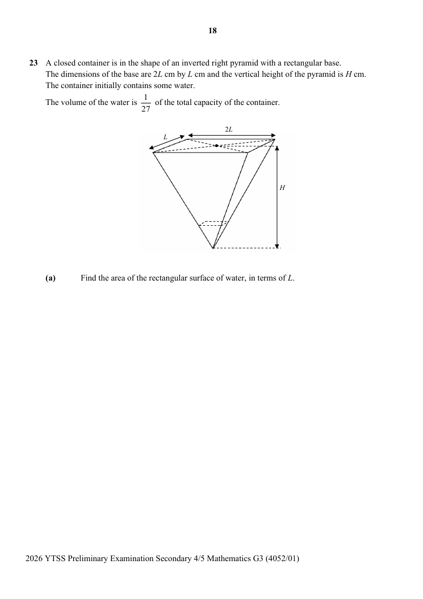
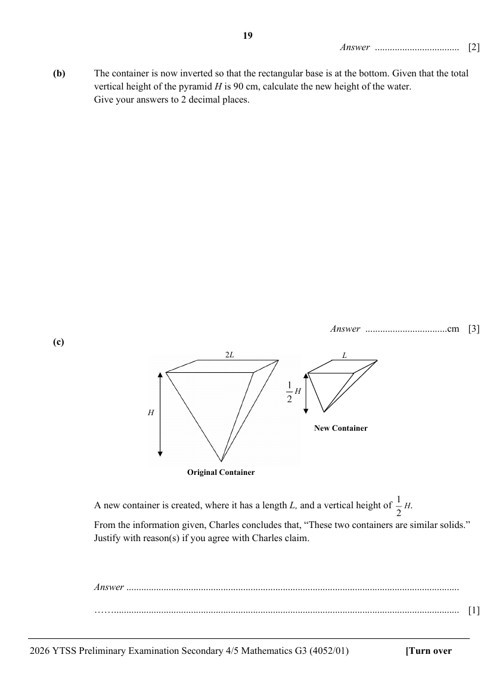

## Question

> **Marks:** (a) 2, (b) 3, (c) 1; total 6
> **Page:** 18–19

A closed container is in the shape of an inverted right pyramid with a rectangular base.
The dimensions of the base are $2L$ cm by $L$ cm and the vertical height of the pyramid is $H$ cm.
The container initially contains some water.
The volume of the water is $\dfrac{1}{27}$ of the total capacity of the container.

**(a)** Find the area of the rectangular surface of water, in terms of $L$. [2]

**(b)** The container is now inverted so that the rectangular base is at the bottom. Given that the total vertical height of the pyramid $H$ is 90 cm, calculate the new height of the water.
Give your answers to 2 decimal places. [3]

**(c)**

A new container is created, where it has a length $L$, and a vertical height of $\dfrac{1}{2}H$.
From the information given, Charles concludes that, “These two containers are similar solids.”
Justify with reason(s) if you agree with Charles claim. [1]
