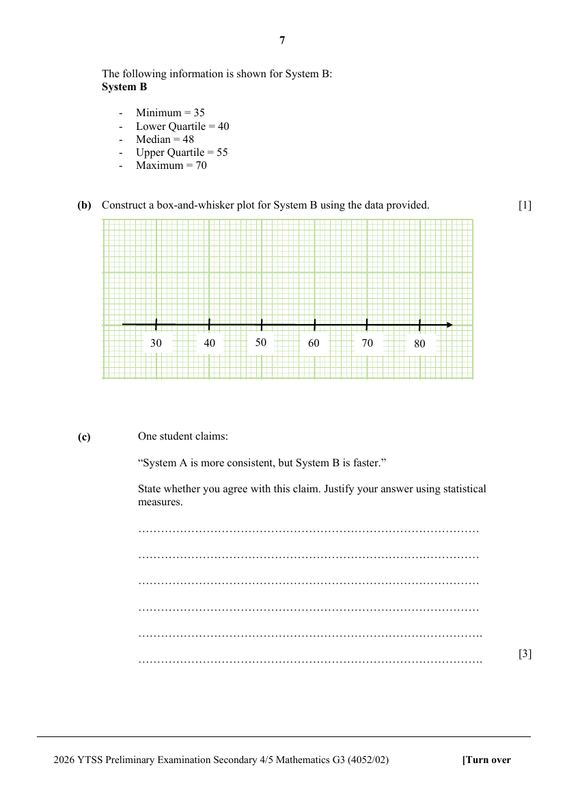

## Question

> **Marks:** (a)(i) 1, (a)(ii) 1, (b) 1, (c) 3; total 6
> **Page:** 6–7

YTSS is testing two AI systems, System A and System B, tracking their response times (in seconds) to student queries.

The response times for System A are shown below:

System A

| Stem | Leaf |
| --- | --- |
| 3 | 8 9 |
| 4 | 1 2 5 7 |
| 5 | 0 3 6 |
| 6 | 2 4 |

Key: 4 | 2 represents 42 seconds

**(a)(i)** Find the median response time for System A. [1]

**(a)(ii)** Find the standard deviation of the response times for System A. [1]

The following information is shown for System B:

System B

- Minimum = 35
- Lower Quartile = 40
- Median = 48
- Upper Quartile = 55
- Maximum = 70

**(b)** Construct a box-and-whisker plot for System B using the data provided. [1]

**(c)** One student claims:

“System A is more consistent, but System B is faster.”

State whether you agree with this claim. Justify your answer using statistical measures. [3]
