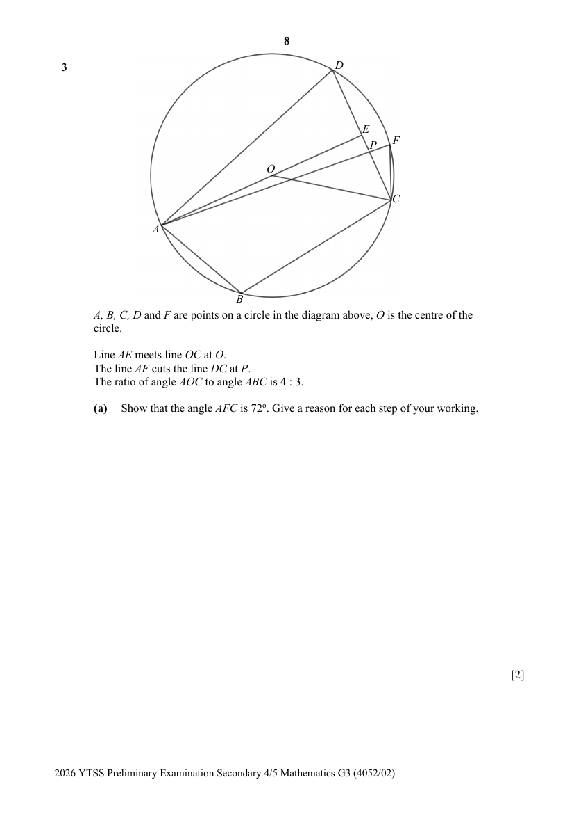

## Question

> **Marks:** (a) 2, (b) 2, (c) 2; total 6
> **Page:** 8–9

$A$, $B$, $C$, $D$ and $F$ are points on a circle in the diagram above, $O$ is the centre of the circle.

Line $AE$ meets line $OC$ at $O$.
The line $AF$ cuts the line $DC$ at $P$.
The ratio of angle $AOC$ to angle $ABC$ is $4:3$.

**(a)** Show that the angle $AFC$ is $72^{\circ}$. Give a reason for each step of your working. [2]

**(b)** Find the perimeter of the major sector $ADFC$, given that the diameter of the circle with centre $O$ is 11cm. [2]

**(c)** Another circle is drawn on the diagram such that line $AD$ is its diameter.
Determine whether point $E$ lies on its circumference if $\angle DAO=18^{\circ}$.
Give reasons for each statement you make. [2]
