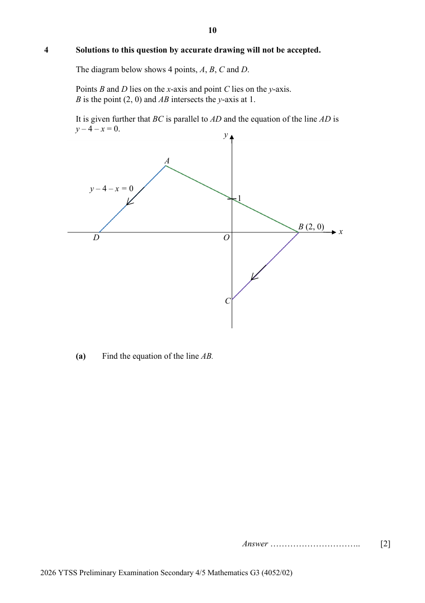

## Question

> **Marks:** (a) 2, (b) 2, (c)(i) 2, (c)(ii) 2; total 8
> **Page:** 10–11

Solutions to this question by accurate drawing will not be accepted.

The diagram below shows 4 points, $A$, $B$, $C$ and $D$.

Points $B$ and $D$ lies on the $x$-axis and point $C$ lies on the $y$-axis.
$B$ is the point $(2, 0)$ and $AB$ intersects the $y$-axis at 1.

It is given further that $BC$ is parallel to $AD$ and the equation of the line $AD$ is $y-4-x=0$.

**(a)** Find the equation of the line $AB$. [2]

**(b)** Show that the coordinates of $A$ are $(-2, 2)$. [2]

**(c)(i)** Find distance $AC$. [2]

**(c)(ii)** Find the shortest distance from $B$ to $AC$ given that the area of $ABC$ is 6 units$^{2}$. [2]
