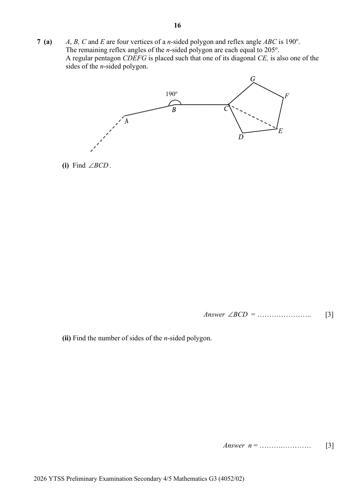
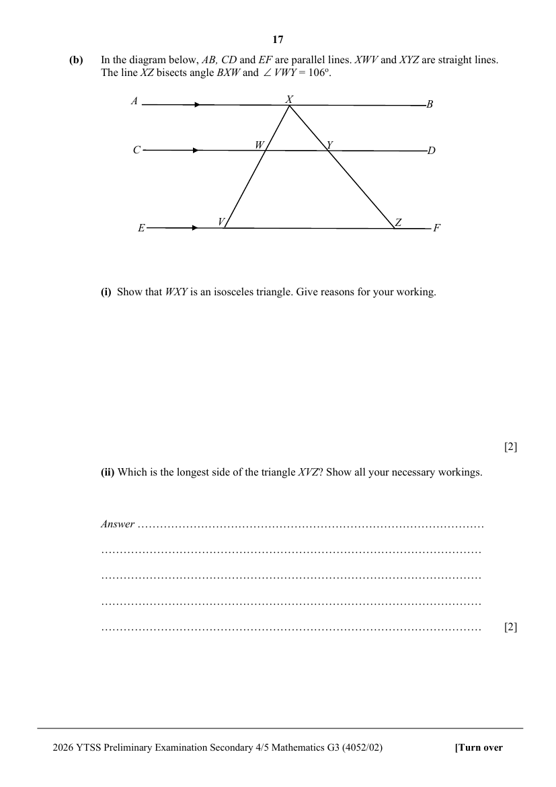

## Question

> **Marks:** (a)(i) 3, (a)(ii) 3, (b)(i) 2, (b)(ii) 2; total 10
> **Page:** 16–17

**(a)** $A$, $B$, $C$ and $E$ are four vertices of a $n$-sided polygon and reflex angle $ABC$ is $190^{\circ}$.
The remaining reflex angles of the $n$-sided polygon are each equal to $205^{\circ}$.
A regular pentagon $CDEFG$ is placed such that one of its diagonal $CE$, is also one of the sides of the $n$-sided polygon.

**(i)** Find $\angle BCD$. [3]

**(ii)** Find the number of sides of the $n$-sided polygon. [3]

**(b)** In the diagram below, $AB$, $CD$ and $EF$ are parallel lines. $XWV$ and $XYZ$ are straight lines.
The line $XZ$ bisects angle $BXW$ and $\angle VWY=106^{\circ}$.

**(i)** Show that $WXY$ is an isosceles triangle. Give reasons for your working. [2]

**(ii)** Which is the longest side of the triangle $XVZ$? Show all your necessary workings. [2]
