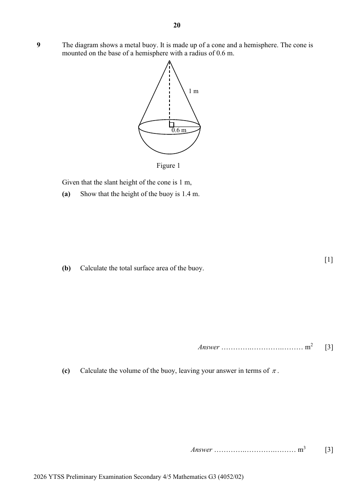
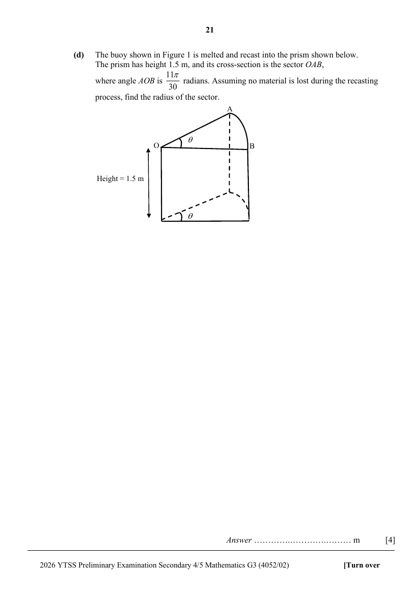

## Question

> **Marks:** (a) 1, (b) 3, (c) 3, (d) 4; total 11
> **Page:** 20–21

The diagram shows a metal buoy. It is made up of a cone and a hemisphere. The cone is mounted on the base of a hemisphere with a radius of 0.6 m.

Given that the slant height of the cone is 1 m,

**(a)** Show that the height of the buoy is 1.4 m. [1]

**(b)** Calculate the total surface area of the buoy. [3]

**(c)** Calculate the volume of the buoy, leaving your answer in terms of $\pi$. [3]

**(d)** The buoy shown in Figure 1 is melted and recast into the prism shown below.
The prism has height 1.5 m, and its cross-section is the sector $OAB$, where angle $AOB$ is $\dfrac{11\pi}{30}$ radians. Assuming no material is lost during the recasting process, find the radius of the sector.

[4]
