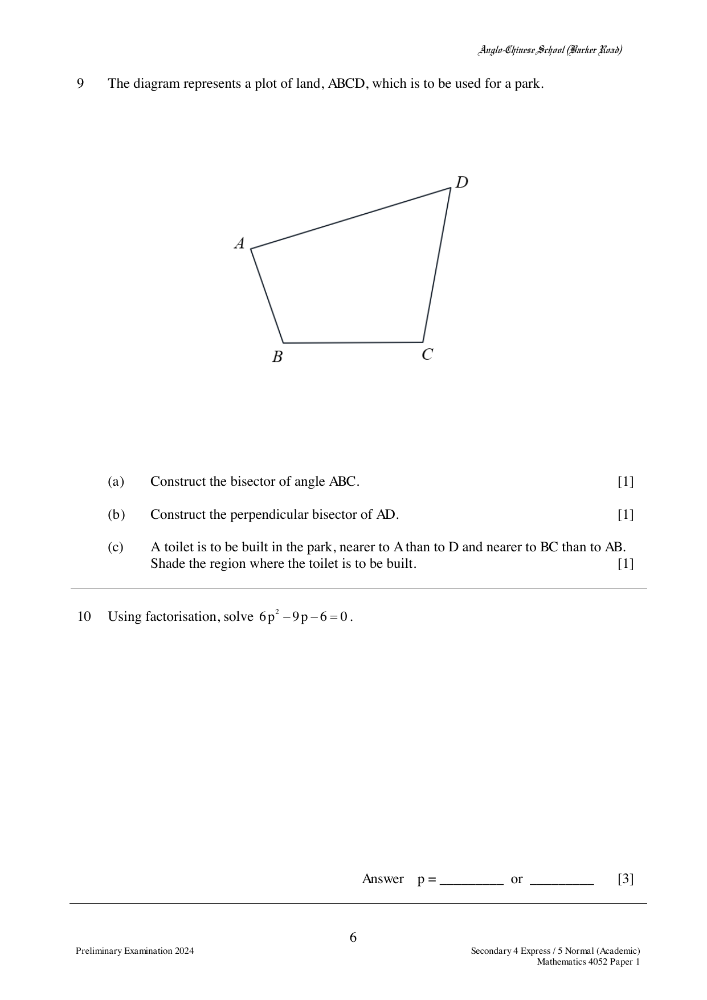
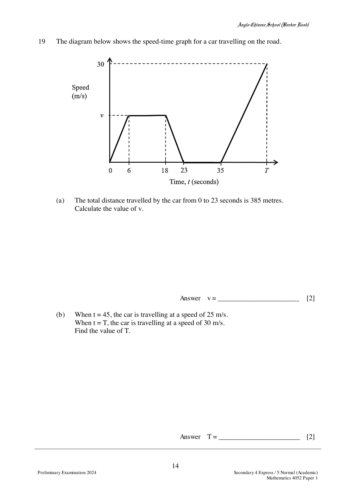
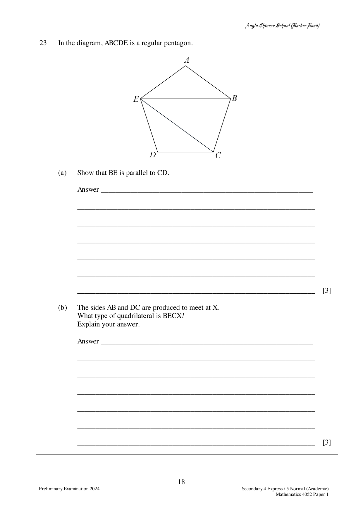

# Anglo-Chinese School (Barker Road) — Mathematics 4052/01 Paper 1 (cleaned)

> **Institution:** Anglo-Chinese School (Barker Road)
> **Exam:** Preliminary Examination 2024
> **Level:** Secondary Four Express / Five Normal (Academic)
> **Subjects:** Elementary Mathematics
> **Paper:** 4052/01 Paper 1
> **Date:** Not printed
> **Duration:** 2 hours 15 minutes
> **Total Marks:** 90
> **Source:** `ACSBR 2024 4E5N Prelim Math P1 QP.pdf`

---

## Instructions

Candidates answer on the Question Paper.

Write your index number and name on all the work you hand in.
Write in dark blue or black pen.
You may use an HB pencil for any diagrams or graphs.

Answer all questions.
The number of marks is given in brackets [ ] at the end of each question or part question.

If working is needed for any question it must be shown with the answer.
Omission of essential working will result in loss of marks.
The total of the marks for this paper is 90.

The use of an approved scientific calculator is expected, where appropriate.
If the degree of accuracy is not specified in the question and if the answer is not exact, give the answer to three significant figures. Give answers in degrees to one decimal place.
For $\pi$, use either your calculator value or $3.142$.

This document consists of 21 printed pages and 1 blank page.

---

## Mathematical Formulae

*Compound interest*

$$
\text{Total amount} = P\left(1+\frac{r}{100}\right)^{n}
$$

*Mensuration*

$$
\text{Curved surface area of a cone} = \pi rl
$$

$$
\text{Surface area of a sphere} = 4\pi r^{2}
$$

$$
\text{Volume of a cone} = \frac{1}{3}\pi r^{2}h
$$

$$
\text{Volume of a sphere} = \frac{4}{3}\pi r^{3}
$$

$$
\text{Area of triangle } ABC = \frac{1}{2}ab\sin C
$$

$$
\text{Arc length} = r\theta,\text{ where }\theta\text{ is in radians}
$$

$$
\text{Sector area} = \frac{1}{2}r^{2}\theta,\text{ where }\theta\text{ is in radians}
$$

*Trigonometry*

$$
\frac{a}{\sin A} = \frac{b}{\sin B} = \frac{c}{\sin C}
$$

$$
a^{2} = b^{2}+c^{2}-2bc\cos A
$$

*Statistics*

$$
\text{Mean} = \frac{\sum fx}{\sum f}
$$

$$
\text{Standard deviation} = \sqrt{\frac{\sum fx^{2}}{\sum f}-\left(\frac{\sum fx}{\sum f}\right)^{2}}
$$

---

### Q1

> **Marks:** 1
> **Topic:** N1 Numbers and their operations
> **Sub-topic:** Numbers and their operations
> **LO:** [[context/subjects/o-level-e-maths/learning-objectives/o-level-e-maths-N1e.md|N1e]]
> **Page:** 3

Write the following numbers in order of size, starting with the smallest.

$$
\sqrt{0.81},\quad 0.902,\quad \frac{399}{441},\quad 0.86^{\frac{2}{3}}
$$

### Q2

> **Marks:** 2
> **Topic:** N6 Functions and graphs
> **Sub-topic:** Functions and graphs
> **LO:** [[context/subjects/o-level-e-maths/learning-objectives/o-level-e-maths-N6g.md|N6g]]
> **Page:** 3

Write as a single fraction in its simplest form

$$
\frac{7x}{(x-5)^{2}}+\frac{1}{5-x}.
$$

### Q3

> **Marks:** 2
> **Topic:** N1 Numbers and their operations
> **Sub-topic:** Numbers and their operations
> **LO:** [[context/subjects/o-level-e-maths/learning-objectives/o-level-e-maths-N1g.md|N1g]]
> **Page:** 3

The capacity of a SD card is 250 gigabytes correct to 2 significant figures.
The size of a picture file is 2.5 megabytes correct to 1 decimal place.

Calculate the largest number of files that can be stored in this SD card.
Give your answer in standard form, correct to 3 significant figures.
($1$ gigabyte $= 10^{9}$ bytes, $1$ megabyte $= 10^{6}$ bytes)

### Q4

> **Marks:** 2
> **Topic:** N5 Algebraic expressions and formulae
> **Sub-topic:** Algebraic expressions and formulae
> **LO:** [[context/subjects/o-level-e-maths/learning-objectives/o-level-e-maths-N5b.md|N5b]]
> **Page:** 4

Simplify $\dfrac{5c}{2}\div\dfrac{20c^{2}}{d}$.

### Q5

> **Marks:** 2
> **Topic:** N5 Algebraic expressions and formulae
> **Sub-topic:** Algebraic expressions and formulae
> **LO:** [[context/subjects/o-level-e-maths/learning-objectives/o-level-e-maths-N5m.md|N5m]]
> **Page:** 4

$y$ is directly proportional to $x^{2}$.
If $x$ is increased by $200\%$, find the percentage increase in $y$.

### Q6

> **Marks:** 2
> **Topic:** N2 Ratio and proportion
> **Sub-topic:** Ratio and proportion
> **LO:** [[context/subjects/o-level-e-maths/learning-objectives/o-level-e-maths-N2a.md|N2a]]
> **Page:** 4

A sum of money was divided between Amelia, Brandon and Claire in the ratio $2:3:4$.
If instead, this money had been divided equally between them, Amelia would have received an extra ＄20.
What was the total sum of money?

### Q7

> **Marks:** 3
> **Topic:** N7 Equations and inequalities
> **Sub-topic:** Equations and inequalities
> **LO:** [[context/subjects/o-level-e-maths/learning-objectives/o-level-e-maths-N7g.md|N7g]]
> **Page:** 5

(a) Solve the inequalities $-8 \le 2-3x < 7-\dfrac{1}{2}x$.

(b) Write down all the integers that satisfy $-8 \le 2-3x < 7-\dfrac{1}{2}x$.

### Q8

> **Marks:** 3
> **Topic:** N8 Set language and notation
> **Sub-topic:** Set language and notation
> **LO:** [[context/subjects/o-level-e-maths/learning-objectives/o-level-e-maths-N8c.md|N8c]]
> **Page:** 5

(a) On the Venn diagram, shade the region which represents $A \cup B'$.

(b) $\xi = \{\text{integers } x : 1 \le x \le 12\}$

$A = \{2, 3, 5, 7, 11\}$

$B = \{3, 6, 9, 12\}$

This information is shown on the Venn diagram.

Use one of the symbols below to complete each statement.

$\varnothing \quad \in \quad \subset \quad \notin \quad \not\subset$

(i) $7$ ___________ $B$

(ii) $\{3, 7\}$ ___________ $A$

### Q9

> **Marks:** 3
> **Topic:** G2 Congruence and similarity
> **Sub-topic:** Congruence and similarity
> **LO:** [[context/subjects/o-level-e-maths/learning-objectives/o-level-e-maths-G2e.md|G2e]]
> **Page:** 6

The diagram represents a plot of land, $ABCD$, which is to be used for a park.

(a) Construct the bisector of angle $ABC$.

(b) Construct the perpendicular bisector of $AD$.

(c) A toilet is to be built in the park, nearer to $A$ than to $D$ and nearer to $BC$ than to $AB$. Shade the region where the toilet is to be built.

### Q10

> **Marks:** 3
> **Topic:** N5 Algebraic expressions and formulae
> **Sub-topic:** Algebraic expressions and formulae
> **LO:** [[context/subjects/o-level-e-maths/learning-objectives/o-level-e-maths-N5h.md|N5h]]
> **Page:** 6

Using factorisation, solve $6p^{2}-9p-6 = 0$.

### Q11

> **Marks:** 3
> **Topic:** N3 Percentage
> **Sub-topic:** Percentage
> **LO:** [[context/subjects/o-level-e-maths/learning-objectives/o-level-e-maths-N3d.md|N3d]]
> **Page:** 7

A supplier sells watches at ＄210 each.
Jimmy buys the watches from the supplier at a discount of $20\%$.
Jimmy intends to then sell the watches at a profit of $20\%$.

As a marketing strategy, Jimmy plans to offer a $10\%$ discount on the marked price without affecting his intended $20\%$ profit.
Calculate the marked price that Jimmy should sell each watch at.

### Q12

> **Marks:** 3
> **Topic:** S1 Data handling and analysis
> **Sub-topic:** Data handling and analysis
> **LO:** [[context/subjects/o-level-e-maths/learning-objectives/o-level-e-maths-S1f.md|S1f]]
> **Page:** 7

Jim sets off at 08 50 to walk 1000 metres at an average speed of 4 km/h.
He takes a 5 minutes break and then runs 1.3 km in 5 minutes.

(a) He aims to complete the entire exercise by 09 30. Will he achieve his target? Show your working clearly.

(b) Calculate his average speed for the entire exercise. Give your answer in metres per minute.

### Q13

> **Marks:** 3
> **Topic:** G5 Mensuration
> **Sub-topic:** Mensuration
> **LO:** [[context/subjects/o-level-e-maths/learning-objectives/o-level-e-maths-G5d.md|G5d]]
> **Page:** 8

(a) Two bottles of Brand A coffee are geometrically similar.
The larger bottle contains 200 g of coffee granules.

The larger bottle is approximately $49\%$ taller than the smaller bottle.
Find, in grams, the amount of coffee granules in the smaller bottle.
Give your answer to the nearest gram.

(b) Brand Y claims that its sales of 200 g bottles of coffee are better than that of Brand X in the past 5 years.
State one aspect of the charts that makes this claim wrong.

### Q14

> **Marks:** 4
> **Topic:** N1 Numbers and their operations
> **Sub-topic:** Numbers and their operations
> **LO:** [[context/subjects/o-level-e-maths/learning-objectives/o-level-e-maths-N1b.md|N1b]]
> **Page:** 9

(a) Express 1260 as a product of its prime factors.

(b) The highest common factor of two numbers is 12 while the lowest common multiple is 1260. Both numbers are less than 200.
Find the two numbers.

(c) $486 = 2 \times 3^{5}$.
$m$ and $n$ are both prime numbers.
Find the values of $m$ and $n$ so that $486 \times \dfrac{m}{n}$ is both a perfect square and a perfect cube.

### Q15

> **Marks:** 4
> **Topic:** N6 Functions and graphs
> **Sub-topic:** Functions and graphs
> **LO:** [[context/subjects/o-level-e-maths/learning-objectives/o-level-e-maths-N6c.md|N6c]]
> **Page:** 10

(a) Express $x^{2}+\dfrac{1}{2}x+1$ in the form $(x+a)^{2}+b$.

(b) Sketch the graph of $y = x^{2}+\dfrac{1}{2}x+1$ on the axes below.
Indicate clearly the coordinates of the point where the graph crosses the $y$-axis and the turning point on the curve.

### Q16

> **Marks:** 4
> **Topic:** N9 Matrices
> **Sub-topic:** Matrices
> **LO:** [[context/subjects/o-level-e-maths/learning-objectives/o-level-e-maths-N9b.md|N9b]]
> **Page:** 11

The table below shows the number of cars and motorcycles passing through an Electronic Road Pricing (ERP) gantry on certain days of the week from 7.30 am to 7.55 am.

| | Cars | Motorcycles |
| --- | --- | --- |
| Wednesday | 320 | 120 |
| Thursday | 380 | 100 |
| Friday | 410 | 130 |
| Charges per vehicle | ＄2 | ＄0.50 |

(a) Represent the number of vehicles passing through the ERP gantry in a $3 \times 2$ matrix $V$.

(b) Write down a matrix $C$ such that the product $P = VC$ represents the total charges incurred by all vehicles on each of the days.

(c) Evaluate the matrix $P = VC$.

(d) $A$ is a matrix such that $A = \dfrac{1}{3}\begin{pmatrix} 1 & 1 & 1 \end{pmatrix}P$.
State what $A$ represents.

### Q17

> **Marks:** 4
> **Topic:** N6 Functions and graphs
> **Sub-topic:** Functions and graphs
> **LO:** [[context/subjects/o-level-e-maths/learning-objectives/o-level-e-maths-N6c.md|N6c]]
> **Page:** 12

The diagram shows a container in the shape of a prism with a triangular cross-section.
The container has a height of 40 cm.
Water is poured into the empty container at a constant rate.
It takes 12 minutes to fill the container completely.
After $t$ minutes, the depth of the water is $d$ cm.

(a) Find the value of $t$ when $d = 20$.

(b) On the grid, sketch the graph showing how the depth varies during the 12 minutes.

### Q18

> **Marks:** 4
> **Topic:** G5 Mensuration
> **Sub-topic:** Mensuration
> **LO:** [[context/subjects/o-level-e-maths/learning-objectives/o-level-e-maths-G5g.md|G5g]]
> **Page:** 13

The diagram shows a semicircle with centre $O$ and radius 8 cm.
$OP$ is perpendicular to $PQ$.
Angle $PQO = 0.7$ radians.

Find the area of the shaded region.

### Q19

> **Marks:** 4
> **Topic:** N6 Functions and graphs
> **Sub-topic:** Functions and graphs
> **LO:** [[context/subjects/o-level-e-maths/learning-objectives/o-level-e-maths-N6c.md|N6c]]
> **Page:** 14

The diagram below shows the speed-time graph for a car travelling on the road.

The graph rises from the origin to speed $v$ m/s at $t = 6$, stays at $v$ until $t = 18$, falls to 0 at $t = 23$, stays at 0 until $t = 35$, then rises to 30 m/s at $t = T$.

(a) The total distance travelled by the car from 0 to 23 seconds is 385 metres.
Calculate the value of $v$.

(b) When $t = 45$, the car is travelling at a speed of 25 m/s.
When $t = T$, the car is travelling at a speed of 30 m/s.
Find the value of $T$.

### Q20

> **Marks:** 5
> **Topic:** G2 Congruence and similarity
> **Sub-topic:** Congruence and similarity
> **LO:** [[context/subjects/o-level-e-maths/learning-objectives/o-level-e-maths-G2i.md|G2i]]
> **Page:** 15

In the diagram, $AB$, $QR$ and $PC$ are parallel.
$PQB$, $CQA$ and $CRB$ are straight lines.
$AB = 7$ cm and $QR = 3$ cm.

(a) Show that triangle $PCB$ and triangle $QRB$ are similar.
Give a reason for each statement.

(b) Write down another pair of similar triangles.

(c) Calculate $PC$.

### Q21

> **Marks:** 5
> **Page:** 16

(a) Simplify $\left(\dfrac{4a^{6}}{b^{4}}\right)^{-\frac{1}{2}}$, giving your answer in positive index.

(b) $\dfrac{2^{k}}{\sqrt[4]{8}} = 4^{2k}$.
> **Topic:** N1 Numbers and their operations
> **Sub-topic:** Numbers and their operations
> **LO:** [[context/subjects/o-level-e-maths/learning-objectives/o-level-e-maths-N1j.md|N1j]]

Use the laws of indices to find the value of $k$.
Show your working.

### Q22

> **Marks:** 5
> **Topic:** N5 Algebraic expressions and formulae
> **Sub-topic:** Algebraic expressions and formulae
> **LO:** [[context/subjects/o-level-e-maths/learning-objectives/o-level-e-maths-N5e.md|N5e]]
> **Page:** 17

The first three terms in a sequence of numbers are given below.

$$
\begin{align*}
T_{1} &= 1 \times 2 + 10 = 12 \\
T_{2} &= 2 \times 3 + 6 = 12 \\
T_{3} &= 3 \times 4 + 2 = 14 \\
T_{4} &= 4 \times 5 - 2 = 18
\end{align*}
$$

(a) Show that the $n$th term of the sequence, $T_{n}$, is given by $T_{n} = n^{2}-3n+14$.

(b) Evaluate $T_{50}$.

(c) Explain why every term in the sequence is even.

### Q23

> **Marks:** 6
> **Topic:** G2 Congruence and similarity
> **Sub-topic:** Congruence and similarity
> **LO:** [[context/subjects/o-level-e-maths/learning-objectives/o-level-e-maths-G2b.md|G2b]]
> **Page:** 18

In the diagram, $ABCDE$ is a regular pentagon.

(a) Show that $BE$ is parallel to $CD$.

(b) The sides $AB$ and $DC$ are produced to meet at $X$.
What type of quadrilateral is $BECX$?
Explain your answer.

### Q24

> **Marks:** 6
> **Topic:** G6 Coordinate geometry
> **Sub-topic:** Coordinate geometry
> **LO:** [[context/subjects/o-level-e-maths/learning-objectives/o-level-e-maths-G6b.md|G6b]]
> **Page:** 19

$A$ is the point $(8, -2)$ and $\overrightarrow{AB} = \begin{pmatrix} 4 \\ -3 \end{pmatrix}$.

(a) Find

(i) $AB$,

(ii) the equation of the line $AB$.

(b) The equation of the line $CD$ is $2y-4x = 19$.
Find the coordinates of the point of intersection of $AB$ and $CD$.

### Q25

> **Marks:** 7
> **Topic:** S2 Probability
> **Sub-topic:** Probability
> **LO:** [[context/subjects/o-level-e-maths/learning-objectives/o-level-e-maths-S2c.md|S2c]]
> **Page:** 20–21

There are 12 boys and 13 girls in a class.
Two of the children are selected at random to participate in a forum.

(a) Draw a tree diagram to show the probabilities of the possible outcomes.

(b) Find, as a fraction in its simplest form, the probability that

(i) two boys are selected,

(ii) one boy and one girl are selected.

(c) As a standby, a third student is selected.
Find the probability that out of the three students, there will be at least one boy and one girl selected.
