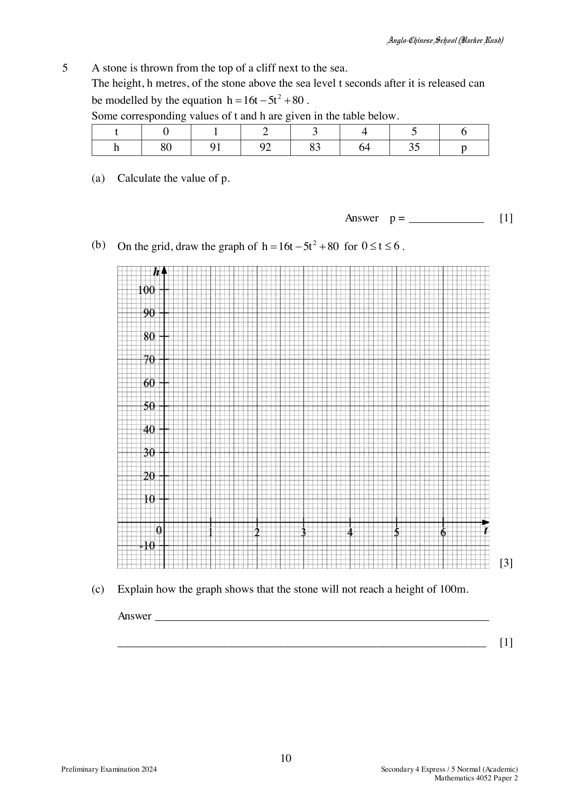
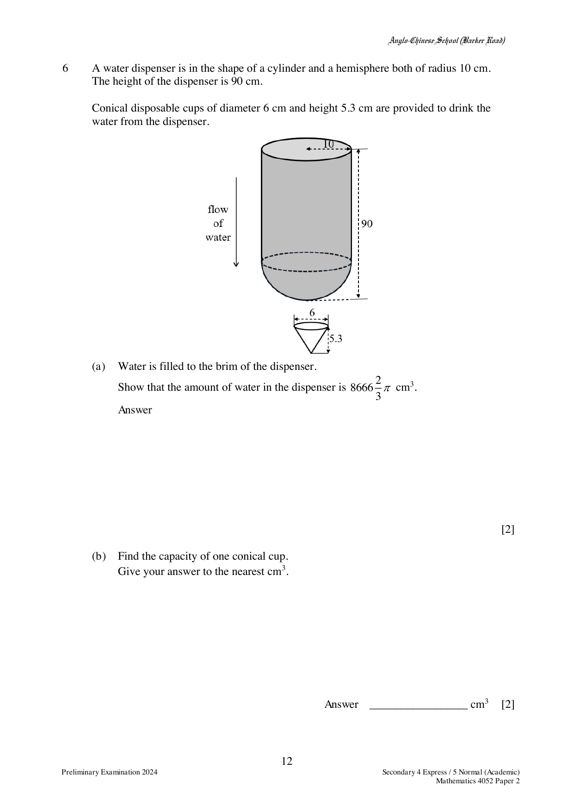
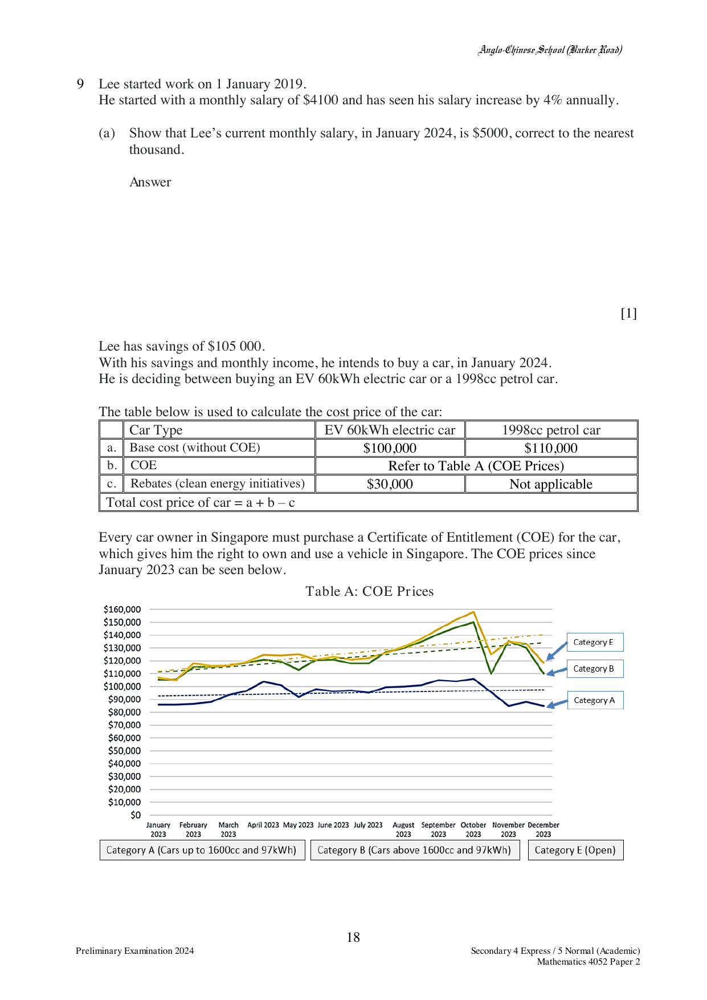

# Anglo-Chinese School (Barker Road) — Mathematics 4052/02 Paper 2 (cleaned)

> **Institution:** Anglo-Chinese School (Barker Road)
> **Exam:** Preliminary Examination 2024
> **Level:** Secondary Four Express / Five Normal (Academic)
> **Subjects:** Elementary Mathematics
> **Paper:** 4052/02 Paper 2
> **Date:** Not printed
> **Duration:** 2 hours 15 minutes
> **Total Marks:** 90
> **Source:** `ACSBR 2024 4E5N Prelim Math P2 QP.pdf`

---

## Instructions

Candidates answer on the Question Paper.

Write your index number and name on all the work you hand in.
Write in dark blue or black pen.
You may use an HB pencil for any diagrams or graphs.

Answer all questions.
The number of marks is given in brackets [ ] at the end of each question or part question.

If working is needed for any question it must be shown with the answer.
Omission of essential working will result in loss of marks.
The total of the marks for this paper is 90.

The use of an approved scientific calculator is expected, where appropriate.
If the degree of accuracy is not specified in the question and if the answer is not exact, give the answer to three significant figures. Give answers in degrees to one decimal place.
For $\pi$, use either your calculator value or $3.142$.

This document consists of 21 printed pages and 1 blank page.

---

## Mathematical Formulae

*Compound interest*

$$
\text{Total amount} = P\left(1+\frac{r}{100}\right)^{n}
$$

*Mensuration*

$$
\text{Curved surface area of a cone} = \pi rl
$$

$$
\text{Surface area of a sphere} = 4\pi r^{2}
$$

$$
\text{Volume of a cone} = \frac{1}{3}\pi r^{2}h
$$

$$
\text{Volume of a sphere} = \frac{4}{3}\pi r^{3}
$$

$$
\text{Area of triangle } ABC = \frac{1}{2}ab\sin C
$$

$$
\text{Arc length} = r\theta,\text{ where }\theta\text{ is in radians}
$$

$$
\text{Sector area} = \frac{1}{2}r^{2}\theta,\text{ where }\theta\text{ is in radians}
$$

*Trigonometry*

$$
\frac{a}{\sin A} = \frac{b}{\sin B} = \frac{c}{\sin C}
$$

$$
a^{2} = b^{2}+c^{2}-2bc\cos A
$$

*Statistics*

$$
\text{Mean} = \frac{\sum fx}{\sum f}
$$

$$
\text{Standard deviation} = \sqrt{\frac{\sum fx^{2}}{\sum f}-\left(\frac{\sum fx}{\sum f}\right)^{2}}
$$

---

### Q1

> **Marks:** 9
> **Sub-topic:** Algebra
> **Page:** 3

On a particular day in 2023, the exchange rate between Singapore dollars (SGD) and United States dollars (USD) was USD 1 $=$ SGD $x$.

(a) Write down an expression, in terms of $x$, for the USD received in exchange for SGD 10 000.

In 2022, the rate was such that USD 1 would exchange for SGD 0.030 less than in 2023.
The difference in exchanging SGD 10 000 in 2023 and SGD 10 000 in 2022 is USD 166.

(b) Write down an equation to represent this information and show that it reduces to

$$
83x^{2}-2.49x-150 = 0.
$$

(c) Solve the equation $83x^{2}-2.49x-150 = 0$, giving your solutions correct to three decimal places.

(d) Find the amount of USD received in exchange for SGD 20 000 in 2022.
Give your answer correct to the nearest dollar.

### Q2

> **Marks:** 8
> **Sub-topic:** Algebra
> **Page:** 4–5

(a) It is given that $sq^{2} = r-3q^{2}$.

(i) Evaluate $s$ when $q = -3$ and $r = 5$.

(ii) Express $q$ in terms of $r$ and $s$.

(b) (i) Show that $(7n-1)^{2}-(n-1)^{2}$ is a multiple of 12 for all integer values of $n$.

(ii) Simplify

$$
\frac{p-3n+12n^{2}-4np}{(7n-1)^{2}-(n-1)^{2}}.
$$

### Q3

> **Marks:** 10
> **Sub-topic:** Geometry
> **Page:** 6–7

The diagram shows a circle $ABCDEF$, with centre $O$.
$TA$ and $TE$ are tangents to the circle.
$BGF$ and $COT$ are straight lines.
$OA$ intersects $BF$ at $G$. $CT$ is parallel to $BA$.
Angle $OTE = 32^{\circ}$.

(a) Identify the triangle that is congruent to triangle $TOE$ and show that they are congruent.
Give a reason for each statement you make.

(b) Find, giving reasons for each step of your working,

(i) angle $OFG$,

(ii) angle $CDE$.

(c) Explain why points $O$, $E$, $T$ and $A$ can also be points on the circumference of another circle.

### Q4

> **Marks:** 8
> **Sub-topic:** Vectors
> **Page:** 8–9

The position vectors of $A$ and $B$, relative to $O$, are $\mathbf{a}$ and $2\mathbf{b}$ respectively.

$$
\overrightarrow{BC} = \frac{3}{4}\overrightarrow{BA} \quad \text{and} \quad \overrightarrow{AD} = \frac{1}{2}\overrightarrow{BO}.
$$

(a) Find, in terms of $\mathbf{a}$ and $\mathbf{b}$,

(i) $\overrightarrow{AB}$,

(ii) $\overrightarrow{OC}$.

(b) (i) $P$ is a point outside triangle $ABO$.
Find $\overrightarrow{OP}$, such that $\overrightarrow{BP} = 3\overrightarrow{OA}$.

(ii) Show that $O$, $C$ and $P$ lie on a straight line.

(c) Find the ratio

(i) area of triangle $OCB$ : area of triangle $OCA$,

(ii) area of triangle $OAC$ : area of triangle $OAD$.

### Q5

> **Marks:** 9
> **Sub-topic:** Graphs
> **Page:** 10–11

A stone is thrown from the top of a cliff next to the sea.
The height, $h$ metres, of the stone above the sea level $t$ seconds after it is released can be modelled by the equation $h = 16t-5t^{2}+80$.
Some corresponding values of $t$ and $h$ are given in the table below.

| $t$ | 0 | 1 | 2 | 3 | 4 | 5 | 6 |
| --- | --- | --- | --- | --- | --- | --- | --- |
| $h$ | 80 | 91 | 92 | 83 | 64 | 35 | $p$ |

(a) Calculate the value of $p$.

(b) On the grid, draw the graph of $h = 16t-5t^{2}+80$ for $0 \le t \le 6$.

(c) Explain how the graph shows that the stone will not reach a height of 100 m.

(d) Use the graph to find the length of time that the stone was 84 metres or more above sea level.

(e) By drawing a tangent on the grid in part (b), find the gradient of the curve at $(4, 64)$.
State the units of your answer.

### Q6

> **Marks:** 11
> **Sub-topic:** Mensuration
> **Page:** 12–13

A water dispenser is in the shape of a cylinder and a hemisphere both of radius 10 cm.
The height of the dispenser is 90 cm.

Conical disposable cups of diameter 6 cm and height 5.3 cm are provided to drink the water from the dispenser.

(a) Water is filled to the brim of the dispenser.
Show that the amount of water in the dispenser is $8666\dfrac{2}{3}\pi$ cm$^{3}$.

(b) Find the capacity of one conical cup.
Give your answer to the nearest cm$^{3}$.

(c) Find the height of the water remaining in the dispenser after 250 cups of water have been dispensed.

(d) The conical disposable cups are made of a thin material of negligible thickness.
Calculate the cost of 250 conical cups given that the cost of material is 0.003 cents/cm$^{2}$.
Give your answer to the nearest cent.

### Q7

> **Marks:** 13
> **Sub-topic:** Trigonometry
> **Page:** 14–15

The map shown has a scale of $1:7500$.
An area on the map is formed by a triangle $PQR$.
$PQ = 7$ cm, $QR = 5.5$ cm and $RP = 6$ cm.

(a) Find the actual perimeter, in kilometres, of triangle $PQR$.

(b) $P$ is due north of $Q$.
Calculate the bearing of $Q$ from $R$.

(c) Calculate, in square metres, the actual area of triangle $PQR$.

(d) A drone flies along the line $QP$ at a vertical height of 75 m.
Find the greatest angle of elevation of the drone from $R$.

### Q8

> **Marks:** 11
> **Sub-topic:** Statistics
> **Page:** 16–17

The marks attained by 40 students in a Mathematics test were recorded.
The cumulative frequency curve shows the distribution of the marks.

(a) Use the curve to estimate

(i) the median mark,

(ii) the interquartile range.

(b) $12.5\%$ of students achieved more than $x$ marks in this test. Estimate the value of $x$.

(c) Complete the frequency distribution table of the marks attained by the students.

| Marks ($x$) | $4 \le x < 10$ | $10 \le x < 15$ | $15 \le x < 20$ | $20 \le x < 24$ |
| --- | --- | --- | --- | --- |
| Number of students | | | | |

Calculate an estimate for

(i) the mean mark,

(ii) the standard deviation of their marks.

The same group of students sat for a Chemistry test.
The maximum mark for the test was also 25.
The box-and-whisker plot of the distribution of the marks is shown below.

The five labels on the plot, from left to right, are 4, 12, 14, $a$ and 24.

(d) The scores of the top $25\%$ of the students for the Chemistry test were less consistent than the scores of the bottom $25\%$.
Given that $a$ is an integer, write down the value of $a$.

(e) Make two comparisons between the performances of the students in the Mathematics test and the Chemistry test.
Use figures to support your answer.

### Q9

> **Marks:** 11
> **Sub-topic:** Real-world context
> **Page:** 18–21

Lee started work on 1 January 2019.
He started with a monthly salary of ＄4100 and has seen his salary increase by $4\%$ annually.

(a) Show that Lee’s current monthly salary, in January 2024, is ＄5000, correct to the nearest thousand.

Lee has savings of ＄105 000.
With his savings and monthly income, he intends to buy a car, in January 2024.
He is deciding between buying an EV 60 kWh electric car or a 1998 cc petrol car.

The table below is used to calculate the cost price of the car.

| | Car type | EV 60 kWh electric car | 1998 cc petrol car |
| --- | --- | --- | --- |
| a | Base cost (without COE) | ＄100,000 | ＄110,000 |
| b | COE | Refer to Table A (COE Prices) | Refer to Table A (COE Prices) |
| c | Rebates (clean energy initiatives) | ＄30,000 | Not applicable |

Total cost price of car $= a+b-c$.

Every car owner in Singapore must purchase a Certificate of Entitlement (COE) for the car, which gives him the right to own and use a vehicle in Singapore. The COE prices since January 2023 can be seen below.

**Table A: COE Prices**

The chart shows Category A (cars up to 1600 cc and 97 kWh), Category B (cars above 1600 cc and 97 kWh) and Category E (Open), from January 2023 to December 2023.

Lee will take a loan from a financial institution. He intends to take the largest loan possible.
The loan amount can be calculated using the information in Table B below.

**Table B: Calculation of Loan**

| Car type | EV 60 kWh | 1998 cc petrol car |
| --- | --- | --- |
| Maximum loan amount | 60% of cost price of car | 70% of cost price of car |
| Maximum loan period | 7 years | 7 years |
| Interest rate (based on simple interest) | 2.78% yearly | 2.78% yearly |

Being prudent, he would like to maintain an amount equivalent to at least 6 months of his salary in his savings.

(b) Show that Lee can only make the downpayment for one of the two cars.
Show your calculations clearly and justify any decisions you make.

The approximate expenses for each car are seen in Table C below.

**Table C: Maintenance Cost**

| | Car type | EV 60 kWh | 1998 cc petrol car |
| --- | --- | --- | --- |
| a | Road tax | Refer to Table D below | Refer to Table D below |
| b | Repayment of loan | to be calculated | to be calculated |
| c | Other costs (annual) | ＄4700 | ＄3000 |
| d | Other costs (monthly) | ＄600 | ＄800 |

Total expenses $= a+b+c+d$.

**Table D: Road Tax (for 6 months)**

The table calculates the road tax for 6 months.

| | Band | Formula |
| --- | --- | --- |
| Petrol car, engine capacity (EC) in cc | $1000 < \text{EC} \le 1600$ | $[250+0.375(\text{EC}-1000)] \times 0.782$ |
| Petrol car, engine capacity (EC) in cc | $1600 < \text{EC} \le 3000$ | $[475+0.75(\text{EC}-1600)] \times 0.782$ |
| Electric car, power rating (PR) in kWh | $30 < \text{PR} \le 230$ | $[250+3.75(\text{PR}-30)] \times 0.782$ |
| Electric car, power rating (PR) in kWh | $\text{PR} > 230$ | $[1525+10(\text{PR}-230)] \times 0.782$ |

(c) Lee’s monthly expenditure is around ＄2700 on average.
Based on the information given, determine if Lee can afford the car identified in part (b).
Show your calculations clearly and justify any decisions you make.

Answer: Lee _____________________ afford the car.
