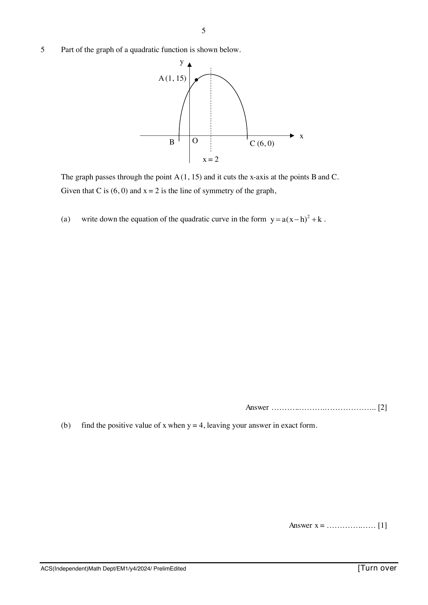
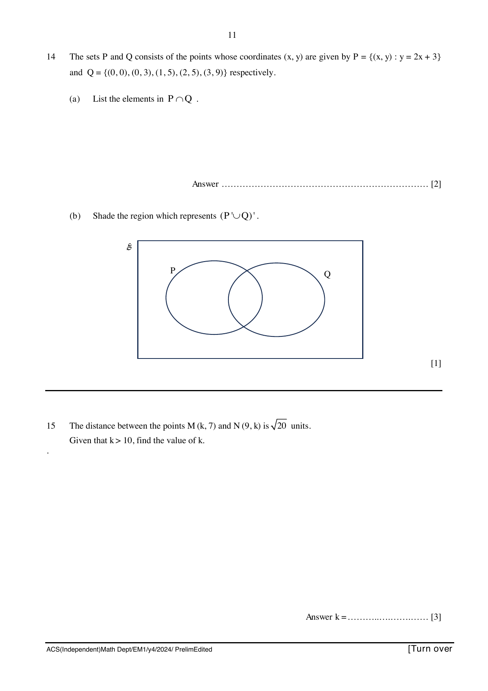
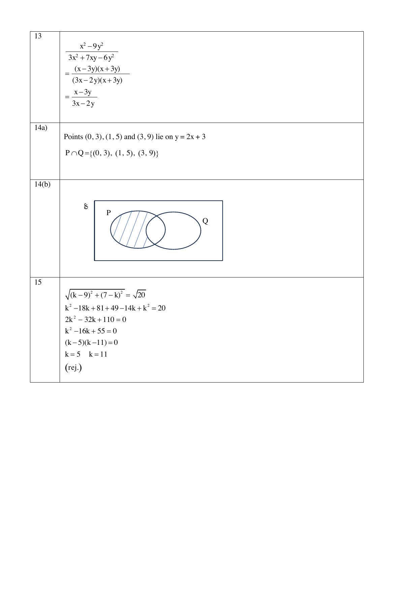
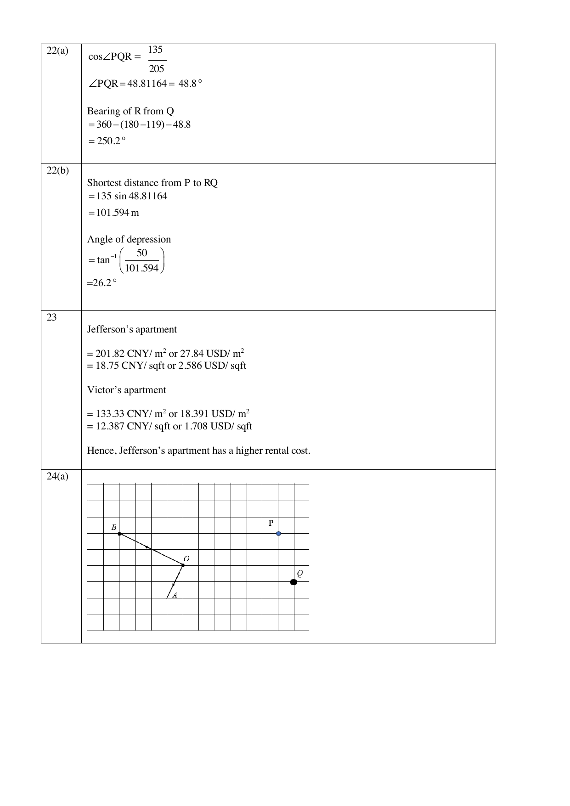
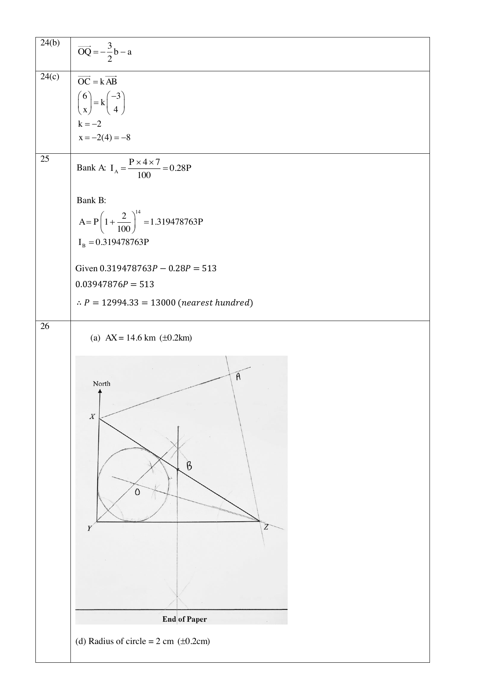

# Anglo-Chinese School (Independent) — Mathematics 4052/01 Paper 1 (cleaned)

> **Institution:** Anglo-Chinese School (Independent)
> **Exam:** Preliminary Examination 2024
> **Level:** Year Four Express
> **Subjects:** Elementary Mathematics
> **Paper:** 4052/01 Paper 1
> **Date:** Thursday, 1 August 2024
> **Duration:** 2 hours 15 minutes
> **Total Marks:** 90
> **Source:** `2024 ACSI Prelim P1.pdf`

---

## Instructions

Candidates answer on the Question Paper.

Write your index number, name and class in the spaces on top of this page.
Write in dark blue or black pen.
You may use an HB pencil for any diagrams or graphs.
Do not use staples, paper clips, highlighters, glue or correction fluid.

Answer all questions.
If working is needed for any question, it must be shown with the answer.
Omission of essential working will result in loss of marks.
The use of an approved scientific calculator is expected, where appropriate.
If the degree of accuracy is not specified in the question, and if the answer is not exact, give the answer to three significant figures. Give answers in degrees to one decimal place.
For $\pi$, use either your calculator value or $3.142$, unless the question requires the answer in terms of $\pi$.

The number of marks is given in brackets [ ] at the end of each question or part question.
The total number of marks for this paper is 90.

---

## Mathematical Formulae

*Compound interest*

$$
\text{Total amount} = P\left(1 + \frac{r}{100}\right)^{n}
$$

*Mensuration*

$$
\text{Curved surface area of a cone} = \pi rl
$$

$$
\text{Surface area of a sphere} = 4\pi r^{2}
$$

$$
\text{Volume of a cone} = \frac{1}{3}\pi r^{2}h
$$

$$
\text{Volume of a sphere} = \frac{4}{3}\pi r^{3}
$$

$$
\text{Area of a triangle} = \frac{1}{2}ab\sin C
$$

$$
\text{Arc length} = r\theta,\text{ where }\theta\text{ is in radians}
$$

$$
\text{Sector area} = \frac{1}{2}r^{2}\theta,\text{ where }\theta\text{ is in radians}
$$

*Trigonometry*

$$
\frac{a}{\sin A} = \frac{b}{\sin B} = \frac{c}{\sin C}
$$

$$
a^{2} = b^{2} + c^{2} - 2bc\cos A
$$

*Statistics*

$$
\text{Mean} = \frac{\sum fx}{\sum f}
$$

$$
\text{Standard deviation} = \sqrt{\frac{\sum fx^{2}}{\sum f} - \left(\frac{\sum fx}{\sum f}\right)^{2}}
$$

---

### Q1

> **Marks:** 2
> **Sub-topic:** Number
> **Page:** 3

The point $C$ lies on the line $AB$ such $AC:AB = 2:7$.

(a) Write $AC$ as a fraction of $BC$. [1]

(b) Given that $AC$ is $24$ cm, calculate the length of $BC$. [1]

### Q2

> **Marks:** 2
> **Sub-topic:** Trigonometry
> **Page:** 3

(a) $\sin x^{\circ} = 0.66913$

Given that $x$ is an obtuse angle, find $x$. [1]

(b) $\cos y^{\circ} = -\cos 121^{\circ}$

Given that $y$ is an acute angle, find the value of $y$. [1]

### Q3

> **Marks:** 2
> **Sub-topic:** Probability
> **Page:** 4

During a game, Lee rolled two fair six-sided die. To obtain the score, he subtracted the lower number from the higher number. If the numbers shown on the dice were the same, his score is zero.

(a) Construct a possibility diagram to show all possible outcomes. [1]

(b) Find the probability that Lee's score is $5$. [1]

### Q4

> **Marks:** 2
> **Sub-topic:** Number
> **Page:** 4

A shopkeeper bought a pair of shorts for ＄24. He made a percentage profit of $45\%$ despite selling it at a discount of $20\%$ off the listed price. Calculate the listed price for this pair of shorts. [2]

### Q5

> **Marks:** 3
> **Sub-topic:** Graphs
> **Page:** 5

Part of the graph of a quadratic function is shown below.

The graph passes through the point $A(1, 15)$ and it cuts the $x$-axis at the points $B$ and $C$.
Given that $C$ is $(6, 0)$ and $x = 2$ is the line of symmetry of the graph,

(a) write down the equation of the quadratic curve in the form $y = a(x - h)^{2} + k$. [2]

(b) find the positive value of $x$ when $y = 4$, leaving your answer in exact form. [1]

### Q6

> **Marks:** 2
> **Sub-topic:** Statistics
> **Page:** 6

Justin drew this graph to show his mobile data usage for each of the following four months.

State one aspect of the graph that may be misleading and explain how this may lead to a misinterpretation of the graph. [2]

### Q7

> **Marks:** 2
> **Sub-topic:** Algebra
> **Page:** 6

Simplify $\left(\dfrac{1}{2}x^{2}\right)^{3} \div \left(4\sqrt[3]{x^{5}}\right)$ giving your answer in the form of $ax^{n}$, where $a$ and $n$ are rational numbers. [2]

### Q8

> **Marks:** 3
> **Sub-topic:** Number
> **Page:** 7

(a) Express $13\,824$ as a product of its prime factors. [1]

(b) Explain why $13\,824$ is a perfect cube. [1]

(c) Given that $a$ is a prime number, find the value of $a$ such that $\dfrac{1}{8a} \times 13824$ is a perfect square. [1]

### Q9

> **Marks:** 6
> **Sub-topic:** Geometry
> **Page:** 8

In the diagram, $ABCD$ is a rectangle and $E$ and $F$ are points on $AD$ and $BC$ respectively.

The ratio of the area of triangle $ABF$ to the area of rectangle $ABCD$ is $1:9$.
The ratio of the area of triangle $AFE$ to the area of rectangle $ABCD$ is $1:6$.

Explain with clear workings, if the following statements are true/ false.

A: The ratio of the area of triangle $ABF$ to that of triangle $AFE$ is $2:3$.

B: The ratio of the area of triangle $DFC$ to that of rectangle $ABCD$ is $2:5$.

C: The sum of the area of triangles $ABF$ and triangle $DFC$ is equal to the sum of the area of triangles $AFE$ and $EFD$. [6]

### Q10

> **Marks:** 3
> **Sub-topic:** Number
> **Page:** 9

The ratio of the number of soccer balls and volleyballs in a sports shop was $11:7$. After $126$ soccer balls were added and $233$ volleyballs were sold, the ratio became $14:3$. How many volleyballs were there in the shop at first? [3]

### Q11

> **Marks:** 2
> **Sub-topic:** Algebra
> **Page:** 9

Explain why $(5n + 2)^{2} - (5n - 2)^{2}$ is a multiple of $8$ for all integer values of $n$. [2]

### Q12

> **Marks:** 4
> **Sub-topic:** Algebra
> **Page:** 10

Factorise the following completely.

(a) $45b - 18ab - 2a^{2} + 5a$, [2]

(b) $2p^{2} - \dfrac{2}{3}p - \dfrac{1}{6}$. [2]

### Q13

> **Marks:** 3
> **Sub-topic:** Algebra
> **Page:** 10

Simplify $\dfrac{x^{2} - 9y^{2}}{3x^{2} + 7xy - 6y^{2}}$. [3]

### Q14

> **Marks:** 3
> **Sub-topic:** Sets
> **Page:** 11

The sets $P$ and $Q$ consists of the points whose coordinates $(x, y)$ are given by $P = \{(x, y) : y = 2x + 3\}$ and $Q = \{(0, 0), (0, 3), (1, 5), (2, 5), (3, 9)\}$ respectively.

(a) List the elements in $P \cap Q$. [2]

(b) Shade the region which represents $(P' \cup Q)'$. [1]

### Q15

> **Marks:** 3
> **Sub-topic:** Coordinate geometry
> **Page:** 11

The distance between the points $M(k, 7)$ and $N(9, k)$ is $\sqrt{20}$ units.
Given that $k > 10$, find the value of $k$. [3]

### Q16

> **Marks:** 2
> **Sub-topic:** Algebra
> **Page:** 12

Mr Tan took $4$ hours to travel from Town A to Town B. Mr Lim took $8$ hours to travel in the opposite direction from Town B to Town A using the same route. They both started at $11$ am. What time did they pass each other? [2]

### Q17

> **Marks:** 3
> **Sub-topic:** Algebra
> **Page:** 12

Sam and Wilson can paint a house together in $6$ days. They painted the house together for $5$ days and then Sam completed the painting of the remaining house alone in $3$ days. How many days would it take for Wilson to paint the entire house by himself? [3]

### Q18

> **Marks:** 7
> **Sub-topic:** Statistics
> **Page:** 13–14

The cumulative frequency curve below illustrates the wait time of $240$ customers who visited a bank.

Use the graph to estimate

(a) the 60th percentile, [1]

(b) the interquartile range of the wait time. [2]

(c) Only $10\%$ of the customers complained about the long wait time they experienced. What was the minimum wait time for these customers? [2]

(d) Two customers are chosen at random. Find the probability that one customer waited for less than or equal to $60$ minutes and the other waited for more than $100$ minutes. [2]

### Q19

> **Marks:** 5
> **Sub-topic:** Trigonometry
> **Page:** 15

In the diagram below, triangle $ABC$ is congruent to triangle $PNA$.

Given that $BC = 22$ cm, $AP = 32$ cm and angle $ACB = 91^{\circ}$, calculate

(a) the length of $BN$, [3]

(b) angle $APN$. [2]

### Q20

> **Marks:** 3
> **Sub-topic:** Statistics
> **Page:** 16

The mean of ten different numbers is $11.8$.

(a) Write down a number which will generate a mean of $12$, when added to these ten numbers. [1]

(b) Each value within the ten numbers is adjusted as follows:

If the number is less than the mean, the number is decreased by $2$,
if the number is greater than the mean, the number is increased by $2$ and
if the number is equal to the mean, it remains unchanged.

Explain clearly how these adjustments would affect the standard deviation. [2]

### Q21

> **Marks:** 6
> **Sub-topic:** Matrices
> **Page:** 17–18

A tour agency sells cruise packages to Vietnam, Maldives and Taiwan at ＄1299, ＄1398 and ＄2538 respectively. The table below shows the number of customers who have signed up for the respective cruise packages via the tour agency from January to June and from July to December.

| | First Period From January to June | Second Period From July to December |
| --- | --- | --- |
| Vietnam | 27 | 24 |
| Maldives | 23 | 29 |
| Taiwan | 19 | 22 |

The number of people who signed up for cruise packages to Vietnam, Maldives and Taiwan can be represented by the matrix

$$
P = \begin{pmatrix} 27 & 24 \\ 23 & 29 \\ 19 & 22 \end{pmatrix}.
$$

(a) The elements of matrix $C$, where $C = AP$, represents the total earnings for each period. Write down the matrix $A$. [1]

(b) Hence, by using matrix multiplication, determine the total earnings, $C$ by the tour agency for each of the period respectively. [2]

(c) Given $M = CR$, where $R = \begin{pmatrix} 1 \\ 1 \end{pmatrix}$, find the matrix $M$. [2]

(d) Describe what is represented by the element(s) of $M$. [1]

### Q22

> **Marks:** 5
> **Sub-topic:** Trigonometry
> **Page:** 19

$P$, $Q$ and $R$ are three points on level ground such that $RPQ$ forms a right-angled triangle with $PQ$ and $RQ$ measuring $135$ m and $205$ m respectively. It is given that a building of height $50$ m is situated at $P$ and that the bearing of $Q$ from $P$ is $119^{\circ}$.

(a) Calculate the bearing of $R$ from $Q$. [2]

(b) Calculate the largest possible angle of depression from the top of the building to any point on the path $RQ$. [3]

### Q23

> **Marks:** 3
> **Sub-topic:** Real-world context
> **Page:** 20

Jefferson and Victor were sent by their company to work in Washington D.C. and Beijing respectively. Jefferson rented a $696$ sq ft apartment in Washington D.C. for $1800$ USD while Victor rented a $60$ m$^{2}$ apartment in Beijing for $8000$ CNY. Given that the currency exchange rate for both cities is $1$ USD $= 7.25$ CNY and that $1$ m$^{2} = 10.7639$ sq ft, illustrate with clear working, which apartment has a higher rental cost. [3]

### Q24

> **Marks:** 4
> **Sub-topic:** Vectors
> **Page:** 21

In the grid, $\overrightarrow{OA} = \mathbf{a}$ and $\overrightarrow{OB} = \mathbf{b}$. $Q$ is a point on the grid.

(a) Mark and label the point $P$ such that $\overrightarrow{OP} = -\mathbf{b} - 2\mathbf{a}$. [1]

(b) Express $\overrightarrow{OQ}$ in the form $m\mathbf{a} + n\mathbf{b}$, where $m$, $n$ are real numbers. [1]

(c) Given that $\overrightarrow{OC} = \begin{pmatrix} 6 \\ x \end{pmatrix}$ and $\overrightarrow{OC}$ is parallel to $\overrightarrow{AB}$, find the value of $x$. [2]

### Q25

> **Marks:** 4
> **Sub-topic:** Number
> **Page:** 22

Edwin deposited ＄$P$ each into Bank A and Bank B. Bank A offered a simple interest of $4\%$ per annum while Bank B offered an interest rate of $2\%$ per half-year, compounded every six months. The difference in the amount Edwin received from both banks after a period of $7$ years is ＄513. Find $P$, correct your answer to the nearest hundred. [4]

### Q26

> **Marks:** 6
> **Sub-topic:** Geometry
> **Page:** 23

$X$, $Y$, and $Z$ are three points on a horizontal sea level map as shown below.
$X$ is due North of $Y$ and $Z$ is due east of $Y$.
Ship A is on a bearing of $070^{\circ}$ from $X$ and on a bearing of $350^{\circ}$ from $Z$.
It is given that $1$ cm represents $2$ km on the sea level.

(a) Label the position of Ship A and write down the actual distance $AX$. [2]

(b) A boat, $B$ stationed along path $XZ$ is equidistant from $Y$ and $Z$. Label the position of $B$. [2]

(c) Showing your constructions clearly, draw a circle with centre $O$, on the map such that the lines $XY$, $YZ$ and $XZ$ are tangents to the circle. Hence write down the radius of the circle on the map. [2]

---

## Answers

Worked solutions printed after the question paper. Page numbers are this PDF's physical pages.

### Q1

> **Page:** 24

(a) $\dfrac{AC}{BC} = \dfrac{2}{5}$

(b) $\dfrac{24}{2} \times 5 = 60$ cm

### Q2

> **Page:** 24

(a) $\sin x = 0.66913$

$x = 42$ or $x = 180 - 42 = 138$ where $x$ is obtuse.

(b) $\cos y = -\cos 121$

$y = 180 - 121 = 59$

### Q3

> **Page:** 24

(a)

| | 1 | 2 | 3 | 4 | 5 | 6 |
| --- | --- | --- | --- | --- | --- | --- |
| 1 | 0 | 1 | 2 | 3 | 4 | 5 |
| 2 | 1 | 0 | 1 | 2 | 3 | 4 |
| 3 | 2 | 1 | 0 | 1 | 2 | 3 |
| 4 | 3 | 2 | 1 | 0 | 1 | 2 |
| 5 | 4 | 3 | 2 | 1 | 0 | 1 |
| 6 | 5 | 4 | 3 | 2 | 1 | 0 |

(b) $\dfrac{2}{36} = \dfrac{1}{18}$

### Q4

> **Page:** 24

Price with profit of $45\%$: ＄$24 \times \dfrac{145}{100} =$ ＄$34.80$

Listed price before $20\%$ discount: ＄$34.8 \times \dfrac{100}{80} =$ ＄$43.50$

### Q5

> **Page:** 24–25

(a) $B(-2, 0)$

$y = a(x + 2)(x - 6)$

Substitute $(1, 15)$ into the equation to find $a$: $a = -1$.

Find the maximum coordinate: when $x = 2$, $y = 16$. Equation: $y = -(x - 2)^{2} + 16$.

(b) $4 = -(x - 2)^{2} + 16$

$x = 2 + \sqrt{12}$ or $2 + 2\sqrt{3}$ (positive value)

### Q6

> **Page:** 25

It is not clear as to whether the height or the area of the phones should be used to determine the data usage. It is also not clear if the values in the vertical axis start from $0$ which can lead to misinterpretation.

### Q7

> **Page:** 25

$$
\left(\frac{1}{2}x^{2}\right)^{3} \div \left(4\sqrt[3]{x^{5}}\right) = 2^{-3}x^{6} \div 2^{2}x^{\frac{5}{3}} = \frac{1}{32}x^{\frac{13}{3}}
$$

### Q8

> **Page:** 25

(a) $13824 = 2^{9} \times 3^{3}$

(b) Since $13824 = 2^{9} \times 3^{3} = (2^{3} \times 3)^{3}$. It can be written as a cube of a number.

(c) $\dfrac{1}{8a} \times 2^{9} \times 3^{3} \rightarrow a = 3$

### Q9

> **Page:** 26

Statement A

$$
\frac{\text{Area }\triangle ABF}{\text{Area }\triangle AFE} = \frac{\text{Area }\triangle ABF}{\text{Area }ABCD} \times \frac{\text{Area }ABCD}{\text{Area }\triangle AFE} = \frac{1}{9} \times \frac{6}{1} = \frac{2}{3}
$$

Statement B is incorrect.

$$
\frac{\text{Area of }\triangle DFC}{\text{Area of }ABCD} = \frac{0.5 \times FC \times AB}{BC \times AB} = \frac{0.5 \times 7}{9} = \frac{7}{18}
$$

Statement C

Area of $\triangle ABF$ and $\triangle DCF$ $= \dfrac{1}{2} \times AD \times AB$

Area of $\triangle AFE$ and $\triangle DEF$ $= \dfrac{1}{2} \times BC \times AB$

Since $AD = BC$, their sums are equal.

### Q10

> **Page:** 26

Let the number of volleyballs be $x$.

$$
\frac{\dfrac{11}{7}x + 126}{x - 233} = \frac{14}{3}
$$

$$
\frac{33}{7}x + 378 = 14x - 3262
$$

$$
\frac{65}{7}x = 3640
$$

$x = 392$

### Q11

> **Page:** 27

Method 1

$$
(5n + 2)^{2} - (5n - 2)^{2} = 25n^{2} + 20n + 4 - (25n^{2} - 20n + 4) = 40n = 8(5n)
$$

Method 2

$$
(5n + 2)^{2} - (5n - 2)^{2} = (5n + 2 + 5n - 2)(5n + 2 - 5n + 2) = 40n = 8(5n)
$$

Hence, $(5n + 2)^{2} - (5n - 2)^{2}$ is a multiple of $8$.

### Q12

> **Page:** 27

(a) $45b - 18ab - 2a^{2} + 5a = 9b(5 - 2a) + a(5 - 2a) = (a + 9b)(5 - 2a)$

or $= (-9b - a)(2a - 5)$

or $= -(a + 9b)(2a - 5)$

(b) $2p^{2} - \dfrac{2}{3}p - \dfrac{1}{6} = \dfrac{1}{6}(12p^{2} - 2o - 1) = \dfrac{1}{6}(6p + 1)(2p - 1)$

or $(2p - 1)\left(p + \dfrac{1}{6}\right)$

or $\left(2p + \dfrac{1}{3}\right)\left(p - \dfrac{1}{2}\right)$

or $2\left(p + \dfrac{1}{6}\right)\left(p - \dfrac{1}{2}\right)$

### Q13

> **Page:** 28

$$
\frac{x^{2} - 9y^{2}}{3x^{2} + 7xy - 6y^{2}} = \frac{(x - 3y)(x + 3y)}{(3x - 2y)(x + 3y)} = \frac{x - 3y}{3x - 2y}
$$

### Q14

> **Page:** 28

(a) Points $(0, 3)$, $(1, 5)$ and $(3, 9)$ lie on $y = 2x + 3$.

$P \cap Q = \{(0, 3), (1, 5), (3, 9)\}$

(b) The region in $P$ but not in $Q$ is shaded.

### Q15

> **Page:** 28

$$
\sqrt{(k - 9)^{2} + (7 - k)^{2}} = \sqrt{20}
$$

$$
k^{2} - 18k + 81 + 49 - 14k + k^{2} = 20
$$

$$
2k^{2} - 32k + 110 = 0
$$

$$
k^{2} - 16k + 55 = 0
$$

$$
(k - 5)(k - 11) = 0
$$

$k = 5$ (rej.), $k = 11$

### Q16

> **Page:** 29

In $1$ hour, Mr Tan travelled $\dfrac{1}{4}$ of the distance between Town A and Town B while Mr Lim travelled $\dfrac{1}{8}$ of that distance.

$$
\frac{1}{4} + \frac{1}{8} = \frac{3}{8}
$$

$\dfrac{1}{8}$ of the distance takes $\dfrac{1}{3}$ hour, so $\dfrac{8}{8}$ of the distance takes $\dfrac{8}{3}$ hours.

$11$ am $+ 2\dfrac{2}{3}$ hours $= 1.40$ pm

### Q17

> **Page:** 29

Remaining house to be painted $= 1 - \dfrac{5}{6} = \dfrac{1}{6}$.

Sam can paint $\dfrac{1}{6}$ of the house in $3$ days, so he will paint the entire house in $18$ days.

Rate at which Sam and Wilson paint the house $= \dfrac{1}{6}$ house per day.

Rate at which Wilson paints the house $= \dfrac{1}{6} - \dfrac{1}{18} = \dfrac{1}{9}$ house per day.

Time taken for Wilson to paint the house on his own $= 1 \div \dfrac{1}{9} = 9$ days.

### Q18

> **Page:** 29–30

(a) 60th percentile: read off from $144$, so $76$ minutes.

(b) Upper quartile: read off from $180$, so $84$. Lower quartile: read off from $60$, so $54$.

Interquartile range $= 84 - 54 = 30$ min.

(c) $10\% \rightarrow 24$ customers. Read off from $216$, so $100$ minutes.

(d)

$$
\begin{align*}
&P(\text{less than or equal to } 60\text{ min}) \times P(\text{more than } 100\text{ min}) \\
&+ P(\text{more than } 100\text{ min}) \times P(\text{less than or equal to } 60\text{ min}) \\
&= \frac{76}{240} \times \frac{24}{239} + \frac{24}{240} \times \frac{76}{239} = \frac{76}{1195}
\end{align*}
$$

### Q19

> **Page:** 30

(a) $AB^{2} = 22^{2} + 32^{2} - 2(22)(32)\cos 91^{\circ}$

$AB = 39.148$ cm

$BN = 39.1 - 22 = 17.1$ cm (3 s.f.)

(b) $\dfrac{\sin \angle APN}{22} = \dfrac{\sin 91^{\circ}}{39.148}$

$\angle APN = 34.186^{\circ} = 34.2^{\circ}$

### Q20

> **Page:** 30

(a) $(12 \times 11) - (11.8 \times 10) = 14$

(b) These adjustments make smaller numbers even smaller and larger numbers even larger. This widens the overall spread of the numbers. Since standard deviation measures how spread out the numbers are from the mean, the standard deviation will increase.

### Q21

> **Page:** 30

(a) $A = \begin{pmatrix} 1299 & 1398 & 2538 \end{pmatrix}$

(b)

$$
C = \begin{pmatrix} 1299 & 1398 & 2538 \end{pmatrix}\begin{pmatrix} 27 & 24 \\ 23 & 29 \\ 19 & 22 \end{pmatrix} = \begin{pmatrix} 115449 & 127554 \end{pmatrix}
$$

(c)

$$
M = \begin{pmatrix} 115449 & 127554 \end{pmatrix}\begin{pmatrix} 1 \\ 1 \end{pmatrix} = (115449 + 127554) = (243003)
$$

(d) $M$ represents the total earnings in both periods.

### Q22

> **Page:** 31

(a) $\cos \angle PQR = \dfrac{135}{205}$

$\angle PQR = 48.81164^{\circ} = 48.8^{\circ}$

Bearing of $R$ from $Q$ $= 360 - (180 - 119) - 48.8 = 250.2^{\circ}$

(b) Shortest distance from $P$ to $RQ$ $= 135\sin 48.81164 = 101.594$ m

Angle of depression $= \tan^{-1}\left(\dfrac{50}{101.594}\right) = 26.2^{\circ}$

### Q23

> **Page:** 31

Jefferson's apartment $= 201.82$ CNY/m$^{2}$ or $27.84$ USD/m$^{2}$ $= 18.75$ CNY/sq ft or $2.586$ USD/sq ft.

Victor's apartment $= 133.33$ CNY/m$^{2}$ or $18.391$ USD/m$^{2}$ $= 12.387$ CNY/sq ft or $1.708$ USD/sq ft.

Hence, Jefferson's apartment has a higher rental cost.

### Q24

> **Page:** 31–32

(a) Point $P$ is marked on the grid.

(b) $\overrightarrow{OQ} = -\dfrac{3}{2}\mathbf{b} - \mathbf{a}$

(c) $\overrightarrow{OC} = k\overrightarrow{AB}$

$$
\begin{pmatrix} 6 \\ x \end{pmatrix} = k\begin{pmatrix} -3 \\ 4 \end{pmatrix}
$$

$k = -2$, $x = -2(4) = -8$

### Q25

> **Page:** 32

Bank A: $I_{A} = \dfrac{P \times 4 \times 7}{100} = 0.28P$

Bank B:

$$
A = P\left(1 + \frac{2}{100}\right)^{14} = 1.319478763P
$$

$I_{B} = 0.319478763P$

Given $0.319478763P - 0.28P = 513$

$0.03947876P = 513$

Therefore $P = 12994.33 = 13000$ (nearest hundred)

### Q26

> **Page:** 32

(a) $AX = 14.6$ km ($\pm 0.2$ km)

(d) Radius of circle $= 2$ cm ($\pm 0.2$ cm)

