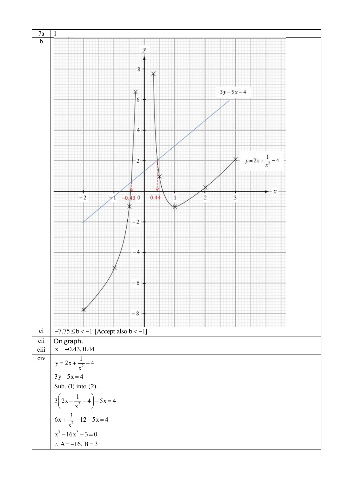

# Anglo-Chinese School (Independent) — Mathematics 4052/02 Paper 2 (cleaned)

> **Institution:** Anglo-Chinese School (Independent)
> **Exam:** Preliminary Examination 2024
> **Level:** Year Four Express
> **Subjects:** Elementary Mathematics
> **Paper:** 4052/02 Paper 2
> **Date:** Wednesday, 7 August 2024
> **Duration:** 2 hours 15 minutes
> **Total Marks:** 90
> **Source:** `2024 ACSI Prelim P2.pdf`

---

## Instructions

Candidates answer on the Question Paper.

Write your index number, name and class in the spaces on top of this page.
Write in dark blue or black pen.
You may use an HB pencil for any diagrams or graphs.
Do not use staples, paper clips, highlighters, glue or correction fluid.

Answer all questions.
The number of marks is given in brackets [ ] at the end of each question or part question.

If working is needed for any question it must be shown with the answer.
Omission of essential working will result in loss of marks.
The total of the marks for this paper is 90.

The use of an approved scientific calculator is expected, where appropriate.
If the degree of accuracy is not specified in the question, and if the answer is not exact, give the answer to three significant figures. Give answers in degrees to one decimal place.
For $\pi$, use either your calculator value or $3.142$.

---

## Mathematical Formulae

*Compound interest*

$$
\text{Total amount} = P\left(1 + \frac{r}{100}\right)^{n}
$$

*Mensuration*

$$
\text{Curved surface area of a cone} = \pi rl
$$

$$
\text{Surface area of a sphere} = 4\pi r^{2}
$$

$$
\text{Volume of a cone} = \frac{1}{3}\pi r^{2}h
$$

$$
\text{Volume of a sphere} = \frac{4}{3}\pi r^{3}
$$

$$
\text{Area of a triangle} = \frac{1}{2}ab\sin C
$$

$$
\text{Arc length} = r\theta,\text{ where }\theta\text{ is in radians}
$$

$$
\text{Sector area} = \frac{1}{2}r^{2}\theta,\text{ where }\theta\text{ is in radians}
$$

*Trigonometry*

$$
\frac{a}{\sin A} = \frac{b}{\sin B} = \frac{c}{\sin C}
$$

$$
a^{2} = b^{2} + c^{2} - 2bc\cos A
$$

*Statistics*

$$
\text{Mean} = \frac{\sum fx}{\sum f}
$$

$$
\text{Standard deviation} = \sqrt{\frac{\sum fx^{2}}{\sum f} - \left(\frac{\sum fx}{\sum f}\right)^{2}}
$$

---

### Q1

> **Marks:** 14
> **Page:** 3–4

(a) Solve the equation $2(x - 5) = 3x - 1$. [2]
> **Topic:** N7 Equations and inequalities
> **Sub-topic:** Equations and inequalities
> **LO:** [[context/subjects/o-level-e-maths/learning-objectives/o-level-e-maths-N7a.md|N7a]]

(b) Solve the inequality $7 - 4y > 3(y + 2)$. [2]
> **Topic:** N7 Equations and inequalities
> **Sub-topic:** Equations and inequalities
> **LO:** [[context/subjects/o-level-e-maths/learning-objectives/o-level-e-maths-N7g.md|N7g]]

(c) Given that $\dfrac{1}{p} - \dfrac{1}{2q} = \dfrac{1}{3r}$,

(i) find $p$ when $q = -1$ and $r = 2$, [2]
> **Topic:** N5 Algebraic expressions and formulae
> **Sub-topic:** Algebraic expressions and formulae
> **LO:** [[context/subjects/o-level-e-maths/learning-objectives/o-level-e-maths-N5l.md|N5l]]

(ii) rearrange the formula to make $q$ the subject. [3]
> **Topic:** N5 Algebraic expressions and formulae
> **Sub-topic:** Algebraic expressions and formulae
> **LO:** [[context/subjects/o-level-e-maths/learning-objectives/o-level-e-maths-N5k.md|N5k]]

(d) Solve the equation $\dfrac{5}{x + 2} - \dfrac{3x}{2x - 1} = 3$.

Give your solutions correct to $2$ decimal places. [5]
> **Topic:** N7 Equations and inequalities
> **Sub-topic:** Equations and inequalities
> **LO:** [[context/subjects/o-level-e-maths/learning-objectives/o-level-e-maths-N7e.md|N7e]]

### Q2

> **Marks:** 9
> **Page:** 4–5

(a) A manufacturing company produces electronic components for various devices.
They are analyzing the production data for the past $3$ months, which includes quantities of components produced and the corresponding costs.

The data is presented in the table below:

| Month | Quantity Produced (in units) | Cost per unit (in dollars) |
| --- | --- | --- |
| May | $5.8 \times 10^{5}$ | $0.0211$ |
| June | $4.3 \times 10^{6}$ | $0.0183$ |
| July | $7.6 \times 10^{5}$ | $0.0203$ |

(i) Express the total quantity produced from May to July in standard form correct to $3$ significant figures. [1]
> **Topic:** N1 Numbers and their operations
> **Sub-topic:** Numbers and their operations
> **LO:** [[context/subjects/o-level-e-maths/learning-objectives/o-level-e-maths-N1g.md|N1g]]

(ii) Calculate the average cost per unit for these $3$ months.
Express your answer in cents. [2]
> **Topic:** N1 Numbers and their operations
> **Sub-topic:** Numbers and their operations
> **LO:** [[context/subjects/o-level-e-maths/learning-objectives/o-level-e-maths-N1g.md|N1g]]

(iii) Given that the percentage increase in the quantity produced from July to August is $11.8\%$, calculate the quantity produced in August.
Leave your answer in standard form correct to $3$ significant figures. [2]
> **Topic:** N1 Numbers and their operations
> **Sub-topic:** Numbers and their operations
> **LO:** [[context/subjects/o-level-e-maths/learning-objectives/o-level-e-maths-N1g.md|N1g]]

(b) The company wants to build a prototype of a particular electronic component they are manufacturing.
The radius of the actual electronic component is $3.8 \times 10^{-5}$ m.
In a scale drawing, the radius of the prototype of the electronic component is $1.9$ cm.

(i) Find the scale used for the drawing.
Give your answer in the form $n:1$. [2]
> **Topic:** N2 Ratio and proportion
> **Sub-topic:** Ratio and proportion
> **LO:** [[context/subjects/o-level-e-maths/learning-objectives/o-level-e-maths-N2a.md|N2a]]

(ii) Given that the prototype has a total surface area of $1.81 \times 10^{-8}$ m$^{2}$, find, in cm$^{2}$, the actual total surface area of the electronic component. Give your answer in standard form. [2]
> **Topic:** N2 Ratio and proportion
> **Sub-topic:** Ratio and proportion
> **LO:** [[context/subjects/o-level-e-maths/learning-objectives/o-level-e-maths-N2a.md|N2a]]

### Q3

> **Marks:** 12
> **Page:** 6–7

In Diagram I below, $ABCDE$ is a regular pentagon, centre $O$. $OA = OB = 4$ cm.

(a) State the value of angle $AOB$. [1]
> **Topic:** G3 Properties of circles
> **Sub-topic:** Properties of circles
> **LO:** [[context/subjects/o-level-e-maths/learning-objectives/o-level-e-maths-G3b.md|G3b]]

(b) Calculate the area of the pentagon $ABCDE$. [2]
> **Topic:** G3 Properties of circles
> **Sub-topic:** Properties of circles
> **LO:** [[context/subjects/o-level-e-maths/learning-objectives/o-level-e-maths-G3b.md|G3b]]

(c) Diagram II shows a design for a new badge.
The vertices of the regular pentagon $ABCDE$ are joined by circular arcs whose centres are the opposite vertices.
For example, the arc $AB$ has centre $D$ and radius $AD$.

(i) Find angle $ABD$.
Give reasons for each step of your working. [2]
> **Topic:** G3 Properties of circles
> **Sub-topic:** Properties of circles
> **LO:** [[context/subjects/o-level-e-maths/learning-objectives/o-level-e-maths-G3b.md|G3b]]

(ii) Show that the length of $BD$ is approximately $7.61$ cm. [2]
> **Topic:** G3 Properties of circles
> **Sub-topic:** Properties of circles
> **LO:** [[context/subjects/o-level-e-maths/learning-objectives/o-level-e-maths-G3b.md|G3b]]

(iii) Calculate the area of the shaded segment in Diagram II. [3]
> **Topic:** G3 Properties of circles
> **Sub-topic:** Properties of circles
> **LO:** [[context/subjects/o-level-e-maths/learning-objectives/o-level-e-maths-G3b.md|G3b]]

(iv) Calculate the area of the face $ABCDE$ of the badge. [2]
> **Topic:** G3 Properties of circles
> **Sub-topic:** Properties of circles
> **LO:** [[context/subjects/o-level-e-maths/learning-objectives/o-level-e-maths-G3b.md|G3b]]

### Q4

> **Marks:** 4
> **Page:** 8

Here are the first four terms of a sequence.

$$
2 \quad \frac{5}{3} \quad \frac{10}{5} \quad \frac{17}{7}
$$

(a) Find the fifth term of the sequence. [1]
> **Topic:** N5 Algebraic expressions and formulae
> **Sub-topic:** Algebraic expressions and formulae
> **LO:** [[context/subjects/o-level-e-maths/learning-objectives/o-level-e-maths-N5e.md|N5e]]

(b) $T_{n}$ is the $n$th term of the sequence.

Find an expression, in terms of $n$, for $T_{n}$. [2]
> **Topic:** N5 Algebraic expressions and formulae
> **Sub-topic:** Algebraic expressions and formulae
> **LO:** [[context/subjects/o-level-e-maths/learning-objectives/o-level-e-maths-N5e.md|N5e]]

(c) Find the value of $T_{25} - T_{24}$. [1]
> **Topic:** N5 Algebraic expressions and formulae
> **Sub-topic:** Algebraic expressions and formulae
> **LO:** [[context/subjects/o-level-e-maths/learning-objectives/o-level-e-maths-N5e.md|N5e]]

### Q5

> **Marks:** 9
> **Page:** 8–9

The diagram shows a solid ornament in the shape of a cylinder with an upright cone cut out at one end and a hemisphere attached to the other end.

The vertical heights of the cone and cylinder are $x$ cm and $2x$ cm respectively.

(a) Find the ratio of the volume of the cone to that of the cylinder, expressing your answer as a fraction in the simplest form. [1]
> **Topic:** G5 Mensuration
> **Sub-topic:** Mensuration
> **LO:** [[context/subjects/o-level-e-maths/learning-objectives/o-level-e-maths-G5c.md|G5c]]

(b) If the volume of the cylinder is $345$ cm$^{3}$ and its height is $8$ cm, calculate

(i) the radius of the cylinder, [2]
> **Topic:** G5 Mensuration
> **Sub-topic:** Mensuration
> **LO:** [[context/subjects/o-level-e-maths/learning-objectives/o-level-e-maths-G5c.md|G5c]]

(ii) the curved surface area of the cone, [3]
> **Topic:** G5 Mensuration
> **Sub-topic:** Mensuration
> **LO:** [[context/subjects/o-level-e-maths/learning-objectives/o-level-e-maths-G5c.md|G5c]]

(iii) the quantity of paint needed to paint the exterior of the ornament with a $0.2$ mm thick coat of paint. [3]
> **Topic:** G5 Mensuration
> **Sub-topic:** Mensuration
> **LO:** [[context/subjects/o-level-e-maths/learning-objectives/o-level-e-maths-G5c.md|G5c]]

### Q6

> **Marks:** 9
> **Page:** 10–11

In the diagram, $OABC$ is a parallelogram and $D$ is the midpoint of $BC$.
$BE$ and $OC$ produced intersect at point $F$.
It is given that $BE:BF = 1:3$, $OC:OF = 1:2$, $\overrightarrow{OA} = \mathbf{a}$ and $\overrightarrow{OC} = \mathbf{c}$.

(a) Express and simplify the following vectors in terms of $\mathbf{a}$ and $\mathbf{c}$,

(i) $\overrightarrow{BF}$, [1]
> **Topic:** G7 Vectors in two dimensions
> **Sub-topic:** Vectors in two dimensions
> **LO:** [[context/subjects/o-level-e-maths/learning-objectives/o-level-e-maths-G7h.md|G7h]]

(ii) $\overrightarrow{AE}$, [2]
> **Topic:** G7 Vectors in two dimensions
> **Sub-topic:** Vectors in two dimensions
> **LO:** [[context/subjects/o-level-e-maths/learning-objectives/o-level-e-maths-G7h.md|G7h]]

(iii) $\overrightarrow{OD}$. [1]
> **Topic:** G7 Vectors in two dimensions
> **Sub-topic:** Vectors in two dimensions
> **LO:** [[context/subjects/o-level-e-maths/learning-objectives/o-level-e-maths-G7h.md|G7h]]

(b) Determine, with clear working shown, whether points $O$, $D$ and $E$ lie on a straight line. [3]
> **Topic:** G7 Vectors in two dimensions
> **Sub-topic:** Vectors in two dimensions
> **LO:** [[context/subjects/o-level-e-maths/learning-objectives/o-level-e-maths-G7h.md|G7h]]

(c) Find the value of $\dfrac{\text{area of triangle } CDE}{\text{area of parallelogram } OABC}$. [2]
> **Topic:** G7 Vectors in two dimensions
> **Sub-topic:** Vectors in two dimensions
> **LO:** [[context/subjects/o-level-e-maths/learning-objectives/o-level-e-maths-G7h.md|G7h]]

### Q7

> **Marks:** 12
> **Page:** 12–13

(a) Complete the table of values for $y = 2x + \dfrac{1}{x^{2}} - 4$.
Values are given to two decimal places where appropriate. [1]
> **Topic:** N6 Functions and graphs
> **Sub-topic:** Functions and graphs
> **LO:** [[context/subjects/o-level-e-maths/learning-objectives/o-level-e-maths-N6c.md|N6c]]

| $x$ | $-2$ | $-1$ | $-0.5$ | $-0.3$ | $0.3$ | $0.5$ | $1$ | $2$ | $3$ |
| --- | --- | --- | --- | --- | --- | --- | --- | --- | --- |
| $y$ | $-7.75$ | $-5$ | $-1$ | $6.51$ | $7.71$ |  | $-1$ | $0.25$ | $2.1$ |

(b) On the grid opposite, draw the graph of $y = 2x + \dfrac{1}{x^{2}} - 4$ for $-2 \leq x \leq 3$. [3]
> **Topic:** N6 Functions and graphs
> **Sub-topic:** Functions and graphs
> **LO:** [[context/subjects/o-level-e-maths/learning-objectives/o-level-e-maths-N6c.md|N6c]]

(c) (i) $y = b$ cuts the graph of $y = 2x + \dfrac{1}{x^{2}} - 4$ at one point for $-2 \leq x \leq 3$, state the range of values of $b$. [1]
> **Topic:** N6 Functions and graphs
> **Sub-topic:** Functions and graphs
> **LO:** [[context/subjects/o-level-e-maths/learning-objectives/o-level-e-maths-N6c.md|N6c]]

(ii) On the same grid, draw the graph of $3y - 5x = 4$ for $-2 \leq x \leq 3$. [2]
> **Topic:** N6 Functions and graphs
> **Sub-topic:** Functions and graphs
> **LO:** [[context/subjects/o-level-e-maths/learning-objectives/o-level-e-maths-N6c.md|N6c]]

(iii) Write down the $x$-coordinates of the points where the graph of $3y - 5x = 4$ intersects the curve for $-2 \leq x \leq 3$. [2]
> **Topic:** N6 Functions and graphs
> **Sub-topic:** Functions and graphs
> **LO:** [[context/subjects/o-level-e-maths/learning-objectives/o-level-e-maths-N6c.md|N6c]]

(iv) These values of $x$ are solutions of the equation $x^{3} + Ax^{2} + B = 0$.
Find the value of $A$ and the value of $B$. [3]
> **Topic:** N6 Functions and graphs
> **Sub-topic:** Functions and graphs
> **LO:** [[context/subjects/o-level-e-maths/learning-objectives/o-level-e-maths-N6c.md|N6c]]

### Q8

> **Marks:** 9
> **Page:** 14–15

(a) The box-and-whisker plots show the distribution of the masses (in grams) of eggs sold in Shop A and Shop B.

(i) There are $25$ eggs with masses of more than $59$ g sold in Shop A.

Find the total number of eggs sold in Shop A. [1]
> **Topic:** S1 Data handling and analysis
> **Sub-topic:** Data handling and analysis
> **LO:** [[context/subjects/o-level-e-maths/learning-objectives/o-level-e-maths-S1f.md|S1f]]

(ii) Make a comment comparing the averages and a comment comparing the distribution of the masses of the eggs sold in Shop A and Shop B.

Use figures to support your answers. [3]
> **Topic:** S1 Data handling and analysis
> **Sub-topic:** Data handling and analysis
> **LO:** [[context/subjects/o-level-e-maths/learning-objectives/o-level-e-maths-S1f.md|S1f]]

(b) In a sample of $80$ eggs, $4$ are cracked.

(i) One egg is selected from the sample at random.

Find the probability that the egg is cracked. [1]
> **Topic:** S2 Probability
> **Sub-topic:** Probability
> **LO:** [[context/subjects/o-level-e-maths/learning-objectives/o-level-e-maths-S2c.md|S2c]]

(ii) Two eggs are selected from the sample at random.

Find the probability that both eggs are cracked. [2]
> **Topic:** S2 Probability
> **Sub-topic:** Probability
> **LO:** [[context/subjects/o-level-e-maths/learning-objectives/o-level-e-maths-S2c.md|S2c]]

(iii) Three eggs are selected from the sample at random.

Find the probability that at least one egg is cracked. [2]
> **Topic:** S2 Probability
> **Sub-topic:** Probability
> **LO:** [[context/subjects/o-level-e-maths/learning-objectives/o-level-e-maths-S2c.md|S2c]]

### Q9

> **Marks:** 12
> **Page:** 16–19

Emily is considering signing up for a new credit card and has shortlisted three options: Card A, Card B and Card C. Each card offers distinct benefits, rewards, and imposes different annual fees.

The table below presents the essential features of each card:

| Card Features | Card A | Card B | Card C |
| --- | --- | --- | --- |
| Annual Fee$^{1}$ (in SGD) payable at the end of 12 months | ＄110 | ＄90 | Waived off for the first year; ＄250 for 2nd year onwards |
| Cashback$^{2}$ Rate per month | $1.5\%$ of expenditure | $1.3\%$ of expenditure | $1.2\%$ of expenditure |
| Sign-up Bonus (in SGD) to be used to offset the first bill payment | ＄50 | ＄60 | ＄70 |
| Number of Free Airport Lounge Access Passes per year | 2 | 4 | Unlimited |

$^{1}$ Cardholder does not enjoy cashback on the annual fee.

$^{2}$ Cashback amount is the amount of money received by the cardholder based on his/her expenditure. The cashback amount will be credited to the card account and used to offset the credit card bill for that month.

(a) Calculate the net rewards (which consist of cashback and sign-up bonus) for each credit card for an expenditure of SGD $2000$ within the first month of card usage. [3]
> **Topic:** N4 Rate and speed
> **Sub-topic:** Rate and speed
> **LO:** [[context/subjects/o-level-e-maths/learning-objectives/o-level-e-maths-N4a.md|N4a]]

(b) Emily's monthly card expenditure is SGD $2000$.

Assuming Emily has signed up for credit card A, by considering only the annual fee and the net rewards, calculate the total amount she has to pay for her credit card bill after the first year of usage. [2]
> **Topic:** N4 Rate and speed
> **Sub-topic:** Rate and speed
> **LO:** [[context/subjects/o-level-e-maths/learning-objectives/o-level-e-maths-N4a.md|N4a]]

(c) Emily enjoys travelling. As such, travel perks are important to her.

The following table provides a summary of Emily's monthly expenditure and travel needs.

Additional information

- Monthly Card Expenditure (excluding annual fee and purchases made for airport lounge access passes): SGD $2000$
- Airport Lounge Access Passes$^{3}$ required per year: $5$

$^{3}$ Credit card must be presented at the Airport Lounge. Any Airport Lounge access pass bought, costing ＄50 each, must be charged to the same credit card. Cardholder will not be able to enjoy cashback on the amount spent on Airport Lounge access passes.

Determine which credit card might be the best choice for Emily if she signs up for the card and uses it for two consecutive years.

Justify any decisions you make and show your calculations clearly. [7]
> **Topic:** N4 Rate and speed
> **Sub-topic:** Rate and speed
> **LO:** [[context/subjects/o-level-e-maths/learning-objectives/o-level-e-maths-N4a.md|N4a]]

---

## Answers

Worked solutions printed after the question paper. Page numbers are this PDF's physical pages.

### Q1

> **Page:** 21

(a) $2(x - 5) = 3x - 1$

$2x - 10 = 3x - 1$

$x = -9$

(b) $7 - 4y > 3(y + 2)$

$7 - 4y > 3y + 6$

$1 > 7y$

$y < \dfrac{1}{7}$

(c) (i) $\dfrac{1}{p} - \dfrac{1}{2q} = \dfrac{1}{3r}$

$$
\frac{1}{p} - \frac{1}{2(-1)} = \frac{1}{3(2)}
$$

$$
\frac{1}{p} = \frac{1}{6} - \frac{1}{2} = -\frac{1}{3}
$$

Therefore $p = -3$.

(ii)

$$
\frac{1}{2q} = \frac{1}{p} - \frac{1}{3r} = \frac{3r - p}{3pr}
$$

$$
q = \frac{3pr}{2(3r - p)}
$$

(d) $\dfrac{5}{x + 2} - \dfrac{3x}{2x - 1} = 3$

$5(2x - 1) - 3x(x + 2) = 3(x + 2)(2x - 1)$

$10x - 5 - 3x^{2} - 6x = 3(2x^{2} + 3x - 2)$

$4x - 5 - 3x^{2} = 6x^{2} + 9x - 6$

$9x^{2} + 5x - 1 = 0$

$$
x = \frac{-5 \pm \sqrt{5^{2} - 4(9)(-1)}}{2(9)} = \frac{-5 \pm \sqrt{61}}{18}
$$

$x = -0.71$ (2 d.p.) or $0.16$ (2 d.p.)

### Q2

> **Page:** 21–22

(a) (i) $5.8 \times 10^{5} + 4.3 \times 10^{6} + 7.6 \times 10^{5} = 5.64 \times 10^{6}$

(ii)

$$
\frac{5.8 \times 10^{5} \times 0.0211 + 4.3 \times 10^{6} \times 0.0183 + 7.6 \times 10^{5} \times 0.0203}{5.64 \times 10^{6}} = 0.0189
$$

which is ＄0.0189, or $1.89$ cents (2 d.p.).

(iii) $7.6 \times 10^{5} \times \dfrac{111.8}{100} = 849680 = 8.50 \times 10^{5}$ (3 s.f.)

(b) (i) $3.8 \times 10^{-5}$ m $= 0.0038$ cm.

$0.0038$ cm is represented by $1.9$ cm.

$1$ cm is represented by $\dfrac{1.9}{0.0038}$ cm $= 500$ cm.

Therefore the scale used is $500:1$.

(ii) $1.81 \times 10^{-8}$ m$^{2} = 1.81 \times 10^{-4}$ cm$^{2}$.

$500$ cm of the prototype represents $1$ cm of the actual electronic component.

$500 \times 500$ cm$^{2} = 2.5 \times 10^{5}$ cm$^{2}$ of the prototype represents $1$ cm$^{2}$ of the actual.

Therefore $1.81 \times 10^{-4}$ cm$^{2}$ of the prototype represents $\dfrac{1.81 \times 10^{-4}}{2.5 \times 10^{5}} = 7.24 \times 10^{-10}$ cm$^{2}$ of the actual.

### Q3

> **Page:** 22–23

(a) $\angle AOB = 360^{\circ} \div 5 = 72^{\circ}$ (angles at a point)

(b) Area of pentagon $ABCDE$ $= 5 \times \dfrac{1}{2}(4)(4)\sin 72^{\circ} = 38.042$ cm$^{2}$ (5 s.f.) $= 38.0$ cm$^{2}$ (3 s.f.)

(c) (i) $\angle ADB = 72^{\circ} \div 2 = 36^{\circ}$ (angle at the centre $= 2 \times$ angle at the circumference)

$$
\angle ABD = \frac{180^{\circ} - 36^{\circ}}{2} = 72^{\circ}
$$

(base angles of an isosceles triangle)

(ii) $BD = 2 \times BM = 2 \times 4\sin 72^{\circ} = 7.61$ cm (3 s.f.) (shown)

Or $\dfrac{4}{\sin \angle ODB} = \dfrac{BD}{\sin \angle BOD}$, so $\dfrac{4}{\sin 18^{\circ}} = \dfrac{BD}{\sin 144^{\circ}}$, and $BD = 7.61$ cm (3 s.f.) (shown).

Or $\angle BOD = (360^{\circ} - 72^{\circ}) \div 2 = 144^{\circ}$ (angles at a point)

$$
BD^{2} = 4^{2} + 4^{2} - 2(4)(4)\cos 144^{\circ} = 32 - 32\cos 144^{\circ}
$$

$BD \approx 7.60845 = 7.61$ cm (3 s.f.) (shown)

(iii) Area of the shaded segment $=$ area of sector $DAB$ $-$ area of $\triangle DAB$

$$
= \frac{36^{\circ}}{360^{\circ}} \times \pi \times (7.60845)^{2} - \frac{1}{2}(7.60845)^{2}\sin 36^{\circ} = 18.186 - 17.013 = 1.1732 \text{ (3 s.f.)}
$$

(iv) Area of the badge $=$ area of the pentagon $+$ area of $5$ segments

$= 38.042 + 5(1.1732) = 43.9$ cm$^{2}$ (3 s.f.)

### Q4

> **Page:** 23

(a) $T_{5} = \dfrac{26}{9}$

(b) $T_{n} = \dfrac{n^{2} + 1}{2n - 1}$

(c)

$$
T_{25} - T_{24} = \frac{25^{2} + 1}{2(25) - 1} - \frac{24^{2} + 1}{2(24) - 1} = \frac{626}{49} - \frac{577}{47} = \frac{1149}{2303}
$$

### Q5

> **Page:** 23

(a)

$$
\frac{\text{Volume of cone}}{\text{Volume of cylinder}} = \frac{\frac{1}{3}\pi r^{2}x}{\pi r^{2}(2x)} = \frac{1}{6}
$$

(b) (i) Radius of the cylinder $= \sqrt{\dfrac{345}{\pi(8)}} \approx 3.7050 = 3.71$ cm (3 s.f.)

(ii) Slant height of the cone $= \sqrt{\left(\dfrac{345}{\pi(8)}\right)^{2} + 4^{2}} \approx 5.4523$

Curved surface area of the cone $= \pi(3.7050)(5.4523) \approx 63.463 = 63.5$ cm$^{2}$ (3 s.f.)

(iii) Volume of paint

$$
= \left[63.463 + 2\pi(3.7050)(8) + \frac{1}{2} \times 4\pi(3.7050)^{2}\right] \times \frac{0.2}{10} = 6.72 \text{ cm}^{3} \text{ (3 s.f.)}
$$

### Q6

> **Page:** 23–24

(a) (i) $\overrightarrow{BF} = -\mathbf{a} + \mathbf{c}$

(ii) $\overrightarrow{AE} = \mathbf{c} + \dfrac{1}{3}(\mathbf{c} - \mathbf{a}) = \dfrac{1}{3}(4\mathbf{c} - \mathbf{a})$

(iii) $\overrightarrow{OD} = \mathbf{a} + \dfrac{1}{2}\mathbf{c}$

(b) $\overrightarrow{OE} = \overrightarrow{OA} + \overrightarrow{AE} = \mathbf{a} + \dfrac{1}{3}(4\mathbf{c} - \mathbf{a}) = \dfrac{2}{3}\mathbf{a} + \dfrac{4}{3}\mathbf{c} = \dfrac{4}{3}\left(\dfrac{1}{2}\mathbf{a} + \mathbf{c}\right)$

$\overrightarrow{OE} = \dfrac{4}{3}\overrightarrow{OD}$, so $\overrightarrow{OE}$ is parallel to $\overrightarrow{OD}$.

$\overrightarrow{OE}$ and $\overrightarrow{OD}$ share a common point $O$, so $O$, $D$ and $E$ lie on the same straight line.

Or $\overrightarrow{DE} = \overrightarrow{DB} + \overrightarrow{BE} = \dfrac{1}{2}\mathbf{a} + \dfrac{1}{3}\overrightarrow{BF} = \dfrac{1}{2}\mathbf{a} + \dfrac{1}{3}(-\mathbf{a} + \mathbf{c}) = \dfrac{1}{6}\mathbf{a} + \dfrac{1}{3}\mathbf{c} = \dfrac{1}{3}\left(\dfrac{1}{2}\mathbf{a} + \mathbf{c}\right)$

$\overrightarrow{DE} = \dfrac{1}{3}\overrightarrow{OD}$, so $\overrightarrow{DE}$ is parallel to $\overrightarrow{OD}$.

$\overrightarrow{DE}$ and $\overrightarrow{OD}$ share a common point $D$, so $O$, $D$ and $E$ lie on the same straight line.

(c)

$$
\frac{\text{area of triangle } CDE}{\text{area of parallelogram } OABC} = \frac{\text{area of }\triangle CDE}{\text{area of }\triangle CDO} \times \frac{\text{area of }\triangle CDO}{\text{area of parallelogram } OABC} = \frac{1}{3} \times \frac{1}{4} = \frac{1}{12}
$$

### Q7

> **Page:** 25

(a) $1$

(b) The curve and the line $3y - 5x = 4$ are drawn on the grid.

(c) (i) $-7.75 \leq b < -1$ [Accept also $b < -1$]

(ii) On graph.

(iii) $x = -0.43$, $0.44$

(iv) $y = 2x + \dfrac{1}{x^{2}} - 4$ and $3y - 5x = 4$.

Substitute (1) into (2):

$$
3\left(2x + \frac{1}{x^{2}} - 4\right) - 5x = 4
$$

$$
6x + \frac{3}{x^{2}} - 12 - 5x = 4
$$

$$
x^{3} - 16x^{2} + 3 = 0
$$

Therefore $A = -16$, $B = 3$.

### Q8

> **Page:** 26

(a) (i) $Q_{3} = 59$ g. Total number of eggs $= 25 \times 4 = 100$.

(ii) 1. $Q_{2A} = 54$ g; $Q_{2B} = 50$ g. Masses of eggs in shop A are heavier due to its higher median value.

2. $IQR_{A} = 59\text{ g} - 49\text{ g} = 10$ g; $IQR_{B} = 53\text{ g} - 45\text{ g} = 8$ g. Masses of eggs in shop B are more consistent due to its lower IQR.

(b) (i) Probability that the egg is cracked $= \dfrac{4}{80} = \dfrac{1}{20}$

(ii) Probability that both eggs are cracked $= \dfrac{4}{80} \times \dfrac{3}{79} = \dfrac{3}{1580}$

(iii) Probability that at least one egg is cracked $= 1 - \dfrac{76}{80} \times \dfrac{75}{79} \times \dfrac{74}{78} = \dfrac{593}{4108}$

### Q9

> **Page:** 27

(a) Net rewards for Card A $= \dfrac{1.5}{100} \times 2000 + 50 =$ ＄$80$

Net rewards for Card B $= \dfrac{1.3}{100} \times 2000 + 60 =$ ＄$86$

Net rewards for Card C $= \dfrac{1.2}{100} \times 2000 + 70 =$ ＄$94$

(b) Credit card bill for Card A

$$
= \left[\left(1 - \frac{1.5}{100}\right) \times 2000 \times 12\right] - 50 + 110 = 23700
$$

which is ＄23700.

(c) Credit card bill after $2$ years for Card A

$$
= \left[\left(1 - \frac{1.5}{100}\right) \times (2000 \times 12 \times 2)\right] + 6 \times 50 - 50 + (110 \times 2) = 47750
$$

which is ＄47750.

Credit card bill after $2$ years for Card B

$$
= \left[\left(1 - \frac{1.3}{100}\right) \times (2000 \times 12 \times 2)\right] + 2 \times 50 - 60 + (90 \times 2) = 47596
$$

which is ＄47596.

Credit card bill after $2$ years for Card C

$$
= \left[\left(1 - \frac{1.2}{100}\right) \times (2000 \times 12 \times 2)\right] - 70 + 250 = 47604
$$

which is ＄47604.

Credit card B has the least bill amount. Therefore, Card B is the best choice.
