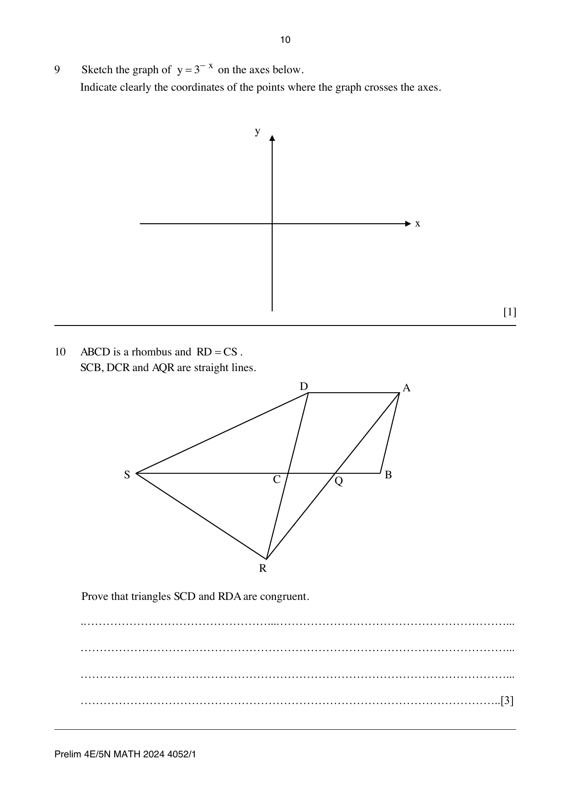
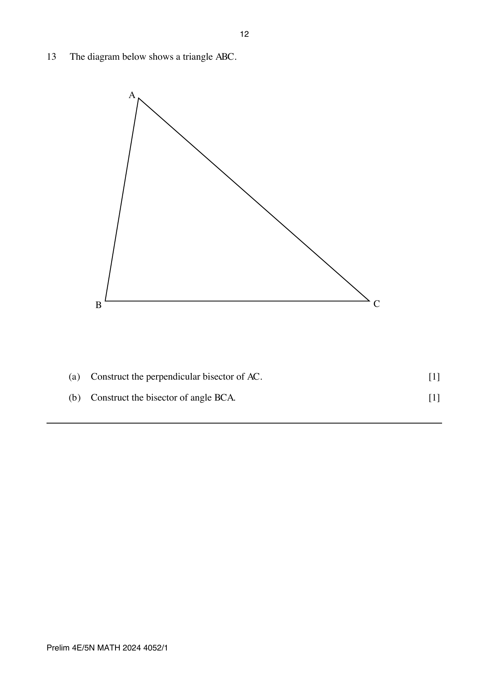
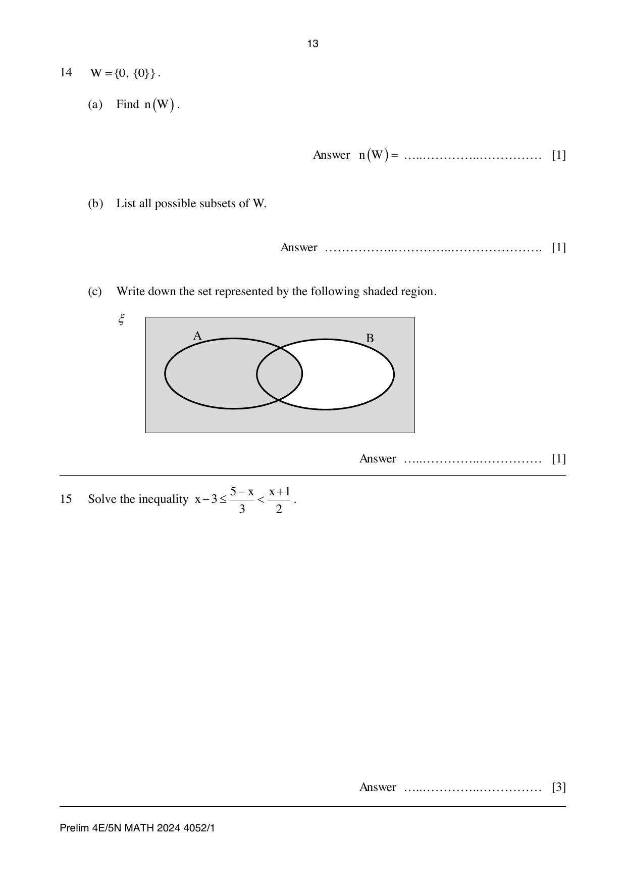
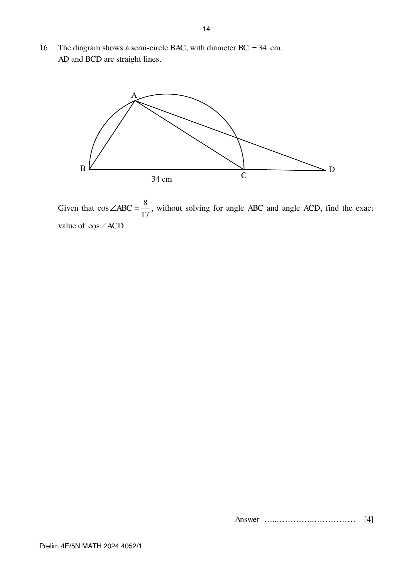
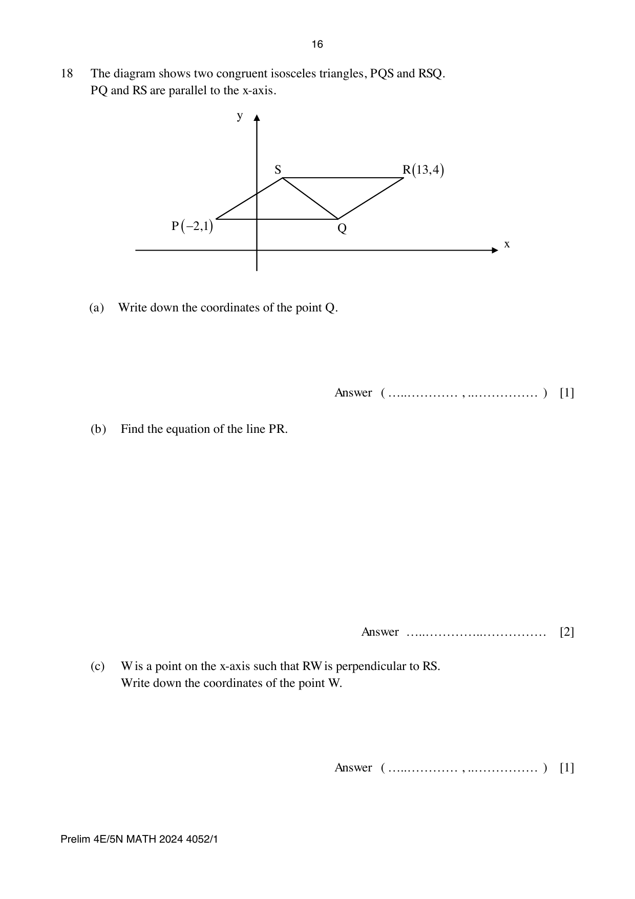
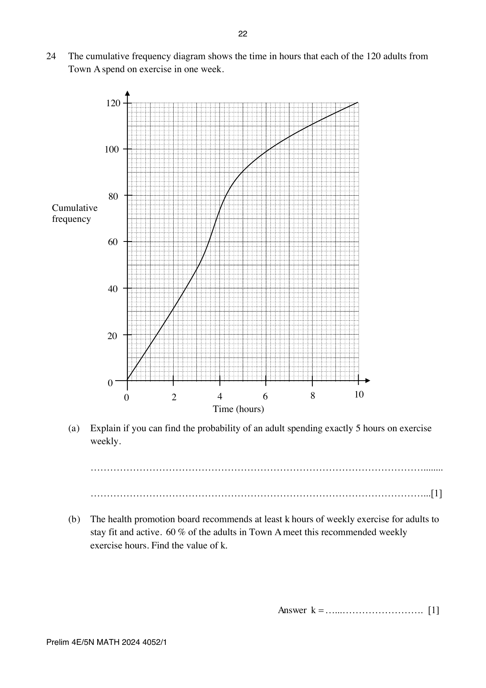
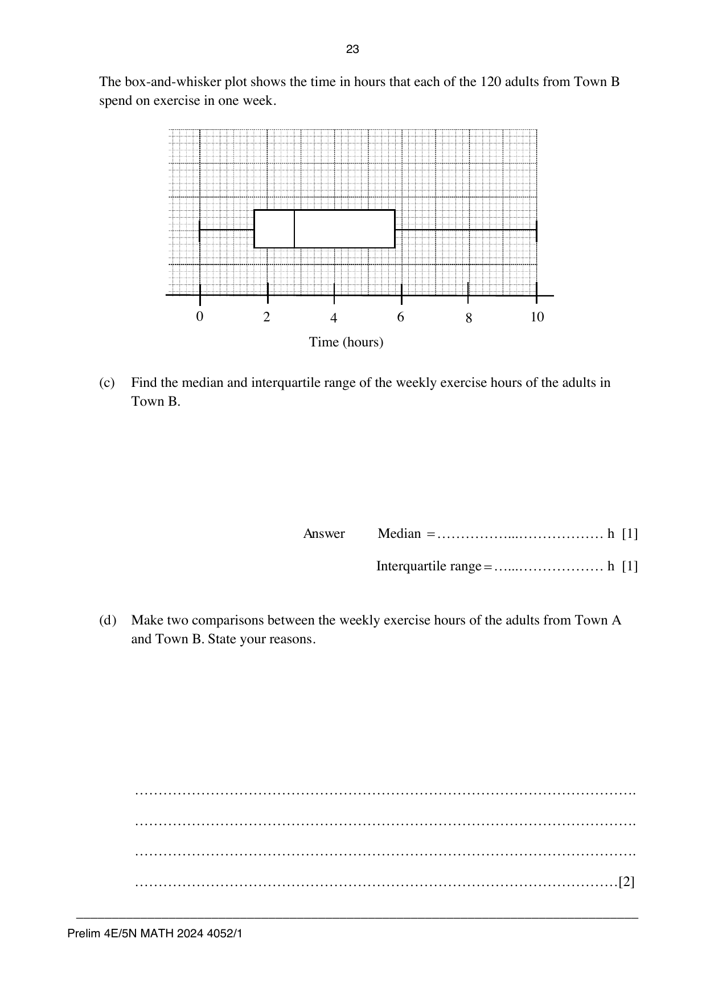
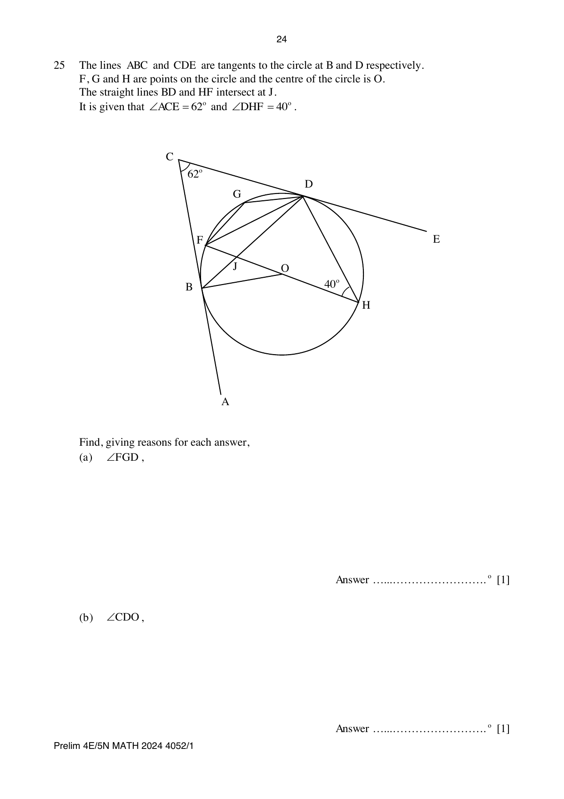
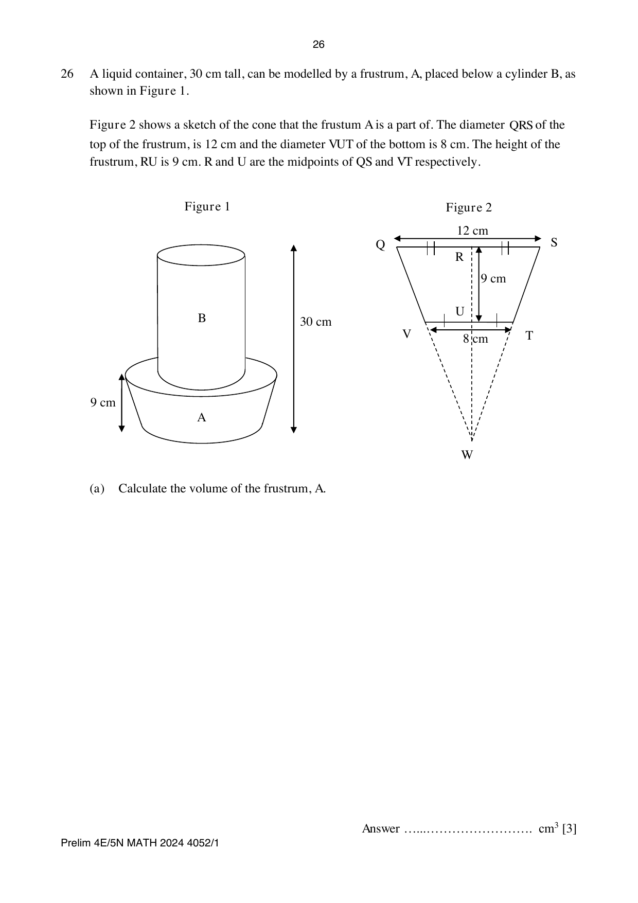

# Anderson Secondary School — Mathematics 4052/01 Paper 1 (cleaned)

> **Institution:** Anderson Secondary School
> **Exam:** Preliminary Examination 2024
> **Level:** Secondary Four Express and Five Normal
> **Subjects:** Elementary Mathematics
> **Paper:** 4052/01 Paper 1
> **Date:** 14 August 2024
> **Duration:** 2 hours 15 minutes
> **Total Marks:** 90
> **Source:** `ANDSS 4E2024EM_Prelim_P1_QP.pdf`

---

## Instructions

Candidates answer on the Question Paper.
No Additional Materials are required.

Write your name, class and index number in the spaces at the top of this page.
Write in dark blue or black pen.
You may use an HB pencil for any diagrams or graphs.
Do not use paper clips, highlighters, glue or correction fluid/tape.

Answer all the questions.
If working is needed for any question it must be neatly and clearly shown in the space below the question.
Omission of essential working will result in loss of marks.
The use of an approved scientific calculator is expected, where appropriate.
If the degree of accuracy is not specified in the question, and if the answer is not exact, give the answer to three significant figures. Give answers in degrees to one decimal place.
For $\pi$, use either your calculator value or $3.142$, unless the question requires the answer in terms of $\pi$.

At the end of the examination, fasten all your work securely together.
The number of marks is given in brackets [ ] at the end of each question or part question.
The total of the marks for this paper is 90.

Setter: Mr Azmi

---

## Mathematical Formulae

*Compound interest*

$$
\text{Total amount} = P\left(1+\frac{r}{100}\right)^{n}
$$

*Mensuration*

$$
\text{Curved surface area of a cone} = \pi rl
$$

$$
\text{Surface area of a sphere} = 4\pi r^{2}
$$

$$
\text{Volume of a cone} = \frac{1}{3}\pi r^{2}h
$$

$$
\text{Volume of a sphere} = \frac{4}{3}\pi r^{3}
$$

$$
\text{Area of triangle } ABC = \frac{1}{2}ab\sin C
$$

$$
\text{Arc length} = r\theta,\text{ where }\theta\text{ is in radians}
$$

$$
\text{Sector area} = \frac{1}{2}r^{2}\theta,\text{ where }\theta\text{ is in radians}
$$

*Trigonometry*

$$
\frac{a}{\sin A} = \frac{b}{\sin B} = \frac{c}{\sin C}
$$

$$
a^{2} = b^{2}+c^{2}-2bc\cos A
$$

*Statistics*

$$
\text{Mean} = \frac{\Sigma fx}{\Sigma f}
$$

$$
\text{Standard deviation} = \sqrt{\frac{\Sigma fx^{2}}{\Sigma f}-\left(\frac{\Sigma fx}{\Sigma f}\right)^{2}}
$$

---

### Q1

> **Marks:** 2
> **Topic:** N5 Algebraic expressions and formulae
> **Sub-topic:** Algebraic expressions and formulae
> **LO:** [[context/subjects/o-level-e-maths/learning-objectives/o-level-e-maths-N5j.md|N5j]]
> **Page:** 3

Expand and simplify $a(5a-2b)(5a+2b)$.

### Q2

> **Marks:** 2
> **Topic:** N5 Algebraic expressions and formulae
> **Sub-topic:** Algebraic expressions and formulae
> **LO:** [[context/subjects/o-level-e-maths/learning-objectives/o-level-e-maths-N5m.md|N5m]]
> **Page:** 3

Given that $3^{x}+3^{x+2}=90$, find $x$.

### Q3

> **Marks:** 3
> **Topic:** N5 Algebraic expressions and formulae
> **Sub-topic:** Algebraic expressions and formulae
> **LO:** [[context/subjects/o-level-e-maths/learning-objectives/o-level-e-maths-N5m.md|N5m]]
> **Page:** 4

Simplify $\dfrac{2x^{2}+4xy-3x-6y}{2x^{2}+xy-6y^{2}}$.

### Q4

> **Marks:** 3
> **Page:** 5

Two integers, $A$ and $B$, can be written as products of prime factors.

$$
A = 3^{m+2}\times 7 \qquad B = q\times 3^{m}\times 7
$$

The lowest common multiple (LCM) of $A$ and $B$ is $3^{3}\times 5\times 7$.

**(a)** Write down the value of $m$ and $q$. [2]
> **Topic:** N1 Numbers and their operations
> **Sub-topic:** Numbers and their operations
> **LO:** [[context/subjects/o-level-e-maths/learning-objectives/o-level-e-maths-N1b.md|N1b]]

**(b)** Find the highest common factor of $A$ and $B$. [1]
> **Topic:** N1 Numbers and their operations
> **Sub-topic:** Numbers and their operations
> **LO:** [[context/subjects/o-level-e-maths/learning-objectives/o-level-e-maths-N1b.md|N1b]]

### Q5

> **Marks:** 2
> **Topic:** S1 Data handling and analysis
> **Sub-topic:** Data handling and analysis
> **LO:** [[context/subjects/o-level-e-maths/learning-objectives/o-level-e-maths-S1b.md|S1b]]
> **Page:** 6

Below is a graph from the Annual Climate Singapore 2023, which shows the top 10 warmest years in Singapore since 1929.

State one aspect of the graph that may be misleading and explain how this may lead to a misinterpretation of the graph. [2]

### Q6

> **Marks:** 4
> **Page:** 7

**(a)** Simplify $\left(\dfrac{y^{9}}{27x^{-6}}\right)^{-\frac{2}{3}}$, leaving your answer in positive index. [2]
> **Topic:** N1 Numbers and their operations
> **Sub-topic:** Numbers and their operations
> **LO:** [[context/subjects/o-level-e-maths/learning-objectives/o-level-e-maths-N1j.md|N1j]]

**(b)** Given $\dfrac{25^{2-x}}{125}=5^{y}$, express $x$ in terms of $y$. [2]
> **Topic:** N1 Numbers and their operations
> **Sub-topic:** Numbers and their operations
> **LO:** [[context/subjects/o-level-e-maths/learning-objectives/o-level-e-maths-N1j.md|N1j]]

### Q7

> **Marks:** 3
> **Page:** 8

**(a)** Factorise $9x^{2}+24xy+16y^{2}$ completely. [1]
> **Topic:** N5 Algebraic expressions and formulae
> **Sub-topic:** Algebraic expressions and formulae
> **LO:** [[context/subjects/o-level-e-maths/learning-objectives/o-level-e-maths-N5h.md|N5h]]

**(b)** Hence factorise $144a^{8}-(9a^{8}+24a^{4}y+16y^{2})$ completely. [2]
> **Topic:** N5 Algebraic expressions and formulae
> **Sub-topic:** Algebraic expressions and formulae
> **LO:** [[context/subjects/o-level-e-maths/learning-objectives/o-level-e-maths-N5h.md|N5h]]

### Q8

> **Marks:** 3
> **Page:** 9

The intensity of a sound detected by a receiver is inversely proportional to the square of the distance of the receiver from the source of the sound.
When the distance is $r$ metres, the intensity of the sound detected is $q$ decibels.

When the distance is reduced by $40\%$,

**(a)** find the intensity of the sound detected, in terms of $q$. [2]
> **Topic:** N3 Percentage
> **Sub-topic:** Percentage
> **LO:** [[context/subjects/o-level-e-maths/learning-objectives/o-level-e-maths-N3d.md|N3d]]

**(b)** calculate the percentage difference in the intensity of the sound detected. [1]
> **Topic:** N3 Percentage
> **Sub-topic:** Percentage
> **LO:** [[context/subjects/o-level-e-maths/learning-objectives/o-level-e-maths-N3d.md|N3d]]

### Q9

> **Marks:** 1
> **Topic:** N6 Functions and graphs
> **Sub-topic:** Functions and graphs
> **LO:** [[context/subjects/o-level-e-maths/learning-objectives/o-level-e-maths-N6c.md|N6c]]
> **Page:** 10

Sketch the graph of $y=3^{-x}$ on the axes below.
Indicate clearly the coordinates of the points where the graph crosses the axes. [1]

### Q10

> **Marks:** 3
> **Topic:** G2 Congruence and similarity
> **Sub-topic:** Congruence and similarity
> **LO:** [[context/subjects/o-level-e-maths/learning-objectives/o-level-e-maths-G2i.md|G2i]]
> **Page:** 10

$ABCD$ is a rhombus and $RD=CS$.
$SCB$, $DCR$ and $AQR$ are straight lines.

Prove that triangles $SCD$ and $RDA$ are congruent. [3]

### Q11

> **Marks:** 2
> **Topic:** N6 Functions and graphs
> **Sub-topic:** Functions and graphs
> **LO:** [[context/subjects/o-level-e-maths/learning-objectives/o-level-e-maths-N6c.md|N6c]]
> **Page:** 11

By expressing $x^{2}-10x-2$ in the form $(x-h)^{2}+k$, where $h$ and $k$ are constants, write down the coordinates of the minimum point of the graph of $y=x^{2}-10x-2$. [2]

### Q12

> **Marks:** 3
> **Page:** 11

$$
\xi = \{(x,y): x\text{ and }y\text{ are integers, }-2\leq x<1\text{ and }-1\leq y\leq 1\}
$$

$$
P = \{(x,y): x^{2}+y^{2}<2\}
$$

$$
Q = \{(x,y): xy<0\}
$$

**(a)** Find the number of elements in the universal set $\xi$. [1]
> **Topic:** N8 Set language and notation
> **Sub-topic:** Set language and notation
> **LO:** [[context/subjects/o-level-e-maths/learning-objectives/o-level-e-maths-N8a.md|N8a]]

**(b)** List the elements of the following in set notation.

**(i)** $P$ [1]
> **Topic:** N8 Set language and notation
> **Sub-topic:** Set language and notation
> **LO:** [[context/subjects/o-level-e-maths/learning-objectives/o-level-e-maths-N8a.md|N8a]]

**(ii)** $Q$ [1]
> **Topic:** N8 Set language and notation
> **Sub-topic:** Set language and notation
> **LO:** [[context/subjects/o-level-e-maths/learning-objectives/o-level-e-maths-N8a.md|N8a]]

### Q13

> **Marks:** 2
> **Page:** 12

The diagram below shows a triangle $ABC$.

**(a)** Construct the perpendicular bisector of $AC$. [1]
> **Topic:** G2 Congruence and similarity
> **Sub-topic:** Congruence and similarity
> **LO:** [[context/subjects/o-level-e-maths/learning-objectives/o-level-e-maths-G2e.md|G2e]]

**(b)** Construct the bisector of angle $BCA$. [1]
> **Topic:** G2 Congruence and similarity
> **Sub-topic:** Congruence and similarity
> **LO:** [[context/subjects/o-level-e-maths/learning-objectives/o-level-e-maths-G2e.md|G2e]]

### Q14

> **Marks:** 3
> **Page:** 13

$W=\{0,\{0\}\}$.

**(a)** Find $n(W)$. [1]
> **Topic:** N8 Set language and notation
> **Sub-topic:** Set language and notation
> **LO:** [[context/subjects/o-level-e-maths/learning-objectives/o-level-e-maths-N8c.md|N8c]]

**(b)** List all possible subsets of $W$. [1]
> **Topic:** N8 Set language and notation
> **Sub-topic:** Set language and notation
> **LO:** [[context/subjects/o-level-e-maths/learning-objectives/o-level-e-maths-N8c.md|N8c]]

**(c)** Write down the set represented by the following shaded region. [1]
> **Topic:** N8 Set language and notation
> **Sub-topic:** Set language and notation
> **LO:** [[context/subjects/o-level-e-maths/learning-objectives/o-level-e-maths-N8c.md|N8c]]

### Q15

> **Marks:** 3
> **Topic:** N7 Equations and inequalities
> **Sub-topic:** Equations and inequalities
> **LO:** [[context/subjects/o-level-e-maths/learning-objectives/o-level-e-maths-N7g.md|N7g]]
> **Page:** 13

Solve the inequality $x-3\leq \dfrac{5-x}{3}<\dfrac{x+1}{2}$. [3]

### Q16

> **Marks:** 4
> **Topic:** G4 Pythagoras' theorem and trigonometry
> **Sub-topic:** Pythagoras' theorem and trigonometry
> **LO:** [[context/subjects/o-level-e-maths/learning-objectives/o-level-e-maths-G4c.md|G4c]]
> **Page:** 14

The diagram shows a semi-circle $BAC$, with diameter $BC=34$ cm.
$AD$ and $BCD$ are straight lines.

Given that $\cos\angle ABC=\dfrac{8}{17}$, without solving for angle $ABC$ and angle $ACD$, find the exact value of $\cos\angle ACD$. [4]

### Q17

> **Marks:** 5
> **Page:** 15

The sequence $T_{1}$, $T_{2}$, $T_{3}$, $T_{4}$, $\ldots$ has the following first four terms.

$$
T_{1}=2^{2}-1=3
$$

$$
T_{2}=3^{2}-2=7
$$

$$
T_{3}=4^{2}-3=13
$$

$$
T_{4}=5^{2}-4=21
$$

**(a)** Find the 7th term of the sequence, $T_{7}$. [1]
> **Topic:** N5 Algebraic expressions and formulae
> **Sub-topic:** Algebraic expressions and formulae
> **LO:** [[context/subjects/o-level-e-maths/learning-objectives/o-level-e-maths-N5e.md|N5e]]

**(b)** Write the expression for the $n$th term of the sequence. [1]
> **Topic:** N5 Algebraic expressions and formulae
> **Sub-topic:** Algebraic expressions and formulae
> **LO:** [[context/subjects/o-level-e-maths/learning-objectives/o-level-e-maths-N5e.md|N5e]]

**(c)** Kelvin claims that the difference between 2 consecutive terms $T_{n+1}-T_{n}$, where $n$ is a positive integer, will always be even. Do you agree? Explain your answer with clear workings. [3]
> **Topic:** N5 Algebraic expressions and formulae
> **Sub-topic:** Algebraic expressions and formulae
> **LO:** [[context/subjects/o-level-e-maths/learning-objectives/o-level-e-maths-N5e.md|N5e]]

### Q18

> **Marks:** 7
> **Page:** 16–17

The diagram shows two congruent isosceles triangles, $PQS$ and $RSQ$.
$PQ$ and $RS$ are parallel to the $x$-axis.

**(a)** Write down the coordinates of the point $Q$. [1]
> **Topic:** G6 Coordinate geometry
> **Sub-topic:** Coordinate geometry
> **LO:** [[context/subjects/o-level-e-maths/learning-objectives/o-level-e-maths-G6c.md|G6c]]

**(b)** Find the equation of the line $PR$. [2]
> **Topic:** G6 Coordinate geometry
> **Sub-topic:** Coordinate geometry
> **LO:** [[context/subjects/o-level-e-maths/learning-objectives/o-level-e-maths-G6c.md|G6c]]

**(c)** $W$ is a point on the $x$-axis such that $RW$ is perpendicular to $RS$.
Write down the coordinates of the point $W$. [1]
> **Topic:** G6 Coordinate geometry
> **Sub-topic:** Coordinate geometry
> **LO:** [[context/subjects/o-level-e-maths/learning-objectives/o-level-e-maths-G6c.md|G6c]]

**(d)** Find the perimeter of $PQRS$. [3]
> **Topic:** G6 Coordinate geometry
> **Sub-topic:** Coordinate geometry
> **LO:** [[context/subjects/o-level-e-maths/learning-objectives/o-level-e-maths-G6c.md|G6c]]

### Q19

> **Marks:** 1
> **Topic:** N1 Numbers and their operations
> **Sub-topic:** Numbers and their operations
> **LO:** [[context/subjects/o-level-e-maths/learning-objectives/o-level-e-maths-N1h.md|N1h]]
> **Page:** 17

In the year 2022, it was recorded that the average amount of waste generated in Singapore daily was $20.3$ thousand tonnes. Assuming that there are $365$ days in a year, find the total amount of waste generated in the year 2022, leaving your answer in standard form. [1]

### Q20

> **Marks:** 7
> **Page:** 18–19

A company sells chocolate muffins and banana muffins. These muffins are sold across three different outlets, which are Outlet A, Outlet B and Outlet C. The table shows the number of boxes of chocolate muffins and banana muffins produced at each of the three outlets in a particular day.

|  | Chocolate Muffin | Banana Muffin |
| --- | --- | --- |
| Outlet A | 36 | 40 |
| Outlet B | 48 | 39 |
| Outlet C | 45 | $x$ |

The table can be represented by matrix $Q$, where

$$
Q=\begin{pmatrix} 36 & 40 \\ 48 & 39 \\ 45 & x \end{pmatrix}.
$$

**(a) (i)** The production cost for each box of chocolate muffin and each box of banana muffin is ＄3 and ＄4.50 respectively. Represent this information in a $2\times 1$ matrix, $P$. [1]
> **Topic:** N9 Matrices
> **Sub-topic:** Matrices
> **LO:** [[context/subjects/o-level-e-maths/learning-objectives/o-level-e-maths-N9b.md|N9b]]

**(ii)** Evaluate the matrix $R=QP$. [1]
> **Topic:** N9 Matrices
> **Sub-topic:** Matrices
> **LO:** [[context/subjects/o-level-e-maths/learning-objectives/o-level-e-maths-N9b.md|N9b]]

**(b)** State what each of the elements in matrix $R$ represents. [1]
> **Topic:** N9 Matrices
> **Sub-topic:** Matrices
> **LO:** [[context/subjects/o-level-e-maths/learning-objectives/o-level-e-maths-N9b.md|N9b]]

The company sells each box of muffins for $70\%$ more than it costs to produce.
On that day, the company sold $\dfrac{5}{6}$ of each flavour of muffins in Outlet A, $\dfrac{4}{5}$ of each flavour of muffins in Outlet B, and all the muffins in Outlet C.

**(c)** By using the matrix $R$, find the total amount collected from the sale of muffins from all three outlets. [3]
> **Topic:** N9 Matrices
> **Sub-topic:** Matrices
> **LO:** [[context/subjects/o-level-e-maths/learning-objectives/o-level-e-maths-N9b.md|N9b]]

**(d)** The total amount collected from the sales of muffins from all three outlets is ＄1454.52.
Calculate the value of $x$. [1]
> **Topic:** N9 Matrices
> **Sub-topic:** Matrices
> **LO:** [[context/subjects/o-level-e-maths/learning-objectives/o-level-e-maths-N9b.md|N9b]]

### Q21

> **Marks:** 5
> **Page:** 20

In a class of 36 students, each student is either in a sports team or a performing arts club. Each student is also either a member or is a leader in their respective co-curricular activities.
One student is selected at random from the class. The probability that the student selected is in a sports team is $\dfrac{1}{3}$.

**(a)** Given that there are 4 sports team members in the class, find the number of students who are leaders in a sports team. [1]
> **Topic:** S2 Probability
> **Sub-topic:** Probability
> **LO:** [[context/subjects/o-level-e-maths/learning-objectives/o-level-e-maths-S2c.md|S2c]]

Two students are selected at random from the class. The probability that both of them are members of a performing arts club is $\dfrac{1}{42}$.

**(b)** Find the number of students who are members in a performing arts club. [3]
> **Topic:** S2 Probability
> **Sub-topic:** Probability
> **LO:** [[context/subjects/o-level-e-maths/learning-objectives/o-level-e-maths-S2c.md|S2c]]

In another class, the probability that a student is a leader in a co-curricular activity is $k$. The probability that a student is in a performing arts club is $m$.

**(c)** Derrick claimed that the probability of a student in this class being a leader or is in a performing arts club is $k+m$. Explain with reasons whether you agree with Derrick’s claim. [1]
> **Topic:** S2 Probability
> **Sub-topic:** Probability
> **LO:** [[context/subjects/o-level-e-maths/learning-objectives/o-level-e-maths-S2c.md|S2c]]

### Q22

> **Marks:** 2
> **Topic:** G5 Mensuration
> **Sub-topic:** Mensuration
> **LO:** [[context/subjects/o-level-e-maths/learning-objectives/o-level-e-maths-G5b.md|G5b]]
> **Page:** 21

The scale of a map is $1:n$.
A school garden measuring $8\text{ cm}^{2}$ on a map has an actual area of $2048\text{ m}^{2}$.
Find $n$. [2]

### Q23

> **Marks:** 3
> **Topic:** N4 Rate and speed
> **Sub-topic:** Rate and speed
> **LO:** [[context/subjects/o-level-e-maths/learning-objectives/o-level-e-maths-N4a.md|N4a]]
> **Page:** 21

4 technicians plan to repair 416 computers in 16 days.
However, after repairing for 10 days, one of the technicians fell sick and could not continue.
The remaining computers are to be repaired by the other three technicians.

Assuming that the technicians work at the same rate, calculate the total number of days needed for all 416 computers to be repaired. [3]

### Q24

> **Marks:** 6
> **Page:** 22–23

The cumulative frequency diagram shows the time in hours that each of the 120 adults from Town A spend on exercise in one week.

**(a)** Explain if you can find the probability of an adult spending exactly 5 hours on exercise weekly. [1]
> **Topic:** S2 Probability
> **Sub-topic:** Probability
> **LO:** [[context/subjects/o-level-e-maths/learning-objectives/o-level-e-maths-S2c.md|S2c]]

**(b)** The health promotion board recommends at least $k$ hours of weekly exercise for adults to stay fit and active. $60\%$ of the adults in Town A meet this recommended weekly exercise hours. Find the value of $k$. [1]
> **Topic:** S2 Probability
> **Sub-topic:** Probability
> **LO:** [[context/subjects/o-level-e-maths/learning-objectives/o-level-e-maths-S2c.md|S2c]]

The box-and-whisker plot shows the time in hours that each of the 120 adults from Town B spend on exercise in one week.

**(c)** Find the median and interquartile range of the weekly exercise hours of the adults in Town B. [2]
> **Topic:** S2 Probability
> **Sub-topic:** Probability
> **LO:** [[context/subjects/o-level-e-maths/learning-objectives/o-level-e-maths-S2c.md|S2c]]

**(d)** Make two comparisons between the weekly exercise hours of the adults from Town A and Town B. State your reasons. [2]
> **Topic:** S2 Probability
> **Sub-topic:** Probability
> **LO:** [[context/subjects/o-level-e-maths/learning-objectives/o-level-e-maths-S2c.md|S2c]]

### Q25

> **Marks:** 6
> **Page:** 24–25

The lines $ABC$ and $CDE$ are tangents to the circle at $B$ and $D$ respectively.
$F$, $G$ and $H$ are points on the circle and the centre of the circle is $O$.
The straight lines $BD$ and $HF$ intersect at $J$.
It is given that $\angle ACE=62^{\circ}$ and $\angle DHF=40^{\circ}$.

Find, giving reasons for each answer,

**(a)** $\angle FGD$, [1]
> **Topic:** G3 Properties of circles
> **Sub-topic:** Properties of circles
> **LO:** [[context/subjects/o-level-e-maths/learning-objectives/o-level-e-maths-G3a.md|G3a]]

**(b)** $\angle CDO$, [1]
> **Topic:** G3 Properties of circles
> **Sub-topic:** Properties of circles
> **LO:** [[context/subjects/o-level-e-maths/learning-objectives/o-level-e-maths-G3a.md|G3a]]

**(c)** $\angle BOF$, [2]
> **Topic:** G3 Properties of circles
> **Sub-topic:** Properties of circles
> **LO:** [[context/subjects/o-level-e-maths/learning-objectives/o-level-e-maths-G3a.md|G3a]]

**(c)** $\angle FJD$. [2]
> **Topic:** G3 Properties of circles
> **Sub-topic:** Properties of circles
> **LO:** [[context/subjects/o-level-e-maths/learning-objectives/o-level-e-maths-G3a.md|G3a]]

The second part is printed as (c) again.

### Q26

> **Marks:** 5
> **Page:** 26–27

A liquid container, 30 cm tall, can be modelled by a frustum, A, placed below a cylinder B, as shown in Figure 1.

Figure 2 shows a sketch of the cone that the frustum A is a part of. The diameter $QRS$ of the top of the frustum is 12 cm and the diameter $VUT$ of the bottom is 8 cm. The height of the frustum, $RU$, is 9 cm. $R$ and $U$ are the midpoints of $QS$ and $VT$ respectively.

**(a)** Calculate the volume of the frustum, A. [3]
> **Topic:** G5 Mensuration
> **Sub-topic:** Mensuration
> **LO:** [[context/subjects/o-level-e-maths/learning-objectives/o-level-e-maths-G5c.md|G5c]]

A liquid is poured into the container at a constant rate of $q\text{ cm}^{3}$ per second.
It takes 50 seconds to fill up A completely and it takes another 30 seconds to fill up B completely.

**(b)** Sketch the height of the liquid in the container with respect to time. Axes are given with height from 0 to 30 cm and time from 0 to 80 seconds. [2]
> **Topic:** G5 Mensuration
> **Sub-topic:** Mensuration
> **LO:** [[context/subjects/o-level-e-maths/learning-objectives/o-level-e-maths-G5c.md|G5c]]
