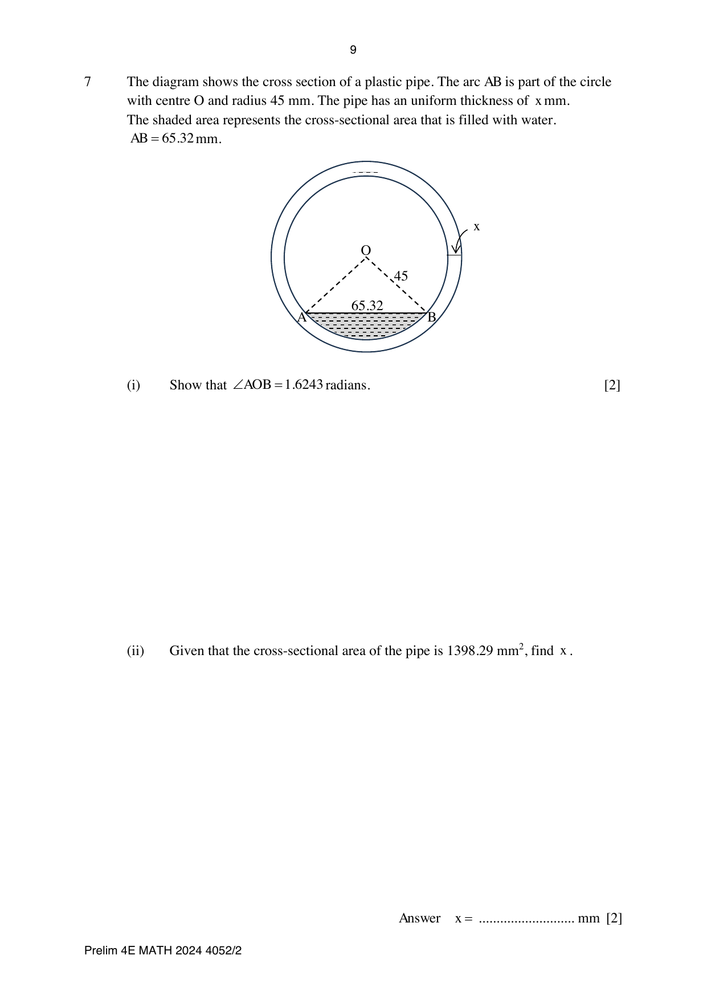
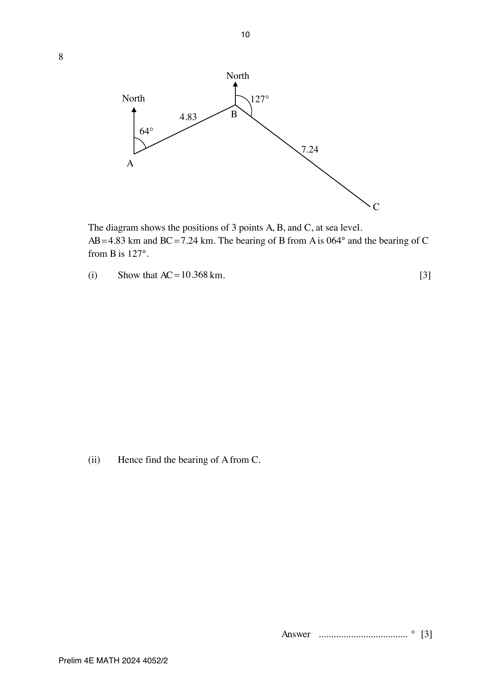
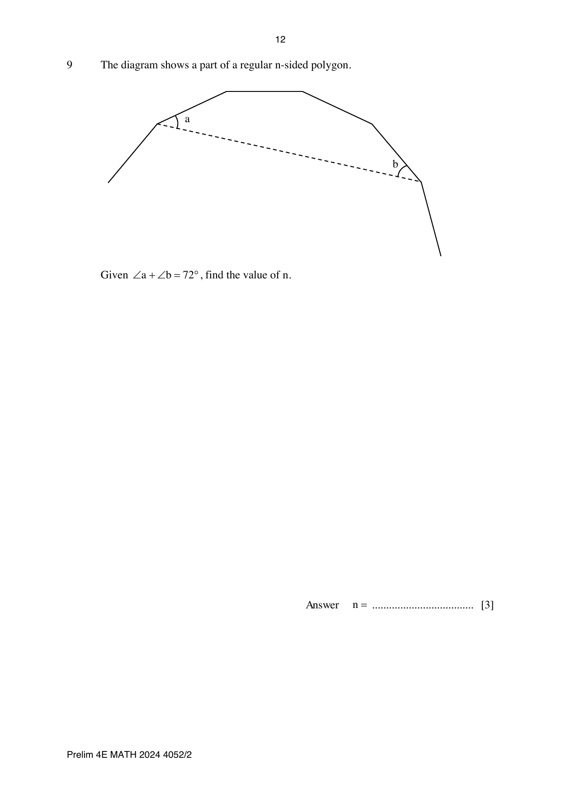
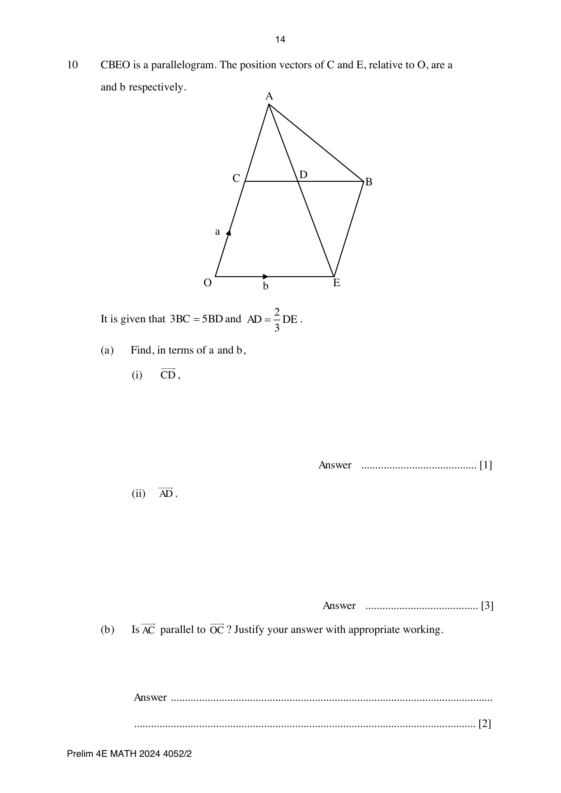

# Anderson Secondary School — Mathematics 4052/02 Paper 2 (cleaned)

> **Institution:** Anderson Secondary School
> **Exam:** Preliminary Examination 2024
> **Level:** Secondary Four Express and Five Normal
> **Subjects:** Elementary Mathematics
> **Paper:** 4052/02 Paper 2
> **Date:** 15 August 2024
> **Duration:** 2 hours 15 minutes
> **Total Marks:** 90
> **Source:** `ANDSS 4E2024EM_ Prelim P2_QP.pdf`

---

## Instructions

Candidates answer on the Question Paper.
Additional Materials: Nil.

Write your name, class and index number on all the work you hand in.
Write in dark blue or black pen.
You may use an HB pencil for any diagrams or graphs.
Do not use staples, paper clips, highlighters, glue, correction fluid or tape.

Answer all questions on the answer spaces provided.
If working is needed for any question, it must be shown with the answer.
Omission of essential working will result in loss of marks.

The use of an approved scientific calculator is expected, where appropriate.
If the degree of accuracy is not specified in the question, and if the answer is not exact, give the answer to three significant figures. Give answers in degrees to one decimal place.
For $\pi$, use either your calculator value or $3.142$, unless the question requires the answer in terms of $\pi$.

At the end of the examination, fasten all your work securely together.
The number of marks is given in brackets [ ] at the end of each question or part question.
The total of the marks for this paper is 90.

Setter: Mr Colin Chen

---

## Mathematical Formulae

*Compound interest*

$$
\text{Total amount} = P\left(1+\frac{r}{100}\right)^{n}
$$

*Mensuration*

$$
\text{Curved surface area of a cone} = \pi rl
$$

$$
\text{Surface area of a sphere} = 4\pi r^{2}
$$

$$
\text{Volume of a cone} = \frac{1}{3}\pi r^{2}h
$$

$$
\text{Volume of a sphere} = \frac{4}{3}\pi r^{3}
$$

$$
\text{Area of triangle } ABC = \frac{1}{2}ab\sin C
$$

$$
\text{Arc length} = r\theta,\text{ where }\theta\text{ is in radians}
$$

$$
\text{Sector area} = \frac{1}{2}r^{2}\theta,\text{ where }\theta\text{ is in radians}
$$

*Trigonometry*

$$
\frac{a}{\sin A} = \frac{b}{\sin B} = \frac{c}{\sin C}
$$

$$
a^{2} = b^{2}+c^{2}-2bc\cos A
$$

*Statistics*

$$
\text{Mean} = \frac{\Sigma fx}{\Sigma f}
$$

$$
\text{Standard deviation} = \sqrt{\frac{\Sigma fx^{2}}{\Sigma f}-\left(\frac{\Sigma fx}{\Sigma f}\right)^{2}}
$$

---

### Q1

> **Marks:** 7
> **Page:** 3

A cone has a radius of 24 cm and a total surface area of $1536\pi\text{ cm}^{2}$.

**(a)** Show that the volume of the cone is $6144\pi\text{ cm}^{3}$. [3]
> **Topic:** G5 Mensuration
> **Sub-topic:** Mensuration
> **LO:** [[context/subjects/o-level-e-maths/learning-objectives/o-level-e-maths-G5c.md|G5c]]

**(b)** The cone is recasted into a solid sphere. Find

**(i)** the radius of the sphere, [2]
> **Topic:** G5 Mensuration
> **Sub-topic:** Mensuration
> **LO:** [[context/subjects/o-level-e-maths/learning-objectives/o-level-e-maths-G5c.md|G5c]]

**(ii)** the total surface area of the sphere. [2]
> **Topic:** G5 Mensuration
> **Sub-topic:** Mensuration
> **LO:** [[context/subjects/o-level-e-maths/learning-objectives/o-level-e-maths-G5c.md|G5c]]

### Q2

> **Marks:** 8
> **Page:** 4–5

**(a)** Matthew invests ＄20 000 into a fixed deposit at $r\%$ per month, compounded monthly. After 24 months he will be able to receive ＄21 337.05.
Find the value of $r$. [2]
> **Topic:** N3 Percentage
> **Sub-topic:** Percentage
> **LO:** [[context/subjects/o-level-e-maths/learning-objectives/o-level-e-maths-N3d.md|N3d]]

**(b)** Matthew buys a car on hire purchase. He made a $30\%$ downpayment and takes up a 7 year loan which charges simple interest at $2.78\%$ per annum. Given that he pays ＄1774.40 monthly instalment for the car, calculate the price of the car.
Give your answer correct to the nearest dollar. [3]
> **Topic:** N3 Percentage
> **Sub-topic:** Percentage
> **LO:** [[context/subjects/o-level-e-maths/learning-objectives/o-level-e-maths-N3d.md|N3d]]

**(c)** Matthew wants to invest in Japanese Yen (JPY) to make a profit. In April, he bought JPY with SGD 980. In June, he sold the JPY to get his money back in Singapore dollars.
The exchange rates were:

- April: SGD 1 = JPY 114.5
- June: SGD 1 = JPY 118.2

Calculate the percentage profit or loss that Matthew made. [3]
> **Topic:** N3 Percentage
> **Sub-topic:** Percentage
> **LO:** [[context/subjects/o-level-e-maths/learning-objectives/o-level-e-maths-N3d.md|N3d]]

### Q3

> **Marks:** 3
> **Topic:** N3 Percentage
> **Sub-topic:** Percentage
> **LO:** [[context/subjects/o-level-e-maths/learning-objectives/o-level-e-maths-N3d.md|N3d]]
> **Page:** 5

A chess club currently has 37 male members and 16 female members. The club hosted a Valentine's Day event to attract married couples to join the club as new members. (Both husband and wife must be totally new to the club.) After this event, the percentage of female members became $40\%$. Find the number of married couples who joined the club after the event. [3]

### Q4

> **Marks:** 6
> **Page:** 6

The marks of a group of 19 students in a test were recorded, as the marks are shown in the stem and leaf diagram. The mode is 42 marks.

| Stem | Leaf | | | | | | | |
| --- | --- | --- | --- | --- | --- | --- | --- | --- |
| 3 | $a$ | 0 | 1 | 2 | 6 | | | |
| 4 | 1 | 2 | 2 | 2 | 6 | 7 | | |
| 5 | 0 | 2 | 4 | 4 | $b$ | 5 | 8 | 9 |

Key: $4\mid 1$ means 41 marks.

**(i)** Find the value of $a$ and $b$. [2]
> **Topic:** S1 Data handling and analysis
> **Sub-topic:** Data handling and analysis
> **LO:** [[context/subjects/o-level-e-maths/learning-objectives/o-level-e-maths-S1k.md|S1k]]

**(ii)** Find the median mark. [1]
> **Topic:** S1 Data handling and analysis
> **Sub-topic:** Data handling and analysis
> **LO:** [[context/subjects/o-level-e-maths/learning-objectives/o-level-e-maths-S1f.md|S1f]]

**(iii)** Calculate the mean and standard deviation of the marks. [2]
> **Topic:** S1 Data handling and analysis
> **Sub-topic:** Data handling and analysis
> **LO:** [[context/subjects/o-level-e-maths/learning-objectives/o-level-e-maths-S1k.md|S1k]]

**(iv)** Marks for another group of 20 students were also recorded. The results are summarized in the table below.

| | |
| --- | --- |
| Mean | 48.2 |
| Standard deviation | 7.22 |

Make two comparisons between the marks obtained by the group of 19 students and by the group of 20 students. [2]
> **Topic:** S1 Data handling and analysis
> **Sub-topic:** Data handling and analysis
> **LO:** [[context/subjects/o-level-e-maths/learning-objectives/o-level-e-maths-S1f.md|S1f]]

### Q5

> **Marks:** 8
> **Page:** 7–8

**(a)** Adam has some 50-cent and 20-cent coins in his wallet. Given that he has a total of 73 coins adding up to a value of ＄28.10, form 2 simultaneous equations to find the number of 50-cent and 20-cent coins he has. [5]
> **Topic:** N7 Equations and inequalities
> **Sub-topic:** Equations and inequalities
> **LO:** [[context/subjects/o-level-e-maths/learning-objectives/o-level-e-maths-N7c.md|N7c]]

**(b)** Express $\dfrac{4x}{4x^{2}-25}+\dfrac{1}{5-2x}$ as a single fraction in its simplest form. [3]
> **Topic:** N7 Equations and inequalities
> **Sub-topic:** Equations and inequalities
> **LO:** [[context/subjects/o-level-e-maths/learning-objectives/o-level-e-maths-N7c.md|N7c]]

### Q6

> **Marks:** 3
> **Page:** 8

The position vectors of points $A$ and $B$ are $\begin{pmatrix}-9\\ 3\end{pmatrix}$ and $\begin{pmatrix}1\\ -12\end{pmatrix}$ respectively.

**(a)** Find the column vector $\overrightarrow{BA}$. [1]
> **Topic:** G7 Vectors in two dimensions
> **Sub-topic:** Vectors in two dimensions
> **LO:** [[context/subjects/o-level-e-maths/learning-objectives/o-level-e-maths-G7h.md|G7h]]

**(b)** Find $\left|\overrightarrow{BA}\right|$. [2]
> **Topic:** G7 Vectors in two dimensions
> **Sub-topic:** Vectors in two dimensions
> **LO:** [[context/subjects/o-level-e-maths/learning-objectives/o-level-e-maths-G7h.md|G7h]]

### Q7

> **Marks:** 4
> **Page:** 9

The diagram shows the cross section of a plastic pipe. The arc $AB$ is part of the circle with centre $O$ and radius 45 mm. The pipe has a uniform thickness of $x$ mm.
The shaded area represents the cross-sectional area that is filled with water.
$AB=65.32$ mm.

**(i)** Show that $\angle AOB=1.6243$ radians. [2]
> **Topic:** G5 Mensuration
> **Sub-topic:** Mensuration
> **LO:** [[context/subjects/o-level-e-maths/learning-objectives/o-level-e-maths-G5g.md|G5g]]

**(ii)** Given that the cross-sectional area of the pipe is $1398.29\text{ mm}^{2}$, find $x$. [2]
> **Topic:** G5 Mensuration
> **Sub-topic:** Mensuration
> **LO:** [[context/subjects/o-level-e-maths/learning-objectives/o-level-e-maths-G5b.md|G5b]]

### Q8

> **Marks:** 10
> **Page:** 10–11

The diagram shows the positions of 3 points $A$, $B$, and $C$, at sea level.
$AB=4.83$ km and $BC=7.24$ km. The bearing of $B$ from $A$ is $064^{\circ}$ and the bearing of $C$ from $B$ is $127^{\circ}$.

**(i)** Show that $AC=10.368$ km. [3]
> **Topic:** G4 Pythagoras' theorem and trigonometry
> **Sub-topic:** Pythagoras' theorem and trigonometry
> **LO:** [[context/subjects/o-level-e-maths/learning-objectives/o-level-e-maths-G4g.md|G4g]]

**(ii)** Hence find the bearing of $A$ from $C$. [3]
> **Topic:** G4 Pythagoras' theorem and trigonometry
> **Sub-topic:** Pythagoras' theorem and trigonometry
> **LO:** [[context/subjects/o-level-e-maths/learning-objectives/o-level-e-maths-G4g.md|G4g]]

**(iii)** A boat travels in a straight line from point $B$ to reach the line $AC$. Find the shortest distance that the boat needs to travel. [2]
> **Topic:** G4 Pythagoras' theorem and trigonometry
> **Sub-topic:** Pythagoras' theorem and trigonometry
> **LO:** [[context/subjects/o-level-e-maths/learning-objectives/o-level-e-maths-G4g.md|G4g]]

**(iv)** An object was detected directly below point $C$. The angle of depression of the object from $B$ is $12^{\circ}$. Find the distance of the object from $C$. [2]
> **Topic:** G4 Pythagoras' theorem and trigonometry
> **Sub-topic:** Pythagoras' theorem and trigonometry
> **LO:** [[context/subjects/o-level-e-maths/learning-objectives/o-level-e-maths-G4g.md|G4g]]

### Q9

> **Marks:** 3
> **Topic:** G1 Angles, triangles and polygons
> **Sub-topic:** Angles, triangles and polygons
> **LO:** [[context/subjects/o-level-e-maths/learning-objectives/o-level-e-maths-G1f.md|G1f]]
> **Page:** 12

The diagram shows a part of a regular $n$-sided polygon.

Given $\angle a+\angle b=72^{\circ}$, find the value of $n$. [3]

### Q10

> **Marks:** 11
> **Page:** 14–15

$CBEO$ is a parallelogram. The position vectors of $C$ and $E$, relative to $O$, are $\mathbf{a}$ and $\mathbf{b}$ respectively.

It is given that $3BC=5BD$ and $AD=\dfrac{2}{3}DE$.

**(a)** Find, in terms of $\mathbf{a}$ and $\mathbf{b}$,

**(i)** $\overrightarrow{CD}$, [1]
> **Topic:** G7 Vectors in two dimensions
> **Sub-topic:** Vectors in two dimensions
> **LO:** [[context/subjects/o-level-e-maths/learning-objectives/o-level-e-maths-G7h.md|G7h]]

**(ii)** $\overrightarrow{AD}$. [3]
> **Topic:** G7 Vectors in two dimensions
> **Sub-topic:** Vectors in two dimensions
> **LO:** [[context/subjects/o-level-e-maths/learning-objectives/o-level-e-maths-G7h.md|G7h]]

**(b)** Is $AC$ parallel to $OC$? Justify your answer with appropriate working. [2]
> **Topic:** G7 Vectors in two dimensions
> **Sub-topic:** Vectors in two dimensions
> **LO:** [[context/subjects/o-level-e-maths/learning-objectives/o-level-e-maths-G7h.md|G7h]]

**(c)** Find

**(i)** $\dfrac{\text{area of }\triangle ADB}{\text{area of }\triangle ACD}$, [1]
> **Topic:** G7 Vectors in two dimensions
> **Sub-topic:** Vectors in two dimensions
> **LO:** [[context/subjects/o-level-e-maths/learning-objectives/o-level-e-maths-G7h.md|G7h]]

**(ii)** $\dfrac{\text{area of }\triangle ADC}{\text{area of }\triangle AOE}$, [2]
> **Topic:** G7 Vectors in two dimensions
> **Sub-topic:** Vectors in two dimensions
> **LO:** [[context/subjects/o-level-e-maths/learning-objectives/o-level-e-maths-G7h.md|G7h]]

**(iii)** $\dfrac{\text{area of }\triangle ADB}{\text{area of }CDEO}$. [2]
> **Topic:** G7 Vectors in two dimensions
> **Sub-topic:** Vectors in two dimensions
> **LO:** [[context/subjects/o-level-e-maths/learning-objectives/o-level-e-maths-G7h.md|G7h]]

### Q11

> **Marks:** 9
> **Page:** 16–17

The variables $x$ and $y$ are connected by the equation $y=2x+\dfrac{6}{x}-7$.
Some corresponding values of $x$ and $y$ are given in the table below.

| $x$ | 0.5 | 1 | 1.5 | 2 | 3 | 4 | 5 | 6 | 7 |
| --- | --- | --- | --- | --- | --- | --- | --- | --- | --- |
| $y$ | 6 | 1 | 0 | $a$ | 1 | 2.5 | 4.2 | 6 | 7.9 |

**(a)** Calculate the value of $a$. [1]
> **Topic:** N6 Functions and graphs
> **Sub-topic:** Functions and graphs
> **LO:** [[context/subjects/o-level-e-maths/learning-objectives/o-level-e-maths-N6c.md|N6c]]

**(b)** On the grid, draw the graph of $y=2x+\dfrac{6}{x}-7$ for $0.5\leq x\leq 7$. [2]
> **Topic:** N6 Functions and graphs
> **Sub-topic:** Functions and graphs
> **LO:** [[context/subjects/o-level-e-maths/learning-objectives/o-level-e-maths-N6c.md|N6c]]

A blank grid is printed on the next page of the question paper.

**(c)** The point $A$ has coordinates $(3,-1)$. A tangent to the curve can be drawn so that the tangent passes through $A$.

**(i)** On the same grid draw this tangent. [1]
> **Topic:** N6 Functions and graphs
> **Sub-topic:** Functions and graphs
> **LO:** [[context/subjects/o-level-e-maths/learning-objectives/o-level-e-maths-N6c.md|N6c]]

**(ii)** Find the equation of this tangent. [2]
> **Topic:** N6 Functions and graphs
> **Sub-topic:** Functions and graphs
> **LO:** [[context/subjects/o-level-e-maths/learning-objectives/o-level-e-maths-N6c.md|N6c]]

**(d)** By drawing a suitable straight line on your graph, explain why the equation $3x^{2}-8x+6=0$ has no solution for $0.5\leq x\leq 7$. [3]
> **Topic:** N6 Functions and graphs
> **Sub-topic:** Functions and graphs
> **LO:** [[context/subjects/o-level-e-maths/learning-objectives/o-level-e-maths-N6c.md|N6c]]

### Q12

> **Marks:** 9
> **Page:** 18–19

Mr Tan took part in a 42 km marathon run. He used $x$ minutes to run the first 25 km at a constant speed.

**(a)** Write down an expression, in terms of $x$, for his speed in km/h for the first 25 km. [1]
> **Topic:** N6 Functions and graphs
> **Sub-topic:** Functions and graphs
> **LO:** [[context/subjects/o-level-e-maths/learning-objectives/o-level-e-maths-N6h.md|N6h]]

**(c)** For the last 17 km of the run, Mr Tan ran at a speed that is 2 km/h slower than his initial speed, and he took $(x-22.5)$ minutes.
Write down an equation to represent this information and show that it simplifies to $2x^{2}-525x+33750=0$. [3]
> **Topic:** N6 Functions and graphs
> **Sub-topic:** Functions and graphs
> **LO:** [[context/subjects/o-level-e-maths/learning-objectives/o-level-e-maths-N6h.md|N6h]]

The question paper prints this part as (c). There is no printed part (b). The mark scheme labels this working (b).

**(c)** Solve $2x^{2}-525x+33750=0$. [3]
> **Topic:** N6 Functions and graphs
> **Sub-topic:** Functions and graphs
> **LO:** [[context/subjects/o-level-e-maths/learning-objectives/o-level-e-maths-N6h.md|N6h]]

**(d)** Given that Mr Tan took more than 4 hours to complete his run, find the time he took for the whole run. Give your answer in hours and minutes. [2]
> **Topic:** N6 Functions and graphs
> **Sub-topic:** Functions and graphs
> **LO:** [[context/subjects/o-level-e-maths/learning-objectives/o-level-e-maths-N6h.md|N6h]]

### Q13

> **Marks:** 8
> **Page:** 20–22

A book writer intends to sell her books to either Australia or Brazil, and she is planning to use Singapore post office Speedpost service to mail her books. The following table shows the mailing prices and other requirements.

All rates are in Singapore dollars.
GST is not applicable for international mail rates.
The largest dimension should not exceed 400 mm, with length, width and height combined not exceeding 900 mm.

| Destination | Weight up to | Speedpost Express (＄) | Speedpost Priority (＄) | Speedpost Economy (＄) |
| --- | --- | --- | --- | --- |
| Zone A, Malaysia | Document | 25.00 | 20.00 | - |
| Zone A, Malaysia | 2 kg | 61.00 | 39.00 | 26.00 |
| Zone A, Malaysia | 5 kg | 91.00 | 55.00 | 26.00 |
| Zone A, Malaysia | 10 kg | 122.00 | 78.00 | 43.00 |
| Zone A, Malaysia | 20 kg | 158.00 | 115.00 | 66.00 |
| Zone B, Asia | Document | 50.00 | 45.00 | - |
| Zone B, Asia | 2 kg | 108.00 | 78.00 | 37.00 |
| Zone B, Asia | 5 kg | 180.00 | 123.00 | 37.00 |
| Zone B, Asia | 10 kg | 269.00 | 182.00 | 64.00 |
| Zone B, Asia | 20 kg | 398.00 | 278.00 | 106.00 |
| Zone C, Australia, New Zealand, Europe, USA and Canada | Document | 75.00 | 70.00 | - |
| Zone C, Australia, New Zealand, Europe, USA and Canada | 2 kg | 159.00 | 107.00 | 80.00 |
| Zone C, Australia, New Zealand, Europe, USA and Canada | 5 kg | 259.00 | 161.00 | 80.00 |
| Zone C, Australia, New Zealand, Europe, USA and Canada | 10 kg | 400.00 | 232.00 | 135.00 |
| Zone C, Australia, New Zealand, Europe, USA and Canada | 20 kg | 569.00 | 354.00 | 202.00 |
| Zone D, Rest of the World | Document | 100.00 | 95.00 | - |
| Zone D, Rest of the World | 2 kg | 393.00 | 155.00 | 86.00 |
| Zone D, Rest of the World | 5 kg | 630.00 | 260.00 | 86.00 |
| Zone D, Rest of the World | 10 kg | 929.00 | 386.00 | 160.00 |
| Zone D, Rest of the World | 20 kg | 1388.00 | 603.00 | 282.00 |

**(a)** The writer wants to send an 18 kg parcel using Speedpost Economy.
Calculate the percentage increase in the cost of sending to Brazil as compared to the cost of sending to Australia. [2]
> **Topic:** N3 Percentage
> **Sub-topic:** Percentage
> **LO:** [[context/subjects/o-level-e-maths/learning-objectives/o-level-e-maths-N3d.md|N3d]]

**(b)** All the books have the same dimension of 6 mm by 128 mm by 128 mm and weigh 75 g each. The cost to manufacture each book is ＄1.80.
The author hopes to earn a profit of ＄3.00 for each book sold to Australia.
By considering the manufacturing cost and the mailing cost to Australia, find the lowest possible price at which the writer should sell each book. Give your answer in dollars and cents correct to the nearest ten cents. Show your working clearly. [6]
> **Topic:** N3 Percentage
> **Sub-topic:** Percentage
> **LO:** [[context/subjects/o-level-e-maths/learning-objectives/o-level-e-maths-N3d.md|N3d]]
