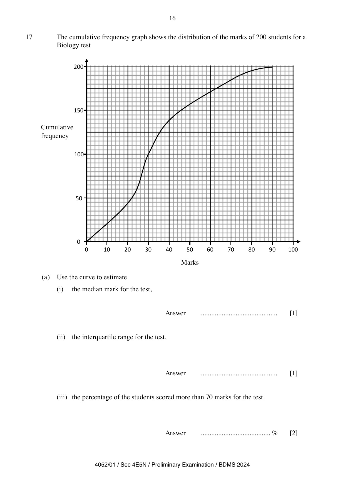
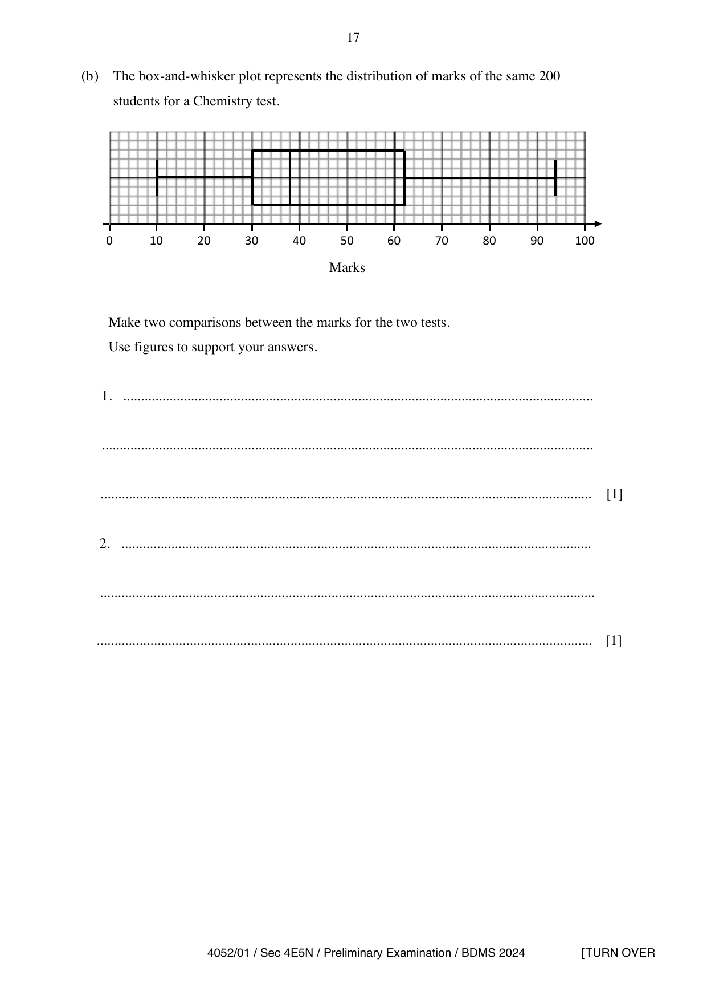
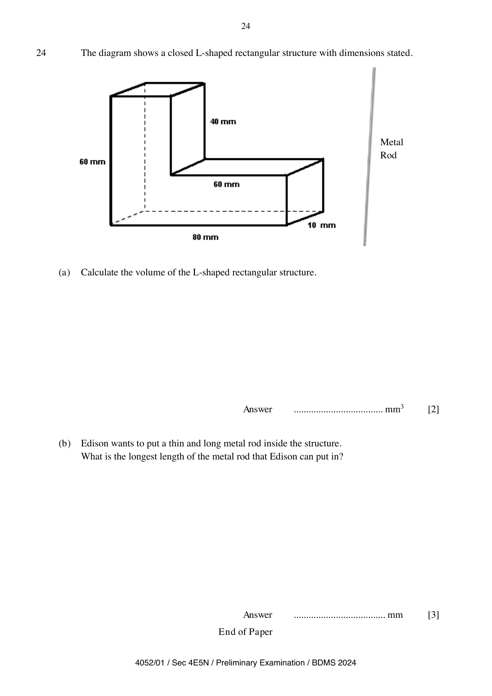

# Bendemeer Secondary School — Mathematics 4052/01 Paper 1 (cleaned)

> **Institution:** Bendemeer Secondary School
> **Exam:** Preliminary Examination 2024
> **Level:** Secondary 4 Express / 5 Normal (Academic)
> **Subjects:** Elementary Mathematics
> **Paper:** 4052/01 Paper 1
> **Date:** 20 August 2024
> **Duration:** 2 hours 15 minutes
> **Total Marks:** 90
> **Source:** `Bendemeer 2024_Prelim Exam_4E5N_EMath_P1 QP.pdf`

---

## Instructions

Write your name, class and register number on all the work you hand in.
Write in dark blue or black pen.
You may use an HB pencil for any diagrams or graphs.
Do not use staples, paper clips, glue or correction fluid/tape.
DO NOT WRITE ON ANY BARCODES.

Answer all questions.
The number of marks is given in brackets [ ] at the end of each question or part question.

If working is needed for any question, it must be shown with the answer.
Omission of essential working will result in loss of marks.
The total of the marks for this paper is 90.

The use of an approved scientific calculator is expected, where appropriate.
If the degree of accuracy is not specified in the question, and if the answer is not exact, give the answer to three significant figures. Give answers in degrees to one decimal place.
For $\pi$, use either your calculator value or $3.142$.

Candidates answer on the Question Paper. No additional materials are required.

---

## Mathematical Formulae

*Compound interest*

$$
\text{Total amount} = P\left(1+\frac{r}{100}\right)^{n}
$$

*Mensuration*

$$
\text{Curved surface area of a cone} = \pi rl
$$

$$
\text{Surface area of a sphere} = 4\pi r^{2}
$$

$$
\text{Volume of a cone} = \frac{1}{3}\pi r^{2}h
$$

$$
\text{Volume of a sphere} = \frac{4}{3}\pi r^{3}
$$

$$
\text{Area of triangle } ABC = \frac{1}{2}ab\sin C
$$

$$
\text{Arc length} = r\theta,\text{ where }\theta\text{ is in radians}
$$

$$
\text{Sector area} = \frac{1}{2}r^{2}\theta,\text{ where }\theta\text{ is in radians}
$$

*Trigonometry*

$$
\frac{a}{\sin A} = \frac{b}{\sin B} = \frac{c}{\sin C}
$$

$$
a^{2} = b^{2}+c^{2}-2bc\cos A
$$

*Statistics*

$$
\text{Mean} = \frac{\sum fx}{\sum f}
$$

$$
\text{Standard deviation} = \sqrt{\frac{\sum fx^{2}}{\sum f}-\left(\frac{\sum fx}{\sum f}\right)^{2}}
$$

---

## Answer all the questions

### Q1

> **Marks:** 3
> **Page:** 3

Factorise each of the following completely.

**(a)** $4a^{2}-b^{2}$ [1]
> **Topic:** N5 Algebraic expressions and formulae
> **Sub-topic:** Algebraic expressions and formulae
> **LO:** [[context/subjects/o-level-e-maths/learning-objectives/o-level-e-maths-N5h.md|N5h]]

**(b)** $5x-1+10x^{2}y-2xy$ [2]
> **Topic:** N5 Algebraic expressions and formulae
> **Sub-topic:** Algebraic expressions and formulae
> **LO:** [[context/subjects/o-level-e-maths/learning-objectives/o-level-e-maths-N5h.md|N5h]]

---

### Q2

> **Marks:** 3
> **Page:** 4

**(a)** Simplify $(2x^{3}y)^{3}$. [1]
> **Topic:** N1 Numbers and their operations
> **Sub-topic:** Numbers and their operations
> **LO:** [[context/subjects/o-level-e-maths/learning-objectives/o-level-e-maths-N1j.md|N1j]]

**(b)** Use the laws of indices to solve the following equation for $x$. Show your working clearly.

$$
2^{2}\times 5^{3}+\frac{1}{125^{x}}=5^{4}
$$

[2]
> **Topic:** N1 Numbers and their operations
> **Sub-topic:** Numbers and their operations
> **LO:** [[context/subjects/o-level-e-maths/learning-objectives/o-level-e-maths-N1j.md|N1j]]

---

### Q3

> **Marks:** 3
> **Page:** 5

**(a)** Express $1176$ as a product of its prime factors. [1]
> **Topic:** N1 Numbers and their operations
> **Sub-topic:** Numbers and their operations
> **LO:** [[context/subjects/o-level-e-maths/learning-objectives/o-level-e-maths-N1b.md|N1b]]

**(b)** The number $1176k$ is a perfect cube. Find the smallest positive integer value of $k$. [1]
> **Topic:** N1 Numbers and their operations
> **Sub-topic:** Numbers and their operations
> **LO:** [[context/subjects/o-level-e-maths/learning-objectives/o-level-e-maths-N1b.md|N1b]]

**(c)** The highest common factor of two distinct integers, $n$ and $1176$, is $28$. Given that $500<n<1000$, find the smallest possible value of $n$. [1]
> **Topic:** N1 Numbers and their operations
> **Sub-topic:** Numbers and their operations
> **LO:** [[context/subjects/o-level-e-maths/learning-objectives/o-level-e-maths-N1b.md|N1b]]

---

### Q4

> **Marks:** 2
> **Topic:** G5 Mensuration
> **Sub-topic:** Mensuration
> **LO:** [[context/subjects/o-level-e-maths/learning-objectives/o-level-e-maths-G5c.md|G5c]]
> **Page:** 6

The volume of a right pyramid is $4.8\times 10^{-8}\text{ m}^{3}$ and its length of the square base is $1.5\times 10^{-3}\text{ m}$. Giving your answer in standard form, find its height. [2]

---

### Q5

> **Marks:** 2
> **Topic:** N4 Rate and speed
> **Sub-topic:** Rate and speed
> **LO:** [[context/subjects/o-level-e-maths/learning-objectives/o-level-e-maths-N4a.md|N4a]]
> **Page:** 6

Benjamin invested ＄8000 at a rate of $3.3\%$ per annum compounded monthly. What is the value of his investment at the end of $6$ months? [2]

---

### Q6

> **Marks:** 4
> **Page:** 7

**(a)** In the Venn diagram below, shade the region $P\cup Q'$.

The diagram is a rectangle for the universal set $\varepsilon$ containing two overlapping circles labelled $P$ and $Q$. [1]
> **Topic:** N8 Set language and notation
> **Sub-topic:** Set language and notation
> **LO:** [[context/subjects/o-level-e-maths/learning-objectives/o-level-e-maths-N8c.md|N8c]]

**(b)** A universal set $\varepsilon$ and its subsets $A$ and $B$ are given by

$\varepsilon = \{x : x\text{ is an integer and }0<x<12\}$,

$A = \{x : x\text{ is a factor of }24\}$,

$B = \{x : 2x-7\geq 5\}$.

**(i)** Write all the elements of $\varepsilon$ in the Venn diagram below.

The diagram is a rectangle for $\varepsilon$ containing two overlapping circles labelled $A$ and $B$. [2]
> **Topic:** N8 Set language and notation
> **Sub-topic:** Set language and notation
> **LO:** [[context/subjects/o-level-e-maths/learning-objectives/o-level-e-maths-N8c.md|N8c]]

**(ii)** Another number is included in the universal set $\varepsilon$. This number is in the region $A\cap B$. Write down a possible value of this number. [1]
> **Topic:** N8 Set language and notation
> **Sub-topic:** Set language and notation
> **LO:** [[context/subjects/o-level-e-maths/learning-objectives/o-level-e-maths-N8c.md|N8c]]

---

### Q7

> **Marks:** 4
> **Page:** 8

The expression $2x^{2}+8x+9$ is equivalent to $2(x+a)^{2}+b$.

**(a)** Find the value of $a$ and the value of $b$. [2]
> **Topic:** N6 Functions and graphs
> **Sub-topic:** Functions and graphs
> **LO:** [[context/subjects/o-level-e-maths/learning-objectives/o-level-e-maths-N6c.md|N6c]]

**(b)** Sketch the curve $y=2x^{2}+8x+9$ on the given axes below, clearly showing the $y$-intercept and the turning point.

Blank Cartesian axes are given, with the origin marked $0$. [2]
> **Topic:** N6 Functions and graphs
> **Sub-topic:** Functions and graphs
> **LO:** [[context/subjects/o-level-e-maths/learning-objectives/o-level-e-maths-N6c.md|N6c]]

---

### Q8

> **Marks:** 4
> **Page:** 9

Given that $y$ is inversely proportional to the square of $(x+2)$ and the value of $y=\dfrac{1}{3}$ when $x=7$.

**(a)** Express $y$ in terms of $x$. [2]
> **Topic:** N5 Algebraic expressions and formulae
> **Sub-topic:** Algebraic expressions and formulae
> **LO:** [[context/subjects/o-level-e-maths/learning-objectives/o-level-e-maths-N5k.md|N5k]]

**(b)** Hence, or otherwise, make $x$ the subject of the formula. [2]
> **Topic:** N5 Algebraic expressions and formulae
> **Sub-topic:** Algebraic expressions and formulae
> **LO:** [[context/subjects/o-level-e-maths/learning-objectives/o-level-e-maths-N5k.md|N5k]]

---

### Q9

> **Marks:** 2
> **Topic:** N6 Functions and graphs
> **Sub-topic:** Functions and graphs
> **LO:** [[context/subjects/o-level-e-maths/learning-objectives/o-level-e-maths-N6i.md|N6i]]
> **Page:** 10

Explain why $(2n+3)^{2}-(4n+3)(n-6)$ is a multiple of $3$ for all integer values of $n$. [2]

---

### Q10

> **Marks:** 3
> **Topic:** N5 Algebraic expressions and formulae
> **Sub-topic:** Algebraic expressions and formulae
> **LO:** [[context/subjects/o-level-e-maths/learning-objectives/o-level-e-maths-N5m.md|N5m]]
> **Page:** 10

Simplify $\dfrac{2x+3}{x^{2}+3x+2}-\dfrac{5}{x+1}$ as a single fraction. [3]

---

### Q11

> **Marks:** 4
> **Page:** 11

**(a)** Solve the inequality

$$
x-7\leq\frac{3x-5}{2}<8.
$$

Represent your solution on the number line below.

The number line is marked from $-10$ to $8$ in steps of $2$. [3]
> **Topic:** N7 Equations and inequalities
> **Sub-topic:** Equations and inequalities
> **LO:** [[context/subjects/o-level-e-maths/learning-objectives/o-level-e-maths-N7g.md|N7g]]

**(b)** Hence, write down the largest prime number that satisfy the inequality

$$
x-7\leq\frac{3x-5}{2}<8.
$$

[1]
> **Topic:** N1 Numbers and their operations
> **Sub-topic:** Numbers and their operations
> **LO:** [[context/subjects/o-level-e-maths/learning-objectives/o-level-e-maths-N1e.md|N1e]]

---

### Q12

> **Marks:** 3
> **Page:** 12

In the diagram below, $ADB$ is a right-angled triangle with $\angle ADB=90^{\circ}$ and $ACD$ is a triangle with $AD=8\text{ cm}$ and $\angle DCA=30^{\circ}$. $B$ is a point on $AC$ such that $AB=10\text{ cm}$ and $DB=6\text{ cm}$.

**(a)** Write down, as a fraction in its simplest form, the value of $\sin\angle DBC$. [1]
> **Topic:** G4 Pythagoras' theorem and trigonometry
> **Sub-topic:** Pythagoras' theorem and trigonometry
> **LO:** [[context/subjects/o-level-e-maths/learning-objectives/o-level-e-maths-G4c.md|G4c]]

**(b)** Hence, calculate the length of $DC$. [2]
> **Topic:** G4 Pythagoras' theorem and trigonometry
> **Sub-topic:** Pythagoras' theorem and trigonometry
> **LO:** [[context/subjects/o-level-e-maths/learning-objectives/o-level-e-maths-G4c.md|G4c]]

---

### Q13

> **Marks:** 3
> **Topic:** G1 Angles, triangles and polygons
> **Sub-topic:** Angles, triangles and polygons
> **LO:** [[context/subjects/o-level-e-maths/learning-objectives/o-level-e-maths-G1d.md|G1d]]
> **Page:** 12

Dorothy wants to make a bracelet using gemstones. Every gemstone is a regular pentagon of the same size.

A small sketch shows regular pentagons joined edge to edge.

How many gemstones does she need to make a bracelet assuming that there is no gap between each gemstone? [3]

---

### Q14

> **Marks:** 5
> **Page:** 13

Each term in the following sequence is found by multiplying the same constant to the previous term.

$$
p,\quad 12,\quad q,\quad 48,\quad r,\quad \ldots
$$

**(a)** Write down two possible values of $q$. [2]
> **Topic:** N3 Percentage
> **Sub-topic:** Percentage
> **LO:** [[context/subjects/o-level-e-maths/learning-objectives/o-level-e-maths-N3b.md|N3b]]

**(b)** Write down the value of $\dfrac{p}{r}$. [1]
> **Topic:** N3 Percentage
> **Sub-topic:** Percentage
> **LO:** [[context/subjects/o-level-e-maths/learning-objectives/o-level-e-maths-N3b.md|N3b]]

**(c)** Write down the $n$th term of the sequence. [1]
> **Topic:** N3 Percentage
> **Sub-topic:** Percentage
> **LO:** [[context/subjects/o-level-e-maths/learning-objectives/o-level-e-maths-N3b.md|N3b]]

**(d)** Explain why $400$ is not a term in this sequence. [1]
> **Topic:** N3 Percentage
> **Sub-topic:** Percentage
> **LO:** [[context/subjects/o-level-e-maths/learning-objectives/o-level-e-maths-N3b.md|N3b]]

---

### Q15

> **Marks:** 4
> **Topic:** S2 Probability
> **Sub-topic:** Probability
> **LO:** [[context/subjects/o-level-e-maths/learning-objectives/o-level-e-maths-S2c.md|S2c]]
> **Page:** 14

A bag initially contains $6$ blue balls, $x$ green balls and $y$ red balls. The probability of drawing a green ball is $\dfrac{1}{4}$. If $4$ blue balls are added into the bag and $1$ red ball is removed from the bag, the possibility of drawing a green ball from the bag is $\dfrac{2}{9}$. Find the value of $x$. [4]

---

### Q16

> **Marks:** 4
> **Page:** 15

**(a)** Construct triangle $ABC$ where $AB=10\text{ cm}$, $BC=7\text{ cm}$ and $\angle ABC=60^{\circ}$. $AB$ has already been drawn. [1]
> **Topic:** G2 Congruence and similarity
> **Sub-topic:** Congruence and similarity
> **LO:** [[context/subjects/o-level-e-maths/learning-objectives/o-level-e-maths-G2e.md|G2e]]

**(b)** Construct the perpendicular bisector of $AB$. [1]
> **Topic:** G2 Congruence and similarity
> **Sub-topic:** Congruence and similarity
> **LO:** [[context/subjects/o-level-e-maths/learning-objectives/o-level-e-maths-G2e.md|G2e]]

**(c)** Construct the bisector of angle $BAC$. [1]
> **Topic:** G2 Congruence and similarity
> **Sub-topic:** Congruence and similarity
> **LO:** [[context/subjects/o-level-e-maths/learning-objectives/o-level-e-maths-G2e.md|G2e]]

**(d)** Mark clearly a possible point which is inside the triangle, equidistant from the lines $AB$ and $AC$, and is nearer to point $A$ than point $B$. Label this point $P$. [1]
> **Topic:** G2 Congruence and similarity
> **Sub-topic:** Congruence and similarity
> **LO:** [[context/subjects/o-level-e-maths/learning-objectives/o-level-e-maths-G2e.md|G2e]]

---

### Q17

> **Marks:** 6
> **Page:** 16–17

The cumulative frequency graph shows the distribution of the marks of $200$ students for a Biology test.

**(a)** Use the curve to estimate

**(i)** the median mark for the test, [1]
> **Topic:** S1 Data handling and analysis
> **Sub-topic:** Data handling and analysis
> **LO:** [[context/subjects/o-level-e-maths/learning-objectives/o-level-e-maths-S1f.md|S1f]]

**(ii)** the interquartile range for the test, [1]
> **Topic:** S1 Data handling and analysis
> **Sub-topic:** Data handling and analysis
> **LO:** [[context/subjects/o-level-e-maths/learning-objectives/o-level-e-maths-S1f.md|S1f]]

**(iii)** the percentage of the students scored more than $70$ marks for the test. [2]
> **Topic:** N6 Functions and graphs
> **Sub-topic:** Functions and graphs
> **LO:** [[context/subjects/o-level-e-maths/learning-objectives/o-level-e-maths-N6c.md|N6c]]

**(b)** The box-and-whisker plot represents the distribution of marks of the same $200$ students for a Chemistry test.

Make two comparisons between the marks for the two tests. Use figures to support your answers. [2]
> **Topic:** S1 Data handling and analysis
> **Sub-topic:** Data handling and analysis
> **LO:** [[context/subjects/o-level-e-maths/learning-objectives/o-level-e-maths-S1f.md|S1f]]

---

### Q18

> **Marks:** 4
> **Page:** 18

The volumes of two geometrically similar troughs $X$ and $Y$ are $4050\text{ cm}^{3}$ and $1200\text{ cm}^{3}$ respectively.

Trough $X$ has a height of $75\text{ cm}$ and base area of $162\text{ cm}^{2}$.

The diagram shows trough $X$, labelled $75\text{ cm}$, beside a smaller trough $Y$.

Find

**(a)** the height of trough $Y$, [2]
> **Topic:** G5 Mensuration
> **Sub-topic:** Mensuration
> **LO:** [[context/subjects/o-level-e-maths/learning-objectives/o-level-e-maths-G5a.md|G5a]]

**(b)** the area of the base of trough $Y$. [2]
> **Topic:** G5 Mensuration
> **Sub-topic:** Mensuration
> **LO:** [[context/subjects/o-level-e-maths/learning-objectives/o-level-e-maths-G5b.md|G5b]]

---

### Q19

> **Marks:** 4
> **Page:** 19

The diagram shows a square $PQRS$ of side $4\text{ cm}$. Two quadrants are drawn with $P$ and $Q$ as their centres respectively. The two quadrants intersect at point $X$.

**(a)** Catherine said the triangle $PXQ$ is an equilateral triangle. State whether you agree or disagree with Catherine and explain your decision. [1]
> **Topic:** G5 Mensuration
> **Sub-topic:** Mensuration
> **LO:** [[context/subjects/o-level-e-maths/learning-objectives/o-level-e-maths-G5b.md|G5b]]

**(b)** Find the area of the shaded region $SXR$. [3]
> **Topic:** G5 Mensuration
> **Sub-topic:** Mensuration
> **LO:** [[context/subjects/o-level-e-maths/learning-objectives/o-level-e-maths-G5b.md|G5b]]

---

### Q20

> **Marks:** 4
> **Page:** 20

The diagram shows the points $A$ and $B$ where $\overrightarrow{AB}=\begin{pmatrix}-2\\ -6\end{pmatrix}$.

**(a)** Given that $\overrightarrow{BC}=\begin{pmatrix}-3\\ 1\end{pmatrix}$, mark and label the point $C$ on the diagram. [1]
> **Topic:** G7 Vectors in two dimensions
> **Sub-topic:** Vectors in two dimensions
> **LO:** [[context/subjects/o-level-e-maths/learning-objectives/o-level-e-maths-G7h.md|G7h]]

**(b)** $D$ is the point such that $|\overrightarrow{BC}|=|\overrightarrow{CD}|$ and $ABCD$ is a kite. Express $\overrightarrow{CD}$ as a vector. [1]
> **Topic:** G7 Vectors in two dimensions
> **Sub-topic:** Vectors in two dimensions
> **LO:** [[context/subjects/o-level-e-maths/learning-objectives/o-level-e-maths-G7h.md|G7h]]

**(c)** Find $|\overrightarrow{AC}|$. [2]
> **Topic:** G7 Vectors in two dimensions
> **Sub-topic:** Vectors in two dimensions
> **LO:** [[context/subjects/o-level-e-maths/learning-objectives/o-level-e-maths-G7h.md|G7h]]

---

### Q21

> **Marks:** 4
> **Page:** 21

The graph shows the speed-time graph of a car during a period of $60$ seconds. The distance travelled in the first $20$ seconds is $250\text{ m}$.

The graph starts at $10\text{ m/s}$ when $t=0$, rises in a straight line to a maximum speed $v$ at $t=20\text{ s}$, falls in a straight line to $10\text{ m/s}$ at $t=32\text{ s}$, and stays at $10\text{ m/s}$ until $t=60\text{ s}$.

**(a)** Show that the maximum speed $v$ is $15\text{ m/s}$. [1]
> **Topic:** N6 Functions and graphs
> **Sub-topic:** Functions and graphs
> **LO:** [[context/subjects/o-level-e-maths/learning-objectives/o-level-e-maths-N6b.md|N6b]]

**(b)** Calculate the deceleration during the motion. [1]
> **Topic:** N6 Functions and graphs
> **Sub-topic:** Functions and graphs
> **LO:** [[context/subjects/o-level-e-maths/learning-objectives/o-level-e-maths-N6b.md|N6b]]

**(c)** Calculate the average speed during the $60$ seconds. [2]
> **Topic:** N6 Functions and graphs
> **Sub-topic:** Functions and graphs
> **LO:** [[context/subjects/o-level-e-maths/learning-objectives/o-level-e-maths-N6b.md|N6b]]

---

### Q22

> **Marks:** 5
> **Page:** 22

In the figure below, $O$ is the origin, $A$ is the point $(9, 3)$, $B$ is the point $(6, 0)$ and $D$ is the point $(0, 12)$.

Line $AB$ is drawn, and $C$ lies on the positive $x$-axis. $D$ is on the positive $y$-axis, and $CD$ is drawn.

**(a)** $C$ is another point on the $x$-axis such that $AB=AC$. Find the coordinates of $C$. [1]
> **Topic:** G6 Coordinate geometry
> **Sub-topic:** Coordinate geometry
> **LO:** [[context/subjects/o-level-e-maths/learning-objectives/o-level-e-maths-G6c.md|G6c]]

**(b)** Find the equation of line $AB$. [2]
> **Topic:** G6 Coordinate geometry
> **Sub-topic:** Coordinate geometry
> **LO:** [[context/subjects/o-level-e-maths/learning-objectives/o-level-e-maths-G6c.md|G6c]]

**(c)** Find the shortest distance from $O$ to the straight line $CD$. [2]
> **Topic:** G6 Coordinate geometry
> **Sub-topic:** Coordinate geometry
> **LO:** [[context/subjects/o-level-e-maths/learning-objectives/o-level-e-maths-G6c.md|G6c]]

---

### Q23

> **Marks:** 5
> **Page:** 23

In the diagram, $ABC$, $CDE$ and $AFE$ are straight lines. $BD$ is parallel to $AE$. $BD=15\text{ cm}$, $CD=12\text{ cm}$, $DE=8\text{ cm}$ and $EF=10\text{ cm}$.

Point $C$ is above $D$, with $CD=12\text{ cm}$. $B$ is to the left of $D$, with $BD=15\text{ cm}$. $E$ is to the right of and below $D$, with $DE=8\text{ cm}$. $F$ lies on $AE$ with $EF=10\text{ cm}$. Arrows on $BD$ and $AE$ show that the lines are parallel.

**(a)** Show that triangles $CDB$ and $DEF$ are similar. Give a reason for each statement you make. [2]
> **Topic:** G2 Congruence and similarity
> **Sub-topic:** Congruence and similarity
> **LO:** [[context/subjects/o-level-e-maths/learning-objectives/o-level-e-maths-G2i.md|G2i]]

**(b)** Find the ratio of area of triangle $CDB$ : area of triangle $DEF$. [1]
> **Topic:** G2 Congruence and similarity
> **Sub-topic:** Congruence and similarity
> **LO:** [[context/subjects/o-level-e-maths/learning-objectives/o-level-e-maths-G2i.md|G2i]]

**(c)** Show that $ABDF$ is a parallelogram. [2]
> **Topic:** G2 Congruence and similarity
> **Sub-topic:** Congruence and similarity
> **LO:** [[context/subjects/o-level-e-maths/learning-objectives/o-level-e-maths-G2i.md|G2i]]

---

### Q24

> **Marks:** 5
> **Page:** 24

The diagram shows a closed L-shaped rectangular structure with dimensions stated.

**(a)** Calculate the volume of the L-shaped rectangular structure. [2]
> **Topic:** G5 Mensuration
> **Sub-topic:** Mensuration
> **LO:** [[context/subjects/o-level-e-maths/learning-objectives/o-level-e-maths-G5c.md|G5c]]

**(b)** Edison wants to put a thin and long metal rod inside the structure. What is the longest length of the metal rod that Edison can put in? [3]
> **Topic:** G5 Mensuration
> **Sub-topic:** Mensuration
> **LO:** [[context/subjects/o-level-e-maths/learning-objectives/o-level-e-maths-G5c.md|G5c]]

End of Paper
