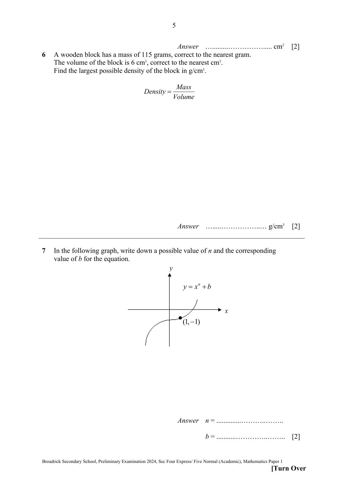
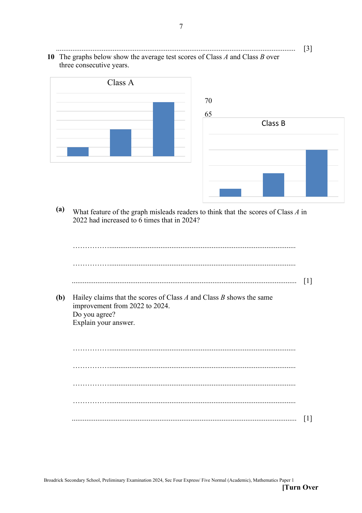
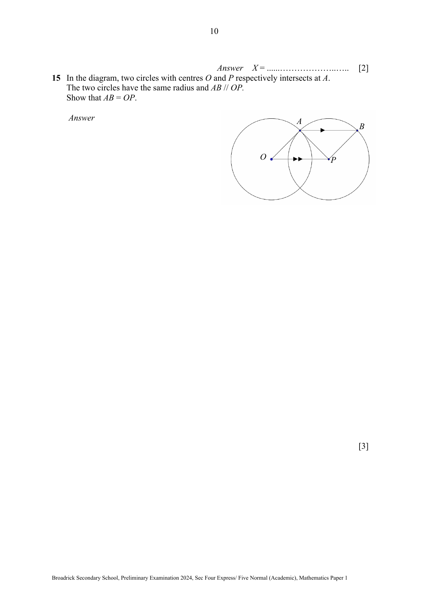
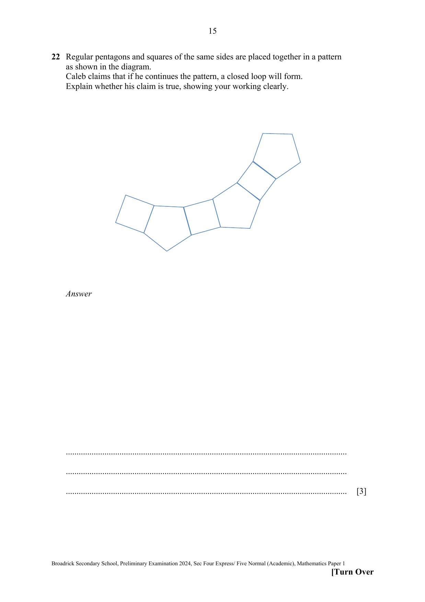

# Broadrick Secondary School — Mathematics 4052/01 Paper 1 (cleaned)

> **Institution:** Broadrick Secondary School
> **Exam:** Preliminary Examination 2024
> **Level:** Secondary 4 Express / Secondary 5 Normal Academic
> **Subjects:** Elementary Mathematics
> **Paper:** 4052/01 Paper 1
> **Date:** August 2024
> **Duration:** 2 hours 15 minutes
> **Total Marks:** 90
> **Source:** `Broadrick EM 2024 Maths Sec Prelim - P1.pdf`

---

## Instructions

Write your name, class and index number on all the work you hand in.
Write in dark blue or black pen.
You may use an HB pencil for any diagrams or graphs.
Do not use staples, paper clips, glue or correction fluid.

Answer all questions.
If working is needed for any question it must be shown with the answer.
Omission of essential working will result in loss of marks.
The use of an approved scientific calculator is expected, where appropriate.
If the degree of accuracy is not specified in the question, and if the answer is not exact, give the answer to three significant figures. Give answers in degrees to one decimal place.
For $\pi$, use either your calculator value or $3.142$, unless the question requires the answer in terms of $\pi$.

The number of marks is given in brackets [ ] at the end of each question or part question.
The total of the marks for this paper is 90.

Printed errata on the cover: Q13(b) — for $p>10$ instead of $p\geq 0$.

Some Word equations did not render on the PDF (Q17, Q24, the matrix in Q25, and the vector statement in Q27). Those gaps are marked below and are not filled in from the mark scheme.

---

## Mathematical Formulae

*Compound interest*

$$
\text{Total amount} = P\left(1+\frac{r}{100}\right)^{n}
$$

*Mensuration*

$$
\text{Curved surface area of a cone} = \pi rl
$$

$$
\text{Surface area of a sphere} = 4\pi r^{2}
$$

$$
\text{Volume of a cone} = \frac{1}{3}\pi r^{2}h
$$

$$
\text{Volume of a sphere} = \frac{4}{3}\pi r^{3}
$$

$$
\text{Area of triangle } ABC = \frac{1}{2}ab\sin C
$$

$$
\text{Arc length} = r\theta,\text{ where }\theta\text{ is in radians}
$$

$$
\text{Sector area} = \frac{1}{2}r^{2}\theta,\text{ where }\theta\text{ is in radians}
$$

*Trigonometry*

$$
\frac{a}{\sin A} = \frac{b}{\sin B} = \frac{c}{\sin C}
$$

$$
a^{2} = b^{2}+c^{2}-2bc\cos A
$$

*Statistics*

$$
\text{Mean} = \frac{\sum fx}{\sum f}
$$

$$
\text{Standard deviation} = \sqrt{\frac{\sum fx^{2}}{\sum f}-\left(\frac{\sum fx}{\sum f}\right)^{2}}
$$

---

### Q1

> **Marks:** 1
> **Topic:** N1 Numbers and their operations
> **Sub-topic:** Numbers and their operations
> **LO:** [[context/subjects/o-level-e-maths/learning-objectives/o-level-e-maths-N1g.md|N1g]]
> **Page:** 3

Evaluate $\dfrac{(-3.85)^{2}-\sqrt{10-0.9\times(-6)}}{3.11-4^{3}}$, giving your answer to 4 significant figures.

### Q2

> **Marks:** (a) 1, (b) 1; total 2
> **Topic:** S1 Data handling and analysis
> **Sub-topic:** Data handling and analysis
> **LO:** [[context/subjects/o-level-e-maths/learning-objectives/o-level-e-maths-S1f.md|S1f]]
> **Page:** 3

The frequency table shows the reaction time, $t$ seconds, for a chemical to change the colour of the litmus paper in 100 laboratory sessions.

| Time ($t$ sec) | $0<t\leq 1$ | $1<t\leq 2$ | $2<t\leq 3$ | $3<t\leq 4$ | $4<t\leq 5$ |
| --- | --- | --- | --- | --- | --- |
| Frequency | 8 | 28 | 44 | 18 | 2 |

Calculate an estimate for the

**(a)** mean reaction time,

**(b)** standard deviation of the reaction times.

### Q3

> **Marks:** 2
> **Topic:** N1 Numbers and their operations
> **Sub-topic:** Numbers and their operations
> **LO:** [[context/subjects/o-level-e-maths/learning-objectives/o-level-e-maths-N1h.md|N1h]]
> **Page:** 3

Given that $\dfrac{5^{x}}{2^{2x}\times 5^{3-x}}=2^{m}5^{n}$, express $m$ and $n$ in terms of $x$.

### Q4

> **Marks:** 2
> **Topic:** N1 Numbers and their operations
> **Sub-topic:** Numbers and their operations
> **LO:** [[context/subjects/o-level-e-maths/learning-objectives/o-level-e-maths-N1b.md|N1b]]
> **Page:** 4

The highest common factor of two numbers is 18.
The lowest common multiple of the two numbers is 324.
Both numbers are greater than 20.

Find the two numbers.

### Q5

> **Marks:** (a) 1, (b) 2; total 3
> **Topic:** N2 Ratio and proportion
> **Sub-topic:** Ratio and proportion
> **LO:** [[context/subjects/o-level-e-maths/learning-objectives/o-level-e-maths-N2c.md|N2c]]
> **Page:** 4–5

A map has a scale of $1:50\,000$.

**(a)** The distance between two towns on the map is 7.5 cm.
Calculate the actual distance between the two towns in kilometres.

**(b)** A lake covers an actual area of 2.25 square kilometres.
Find the area of the lake on the map in square centimetres.

### Q6

> **Marks:** 2
> **Topic:** N3 Percentage
> **Sub-topic:** Percentage
> **LO:** [[context/subjects/o-level-e-maths/learning-objectives/o-level-e-maths-N3e.md|N3e]]
> **Page:** 5

A wooden block has a mass of 115 grams, correct to the nearest gram.
The volume of the block is $6\text{ cm}^{3}$, correct to the nearest $\text{cm}^{3}$.
Find the largest possible density of the block in $\text{g/cm}^{3}$.

$$\text{Density}=\frac{\text{Mass}}{\text{Volume}}$$

### Q7

> **Marks:** 2
> **Topic:** N6 Functions and graphs
> **Sub-topic:** Functions and graphs
> **LO:** [[context/subjects/o-level-e-maths/learning-objectives/o-level-e-maths-N6c.md|N6c]]
> **Page:** 5

In the following graph, write down a possible value of $n$ and the corresponding value of $b$ for the equation.

The curve $y=x^{n}+b$ passes through $(1,-1)$. It lies in the third and first quadrants and is increasing through that point.

### Q8

> **Marks:** (a) 2, (b) 2; total 4
> **Topic:** G4 Pythagoras' theorem and trigonometry
> **Sub-topic:** Pythagoras' theorem and trigonometry
> **LO:** [[context/subjects/o-level-e-maths/learning-objectives/o-level-e-maths-G4e.md|G4e]]
> **Page:** 6

In triangle $ABC$, $AB=14.6\text{ cm}$, $BC=7.6\text{ cm}$ and angle $BAC=31^{\circ}$.

Find

**(a)** obtuse angle $ACB$,

**(b)** area of triangle $ABC$.

### Q9

> **Marks:** 3
> **Topic:** N3 Percentage
> **Sub-topic:** Percentage
> **LO:** [[context/subjects/o-level-e-maths/learning-objectives/o-level-e-maths-N3d.md|N3d]]
> **Page:** 6–7

Keila travels from Singapore to Japan.
She wants to change 850 Singapore dollars (＄) into Yen (¥).

The exchange rate in Singapore is ＄100 = ¥11600 and the exchange rate in Japan is ¥1 = ＄0.0086.
She claims that she will receive more if she changes the money in Singapore.
Justify if her claim is true.
Show your working.

### Q10

> **Marks:** (a) 1, (b) 1; total 2
> **Topic:** S1 Data handling and analysis
> **Sub-topic:** Data handling and analysis
> **LO:** [[context/subjects/o-level-e-maths/learning-objectives/o-level-e-maths-S1f.md|S1f]]
> **Page:** 7

The graphs below show the average test scores of Class A and Class B over three consecutive years.

**(a)** What feature of the graph misleads readers to think that the scores of Class A in 2022 had increased to 6 times that in 2024?

**(b)** Hailey claims that the scores of Class A and Class B shows the same improvement from 2022 to 2024.
Do you agree?
Explain your answer.

### Q11

> **Marks:** 2
> **Topic:** N1 Numbers and their operations
> **Sub-topic:** Numbers and their operations
> **LO:** [[context/subjects/o-level-e-maths/learning-objectives/o-level-e-maths-N1e.md|N1e]]
> **Page:** 8

The number $2^{p}\times 5^{q}\times\dfrac{5}{2}$ is a perfect cube where $p$ and $q$ are greater than 1.
Find the smallest possible integer values of $p$ and of $q$.

### Q12

> **Marks:** (a) 1, (b) 3; total 4
> **Page:** 8–9

**(a)** Simplify $\left(16y^{3}\right)^{\frac{3}{2}}$.

**(b)** $5^{k}=125\sqrt[3]{5}\sqrt{5}$.
> **Topic:** N1 Numbers and their operations
> **Sub-topic:** Numbers and their operations
> **LO:** [[context/subjects/o-level-e-maths/learning-objectives/o-level-e-maths-N1j.md|N1j]]
Use laws of indices to find the value of $k$.
Show your working.

### Q13

> **Marks:** (a) 1, (b) 1, (c) 1; total 3
> **Topic:** N8 Set language and notation
> **Sub-topic:** Set language and notation
> **LO:** [[context/subjects/o-level-e-maths/learning-objectives/o-level-e-maths-N8a.md|N8a]]
> **Page:** 9

Given that $\xi=\{\text{integers }x:p\leq x<20\}$

$A=\{\text{factors of }24\}$

$B=\{\text{prime numbers}\}$

$C=\{\text{perfect squares}\}$

**(a)** List the elements of $A$ if $p=2$.

**(b)** For $p\geq 0$, list the elements of $(B\cup C)'$ such that $\mathrm{n}(B\cup C)'=4$.

Cover errata: this part should read $p>10$ instead of $p\geq 0$.

**(c)** Find the smallest $p$ such that $A\cap C=\varnothing$.

### Q14

> **Marks:** 2
> **Topic:** N2 Ratio and proportion
> **Sub-topic:** Ratio and proportion
> **LO:** [[context/subjects/o-level-e-maths/learning-objectives/o-level-e-maths-N2a.md|N2a]]
> **Page:** 9–10

A company divided a bonus among its employees $A$, $B$, and $C$ in the ratio $2:3:7$.
$C$'s bonus was $X\%$ more than the combined bonus of $A$ and $B$.
Find $X$.

### Q15

> **Marks:** 3
> **Topic:** G3 Properties of circles
> **Sub-topic:** Properties of circles
> **LO:** [[context/subjects/o-level-e-maths/learning-objectives/o-level-e-maths-G3b.md|G3b]]
> **Page:** 10

In the diagram, two circles with centres $O$ and $P$ respectively intersects at $A$.
The two circles have the same radius and $AB\parallel OP$.
Show that $AB=OP$.

### Q16

> **Marks:** (a) 2, (b)(i) 2, (b)(ii) 2; total 6
> **Topic:** G6 Coordinate geometry
> **Sub-topic:** Coordinate geometry
> **LO:** [[context/subjects/o-level-e-maths/learning-objectives/o-level-e-maths-G6c.md|G6c]]
> **Page:** 11

**(a)** Leanne says that the equation of the line $AB$ is $2y=-4x+1$ and the equation of the line $PQ$ is $4y=-9x+2$.

Is she correct?
Explain your answer.

**(b)** The diagram shows the graph of $y=x^{2}+px+q$. The curve crosses the $x$-axis at $-4$ and $1.5$.

**(i)** Write down equation of the graph in the form $y=x^{2}+px+q$.

**(ii)** Find the coordinates of the minimum point.

### Q17

> **Marks:** 2
> **Topic:** N6 Functions and graphs
> **Sub-topic:** Functions and graphs
> **LO:** [[context/subjects/o-level-e-maths/learning-objectives/o-level-e-maths-N6h.md|N6h]]
> **Page:** 12

Write as a single fraction in its simplest form [unclear].

The expression after “simplest form” is not visible on the page.

### Q18

> **Marks:** (a)(i) 1, (a)(ii) 2, (b) 2; total 5
> **Topic:** N5 Algebraic expressions and formulae
> **Sub-topic:** Algebraic expressions and formulae
> **LO:** [[context/subjects/o-level-e-maths/learning-objectives/o-level-e-maths-N5h.md|N5h]]
> **Page:** 12

**(a)** Factorise completely.

**(i)** $24a^{2}b+12ab^{2}-ab$

**(ii)** $mn-18-9m+2n$

**(b)** Expand and simplify $(-2x+3q)(x-2q)$.

### Q19

> **Marks:** (a) 2, (b) 2; total 4
> **Topic:** N3 Percentage
> **Sub-topic:** Percentage
> **LO:** [[context/subjects/o-level-e-maths/learning-objectives/o-level-e-maths-N3d.md|N3d]]
> **Page:** 13

Rayden invested ＄20 000 at a rate of 0.3% per month compound interest.

**(a)** Find the value of his investment at the end of 2 years.

**(b)** Rayden then withdrew $\dfrac{1}{5}$ of the accumulated amount at the end of the 2 years.
Find the new rate of compound interest per month so that his remaining investment reaches the same value in (a) in another 3 years.

### Q20

> **Marks:** 3
> **Topic:** N5 Algebraic expressions and formulae
> **Sub-topic:** Algebraic expressions and formulae
> **LO:** [[context/subjects/o-level-e-maths/learning-objectives/o-level-e-maths-N5m.md|N5m]]
> **Page:** 13

Simplify $\dfrac{2x^{2}-5xy-12y^{2}}{x^{2}-16y^{2}}$.

### Q21

> **Marks:** (a) 2, (b) 1; total 3
> **Topic:** G6 Coordinate geometry
> **Sub-topic:** Coordinate geometry
> **LO:** [[context/subjects/o-level-e-maths/learning-objectives/o-level-e-maths-G6c.md|G6c]]
> **Page:** 14

$P$ is the point $(-3,1)$ and $Q$ is the point $(3,3)$.

**(a)** Find the length of the $PQ$.

**(b)** The point $R$ is such that $PQR$ forms an isosceles triangle.
The angle bisector of angle $PQR$ has an equation of $y=x$.
Find the coordinates of $R$.

### Q22

> **Marks:** 3
> **Topic:** G2 Congruence and similarity
> **Sub-topic:** Congruence and similarity
> **LO:** [[context/subjects/o-level-e-maths/learning-objectives/o-level-e-maths-G2f.md|G2f]]
> **Page:** 15

Regular pentagons and squares of the same sides are placed together in a pattern as shown in the diagram.
Caleb claims that if he continues the pattern, a closed loop will form.
Explain whether his claim is true, showing your working clearly.

### Q23

> **Marks:** (a) 3, (b) 2; total 5
> **Topic:** G5 Mensuration
> **Sub-topic:** Mensuration
> **LO:** [[context/subjects/o-level-e-maths/learning-objectives/o-level-e-maths-G5c.md|G5c]]
> **Page:** 16

A cylinder $X$ has radius, $r$ cm and height $h$ cm.
A hemisphere $S$ is such that its radius is half of the radius of cylinder $X$.

**(a)** The volume of the cylinder is 4 times that of the hemisphere.
Express $h$ in terms of $r$.

**(b)** Another cylinder $Y$ is geometrically similar to cylinder $X$.
The ratio of the curved surface area of $X:Y=9:4$.
Find the height of cylinder $Y$ in terms of $r$.

### Q24

> **Marks:** (a) 2, (b) 2; total 4
> **Topic:** N5 Algebraic expressions and formulae
> **Sub-topic:** Algebraic expressions and formulae
> **LO:** [[context/subjects/o-level-e-maths/learning-objectives/o-level-e-maths-N5e.md|N5e]]
> **Page:** 17

The sum of the first $n$ terms of a linear sequence is [unclear].

The expression for the sum is not visible on the page.

**(a)** Show that the sum of the first $n$ terms in the sequence is always even.

**(b)** By finding the first three terms in the sequence or otherwise, find, in terms of $n$, an expression for the $n$th term of the sequence.

### Q25

> **Marks:** (a) 1, (b) 2, (c) 1, (d) 1; total 5
> **Topic:** N9 Matrices
> **Sub-topic:** Matrices
> **LO:** [[context/subjects/o-level-e-maths/learning-objectives/o-level-e-maths-N9b.md|N9b]]
> **Page:** 18

In bookstore A, a fiction book costs ＄8, a non-fiction book costs ＄10 and a science book costs ＄11.50.
In bookstore B, a fiction book costs ＄1.10 less, a non-fiction book costs ＄2.80 less and a science book costs ＄1.50 more than that in bookstore A.

The information can be represented by the matrix with columns labelled A and B and rows labelled F, NF and S. The numerical entries of that matrix are not visible on the page.

**(a)** Kevin bought 4 fiction books, 3 non-fiction books and 2 science books.
Molly bought 2 fiction book and $x$ science books.
Represent their purchases, in terms of $x$, in a $2\times 3$ matrix $\mathbf{P}$.

**(b)** Evaluate the matrix $\mathbf{R}=\mathbf{PQ}$.

**(c)** Explain what the elements in the first column of matrix $\mathbf{R}$ represent.

**(d)** Molly can save ＄5.30 by purchasing in bookstore A.
Using your answer in (b), find the value of $x$.

### Q26

> **Marks:** (a) 1, (b) 2, (c) 2, (d) 2; total 7
> **Topic:** N6 Functions and graphs
> **Sub-topic:** Functions and graphs
> **LO:** [[context/subjects/o-level-e-maths/learning-objectives/o-level-e-maths-N6c.md|N6c]]
> **Page:** 19–20

The diagrams show the speed-time graph and the corresponding distance-time graph of a car.
The car travelled from a point $P$ to $Q$ and in the journey, its greatest speed attained was 1.5 km/min.

On the speed-time graph, speed rises linearly from $v$ at 0800 to 1.5 km/min at 0820, stays at 1.5 km/min until 0900, then falls linearly to 0 at time $T$.
On the distance-time graph, distance is 0 at 0800, 21 km at 0820, and 92.25 km at time $T$. The graph is curved from 0800 to 0820, straight from 0820 to 0900, then curved up to 92.25 km.

**(a)** Convert 1.5 km/min to m/s.

**(b)** Show that $v$, the initial speed, was 0.6 km/min.

**(c)** Find the speed of the car, in m/s, at 0812.

**(d)** The total distance travelled by the car is 92.25 km.
Find the time, $T$, when it comes to a complete stop.

### Q27

> **Marks:** (a) 2, (b)(i) 3, (b)(ii) 1; total 6
> **Topic:** G7 Vectors in two dimensions
> **Sub-topic:** Vectors in two dimensions
> **LO:** [[context/subjects/o-level-e-maths/learning-objectives/o-level-e-maths-G7h.md|G7h]]
> **Page:** 21

$ABC$ is a triangle.
$D$ is the point on $BC$ such that $3BD=2DC$.

The printed statement after “and” is not visible. The diagram shows an arrow along $AC$ and an arrow along $AB$.

**(a)** Find $\overrightarrow{AD}$ in terms of $\mathbf{m}$ and $\mathbf{n}$.

**(b)** $R$ is on $AD$ produced such that $\overrightarrow{AR}=k\overrightarrow{AD}$ and $AC$ is parallel to $BR$.

**(i)** Show that $k=\dfrac{5}{3}$.

**(ii)** Find the ratio $\dfrac{\text{area of triangle }ABD}{\text{area of triangle }RBD}$.
