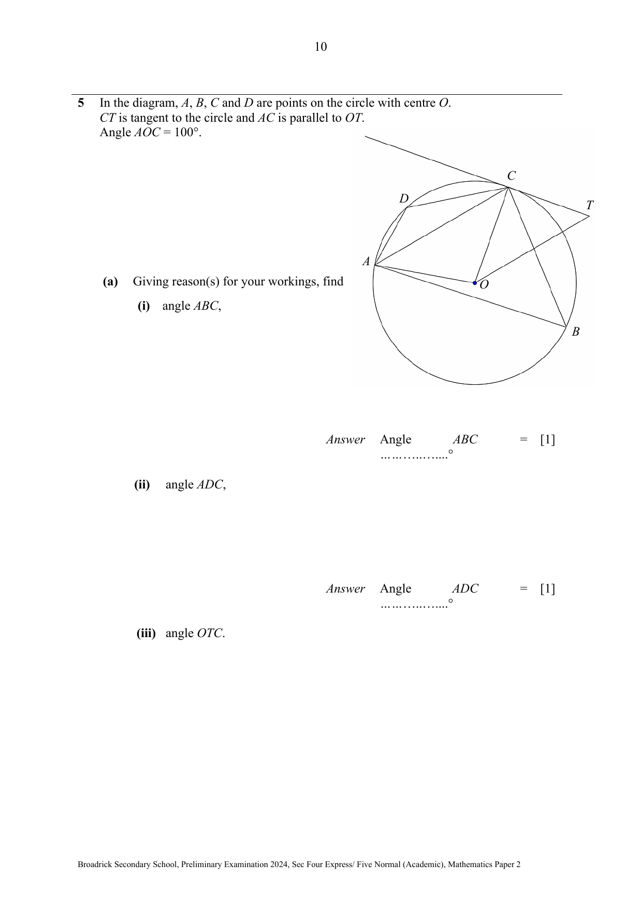

# Broadrick Secondary School — Mathematics 4052/02 Paper 2 (cleaned)

> **Institution:** Broadrick Secondary School
> **Exam:** Preliminary Examination 2024
> **Level:** Secondary 4 Express / Secondary 5 Normal Academic
> **Subjects:** Elementary Mathematics
> **Paper:** 4052/02 Paper 2
> **Date:** August 2024
> **Duration:** 2 hours 15 minutes
> **Total Marks:** 90
> **Source:** `Broadrick EM 2024 Maths Sec Prelim - P2.pdf`

---

## Instructions

Write your name, class and index number on all the work you hand in.
Write in dark blue or black pen.
You may use an HB pencil for any diagrams or graphs.
Do not use staples, paper clips, glue or correction fluid.
Write the question number attempted in the left column in the box provided.

Answer all questions.
If working is needed for any question it must be shown with the answer.
Omission of essential working will result in loss of marks.
The use of an approved scientific calculator is expected, where appropriate.
If the degree of accuracy is not specified in the question, and if the answer is not exact, give the answer to three significant figures. Give answers in degrees to one decimal place.
For $\pi$, use either your calculator value or $3.142$, unless the question requires the answer in terms of $\pi$.

The number of marks is given in brackets [ ] at the end of each question or part question.
The total of the marks for this paper is 90.

Setter: Ms Yeo Li Shan.

The equations in Q2(a) and Q2(d), and the coordinates of $A$ and $D$ in Q3, are not visible on the PDF.

---

## Mathematical Formulae

*Compound interest*

$$
\text{Total amount} = P\left(1+\frac{r}{100}\right)^{n}
$$

*Mensuration*

$$
\text{Curved surface area of a cone} = \pi rl
$$

$$
\text{Surface area of a sphere} = 4\pi r^{2}
$$

$$
\text{Volume of a cone} = \frac{1}{3}\pi r^{2}h
$$

$$
\text{Volume of a sphere} = \frac{4}{3}\pi r^{3}
$$

$$
\text{Area of triangle } ABC = \frac{1}{2}ab\sin C
$$

$$
\text{Arc length} = r\theta,\text{ where }\theta\text{ is in radians}
$$

$$
\text{Sector area} = \frac{1}{2}r^{2}\theta,\text{ where }\theta\text{ is in radians}
$$

*Trigonometry*

$$
\frac{a}{\sin A} = \frac{b}{\sin B} = \frac{c}{\sin C}
$$

$$
a^{2} = b^{2}+c^{2}-2bc\cos A
$$

*Statistics*

$$
\text{Mean} = \frac{\sum fx}{\sum f}
$$

$$
\text{Standard deviation} = \sqrt{\frac{\sum fx^{2}}{\sum f}-\left(\frac{\sum fx}{\sum f}\right)^{2}}
$$

---

### Q1

> **Marks:** (a) 1, (b) 2, (c) 2; total 5
> **Topic:** N1 Numbers and their operations
> **Sub-topic:** Numbers and their operations
> **LO:** [[context/subjects/o-level-e-maths/learning-objectives/o-level-e-maths-N1h.md|N1h]]
> **Page:** 3

A company produces phones.
In 2023, the company produced 3.6 million smartphones.

**(a)** Due to increased demand, the company produced 4.2 million smartphones in 2024.
Express this production figure in standard form.

**(b)** Calculate the percentage increase in smartphone production from 2023 to 2024.

**(c)** In 2023, 4% of the total phones produced were not smartphones.
Calculate the total number of phones produced in 2023.
Express your answer in standard form.

### Q2

> **Marks:** (a) 2, (b) 1, (c) 3, (d) 4; total 10
> **Topic:** N5 Algebraic expressions and formulae
> **Sub-topic:** Algebraic expressions and formulae
> **LO:** [[context/subjects/o-level-e-maths/learning-objectives/o-level-e-maths-N5k.md|N5k]]
> **Page:** 4–5

**(a)** Solve [unclear].

The equation is not visible on the page.

**(b)** Solve the inequality $1-3p\geq 5$.

**(c)** $3A=\dfrac{Ap+h}{1-h}$.
Rearrange the formula to make $A$ the subject.

**(d)** Solve the equation [unclear].
Give your answers correct to two decimal places.

The equation is not visible on the page.

### Q3

> **Marks:** (a) 3, (b) 2, (c) 2, (d) 3; total 10
> **Topic:** G6 Coordinate geometry
> **Sub-topic:** Coordinate geometry
> **LO:** [[context/subjects/o-level-e-maths/learning-objectives/o-level-e-maths-G6c.md|G6c]]
> **Page:** 6–7

$A$ is the point [unclear] and $D$ is the point [unclear].
$B$ is a point on the $y$-axis.

The coordinates of $A$ and of $D$ are not visible. The diagram shows $A$ to the left of the origin, $D$ on the positive $y$-axis, $B$ on the negative $y$-axis and $C$ in the first quadrant, with $ABCD$ a kite symmetric about the $y$-axis.

**(a)** The line $AB$ is parallel to $3y+5x-6=0$.
Find the equation of the line $AB$.

**(b)** Find the coordinates of $C$ such that it is equidistant from $B$ and $D$ and it lies on the line $y=7.5-x$.

**(c)** Find the area of the quadrilateral $ABCD$.

**(d)** Find the size of angle $ABC$.

### Q4

> **Marks:** (a) 1, (b)(i) 2, (b)(ii) 3, (b)(iii) 3; total 9
> **Topic:** N7 Equations and inequalities
> **Sub-topic:** Equations and inequalities
> **LO:** [[context/subjects/o-level-e-maths/learning-objectives/o-level-e-maths-N7c.md|N7c]]
> **Page:** 7–9

The table below shows the number of vertices ($n$) and number of diagonals ($X$) in a polygon.

| Number of vertices ($n$) | Number of diagonals ($X$) |
| --- | --- |
| 3 | 0 |
| 4 | 2 |
| 5 | 5 |
| 6 | 9 |
| $\ldots$ | |
| 8 | $a$ |

**(a)** Write down the value of $a$.

**(b)** The number of diagonals is related to the number of vertices by the equation $X=pn^{2}+qn$ where $p$ and $q$ are constants.

**(i)** Using appropriate substitution, show that $16p+4q=2$ and $25p+5q=5$.

**(ii)** Solve these simultaneous equations to find the values of $p$ and of $q$.

**(iii)** Explain whether it is possible to have a $n$-sided polygon with 495 diagonals.
Show your working clearly.

### Q5

> **Marks:** (a)(i) 1, (a)(ii) 1, (a)(iii) 3, (b) 1, (c) 3; total 9
> **Topic:** G3 Properties of circles
> **Sub-topic:** Properties of circles
> **LO:** [[context/subjects/o-level-e-maths/learning-objectives/o-level-e-maths-G3b.md|G3b]]
> **Page:** 10–11

In the diagram, $A$, $B$, $C$ and $D$ are points on the circle with centre $O$.
$CT$ is tangent to the circle and $AC$ is parallel to $OT$.
Angle $AOC=100^{\circ}$.

**(a)** Giving reason(s) for your workings, find

**(i)** angle $ABC$,

**(ii)** angle $ADC$,

**(iii)** angle $OTC$.

**(b)** Explain whether a circle can be drawn passing through the points $A$, $O$, $C$ and $D$.

**(c)** Given $CT=4.8\text{ cm}$, find the area of the minor segment $ADC$.

### Q6

> **Marks:** (a) 1, (b) 3, (c)(i) 1, (c)(ii) 2, (d) 3; total 10
> **Topic:** G6 Coordinate geometry
> **Sub-topic:** Coordinate geometry
> **LO:** [[context/subjects/o-level-e-maths/learning-objectives/o-level-e-maths-G6c.md|G6c]]
> **Page:** 12–13

**(a)** Complete the table of values for $y=\dfrac{1}{x-1}+x-1$.

| $x$ | $-2$ | $-1$ | $0$ | $0.5$ | $0.75$ | $1.25$ | $1.5$ | $2$ | $3$ | $3.5$ | $4$ |
| --- | --- | --- | --- | --- | --- | --- | --- | --- | --- | --- | --- |
| $y$ | | $-2.5$ | $-2$ | $-2.5$ | $-4.25$ | $4.25$ | $2.5$ | $2$ | $2.5$ | $2.9$ | $3.33$ |

The $y$-value for $x=-2$ is blank on the paper.

**(b)** On the grid opposite, draw the graph of $y=\dfrac{1}{x-1}+x-1$ for $-2\leq x\leq 4$.

**(c)** The point $P$ has the coordinates $(-1,2)$.
A tangent to the curve can be drawn so that the tangent passes through $P$ and its gradient $<0$.

**(i)** Draw this tangent on the same grid.

**(ii)** Find the equation of this tangent.

**(d)** By drawing an appropriate line, use your graph to solve the equation $\dfrac{1}{x-1}-\dfrac{1}{4}x=0$ in the range $-2\leq x\leq 4$.

### Q7

> **Marks:** (a)(i) 1, (a)(ii) 2, (b) 2, (c) 2, (d) 1, (e) 2; total 10
> **Topic:** S1 Data handling and analysis
> **Sub-topic:** Data handling and analysis
> **LO:** [[context/subjects/o-level-e-maths/learning-objectives/o-level-e-maths-S1i.md|S1i]]
> **Page:** 14–16

The cumulative frequency curve shows the distribution of the masses of 160 apples in tree A.

**(a)** Use the curve to estimate

**(i)** the median mass,

**(ii)** the interquartile range of the masses.

**(b)** 20% of the heaviest apples belong to the top grade.
Find the minimum mass an apple needs to be in the top grade.

**(c)** Two apples are chosen at random.
Find the probability that one apple weighs less than 320 g and the other apple weighs more than 360 g.
Give your answer to 3 significant figures.

The masses of 160 apples from tree B were recorded.
The box-and-whisker plot shows the distribution of the masses.

**(d)** Explain if the following statement is true.
“In tree B, there are more apples weighing less than 320 g as compared to those weighing more than 360 g.”

**(e)** Justine claims that it is better to get the apples from tree B.
Do you agree?
Explain your answer using appropriate figures.

### Q8

> **Marks:** (a) 2, (b) 2, (c) 4, (d) 2; total 10
> **Topic:** G5 Mensuration
> **Sub-topic:** Mensuration
> **LO:** [[context/subjects/o-level-e-maths/learning-objectives/o-level-e-maths-G5f.md|G5f]]
> **Page:** 16–18

The diagram shows a box in the shape of a cuboid measuring 15 cm by 8 cm by 10 cm.
The box has an open lid such that $I$ and $J$ are vertically above the midpoints of $DH$ and $CG$ respectively.

A rod is placed inside the box such that it touches the box only at $A$ and $J$.
Assume that the rod has negligible width.

**(a)** Find the length of $BE$.

**(b)** Find the length of $AG$.

**(c)** Show that the length of the rod, $AJ$, is 22.97 cm, correct to 4 significant figures.

**(d)** Find angle $JAG$.

### Q9

> **Marks:** (a) 2, (b) 5; total 7
> **Topic:** G5 Mensuration
> **Sub-topic:** Mensuration
> **LO:** [[context/subjects/o-level-e-maths/learning-objectives/o-level-e-maths-G5b.md|G5b]]
> **Page:** 18–19

An upright container is in the shape of a cone, mounted on a hemisphere.
The centre of the base of the cone and the hemisphere coincides.
The cone has a radius of 2 m and height of 3 m.
The hemisphere has a radius of 3 m.

**(a)** Find the capacity of the container.

**(b)** There is a tap on the vertex of the cone.
The container is filled with water such that the hemisphere and 90% of the cone are filled.
Find the area which the water is in contact with the container.

### Q10

> **Marks:** (a) 1, (b) 2, (c) 7; total 10
> **Topic:** N1 Numbers and their operations
> **Sub-topic:** Numbers and their operations
> **LO:** [[context/subjects/o-level-e-maths/learning-objectives/o-level-e-maths-N1g.md|N1g]]
> **Page:** 20–22

Tay is part of a student committee organizing a charity race event in 2025.
He wants to estimate the cost per participant to cover all expenses.

He did some more research and found the following costs.

Costs (excluding 9% GST)

| Item | Description | Unit cost |
| --- | --- | --- |
| Printing of T-shirts | One sided print, bundle of 100 pcs | ＄800 |
| | Double sided print, bundle of 100 pcs | ＄1500 |
| | Double sided print, bundle of 500 pcs | ＄7000 |
| Goodie bags (pack of 5) | One pack of 5 bags | ＄20 |
| | Bulk price (100+ packs) | ＄18 |
| | Bulk price (500+ packs) | ＄15 |
| Booking of venue | At least 6 months in advance | ＄1200 |
| | 3 to 5 months in advance | ＄1500 |
| Refreshments | Large set | ＄3 |
| | Regular set | ＄2.80 |
| | Small set | ＄2.50 |
| Participant medals | Pack of 10 | ＄45 |
| | Pack of 50 | ＄210 |

The T-shirts are printed overseas and shipped by a local courier.
Tay estimated the weight of each shirt to be 140 grams and he needs to select one of the local couriers.
The shipping rate depends on the weight of the product and courier.

| Local courier | First kg | Next 0.5 kg | Weight limit of each parcel |
| --- | --- | --- | --- |
| Simply Post | ＄4.80 | ＄1.85 | 80 kg |
| Singapore Post | ＄6.00 | ＄1.80 | 50 kg |
| DPEX | ＄5.50 | ＄1.60 | 30 kg |

Products need to be shipped in separate parcels if weight exceeds the limit.
9% GST is applicable for import goods as well as shipping fees.

**(a)** How many percent more will Tay need to pay if he booked the venue 3 months in advance instead of 6 months in advance?

**(b)** For a 50 kg purchase, calculate the amount of shipping fees charged by Singapore Post.

The event is scheduled to be in October.
Tay estimated the number of participants to be 1000 and he plans to confirm the venue by February.
He also wants to print double sided for the participant’s T-shirt, and issue a goodie bag, refreshment and medal to each participant.

He needs to decide how much registration fee he should charge each participant.
He must be able donate at least 40% of the proceeds to the charity and still cover all the costs.

**(c)** Suggest a sensible amount for the registration fee of a participant.
State your assumptions and decisions if any.
Show your calculations clearly.
