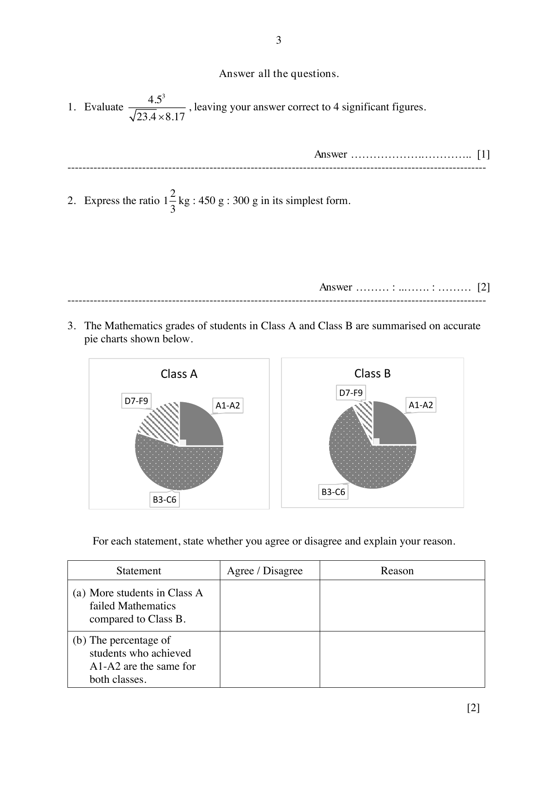
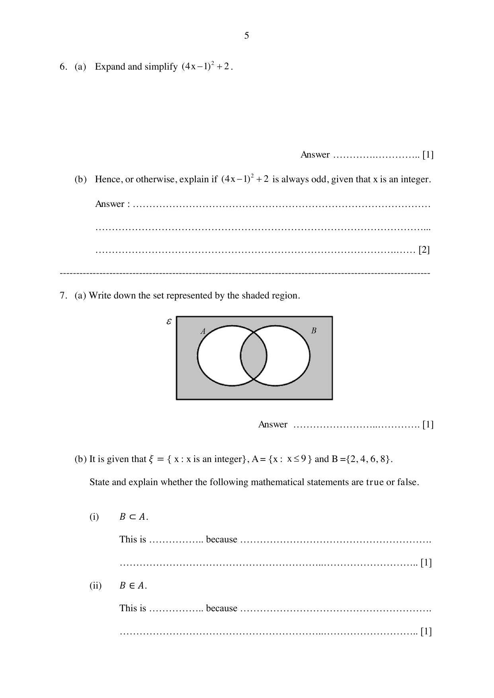
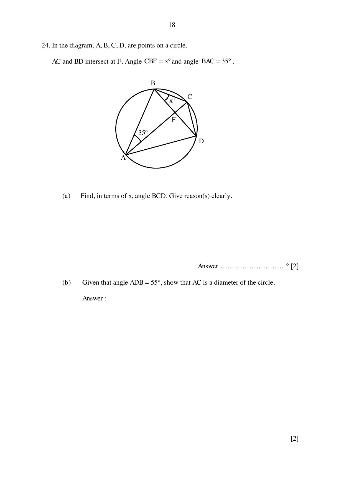
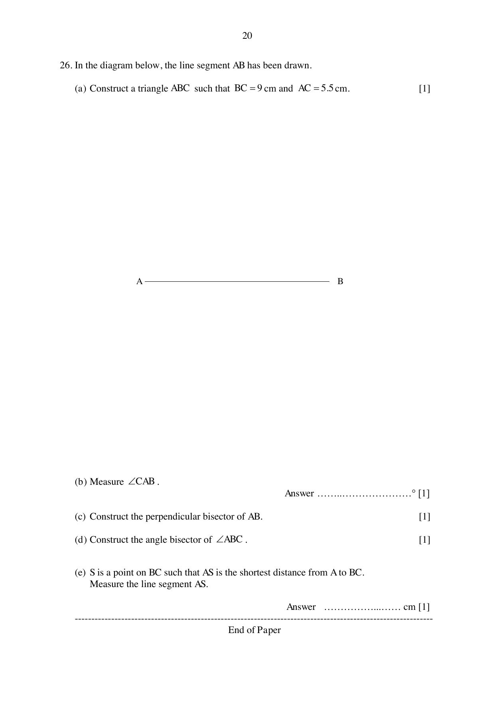

# Bukit View Secondary School — Mathematics 4052/01 Paper 1 (cleaned)

> **Institution:** Bukit View Secondary School
> **Exam:** Preliminary Examination 2024
> **Level:** Secondary Four Express / Five Normal (Academic)
> **Subjects:** Elementary Mathematics
> **Paper:** 4052/01 Paper 1
> **Date:** 19 August 2024
> **Duration:** 2 hours 15 minutes
> **Total Marks:** 90
> **Source:** `BVSS 2024 Prelim EM Paper 1.pdf`

---

## Instructions

Write your name, register number and class in the spaces provided on top of this cover page.
Write in dark blue or black pen.
You may use an HB pencil for any diagrams or graphs.
Do not use staples, paper clips, highlighters, glue or correction fluid.

Answer all questions.
If working is needed for any question it must be shown with the answer.
Omission of essential working will result in loss of marks.
The use of an approved scientific calculator is expected, where appropriate.
If the degree of accuracy is not specified in the question, and if the answer is not exact, give the answer to three significant figures. Give answers in degrees to one decimal place.
For $\pi$, use either your calculator value or $3.142$, unless the question requires the answer in terms of $\pi$.
At the end of the examination, fasten all your work securely together.
The number of marks is given in brackets [ ] at the end of each question or part question.
The total of the marks for this paper is 90.

Setter: Mrs Irni Prasad.

---

## Mathematical Formulae

*Compound interest*

$$
\text{Total amount} = P\left(1+\frac{r}{100}\right)^{n}
$$

*Mensuration*

$$
\text{Curved surface area of a cone} = \pi rl
$$

$$
\text{Surface area of a sphere} = 4\pi r^{2}
$$

$$
\text{Volume of a cone} = \frac{1}{3}\pi r^{2}h
$$

$$
\text{Volume of a sphere} = \frac{4}{3}\pi r^{3}
$$

$$
\text{Area of triangle } ABC = \frac{1}{2}ab\sin C
$$

$$
\text{Arc length} = r\theta,\text{ where }\theta\text{ is in radians}
$$

$$
\text{Sector area} = \frac{1}{2}r^{2}\theta,\text{ where }\theta\text{ is in radians}
$$

*Trigonometry*

$$
\frac{a}{\sin A} = \frac{b}{\sin B} = \frac{c}{\sin C}
$$

$$
a^{2} = b^{2}+c^{2}-2bc\cos A
$$

*Statistics*

$$
\text{Mean} = \frac{\sum fx}{\sum f}
$$

$$
\text{Standard deviation} = \sqrt{\frac{\sum fx^{2}}{\sum f}-\left(\frac{\sum fx}{\sum f}\right)^{2}}
$$

---

Answer all the questions.

### Q1

> **Marks:** 1
> **Sub-topic:** Number
> **Page:** 3

Evaluate $\dfrac{4.5^{3}}{\sqrt{23.4\times 8.17}}$, leaving your answer correct to 4 significant figures.

### Q2

> **Marks:** 2
> **Sub-topic:** Number
> **Page:** 3

Express the ratio $1\dfrac{2}{3}\text{ kg} : 450\text{ g} : 300\text{ g}$ in its simplest form.

### Q3

> **Marks:** 2
> **Sub-topic:** Statistics
> **Page:** 3

The Mathematics grades of students in Class A and Class B are summarised on accurate pie charts shown below.

Class A and Class B each show sectors labelled D7-F9, A1-A2 and B3-C6. The A1-A2 sectors look the same size. The D7-F9 sector is larger in Class A than in Class B. The B3-C6 sector is the largest in both charts, with different shading.

For each statement, state whether you agree or disagree and explain your reason.

| Statement | Agree / Disagree | Reason |
| --- | --- | --- |
| (a) More students in Class A failed Mathematics compared to Class B. |  |  |
| (b) The percentage of students who achieved A1-A2 are the same for both classes. |  |  |

### Q4

> **Marks:** 2
> **Sub-topic:** Geometry
> **Page:** 4

A regular polygon has $n$ sides. The size of each interior angle is 5 times the size of each exterior angle.

(a) Calculate the value of each exterior angle. [1]

(b) State the value of $n$. [1]

### Q5

> **Marks:** 3
> **Sub-topic:** Algebra
> **Page:** 4

The radius, $r$, of an object is directly proportional to the square root of its surface area, $A$.

(i) Sketch the relationship between $r$ and $\sqrt{A}$ on the space below. Axes are given with $r$ vertical and $\sqrt{A}$ horizontal. [1]

(ii) The surface area of the object is $1.21\text{ cm}^{2}$ when the radius is $0.44\text{ cm}$. Find the surface area of the object when the radius is $1.2\text{ cm}$. [2]

### Q6

> **Marks:** 3
> **Sub-topic:** Algebra
> **Page:** 5

(a) Expand and simplify $(4x-1)^{2}+2$. [1]

(b) Hence, or otherwise, explain if $(4x-1)^{2}+2$ is always odd, given that $x$ is an integer. [2]

### Q7

> **Marks:** 3
> **Sub-topic:** Sets
> **Page:** 5

(a) Write down the set represented by the shaded region. [1]

(b) It is given that $\xi = \{x : x\text{ is an integer}\}$, $A = \{x : x\leq 9\}$ and $B = \{2, 4, 6, 8\}$.

State and explain whether the following mathematical statements are true or false.

(i) $B\subset A$. [1]

(ii) $B\in A$. [1]

### Q8

> **Marks:** 3
> **Sub-topic:** Algebra
> **Page:** 6

Express $\dfrac{2}{d+3e}-\dfrac{d-15e}{d^{2}-9e^{2}}$ as a single fraction in its simplest form.

### Q9

> **Marks:** 3
> **Sub-topic:** Number
> **Page:** 6

A plan of a garden is drawn to a scale $1 : 20$.

(a) Calculate the length of the line on the plan, in cm, which represents $13\text{ m}$ long. [1]

(b) The actual area of a pond in the garden is $p\text{ m}^{2}$. Show, with clear working, that the area of the pond represented on the map is $25p\text{ cm}^{2}$. [2]

### Q10

> **Marks:** 3
> **Sub-topic:** Algebra
> **Page:** 7

$x$ is $35\%$ of $y$.

$$
2x+45 = y.
$$

Find the value of $x$ and of $y$.

### Q11

> **Marks:** 3
> **Sub-topic:** Number
> **Page:** 7

The difference between simple interest and compound interest for a period of 3 years at $5\%$ per annum is ＄366.

Find the principal amount.

### Q12

> **Marks:** 3
> **Sub-topic:** Statistics
> **Page:** 8

The following data shows the masses of 11 parcels in kg.

$$
1.8\quad 2.1\quad 2.4\quad 2.5\quad 2.6\quad 3.2\quad 3.3\quad 3.5\quad 3.8\quad 4.0\quad 4.9
$$

(a) Calculate the mean mass. [1]

(b) Find the median mass. [1]

(c) Two parcels (the $2.4\text{ kg}$ and the $4.9\text{ kg}$) were removed from the delivery van. Explain why the median mass remains unchanged. [1]

### Q13

> **Marks:** 4
> **Sub-topic:** Graphs
> **Page:** 9

(a) By completing the square, find the coordinates of the turning point of the curve $y = x^{2}+4x+7$. [2]

(b) Hence, sketch the graph of $y = x^{2}+4x+7$ in the space below, showing your $y$-intercept and turning point clearly. Blank axes labelled $x$ and $y$ are given. [2]

### Q14

> **Marks:** 4
> **Sub-topic:** Vectors
> **Page:** 10

On the grid, $\overrightarrow{OA} = \mathbf{a}$ and $\overrightarrow{OB} = \mathbf{b}$.

(a) Mark clearly on the grid in the answer space,

(i) the point $C$ such that $\overrightarrow{OC} = 2\mathbf{b}+\mathbf{a}$

(ii) the point $D$ such that $\overrightarrow{OD} = \dfrac{1}{2}\mathbf{b}-3\mathbf{a}$. [2]

(b) Find $\overrightarrow{CD}$ in terms of $\mathbf{a}$ and $\mathbf{b}$. [2]

### Q15

> **Marks:** 3
> **Sub-topic:** Number
> **Page:** 11

Simplify $\left(\dfrac{9p^{3}q^{-2}}{p^{-1}}\right)^{-\frac{3}{2}}$, leaving your answer in positive index.

### Q16

> **Marks:** 3
> **Sub-topic:** Number
> **Page:** 11

Danny wants to purchase ingredients from Malaysia.

He needs to pay the Malaysia supplier MYR 2000 for the ingredients.
The transportation fees for the ingredients is MYR 60.
For importing goods into Singapore, a $9\%$ Goods and Services Tax (GST) is payable on the cost of goods and transportation.

The exchange rate between Singapore dollars (＄) and Malaysian Ringgit (MYR) is ＄1 = MYR 3.46.

Calculate the amount of money, in Singapore dollars, that Danny has to pay to import the ingredients.

### Q17

> **Marks:** 4
> **Sub-topic:** Number
> **Page:** 12

When written as a product of its prime factors,

$$
X = 2^{n}\times a^{b}.
$$

The cube root of $X$ is $14$.

(a) Find the values of $n$, $a$, and $b$. [2]

(b) Find the largest possible number that will divide $X$ and $756$ exactly. [2]

### Q18

> **Marks:** 3
> **Sub-topic:** Number
> **Page:** 12

On a certain day, Barry took the bus to school. The bus travels at an average speed of $12.5\text{ m/s}$.

(a) Convert $12.5\text{ m/s}$ to km/h. [1]

(b) Jeff and Barry travel the same distance to school. Jeff walked at an average speed of $5\text{ km/h}$ and took 20 minutes longer than Barry. Find the distance each of them travelled to school. [2]

### Q19

> **Marks:** 4
> **Sub-topic:** Coordinate geometry
> **Page:** 13

A straight line meets the curve $y = x^{2}-2x-3$ at two points $A(-3, k)$ and $B(4, 5)$.

(i) Show that $k = 12$. [1]

(ii) Find the equation of the straight line. [2]

(iii) Find the length of the line segment $AB$. [1]

### Q20

> **Marks:** 4
> **Sub-topic:** Algebra
> **Page:** 14

In a sequence, the same number is subtracted each time to obtain the next term.

The first four terms of the sequence are as follows:

$$
54\quad x\quad y\quad 33
$$

(a) Find the value of $x$ and $y$. [1]

(b) Write down an expression for the $n$th term of this sequence. [1]

(c) Which term in the sequence will give the first negative number? [1]

(d) Explain why $-260$ is not a term of this sequence. [1]

### Q21

> **Marks:** 4
> **Sub-topic:** Graphs
> **Page:** 15

The diagram shows the speed-time graph of a van. The van decelerates uniformly until it reaches $0.7\text{ km/min}$. It then continues at this constant speed before accelerating its speed uniformly at $0.1\text{ km/min}^{2}$.

The graph starts at $2.0\text{ km/min}$ at 10 00, falls in a straight line to $0.7\text{ km/min}$ at 10 20, stays at $0.7\text{ km/min}$ until time $k$, then rises in a straight line to $1.4\text{ km/min}$ at 10 35. A horizontal guide is drawn at $1.4\text{ km/min}$.

(a) Find the speed of the van at 10 05. [2]

(b) Find time at $k$. [2]

### Q22

> **Marks:** 5
> **Sub-topic:** Mensuration
> **Page:** 16

The shape of a closed container can be modelled by stacking a smaller cylinder, A, on top of a larger cylinder, B. Cylinder A and Cylinder B are geometrically similar. The radii of Cylinder A and Cylinder B are $r\text{ cm}$ and $3r\text{ cm}$ respectively.

(a) It takes 98 seconds to fill the container to the brim. Calculate the time taken to fill Cylinder B. [2]

(b) Given that the height of cylinder A is $h\text{ cm}$, find an expression for the total surface area of the container in terms of $r$, $h$ and $\pi$. [3]

### Q23

> **Marks:** 6
> **Sub-topic:** Probability
> **Page:** 17

Mdm Chng has six ＄1 coins and eight 50 cents coins in her purse. She takes the coins out of her purse, at random, one after the other, without replacement.

The probability tree diagram below shows the possible outcomes and their probabilities. Every probability bracket is blank.

(i) Complete the probability tree diagram. [2]

(ii) Find the probability that the total value of the two coins taken out is ＄1.50. [2]

(iii) Mdm Chng took a third coin out. Find the probability that the total sum of the three coins taken out is ＄2. [2]

### Q24

> **Marks:** 4
> **Sub-topic:** Geometry
> **Page:** 18

In the diagram, $A$, $B$, $C$, $D$ are points on a circle. $AC$ and $BD$ intersect at $F$. Angle $CBF = x^{\circ}$ and angle $BAC = 35^{\circ}$.

(a) Find, in terms of $x$, angle $BCD$. Give reason(s) clearly. [2]

(b) Given that angle $ADB = 55^{\circ}$, show that $AC$ is a diameter of the circle. [2]

### Q25

> **Marks:** 6
> **Sub-topic:** Matrices
> **Page:** 19

In Shop P, a tub of ice cream cost ＄18.70, a carton of milk cost ＄8.60 and a box of chocolates cost ＄10. In Shop G, a tub of ice cream cost ＄17.50, a carton of milk cost ＄7.40 and a box of chocolates cost ＄13.

The items are exactly the same in both shops.

The information above can be represented by the matrix

$$
A = \begin{pmatrix} 18.7 & 17.5 \\ 8.6 & 7.4 \\ 10 & 13 \end{pmatrix}.
$$

(a) Tina would like to buy 5 tubs of ice cream, 3 cartons of milk and 1 box of chocolates. Mike would like to buy 3 tubs of ice cream, 4 cartons of milk and $x$ boxes of chocolates. Represent this information in a $2\times 3$ matrix $B$. [1]

(b) Find, in terms of $x$, the matrix $C = BA$. [2]

(c) State what the elements in matrix $C$ represents. [1]

(d) Determine if it is possible for Mike to spend the same amount regardless of which shop he buys the items from. Justify your answer with calculations. [2]

### Q26

> **Marks:** 5
> **Sub-topic:** Geometry
> **Page:** 20

In the diagram below, the line segment $AB$ has been drawn.

(a) Construct a triangle $ABC$ such that $BC = 9\text{ cm}$ and $AC = 5.5\text{ cm}$. [1]

(b) Measure $\angle CAB$. [1]

(c) Construct the perpendicular bisector of $AB$. [1]

(d) Construct the angle bisector of $\angle ABC$. [1]

(e) $S$ is a point on $BC$ such that $AS$ is the shortest distance from $A$ to $BC$. Measure the line segment $AS$. [1]
