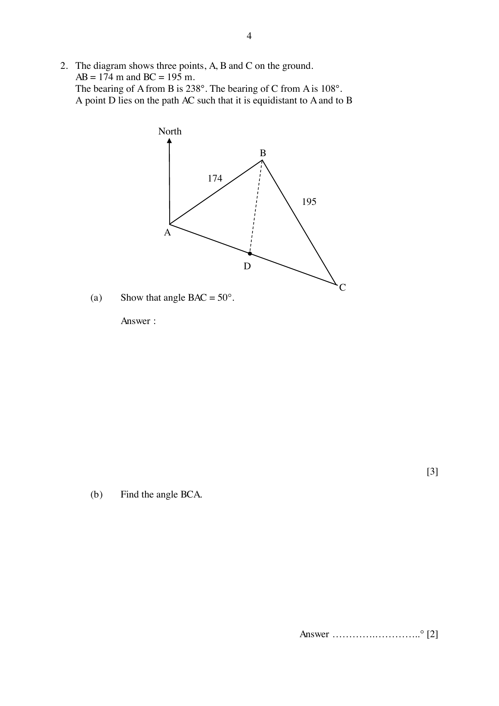
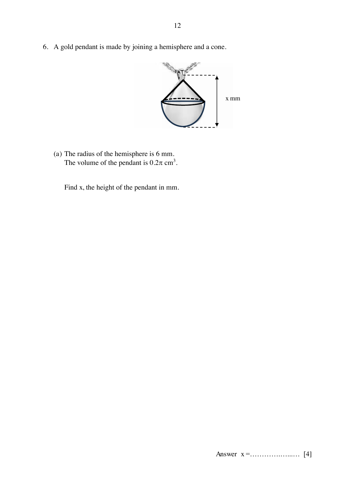

# Bukit View Secondary School — Mathematics 4052/02 Paper 2 (cleaned)

> **Institution:** Bukit View Secondary School
> **Exam:** Preliminary Examination 2024
> **Level:** Secondary Four Express / Five Normal (Academic)
> **Subjects:** Elementary Mathematics
> **Paper:** 4052/02 Paper 2
> **Date:** 20 August 2024
> **Duration:** 2 hours 15 minutes
> **Total Marks:** 90
> **Source:** `BVSS 2024 Prelim EM Paper 2.pdf`

---

## Instructions

Write your name, register number and class in the spaces provided on top of this cover page.
Write in dark blue or black pen.
You may use an HB pencil for any diagrams or graphs.
Do not use staples, paper clips, highlighters, glue or correction fluid.

Answer all questions.
If working is needed for any question it must be shown with the answer.
Omission of essential working will result in loss of marks.
The use of an approved scientific calculator is expected, where appropriate.
If the degree of accuracy is not specified in the question, and if the answer is not exact, give the answer to three significant figures. Give answers in degrees to one decimal place.
For $\pi$, use either your calculator value or $3.142$, unless the question requires the answer in terms of $\pi$.
At the end of the examination, fasten all your work securely together.
The number of marks is given in brackets [ ] at the end of each question or part question.
The total of the marks for this paper is 90.

The question paper consists of 20 printed pages and 2 blank pages. Setter: Mrs Irni Prasad.

---

## Mathematical Formulae

*Compound interest*

$$
\text{Total amount} = P\left(1+\frac{r}{100}\right)^{n}
$$

*Mensuration*

$$
\text{Curved surface area of a cone} = \pi rl
$$

$$
\text{Surface area of a sphere} = 4\pi r^{2}
$$

$$
\text{Volume of a cone} = \frac{1}{3}\pi r^{2}h
$$

$$
\text{Volume of a sphere} = \frac{4}{3}\pi r^{3}
$$

$$
\text{Area of triangle } ABC = \frac{1}{2}ab\sin C
$$

$$
\text{Arc length} = r\theta,\text{ where }\theta\text{ is in radians}
$$

$$
\text{Sector area} = \frac{1}{2}r^{2}\theta,\text{ where }\theta\text{ is in radians}
$$

*Trigonometry*

$$
\frac{a}{\sin A} = \frac{b}{\sin B} = \frac{c}{\sin C}
$$

$$
a^{2} = b^{2}+c^{2}-2bc\cos A
$$

*Statistics*

$$
\text{Mean} = \frac{\sum fx}{\sum f}
$$

$$
\text{Standard deviation} = \sqrt{\frac{\sum fx^{2}}{\sum f}-\left(\frac{\sum fx}{\sum f}\right)^{2}}
$$

---

Answer all the questions.

### Q1

> **Marks:** 10
> **Page:** 3

(a) Factorise completely $x^{2}-4x-xy+4y$. [2]
> **Topic:** N5 Algebraic expressions and formulae
> **Sub-topic:** Algebraic expressions and formulae
> **LO:** [[context/subjects/o-level-e-maths/learning-objectives/o-level-e-maths-N5h.md|N5h]]

(b) Given that $4^{-\frac{1}{2}} = 8^{\frac{1}{4}}\div 2^{x+1}$, find the exact value of $x$. [3]
> **Topic:** N5 Algebraic expressions and formulae
> **Sub-topic:** Algebraic expressions and formulae
> **LO:** [[context/subjects/o-level-e-maths/learning-objectives/o-level-e-maths-N5h.md|N5h]]

(c) Given that $k = \dfrac{2h+1}{3h-1}$, express $h$ in terms of $k$. [2]
> **Topic:** N5 Algebraic expressions and formulae
> **Sub-topic:** Algebraic expressions and formulae
> **LO:** [[context/subjects/o-level-e-maths/learning-objectives/o-level-e-maths-N5h.md|N5h]]

(d) Solve $\dfrac{2x}{3} < \dfrac{2x+1}{2}\leq\dfrac{3x+7}{4}$. [3]
> **Topic:** N5 Algebraic expressions and formulae
> **Sub-topic:** Algebraic expressions and formulae
> **LO:** [[context/subjects/o-level-e-maths/learning-objectives/o-level-e-maths-N5h.md|N5h]]

### Q2

> **Marks:** 12
> **Page:** 4–5

The diagram shows three points, $A$, $B$ and $C$ on the ground. $AB = 174\text{ m}$ and $BC = 195\text{ m}$. The bearing of $A$ from $B$ is $238^{\circ}$. The bearing of $C$ from $A$ is $108^{\circ}$. A point $D$ lies on the path $AC$ such that it is equidistant to $A$ and to $B$.

(a) Show that angle $BAC = 50^{\circ}$. [3]
> **Topic:** G4 Pythagoras' theorem and trigonometry
> **Sub-topic:** Pythagoras' theorem and trigonometry
> **LO:** [[context/subjects/o-level-e-maths/learning-objectives/o-level-e-maths-G4g.md|G4g]]

(b) Find the angle $BCA$. [2]
> **Topic:** G4 Pythagoras' theorem and trigonometry
> **Sub-topic:** Pythagoras' theorem and trigonometry
> **LO:** [[context/subjects/o-level-e-maths/learning-objectives/o-level-e-maths-G4g.md|G4g]]

(c) Find the area of triangle $ABC$. [3]
> **Topic:** G4 Pythagoras' theorem and trigonometry
> **Sub-topic:** Pythagoras' theorem and trigonometry
> **LO:** [[context/subjects/o-level-e-maths/learning-objectives/o-level-e-maths-G4e.md|G4e]]

(d) Find the distance from $C$ to $D$. [4]
> **Topic:** G4 Pythagoras' theorem and trigonometry
> **Sub-topic:** Pythagoras' theorem and trigonometry
> **LO:** [[context/subjects/o-level-e-maths/learning-objectives/o-level-e-maths-G4g.md|G4g]]

### Q3

> **Marks:** 11
> **Page:** 6–7

The variables $x$ and $y$ are connected by the equation $y = \dfrac{x^{3}}{2}-4x+3$. Some corresponding values of $x$ and $y$ are given in the table below.

| $x$ | $-3.5$ | $-3$ | $-2$ | $-1$ | $0$ | $1$ | $2$ | $2.5$ | $3$ |
| --- | --- | --- | --- | --- | --- | --- | --- | --- | --- |
| $y$ | $-4.4$ | $1.5$ | $p$ | $6.5$ | $3$ | $-0.5$ | $-1$ | $0.8$ | $4.5$ |

(a) Find the value of $p$. [1]
> **Topic:** G6 Coordinate geometry
> **Sub-topic:** Coordinate geometry
> **LO:** [[context/subjects/o-level-e-maths/learning-objectives/o-level-e-maths-G6c.md|G6c]]

(b) On the graph paper found in the next page, draw the graph of $y = \dfrac{x^{3}}{2}-4x+3$ for $-3.5\leq x\leq 3$. [3]
> **Topic:** G6 Coordinate geometry
> **Sub-topic:** Coordinate geometry
> **LO:** [[context/subjects/o-level-e-maths/learning-objectives/o-level-e-maths-G6c.md|G6c]]

The grid is labelled in steps of 1 on both axes. Each large square is divided into smaller squares.

(c) By drawing a tangent, find the gradient of the curve at $x = 2.5$. [2]
> **Topic:** G6 Coordinate geometry
> **Sub-topic:** Coordinate geometry
> **LO:** [[context/subjects/o-level-e-maths/learning-objectives/o-level-e-maths-G6c.md|G6c]]

(d) (i) On the same axes, draw the line $y = -x-1$ for $-3.5\leq x\leq 3$. [1]
> **Topic:** G6 Coordinate geometry
> **Sub-topic:** Coordinate geometry
> **LO:** [[context/subjects/o-level-e-maths/learning-objectives/o-level-e-maths-G6c.md|G6c]]

(ii) Write down the $x$-coordinate of the point where this line intersects the curve. [1]
> **Topic:** G6 Coordinate geometry
> **Sub-topic:** Coordinate geometry
> **LO:** [[context/subjects/o-level-e-maths/learning-objectives/o-level-e-maths-G6c.md|G6c]]

(e) State the minimum value of $y = \dfrac{x^{3}}{2}-4x+3$ for $0\leq x\leq 3$. [1]
> **Topic:** G6 Coordinate geometry
> **Sub-topic:** Coordinate geometry
> **LO:** [[context/subjects/o-level-e-maths/learning-objectives/o-level-e-maths-G6c.md|G6c]]

(f) The equation $\dfrac{x^{3}}{2}-4x+5 = 0$ has only one solution. Explain how this can be seen from your graph. [2]
> **Topic:** G6 Coordinate geometry
> **Sub-topic:** Coordinate geometry
> **LO:** [[context/subjects/o-level-e-maths/learning-objectives/o-level-e-maths-G6c.md|G6c]]

### Q4

> **Marks:** 8
> **Page:** 8–9

The diagram shows a circle with centre $O$. $ABCDE$ is a straight line. $AC = CD$ and line $OD$ meets the circle at $F$. It is given that $OB = 7.5\text{ cm}$, $CD = 12\text{ cm}$ and $\angle OBD = 90^{\circ}$.

(a) Find the length of $OD$. [1]
> **Topic:** G3 Properties of circles
> **Sub-topic:** Properties of circles
> **LO:** [[context/subjects/o-level-e-maths/learning-objectives/o-level-e-maths-G3a.md|G3a]]

(b) Without the use of a calculator, find the value of $\cos\angle ODE$ in its simplest form. [1]
> **Topic:** G3 Properties of circles
> **Sub-topic:** Properties of circles
> **LO:** [[context/subjects/o-level-e-maths/learning-objectives/o-level-e-maths-G3a.md|G3a]]

(c) Show that angle $COD$ is approximately $0.501$ rad. [3]
> **Topic:** G3 Properties of circles
> **Sub-topic:** Properties of circles
> **LO:** [[context/subjects/o-level-e-maths/learning-objectives/o-level-e-maths-G3a.md|G3a]]

(d) Find the perimeter of the shaded region. [3]
> **Topic:** G3 Properties of circles
> **Sub-topic:** Properties of circles
> **LO:** [[context/subjects/o-level-e-maths/learning-objectives/o-level-e-maths-G3a.md|G3a]]

### Q5

> **Marks:** 9
> **Page:** 10–11

A lead technician working with his trainee can repair a machine in $4.2$ hours together. If each of them worked alone, the lead technician would take $x$ hours, while the trainee will need $3.5$ hours more.

(a) If each of them worked alone, find in terms of $x$,

(i) the fraction of work done by the lead technician in one hour, [1]
> **Topic:** N7 Equations and inequalities
> **Sub-topic:** Equations and inequalities
> **LO:** [[context/subjects/o-level-e-maths/learning-objectives/o-level-e-maths-N7a.md|N7a]]

(ii) the fraction of work done by the trainee in one hour. [1]
> **Topic:** N7 Equations and inequalities
> **Sub-topic:** Equations and inequalities
> **LO:** [[context/subjects/o-level-e-maths/learning-objectives/o-level-e-maths-N7a.md|N7a]]

(b) Form an equation and show that it reduces to $10x^{2}-49x-147 = 0$. [3]
> **Topic:** N7 Equations and inequalities
> **Sub-topic:** Equations and inequalities
> **LO:** [[context/subjects/o-level-e-maths/learning-objectives/o-level-e-maths-N7a.md|N7a]]

(c) Solve $10x^{2}-49x-147 = 0$. [3]
> **Topic:** N7 Equations and inequalities
> **Sub-topic:** Equations and inequalities
> **LO:** [[context/subjects/o-level-e-maths/learning-objectives/o-level-e-maths-N7a.md|N7a]]

(d) Hence, find the number of hours needed to repair the machine by two trainees. [1]
> **Topic:** N7 Equations and inequalities
> **Sub-topic:** Equations and inequalities
> **LO:** [[context/subjects/o-level-e-maths/learning-objectives/o-level-e-maths-N7a.md|N7a]]

### Q6

> **Marks:** 11
> **Page:** 12–13

A gold pendant is made by joining a hemisphere and a cone.

(a) The radius of the hemisphere is $6\text{ mm}$. The volume of the pendant is $0.2\pi\text{ cm}^{3}$. Find $x$, the height of the pendant in mm. [4]
> **Topic:** G5 Mensuration
> **Sub-topic:** Mensuration
> **LO:** [[context/subjects/o-level-e-maths/learning-objectives/o-level-e-maths-G5c.md|G5c]]

(b) The mass of the pendant is $1.8\pi$ grams. The gold pendant is priced at ＄101.60 per gram.

(i) Mrs Tan bought it at a discount and paid ＄528.60. Calculate the percentage discount given, correct to the nearest whole number. [3]
> **Topic:** G4 Pythagoras' theorem and trigonometry
> **Sub-topic:** Pythagoras' theorem and trigonometry
> **LO:** [[context/subjects/o-level-e-maths/learning-objectives/o-level-e-maths-G4c.md|G4c]]

(ii) A week later, the shop removed the discount offer. Mr Pang bought the pendant. He also bought a gold chain priced at ＄810. He paid a downpayment of ＄200 and paid the balance with a fixed interest rate of $5.3\%$ per annum for a period of 4 months. Calculate the amount of each monthly instalment, correct to the nearest 10 cents. [4]
> **Topic:** G5 Mensuration
> **Sub-topic:** Mensuration
> **LO:** [[context/subjects/o-level-e-maths/learning-objectives/o-level-e-maths-G5c.md|G5c]]

### Q7

> **Marks:** 8
> **Page:** 14–15

A class of 40 Secondary Four students were asked how much time they have spent on social media in the last week. The results are shown in the table.

| Time spent ($x$ hours) | $0 < x\leq 10$ | $10 < x\leq 20$ | $20 < x\leq 30$ | $30 < x\leq 40$ | $40 < x\leq 50$ |
| --- | --- | --- | --- | --- | --- |
| Frequency | $p$ | $6$ | $12$ | $q$ | $3$ |

The lower quartile of the time spent on social media was 20 hours.

(i) Show that $p = 4$. [2]
> **Topic:** S1 Data handling and analysis
> **Sub-topic:** Data handling and analysis
> **LO:** [[context/subjects/o-level-e-maths/learning-objectives/o-level-e-maths-S1i.md|S1i]]

(ii) Hence state the value of $q$. [1]
> **Topic:** S1 Data handling and analysis
> **Sub-topic:** Data handling and analysis
> **LO:** [[context/subjects/o-level-e-maths/learning-objectives/o-level-e-maths-S1i.md|S1i]]

(iii) Estimate the mean number of hours spent by the students. [2]
> **Topic:** S1 Data handling and analysis
> **Sub-topic:** Data handling and analysis
> **LO:** [[context/subjects/o-level-e-maths/learning-objectives/o-level-e-maths-S1f.md|S1f]]

(iv) Estimate the standard deviation. [1]
> **Topic:** S1 Data handling and analysis
> **Sub-topic:** Data handling and analysis
> **LO:** [[context/subjects/o-level-e-maths/learning-objectives/o-level-e-maths-S1f.md|S1f]]

A class of 40 Secondary Three students were asked how much time (in hours) they have spent on social media in the last week. The results are summarised in the table.

|  |  |
| --- | --- |
| Mean | $15.8$ |
| Standard deviation | $10.9$ |

(v) Make two comparisons between the number of hours spent on social media by the Secondary Three students and by the Secondary Four students. Use the data to support your answers. [2]
> **Topic:** S1 Data handling and analysis
> **Sub-topic:** Data handling and analysis
> **LO:** [[context/subjects/o-level-e-maths/learning-objectives/o-level-e-maths-S1i.md|S1i]]

### Q8

> **Marks:** 11
> **Page:** 16–17

In the diagram, $AT$ is a tangent to the circle, centre $O$. A line through $A$ meets the circle at $B$ and $C$. It is given that angle $TOB = 64^{\circ}$.

(a) Find each of the following angles, stating your reason(s) clearly.

(i) $\angle BCT$. [1]
> **Topic:** G3 Properties of circles
> **Sub-topic:** Properties of circles
> **LO:** [[context/subjects/o-level-e-maths/learning-objectives/o-level-e-maths-G3b.md|G3b]]

(ii) $\angle BTO$. [1]
> **Topic:** G3 Properties of circles
> **Sub-topic:** Properties of circles
> **LO:** [[context/subjects/o-level-e-maths/learning-objectives/o-level-e-maths-G3b.md|G3b]]

(b) Hence or otherwise, show that triangle $ATB$ and triangle $ACT$ are similar. [3]
> **Topic:** G3 Properties of circles
> **Sub-topic:** Properties of circles
> **LO:** [[context/subjects/o-level-e-maths/learning-objectives/o-level-e-maths-G3b.md|G3b]]

(c) Given that $AB = 4.5\text{ cm}$ and $BC = 3.5\text{ cm}$, find the length of $AT$. [2]
> **Topic:** G3 Properties of circles
> **Sub-topic:** Properties of circles
> **LO:** [[context/subjects/o-level-e-maths/learning-objectives/o-level-e-maths-G3b.md|G3b]]

(d) Find the value of $\dfrac{\text{Area }\triangle ABT}{\text{Area }\triangle BCT}$. [1]
> **Topic:** G3 Properties of circles
> **Sub-topic:** Properties of circles
> **LO:** [[context/subjects/o-level-e-maths/learning-objectives/o-level-e-maths-G3b.md|G3b]]

(e) Given that the radius of the circle is $1.8\text{ cm}$, find the area of the shaded segment. [3]
> **Topic:** G3 Properties of circles
> **Sub-topic:** Properties of circles
> **LO:** [[context/subjects/o-level-e-maths/learning-objectives/o-level-e-maths-G3b.md|G3b]]

### Q9

> **Marks:** 10
> **Page:** 19–21

To achieve Singapore's Zero Waste Masterplan goal, the government aims to reduce food waste by $30\%$ by 2030.

The annual waste and recycling statistics from the National Environment Agency shows the amount of food waste generated (in 1000 tonnes) in Singapore from 2019 to 2023.

The graph falls from about 745 in 2019 to about 665 in 2020, rises to about 815 in 2021, stays near 810 in 2022, then falls to about 755 in 2023. Source: NEA Website on Waste Statistics.

| Year | Estimated Singapore Population |
| --- | --- |
| 2022 | 5.64 million |
| 2023 | 5.9 million |

The National Environment Agency (NEA) reported that in 2022, Singapore generated $813\,000$ tonnes of food waste annually.

$[1\text{ tonne} = 1000\text{ kg}]$

(a) Express $813\,000$ tonnes in kg, in standard form. [1]
> **Topic:** N1 Numbers and their operations
> **Sub-topic:** Numbers and their operations
> **LO:** [[context/subjects/o-level-e-maths/learning-objectives/o-level-e-maths-N1h.md|N1h]]

(b) Calculate the average mass, in kg, of food waste per person, per day, in 2022. [2]
> **Topic:** N1 Numbers and their operations
> **Sub-topic:** Numbers and their operations
> **LO:** [[context/subjects/o-level-e-maths/learning-objectives/o-level-e-maths-N1h.md|N1h]]

Mrs Kim's household is made up of 5 persons altogether. The table below shows the estimated average mass of food wastage (in kg) for the three meals in her household in 2022.

| Breakfast | Lunch | Dinner |
| --- | --- | --- |
| $0.25$ | $0.9$ | $1.25$ |

(c) Calculate the average mass, in kg, of food waste per person in Mrs Kim's household, per day, in 2022. [1]
> **Topic:** N1 Numbers and their operations
> **Sub-topic:** Numbers and their operations
> **LO:** [[context/subjects/o-level-e-maths/learning-objectives/o-level-e-maths-N1h.md|N1h]]

According to NEA, a household of 5 persons can reduce food waste in these 4 ways.

| Ways to reduce food waste | Estimated food waste reduction |
| --- | --- |
| Composting | $4.9\text{ kg}$ per week |
| Utilising leftovers | $175\text{ g}$ per day |
| Keeping track of expiry dates | $0.8\text{ kg}$ per week |
| Proper storage | $2.4\text{ kg}$ per month |

In 2023, Mrs Kim encouraged her family to reduce their food waste by implementing the methods listed above. However, Mrs Kim's household does not have a food composting machine.

(d) Determine if Mrs Kim's household managed to reduce their food waste more effectively than the national average mass. Provide your reasoning and calculations clearly. [6]
> **Topic:** N1 Numbers and their operations
> **Sub-topic:** Numbers and their operations
> **LO:** [[context/subjects/o-level-e-maths/learning-objectives/o-level-e-maths-N1h.md|N1h]]
