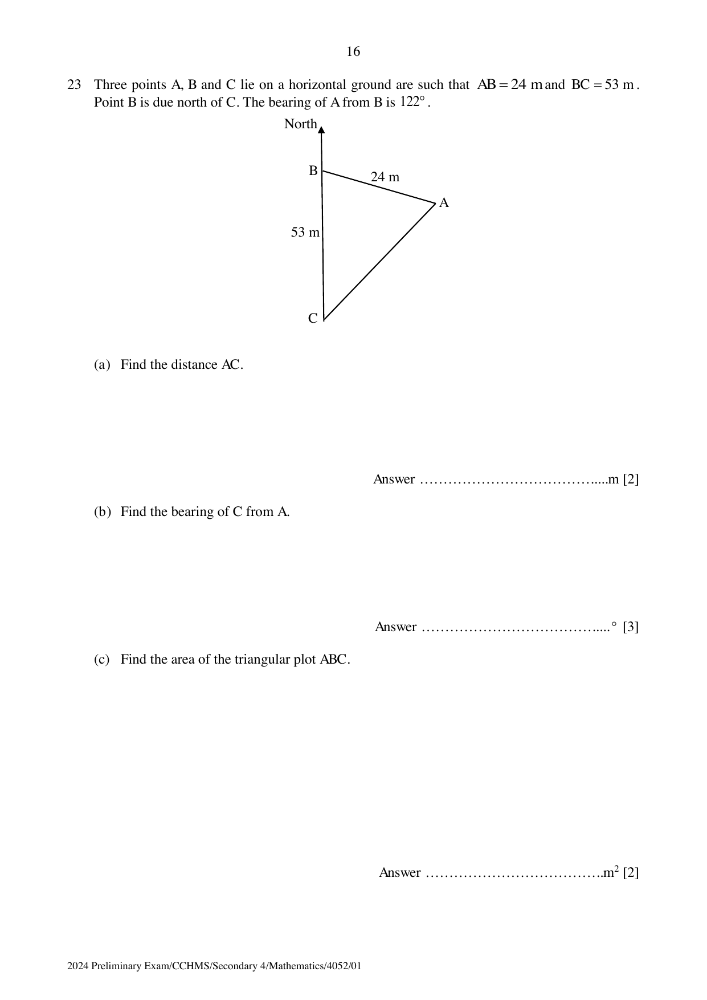
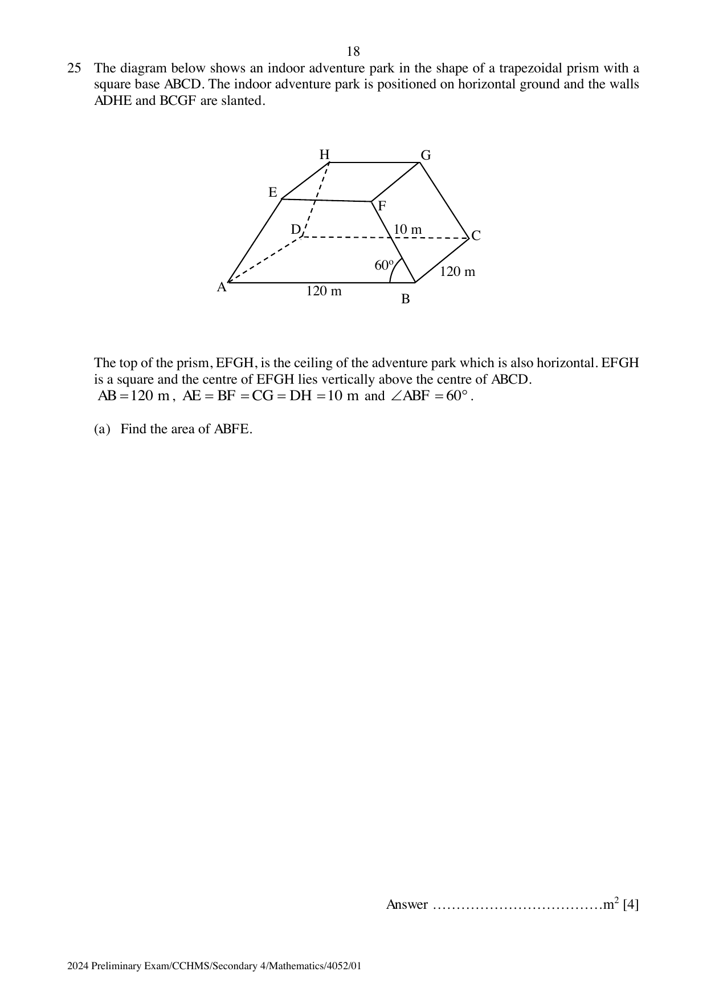
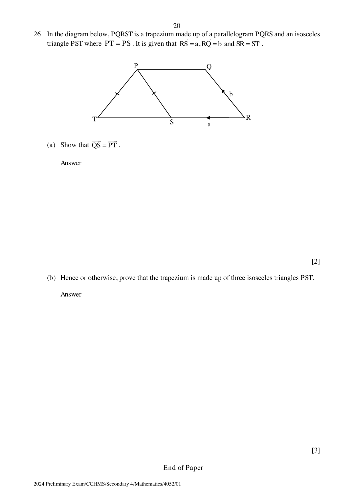

# Chung Cheng High School (Main) — Mathematics 4052/01 Paper 1 (cleaned)

> **Institution:** Chung Cheng High School (Main)
> **Exam:** Preliminary Examination 2024
> **Level:** Secondary 4
> **Subjects:** Elementary Mathematics
> **Paper:** 4052/01 Paper 1
> **Date:** Friday 23 August 2024
> **Duration:** 2 hours 15 minutes
> **Total Marks:** 90
> **Source:** `CCHM 2024 S4 Math Prelim P1.pdf`

---

## Instructions

Candidates answer on the Question Paper.

Write your name, class and index number on all the work you hand in.
Write in dark blue or black pen.
You may use an HB pencil for any diagrams or graphs.
Do not use staples, paper clips, glue or correction fluid.

Answer all the questions.
The number of marks is given in brackets [ ] at the end of each question or part question.

If working is needed for any question, it must be shown with the answer.
Omission of essential working will result in loss of marks.
The total of the marks for this paper is 90.

The use of an approved scientific calculator is expected, where appropriate.
If the degree of accuracy is not specified in the question, and if the answer is not exact, give the answer to three significant figures. Give answers in degrees to one decimal place.
For $\pi$, use either your calculator value or $3.142$.

---

## Mathematical Formulae

*Compound interest*

$$
\text{Total amount} = P\left(1+\frac{r}{100}\right)^{n}
$$

*Mensuration*

$$
\text{Curved surface area of a cone} = \pi rl
$$

$$
\text{Surface area of a sphere} = 4\pi r^{2}
$$

$$
\text{Volume of a cone} = \frac{1}{3}\pi r^{2}h
$$

$$
\text{Volume of a sphere} = \frac{4}{3}\pi r^{3}
$$

$$
\text{Area of triangle } ABC = \frac{1}{2}ab\sin C
$$

$$
\text{Arc length} = r\theta,\text{ where }\theta\text{ is in radians}
$$

$$
\text{Sector area} = \frac{1}{2}r^{2}\theta,\text{ where }\theta\text{ is in radians}
$$

*Trigonometry*

$$
\frac{a}{\sin A} = \frac{b}{\sin B} = \frac{c}{\sin C}
$$

$$
a^{2} = b^{2}+c^{2}-2bc\cos A
$$

*Statistics*

$$
\text{Mean} = \frac{\sum fx}{\sum f}
$$

$$
\text{Standard deviation} = \sqrt{\frac{\sum fx^{2}}{\sum f}-\left(\frac{\sum fx}{\sum f}\right)^{2}}
$$

---

Answer all the questions.

### Q1

> **Marks:** 1
> **Topic:** N2 Ratio and proportion
> **Sub-topic:** Ratio and proportion
> **LO:** [[context/subjects/o-level-e-maths/learning-objectives/o-level-e-maths-N2a.md|N2a]]
> **Page:** 3

The length of a court is $0.028\text{ km}$ and the width of the court is $16\text{ m}$. Express the ratio of the length to the width of the court in its simplest form.

### Q2

> **Marks:** 2
> **Topic:** G4 Pythagoras' theorem and trigonometry
> **Sub-topic:** Pythagoras' theorem and trigonometry
> **LO:** [[context/subjects/o-level-e-maths/learning-objectives/o-level-e-maths-G4c.md|G4c]]
> **Page:** 3

Given that $0 < x < 180$, find the possible values of $x$ for $\sin x^{\circ} = 0.985$.
Give your answers correct to $1$ decimal place.

### Q3

> **Marks:** (a) 2, (b) 2; total 4
> **Topic:** N1 Numbers and their operations
> **Sub-topic:** Numbers and their operations
> **LO:** [[context/subjects/o-level-e-maths/learning-objectives/o-level-e-maths-N1j.md|N1j]]
> **Page:** 3

**(a)** Simplify $\dfrac{(4a^{4}b)^{3}}{10a^{3}b^{7}}$, leaving your answer in positive index form.

**(b)** Given that $2^{x} = 3$, $2^{y} = 7$ and $2^{z} = \dfrac{9}{49}$, use the laws of indices to find the value of $2^{3x-y+\frac{1}{2}z}$.

### Q4

> **Marks:** 2
> **Topic:** N3 Percentage
> **Sub-topic:** Percentage
> **LO:** [[context/subjects/o-level-e-maths/learning-objectives/o-level-e-maths-N3e.md|N3e]]
> **Page:** 4

A group of students won ＄226 in a competition and shared the amount equally, leaving ＄4 leftover. Competing for a second time, the same group of students won ＄296. They shared the ＄296 along with the ＄4 left over from the first competition equally, with no amount remaining.

Assuming that each student received a whole number of dollars in both distributions, find the greatest possible number of students in the group.

### Q5

> **Marks:** (a) 2, (b) 2; total 4
> **Topic:** N3 Percentage
> **Sub-topic:** Percentage
> **LO:** [[context/subjects/o-level-e-maths/learning-objectives/o-level-e-maths-N3d.md|N3d]]
> **Page:** 4

**(a)** On 6 June 2020, Elijah invested some money in a bank which pays a simple interest at a rate of $3.5\%$ per annum. He received a total interest of ＄680.40 on 6 June 2023.

Find the amount of money Elijah invested in the bank.

**(b)** Freddy invested ＄8000 in another bank that paid compound interest at a rate of $1.75\%$ per annum, compounded quarterly.

Find the total amount Freddy received at the end of 5 years. Give your answer correct to the nearest cent.

### Q6

> **Marks:** (a) 1, (b) 1, (c) 1; total 3
> **Topic:** N6 Functions and graphs
> **Sub-topic:** Functions and graphs
> **LO:** [[context/subjects/o-level-e-maths/learning-objectives/o-level-e-maths-N6c.md|N6c]]
> **Page:** 5

From the diagrams above, select one of them which best illustrates each of the following statements.

**(a)** $y = 4\pi x^{3}$.

**(b)** The cost of a project ＄$y$ is a linear function of $x$, where $x$ is the number of man-hours required to complete the project. The project has a fixed cost of ＄100.

**(c)** An object is travelling at a constant speed towards a fixed point $O$. The distance $y$ (in metres) represents how far the object is from point $O$ at time $x$ (in minutes).

### Q7

> **Marks:** 2
> **Topic:** N6 Functions and graphs
> **Sub-topic:** Functions and graphs
> **LO:** [[context/subjects/o-level-e-maths/learning-objectives/o-level-e-maths-N6g.md|N6g]]
> **Page:** 5

Write as a single fraction in its simplest form $\dfrac{4-x}{x+2}-\dfrac{2}{3-x}$.

### Q8

> **Marks:** (a) 1, (b)(i) 1, (b)(ii) 1, (c) 1; total 4
> **Topic:** S1 Data handling and analysis
> **Sub-topic:** Data handling and analysis
> **LO:** [[context/subjects/o-level-e-maths/learning-objectives/o-level-e-maths-S1f.md|S1f]]
> **Page:** 6

The table shows the distribution of the weights of 40 students.

| Weight ($W$ kg) | $40 < W \leq 50$ | $50 < W \leq 60$ | $60 < W \leq 70$ | $70 < W \leq 80$ | $80 < W \leq 90$ |
| --- | --- | --- | --- | --- | --- |
| Frequency | 6 | 8 | $a$ | 11 | 3 |

**(a)** Find the value of $a$.

**(b)** Calculate an estimate for

**(i)** the mean weight of the students,

**(ii)** the standard deviation of the weights.

**(c)** An error in the weighing machine caused the students' weights to be recorded $2\text{ kg}$ more than their actual values.
Explain how the mean and standard deviation will change after the error is rectified.

### Q9

> **Marks:** 3
> **Topic:** N1 Numbers and their operations
> **Sub-topic:** Numbers and their operations
> **LO:** [[context/subjects/o-level-e-maths/learning-objectives/o-level-e-maths-N1g.md|N1g]]
> **Page:** 7

Andy bought a limited-edition watch from an online website based in Thailand for $10\,460$ baht.
Andy also paid ＄15 in Singapore dollars for shipping and GST of $9\%$ on the cost of the watch.
The exchange rate between Thai baht (฿) and Singapore dollars (S＄) was ฿$100 = \text{S＄}P$.
Andy spent a total of ＄436 in Singapore dollars.
Find the value of $P$, giving your answer correct to 3 significant figures.

### Q10

> **Marks:** 2
> **Topic:** G6 Coordinate geometry
> **Sub-topic:** Coordinate geometry
> **LO:** [[context/subjects/o-level-e-maths/learning-objectives/o-level-e-maths-G6c.md|G6c]]
> **Page:** 7

The gradient of the line joining the points $(-3+2a, 7)$ and $(a+1, 2)$ is $-\dfrac{2}{3}$. Find the value of $a$.

### Q11

> **Marks:** 2
> **Topic:** N5 Algebraic expressions and formulae
> **Sub-topic:** Algebraic expressions and formulae
> **LO:** [[context/subjects/o-level-e-maths/learning-objectives/o-level-e-maths-N5m.md|N5m]]
> **Page:** 7

Given that $a^{2}-\dfrac{6a}{b}+\dfrac{9}{b^{2}} = 0$, find the value of $ab$.

### Q12

> **Marks:** 3
> **Topic:** N5 Algebraic expressions and formulae
> **Sub-topic:** Algebraic expressions and formulae
> **LO:** [[context/subjects/o-level-e-maths/learning-objectives/o-level-e-maths-N5h.md|N5h]]
> **Page:** 8

Factorise completely $4mn-16n^{2}-4m^{2}n+64n^{3}$.

### Q13

> **Marks:** (a) 1, (b) 3; total 4
> **Topic:** S2 Probability
> **Sub-topic:** Probability
> **LO:** [[context/subjects/o-level-e-maths/learning-objectives/o-level-e-maths-S2c.md|S2c]]
> **Page:** 8

A bag contains 4 black coins, 7 red coins and 11 white coins. Two coins are drawn from the bag at random, one after another without replacement.

**(a)** Find the probability that a white coin will be chosen on the second draw.

**(b)** $x$ yellow coins are added to the bag. The probability of picking a black coin in both draws is $\dfrac{1}{50}$. Find the value of $x$.

### Q14

> **Marks:** (a) 3, (b) 2; total 5
> **Topic:** G1 Angles, triangles and polygons
> **Sub-topic:** Angles, triangles and polygons
> **LO:** [[context/subjects/o-level-e-maths/learning-objectives/o-level-e-maths-G1f.md|G1f]]
> **Page:** 9

A number of regular $n$-sided polygons are placed together in a ring to form a regular $N$-sided polygon as shown in the diagram below.

**(a)** Show that $N = \dfrac{2n}{n-4}$.

**(b)** Hence, explain why a regular octagon cannot be formed by placing smaller $n$-sided regular polygons in a ring.

### Q15

> **Marks:** (a) 2, (b) 1; total 3
> **Topic:** N6 Functions and graphs
> **Sub-topic:** Functions and graphs
> **LO:** [[context/subjects/o-level-e-maths/learning-objectives/o-level-e-maths-N6g.md|N6g]]
> **Page:** 10

**(a)** Express $x^{2}+5x+7$ in the form $(x+a)^{2}+b$.

**(b)** Hence, explain why the expression will never be negative.

### Q16

> **Marks:** 2
> **Topic:** S1 Data handling and analysis
> **Sub-topic:** Data handling and analysis
> **LO:** [[context/subjects/o-level-e-maths/learning-objectives/o-level-e-maths-S1b.md|S1b]]
> **Page:** 10

A company presented their 2023 financial report in this graph.

State one aspect of the graph that may be misleading and explain how they may lead to a misinterpretation.

### Q17

> **Marks:** (a) 2, (b) 2; total 4
> **Topic:** N8 Set language and notation
> **Sub-topic:** Set language and notation
> **LO:** [[context/subjects/o-level-e-maths/learning-objectives/o-level-e-maths-N8c.md|N8c]]
> **Page:** 11

$\varepsilon = \{\text{integer } x : 0 < x \leq 12\}$

$A = \{\text{prime numbers}\}$

$B = \{\text{numbers that have at least 2 distinct factors}\}$

**(a)** Explain why $A$ is a proper subset of $B$ without listing down the elements.

**(b)** Draw a Venn diagram and list down the elements to illustrate the above information.

### Q18

> **Marks:** (a) 2, (b) 3; total 5
> **Topic:** G2 Congruence and similarity
> **Sub-topic:** Congruence and similarity
> **LO:** [[context/subjects/o-level-e-maths/learning-objectives/o-level-e-maths-G2i.md|G2i]]
> **Page:** 12

The diagram shows a triangle $AGD$ with the points $C$ and $B$ lying on $AD$ and points $E$ and $F$ lying on $GD$.

It is given that $CE \parallel BF \parallel AG$, $BF = 2CE$ and $AG = 3CE$.

**(a)** Show that triangle $DCE$ is similar to triangle $DBF$.

**(b)** Given that the area of trapezium $BFEC = 15\text{ cm}^{2}$, find the area of trapezium $AGFB$.

### Q19

> **Marks:** 3
> **Topic:** G6 Coordinate geometry
> **Sub-topic:** Coordinate geometry
> **LO:** [[context/subjects/o-level-e-maths/learning-objectives/o-level-e-maths-G6c.md|G6c]]
> **Page:** 13

Sketch the graph of $y = (2+x)(x-6)$ on the axes below. Indicate clearly the values where the graph crosses the axes and write down the equation of the line of symmetry.

The printed axes are blank, with the positive $y$-axis upward and the positive $x$-axis to the right.

### Q20

> **Marks:** 2
> **Topic:** N7 Equations and inequalities
> **Sub-topic:** Equations and inequalities
> **LO:** [[context/subjects/o-level-e-maths/learning-objectives/o-level-e-maths-N7d.md|N7d]]
> **Page:** 13

It is given that $y$ is inversely proportional to the square root of $x$.
Find the percentage change in $x$ when the value of $y$ decreases by $50\%$.

### Q21

> **Marks:** (a) 1, (b)(i) 1, (b)(ii) 2; total 4
> **Topic:** N9 Matrices
> **Sub-topic:** Matrices
> **LO:** [[context/subjects/o-level-e-maths/learning-objectives/o-level-e-maths-N9b.md|N9b]]
> **Page:** 14

The table shows the prices of movie tickets categorised by different days of the week and the various age groups.

|  | Monday to Thursday | Friday | Saturday and Sunday |
| --- | --- | --- | --- |
| Child | ＄6.00 | ＄8.50 | ＄9.00 |
| Adult | ＄7.00 | ＄10.00 | ＄12.50 |
| Senior Citizen | ＄6.50 | ＄9.00 | ＄10.00 |

**(a)** Write down a $3 \times 3$ matrix $P$ to represent the above information.

**(b) (i)** The Ng family comprises a child, two adults and a senior citizen while the Tan family comprises three children and two adults. Represent this information as a $2 \times 3$ matrix $Q$.

**(ii)** Evaluate $QP$ and explain what the elements represent.

### Q22

> **Marks:** 4
> **Topic:** S1 Data handling and analysis
> **Sub-topic:** Data handling and analysis
> **LO:** [[context/subjects/o-level-e-maths/learning-objectives/o-level-e-maths-S1f.md|S1f]]
> **Page:** 15

Sam's daily morning routine involves getting breakfast before going to work. He travels by car.
On a particular day, Sam leaves home at 8:00 am and arrives at the breakfast place at 8:15 am.
He leaves the breakfast place at 8:30 am. He arrives at his office at 9:00 am. Sam's average speed for the whole journey is $42\text{ km/h}$.
His average speed from home to the breakfast place is $10\text{ km/h}$ faster than his average speed from the breakfast place to the office.
Find the distance between the breakfast place and Sam's office.

### Q23

> **Marks:** (a) 2, (b) 3, (c) 2; total 7
> **Topic:** G4 Pythagoras' theorem and trigonometry
> **Sub-topic:** Pythagoras' theorem and trigonometry
> **LO:** [[context/subjects/o-level-e-maths/learning-objectives/o-level-e-maths-G4g.md|G4g]]
> **Page:** 16

Three points $A$, $B$ and $C$ lie on a horizontal ground are such that $AB = 24\text{ m}$ and $BC = 53\text{ m}$.
Point $B$ is due north of $C$. The bearing of $A$ from $B$ is $122^{\circ}$.

**(a)** Find the distance $AC$.

**(b)** Find the bearing of $C$ from $A$.

**(c)** Find the area of the triangular plot $ABC$.

### Q24

> **Marks:** (a) 1, (b) 2; total 3
> **Topic:** N5 Algebraic expressions and formulae
> **Sub-topic:** Algebraic expressions and formulae
> **LO:** [[context/subjects/o-level-e-maths/learning-objectives/o-level-e-maths-N5e.md|N5e]]
> **Page:** 17

The first four terms in a sequence of numbers are

$$
3+k,\ 1+k,\ -1+k,\ -3+k,\ \ldots
$$

where $k$ is a constant.

**(a)** Find an expression in terms of $n$ and $k$, for the $n$th term in this sequence.

**(b)** State two conditions on $k$ such that $39$ is a term of the sequence.

### Q25

> **Marks:** (a) 4, (b) 3; total 7
> **Topic:** G4 Pythagoras' theorem and trigonometry
> **Sub-topic:** Pythagoras' theorem and trigonometry
> **LO:** [[context/subjects/o-level-e-maths/learning-objectives/o-level-e-maths-G4g.md|G4g]]
> **Page:** 18–19

The diagram below shows an indoor adventure park in the shape of a trapezoidal prism with a square base $ABCD$. The indoor adventure park is positioned on horizontal ground and the walls $ADHE$ and $BCGF$ are slanted.

The top of the prism, $EFGH$, is the ceiling of the adventure park which is also horizontal. $EFGH$ is a square and the centre of $EFGH$ lies vertically above the centre of $ABCD$.
$AB = 120\text{ m}$, $AE = BF = CG = DH = 10\text{ m}$ and $\angle ABF = 60^{\circ}$.

**(a)** Find the area of $ABFE$.

**(b)** The owner of the indoor park wants to build a flying fox feature from point $H$ to point $B$.
The angle of depression from point $H$ to point $B$ must not exceed $5^{\circ}$, in order to meet the safety requirements. Explain, with mathematical working, whether the flying fox feature can be built.

### Q26

> **Marks:** (a) 2, (b) 3; total 5
> **Topic:** G7 Vectors in two dimensions
> **Sub-topic:** Vectors in two dimensions
> **LO:** [[context/subjects/o-level-e-maths/learning-objectives/o-level-e-maths-G7h.md|G7h]]
> **Page:** 20

In the diagram below, $PQRST$ is a trapezium made up of a parallelogram $PQRS$ and an isosceles triangle $PST$ where $PT = PS$. It is given that $\overrightarrow{RS} = \mathbf{a}$, $\overrightarrow{RQ} = \mathbf{b}$ and $SR = ST$.

**(a)** Show that $\overrightarrow{QS} = \overrightarrow{PT}$.

**(b)** Hence or otherwise, prove that the trapezium is made up of three isosceles triangles $PST$.
