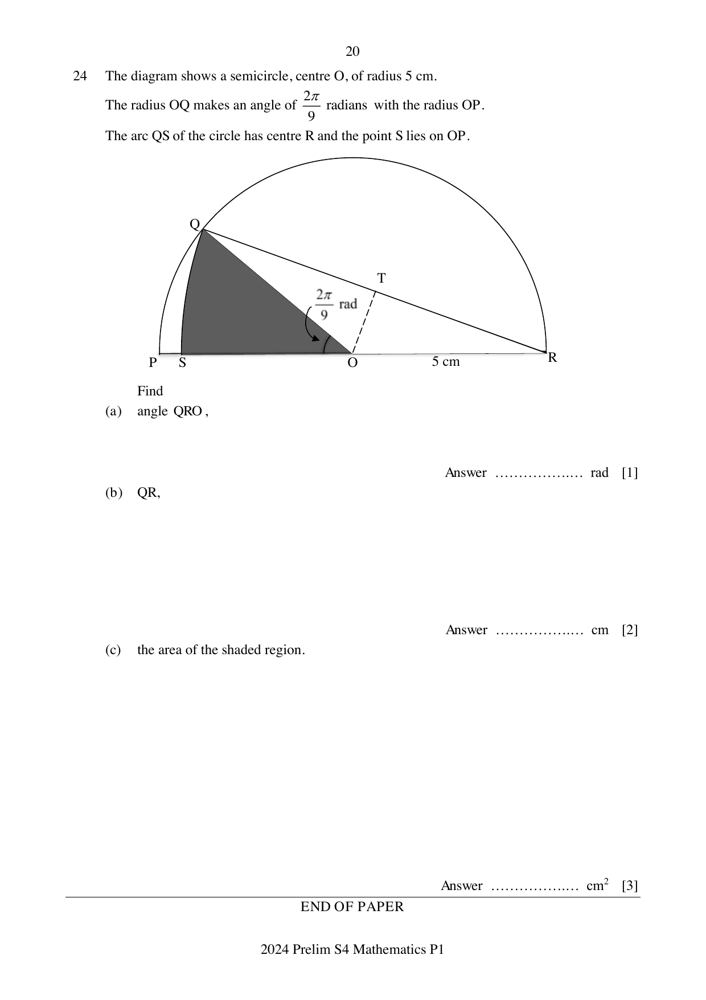
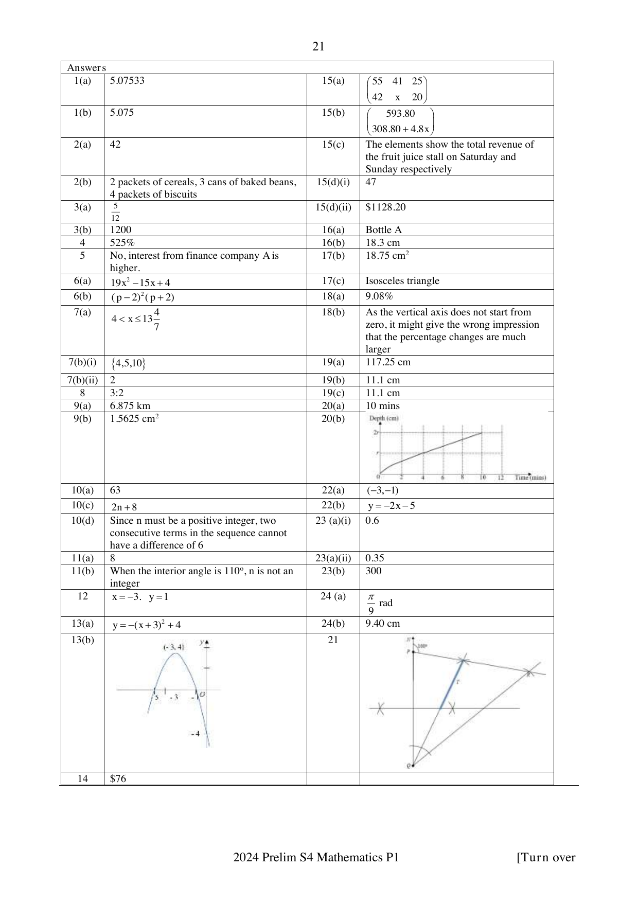

# Crescent Girls' School — Mathematics 4052/01 Paper 1 (cleaned)

> **Institution:** Crescent Girls' School
> **Exam:** Preliminary Examination 2024
> **Level:** Secondary Four
> **Subjects:** Elementary Mathematics
> **Paper:** 4052/01 Paper 1
> **Date:** 19 August 2024
> **Duration:** 2 hours 15 mins
> **Total Marks:** 90
> **Source:** `2024 CGS EM Prelim Paper 1 with Ans Key.pdf`

---

## Instructions

Write your name and index number on all the work you hand in.
Write in dark blue or black pen on both sides of the paper.
You may use an HB pencil for any diagrams or graphs.
Do not use staples, paper clips, glue or correction fluid.

Answer all questions.
If working is needed for any question, it must be shown with the answer.
Omission of essential working will result in loss of marks.
The use of an approved scientific calculator is expected, where appropriate.
If the degree of accuracy is not specified in the question, and if the answer is not exact, give the answer to three significant figures. Give answers in degrees to one decimal place.
For $\pi$, use either your calculator value or $3.142$, unless the question requires the answer in terms of $\pi$.
At the end of the examination, fasten all your work securely together.
The number of marks is given in brackets [ ] at the end of each question or part question.
The total of the marks for this paper is 90.

---

## Mathematical Formulae

*Compound interest*

$$
\text{Total amount} = P\left(1+\frac{r}{100}\right)^{n}
$$

*Mensuration*

$$
\text{Curved surface area of a cone} = \pi rl
$$

$$
\text{Surface area of a sphere} = 4\pi r^{2}
$$

$$
\text{Volume of a cone} = \frac{1}{3}\pi r^{2}h
$$

$$
\text{Volume of a sphere} = \frac{4}{3}\pi r^{3}
$$

$$
\text{Area of triangle } ABC = \frac{1}{2}ab\sin C
$$

$$
\text{Arc length} = r\theta,\text{ where }\theta\text{ is in radians}
$$

$$
\text{Sector area} = \frac{1}{2}r^{2}\theta,\text{ where }\theta\text{ is in radians}
$$

*Trigonometry*

$$
\frac{a}{\sin A} = \frac{b}{\sin B} = \frac{c}{\sin C}
$$

$$
a^{2} = b^{2}+c^{2}-2bc\cos A
$$

*Statistics*

$$
\text{Mean} = \frac{\sum fx}{\sum f}
$$

$$
\text{Standard deviation} = \sqrt{\frac{\sum fx^{2}}{\sum f}-\left(\frac{\sum fx}{\sum f}\right)^{2}}
$$

---

Answer all the questions.

### Q1

> **Marks:** 2
> **Page:** 3

Calculate $\dfrac{1.75(-2.03)^{3}}{-3.85^{2}\div\sqrt[3]{135.7}}$.

(a) Write down the first six digits on your calculator display. [1]
> **Topic:** N1 Numbers and their operations
> **Sub-topic:** Numbers and their operations
> **LO:** [[context/subjects/o-level-e-maths/learning-objectives/o-level-e-maths-N1d.md|N1d]]

(b) Write your answer in part (a) correct to 3 decimal places. [1]
> **Topic:** N1 Numbers and their operations
> **Sub-topic:** Numbers and their operations
> **LO:** [[context/subjects/o-level-e-maths/learning-objectives/o-level-e-maths-N1g.md|N1g]]

### Q2

> **Marks:** 3
> **Page:** 3

The following items are to be packed into gift bags for distribution to an old folks' home.
84 packets of cereals. 126 cans of baked beans. 168 packets of biscuits.
The items are to be packed such that the contents in each gift bag are the same and there are no leftovers. Find

(a) the maximum number of gift bags required, [2]
> **Topic:** N1 Numbers and their operations
> **Sub-topic:** Numbers and their operations
> **LO:** [[context/subjects/o-level-e-maths/learning-objectives/o-level-e-maths-N1g.md|N1g]]

(b) the list of contents in each gift bag. [1]
> **Topic:** N1 Numbers and their operations
> **Sub-topic:** Numbers and their operations
> **LO:** [[context/subjects/o-level-e-maths/learning-objectives/o-level-e-maths-N1g.md|N1g]]

### Q3

> **Marks:** 3
> **Page:** 4

In a concert, $\dfrac{1}{3}$ of the audience were under the age of 20, $25\%$ were over 50 and $\dfrac{2}{3}$ of those over 50 were females.

(a) Find the fraction of the whole audience that were between 20 and 50 inclusive. [1]
> **Topic:** N3 Percentage
> **Sub-topic:** Percentage
> **LO:** [[context/subjects/o-level-e-maths/learning-objectives/o-level-e-maths-N3e.md|N3e]]

(b) 100 of the audience were men above 50. Find the audience size. [2]
> **Topic:** N3 Percentage
> **Sub-topic:** Percentage
> **LO:** [[context/subjects/o-level-e-maths/learning-objectives/o-level-e-maths-N3e.md|N3e]]

### Q4

> **Marks:** 3
> **Topic:** N5 Algebraic expressions and formulae
> **Sub-topic:** Algebraic expressions and formulae
> **LO:** [[context/subjects/o-level-e-maths/learning-objectives/o-level-e-maths-N5m.md|N5m]]
> **Page:** 4

$y$ is inversely proportional to $x^{2}$.
If $x$ is decreased by $60\%$, find the percentage increase in $y$. [3]

### Q5

> **Marks:** 3
> **Topic:** N3 Percentage
> **Sub-topic:** Percentage
> **LO:** [[context/subjects/o-level-e-maths/learning-objectives/o-level-e-maths-N3e.md|N3e]]
> **Page:** 5

Finance company A pays investors compound interest at $1.2\%$ per annum, compounded every month.
Finance company B pays investors simple interest at $1.5\%$ per annum.
Mr Tan intends to invest a certain sum for 5 years. He thinks he should invest in finance company A.
Do you agree? Explain. [3]

### Q6

> **Marks:** 4
> **Page:** 5

(a) A pair of shoes costs ＄$(3x^{2}-7)$ and a bag costs ＄$(2x^{2}-3x+5)$.
Find the total cost of three such pairs of shoes and five of the bags, in terms of $x$. [2]
> **Topic:** N5 Algebraic expressions and formulae
> **Sub-topic:** Algebraic expressions and formulae
> **LO:** [[context/subjects/o-level-e-maths/learning-objectives/o-level-e-maths-N5h.md|N5h]]

(b) Factorise $p^{3}-2p^{2}-4p+8$ completely. [2]
> **Topic:** N5 Algebraic expressions and formulae
> **Sub-topic:** Algebraic expressions and formulae
> **LO:** [[context/subjects/o-level-e-maths/learning-objectives/o-level-e-maths-N5h.md|N5h]]

### Q7

> **Marks:** 4
> **Page:** 6

(a) Solve the inequalities $\dfrac{3}{2}x-2 < 3x-8 \le \dfrac{2x+71}{3}$. [2]
> **Topic:** N7 Equations and inequalities
> **Sub-topic:** Equations and inequalities
> **LO:** [[context/subjects/o-level-e-maths/learning-objectives/o-level-e-maths-N7g.md|N7g]]

(b) $\xi = \{\text{positive integers less than } 17\}$

$A = \{x : 3 \le x < 15\}$

$B = \{\text{factors of } 20\}$

(i) List down the elements in the set $A \cap B$. [1]
> **Topic:** N7 Equations and inequalities
> **Sub-topic:** Equations and inequalities
> **LO:** [[context/subjects/o-level-e-maths/learning-objectives/o-level-e-maths-N7g.md|N7g]]

(ii) Find $n(A \cup B)'$. [1]
> **Topic:** N7 Equations and inequalities
> **Sub-topic:** Equations and inequalities
> **LO:** [[context/subjects/o-level-e-maths/learning-objectives/o-level-e-maths-N7g.md|N7g]]

### Q8

> **Marks:** 2
> **Topic:** G6 Coordinate geometry
> **Sub-topic:** Coordinate geometry
> **LO:** [[context/subjects/o-level-e-maths/learning-objectives/o-level-e-maths-G6c.md|G6c]]
> **Page:** 6

$P$ is the point $(-6,-4)$ and $Q$ is the point $(x,y)$. The gradient of the line $PQ$ is $\dfrac{2}{3}$.
Find the ratio of $x : y$ in its simplest form. [2]

### Q9

> **Marks:** 4
> **Page:** 7

A map is drawn to a scale of $1 : 25\,000$.

(a) The distance between two points on the map is $27.5$ centimetres. Find the actual distance, in kilometres, between the two points. [1]
> **Topic:** N2 Ratio and proportion
> **Sub-topic:** Ratio and proportion
> **LO:** [[context/subjects/o-level-e-maths/learning-objectives/o-level-e-maths-N2c.md|N2c]]

(b) A farm has an area of $36$ square centimetres on this map.
Find the area of the farm, in square centimetres, on a second map which is drawn to a scale of $1 : 120\,000$. [3]
> **Topic:** N2 Ratio and proportion
> **Sub-topic:** Ratio and proportion
> **LO:** [[context/subjects/o-level-e-maths/learning-objectives/o-level-e-maths-N2c.md|N2c]]

### Q10

> **Marks:** 6
> **Page:** 8

The first four terms in a sequence of numbers are given below.

$$
\begin{aligned}
T_{1} &= 3^{2}+2 = 11 \\
T_{2} &= 4^{2}+5 = 21 \\
T_{3} &= 5^{2}+8 = 33 \\
T_{4} &= 6^{2}+11 = 47
\end{aligned}
$$

(a) Find $T_{5}$. [1]
> **Topic:** N5 Algebraic expressions and formulae
> **Sub-topic:** Algebraic expressions and formulae
> **LO:** [[context/subjects/o-level-e-maths/learning-objectives/o-level-e-maths-N5e.md|N5e]]

(b) Show that the $n$th term of the sequence, $T_{n}$, is given by $n^{2}+7n+3$. [1]
> **Topic:** N5 Algebraic expressions and formulae
> **Sub-topic:** Algebraic expressions and formulae
> **LO:** [[context/subjects/o-level-e-maths/learning-objectives/o-level-e-maths-N5e.md|N5e]]

(c) $T_{n}$ and $T_{n+1}$ are consecutive terms in the sequence. Find and simplify an expression, in terms of $n$, for $T_{n+1}-T_{n}$. [2]
> **Topic:** N5 Algebraic expressions and formulae
> **Sub-topic:** Algebraic expressions and formulae
> **LO:** [[context/subjects/o-level-e-maths/learning-objectives/o-level-e-maths-N5e.md|N5e]]

(d) Explain why two consecutive terms of the sequence cannot have a difference of $6$. [2]
> **Topic:** N5 Algebraic expressions and formulae
> **Sub-topic:** Algebraic expressions and formulae
> **LO:** [[context/subjects/o-level-e-maths/learning-objectives/o-level-e-maths-N5e.md|N5e]]

### Q11

> **Marks:** 4
> **Page:** 9

(a) The number of sides of regular polygon $A$ is triple that of another regular polygon $B$.
The ratio of each interior angle of the polygon $A$ to that of the polygon $B$ is $4 : 3$.

(i) Find the number of sides of the polygon $A$. [2]
> **Topic:** G1 Angles, triangles and polygons
> **Sub-topic:** Angles, triangles and polygons
> **LO:** [[context/subjects/o-level-e-maths/learning-objectives/o-level-e-maths-G1f.md|G1f]]

(ii) Hence, find the exterior angle of the polygon $B$. [1]
> **Topic:** G1 Angles, triangles and polygons
> **Sub-topic:** Angles, triangles and polygons
> **LO:** [[context/subjects/o-level-e-maths/learning-objectives/o-level-e-maths-G1f.md|G1f]]

(b) Explain briefly why each interior angle of a polygon cannot be $110^{\circ}$. [1]
> **Topic:** G1 Angles, triangles and polygons
> **Sub-topic:** Angles, triangles and polygons
> **LO:** [[context/subjects/o-level-e-maths/learning-objectives/o-level-e-maths-G1f.md|G1f]]

### Q12

> **Marks:** 3
> **Topic:** N7 Equations and inequalities
> **Sub-topic:** Equations and inequalities
> **LO:** [[context/subjects/o-level-e-maths/learning-objectives/o-level-e-maths-N7c.md|N7c]]
> **Page:** 10

Solve the simultaneous equations.

$$
\begin{aligned}
4x+\frac{37}{3} &= \frac{1}{3}y \\
\frac{1}{3}x-3 &= -4y
\end{aligned}
$$

[3]

### Q13

> **Marks:** 3
> **Page:** 11

(a) Express $y = -x^{2}-6x-5$ in the form $y = a(x+b)^{2}+c$. [1]
> **Topic:** N6 Functions and graphs
> **Sub-topic:** Functions and graphs
> **LO:** [[context/subjects/o-level-e-maths/learning-objectives/o-level-e-maths-N6c.md|N6c]]

(b) Sketch the graph of $y = -x^{2}-6x-5$ on the axes below.
Indicate the values where the graph crosses the axes and the maximum point on the graph. [2]
> **Topic:** N6 Functions and graphs
> **Sub-topic:** Functions and graphs
> **LO:** [[context/subjects/o-level-e-maths/learning-objectives/o-level-e-maths-N6c.md|N6c]]

### Q14

> **Marks:** 2
> **Topic:** N3 Percentage
> **Sub-topic:** Percentage
> **LO:** [[context/subjects/o-level-e-maths/learning-objectives/o-level-e-maths-N3d.md|N3d]]
> **Page:** 11

Jane had some drinks with her friends at a café which gave a ＄$6$ discount. All prices are subjected to $10\%$ service charge and $9\%$ Goods and Services Tax. Her final bill was ＄$83.93$. Find the marked price of her meal. [2]

### Q15

> **Marks:** 7
> **Page:** 12

At a fruit juice stall, a cup of orange juice costs ＄$4.40$, a cup of apple juice costs ＄$4.80$ and a cup of grape juice costs ＄$6.20$. On Saturday, there were $55$ orders for orange juice, $41$ orders for apple juice and $25$ orders for grape juice. On Sunday, there were $42$ orders for orange juice, $x$ orders for apple juice and $20$ orders for grape juice.

(a) Write down a $2 \times 3$ matrix, $A$, representing the orders over Saturday and Sunday. [1]
> **Topic:** N9 Matrices
> **Sub-topic:** Matrices
> **LO:** [[context/subjects/o-level-e-maths/learning-objectives/o-level-e-maths-N9b.md|N9b]]

(b) Find, in terms of $x$, the matrix $P = A\begin{pmatrix} 4.40 \\ 4.80 \\ 6.20 \end{pmatrix}$. [1]
> **Topic:** N9 Matrices
> **Sub-topic:** Matrices
> **LO:** [[context/subjects/o-level-e-maths/learning-objectives/o-level-e-maths-N9b.md|N9b]]

(c) Explain clearly what each element in matrix $P$ represents. [1]
> **Topic:** N9 Matrices
> **Sub-topic:** Matrices
> **LO:** [[context/subjects/o-level-e-maths/learning-objectives/o-level-e-maths-N9b.md|N9b]]

(d) If the total revenue on Sunday is about $10\%$ less that the total revenue on Saturday, calculate

(i) the value of $x$, [2]
> **Topic:** N9 Matrices
> **Sub-topic:** Matrices
> **LO:** [[context/subjects/o-level-e-maths/learning-objectives/o-level-e-maths-N9b.md|N9b]]

(ii) and the total revenue on the weekends using matrix multiplication. [2]
> **Topic:** N9 Matrices
> **Sub-topic:** Matrices
> **LO:** [[context/subjects/o-level-e-maths/learning-objectives/o-level-e-maths-N9b.md|N9b]]

### Q16

> **Marks:** 4
> **Page:** 13

The diagram shows three geometrically similar detergent bottles of the same brand.

- Bottle A: $4$ litres, ＄$15.50$
- Bottle B: $2.5$ litres, ＄$10.20$
- Bottle C: $800$ ml, ＄$4.50$

(a) Explain which of the above bottles is the best value for money. [2]
> **Topic:** G5 Mensuration
> **Sub-topic:** Mensuration
> **LO:** [[context/subjects/o-level-e-maths/learning-objectives/o-level-e-maths-G5d.md|G5d]]

(b) The bottles are all geometrically similar.
The height of the $800$ ml bottle is $12.5$ cm.
Calculate the height of the $2.5$ litres bottle. [2]
> **Topic:** G5 Mensuration
> **Sub-topic:** Mensuration
> **LO:** [[context/subjects/o-level-e-maths/learning-objectives/o-level-e-maths-G5d.md|G5d]]

### Q17

> **Marks:** 6
> **Page:** 14

$ABCD$ is a cyclic quadrilateral and $AB$, $PQ$ and $DC$ are parallel.
Given that $PQ : DC = 2 : 3$ and area of triangle $BPQ = 25$ cm$^{2}$.

(a) Show that triangle $BPQ$ and triangle $BDC$ are similar. [2]
> **Topic:** G2 Congruence and similarity
> **Sub-topic:** Congruence and similarity
> **LO:** [[context/subjects/o-level-e-maths/learning-objectives/o-level-e-maths-G2i.md|G2i]]

(b) Calculate the area of triangle $PCD$. [2]
> **Topic:** G3 Properties of circles
> **Sub-topic:** Properties of circles
> **LO:** [[context/subjects/o-level-e-maths/learning-objectives/o-level-e-maths-G3b.md|G3b]]

(c) What type of triangle is $PAB$? Justify your answer. [2]
> **Topic:** G3 Properties of circles
> **Sub-topic:** Properties of circles
> **LO:** [[context/subjects/o-level-e-maths/learning-objectives/o-level-e-maths-G3b.md|G3b]]

### Q18

> **Marks:** 3
> **Page:** 15

The bar chart is titled "Quarterly Household Electricity Tariff" (cents/kWh). Printed bar values: Jul–Sep 22: $30.17$; Oct–Dec 22: $29.74$; Jan–Mar 23: $28.95$; Apr–Jun 23: $27.43$; Jul–Sep 23: $27.74$; Oct–Dec 23: $28.70$; Jan–Mar 24: $29.89$; Apr–Jun 24: $29.79$. The vertical scale starts at $26.00$.

Source: https://www.spgroup.com.sg/about-us/media-resources/news-and-media-releases/Electricity-Tariff-Revision-for-the-Period-1-April-to-30-June-2024

(a) Find the percentage decrease of the quarterly household electrical tariff between July – Sept 22 and April – June 2023. [2]
> **Topic:** S1 Data handling and analysis
> **Sub-topic:** Data handling and analysis
> **LO:** [[context/subjects/o-level-e-maths/learning-objectives/o-level-e-maths-S1b.md|S1b]]

(b) Explain briefly why the bar chart might be considered misleading. [1]
> **Topic:** S1 Data handling and analysis
> **Sub-topic:** Data handling and analysis
> **LO:** [[context/subjects/o-level-e-maths/learning-objectives/o-level-e-maths-S1b.md|S1b]]

### Q19

> **Marks:** 3
> **Page:** 16

The table below shows the heights of $40$ students.

| Height ($H$ cm) | $90 < H \le 100$ | $100 < H \le 110$ | $110 < H \le 120$ | $120 < H \le 130$ | $130 < H \le 140$ |
| --- | --- | --- | --- | --- | --- |
| Frequency | $2$ | $9$ | $13$ | $10$ | $6$ |

(a) Calculate an estimate of the mean height of the students. [1]
> **Topic:** S1 Data handling and analysis
> **Sub-topic:** Data handling and analysis
> **LO:** [[context/subjects/o-level-e-maths/learning-objectives/o-level-e-maths-S1f.md|S1f]]

(b) Calculate an estimate of the standard deviation of the heights. [1]
> **Topic:** S1 Data handling and analysis
> **Sub-topic:** Data handling and analysis
> **LO:** [[context/subjects/o-level-e-maths/learning-objectives/o-level-e-maths-S1k.md|S1k]]

(c) It was discovered that the students were not instructed to remove their shoes during measurement. Assuming that the average height of the soles of the shoes is $2.5$ cm, state the standard deviation. [1]
> **Topic:** S1 Data handling and analysis
> **Sub-topic:** Data handling and analysis
> **LO:** [[context/subjects/o-level-e-maths/learning-objectives/o-level-e-maths-S1f.md|S1f]]

### Q20

> **Marks:** 4
> **Page:** 17

A solid cone of height and radius $r$ cm is placed inside a cylindrical container of the same radius and a height of $2r$ cm.
Water is poured into the empty container at a constant rate.
After $4$ minutes, the depth of the water is $r$ cm.

(a) Find the time taken to fill the container completely. [2]
> **Topic:** G5 Mensuration
> **Sub-topic:** Mensuration
> **LO:** [[context/subjects/o-level-e-maths/learning-objectives/o-level-e-maths-G5c.md|G5c]]

(b) On the axes in the answer space, sketch the graph showing how the height varies with time. [2]
> **Topic:** G5 Mensuration
> **Sub-topic:** Mensuration
> **LO:** [[context/subjects/o-level-e-maths/learning-objectives/o-level-e-maths-G5c.md|G5c]]

The printed axes are depth (cm) against time (mins), with horizontal guides at $r$ and $2r$ and vertical guides at $0, 2, 4, 6, 8, 10, 12$. The cone stands base-down inside the cylinder.

### Q21

> **Marks:** 4
> **Page:** 18

The diagram below is a map showing the positions of two buildings, $P$ and $Q$.
Building $Q$ is due south of $P$. The scale is $1$ cm to $100$ m.
Another building, $R$ is on a bearing of $100^{\circ}$ from $P$.
The distance between $Q$ and $R$ is $1050$ m.

(a) Mark and label on the diagram the position of building $R$. [1]
> **Topic:** G1 Angles, triangles and polygons
> **Sub-topic:** Angles, triangles and polygons
> **LO:** [[context/subjects/o-level-e-maths/learning-objectives/o-level-e-maths-G1c.md|G1c]]

(b) A convenience store is located at $T$, which is equidistant from lines $PQ$ and $QR$ and is nearer to $P$ than to $Q$.
Mark and label the possible position of the convenience store $T$. [3]
> **Topic:** G1 Angles, triangles and polygons
> **Sub-topic:** Angles, triangles and polygons
> **LO:** [[context/subjects/o-level-e-maths/learning-objectives/o-level-e-maths-G1c.md|G1c]]

### Q22

> **Marks:** 4
> **Page:** 19

The equation of a line $L$, is given as $y = 2x+5$.

(a) A point on the line $L$ is thrice as far from $y$-axis as compared to the $x$-axis. Find the coordinates of the point. [2]
> **Topic:** G6 Coordinate geometry
> **Sub-topic:** Coordinate geometry
> **LO:** [[context/subjects/o-level-e-maths/learning-objectives/o-level-e-maths-G6c.md|G6c]]

(b) The line $L$ is reflected about the $x$-axis. Find the equation of this line. [2]
> **Topic:** G6 Coordinate geometry
> **Sub-topic:** Coordinate geometry
> **LO:** [[context/subjects/o-level-e-maths/learning-objectives/o-level-e-maths-G6c.md|G6c]]

### Q23

> **Marks:** 3
> **Page:** 19

A box contains red, blue and green balls. Each ball is labelled either $2$, $3$, $4$ or $5$.
The table below shows the probability of the colour and number drawn for the balls.

| Colour | 2 | 3 | 4 | 5 |
| --- | --- | --- | --- | --- |
| Red | $0.1$ | $0$ | $0.2$ | $0.15$ |
| Blue | $0.1$ | $0.05$ | $0$ | $0.2$ |
| Green | $0$ | $0.1$ | $0.1$ | $0$ |

(a) A ball is drawn at random from the box. Find the probability that

(i) it is blue or odd, [1]
> **Topic:** S2 Probability
> **Sub-topic:** Probability
> **LO:** [[context/subjects/o-level-e-maths/learning-objectives/o-level-e-maths-S2c.md|S2c]]

(ii) it is not red and not even. [1]
> **Topic:** S2 Probability
> **Sub-topic:** Probability
> **LO:** [[context/subjects/o-level-e-maths/learning-objectives/o-level-e-maths-S2c.md|S2c]]

(b) There are $135$ red balls in the box. How many balls are there in the box altogether? [1]
> **Topic:** S2 Probability
> **Sub-topic:** Probability
> **LO:** [[context/subjects/o-level-e-maths/learning-objectives/o-level-e-maths-S2c.md|S2c]]

### Q24

> **Marks:** 6
> **Page:** 20

The diagram shows a semicircle, centre $O$, of radius $5$ cm.
The radius $OQ$ makes an angle of $\dfrac{2\pi}{9}$ radians with the radius $OP$.
The arc $QS$ of the circle has centre $R$ and the point $S$ lies on $OP$.

Find

(a) angle $QRO$, [1]
> **Topic:** G5 Mensuration
> **Sub-topic:** Mensuration
> **LO:** [[context/subjects/o-level-e-maths/learning-objectives/o-level-e-maths-G5f.md|G5f]]

(b) $QR$, [2]
> **Topic:** G5 Mensuration
> **Sub-topic:** Mensuration
> **LO:** [[context/subjects/o-level-e-maths/learning-objectives/o-level-e-maths-G5f.md|G5f]]

(c) the area of the shaded region. [3]
> **Topic:** G5 Mensuration
> **Sub-topic:** Mensuration
> **LO:** [[context/subjects/o-level-e-maths/learning-objectives/o-level-e-maths-G5b.md|G5b]]

---

## Answers

Printed answer key (PDF page 21). Sketches for Q13(b), Q20(b) and a working diagram beside Q24 are on that page; they are not redrawn here.

**1(a)** $5.07533$

**1(b)** $5.075$

**2(a)** $42$

**2(b)** $2$ packets of cereals, $3$ cans of baked beans, $4$ packets of biscuits

**3(a)** $\dfrac{5}{12}$

**3(b)** $1200$

**4** $525\%$

**5** No, interest from finance company A is higher.

**6(a)** $19x^{2}-15x+4$

**6(b)** $(p-2)^{2}(p+2)$

**7(a)** $4 < x \le 13\dfrac{4}{7}$

**7(b)(i)** $\{4, 5, 10\}$

**7(b)(ii)** $2$

**8** $3 : 2$

**9(a)** $6.875$ km

**9(b)** $1.5625$ cm$^{2}$

**10(a)** $63$

**10(b)** Not printed (the result is given in the question).

**10(c)** $2n+8$

**10(d)** Since $n$ must be a positive integer, two consecutive terms in the sequence cannot have a difference of $6$.

**11(a)** $8$ (printed against 11(a); part (ii) is not printed separately)

**11(b)** When the interior angle is $110^{\circ}$, $n$ is not an integer.

**12** $x = -3$, $y = 1$

**13(a)** $y = -(x+3)^{2}+4$

**13(b)** Sketch on the answer page: a maximum at $(-3, 4)$, crossing the axes. See the embedded key.

**14** ＄$76$

**15(a)** $\begin{pmatrix} 55 & 41 & 25 \\ 42 & x & 20 \end{pmatrix}$

**15(b)** $\begin{pmatrix} 593.80 \\ 308.80+4.8x \end{pmatrix}$

**15(c)** The elements show the total revenue of the fruit juice stall on Saturday and Sunday respectively.

**15(d)(i)** $47$

**15(d)(ii)** ＄$1128.20$

**16(a)** Bottle A

**16(b)** $18.3$ cm

**17(a)** Not printed.

**17(b)** $18.75$ cm$^{2}$

**17(c)** Isosceles triangle

**18(a)** $9.08\%$

**18(b)** As the vertical axis does not start from zero, it might give the wrong impression that the percentage changes are much larger.

**19(a)** $117.25$ cm

**19(b)** $11.1$ cm

**19(c)** $11.1$ cm

**20(a)** $10$ mins

**20(b)** Sketch on the answer page (a straight-line graph of depth against time). See the embedded key.

**21** Not printed (construction).

**22(a)** $(-3, -1)$

**22(b)** $y = -2x-5$

**23(a)(i)** $0.6$

**23(a)(ii)** $0.35$

**23(b)** $300$

**24(a)** $\dfrac{\pi}{9}$ rad

**24(b)** $9.40$ cm

**24(c)** Not printed. A working diagram is on the answer page.
