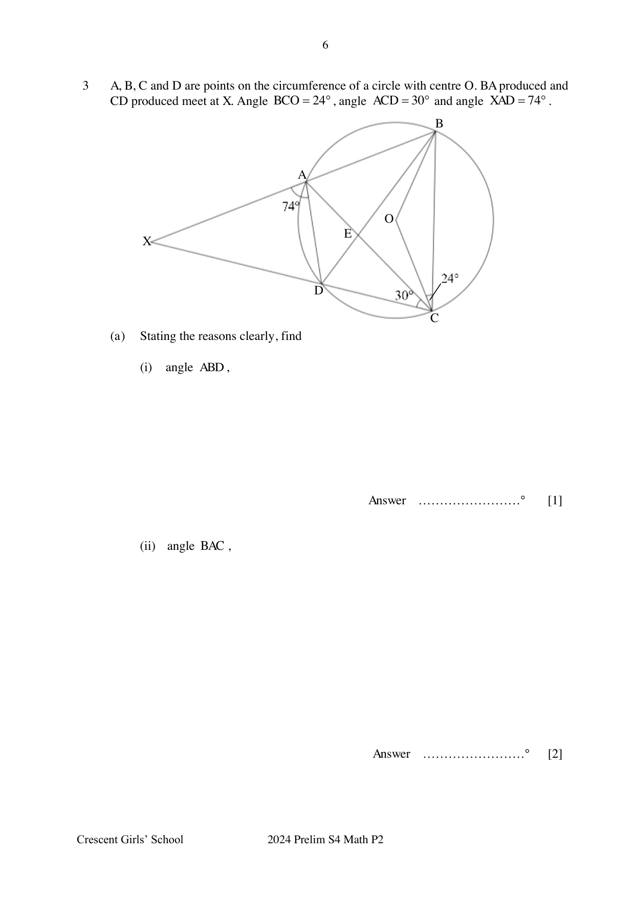
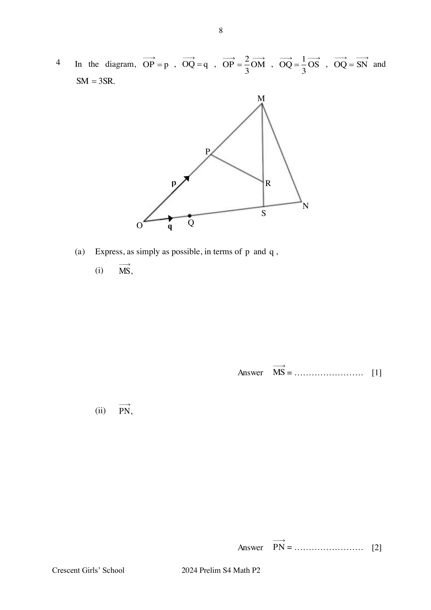
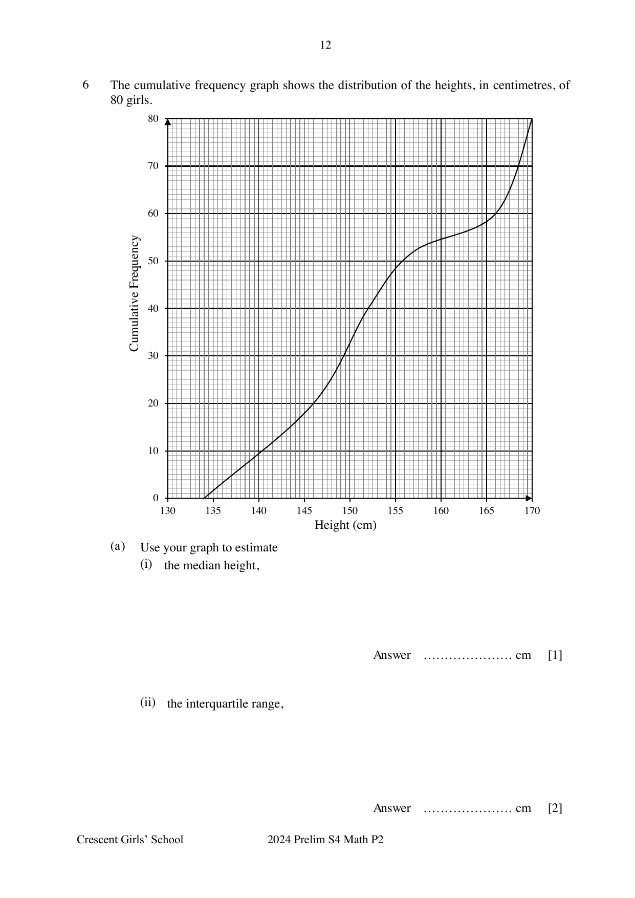
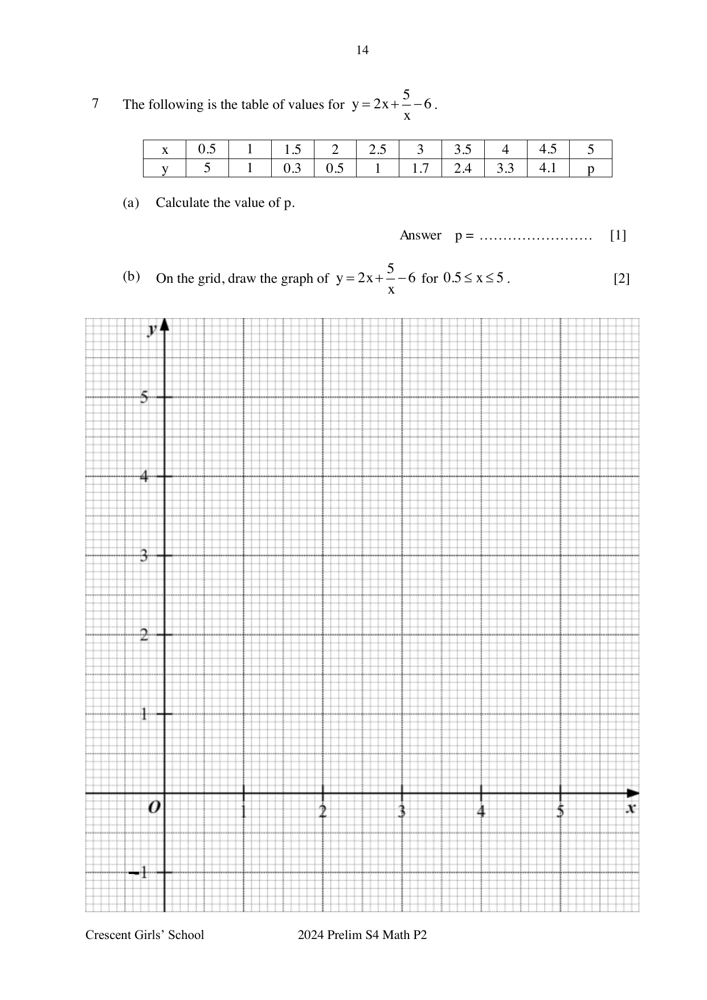
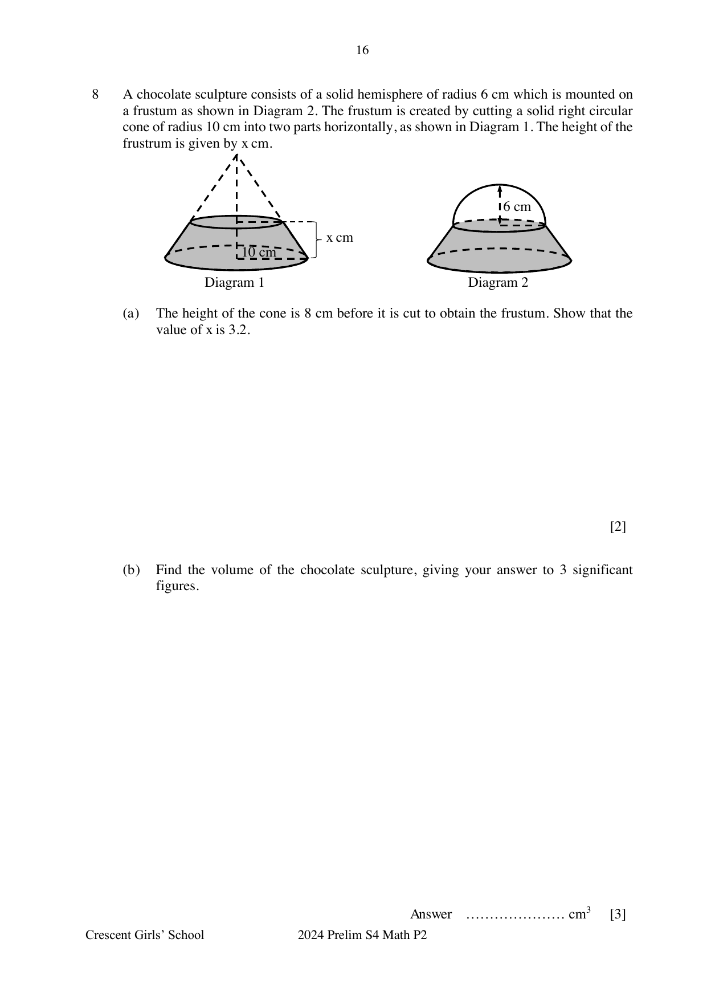
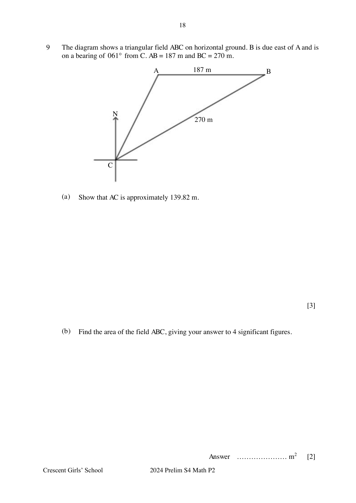
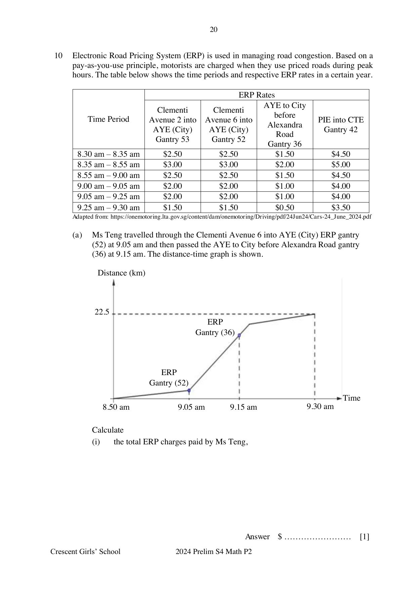
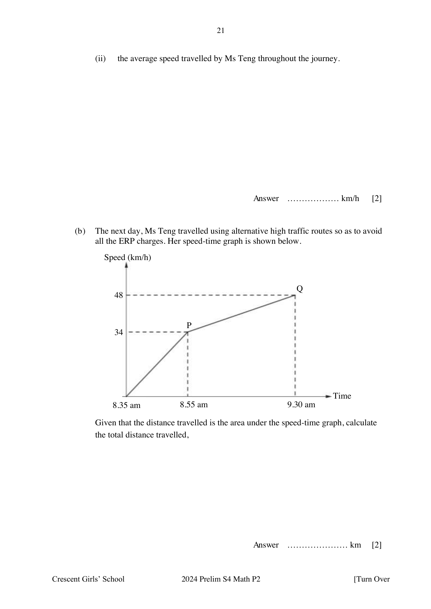

# Crescent Girls' School — Mathematics 4052/02 Paper 2 (cleaned)

> **Institution:** Crescent Girls' School
> **Exam:** Preliminary Examination 2024
> **Level:** Secondary Four
> **Subjects:** Elementary Mathematics
> **Paper:** 4052/02 Paper 2
> **Date:** 20 Aug 2024
> **Duration:** 2 hours 15 minutes
> **Total Marks:** 90
> **Source:** `2024 CGS EM Prelim Paper 2 with Ans Key.pdf`

---

## Instructions

Write your name, register number and class on all the work you hand in.
Write in dark blue or black pen.
You may use an HB pencil for any diagrams or graphs.
Do not use staples, paper clips, glue or correction fluid.

Answer all the questions.
If working is needed for any question it must be shown with the answer.
Omission of essential working will result in loss of marks.
The use of an approved scientific calculator is expected, where appropriate.
If the degree of accuracy is not specified in the question, and if the answer is not exact, give the answer to three significant figures. Give answers in degrees to one decimal place.
For $\pi$, use either your calculator value or $3.142$, unless the question requires the answer in terms of $\pi$.

The number of marks is given in brackets [ ] at the end of each question or part question.
The total of the marks for this paper is 90.

---

## Mathematical Formulae

*Compound interest*

$$
\text{Total amount} = P\left(1+\frac{r}{100}\right)^{n}
$$

*Mensuration*

$$
\text{Curved surface area of a cone} = \pi rl
$$

$$
\text{Surface area of a sphere} = 4\pi r^{2}
$$

$$
\text{Volume of a cone} = \frac{1}{3}\pi r^{2}h
$$

$$
\text{Volume of a sphere} = \frac{4}{3}\pi r^{3}
$$

$$
\text{Area of triangle } ABC = \frac{1}{2}ab\sin C
$$

$$
\text{Arc length} = r\theta,\text{ where }\theta\text{ is in radians}
$$

$$
\text{Sector area} = \frac{1}{2}r^{2}\theta,\text{ where }\theta\text{ is in radians}
$$

*Trigonometry*

$$
\frac{a}{\sin A} = \frac{b}{\sin B} = \frac{c}{\sin C}
$$

$$
a^{2} = b^{2}+c^{2}-2bc\cos A
$$

*Statistics*

$$
\text{Mean} = \frac{\sum fx}{\sum f}
$$

$$
\text{Standard deviation} = \sqrt{\frac{\sum fx^{2}}{\sum f}-\left(\frac{\sum fx}{\sum f}\right)^{2}}
$$

---

### Q1

> **Marks:** 4
> **Page:** 3

$20$ students of class 4A took a test. The marks are shown in the stem and leaf diagram.

| Stem | Leaves |
| --- | --- |
| 5 | 0 2 3 3 5 7 8 |
| 6 | 0 1 2 6 7 7 9 |
| 7 | 0 $k$ 5 4 7 |
| 8 | |
| 9 | 8 |

Key: $5 \mid 2$ means $52$ marks.

The marks are also represented in the box-and-whisker plot. The printed plot has end points and quartile marks at $50$, $56$, $64$, $71$ and $98$.

(a) Find the value of $k$. [1]
> **Topic:** S1 Data handling and analysis
> **Sub-topic:** Data handling and analysis
> **LO:** [[context/subjects/o-level-e-maths/learning-objectives/o-level-e-maths-S1i.md|S1i]]

(b) Would you prefer to use the mean or the median mark to describe the performance of class 4A? Give a reason for your answer. [2]
> **Topic:** S1 Data handling and analysis
> **Sub-topic:** Data handling and analysis
> **LO:** [[context/subjects/o-level-e-maths/learning-objectives/o-level-e-maths-S1f.md|S1f]]

(c) Class 4B took the same test as class 4A. A student from 4B was subsequently transferred to 4A and a new box-and-whisker plot for 4A was then drawn. It is given that the plot remained unchanged.

How many marks did the transfer student obtain in the test? [1]
> **Topic:** S1 Data handling and analysis
> **Sub-topic:** Data handling and analysis
> **LO:** [[context/subjects/o-level-e-maths/learning-objectives/o-level-e-maths-S1i.md|S1i]]

### Q2

> **Marks:** 10
> **Page:** 4–5

(a) Given that $p = \sqrt{\dfrac{q}{2}-r^{2}}+3$, express $r$ in terms of $p$ and $q$. [2]
> **Topic:** N5 Algebraic expressions and formulae
> **Sub-topic:** Algebraic expressions and formulae
> **LO:** [[context/subjects/o-level-e-maths/learning-objectives/o-level-e-maths-N5h.md|N5h]]

(b) Simplify $\dfrac{(-x^{2}y^{3})^{4}\div 2xy^{0}}{\dfrac{3}{5xy^{2}}}$. [4]
> **Topic:** N5 Algebraic expressions and formulae
> **Sub-topic:** Algebraic expressions and formulae
> **LO:** [[context/subjects/o-level-e-maths/learning-objectives/o-level-e-maths-N5h.md|N5h]]

(c) (i) Factorise $9x^{2}-4$. [1]
> **Topic:** N5 Algebraic expressions and formulae
> **Sub-topic:** Algebraic expressions and formulae
> **LO:** [[context/subjects/o-level-e-maths/learning-objectives/o-level-e-maths-N5h.md|N5h]]

(ii) Hence, express $\dfrac{3x}{9x^{2}-4}-\dfrac{2}{3x-2}$ as a single fraction in its simplest form. [3]
> **Topic:** N5 Algebraic expressions and formulae
> **Sub-topic:** Algebraic expressions and formulae
> **LO:** [[context/subjects/o-level-e-maths/learning-objectives/o-level-e-maths-N5h.md|N5h]]

### Q3

> **Marks:** 7
> **Page:** 6–7

$A$, $B$, $C$ and $D$ are points on the circumference of a circle with centre $O$. $BA$ produced and $CD$ produced meet at $X$. Angle $BCO = 24^{\circ}$, angle $ACD = 30^{\circ}$ and angle $XAD = 74^{\circ}$.

(a) Stating the reasons clearly, find

(i) angle $ABD$, [1]
> **Topic:** G3 Properties of circles
> **Sub-topic:** Properties of circles
> **LO:** [[context/subjects/o-level-e-maths/learning-objectives/o-level-e-maths-G3b.md|G3b]]

(ii) angle $BAC$, [2]
> **Topic:** G3 Properties of circles
> **Sub-topic:** Properties of circles
> **LO:** [[context/subjects/o-level-e-maths/learning-objectives/o-level-e-maths-G3b.md|G3b]]

(iii) angle $ECO$. [2]
> **Topic:** G3 Properties of circles
> **Sub-topic:** Properties of circles
> **LO:** [[context/subjects/o-level-e-maths/learning-objectives/o-level-e-maths-G3b.md|G3b]]

(b) $W$ is a point on the same side of the major segment formed by the chord $AD$. Given that angle $AWD = 45^{\circ}$, state with reason whether the point $W$ lies on the circumference of the circle, outside the circle or inside the circle. [2]
> **Topic:** G3 Properties of circles
> **Sub-topic:** Properties of circles
> **LO:** [[context/subjects/o-level-e-maths/learning-objectives/o-level-e-maths-G3b.md|G3b]]

### Q4

> **Marks:** 13
> **Page:** 8–10

In the diagram, $\overrightarrow{OP} = \mathbf{p}$, $\overrightarrow{OQ} = \mathbf{q}$, $\overrightarrow{OP} = \dfrac{2}{3}\overrightarrow{OM}$, $\overrightarrow{OQ} = \dfrac{1}{3}\overrightarrow{OS}$, $\overrightarrow{OQ} = \overrightarrow{SN}$ and $\overrightarrow{SM} = 3\overrightarrow{SR}$.

(a) Express, as simply as possible, in terms of $\mathbf{p}$ and $\mathbf{q}$,

(i) $\overrightarrow{MS}$, [1]
> **Topic:** G7 Vectors in two dimensions
> **Sub-topic:** Vectors in two dimensions
> **LO:** [[context/subjects/o-level-e-maths/learning-objectives/o-level-e-maths-G7h.md|G7h]]

(ii) $\overrightarrow{PN}$, [2]
> **Topic:** G7 Vectors in two dimensions
> **Sub-topic:** Vectors in two dimensions
> **LO:** [[context/subjects/o-level-e-maths/learning-objectives/o-level-e-maths-G7h.md|G7h]]

(iii) $\overrightarrow{PR}$. [3]
> **Topic:** G7 Vectors in two dimensions
> **Sub-topic:** Vectors in two dimensions
> **LO:** [[context/subjects/o-level-e-maths/learning-objectives/o-level-e-maths-G7h.md|G7h]]

(b) Write down two facts about $P$, $R$ and $N$. [2]
> **Topic:** G7 Vectors in two dimensions
> **Sub-topic:** Vectors in two dimensions
> **LO:** [[context/subjects/o-level-e-maths/learning-objectives/o-level-e-maths-G7h.md|G7h]]

(c) Find the numerical value of $\dfrac{\text{Area of } MPR}{\text{Area of } MON}$. [2]
> **Topic:** G7 Vectors in two dimensions
> **Sub-topic:** Vectors in two dimensions
> **LO:** [[context/subjects/o-level-e-maths/learning-objectives/o-level-e-maths-G7h.md|G7h]]

(d) The coordinates of $A$ and $B$ are $(6, 5)$ and $(8, 1)$ respectively.

(i) Express $\overrightarrow{AB}$ as a column vector. [1]
> **Topic:** G7 Vectors in two dimensions
> **Sub-topic:** Vectors in two dimensions
> **LO:** [[context/subjects/o-level-e-maths/learning-objectives/o-level-e-maths-G7h.md|G7h]]

(ii) Find $\left\lvert \overrightarrow{AB} \right\rvert$. [2]
> **Topic:** G7 Vectors in two dimensions
> **Sub-topic:** Vectors in two dimensions
> **LO:** [[context/subjects/o-level-e-maths/learning-objectives/o-level-e-maths-G7h.md|G7h]]

### Q5

> **Marks:** 8
> **Page:** 11

A bag contains $42$ red, $15$ blue and $y$ orange sweets. One sweet is picked at random from the bag. The probability of picking up an orange sweet is $\dfrac{6}{25}$.

(a) Show that the value of $y$ is $18$. [2]
> **Topic:** S2 Probability
> **Sub-topic:** Probability
> **LO:** [[context/subjects/o-level-e-maths/learning-objectives/o-level-e-maths-S2c.md|S2c]]

(b) Two sweets are drawn at random one after another, from the bag, without replacement. Calculate the probability that

(i) both sweets are of the same colour, [2]
> **Topic:** S2 Probability
> **Sub-topic:** Probability
> **LO:** [[context/subjects/o-level-e-maths/learning-objectives/o-level-e-maths-S2c.md|S2c]]

(ii) one sweet drawn is red and the other is blue, [2]
> **Topic:** S2 Probability
> **Sub-topic:** Probability
> **LO:** [[context/subjects/o-level-e-maths/learning-objectives/o-level-e-maths-S2c.md|S2c]]

(iii) at least one sweet drawn is orange. [2]
> **Topic:** S2 Probability
> **Sub-topic:** Probability
> **LO:** [[context/subjects/o-level-e-maths/learning-objectives/o-level-e-maths-S2c.md|S2c]]

### Q6

> **Marks:** 7
> **Page:** 12–13

The cumulative frequency graph shows the distribution of the heights, in centimetres, of $80$ girls.

(a) Use your graph to estimate

(i) the median height, [1]
> **Topic:** S1 Data handling and analysis
> **Sub-topic:** Data handling and analysis
> **LO:** [[context/subjects/o-level-e-maths/learning-objectives/o-level-e-maths-S1f.md|S1f]]

(ii) the interquartile range, [2]
> **Topic:** S1 Data handling and analysis
> **Sub-topic:** Data handling and analysis
> **LO:** [[context/subjects/o-level-e-maths/learning-objectives/o-level-e-maths-S1i.md|S1i]]

(iii) $35\%$ of the girls are taller than $h$ cm. Find the value of $h$. [2]
> **Topic:** S1 Data handling and analysis
> **Sub-topic:** Data handling and analysis
> **LO:** [[context/subjects/o-level-e-maths/learning-objectives/o-level-e-maths-S1i.md|S1i]]

(b) The cumulative frequency graph of the heights of $80$ boys was drawn on the same axes.
The curve representing the heights of the boys lies on the right side of the curve representing the heights of the girls.
The curve representing the heights of the boys is steeper than the curve representing the heights of the girls.
Compare the median and interquartile range of the heights of the boys and the heights of the girls. [2]
> **Topic:** S1 Data handling and analysis
> **Sub-topic:** Data handling and analysis
> **LO:** [[context/subjects/o-level-e-maths/learning-objectives/o-level-e-maths-S1i.md|S1i]]

### Q7

> **Marks:** 11
> **Page:** 14–15

The following is the table of values for $y = 2x+\dfrac{5}{x}-6$.

| $x$ | $0.5$ | $1$ | $1.5$ | $2$ | $2.5$ | $3$ | $3.5$ | $4$ | $4.5$ | $5$ |
| --- | --- | --- | --- | --- | --- | --- | --- | --- | --- | --- |
| $y$ | $5$ | $1$ | $0.3$ | $0.5$ | $1$ | $1.7$ | $2.4$ | $3.3$ | $4.1$ | $p$ |

(a) Calculate the value of $p$. [1]
> **Topic:** G6 Coordinate geometry
> **Sub-topic:** Coordinate geometry
> **LO:** [[context/subjects/o-level-e-maths/learning-objectives/o-level-e-maths-G6c.md|G6c]]

(b) On the grid, draw the graph of $y = 2x+\dfrac{5}{x}-6$ for $0.5 \le x \le 5$. [2]
> **Topic:** N6 Functions and graphs
> **Sub-topic:** Functions and graphs
> **LO:** [[context/subjects/o-level-e-maths/learning-objectives/o-level-e-maths-N6c.md|N6c]]

(c) By drawing a tangent, find the gradient at the point where $x = 1$. [2]
> **Topic:** G6 Coordinate geometry
> **Sub-topic:** Coordinate geometry
> **LO:** [[context/subjects/o-level-e-maths/learning-objectives/o-level-e-maths-G6c.md|G6c]]

(d) Showing your working clearly, explain how your graph shows that there is no solution to the equation $2x+\dfrac{5}{x} = 5$. [2]
> **Topic:** N6 Functions and graphs
> **Sub-topic:** Functions and graphs
> **LO:** [[context/subjects/o-level-e-maths/learning-objectives/o-level-e-maths-N6c.md|N6c]]

(e) (i) Draw the graph of $y = \dfrac{1}{2}x+1$ on the grid in part (b) for $0.5 \le x \le 5$. [1]
> **Topic:** N6 Functions and graphs
> **Sub-topic:** Functions and graphs
> **LO:** [[context/subjects/o-level-e-maths/learning-objectives/o-level-e-maths-N6c.md|N6c]]

(ii) Write down the $x$ coordinates of the points at which the two graphs intersect. [1]
> **Topic:** N6 Functions and graphs
> **Sub-topic:** Functions and graphs
> **LO:** [[context/subjects/o-level-e-maths/learning-objectives/o-level-e-maths-N6c.md|N6c]]

(iii) Given that $a$, $b$ and $c$ are integers, find the equation, in the form $ax^{2}+bx+c = 0$, which is satisfied by the values of $x$ found in (e)(ii). [2]
> **Topic:** N6 Functions and graphs
> **Sub-topic:** Functions and graphs
> **LO:** [[context/subjects/o-level-e-maths/learning-objectives/o-level-e-maths-N6c.md|N6c]]

### Q8

> **Marks:** 9
> **Page:** 16–17

A chocolate sculpture consists of a solid hemisphere of radius $6$ cm which is mounted on a frustum as shown in Diagram 2. The frustum is created by cutting a solid right circular cone of radius $10$ cm into two parts horizontally, as shown in Diagram 1. The height of the frustum is given by $x$ cm.

(a) The height of the cone is $8$ cm before it is cut to obtain the frustum. Show that the value of $x$ is $3.2$. [2]
> **Topic:** G5 Mensuration
> **Sub-topic:** Mensuration
> **LO:** [[context/subjects/o-level-e-maths/learning-objectives/o-level-e-maths-G5c.md|G5c]]

(b) Find the volume of the chocolate sculpture, giving your answer to $3$ significant figures. [3]
> **Topic:** G5 Mensuration
> **Sub-topic:** Mensuration
> **LO:** [[context/subjects/o-level-e-maths/learning-objectives/o-level-e-maths-G5c.md|G5c]]

(c) Find the total surface area of the chocolate sculpture, giving your answer to $3$ significant figures. [4]
> **Topic:** G5 Mensuration
> **Sub-topic:** Mensuration
> **LO:** [[context/subjects/o-level-e-maths/learning-objectives/o-level-e-maths-G5c.md|G5c]]

### Q9

> **Marks:** 11
> **Page:** 18–19

The diagram shows a triangular field $ABC$ on horizontal ground. $B$ is due east of $A$ and is on a bearing of $061^{\circ}$ from $C$. $AB = 187$ m and $BC = 270$ m.

(a) Show that $AC$ is approximately $139.82$ m. [3]
> **Topic:** G4 Pythagoras' theorem and trigonometry
> **Sub-topic:** Pythagoras' theorem and trigonometry
> **LO:** [[context/subjects/o-level-e-maths/learning-objectives/o-level-e-maths-G4g.md|G4g]]

(b) Find the area of the field $ABC$, giving your answer to $4$ significant figures. [2]
> **Topic:** G4 Pythagoras' theorem and trigonometry
> **Sub-topic:** Pythagoras' theorem and trigonometry
> **LO:** [[context/subjects/o-level-e-maths/learning-objectives/o-level-e-maths-G4g.md|G4g]]

(c) A drone is hovering vertically above $B$. The angle of depression of $A$ from the drone is $12^{\circ}$. Calculate the height of the drone above $B$. [2]
> **Topic:** G4 Pythagoras' theorem and trigonometry
> **Sub-topic:** Pythagoras' theorem and trigonometry
> **LO:** [[context/subjects/o-level-e-maths/learning-objectives/o-level-e-maths-G4g.md|G4g]]

(d) Alex moves in a straight line from $B$ to $C$ and stops at $P$ where $AP = 183$ m.
He claims that there are two such positions of $P$.
Determine, with clear calculations, if Alex is right. [4]
> **Topic:** G4 Pythagoras' theorem and trigonometry
> **Sub-topic:** Pythagoras' theorem and trigonometry
> **LO:** [[context/subjects/o-level-e-maths/learning-objectives/o-level-e-maths-G4g.md|G4g]]

### Q10

> **Marks:** 10
> **Page:** 20–22

Electronic Road Pricing System (ERP) is used in managing road congestion. Based on a pay-as-you-use principle, motorists are charged when they use priced roads during peak hours. The table below shows the time periods and respective ERP rates in a certain year.

| Time Period | Clementi Avenue 2 into AYE (City) Gantry 53 | Clementi Avenue 6 into AYE (City) Gantry 52 | AYE to City before Alexandra Road Gantry 36 | PIE into CTE Gantry 42 |
| --- | --- | --- | --- | --- |
| 8.30 am – 8.35 am | ＄2.50 | ＄2.50 | ＄1.50 | ＄4.50 |
| 8.35 am – 8.55 am | ＄3.00 | ＄3.00 | ＄2.00 | ＄5.00 |
| 8.55 am – 9.00 am | ＄2.50 | ＄2.50 | ＄1.50 | ＄4.50 |
| 9.00 am – 9.05 am | ＄2.00 | ＄2.00 | ＄1.00 | ＄4.00 |
| 9.05 am – 9.25 am | ＄2.00 | ＄2.00 | ＄1.00 | ＄4.00 |
| 9.25 am – 9.30 am | ＄1.50 | ＄1.50 | ＄0.50 | ＄3.50 |

Adapted from: https://onemotoring.lta.gov.sg/content/dam/onemotoring/Driving/pdf/24Jun24/Cars-24_June_2024.pdf

(a) Ms Teng travelled through the Clementi Avenue 6 into AYE (City) ERP gantry (52) at 9.05 am and then passed the AYE to City before Alexandra Road gantry (36) at 9.15 am. The distance-time graph is shown.

The printed graph reaches $22.5$ km at $9.30$ am. ERP gantry (52) is marked at $9.05$ am and ERP gantry (36) at $9.15$ am.

Calculate

(i) the total ERP charges paid by Ms Teng, [1]
> **Topic:** N6 Functions and graphs
> **Sub-topic:** Functions and graphs
> **LO:** [[context/subjects/o-level-e-maths/learning-objectives/o-level-e-maths-N6c.md|N6c]]

(ii) the average speed travelled by Ms Teng throughout the journey. [2]
> **Topic:** S1 Data handling and analysis
> **Sub-topic:** Data handling and analysis
> **LO:** [[context/subjects/o-level-e-maths/learning-objectives/o-level-e-maths-S1f.md|S1f]]

(b) The next day, Ms Teng travelled using alternative high traffic routes so as to avoid all the ERP charges. Her speed-time graph is shown below.

Given that the distance travelled is the area under the speed-time graph, calculate the total distance travelled. [2]
> **Topic:** N6 Functions and graphs
> **Sub-topic:** Functions and graphs
> **LO:** [[context/subjects/o-level-e-maths/learning-objectives/o-level-e-maths-N6c.md|N6c]]

(c) While Ms Teng saved on ERP charges travelling on the alternative routes, she also valued her time and the cost of petrol consumed. The value of Ms Teng's time can be modelled by the following equation:

Value of time $=$ time saved in minutes $\times$ ＄$0.15$

Given that the petrol consumption rate of her car is $8.7$ litres per $100$ kilometres and the cost of petrol is ＄$2.76$ per litre, determine the route that Ms Teng would prefer in future. Justify your answer with clear workings. [5]
> **Topic:** S1 Data handling and analysis
> **Sub-topic:** Data handling and analysis
> **LO:** [[context/subjects/o-level-e-maths/learning-objectives/o-level-e-maths-S1f.md|S1f]]

---

## Answers

**1(a)** $2$

**1(b)** I will use the median mark as there is an outlier, $98$ marks, and the median is less affected by the outlier than the mean.

**1(c)** $64$

**2(a)** $r = \pm\sqrt{\dfrac{q}{2}-(p-3)^{2}}$

**2(b)** $\dfrac{5x^{8}y^{14}}{6}$

**2(c)(i)** $(3x-2)(3x+2)$

**2(c)(ii)** $-\dfrac{3x+4}{(3x-2)(3x+2)}$ or $\dfrac{-3x-4}{(3x-2)(3x+2)}$ or $\dfrac{3x+4}{(-3x+2)(3x+2)}$

**3(a)(i)** $30^{\circ}$

**3(a)(ii)** $66^{\circ}$

**3(a)(iii)** $20^{\circ}$

**3(b)** $W$ must lie inside the circle.

**4(a)(i)** $\overrightarrow{MS} = 3\mathbf{q}-\dfrac{3}{2}\mathbf{p}$

**4(a)(ii)** $\overrightarrow{PN} = 4\mathbf{q}-\mathbf{p}$

**4(a)(iii)** $\overrightarrow{PR} = 2\mathbf{q}-\dfrac{1}{2}\mathbf{p}$

**4(b)** $P$, $R$ and $N$ are collinear. $\overrightarrow{PN} = 2\overrightarrow{PR}$ or $\overrightarrow{PR} = \dfrac{1}{2}\overrightarrow{PN}$.

**4(c)** $\dfrac{1}{6}$

**4(d)(i)** $\begin{pmatrix} 2 \\ -4 \end{pmatrix}$

**4(d)(ii)** $4.47$ units

**5(a)** Not printed (the result is given in the question).

**5(b)(i)** $\dfrac{373}{925}$

**5(b)(ii)** $\dfrac{42}{185}$

**5(b)(iii)** $\dfrac{393}{925}$

**6(a)(i)** $152$ cm

**6(a)(ii)** $20$ cm

**6(a)(iii)** $h = 157$

**6(b)** Median height of the boys is higher than the girls. Interquartile range of the height of the boys is smaller than the girls.

**7(a)** $5$

**7(b)** Not printed (graph to be drawn).

**7(c)** $-3$

**7(d)** Draw $y = -1$. No solution as curve does not intersect the line $y = -1$.

**7(e)(i)** Not printed (line to be drawn).

**7(e)(ii)** $x = 0.9$ or $3.75$

**7(e)(iii)** $3x^{2}-14x+10 = 0$

**8(a)** Not printed (the result is given in the question).

**8(b)** $1110$ cm$^{3}$

**8(c)** $798$ cm$^{2}$

**9(a)** Not printed (the result is given in the question).

**9(b)** $12240$ m$^{2}$

**9(c)** $39.7$ m

**9(d)** He is wrong. There is only one such position of $P$, instead of two.

**10(a)(i)** ＄$3$

**10(a)(ii)** $33\dfrac{3}{4}$ or $33.75$ km/h

**10(b)** $29.6$ km

**10(c)** Ms Teng will choose the ERP route in future.
