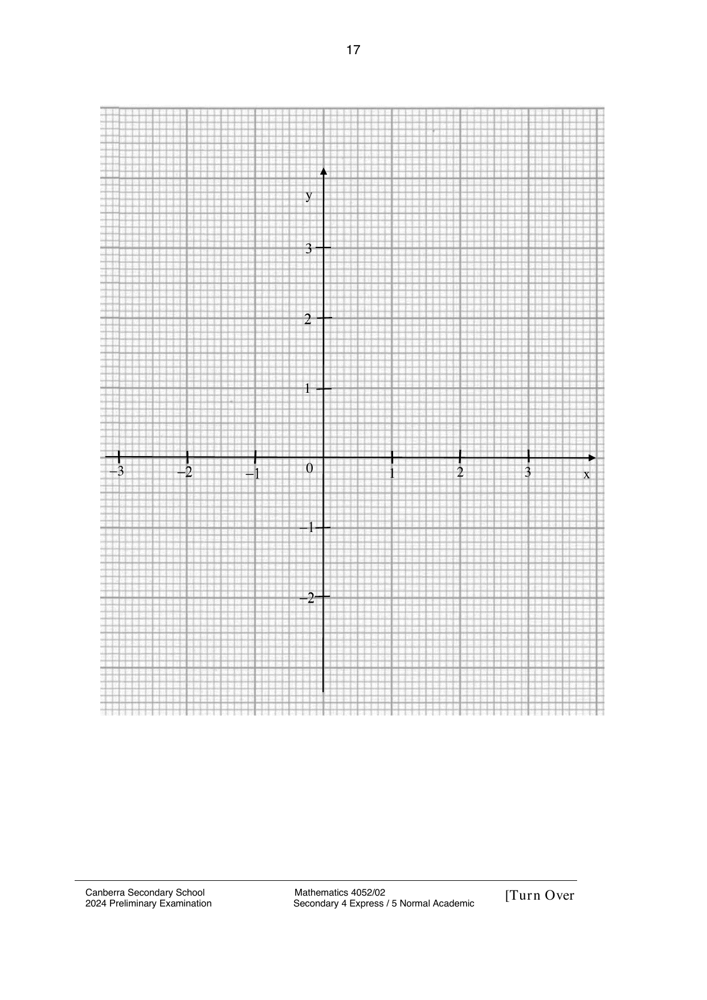

# Canberra Secondary School — Mathematics 4052/02 Paper 2 (cleaned)

> **Institution:** Canberra Secondary School
> **Exam:** Preliminary Examination 2024
> **Level:** Secondary Four Express / Five Normal Academic
> **Subjects:** Mathematics
> **Paper:** 4052/02 Paper 2
> **Date:** 21 Aug 2024
> **Duration:** 2 hours 15 minutes
> **Total Marks:** 90
> **Source:** `Canberra EM 2024  Prelims Paper 2 QP.pdf`

---

## Instructions

Write your full name, class and index number on all work you hand in.
Write in dark blue or black pen on both sides of the paper.
You may use a pencil for any diagrams or graphs.
Do not use staples, paper clips, highlighters, glue or correction fluid.

Answer all the questions.
If working is needed for any question it must be shown with the answer.
Omission of essential working will result in loss of marks.
Calculators should be used where appropriate.
If the degree of accuracy is not specified in the question, and if the answer is not exact, give the answer to three significant figures. Give answers in degrees to one decimal place.
For $\pi$, use either your calculator value or $3.142$, unless the question requires the answer in terms of $\pi$.

The number of marks is given in brackets [ ] at the end of each question or part question.
The total number of marks for this paper is 90.

Errata

Q4. $AED$ is a straight line.

Q9b. The second stage of the journey is 32 km longer than the first stage.

Setter: Ms Sim Yi Lian

---

## Mathematical Formulae

*Compound interest*

$$
\text{Total amount} = P\left(1+\frac{r}{100}\right)^{n}
$$

*Mensuration*

$$
\text{Curved surface area of a cone} = \pi rl
$$

$$
\text{Curved surface area of a sphere} = 4\pi r^{2}
$$

$$
\text{Volume of a sphere} = \frac{4}{3}\pi r^{3}
$$

$$
\text{Area of triangle } ABC = \frac{1}{2}ab\sin C
$$

$$
\text{Arc length} = r\theta,\text{ where }\theta\text{ is in radians}
$$

$$
\text{Sector area} = \frac{1}{2}r^{2}\theta,\text{ where }\theta\text{ is in radians}
$$

*Trigonometry*

$$
\frac{a}{\sin A} = \frac{b}{\sin B} = \frac{c}{\sin C}
$$

$$
a^{2} = b^{2}+c^{2}-2bc\cos A
$$

*Statistics*

$$
\text{Mean} = \frac{\sum fx}{\sum f}
$$

$$
\text{Standard deviation} = \sqrt{\frac{\sum fx^{2}}{\sum f}-\left(\frac{\sum fx}{\sum f}\right)^{2}}
$$

---

## Answer all the questions

### Q1

> **Marks:** (a) 3, (b) 3, (c) 3, (d) 3; total 12
> **Page:** 3–5

**(a)** Solve the simultaneous equations.

$$
4m+6n = 58
$$

$$
3m+5n = 46
$$

[3]
> **Topic:** N7 Equations and inequalities
> **Sub-topic:** Equations and inequalities
> **LO:** [[context/subjects/o-level-e-maths/learning-objectives/o-level-e-maths-N7c.md|N7c]]

**(b)** Write as a single fraction in the simplest form $\dfrac{3x}{2x^{2}-50}-\dfrac{1}{x-5}$. [3]
> **Topic:** N7 Equations and inequalities
> **Sub-topic:** Equations and inequalities
> **LO:** [[context/subjects/o-level-e-maths/learning-objectives/o-level-e-maths-N7c.md|N7c]]

**(c)** $x = \sqrt[3]{\dfrac{25y}{7z+2}}$
> **Topic:** N7 Equations and inequalities
> **Sub-topic:** Equations and inequalities
> **LO:** [[context/subjects/o-level-e-maths/learning-objectives/o-level-e-maths-N7c.md|N7c]]

**(i)** Find $x$ when $y = 25$ and $z = -1$. [1]
> **Topic:** N5 Algebraic expressions and formulae
> **Sub-topic:** Algebraic expressions and formulae
> **LO:** [[context/subjects/o-level-e-maths/learning-objectives/o-level-e-maths-N5l.md|N5l]]

**(ii)** Rearrange the formula to make $y$ the subject. [2]
> **Topic:** N5 Algebraic expressions and formulae
> **Sub-topic:** Algebraic expressions and formulae
> **LO:** [[context/subjects/o-level-e-maths/learning-objectives/o-level-e-maths-N5k.md|N5k]]

**(d)** Solve the equation $\dfrac{2x+3}{(3x+1)(x-1)}-2 = 0$. [3]
> **Topic:** N7 Equations and inequalities
> **Sub-topic:** Equations and inequalities
> **LO:** [[context/subjects/o-level-e-maths/learning-objectives/o-level-e-maths-N7e.md|N7e]]

---

### Q2

> **Marks:** (a) 6, (b) 4; total 10
> **Page:** 6–7

**(a)** The heights, in centimeters, of 100 plants of each of species A and species B are recorded.
The cumulative frequency curves show the distributions of their heights.

**(i)** Use the curve to estimate

**(a)** the median height for species B, [1]
> **Topic:** S1 Data handling and analysis
> **Sub-topic:** Data handling and analysis
> **LO:** [[context/subjects/o-level-e-maths/learning-objectives/o-level-e-maths-S1f.md|S1f]]

**(b)** the 40th percentile for species A, [1]
> **Topic:** S1 Data handling and analysis
> **Sub-topic:** Data handling and analysis
> **LO:** [[context/subjects/o-level-e-maths/learning-objectives/o-level-e-maths-S1f.md|S1f]]

**(c)** the interquartile range for species A. [2]
> **Topic:** S1 Data handling and analysis
> **Sub-topic:** Data handling and analysis
> **LO:** [[context/subjects/o-level-e-maths/learning-objectives/o-level-e-maths-S1f.md|S1f]]

**(ii)** Plants from species B are used for an event.
Only plants with height within 10% of 50 cm are used.
Find the percentage of plants from species B which are used. [2]
> **Topic:** S1 Data handling and analysis
> **Sub-topic:** Data handling and analysis
> **LO:** [[context/subjects/o-level-e-maths/learning-objectives/o-level-e-maths-S1f.md|S1f]]

**(b)** A box has 20 pots of plants.
There are 5 pink pots, 9 blue pots and the remaining pots are green.

**(i)** Two pots are taken from the box at random, without replacement.
Find, as a fraction in its simplest form, the probability that one pot is pink and the other is blue. [2]
> **Topic:** S2 Probability
> **Sub-topic:** Probability
> **LO:** [[context/subjects/o-level-e-maths/learning-objectives/o-level-e-maths-S2c.md|S2c]]

**(ii)** These two pots are returned to the box.
Three pots are taken from the box at random, without replacement.
Find, as a fraction in its simplest form, the probability that only one pot is green. [2]
> **Topic:** S2 Probability
> **Sub-topic:** Probability
> **LO:** [[context/subjects/o-level-e-maths/learning-objectives/o-level-e-maths-S2c.md|S2c]]

---

### Q3

> **Marks:** (a) 3, (b) 5, (c) 3; total 11
> **Page:** 8–9

**(a)** Wayne inherited a sum of money from his parents.
He decided to invest 60% of the money and shares $\dfrac{3}{4}$ of the remaining amount with his wife.
The other ＄20 000 are meant for their travelling expenses.
Calculate the sum of money he inherited. [3]
> **Topic:** N4 Rate and speed
> **Sub-topic:** Rate and speed
> **LO:** [[context/subjects/o-level-e-maths/learning-objectives/o-level-e-maths-N4b.md|N4b]]

**(b)** A bank offers two investment packages.

| Package A | Package B |
| --- | --- |
| Simple interest of 0.97% per annum. | Compound interest of 3.78% per annum. |
| One time payout of 10% of the amount of the investment. | |

Wayne wants to invest ＄55 000 in one of the packages for 3 years.
Which package should he choose if he wishes to reap the most benefits from the investment? [5]
> **Topic:** N3 Percentage
> **Sub-topic:** Percentage
> **LO:** [[context/subjects/o-level-e-maths/learning-objectives/o-level-e-maths-N3d.md|N3d]]

**(c)** Wayne and his wife go on a seven days self-drive trip to Australia.
They pay 150 AUD per day for car hire and 380 AUD per night for hotel.
They pay using credit card and is charged with a fee of 2% for the currency conversion.
The exchange rate between Singapore dollars and Australian dollars is ＄1 = 0.91 AUD.
Calculate the total amount, including credit card fee, Wayne is charged for car hire and accommodation.
Give your answer in Singapore dollars, correct to the nearest dollar. [3]
> **Topic:** N3 Percentage
> **Sub-topic:** Percentage
> **LO:** [[context/subjects/o-level-e-maths/learning-objectives/o-level-e-maths-N3d.md|N3d]]

---

### Q4

> **Marks:** (a) 2, (b) 2, (c) 4; total 8
> **Page:** 10–11

$A$, $B$, $C$ and $D$ are points on a circle.
Line $PCQ$ is a tangent to the circle.
Line $QE$ bisects angle $AEC$ and is parallel to line $CD$.

**(a)** Show that $EC = ED$.
Give a reason for each statement you make. [2]
> **Topic:** G2 Congruence and similarity
> **Sub-topic:** Congruence and similarity
> **LO:** [[context/subjects/o-level-e-maths/learning-objectives/o-level-e-maths-G2i.md|G2i]]

**(b)** Show that triangle $AEF$ is similar to triangle $QCF$.
Give a reason for each statement you make. [2]
> **Topic:** G2 Congruence and similarity
> **Sub-topic:** Congruence and similarity
> **LO:** [[context/subjects/o-level-e-maths/learning-objectives/o-level-e-maths-G2i.md|G2i]]

**(c)** Diameter $AD = 28\text{ cm}$ and angle $QCF = 61^{\circ}$.
Calculate the area of segment $CD$. [4]
> **Topic:** G2 Congruence and similarity
> **Sub-topic:** Congruence and similarity
> **LO:** [[context/subjects/o-level-e-maths/learning-objectives/o-level-e-maths-G2i.md|G2i]]

---

### Q5

> **Marks:** (a) 2, (b) 3, (c) 2, (d) 2, (e) 3; total 12
> **Page:** 12–13

$A$, $B$, $C$ and $D$ are points on horizontal ground.
$AB = 35\text{ m}$ and $BC = 68\text{ m}$.
The bearing of $B$ from $A$ is $137^{\circ}$ and the bearing of $C$ from $B$ is $192^{\circ}$.
Angle $ABD = 85^{\circ}$ and angle $BCD = 70^{\circ}$.

**(a)** Show that angle $ABC = 125^{\circ}$. [2]
> **Topic:** G4 Pythagoras' theorem and trigonometry
> **Sub-topic:** Pythagoras' theorem and trigonometry
> **LO:** [[context/subjects/o-level-e-maths/learning-objectives/o-level-e-maths-G4g.md|G4g]]

**(b)** Calculate $AC$. [3]
> **Topic:** G4 Pythagoras' theorem and trigonometry
> **Sub-topic:** Pythagoras' theorem and trigonometry
> **LO:** [[context/subjects/o-level-e-maths/learning-objectives/o-level-e-maths-G4g.md|G4g]]

**(c)** Calculate $DC$. [2]
> **Topic:** G4 Pythagoras' theorem and trigonometry
> **Sub-topic:** Pythagoras' theorem and trigonometry
> **LO:** [[context/subjects/o-level-e-maths/learning-objectives/o-level-e-maths-G4g.md|G4g]]

A man travels in a straight line from $D$ to $C$.
$X$ is the position of the man where it is the shortest distance from $B$ during this journey.

**(d)** Show that $BX = 63.9\text{ m}$. [2]
> **Topic:** G4 Pythagoras' theorem and trigonometry
> **Sub-topic:** Pythagoras' theorem and trigonometry
> **LO:** [[context/subjects/o-level-e-maths/learning-objectives/o-level-e-maths-G4g.md|G4g]]

**(e)** A drone is hovering vertically above $B$.
The angle of elevation of the drone from $C$ is $40.5^{\circ}$.
Calculate the greatest angle of elevation of the drone from a point on $DC$. [3]
> **Topic:** G4 Pythagoras' theorem and trigonometry
> **Sub-topic:** Pythagoras' theorem and trigonometry
> **LO:** [[context/subjects/o-level-e-maths/learning-objectives/o-level-e-maths-G4g.md|G4g]]

---

### Q6

> **Marks:** (a) 2, (b) 2, (c) 2, (d) 2, (e) 2; total 10
> **Page:** 14–15

In the diagram $ABCD$ is a parallelogram.
The diagonal $AC$ and $BD$ intersect at $E$.
$\overrightarrow{AF} = 2\mathbf{p}$ and $\overrightarrow{AB} = 6\mathbf{p}+4\mathbf{q}$.
$F$ is a point on $AD$ such that $\dfrac{AF}{AD} = \dfrac{1}{3}$.
$G$ is the mid-point of $AE$.

**(a)** Express $\overrightarrow{DE}$ in terms of $\mathbf{p}$ and $\mathbf{q}$, as simply as possible. [2]
> **Topic:** G7 Vectors in two dimensions
> **Sub-topic:** Vectors in two dimensions
> **LO:** [[context/subjects/o-level-e-maths/learning-objectives/o-level-e-maths-G7h.md|G7h]]

**(b)** Express $\overrightarrow{AG}$ in terms of $\mathbf{p}$ and $\mathbf{q}$, as simply as possible. [2]
> **Topic:** G7 Vectors in two dimensions
> **Sub-topic:** Vectors in two dimensions
> **LO:** [[context/subjects/o-level-e-maths/learning-objectives/o-level-e-maths-G7h.md|G7h]]

**(c)** Show that $\overrightarrow{BG} = -3\mathbf{p}-3\mathbf{q}$. [2]
> **Topic:** G7 Vectors in two dimensions
> **Sub-topic:** Vectors in two dimensions
> **LO:** [[context/subjects/o-level-e-maths/learning-objectives/o-level-e-maths-G7h.md|G7h]]

**(d)** Explain why $B$, $G$ and $F$ lie on a straight line. [2]
> **Topic:** G7 Vectors in two dimensions
> **Sub-topic:** Vectors in two dimensions
> **LO:** [[context/subjects/o-level-e-maths/learning-objectives/o-level-e-maths-G7h.md|G7h]]

**(e)** Calculate $\dfrac{\text{the area of triangle } ABF}{\text{the area of parellogram } ABCD}$. [2]
> **Topic:** G7 Vectors in two dimensions
> **Sub-topic:** Vectors in two dimensions
> **LO:** [[context/subjects/o-level-e-maths/learning-objectives/o-level-e-maths-G7h.md|G7h]]

---

### Q7

> **Marks:** (a) 1, (b) 3, (c) 1, (d) 4; total 9
> **Page:** 16–17

**(a)** Complete the table of values for $y = \dfrac{x^{3}}{4}-2x+1$. [1]
> **Topic:** N6 Functions and graphs
> **Sub-topic:** Functions and graphs
> **LO:** [[context/subjects/o-level-e-maths/learning-objectives/o-level-e-maths-N6c.md|N6c]]

| $x$ | $-3$ | $-2$ | $-1$ | $0$ | $1$ | $2$ | $3$ |
| --- | --- | --- | --- | --- | --- | --- | --- |
| $y$ | $0.25$ | $3$ | $2.75$ | $1$ | $-0.75$ | | $1.75$ |

**(b)** On the grid opposite, draw the graph of $y = \dfrac{x^{3}}{4}-2x+1$ for $-3 \leq x \leq 3$. [3]
> **Topic:** N6 Functions and graphs
> **Sub-topic:** Functions and graphs
> **LO:** [[context/subjects/o-level-e-maths/learning-objectives/o-level-e-maths-N6c.md|N6c]]

**(c)** Explain how your graph shows that there is only one solution of the equation $\dfrac{x^{3}}{4}-2x+1 = k$ for some values of $k$. [1]
> **Topic:** N6 Functions and graphs
> **Sub-topic:** Functions and graphs
> **LO:** [[context/subjects/o-level-e-maths/learning-objectives/o-level-e-maths-N6c.md|N6c]]

**(d)** The equation $x^{3}-9x-4 = 0$ can be solved by drawing a suitable straight line on the grid.

**(i)** Find the equation of the straight line. [2]
> **Topic:** N6 Functions and graphs
> **Sub-topic:** Functions and graphs
> **LO:** [[context/subjects/o-level-e-maths/learning-objectives/o-level-e-maths-N6c.md|N6c]]

**(ii)** By drawing this straight line, solve the equation $x^{3}-9x-4 = 0$. [2]
> **Topic:** N6 Functions and graphs
> **Sub-topic:** Functions and graphs
> **LO:** [[context/subjects/o-level-e-maths/learning-objectives/o-level-e-maths-N6c.md|N6c]]

---

### Q8

> **Marks:** (a) 1, (b) 2, (c) 3, (d) 2; total 8
> **Page:** 18–19

The first four terms in a sequence of numbers are given below.

$$
T_{1} = (1\times 3)+8 = 11
$$

$$
T_{2} = (2\times 4)+12 = 20
$$

$$
T_{3} = (3\times 5)+16 = 31
$$

$$
T_{4} = (4\times 6)+20 = 44
$$

**(a)** Find $T_{5}$. [1]
> **Topic:** N5 Algebraic expressions and formulae
> **Sub-topic:** Algebraic expressions and formulae
> **LO:** [[context/subjects/o-level-e-maths/learning-objectives/o-level-e-maths-N5e.md|N5e]]

**(b)** Show that the $n$th term of the sequence, $T_{n}$, is given by $n^{2}+6n+4$. [2]
> **Topic:** N5 Algebraic expressions and formulae
> **Sub-topic:** Algebraic expressions and formulae
> **LO:** [[context/subjects/o-level-e-maths/learning-objectives/o-level-e-maths-N5e.md|N5e]]

**(c)** $T_{p-1}$ and $T_{p}$ are consecutive terms in the sequence.
Find and simplify an expression, in terms of $p$, for the sum of $T_{p-1}$ and $T_{p}$. [3]
> **Topic:** N5 Algebraic expressions and formulae
> **Sub-topic:** Algebraic expressions and formulae
> **LO:** [[context/subjects/o-level-e-maths/learning-objectives/o-level-e-maths-N5e.md|N5e]]

**(d)** Find the value of $p$ when the sum of $T_{p-1}$ and $T_{p}$ is 303. [2]
> **Topic:** N5 Algebraic expressions and formulae
> **Sub-topic:** Algebraic expressions and formulae
> **LO:** [[context/subjects/o-level-e-maths/learning-objectives/o-level-e-maths-N5e.md|N5e]]

---

### Q9

> **Marks:** (a) 2, (b) 8; total 10
> **Page:** 20–21

Jim, his wife and their child visited Hokkaido, Japan.

The tables below give information that can be used to work out some of their expenses.

Prices of flight tickets for a return trip

| Payment mode | Cash (Includes tax) | | Redemption with miles (Excludes tax of ＄115 per pax) | |
| --- | --- | --- | --- | --- |
| Class | Economy | Business | Economy | Business |
| Adult | ＄1920 | ＄5500 | | 140 000 miles |
| Child | ＄1350 | ＄4000 | 90 000 miles | |

Amount of fuel used (litres/100 km)

| Type of driving | Sedan car | Sport Utility Vehicle (SUV) | Mini van |
| --- | --- | --- | --- |
| City | 7.8 | 9.3 | 10.8 |
| Out of city | 5.7 | 7.5 | 8.9 |
| Combined | 6.2 | 8.8 | 9.5 |

Daily rates of driver

| Day(s) of hire | 8 hours | Additional time |
| --- | --- | --- |
| 1 | ＄350 | ＄45 per hour |
| 2 or more | ＄300 | ＄40 per hour |

**(a)** They travelled in business class and Jim had 150 000 miles to offset some of the cost of their flight tickets.
Calculate the amount of money he paid for the tickets. [2]
> **Topic:** S1 Data handling and analysis
> **Sub-topic:** Data handling and analysis
> **LO:** [[context/subjects/o-level-e-maths/learning-objectives/o-level-e-maths-S1f.md|S1f]]

**(b)** Jim engaged a driver for 10 hours and his family travelled in a SUV for one day during their trip.
The driver picked them from their accommodation in the city to attractions outside the city.

The driver drove the first stage of the journey at an average speed of 70 km/h.
The second stage of the journey is 32 km longer than the second stage.
The driver drove at an average speed of 80 km/h.
The journey takes a total of 4 hours and 9 minutes.

Fuel price for the vehicle was ＄1.70 per litre.
Jim paid ＄550 to the driver.
He thinks that he included a 20% tips in the amount paid to the driver.

Is he correct?
Justify your decision with calculations. [8]
> **Topic:** S1 Data handling and analysis
> **Sub-topic:** Data handling and analysis
> **LO:** [[context/subjects/o-level-e-maths/learning-objectives/o-level-e-maths-S1f.md|S1f]]
