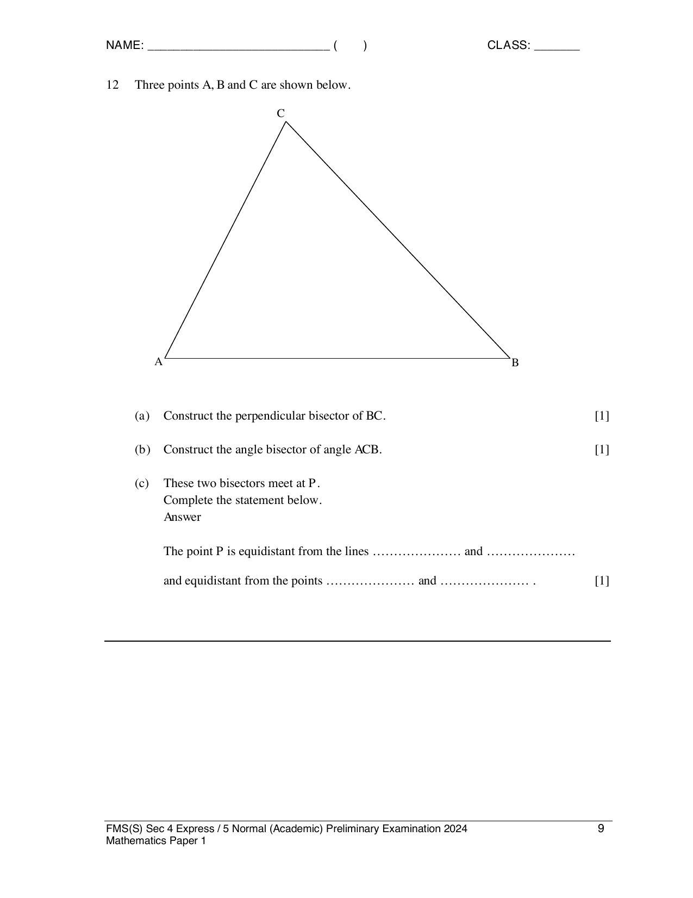

# Fairfield Methodist School (Secondary) — Mathematics 4052/01 Paper 1 (cleaned)

> **Institution:** Fairfield Methodist School (Secondary)
> **Exam:** Preliminary Examination 2024
> **Level:** Secondary 4 Express / 5 Normal (Academic)
> **Subjects:** Elementary Mathematics
> **Paper:** 4052/01 Paper 1
> **Date:** 19 August 2024
> **Duration:** 2 hours 15 minutes
> **Total Marks:** 90
> **Source:** `2024 FMSS EMATH P1 PRELIM QP.pdf`

---

## Instructions

Candidates answer on the Question Paper.

Write your name, index number and class on all the work you hand in.
Write in dark blue or black pen.
You may use an HB pencil for any diagrams or graphs.
Do not use staples, paper clips, glue or correction fluid.

Answer all the questions.
The number of marks is given in brackets [ ] at the end of each question or part question.

If working is needed for any question it must be shown with the answer.
Omission of essential working will result in loss of marks.
The total of the marks for this paper is 90.

The use of an approved scientific calculator is expected, where appropriate.
If the degree of accuracy is not specified in the question and if the answer is not exact, give the answer to three significant figures. Give answers in degrees to one decimal place.
For $\pi$, use either your calculator value or $3.142$.

Setter: Mr Alester Tan.

---

## Mathematical Formulae

*Compound interest*

$$
\text{Total amount} = P\left(1+\frac{r}{100}\right)^{n}
$$

*Mensuration*

$$
\text{Curved surface area of a cone} = \pi rl
$$

$$
\text{Surface area of a sphere} = 4\pi r^{2}
$$

$$
\text{Volume of a cone} = \frac{1}{3}\pi r^{2}h
$$

$$
\text{Volume of a sphere} = \frac{4}{3}\pi r^{3}
$$

$$
\text{Area of triangle } ABC = \frac{1}{2}ab\sin C
$$

$$
\text{Arc length} = r\theta,\text{ where }\theta\text{ is in radians}
$$

$$
\text{Sector area} = \frac{1}{2}r^{2}\theta,\text{ where }\theta\text{ is in radians}
$$

*Trigonometry*

$$
\frac{a}{\sin A} = \frac{b}{\sin B} = \frac{c}{\sin C}
$$

$$
a^{2} = b^{2}+c^{2}-2bc\cos A
$$

*Statistics*

$$
\text{Mean} = \frac{\sum fx}{\sum f}
$$

$$
\text{Standard deviation} = \sqrt{\frac{\sum fx^{2}}{\sum f}-\left(\frac{\sum fx}{\sum f}\right)^{2}}
$$

---

## Answer all the questions

### Q1

> **Marks:** 1
> **Topic:** N3 Percentage
> **Sub-topic:** Percentage
> **LO:** [[context/subjects/o-level-e-maths/learning-objectives/o-level-e-maths-N3e.md|N3e]]
> **Page:** 3

Given that $p:16 = 3:20$, find the value of $p$. [1]

---

### Q2

> **Marks:** (a) 2, (b) 2; total 4
> **Page:** 3

**(a)** Factorise completely $2a^{2}c-ad-2abc+bd$. [2]
> **Topic:** N5 Algebraic expressions and formulae
> **Sub-topic:** Algebraic expressions and formulae
> **LO:** [[context/subjects/o-level-e-maths/learning-objectives/o-level-e-maths-N5h.md|N5h]]

**(b)** Expand and simplify $(7x-4y)(x+3y)$. [2]
> **Topic:** N5 Algebraic expressions and formulae
> **Sub-topic:** Algebraic expressions and formulae
> **LO:** [[context/subjects/o-level-e-maths/learning-objectives/o-level-e-maths-N5j.md|N5j]]

---

### Q3

> **Marks:** 2
> **Topic:** S1 Data handling and analysis
> **Sub-topic:** Data handling and analysis
> **LO:** [[context/subjects/o-level-e-maths/learning-objectives/o-level-e-maths-S1f.md|S1f]]
> **Page:** 3

Tristen has written five positive integers.
The median of these numbers is $8$, the mode is $7$ and the mean is $13$.
The range of these numbers is $21$.

Find the five numbers. [2]

---

### Q4

> **Marks:** (a) 2, (b) 1; total 3
> **Page:** 4

In the diagram, $ABC$ is a triangle. $D$ is the point on $AC$ such that $\angle ABC = \angle ADB$.

**(a)** Show that triangles $ABC$ and $ADB$ are similar. [2]
> **Topic:** G2 Congruence and similarity
> **Sub-topic:** Congruence and similarity
> **LO:** [[context/subjects/o-level-e-maths/learning-objectives/o-level-e-maths-G2i.md|G2i]]

**(b)** Given that $AB = 8\text{ m}$ and $AD = 5\text{ m}$, find $AC$. [1]
> **Topic:** G2 Congruence and similarity
> **Sub-topic:** Congruence and similarity
> **LO:** [[context/subjects/o-level-e-maths/learning-objectives/o-level-e-maths-G2i.md|G2i]]

---

### Q5

> **Marks:** 1
> **Topic:** N6 Functions and graphs
> **Sub-topic:** Functions and graphs
> **LO:** [[context/subjects/o-level-e-maths/learning-objectives/o-level-e-maths-N6c.md|N6c]]
> **Page:** 5

The graph shows the number of electric vehicles (EVs) manufactured by a company for the years 2022 and 2023.

The vertical axis is labelled “Number of EVs (thousands)” and is marked at $50$ and $60$ only. The 2022 bar is a small car picture sitting on the axis, with its roof at the $50$ line. The 2023 bar is a much larger car picture whose roof meets the $60$ line. The horizontal axis is labelled Year.

Explain how the graph above may be misleading. [1]

---

### Q6

> **Marks:** 2
> **Topic:** N2 Ratio and proportion
> **Sub-topic:** Ratio and proportion
> **LO:** [[context/subjects/o-level-e-maths/learning-objectives/o-level-e-maths-N2c.md|N2c]]
> **Page:** 5

A map has a scale of $1:2\,000\,000$.
The area of Johor Bahru on the map is $0.55\text{ cm}^{2}$.
Calculate the actual area, in square kilometres of Johor Bahru. [2]

---

### Q7

> **Marks:** (a) 1, (b) 1; total 2
> **Page:** 6

In a sequence, the same number is added each time to obtain the next term.
The second term of the sequence is $11$ and the fifth term of the sequence is $32$.

**(a)** Write an expression in terms of $n$, for the $n$th term of the sequence. [1]
> **Topic:** N5 Algebraic expressions and formulae
> **Sub-topic:** Algebraic expressions and formulae
> **LO:** [[context/subjects/o-level-e-maths/learning-objectives/o-level-e-maths-N5e.md|N5e]]

**(b)** Explain why $121$ is not a term in the sequence. [1]
> **Topic:** N5 Algebraic expressions and formulae
> **Sub-topic:** Algebraic expressions and formulae
> **LO:** [[context/subjects/o-level-e-maths/learning-objectives/o-level-e-maths-N5e.md|N5e]]

---

### Q8

> **Marks:** 2
> **Topic:** N3 Percentage
> **Sub-topic:** Percentage
> **LO:** [[context/subjects/o-level-e-maths/learning-objectives/o-level-e-maths-N3d.md|N3d]]
> **Page:** 6

The force, $F$, between two particles is inversely proportional to the square of the distance, $d$, between them.
Calculate the percentage change in force when the distance between the two particles is increased by $350\%$. [2]

---

### Q9

> **Marks:** (a) 1, (b)(i) 1, (b)(ii) 1; total 3
> **Page:** 7

**(a)** The sketch represents the graph of $y = x^{n}$. Write down a possible value of $n$. [1]
> **Topic:** N6 Functions and graphs
> **Sub-topic:** Functions and graphs
> **LO:** [[context/subjects/o-level-e-maths/learning-objectives/o-level-e-maths-N6c.md|N6c]]

The sketch has a branch in the first quadrant that falls towards the positive $x$-axis as $x$ increases, and a branch in the third quadrant that falls away from the origin as $x$ decreases. Both branches approach the axes. There is no branch in the second or fourth quadrant.

**(b)** The point $(1, 1)$ is marked on each diagram below.
On these diagrams, sketch the graphs of

**(i)** $y = 2^{x}+1$, [1]
> **Topic:** N6 Functions and graphs
> **Sub-topic:** Functions and graphs
> **LO:** [[context/subjects/o-level-e-maths/learning-objectives/o-level-e-maths-N6c.md|N6c]]

**(ii)** $y = \dfrac{2}{x^{2}}$. [1]
> **Topic:** N6 Functions and graphs
> **Sub-topic:** Functions and graphs
> **LO:** [[context/subjects/o-level-e-maths/learning-objectives/o-level-e-maths-N6c.md|N6c]]

Each answer diagram is a blank pair of axes with $(1, 1)$ marked.

---

### Q10

> **Marks:** 2
> **Topic:** G5 Mensuration
> **Sub-topic:** Mensuration
> **LO:** [[context/subjects/o-level-e-maths/learning-objectives/o-level-e-maths-G5b.md|G5b]]
> **Page:** 8

The diagram shows a parallelogram $ABCD$. The perpendicular height is $h\text{ cm}$.

The area of parallelogram is increased by $150\%$ when $AB$ is reduced by $20\%$ and $h$ is increased by $x\%$. Find the value of $x$. [2]

---

### Q11

> **Marks:** (a) 2, (b) 1; total 3
> **Page:** 8

The frequency table shows the Mathematics quiz marks of $25$ students. The mean marks is $13.8$.

| Marks | 12 | 13 | 14 | 15 | 16 |
| --- | --- | --- | --- | --- | --- |
| Number of students | 5 | 5 | 7 | 6 | 2 |

**(a)** Find the standard deviation of the marks. [2]
> **Topic:** S1 Data handling and analysis
> **Sub-topic:** Data handling and analysis
> **LO:** [[context/subjects/o-level-e-maths/learning-objectives/o-level-e-maths-S1h.md|S1h]]

**(b)** It was discovered that there was a mistake in the recording of the quiz marks. The correct mark for each student was $3$ more than the recorded mark.
A student commented that the spread of the quiz marks in the class is now wider after the addition of marks.
Explain why his comment is wrong using mean and standard deviation of the marks. [1]
> **Topic:** S1 Data handling and analysis
> **Sub-topic:** Data handling and analysis
> **LO:** [[context/subjects/o-level-e-maths/learning-objectives/o-level-e-maths-S1f.md|S1f]]

---

### Q12

> **Marks:** (a) 1, (b) 1, (c) 1; total 3
> **Page:** 9

Three points $A$, $B$ and $C$ are shown below. $A$ is at the lower left, $B$ is at the lower right, and $C$ is above the segment $AB$, closer to $A$ than to $B$.

**(a)** Construct the perpendicular bisector of $BC$. [1]
> **Topic:** G2 Congruence and similarity
> **Sub-topic:** Congruence and similarity
> **LO:** [[context/subjects/o-level-e-maths/learning-objectives/o-level-e-maths-G2e.md|G2e]]

**(b)** Construct the angle bisector of angle $ACB$. [1]
> **Topic:** G2 Congruence and similarity
> **Sub-topic:** Congruence and similarity
> **LO:** [[context/subjects/o-level-e-maths/learning-objectives/o-level-e-maths-G2e.md|G2e]]

**(c)** These two bisectors meet at $P$.
Complete the statement below.

The point $P$ is equidistant from the lines ………………… and …………………
and equidistant from the points ………………… and ………………… . [1]
> **Topic:** G2 Congruence and similarity
> **Sub-topic:** Congruence and similarity
> **LO:** [[context/subjects/o-level-e-maths/learning-objectives/o-level-e-maths-G2e.md|G2e]]

---

### Q13

> **Marks:** (a) 2, (b) 1; total 3
> **Page:** 10

**(a)** Use prime factors to explain why $54 \times 150$ is a perfect square. [2]
> **Topic:** N1 Numbers and their operations
> **Sub-topic:** Numbers and their operations
> **LO:** [[context/subjects/o-level-e-maths/learning-objectives/o-level-e-maths-N1b.md|N1b]]

**(b)** The number $150k$ is a perfect cube.
Find the smallest possible integer value of $k$. [1]
> **Topic:** N1 Numbers and their operations
> **Sub-topic:** Numbers and their operations
> **LO:** [[context/subjects/o-level-e-maths/learning-objectives/o-level-e-maths-N1b.md|N1b]]

---

### Q14

> **Marks:** (a) 2, (b) 4; total 6
> **Page:** 11

$ABC$ is an equilateral triangle with lengths $(5x+y)\text{ cm}$, $(16y-x)\text{ cm}$ and $(4x+5y-3)\text{ cm}$.

**(a)** Write down two simultaneous equations, in terms of $x$ and $y$, to represent this information. [2]
> **Topic:** N7 Equations and inequalities
> **Sub-topic:** Equations and inequalities
> **LO:** [[context/subjects/o-level-e-maths/learning-objectives/o-level-e-maths-N7c.md|N7c]]

**(b)** Solve the simultaneous equations and hence find the area of triangle $ABC$. [4]
> **Topic:** N7 Equations and inequalities
> **Sub-topic:** Equations and inequalities
> **LO:** [[context/subjects/o-level-e-maths/learning-objectives/o-level-e-maths-N7c.md|N7c]]

---

### Q15

> **Marks:** (a) 3, (b) 2; total 5
> **Page:** 12

**(a)** Given that $\dfrac{\left(4^{\frac{1}{2}}\right)^{y+1}}{16} = 8^{2-y}$, find the value of $y$. [3]
> **Topic:** N3 Percentage
> **Sub-topic:** Percentage
> **LO:** [[context/subjects/o-level-e-maths/learning-objectives/o-level-e-maths-N3c.md|N3c]]

**(b)** Jasmine says that $2^{500}$ is greater than $5^{250}$. Do you agree with her statement?
Justify your answer with mathematical working. [2]
> **Topic:** N3 Percentage
> **Sub-topic:** Percentage
> **LO:** [[context/subjects/o-level-e-maths/learning-objectives/o-level-e-maths-N3c.md|N3c]]

---

### Q16

> **Marks:** (a) 1, (b) 2; total 3
> **Page:** 13

A solid cone, $C$, is cut into two parts, $X$ and $Y$, by a plane parallel to the base. $X$ is the smaller cone and $Y$ is the frustum.
The ratio of the areas of the bases of $X$ and $C$ is $25:49$.

**(a)** Find the ratio of the circumference of the bases of $X$ and $C$. [1]
> **Topic:** G5 Mensuration
> **Sub-topic:** Mensuration
> **LO:** [[context/subjects/o-level-e-maths/learning-objectives/o-level-e-maths-G5b.md|G5b]]

**(b)** The mass of $C$ is $36\text{ kg}$. Find the mass of $Y$. [2]
> **Topic:** G5 Mensuration
> **Sub-topic:** Mensuration
> **LO:** [[context/subjects/o-level-e-maths/learning-objectives/o-level-e-maths-G5b.md|G5b]]

---

### Q17

> **Marks:** (a)(i) 2, (a)(ii) 1, (b)(i) 2, (b)(ii) 1; total 6
> **Page:** 14

**(a) (i)** The expression $x^{2}-12x+5$ is equivalent to $(x-a)^{2}+b$.
Find the value of $a$ and the value of $b$. [2]
> **Topic:** G6 Coordinate geometry
> **Sub-topic:** Coordinate geometry
> **LO:** [[context/subjects/o-level-e-maths/learning-objectives/o-level-e-maths-G6c.md|G6c]]

**(ii)** The curve $y = x^{2}-12x+5$ is drawn.
Write the equation of the line of symmetry of the curve. [1]
> **Topic:** G6 Coordinate geometry
> **Sub-topic:** Coordinate geometry
> **LO:** [[context/subjects/o-level-e-maths/learning-objectives/o-level-e-maths-G6c.md|G6c]]

**(b) (i)** Sketch the graph of $y = -(x-3)(x+5)$ on the axes below.
Indicate clearly the values where the graph crosses the $x$- and $y$-axes. [2]
> **Topic:** G6 Coordinate geometry
> **Sub-topic:** Coordinate geometry
> **LO:** [[context/subjects/o-level-e-maths/learning-objectives/o-level-e-maths-G6c.md|G6c]]

**(ii)** State the coordinates of the maximum point of the graph of $y = -(x-3)(x+5)$. [1]
> **Topic:** G6 Coordinate geometry
> **Sub-topic:** Coordinate geometry
> **LO:** [[context/subjects/o-level-e-maths/learning-objectives/o-level-e-maths-G6c.md|G6c]]

---

### Q18

> **Marks:** (a) 1, (b) 2, (c) 1; total 4
> **Page:** 15

In the diagram, $R(-3, 4)$ is on $PQ$ such that the midpoint of $RQ$ lies on the $y$-axis.
Point $Q$ lies on the $x$-axis. Point $P$ is in the second quadrant, above and to the left of $R$.

**(a)** Find the coordinates of $Q$. [1]
> **Topic:** G6 Coordinate geometry
> **Sub-topic:** Coordinate geometry
> **LO:** [[context/subjects/o-level-e-maths/learning-objectives/o-level-e-maths-G6c.md|G6c]]

**(b)** Given that the point $P$ has coordinates $(x, 6)$, find the value of $x$. [2]
> **Topic:** G6 Coordinate geometry
> **Sub-topic:** Coordinate geometry
> **LO:** [[context/subjects/o-level-e-maths/learning-objectives/o-level-e-maths-G6c.md|G6c]]

**(c)** Find the equation of the line $PQ$. [1]
> **Topic:** G6 Coordinate geometry
> **Sub-topic:** Coordinate geometry
> **LO:** [[context/subjects/o-level-e-maths/learning-objectives/o-level-e-maths-G6c.md|G6c]]

---

### Q19

> **Marks:** (a)(i) 1, (a)(ii) 1, (b) 3; total 5
> **Page:** 16

$A$, $B$, $C$ and $D$ lie on a circle with centre $O$ and radius $5\text{ cm}$. $\angle AOB = 1.8$ radians.
$D$ lies on the minor arc $AB$ and $C$ lies on the major arc $AB$. The shaded region is the segment $ADB$.

**(a) (i)** Write down an expression, in terms of $\pi$, for the reflex angle $AOB$. [1]
> **Topic:** G5 Mensuration
> **Sub-topic:** Mensuration
> **LO:** [[context/subjects/o-level-e-maths/learning-objectives/o-level-e-maths-G5g.md|G5g]]

**(ii)** Find an expression, in terms of $\pi$, for the length of the arc $ACB$. [1]
> **Topic:** G5 Mensuration
> **Sub-topic:** Mensuration
> **LO:** [[context/subjects/o-level-e-maths/learning-objectives/o-level-e-maths-G5g.md|G5g]]

**(b)** Find the area of the shaded segment $ADB$. [3]
> **Topic:** G5 Mensuration
> **Sub-topic:** Mensuration
> **LO:** [[context/subjects/o-level-e-maths/learning-objectives/o-level-e-maths-G5b.md|G5b]]

---

### Q20

> **Marks:** (a)(i) 1, (a)(ii) 1, (a)(iii) 1, (b)(i) 1, (b)(ii) 1; total 5
> **Page:** 17

**(a)** $\xi = \{\text{integers } x : 1 \leq x \leq 18\}$

$A = \{1, 4, 9, 16\}$

$B = \{\text{integers that are divisible by } 2\}$

**(i)** Describe the elements of set $A$. [1]
> **Topic:** N8 Set language and notation
> **Sub-topic:** Set language and notation
> **LO:** [[context/subjects/o-level-e-maths/learning-objectives/o-level-e-maths-N8c.md|N8c]]

**(ii)** List the elements contained in the set $A \cap B'$, [1]
> **Topic:** N8 Set language and notation
> **Sub-topic:** Set language and notation
> **LO:** [[context/subjects/o-level-e-maths/learning-objectives/o-level-e-maths-N8c.md|N8c]]

**(iii)** Write down the number of elements contained in the set $A \cup B$. [1]
> **Topic:** N8 Set language and notation
> **Sub-topic:** Set language and notation
> **LO:** [[context/subjects/o-level-e-maths/learning-objectives/o-level-e-maths-N8c.md|N8c]]

**(b) (i)** On the Venn diagram, shade the region which represents $(P \cup Q)'$.

The diagram is a rectangle $\xi$ containing two overlapping circles labelled $P$ and $Q$. [1]
> **Topic:** N8 Set language and notation
> **Sub-topic:** Set language and notation
> **LO:** [[context/subjects/o-level-e-maths/learning-objectives/o-level-e-maths-N8c.md|N8c]]

**(ii)** Using set notation to describe the shaded region.

In the second diagram, circle $Q$ lies entirely inside circle $P$. The region outside $P$, and the interior of $Q$, are shaded. The part of $P$ outside $Q$ is unshaded. [1]
> **Topic:** N8 Set language and notation
> **Sub-topic:** Set language and notation
> **LO:** [[context/subjects/o-level-e-maths/learning-objectives/o-level-e-maths-N8c.md|N8c]]

---

### Q21

> **Marks:** (a)(i) 2, (a)(ii) 1, (b) 2; total 5
> **Page:** 18

**(a)** In the diagram below, $DCB$ is a straight line.
$AD = 8\text{ m}$, $AC = 10\text{ m}$, $CD = 6\text{ m}$ and $AB = 17\text{ m}$.

**(i)** Show that $\angle ADC$ is a right angle. [2]
> **Topic:** G4 Pythagoras' theorem and trigonometry
> **Sub-topic:** Pythagoras' theorem and trigonometry
> **LO:** [[context/subjects/o-level-e-maths/learning-objectives/o-level-e-maths-G4c.md|G4c]]

**(ii)** Express the value of $\cos \angle ACB$ as a fraction in its lowest term. [1]
> **Topic:** G4 Pythagoras' theorem and trigonometry
> **Sub-topic:** Pythagoras' theorem and trigonometry
> **LO:** [[context/subjects/o-level-e-maths/learning-objectives/o-level-e-maths-G4c.md|G4c]]

**(b)** $\sin x^{\circ} = 0.8929$
Find two possible values of $x$ in the range $0^{\circ} \leq x \leq 180^{\circ}$. [2]
> **Topic:** G4 Pythagoras' theorem and trigonometry
> **Sub-topic:** Pythagoras' theorem and trigonometry
> **LO:** [[context/subjects/o-level-e-maths/learning-objectives/o-level-e-maths-G4c.md|G4c]]

---

### Q22

> **Marks:** (a)(i) 1, (a)(ii) 1, (a)(iii) 1, (b) 1; total 4
> **Page:** 19

In the diagram, $ABCDE$ is a regular pentagon.

**(a)** Calculate

**(i)** $\angle BAE$, [1]
> **Topic:** G1 Angles, triangles and polygons
> **Sub-topic:** Angles, triangles and polygons
> **LO:** [[context/subjects/o-level-e-maths/learning-objectives/o-level-e-maths-G1d.md|G1d]]

**(ii)** $\angle AEB$, [1]
> **Topic:** G1 Angles, triangles and polygons
> **Sub-topic:** Angles, triangles and polygons
> **LO:** [[context/subjects/o-level-e-maths/learning-objectives/o-level-e-maths-G1d.md|G1d]]

**(iii)** $\angle BEC$. [1]
> **Topic:** G1 Angles, triangles and polygons
> **Sub-topic:** Angles, triangles and polygons
> **LO:** [[context/subjects/o-level-e-maths/learning-objectives/o-level-e-maths-G1d.md|G1d]]

**(b)** Explain why $BE$ is parallel to $CD$. [1]
> **Topic:** G1 Angles, triangles and polygons
> **Sub-topic:** Angles, triangles and polygons
> **LO:** [[context/subjects/o-level-e-maths/learning-objectives/o-level-e-maths-G1d.md|G1d]]

---

### Q23

> **Marks:** (a) 1, (b) 2, (c) 1; total 4
> **Page:** 20

The stem-and-leaf diagram below shows the times, in minutes, taken by $15$ students to complete a task.

| Stem | Leaf |
| --- | --- |
| 1 | 5 6 8 9 9 |
| 2 | 0 2 4 $p$ 5 5 7 |
| 3 | 0 0 2 |

Key: $1 \mid 5$ represents $15$ minutes.

**(a)** The modal time is $25$ minutes. Find the value of $p$. [1]
> **Topic:** S1 Data handling and analysis
> **Sub-topic:** Data handling and analysis
> **LO:** [[context/subjects/o-level-e-maths/learning-objectives/o-level-e-maths-S1i.md|S1i]]

**(b)** Find the interquartile range. [2]
> **Topic:** S1 Data handling and analysis
> **Sub-topic:** Data handling and analysis
> **LO:** [[context/subjects/o-level-e-maths/learning-objectives/o-level-e-maths-S1i.md|S1i]]

**(c)** When the time taken for the $16$th student is added to the diagram, the median is $23$ minutes.
What is the possible time taken by this student to complete a task? [1]
> **Topic:** S1 Data handling and analysis
> **Sub-topic:** Data handling and analysis
> **LO:** [[context/subjects/o-level-e-maths/learning-objectives/o-level-e-maths-S1f.md|S1f]]

---

### Q24

> **Marks:** (i) 1, (ii) 2; total 3
> **Page:** 21

There are $30$ blue balls, $20$ green balls and $14$ yellow balls in a bag.
A ball is chosen at random from the bag and then replaced.

**(i)** Find the probability of not picking a green ball, express your answer to the lowest term. [1]
> **Topic:** S2 Probability
> **Sub-topic:** Probability
> **LO:** [[context/subjects/o-level-e-maths/learning-objectives/o-level-e-maths-S2c.md|S2c]]

**(ii)** The probability of picking a green ball from the bag after $x$ number of green balls are removed is $\dfrac{3}{14}$. Using algebra, find the value of $x$. [2]
> **Topic:** S2 Probability
> **Sub-topic:** Probability
> **LO:** [[context/subjects/o-level-e-maths/learning-objectives/o-level-e-maths-S2c.md|S2c]]

---

### Q25

> **Marks:** (a) 1, (b) 1, (c) 1, (d) 1; total 4
> **Page:** 22

Two outlets of a coffee chain sell three different types of coffee: espresso, flat white and mocha. The table shows the number of cups of each type of coffee sold on a particular day.

| Outlet | Expresso | Flat White | Mocha |
| --- | --- | --- | --- |
| A | 30 | 30 | 35 |
| B | $x$ | $x+2$ | 40 |

This information can be represented by the matrix $P = \begin{pmatrix} 30 & 30 & 35 \\ x & x+2 & 40 \end{pmatrix}$.

The coffee chain sells a cup of espresso at ＄$2.50$, a cup of flat white at ＄$4$ and a cup of mocha at ＄$5.50$.

This information can be represented by the matrix $Q = \begin{pmatrix} 2.5 \\ 4 \\ 5.5 \end{pmatrix}$.

**(a)** Find, in terms of $x$, the matrix $R = PQ$. [1]
> **Topic:** N9 Matrices
> **Sub-topic:** Matrices
> **LO:** [[context/subjects/o-level-e-maths/learning-objectives/o-level-e-maths-N9b.md|N9b]]

**(b)** Explain what the elements of the first row of matrix $R$ represent. [1]
> **Topic:** N9 Matrices
> **Sub-topic:** Matrices
> **LO:** [[context/subjects/o-level-e-maths/learning-objectives/o-level-e-maths-N9b.md|N9b]]

**(c)** Outlet B collected ＄$100.50$ more than Outlet A from the sales of coffee on that particular day. Find $x$. [1]
> **Topic:** N9 Matrices
> **Sub-topic:** Matrices
> **LO:** [[context/subjects/o-level-e-maths/learning-objectives/o-level-e-maths-N9b.md|N9b]]

**(d)** The elements of matrix $T$, where $T = SR$, represents the total amount of money, in dollars, collected in outlets A and B on that particular day. Write down the matrix $S$. [1]
> **Topic:** N9 Matrices
> **Sub-topic:** Matrices
> **LO:** [[context/subjects/o-level-e-maths/learning-objectives/o-level-e-maths-N9b.md|N9b]]

---

### Q26

> **Marks:** (a) 1, (b) 1, (c) 1, (d) 2; total 5
> **Page:** 23

The diagram is the speed-time graph for the first $k$ seconds of the motion of an object.

Speed rises in a straight line from $(0, 0)$ to $(10, 40)$, then stays at $40\text{ m/s}$ until time $k$ seconds. Speed is in m/s and time is in seconds.

**(a)** Find the acceleration when $t = 5$. [1]
> **Topic:** N6 Functions and graphs
> **Sub-topic:** Functions and graphs
> **LO:** [[context/subjects/o-level-e-maths/learning-objectives/o-level-e-maths-N6c.md|N6c]]

**(b)** Find the distance travelled in the first $10$ seconds. [1]
> **Topic:** N6 Functions and graphs
> **Sub-topic:** Functions and graphs
> **LO:** [[context/subjects/o-level-e-maths/learning-objectives/o-level-e-maths-N6c.md|N6c]]

**(c)** The distance travelled in the first $k$ seconds is $520\text{ m}$. Find the value of $k$. [1]
> **Topic:** N6 Functions and graphs
> **Sub-topic:** Functions and graphs
> **LO:** [[context/subjects/o-level-e-maths/learning-objectives/o-level-e-maths-N6c.md|N6c]]

**(d)** On the axes in the answer space, sketch the distance-time graph for the first $k$ seconds of the motion of the object. [2]
> **Topic:** N6 Functions and graphs
> **Sub-topic:** Functions and graphs
> **LO:** [[context/subjects/o-level-e-maths/learning-objectives/o-level-e-maths-N6c.md|N6c]]
