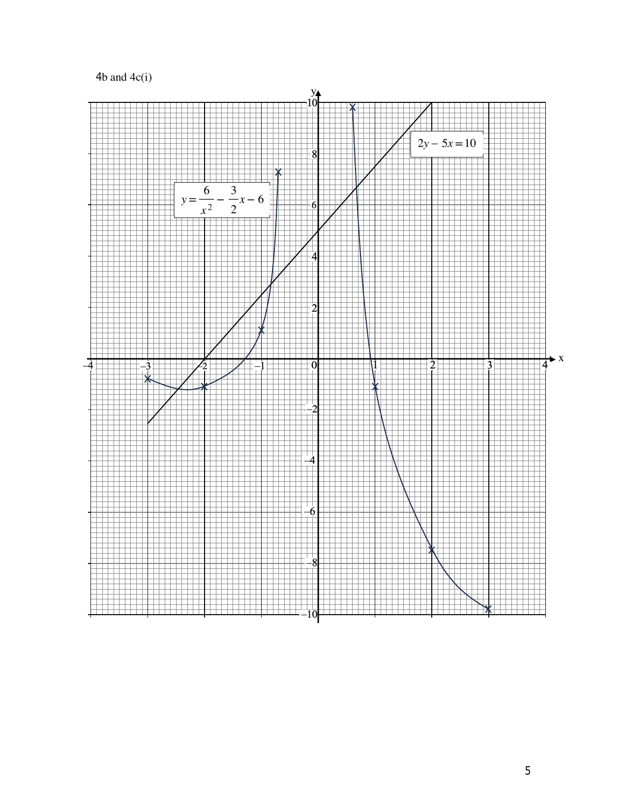

# Fairfield Methodist School (Secondary) — Mathematics 4052/02 Paper 2 Mark Scheme (cleaned)

> **Institution:** Fairfield Methodist School (Secondary)
> **Exam:** Preliminary Examination 2024
> **Level:** Secondary 4 Express / 5 Normal (Academic)
> **Subjects:** Elementary Mathematics
> **Paper:** 4052/02 Paper 2
> **Date:** 20 August 2024
> **Duration:** 2 hours 15 minutes
> **Total Marks:** 90
> **Source:** `2024 FMSS EMATH P2 PRELIM MS.pdf`
>
> **Page** on each question is the physical page of the question paper `2024 FMSS EMATH P2 PRELIM QP.pdf`, not the mark-scheme PDF. The scheme header does not print the date or duration; those are taken from the question paper.

---

## Mark scheme

### Q1

> **Marks:** (a)(i) 1, (a)(ii) 2, (b) 2, (c) 2, (d) 5; total 12
> **Sub-topic:** Algebra
> **Page:** 3–5

**(a)(i)**

$$
g = -6-\frac{2}{3+2} = -\frac{32}{5} \text{ or } -6\frac{2}{5} \text{ or } -6.4
$$

B1.

**(a)(ii)**

$$
(g-f)(3+p) = -p, \quad p = \frac{3f-3g}{g-f+1} \text{ or } \frac{3g-3f}{f-g-1}
$$

M1, A1.

**(b)**

$$
3x-21 > 8x+1, \quad -5x > 22, \quad x < -\frac{22}{5} \text{ or } -4\frac{2}{5} \text{ or } -4.4
$$

M1, A1.

**(c)**

$$
\frac{4(2x-3)+3x}{12} = 4, \quad 11x = 60, \quad x = \frac{60}{11} \text{ or } 5\frac{5}{11}
$$

M1, A1.

**(d)**

$$
\frac{7(3-2x)-4(x+2)}{(x+2)(3-2x)} = 5
$$

$$
10x^{2}-13x-17 = 0
$$

$$
x = \frac{13\pm\sqrt{849}}{20}
$$

$x = 2.11$ or $x = -0.81$ (2 d.p.). M1, M1, M1, A1, A1.

---

### Q2

> **Marks:** (a) 2, (b) 2, (c)(i) 1, (c)(ii) 2, (d)(i) 1, (d)(ii) 3; total 11
> **Sub-topic:** Number
> **Page:** 6–8

**(a)** Total cost $= 1800+150 = 1950$.

$$
\frac{120\times 45-1950}{1950}\times 100\% = 177\% \text{ (3 s.f.)}
$$

B1, B1.

**(b)**

$$
5000\left(1+\frac{2.55}{100}\right)^{2} = 5258.25
$$

Interest $= 5258.25-5000 = 258.25$. ＄258.25. M1, A1.

**(c)(i)** $1.22\times 10^{10}$. B1.

**(c)(ii)**

$$
\frac{12163000000}{5.637\times 10^{6}}\div 12 = 179.81 = 180
$$

(nearest dollar). M1, A1.

**(d)(i)** $(2550\times 3)\times 1.1 = 8415$ CNY. B1.

**(d)(ii)** Shenzhen in SGD: $\dfrac{8415}{100}\times 18.64 = 1568.556$.

Hong Kong: $2550\times 2 = 5100$ HKD. In SGD with the fee: $\dfrac{5100}{5.75}\times 1.015 = 900.260$.

Total $= 1568.556+900.260 = 2469$ SGD (nearest dollar). M1, M1, A1.

---

### Q3

> **Marks:** (a)(i) 1, (a)(ii) 2, (b) 2, (c) 2, (d)(i) 1, (d)(ii) 2; total 10
> **Sub-topic:** Statistics
> **Page:** 9–11

**(a)(i)** Median $= 136\text{ cm}$. B1.

**(a)(ii)** Lower quartile $= 132$, upper quartile $= 142$, interquartile range $= 10\text{ cm}$. M1, A1.

**(b)** Number of girls $= 2$.

$$
\frac{2}{120}\times 100\% = 1.67\% \text{ (3 s.f.) or } 1\frac{2}{3}\%
$$

B2.

**(c)** Casa Secondary School girls are shorter as the median height is less than Landmark Secondary School, or vice versa. Casa has a smaller or larger spread of height as the interquartile range is less than Landmark, or vice versa. Accept “more consistent” if a smaller spread is stated. A1 must state median. A1 must state spread.

**(d)(i)**

$$
\frac{18}{45}\times\frac{17}{44} = \frac{17}{110}
$$

B1.

**(d)(ii)**

$$
\frac{12}{45}\times\frac{5}{44}+\frac{5}{45}\times\frac{12}{44} = \frac{2}{33}
$$

M1, A1.

---

### Q4

> **Marks:** (a) 1, (b) 3, (c)(i) 2, (c)(ii) 2, (c)(iii) 3; total 11
> **Sub-topic:** Graphs
> **Page:** 12–13

**(a)** When $x = -2$, $y = -1.5$ (1 d.p.). B1.

**(b)** See the scheme graph. P2 if all points are plotted correctly, P1 for 7 points, otherwise P0. Curve C1.

**(c)(i)** Line on the same graph. P1, L1.

**(c)(ii)** $x = -2.45\pm 0.2$, $-0.85\pm 0.1$, $0.65\pm 0.1$. B2 for all, B1 for 2 correct.

**(c)(iii)**

$$
2\left(\frac{6}{x^{2}}-\frac{3}{2}x-6\right)-5x = 10
$$

$$
4x^{3}+11x^{2}-6 = 0
$$

$A = 11$, $B = -6$. M1, B1, B1.

---

### Q5

> **Marks:** (a) 3, (b)(i) 2, (b)(ii) 3, (b)(iii) 3; total 11
> **Sub-topic:** Vectors
> **Page:** 14–16

**(a)**

$$
\overrightarrow{PQ} = \begin{pmatrix} -2 \\ 6 \end{pmatrix}, \quad \overrightarrow{PR} = \begin{pmatrix} -6 \\ h+4 \end{pmatrix}
$$

$$
-2 = -6k, \quad k = \frac{1}{3}, \quad h = 14
$$

M1, A1, A1.

**(b)(i)**

$$
\overrightarrow{OS} = 4\mathbf{b}+\frac{m}{13}(-4\mathbf{b}+2\mathbf{a}) = \frac{2m}{13}\mathbf{a}+\left(4-\frac{4m}{13}\right)\mathbf{b}
$$

M1, A1.

**(b)(ii)** $ST:OS = 9:4$, so $\overrightarrow{OS} = \dfrac{4}{13}\overrightarrow{OT}$.

$$
\overrightarrow{OS} = \frac{20}{13}\mathbf{a}+\frac{12}{13}\mathbf{b}, \quad m = 10
$$

M1, A1, A1.

**(b)(iii)**

$$
\overrightarrow{OU} = \frac{20}{3}\mathbf{a}+\frac{12}{3}\mathbf{b} = \frac{4}{3}(5\mathbf{a}+3\mathbf{b})
$$

$$
\overrightarrow{OS} = \frac{4}{13}(5\mathbf{a}+3\mathbf{b})
$$

$\overrightarrow{OU}$ and $\overrightarrow{OS}$ are scalar multiples and share the point $O$, so $O$, $S$ and $U$ lie on a straight line. M1, A1, B1.

---

### Q6

> **Marks:** (a)(i) 3, (a)(ii) 1, (b) 3; total 7
> **Sub-topic:** Geometry
> **Page:** 17–18

**(a)(i)** $\angle BAD = 180^{\circ}-98^{\circ} = 82^{\circ}$ (angles in opposite segments).

$\angle BAO = 82^{\circ}-30^{\circ} = 52^{\circ}$.

$\angle BOA = 180^{\circ}-2(52^{\circ}) = 76^{\circ}$ (angle sum of an isosceles triangle).

$\angle OAE = 90^{\circ}$ (tangent perpendicular to radius).

$\angle OEA = 180^{\circ}-90^{\circ}-76^{\circ} = 14^{\circ}$. B1, B1, B1. Minus 1 mark if no or a wrong reason is given.

**(a)(ii)** Since $\angle OAE = 90^{\circ}$ (tangent perpendicular to radius), a right angle is formed in a semicircle, so a circle with diameter $OE$ passes through $A$. AG1.

**(b)** One acceptable proof: $\angle QTS = \angle TRU$ (right angle in a semicircle), $QS = TU$ (diameters of two equal circles), $QT = TR$ (radii of two equal circles). By RHS, triangles $STQ$ and $URT$ are congruent. M2 for RHS, AG1. Minus 1 if no or a wrong reason is given. ASA and AAS alternatives are also on the scheme.

---

### Q7

> **Marks:** (a) 1, (b) 2, (c) 2, (d) 4; total 9
> **Sub-topic:** Mensuration
> **Page:** 19–20

**(a)**

$$
\frac{4}{3}\pi(3x)^{3} = 36\pi x^{3} \text{ (shown)}
$$

AG1.

**(b)** $\pi(4x)^{2}h = 200\times 36\pi x^{3}$, so $h = 450x$. M1, A1.

**(c)**

$$
16\pi(450)x^{2} = 2024363\pi, \quad x = \sqrt[3]{\frac{2024363}{16\times 450}} = 6.55 \text{ (3 s.f.)}
$$

M1, A1.

**(d)** Radius $= 3x+1.8 = 21.4534\text{ mm}$. Surface area $= 4\pi(21.4534)^{2} = 5783.6516\text{ mm}^{2}$.

$$
\frac{620\times 920}{5783.6516} = 98.622
$$

98 golf balls (round down). B1, M1, M1, A1.

---

### Q8

> **Marks:** (a) 3, (b) 3, (c) 2, (d) 1; total 9
> **Sub-topic:** Trigonometry
> **Page:** 21–22

**(a)**

$$
0.9^{2} = 1.2^{2}+1.4^{2}-2(1.2)(1.4)\cos\angle BAC
$$

$$
\angle BAC = 39.6^{\circ} \text{ (1 d.p.)}
$$

M1, M1, A1.

**(b)** $AD = 0.697679\text{ km}$ and $CD = 0.899117\text{ km}$. Shortest distance $DX = 0.380\text{ km}$ (3 s.f.), using either $\sin 33^{\circ}$ from $AD$ or $\sin 25^{\circ}$ from $CD$. M1, M1, A1.

**(c)** Tower height $0.3\text{ km}$.

$$
\tan\theta = \frac{0.3}{0.379983}, \quad \theta = 38.3^{\circ} \text{ (1 d.p.)}
$$

M1, A1.

**(d)** Bearing of $A$ from $B$ is $180^{\circ}+(90^{\circ}-39.57^{\circ}) = 230.4^{\circ}$ (1 d.p.). B1.

---

### Q9

> **Marks:** (a) 2, (b) 1, (c) 7; total 10
> **Sub-topic:** Real-world context
> **Page:** 23–26

**(a)** Area of the three bedrooms $= 52.35\text{ m}^{2}$. One method on the scheme uses millimetre dimensions from the plan: $3800\times 4850+(2400+1600)(6800-2500)+3800\times 4400 = 52350000\text{ mm}^{2}$. M1, A1.

**(b)** Volume $= 52.35\times 0.05 = 2.6175\text{ m}^{3}$. B1.

**(c)** Cement-sand mixture $= 2.6175\times 1400 = 3664.5\text{ kg}$. Bags $= 3664.5\div 40 = 92$ (round up). Cost $= 92\times 18.50 = 1702$.

Planks $= 52.35\div(0.06\times 0.3) = 2909$ (round up). Boxes $= 59$ (round up). Cost $= 59\times 35.50 = 2094.50$.

Manpower: cement screed $= 4\times 1\times 8\times 5 = 160$. Timber $= 2\times 3\times 8\times 10 = 480$. Total manpower $= 640$.

Total cost $= 1702+2094.50+640 = 4436.50$.

Floor size $= 52.35\div 0.09203 = 568.836$ square feet. Cost per square foot $= 7.80$.

Kent should charge ＄10 per square foot (any amount more than the total cost).
