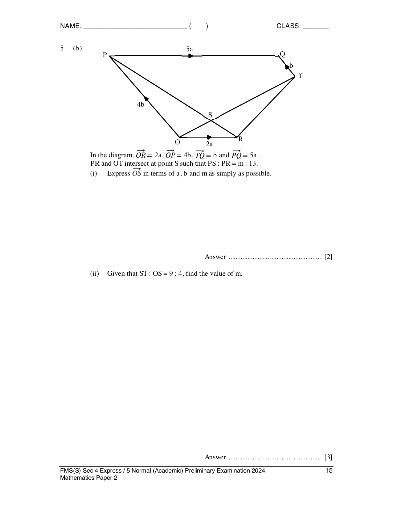
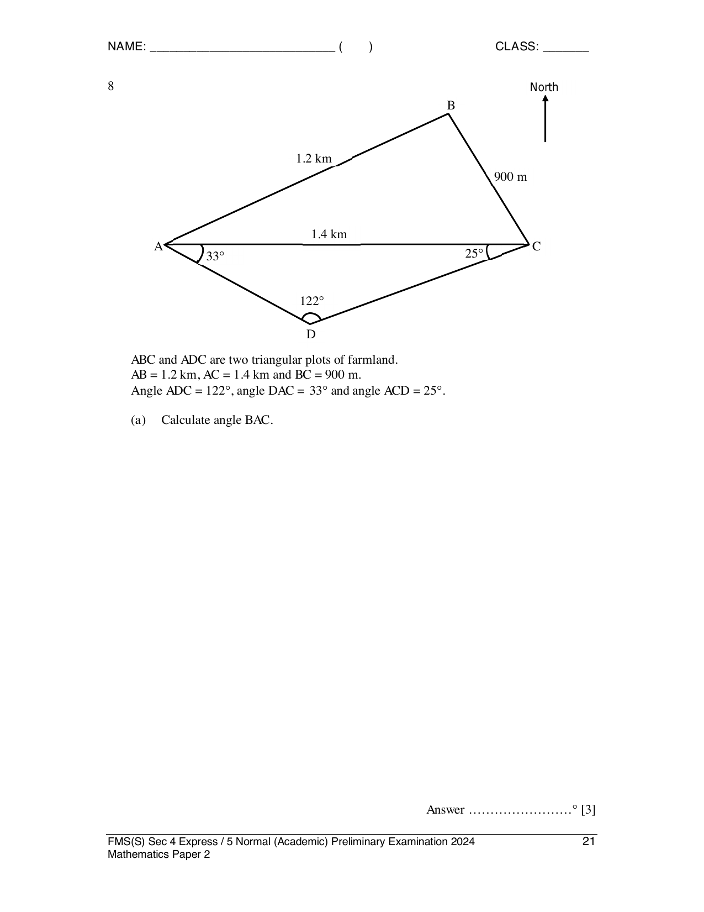

# Fairfield Methodist School (Secondary) — Mathematics 4052/02 Paper 2 (cleaned)

> **Institution:** Fairfield Methodist School (Secondary)
> **Exam:** Preliminary Examination 2024
> **Level:** Secondary 4 Express / 5 Normal (Academic)
> **Subjects:** Elementary Mathematics
> **Paper:** 4052/02 Paper 2
> **Date:** 20 August 2024
> **Duration:** 2 hours 15 minutes
> **Total Marks:** 90
> **Source:** `2024 FMSS EMATH P2 PRELIM QP.pdf`

---

## Instructions

Write your name, index number and class on all the work you hand in.
Write in dark blue or black pen.
You may use an HB pencil for any diagrams or graphs.
Do not use staples, paper clips, glue or correction fluid.

Answer all the questions.
The number of marks is given in brackets [ ] at the end of each question or part question.
If working is needed for any question it must be shown with the answer.
Omission of essential working will result in loss of marks.
The total of the marks for this paper is 90.

The use of an approved scientific calculator is expected, where appropriate.
If the degree of accuracy is not specified in the question and if the answer is not exact, give the answer to three significant figures. Give answers in degrees to one decimal place.
For $\pi$, use either your calculator value or $3.142$.

Setter: Mr James Quek.

---

## Mathematical Formulae

*Compound interest*

$$
\text{Total amount} = P\left(1+\frac{r}{100}\right)^{n}
$$

*Mensuration*

$$
\text{Curved surface area of a cone} = \pi rl
$$

$$
\text{Surface area of a sphere} = 4\pi r^{2}
$$

$$
\text{Volume of a cone} = \frac{1}{3}\pi r^{2}h
$$

$$
\text{Volume of a sphere} = \frac{4}{3}\pi r^{3}
$$

$$
\text{Area of triangle } ABC = \frac{1}{2}ab\sin C
$$

$$
\text{Arc length} = r\theta,\text{ where }\theta\text{ is in radians}
$$

$$
\text{Sector area} = \frac{1}{2}r^{2}\theta,\text{ where }\theta\text{ is in radians}
$$

*Trigonometry*

$$
\frac{a}{\sin A} = \frac{b}{\sin B} = \frac{c}{\sin C}
$$

$$
a^{2} = b^{2}+c^{2}-2bc\cos A
$$

*Statistics*

$$
\text{Mean} = \frac{\sum fx}{\sum f}
$$

$$
\text{Standard deviation} = \sqrt{\frac{\sum fx^{2}}{\sum f}-\left(\frac{\sum fx}{\sum f}\right)^{2}}
$$

---

### Q1

> **Marks:** (a)(i) 1, (a)(ii) 2, (b) 2, (c) 2, (d) 5; total 12
> **Page:** 3–5

**(a)** $g = f-\dfrac{p}{3+p}$.

**(i)** Find $g$ when $f = -6$ and $p = 2$. [1]
> **Topic:** N1 Numbers and their operations
> **Sub-topic:** Numbers and their operations
> **LO:** [[context/subjects/o-level-e-maths/learning-objectives/o-level-e-maths-N1g.md|N1g]]

**(ii)** Rearrange the formula to make $p$ the subject. [2]
> **Topic:** N1 Numbers and their operations
> **Sub-topic:** Numbers and their operations
> **LO:** [[context/subjects/o-level-e-maths/learning-objectives/o-level-e-maths-N1g.md|N1g]]

**(b)** Solve the inequality $x-7 > \dfrac{8x+1}{3}$. [2]
> **Topic:** N1 Numbers and their operations
> **Sub-topic:** Numbers and their operations
> **LO:** [[context/subjects/o-level-e-maths/learning-objectives/o-level-e-maths-N1g.md|N1g]]

**(c)** Solve the equation $\dfrac{2x-3}{3}+\dfrac{x}{4} = 4$. [2]
> **Topic:** N1 Numbers and their operations
> **Sub-topic:** Numbers and their operations
> **LO:** [[context/subjects/o-level-e-maths/learning-objectives/o-level-e-maths-N1g.md|N1g]]

**(d)** Solve the equation $\dfrac{7}{x+2}-\dfrac{4}{3-2x} = 5$. Give your solutions correct to two decimal places. [5]
> **Topic:** N1 Numbers and their operations
> **Sub-topic:** Numbers and their operations
> **LO:** [[context/subjects/o-level-e-maths/learning-objectives/o-level-e-maths-N1g.md|N1g]]

---

### Q2

> **Marks:** (a) 2, (b) 2, (c)(i) 1, (c)(ii) 2, (d)(i) 1, (d)(ii) 3; total 11
> **Page:** 6–8

**(a)** Susan owns an online shop that sells power banks. She buys a box of 120 power banks from an overseas warehouse at ＄1800. It cost her ＄150 to ship the power banks. She plans to sell each power bank at ＄45. Calculate the percentage profit Susan makes on each power bank she sells for ＄45. [2]
> **Topic:** N3 Percentage
> **Sub-topic:** Percentage
> **LO:** [[context/subjects/o-level-e-maths/learning-objectives/o-level-e-maths-N3d.md|N3d]]

**(b)** Susan borrows ＄5000 from a bank to import more products for her online shop. She is charged with a compound interest of 2.55% per year. She pays the money back after 2 years. Calculate the total amount of interest she needs to pay to the bank. Give your answer correct to the nearest cent. [2]
> **Topic:** N3 Percentage
> **Sub-topic:** Percentage
> **LO:** [[context/subjects/o-level-e-maths/learning-objectives/o-level-e-maths-N3d.md|N3d]]

**(c)** In the year 2022, Singaporeans spent ＄12 163 million on e-commerce. The population of Singapore in 2022 was $5.637\times 10^{6}$.

**(i)** Write ＄12 163 million in standard form correct to 3 significant figures. [1]
> **Topic:** N3 Percentage
> **Sub-topic:** Percentage
> **LO:** [[context/subjects/o-level-e-maths/learning-objectives/o-level-e-maths-N3d.md|N3d]]

**(ii)** Calculate the mean amount of money spent per Singaporean per month in 2022. Give your answer correct to the nearest dollar. [2]
> **Topic:** N3 Percentage
> **Sub-topic:** Percentage
> **LO:** [[context/subjects/o-level-e-maths/learning-objectives/o-level-e-maths-N3d.md|N3d]]

**(d)** The exchange rate between Singapore dollars (SGD) and Hong Kong dollars (HKD) is SGD 1 = HKD 5.75. The exchange rate between Chinese Yuan Renminbi (CNY) and Singapore dollars is CNY 100 = SGD 18.64. Susan is planning for a business trip to Shenzhen (China) and Hong Kong. She finds these hotel prices from a tour agency.

- Shenzhen Hotel: CNY 2550 per night plus 10% service charge.
- Hong Kong Hotel: HKD 2550 per night.

Susan books 3 nights in Shenzhen and 2 nights in Hong Kong.

**(i)** Calculate the total amount Susan pays for three nights in Shenzhen. [1]
> **Topic:** N3 Percentage
> **Sub-topic:** Percentage
> **LO:** [[context/subjects/o-level-e-maths/learning-objectives/o-level-e-maths-N3d.md|N3d]]

She uses her credit card for the stay in Hong Kong and Alipay to pay for her stay in Shenzhen. The credit card company will convert the overseas amount to Singapore dollars and there is a currency conversion fee of 1.5%. There is no conversion fee when using Alipay.

**(ii)** Calculate the total amount Susan pays for the two hotels in Singapore dollars. Give your answer correct to the nearest dollar. [3]
> **Topic:** N3 Percentage
> **Sub-topic:** Percentage
> **LO:** [[context/subjects/o-level-e-maths/learning-objectives/o-level-e-maths-N3d.md|N3d]]

---

### Q3

> **Marks:** (a)(i) 1, (a)(ii) 2, (b) 2, (c) 2, (d)(i) 1, (d)(ii) 2; total 10
> **Page:** 9–11

The cumulative frequency graph shows the height distribution of 120 girls in Secondary One of Casa Secondary School.

**(a)** Use the graph to estimate

**(i)** the median height, [1]
> **Topic:** S1 Data handling and analysis
> **Sub-topic:** Data handling and analysis
> **LO:** [[context/subjects/o-level-e-maths/learning-objectives/o-level-e-maths-S1f.md|S1f]]

**(ii)** the interquartile range of the heights. [2]
> **Topic:** S1 Data handling and analysis
> **Sub-topic:** Data handling and analysis
> **LO:** [[context/subjects/o-level-e-maths/learning-objectives/o-level-e-maths-S1f.md|S1f]]

**(b)** For a girl to be selected to join the school’s volleyball team, she must be of at least 160 cm in height. Estimate the percentage of the girls who meet the above criteria. [2]
> **Topic:** S1 Data handling and analysis
> **Sub-topic:** Data handling and analysis
> **LO:** [[context/subjects/o-level-e-maths/learning-objectives/o-level-e-maths-S1f.md|S1f]]

**(c)** The heights of 120 girls in Secondary One from Landmark Secondary School were recorded. The median height is 140 cm and the interquartile range of the height is 13 cm. Make two comparisons between the height distribution in Casa Secondary School and Landmark Secondary School. [2]
> **Topic:** S1 Data handling and analysis
> **Sub-topic:** Data handling and analysis
> **LO:** [[context/subjects/o-level-e-maths/learning-objectives/o-level-e-maths-S1f.md|S1f]]

**(d)** The table summarises the amount of weekly allowance in a class.

| Allowance, $x$ (＄) | $15 \leq x < 20$ | $20 \leq x < 25$ | $25 \leq x < 30$ | $30 \leq x < 35$ | $35 \leq x < 40$ |
| --- | --- | --- | --- | --- | --- |
| Number of students | 5 | 13 | 15 | 6 | 6 |

Two of the students were selected at random. Find, as a fraction in its simplest form, the probability that

**(i)** they both had weekly allowance that is less than ＄25, [1]
> **Topic:** S2 Probability
> **Sub-topic:** Probability
> **LO:** [[context/subjects/o-level-e-maths/learning-objectives/o-level-e-maths-S2c.md|S2c]]

**(ii)** one had at least ＄30 of weekly allowance and the other had less than ＄20 of weekly allowance. [2]
> **Topic:** S2 Probability
> **Sub-topic:** Probability
> **LO:** [[context/subjects/o-level-e-maths/learning-objectives/o-level-e-maths-S2c.md|S2c]]

---

### Q4

> **Marks:** (a) 1, (b) 3, (c)(i) 2, (c)(ii) 2, (c)(iii) 3; total 11
> **Page:** 12–13

The table below shows some values of $x$ and corresponding values of $y$ for $y = \dfrac{6}{x^{2}}-\dfrac{3}{2}x-6$.

**(a)** Complete the table of values, giving your answer correct to 1 decimal place. [1]
> **Topic:** N6 Functions and graphs
> **Sub-topic:** Functions and graphs
> **LO:** [[context/subjects/o-level-e-maths/learning-objectives/o-level-e-maths-N6c.md|N6c]]

| $x$ | $-3$ | $-2$ | $-1$ | $-0.7$ | $0.6$ | $1$ | $2$ | $3$ |
| --- | --- | --- | --- | --- | --- | --- | --- | --- |
| $y$ | $-0.8$ |  | $1.5$ | $7.3$ | $9.8$ | $-1.5$ | $-7.5$ | $-9.8$ |

**(b)** On the grid, draw the graph of $y = \dfrac{6}{x^{2}}-\dfrac{3}{2}x-6$ for $-3 \leq x \leq 3$. [3]

**(c)(i)** On the same grid, draw the graph of $2y-5x = 10$ for $-3 \leq x \leq 2$. [2]
> **Topic:** N6 Functions and graphs
> **Sub-topic:** Functions and graphs
> **LO:** [[context/subjects/o-level-e-maths/learning-objectives/o-level-e-maths-N6c.md|N6c]]

**(ii)** Write down the $x$-coordinates of the points where the line intersects the curve. [2]
> **Topic:** N6 Functions and graphs
> **Sub-topic:** Functions and graphs
> **LO:** [[context/subjects/o-level-e-maths/learning-objectives/o-level-e-maths-N6c.md|N6c]]

**(iii)** These values of $x$ are solutions to the equation $4x^{3}+Ax^{2}+B = 0$. Find the value of $A$ and the value of $B$. [3]
> **Topic:** N6 Functions and graphs
> **Sub-topic:** Functions and graphs
> **LO:** [[context/subjects/o-level-e-maths/learning-objectives/o-level-e-maths-N6c.md|N6c]]

---

### Q5

> **Marks:** (a) 3, (b)(i) 2, (b)(ii) 3, (b)(iii) 3; total 11
> **Page:** 14–16

**(a)** $P$ is the point $(8, -4)$ and $Q$ is the point $(6, 2)$. $R$ has the coordinates $(2, h)$, and $\overrightarrow{PQ} = k\overrightarrow{PR}$. Find the value of $h$ and $k$. [3]
> **Topic:** G7 Vectors in two dimensions
> **Sub-topic:** Vectors in two dimensions
> **LO:** [[context/subjects/o-level-e-maths/learning-objectives/o-level-e-maths-G7h.md|G7h]]

**(b)**

In the diagram, $\overrightarrow{OR} = 2\mathbf{a}$, $\overrightarrow{OP} = 4\mathbf{b}$, $\overrightarrow{TQ} = \mathbf{b}$ and $\overrightarrow{PQ} = 5\mathbf{a}$. $PR$ and $OT$ intersect at point $S$ such that $PS:PR = m:13$.

**(i)** Express $\overrightarrow{OS}$ in terms of $\mathbf{a}$, $\mathbf{b}$ and $m$ as simply as possible. [2]
> **Topic:** G7 Vectors in two dimensions
> **Sub-topic:** Vectors in two dimensions
> **LO:** [[context/subjects/o-level-e-maths/learning-objectives/o-level-e-maths-G7h.md|G7h]]

**(ii)** Given that $ST:OS = 9:4$, find the value of $m$. [3]
> **Topic:** G7 Vectors in two dimensions
> **Sub-topic:** Vectors in two dimensions
> **LO:** [[context/subjects/o-level-e-maths/learning-objectives/o-level-e-maths-G7h.md|G7h]]

**(iii)** $U$ is the point such that $\overrightarrow{RU} = \dfrac{2}{3}(7\mathbf{a}+6\mathbf{b})$. Explain why $O$, $S$ and $U$ lie on a straight line. [3]
> **Topic:** G7 Vectors in two dimensions
> **Sub-topic:** Vectors in two dimensions
> **LO:** [[context/subjects/o-level-e-maths/learning-objectives/o-level-e-maths-G7h.md|G7h]]

---

### Q6

> **Marks:** (a)(i) 3, (a)(ii) 1, (b) 3; total 7
> **Page:** 17–18

**(a)**

$A$, $B$, $C$ and $D$ are points on the circumference of a circle with centre $O$. $AE$ is a tangent to the circle at $A$ and $OE$ is a straight line that passes through the circle at point $B$. $\angle BCD = 98^{\circ}$ and $\angle OAD = 30^{\circ}$.

**(i)** Find $\angle OEA$. Give reasons for each step of your working. [3]
> **Topic:** G3 Properties of circles
> **Sub-topic:** Properties of circles
> **LO:** [[context/subjects/o-level-e-maths/learning-objectives/o-level-e-maths-G3b.md|G3b]]

**(ii)** Explain why a semicircle with $OE$ as diameter passes through the point $A$. [1]
> **Topic:** G3 Properties of circles
> **Sub-topic:** Properties of circles
> **LO:** [[context/subjects/o-level-e-maths/learning-objectives/o-level-e-maths-G3b.md|G3b]]

**(b)**

The diagram shows two circles with equal radii. $P$, $R$, $U$ and $T$ are points on the circle with centre $Q$. $Q$, $T$ and $S$ are points on the circle with centre $R$. $PQRS$ and $UQT$ are straight lines.

Show that triangles $STQ$ and $URT$ are congruent. [3]
> **Topic:** G3 Properties of circles
> **Sub-topic:** Properties of circles
> **LO:** [[context/subjects/o-level-e-maths/learning-objectives/o-level-e-maths-G3b.md|G3b]]

---

### Q7

> **Marks:** (a) 1, (b) 2, (c) 2, (d) 4; total 9
> **Page:** 19–20

A golf ball is made of a spherical inner rubber core and coated with an exterior layer of ionomer resin. Diagram A shows the cross-section of a golf ball. The inner core has a radius of $3x\text{ mm}$ and the thickness of the resin is $y\text{ mm}$.

**(a)** Show that the volume of the inner core is $36\pi x^{3}\text{ mm}^{3}$. [1]
> **Topic:** G5 Mensuration
> **Sub-topic:** Mensuration
> **LO:** [[context/subjects/o-level-e-maths/learning-objectives/o-level-e-maths-G5c.md|G5c]]

**(b)** The inner rubber core is moulded from a cylindrical rubber tube with radius of $4x\text{ mm}$ and height of $h\text{ mm}$ as shown in Diagram B. The cylindrical rubber tube can produce 200 inner rubber cores. Find $h$ in terms of $x$. [2]
> **Topic:** G5 Mensuration
> **Sub-topic:** Mensuration
> **LO:** [[context/subjects/o-level-e-maths/learning-objectives/o-level-e-maths-G5c.md|G5c]]

**(c)** The volume of the cylindrical rubber tube is $2024363\pi\text{ mm}^{3}$. Calculate the value of $x$. [2]
> **Topic:** G5 Mensuration
> **Sub-topic:** Mensuration
> **LO:** [[context/subjects/o-level-e-maths/learning-objectives/o-level-e-maths-G5c.md|G5c]]

**(d)** Each inner rubber core is coated with 1.8 mm of ionomer resin. The golf ball is then wrapped round with a plastic sheet. Given that the dimensions of the plastic sheet are 62 cm by 92 cm, calculate the number of golf balls that can be wrapped from this plastic sheet. [4]
> **Topic:** G5 Mensuration
> **Sub-topic:** Mensuration
> **LO:** [[context/subjects/o-level-e-maths/learning-objectives/o-level-e-maths-G5c.md|G5c]]

---

### Q8

> **Marks:** (a) 3, (b) 3, (c) 2, (d) 1; total 9
> **Page:** 21–22

$ABC$ and $ADC$ are two triangular plots of farmland. $AB = 1.2\text{ km}$, $AC = 1.4\text{ km}$ and $BC = 900\text{ m}$. $\angle ADC = 122^{\circ}$, $\angle DAC = 33^{\circ}$ and $\angle ACD = 25^{\circ}$.

**(a)** Calculate $\angle BAC$. [3]
> **Topic:** G4 Pythagoras' theorem and trigonometry
> **Sub-topic:** Pythagoras' theorem and trigonometry
> **LO:** [[context/subjects/o-level-e-maths/learning-objectives/o-level-e-maths-G4g.md|G4g]]

**(b)** Find the shortest distance from $D$ to a point along the path $AC$. [3]
> **Topic:** G4 Pythagoras' theorem and trigonometry
> **Sub-topic:** Pythagoras' theorem and trigonometry
> **LO:** [[context/subjects/o-level-e-maths/learning-objectives/o-level-e-maths-G4g.md|G4g]]

**(c)** A meteorological tower of 300 m tall is installed vertically at point $D$. Find the largest angle of depression from the top of the tower to a point along the path $AC$. [2]
> **Topic:** G4 Pythagoras' theorem and trigonometry
> **Sub-topic:** Pythagoras' theorem and trigonometry
> **LO:** [[context/subjects/o-level-e-maths/learning-objectives/o-level-e-maths-G4g.md|G4g]]

**(d)** $A$ is due west of $C$. Find the bearing of $A$ from $B$. [1]
> **Topic:** G4 Pythagoras' theorem and trigonometry
> **Sub-topic:** Pythagoras' theorem and trigonometry
> **LO:** [[context/subjects/o-level-e-maths/learning-objectives/o-level-e-maths-G4g.md|G4g]]

---

### Q9

> **Marks:** (a) 2, (b) 1, (c) 7; total 10
> **Page:** 23–26

Kent is a new renovation project manager. He wants to promote his company’s timber flooring for bedrooms.

**(a)** Calculate the area of the three bedrooms in square metres. [2]
> **Topic:** G5 Mensuration
> **Sub-topic:** Mensuration
> **LO:** [[context/subjects/o-level-e-maths/learning-objectives/o-level-e-maths-G5b.md|G5b]]

**(b)** A cement screed of 0.05 m thickness is needed in each bedroom before the timber planks can be laid on top. Calculate the total volume of cement screed, in cubic metres, needed for the three bedrooms. [1]
> **Topic:** G5 Mensuration
> **Sub-topic:** Mensuration
> **LO:** [[context/subjects/o-level-e-maths/learning-objectives/o-level-e-maths-G5c.md|G5c]]

**(c)** Kent’s colleague also gives him this information.

| Item | Description | Unit cost |
| --- | --- | --- |
| Pre-mixed cement-sand mixture (local) | Bag of 40 kg, bulk (1–49 bags) | ＄20.00 |
|  | Bulk (50–99 bags) | ＄18.50 |
|  | Bulk (100+ bags) | ＄16.50 |
| Timber planks (Vietnam) | 6 cm by 30 cm, 50 planks per box | ＄35.50 |

1400 kg of cement-sand mixture produce up to 1 cubic metre of cement screed. Timber planks are fitted so that the number of planks needed depends on the floor area and not on the orientation of the planks.

| Type | Description | Unit cost |
| --- | --- | --- |
| General worker | Mixing/pouring cement screed and finishing surface | ＄5 per hour |
| Skilled worker | Installation, polishing and repair of timber flooring | ＄10 per hour |

A worker is only allowed to work for 8 hours per day.

| Item | Number of workers required | Number of days to complete |
| --- | --- | --- |
| Cement screed construction | 4 | 1 |
| Timber flooring installation | 2 | 3 |

$1$ square foot $= 0.09203$ square metres.

Kent needs to decide how much he should charge his customers for the timber flooring installation for three bedrooms. He must make sure that he charges enough money to cover all his costs. Suggest a sensible amount in price per square foot to charge his customers. Justify the decision you made and show your calculations clearly. [7]
> **Topic:** G5 Mensuration
> **Sub-topic:** Mensuration
> **LO:** [[context/subjects/o-level-e-maths/learning-objectives/o-level-e-maths-G5b.md|G5b]]
