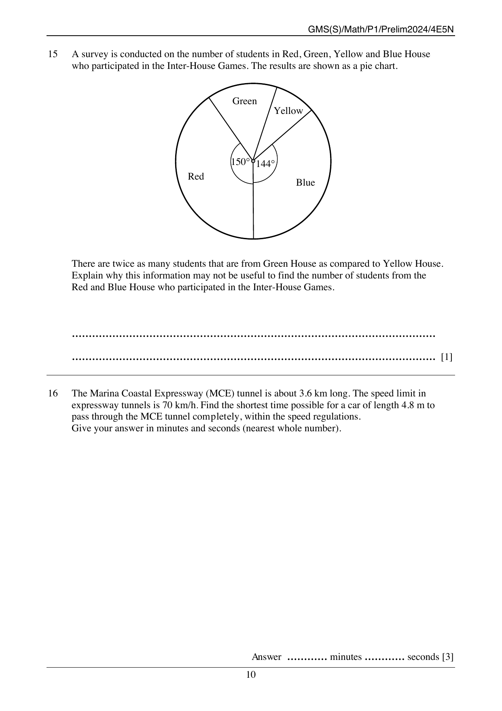
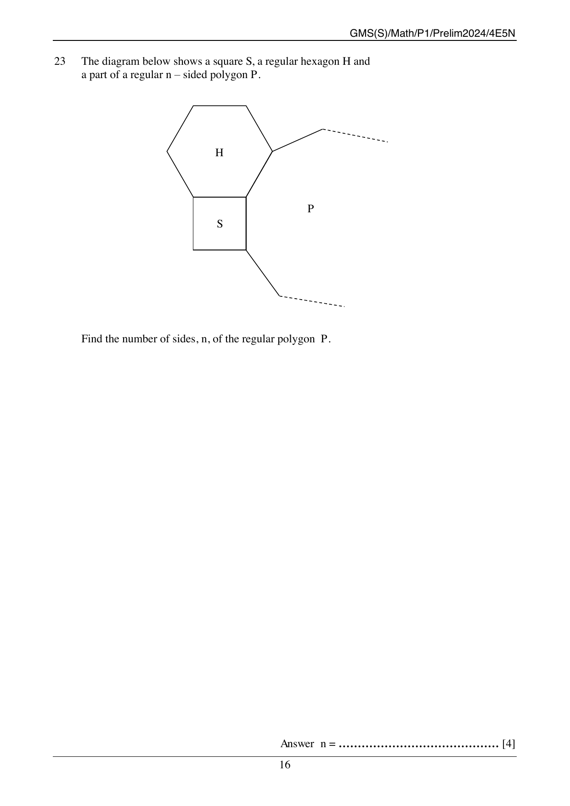
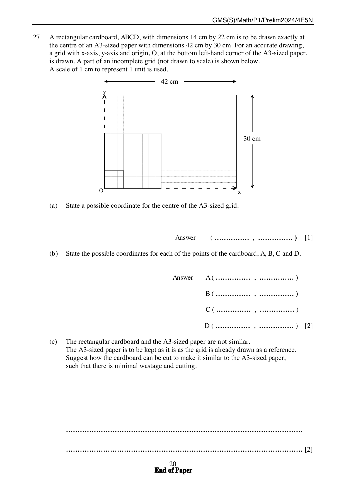

# Geylang Methodist School (Secondary) — Mathematics 4052/01 Paper 1 (cleaned)

> **Institution:** Geylang Methodist School (Secondary)
> **Exam:** Preliminary Examination 2024
> **Level:** Secondary 4 Express / Secondary 5 Normal (Academic)
> **Subjects:** Elementary Mathematics
> **Paper:** 4052/01 Paper 1
> **Date:** Monday, 5 August 2024
> **Duration:** 2 hours 15 minutes
> **Total Marks:** 90
> **Source:** `GMSS_2024_4E5N_EM_P1_PRELIM.pdf`

---

## Instructions

Write your class, index number and name on all the work you hand in.
Write in dark blue or black pen.
You may use an HB pencil for any diagrams or graphs.
Do not use staples, paper clips, glue or correction fluid.

Answer all the questions.
The number of marks is given in brackets [ ] at the end of each question or part question.

If working is needed for any question it must be shown with the answer.
Omission of essential working will result in loss of marks.
The total of the marks for this paper is 90.

The use of an approved scientific calculator is expected, where appropriate.
If the degree of accuracy is not specified in the question and if the answer is not exact, give the answer to three significant figures. Give answers in degrees to one decimal place.
For $\pi$, use either your calculator value or $3.142$.

Candidates answer on the Question Paper.

---

## Mathematical Formulae

*Compound interest*

$$
\text{Total amount} = P\left(1+\frac{r}{100}\right)^{n}
$$

*Mensuration*

$$
\text{Curved surface area of a cone} = \pi rl
$$

$$
\text{Surface area of a sphere} = 4\pi r^{2}
$$

$$
\text{Volume of a cone} = \frac{1}{3}\pi r^{2}h
$$

$$
\text{Volume of a sphere} = \frac{4}{3}\pi r^{3}
$$

$$
\text{Area of triangle } ABC = \frac{1}{2}ab\sin C
$$

$$
\text{Arc length} = r\theta,\text{ where }\theta\text{ is in radians}
$$

$$
\text{Sector area} = \frac{1}{2}r^{2}\theta,\text{ where }\theta\text{ is in radians}
$$

*Trigonometry*

$$
\frac{a}{\sin A} = \frac{b}{\sin B} = \frac{c}{\sin C}
$$

$$
a^{2} = b^{2}+c^{2}-2bc\cos A
$$

*Statistics*

$$
\text{Mean} = \frac{\Sigma fx}{\Sigma f}
$$

$$
\text{Standard deviation} = \sqrt{\frac{\Sigma fx^{2}}{\Sigma f}-\left(\frac{\Sigma fx}{\Sigma f}\right)^{2}}
$$

---

### Q1

> **Marks:** 2
> **Topic:** N5 Algebraic expressions and formulae
> **Sub-topic:** Algebraic expressions and formulae
> **LO:** [[context/subjects/o-level-e-maths/learning-objectives/o-level-e-maths-N5j.md|N5j]]
> **Page:** 3

Expand and simplify $(4x-y)(3x+4y)$.

### Q2

> **Marks:** 2
> **Page:** 3

(a) Find the lowest common multiple (LCM) of $108$ and $140$. [1]
> **Topic:** N1 Numbers and their operations
> **Sub-topic:** Numbers and their operations
> **LO:** [[context/subjects/o-level-e-maths/learning-objectives/o-level-e-maths-N1b.md|N1b]]

(b) Find the highest common factor (HCF) of $108$ and $140$. [1]
> **Topic:** N1 Numbers and their operations
> **Sub-topic:** Numbers and their operations
> **LO:** [[context/subjects/o-level-e-maths/learning-objectives/o-level-e-maths-N1b.md|N1b]]

### Q3

> **Marks:** 1
> **Topic:** N7 Equations and inequalities
> **Sub-topic:** Equations and inequalities
> **LO:** [[context/subjects/o-level-e-maths/learning-objectives/o-level-e-maths-N7f.md|N7f]]
> **Page:** 3

Solve $4-\dfrac{1}{3}x = 2$.

### Q4

> **Marks:** 2
> **Page:** 4

$10,\ 23,\ 34,\ 40,\ 25,\ 35,\ 17,\ 44,\ 23$

(a) Find the median of the set of numbers. [1]
> **Topic:** S1 Data handling and analysis
> **Sub-topic:** Data handling and analysis
> **LO:** [[context/subjects/o-level-e-maths/learning-objectives/o-level-e-maths-S1f.md|S1f]]

(b) Find the range of the set of numbers. [1]
> **Topic:** S1 Data handling and analysis
> **Sub-topic:** Data handling and analysis
> **LO:** [[context/subjects/o-level-e-maths/learning-objectives/o-level-e-maths-S1f.md|S1f]]

### Q5

> **Marks:** 3
> **Page:** 4

(a) A hotel made breakfast milkshake for its guests. A mixture of mango juice, milk and yogurt in the ratio $7:5:3$ are mixed together. $2.5$ litres of milk is used in the mixture.

(i) How much yogurt is used in the milkshake? [1]
> **Topic:** N2 Ratio and proportion
> **Sub-topic:** Ratio and proportion
> **LO:** [[context/subjects/o-level-e-maths/learning-objectives/o-level-e-maths-N2a.md|N2a]]

(ii) How much breakfast milkshake is made? [1]
> **Topic:** N2 Ratio and proportion
> **Sub-topic:** Ratio and proportion
> **LO:** [[context/subjects/o-level-e-maths/learning-objectives/o-level-e-maths-N2a.md|N2a]]

(b) Another milkshake is made using apple juice, peach juice and milk. The ratio of apple juice : milk $= 2:3$. The ratio of milk : peach juice $= 5:4$.

Find the ratio of apple juice : milk : peach juice. [1]
> **Topic:** N2 Ratio and proportion
> **Sub-topic:** Ratio and proportion
> **LO:** [[context/subjects/o-level-e-maths/learning-objectives/o-level-e-maths-N2a.md|N2a]]

### Q6

> **Marks:** 3
> **Topic:** G6 Coordinate geometry
> **Sub-topic:** Coordinate geometry
> **LO:** [[context/subjects/o-level-e-maths/learning-objectives/o-level-e-maths-G6c.md|G6c]]
> **Page:** 5

Find the equation of the straight line passing through $(7,-7)$ and $(-4,15)$.

### Q7

> **Marks:** 2
> **Page:** 5

The graph shows the growth in milk tea consumers regionally.

The chart is titled "Growth of Milk Tea Consumers from Southeast Asian Countries". The bars, with no labelled vertical scale, read Indonesia $8000$, Philippines $3900$, Thailand $3000$, Vietnam $1515$, Singapore $750$ and Malaysia $250$. Adapted from source: https://www.mdpi.com/

(a) State one misleading feature of the graph. [1]
> **Topic:** N6 Functions and graphs
> **Sub-topic:** Functions and graphs
> **LO:** [[context/subjects/o-level-e-maths/learning-objectives/o-level-e-maths-N6c.md|N6c]]

(b) Based on your answer in part (a), explain how this feature affects the reader's interpretation of the graph. [1]
> **Topic:** N6 Functions and graphs
> **Sub-topic:** Functions and graphs
> **LO:** [[context/subjects/o-level-e-maths/learning-objectives/o-level-e-maths-N6c.md|N6c]]

### Q8

> **Marks:** 3
> **Page:** 6

The Venn diagram shows the elements of $\xi = \{\text{integers } x: 1 \leq x \leq 15\}$ and two sets $A$ and $B$.

In $A$ only: $3$, $6$, $9$, $12$. In $A \cap B$: $15$. In $B$ only: $5$, $10$. Outside both sets: $1$, $2$, $4$, $7$, $8$, $11$, $13$, $14$.

(a) Use one of the symbols below to complete each statement.

$\varnothing \quad \subseteq \quad \in \quad \cap \quad \not\subset$

(i) $\{15\}$ $\ldots\ldots\ldots$ $A \cap B$ [1]
> **Topic:** N8 Set language and notation
> **Sub-topic:** Set language and notation
> **LO:** [[context/subjects/o-level-e-maths/learning-objectives/o-level-e-maths-N8c.md|N8c]]

(ii) $1$ $\ldots\ldots\ldots$ $(A \cup B)'$ [1]
> **Topic:** N8 Set language and notation
> **Sub-topic:** Set language and notation
> **LO:** [[context/subjects/o-level-e-maths/learning-objectives/o-level-e-maths-N8c.md|N8c]]

(b) Suggest a description to define set $A$. [1]
> **Topic:** N8 Set language and notation
> **Sub-topic:** Set language and notation
> **LO:** [[context/subjects/o-level-e-maths/learning-objectives/o-level-e-maths-N8c.md|N8c]]

### Q9

> **Marks:** 2
> **Topic:** N1 Numbers and their operations
> **Sub-topic:** Numbers and their operations
> **LO:** [[context/subjects/o-level-e-maths/learning-objectives/o-level-e-maths-N1h.md|N1h]]
> **Page:** 6

The number of social media users globally grew from $4.72$ billion in January 2023 to $5.04$ billion in January 2024. The number increased by $r\%$ every month during that period. Find the value of $r$. ($1$ billion $= 1 \times 10^{9}$)

### Q10

> **Marks:** 3
> **Page:** 7

The following diagram shows the positions of Earth, $E$, and Venus, $V$, and their orbit around the Sun, $S$. The radius of Venus' orbit is $1.082 \times 10^{8}$ km.

[Follow the degree of accuracy of the values specified in this question and leave your answers in standard form where necessary.]

$S$ is the centre. $V$ lies on the inner orbit and $E$ on the outer orbit. $SV$ and $SE$ are drawn, and the angle at $E$ between $ES$ and the chord $EV$ is $\alpha$. The angle at $V$ in triangle $EVS$ is a right angle.

(a) If the angle $\alpha$ is $46.054^{\circ}$, calculate the distance between Earth and the Sun. [1]
> **Topic:** G4 Pythagoras' theorem and trigonometry
> **Sub-topic:** Pythagoras' theorem and trigonometry
> **LO:** [[context/subjects/o-level-e-maths/learning-objectives/o-level-e-maths-G4b.md|G4b]]

(b) State the value of $\alpha$ when Earth is furthest from Venus and calculate this distance. [2]
> **Topic:** G4 Pythagoras' theorem and trigonometry
> **Sub-topic:** Pythagoras' theorem and trigonometry
> **LO:** [[context/subjects/o-level-e-maths/learning-objectives/o-level-e-maths-G4b.md|G4b]]

### Q11

> **Marks:** 3
> **Topic:** N5 Algebraic expressions and formulae
> **Sub-topic:** Algebraic expressions and formulae
> **LO:** [[context/subjects/o-level-e-maths/learning-objectives/o-level-e-maths-N5m.md|N5m]]
> **Page:** 8

Simplify $\dfrac{x^{3}-4x}{2x^{2}-7x+6}$.

### Q12

> **Marks:** 4
> **Page:** 8

(a) A box is said to contain blue marbles, red marbles and yellow marbles. A marble is picked at random from the box. The probability that the marble is blue is $0.27$. The probability that the marble is red is $0.73$.

Deduce if there are any yellow marbles in the box, showing the calculations clearly. [2]
> **Topic:** S2 Probability
> **Sub-topic:** Probability
> **LO:** [[context/subjects/o-level-e-maths/learning-objectives/o-level-e-maths-S2c.md|S2c]]

(b) Another box contains $10$ green marbles, $8$ orange marbles and $3$ purple marbles. The probability of picking a purple marble is $\dfrac{1}{4}$ when $x$ purple marbles are added in. Find the total number of purple marbles in this box. [2]
> **Topic:** S2 Probability
> **Sub-topic:** Probability
> **LO:** [[context/subjects/o-level-e-maths/learning-objectives/o-level-e-maths-S2c.md|S2c]]

### Q13

> **Marks:** 3
> **Topic:** N5 Algebraic expressions and formulae
> **Sub-topic:** Algebraic expressions and formulae
> **LO:** [[context/subjects/o-level-e-maths/learning-objectives/o-level-e-maths-N5h.md|N5h]]
> **Page:** 9

Factorise completely $8-2x-24y+6xy$.

### Q14

> **Marks:** 4
> **Topic:** N3 Percentage
> **Sub-topic:** Percentage
> **LO:** [[context/subjects/o-level-e-maths/learning-objectives/o-level-e-maths-N3e.md|N3e]]
> **Page:** 9

A container of oil is $65\%$ full. $20\%$ of the oil is used for cooking. $15.6$ litres of oil is left in the container. If $14.8$ litres of oil is then poured into the container, determine whether there will be a spill. Show your working.

### Q15

> **Marks:** 1
> **Topic:** S1 Data handling and analysis
> **Sub-topic:** Data handling and analysis
> **LO:** [[context/subjects/o-level-e-maths/learning-objectives/o-level-e-maths-S1b.md|S1b]]
> **Page:** 10

A survey is conducted on the number of students in Red, Green, Yellow and Blue House who participated in the Inter-House Games. The results are shown as a pie chart.

The Red sector is marked $150^{\circ}$ and the Yellow sector is marked $144^{\circ}$. Green and Blue are the other two sectors; their angles are not printed.

There are twice as many students that are from Green House as compared to Yellow House. Explain why this information may not be useful to find the number of students from the Red and Blue House who participated in the Inter-House Games.

### Q16

> **Marks:** 3
> **Topic:** N4 Rate and speed
> **Sub-topic:** Rate and speed
> **LO:** [[context/subjects/o-level-e-maths/learning-objectives/o-level-e-maths-N4a.md|N4a]]
> **Page:** 10

The Marina Coastal Expressway (MCE) tunnel is about $3.6$ km long. The speed limit in expressway tunnels is $70$ km/h. Find the shortest time possible for a car of length $4.8$ m to pass through the MCE tunnel completely, within the speed regulations. Give your answer in minutes and seconds (nearest whole number).

### Q17

> **Marks:** 3
> **Page:** 11

$N = \dfrac{a^{6}}{b^{3}}$ where $a$ and $b$ are prime numbers.

(a) Explain why $N$ is a perfect cube. [1]
> **Topic:** N1 Numbers and their operations
> **Sub-topic:** Numbers and their operations
> **LO:** [[context/subjects/o-level-e-maths/learning-objectives/o-level-e-maths-N1b.md|N1b]]

(b) Show that $M$ is divisible by $6$, given that $\dfrac{MN}{2} = (3ab)^{2}$ and $M$ is a natural number. [2]
> **Topic:** N1 Numbers and their operations
> **Sub-topic:** Numbers and their operations
> **LO:** [[context/subjects/o-level-e-maths/learning-objectives/o-level-e-maths-N1b.md|N1b]]

### Q18

> **Marks:** 3
> **Page:** 11

The expression $2+px-x^{2}$ can be written in the form $q-(x-3)^{2}$.

(a) Find the value of $p$ and the value of $q$. [2]
> **Topic:** N6 Functions and graphs
> **Sub-topic:** Functions and graphs
> **LO:** [[context/subjects/o-level-e-maths/learning-objectives/o-level-e-maths-N6g.md|N6g]]

(b) Explain why when $x = 3$, the expression has its maximum value. [1]
> **Topic:** N6 Functions and graphs
> **Sub-topic:** Functions and graphs
> **LO:** [[context/subjects/o-level-e-maths/learning-objectives/o-level-e-maths-N6g.md|N6g]]

### Q19

> **Marks:** 3
> **Page:** 12

(a) The force, $F$ Newtons, between any two particles in the universe is inversely proportional to the square of the distance, $r$ metres, between them. It is known that $F = 100$ Newtons for a particular value $r$. Find the value of $F$ when this value of $r$ is doubled. [2]
> **Topic:** N6 Functions and graphs
> **Sub-topic:** Functions and graphs
> **LO:** [[context/subjects/o-level-e-maths/learning-objectives/o-level-e-maths-N6b.md|N6b]]

(b) $y$ is proportional to $x^{3}$. Explain the effect on the value of $x$ in order for $y$ to be $2700\%$ of its original value. [1]
> **Topic:** N6 Functions and graphs
> **Sub-topic:** Functions and graphs
> **LO:** [[context/subjects/o-level-e-maths/learning-objectives/o-level-e-maths-N6b.md|N6b]]

### Q20

> **Marks:** 5
> **Page:** 13

The diagram shows an eco-garden in a school in the shape of triangle $ABC$. The diagram is drawn to a scale of $1:1000$.

$AB$ is the horizontal base, with $A$ on the left and $B$ on the right. $C$ is above the base, closer to $A$ than to $B$.

(a) Construct the perpendicular bisector of $AB$. [1]
> **Topic:** G2 Congruence and similarity
> **Sub-topic:** Congruence and similarity
> **LO:** [[context/subjects/o-level-e-maths/learning-objectives/o-level-e-maths-G2e.md|G2e]]

(b) Construct the bisector of angle $ABC$. [1]
> **Topic:** G2 Congruence and similarity
> **Sub-topic:** Congruence and similarity
> **LO:** [[context/subjects/o-level-e-maths/learning-objectives/o-level-e-maths-G2e.md|G2e]]

(c) A flagpole with the school flag is erected at a point $P$ such that it is equidistant from $A$ and $B$ and equidistant from $AB$ and $BC$. Mark the point $P$ on the diagram and measure the actual length of $CP$. [1]
> **Topic:** G2 Congruence and similarity
> **Sub-topic:** Congruence and similarity
> **LO:** [[context/subjects/o-level-e-maths/learning-objectives/o-level-e-maths-G2e.md|G2e]]

(d) A tiled path is to be constructed in the eco-garden, where each tile is equidistant from $P$. The tiled path also meets the line $AB$ and $BC$ at points $X$ and $Y$ respectively such that $BX = BY$. Describe the shape of the tiled path and find its actual length. [2]
> **Topic:** G2 Congruence and similarity
> **Sub-topic:** Congruence and similarity
> **LO:** [[context/subjects/o-level-e-maths/learning-objectives/o-level-e-maths-G2e.md|G2e]]

### Q21

> **Marks:** 4
> **Page:** 14

(a) $\dfrac{2^{a}\times\left(\sqrt[3]{64}\right)^{c}}{16^{b}} = 1$.

Find an expression for $a$ in terms of $b$ and $c$. [2]
> **Topic:** N1 Numbers and their operations
> **Sub-topic:** Numbers and their operations
> **LO:** [[context/subjects/o-level-e-maths/learning-objectives/o-level-e-maths-N1h.md|N1h]]

(b) Simplify $\left(\dfrac{27y^{12}}{x^{6}}\right)^{-\frac{1}{3}}$. [2]
> **Topic:** N1 Numbers and their operations
> **Sub-topic:** Numbers and their operations
> **LO:** [[context/subjects/o-level-e-maths/learning-objectives/o-level-e-maths-N1h.md|N1h]]

### Q22

> **Marks:** 4
> **Page:** 15

The table shows the distribution of weight of $40$ students in a class.

| Weight ($x$ kg) | Frequency |
| --- | --- |
| $40 < x \leq 50$ | $2$ |
| $50 < x \leq 60$ | $13$ |
| $60 < x \leq 70$ | $20$ |
| $70 < x \leq 80$ | $5$ |

(a) Calculate an estimate for

(i) the mean weight of the students, [1]
> **Topic:** S1 Data handling and analysis
> **Sub-topic:** Data handling and analysis
> **LO:** [[context/subjects/o-level-e-maths/learning-objectives/o-level-e-maths-S1f.md|S1f]]

(ii) the standard deviation of the weight. [1]
> **Topic:** S1 Data handling and analysis
> **Sub-topic:** Data handling and analysis
> **LO:** [[context/subjects/o-level-e-maths/learning-objectives/o-level-e-maths-S1f.md|S1f]]

(b) Due to a fault in the weighing machine, the weight recorded was $2$ kg lighter than the actual weight. Explain how this may have affected the mean and standard deviation and state its correct value. [2]
> **Topic:** S1 Data handling and analysis
> **Sub-topic:** Data handling and analysis
> **LO:** [[context/subjects/o-level-e-maths/learning-objectives/o-level-e-maths-S1f.md|S1f]]

### Q23

> **Marks:** 4
> **Topic:** G1 Angles, triangles and polygons
> **Sub-topic:** Angles, triangles and polygons
> **LO:** [[context/subjects/o-level-e-maths/learning-objectives/o-level-e-maths-G1f.md|G1f]]
> **Page:** 16

The diagram below shows a square $S$, a regular hexagon $H$ and a part of a regular $n$-sided polygon $P$.

The regular hexagon $H$ sits on the top side of the square $S$. Two sides of polygon $P$ leave the figure: one from the right-hand vertex where $H$ meets $S$, drawn up and to the right, and one from the bottom-right vertex of $S$, drawn down and to the right. Both continue as dashed lines.

Find the number of sides, $n$, of the regular polygon $P$.

### Q24

> **Marks:** 6
> **Page:** 17

(a) The first five terms of a sequence are $2$, $7$, $12$, $17$ and $22$.

(i) $T_{n}$ is the $n$th term of the sequence. Find an expression, in terms of $n$, for $T_{n}$. [1]
> **Topic:** N5 Algebraic expressions and formulae
> **Sub-topic:** Algebraic expressions and formulae
> **LO:** [[context/subjects/o-level-e-maths/learning-objectives/o-level-e-maths-N5e.md|N5e]]

(ii) The sum of the first $n$ terms of this sequence is given by $an^{2}+bn$.

When $n = 1$, $a+b = 2$. Show that $4a+2b = 9$. [1]
> **Topic:** N5 Algebraic expressions and formulae
> **Sub-topic:** Algebraic expressions and formulae
> **LO:** [[context/subjects/o-level-e-maths/learning-objectives/o-level-e-maths-N5e.md|N5e]]

(iii) Solve the equations from part (ii).

$a+b = 2$,

$4a+2b = 9$. [2]
> **Topic:** N7 Equations and inequalities
> **Sub-topic:** Equations and inequalities
> **LO:** [[context/subjects/o-level-e-maths/learning-objectives/o-level-e-maths-N7a.md|N7a]]

(b) The sum of the first $n$ terms of a different sequence is given by $5n^{2}+3n$. Find the $11$th term of this sequence. [2]
> **Topic:** N5 Algebraic expressions and formulae
> **Sub-topic:** Algebraic expressions and formulae
> **LO:** [[context/subjects/o-level-e-maths/learning-objectives/o-level-e-maths-N5e.md|N5e]]

### Q25

> **Marks:** 6
> **Page:** 18

In the diagram, $B$, $D$ and $F$ lie on a circle, centre $O$. $AC$ is a tangent to the circle at $B$, $DE = FE$, angle $OEF = 5x^{\circ}$ and angle $OBC = 3y^{\circ}$.

$AC$ is a horizontal tangent with $A$ to the left of the point of contact $B$ and $C$ to the right. $O$ is above $B$, so $OB$ is vertical. $F$ is the top of the circle. A straight line from $C$ meets the circle at $D$ and passes through $E$ outside the circle, with $DE = FE$ marked. Angle $OEF = 5x^{\circ}$ and angle $OBC = 3y^{\circ}$.

(a) A statement was made that $BC = CE$. Do you agree? Give reasons for your answer. [1]
> **Topic:** G3 Properties of circles
> **Sub-topic:** Properties of circles
> **LO:** [[context/subjects/o-level-e-maths/learning-objectives/o-level-e-maths-G3a.md|G3a]]

(b) Complete these statements.

(i) $x = \ldots\ldots\ldots$ because $\ldots\ldots\ldots$ [1]
> **Topic:** G3 Properties of circles
> **Sub-topic:** Properties of circles
> **LO:** [[context/subjects/o-level-e-maths/learning-objectives/o-level-e-maths-G3a.md|G3a]]

(ii) $y = \ldots\ldots\ldots$ because $\ldots\ldots\ldots$ [1]
> **Topic:** G3 Properties of circles
> **Sub-topic:** Properties of circles
> **LO:** [[context/subjects/o-level-e-maths/learning-objectives/o-level-e-maths-G3a.md|G3a]]

(c) Using the answers in part (b) and given that angle $BCD = (x+y)^{\circ}$, find the value of reflex angle $BOE$. Give a reason for each step of your answer. [3]
> **Topic:** G3 Properties of circles
> **Sub-topic:** Properties of circles
> **LO:** [[context/subjects/o-level-e-maths/learning-objectives/o-level-e-maths-G3a.md|G3a]]

### Q26

> **Marks:** 6
> **Page:** 19

A conical cup, shown above, has a diameter of $6$ cm with a volume of $40\pi\text{ cm}^{3}$. A cut is made along the dotted line, $OA$. The cup is unfolded to form a sector subtended by angle $\theta$, shown below.

The cone stands with vertex $O$ at the top and a circular base of diameter $6$ cm. The dotted line $OA$ runs from $O$ down a generator to a point $A$ on the base circumference, and a vertical dotted line runs from $O$ to the centre of the base. The net is a sector with the same vertex $O$, angle $\theta$, and both radii labelled $A$.

(a) Show that $\theta$ is approximately $1.3792$ radians (correct to $4$ decimal places). [4]
> **Topic:** G5 Mensuration
> **Sub-topic:** Mensuration
> **LO:** [[context/subjects/o-level-e-maths/learning-objectives/o-level-e-maths-G5g.md|G5g]]

(b) Hence, evaluate the area of the sector. [2]
> **Topic:** G5 Mensuration
> **Sub-topic:** Mensuration
> **LO:** [[context/subjects/o-level-e-maths/learning-objectives/o-level-e-maths-G5b.md|G5b]]

### Q27

> **Marks:** 5
> **Page:** 20

A rectangular cardboard, $ABCD$, with dimensions $14$ cm by $22$ cm is to be drawn exactly at the centre of an A3-sized paper with dimensions $42$ cm by $30$ cm. For an accurate drawing, a grid with $x$-axis, $y$-axis and origin, $O$, at the bottom left-hand corner of the A3-sized paper, is drawn. A part of an incomplete grid (not drawn to scale) is shown below.

A scale of $1$ cm to represent $1$ unit is used. The printed grid is only a fragment: the origin $O$ is at the bottom left, the positive $x$-axis runs to the right and the positive $y$-axis runs upwards. The A3 sheet is labelled $42$ cm along the horizontal and $30$ cm along the vertical in the figure as printed.

(a) State a possible coordinate for the centre of the A3-sized grid. [1]
> **Topic:** G6 Coordinate geometry
> **Sub-topic:** Coordinate geometry
> **LO:** [[context/subjects/o-level-e-maths/learning-objectives/o-level-e-maths-G6c.md|G6c]]

(b) State the possible coordinates for each of the points of the cardboard, $A$, $B$, $C$ and $D$. [2]
> **Topic:** G6 Coordinate geometry
> **Sub-topic:** Coordinate geometry
> **LO:** [[context/subjects/o-level-e-maths/learning-objectives/o-level-e-maths-G6c.md|G6c]]

(c) The rectangular cardboard and the A3-sized paper are not similar. The A3-sized paper is to be kept as it is as the grid is already drawn as a reference. Suggest how the cardboard can be cut to make it similar to the A3-sized paper, such that there is minimal wastage and cutting. [2]
> **Topic:** G6 Coordinate geometry
> **Sub-topic:** Coordinate geometry
> **LO:** [[context/subjects/o-level-e-maths/learning-objectives/o-level-e-maths-G6c.md|G6c]]
