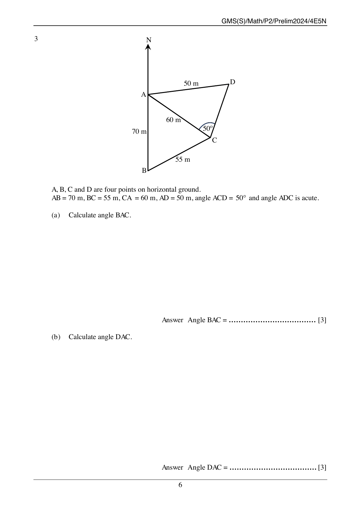
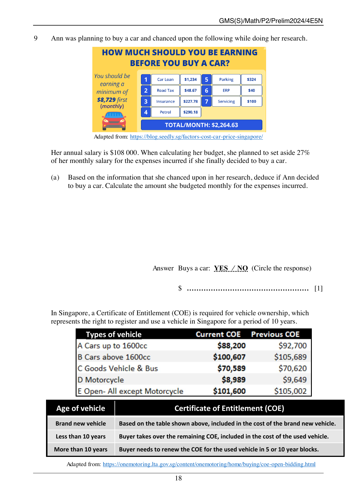

# Geylang Methodist School (Secondary) — Mathematics 4052/02 Paper 2 (cleaned)

> **Institution:** Geylang Methodist School (Secondary)
> **Exam:** Preliminary Examination 2024
> **Level:** Secondary 4 Express / Secondary 5 Normal (Academic)
> **Subjects:** Elementary Mathematics
> **Paper:** 4052/02 Paper 2
> **Date:** Thursday, 15 August 2024
> **Duration:** 2 hours 15 minutes
> **Total Marks:** 90
> **Source:** `GMSS_2024_4E5N_EM_P2_PRELIM.pdf`

---

## Instructions

Write your class, index number and name on all the work you hand in.
Write in dark blue or black pen.
You may use an HB pencil for any diagrams or graphs.
Do not use staples, paper clips, glue or correction fluid.

Answer all the questions.
The number of marks is given in brackets [ ] at the end of each question or part question.

If working is needed for any question it must be shown with the answer.
Omission of essential working will result in loss of marks.
The total of the marks for this paper is 90.

The use of an approved scientific calculator is expected, where appropriate.
If the degree of accuracy is not specified in the question and if the answer is not exact, give the answer to three significant figures. Give answers in degrees to one decimal place.
For $\pi$, use either your calculator value or $3.142$.

Candidates answer on the Question Paper.

Setter: Ms Nainee Ismail and Mr Kenneth Tan.

---

## Mathematical Formulae

*Compound interest*

$$\text{Total amount} = P\left(1 + \frac{r}{100}\right)^n$$

*Mensuration*

Curved surface area of a cone $= \pi r l$

Surface area of a sphere $= 4\pi r^2$

Volume of a cone $= \dfrac{1}{3}\pi r^2 h$

Volume of a sphere $= \dfrac{4}{3}\pi r^3$

Area of triangle $ABC = \dfrac{1}{2}ab \sin C$

Arc length $= r\theta$, where $\theta$ is in radians

Sector area $= \dfrac{1}{2} r^2 \theta$, where $\theta$ is in radians

*Trigonometry*

$$\frac{a}{\sin A} = \frac{b}{\sin B} = \frac{c}{\sin C}$$

$$a^2 = b^2 + c^2 - 2bc \cos A$$

*Statistics*

$$\text{Mean} = \frac{\Sigma fx}{\Sigma f}$$

$$\text{Standard deviation} = \sqrt{\frac{\Sigma fx^2}{\Sigma f} - \left(\frac{\Sigma fx}{\Sigma f}\right)^2}$$

---

### Q1

> **Marks:** 5

> **Page:** 3

A model of a thermos flask consists of a solid hemisphere attached to a solid cylinder as shown. The height of the cylinder is $14$ cm.

The curved surface area of the cylinder is twice the curved surface area of the hemisphere.

(a) Calculate the radius of the base of the cylinder. [2]
> **Topic:** G5 Mensuration
> **Sub-topic:** Mensuration
> **LO:** [[context/subjects/o-level-e-maths/learning-objectives/o-level-e-maths-G5c.md|G5c]]

(b) Calculate the height of the model of the thermos flask. [1]
> **Topic:** G5 Mensuration
> **Sub-topic:** Mensuration
> **LO:** [[context/subjects/o-level-e-maths/learning-objectives/o-level-e-maths-G5c.md|G5c]]

(c) Find the ratio volume of hemisphere : volume of cylinder. [2]
> **Topic:** G5 Mensuration
> **Sub-topic:** Mensuration
> **LO:** [[context/subjects/o-level-e-maths/learning-objectives/o-level-e-maths-G5c.md|G5c]]

---

### Q2

> **Marks:** 13

> **Page:** 4–5

(a) (i) Solve the inequalities $-9 < 5 - 4x \le 6$. [2]
> **Topic:** N7 Equations and inequalities
> **Sub-topic:** Equations and inequalities
> **LO:** [[context/subjects/o-level-e-maths/learning-objectives/o-level-e-maths-N7g.md|N7g]]

(ii) Write down all the integers that satisfy $-9 < 5 - 4x \le 6$. [1]
> **Topic:** N7 Equations and inequalities
> **Sub-topic:** Equations and inequalities
> **LO:** [[context/subjects/o-level-e-maths/learning-objectives/o-level-e-maths-N7g.md|N7g]]

(b)

$$y = \frac{5 - x^2}{x^2 + w}$$

(i) Evaluate the value of $y$ when $x = 2.41$ and $w = 1.908$. Write your answer correct to three decimal places. [2]
> **Topic:** N1 Numbers and their operations
> **Sub-topic:** Numbers and their operations
> **LO:** [[context/subjects/o-level-e-maths/learning-objectives/o-level-e-maths-N1g.md|N1g]]

(ii) Rearrange the formula to make $x$ the subject. [4]
> **Topic:** N5 Algebraic expressions and formulae
> **Sub-topic:** Algebraic expressions and formulae
> **LO:** [[context/subjects/o-level-e-maths/learning-objectives/o-level-e-maths-N5k.md|N5k]]

(c) Solve

$$\frac{6}{x - 1} - \frac{4 - x}{3 - x} = 1.$$

[4]
> **Topic:** N7 Equations and inequalities
> **Sub-topic:** Equations and inequalities
> **LO:** [[context/subjects/o-level-e-maths/learning-objectives/o-level-e-maths-N7g.md|N7g]]

---

### Q3

> **Marks:** 10

> **Page:** 6–7

$A$, $B$, $C$ and $D$ are four points on horizontal ground.
$AB = 70$ m, $BC = 55$ m, $CA = 60$ m, $AD = 50$ m, angle $ACD = 50^\circ$ and angle $ADC$ is acute.

(a) Calculate angle $BAC$. [3]
> **Topic:** G4 Pythagoras' theorem and trigonometry
> **Sub-topic:** Pythagoras' theorem and trigonometry
> **LO:** [[context/subjects/o-level-e-maths/learning-objectives/o-level-e-maths-G4g.md|G4g]]

(b) Calculate angle $DAC$. [3]
> **Topic:** G4 Pythagoras' theorem and trigonometry
> **Sub-topic:** Pythagoras' theorem and trigonometry
> **LO:** [[context/subjects/o-level-e-maths/learning-objectives/o-level-e-maths-G4g.md|G4g]]

(c) Calculate the bearing of $A$ from $D$. [2]
> **Topic:** G4 Pythagoras' theorem and trigonometry
> **Sub-topic:** Pythagoras' theorem and trigonometry
> **LO:** [[context/subjects/o-level-e-maths/learning-objectives/o-level-e-maths-G4g.md|G4g]]

(d) A man walks northwards from point $A$. A vertical pole is placed at point $D$. The greatest angle of elevation of the pole when viewed along this path is $7^\circ$. Calculate the height of the pole. [2]
> **Topic:** G4 Pythagoras' theorem and trigonometry
> **Sub-topic:** Pythagoras' theorem and trigonometry
> **LO:** [[context/subjects/o-level-e-maths/learning-objectives/o-level-e-maths-G4g.md|G4g]]

---

### Q4

> **Marks:** 10

> **Page:** 8–9

Mr Tan planned to travel to Kuala Lumpur for a family trip. Before the trip, he exchanged Singapore Dollars (S＄) for Malaysian Ringgit (RM). The exchange rate is S＄$1$ = RM $x$.

(a) Write down an expression, in terms of $x$, for the Singapore Dollars he exchanged if he received RM $2000$. [1]
> **Topic:** N1 Numbers and their operations
> **Sub-topic:** Numbers and their operations
> **LO:** [[context/subjects/o-level-e-maths/learning-objectives/o-level-e-maths-N1g.md|N1g]]

(b) After the trip, Mr Tan found out that he still had RM $300$. He exchanged the Malaysian Ringgit back to Singapore Dollars. The exchange rate is now S＄$1$ = RM $(x + 0.05)$. Write down an expression, in terms of $x$, for the Singapore Dollars he exchanged for RM $300$. [1]
> **Topic:** N1 Numbers and their operations
> **Sub-topic:** Numbers and their operations
> **LO:** [[context/subjects/o-level-e-maths/learning-objectives/o-level-e-maths-N1g.md|N1g]]

(c) Mr Tan used up S＄$485$ for the trip. Form an equation in $x$ and show that it reduces to

$$1940x^2 - 6703x - 400 = 0.$$

[3]
> **Topic:** N1 Numbers and their operations
> **Sub-topic:** Numbers and their operations
> **LO:** [[context/subjects/o-level-e-maths/learning-objectives/o-level-e-maths-N1g.md|N1g]]

(d) Solve the equation $1940x^2 - 6703x - 400 = 0$, giving your solutions correct to two decimal places. [3]
> **Topic:** N1 Numbers and their operations
> **Sub-topic:** Numbers and their operations
> **LO:** [[context/subjects/o-level-e-maths/learning-objectives/o-level-e-maths-N1g.md|N1g]]

(e) From your solution to part (d), state the exchange rate in the form S＄$1$ = RM $x$, to two decimal places, and hence, find the total amount of Singapore Dollars (S＄) he initially converted to Malaysian Ringgit (RM). [2]
> **Topic:** N1 Numbers and their operations
> **Sub-topic:** Numbers and their operations
> **LO:** [[context/subjects/o-level-e-maths/learning-objectives/o-level-e-maths-N1g.md|N1g]]

---

### Q5

> **Marks:** 10

> **Page:** 10–11

A shop sells two flavours of ice-cream, Raisins (R) and Chunkies (C) in three different sizes, small (S), medium (M) and large (L). The sales on two successive days are given in the table below.

| | Saturday small | Saturday medium | Saturday large | Sunday small | Sunday medium | Sunday large |
| --- | --- | --- | --- | --- | --- | --- |
| Number of cups sold (Raisins) | 12 | 17 | 8 | 14 | 12 | 10 |
| Number of cups sold (Chunkies) | 18 | 15 | 11 | 13 | 21 | 16 |

The information for Saturday’s sales can be represented by the matrix

$$M = \begin{pmatrix} 12 & 17 & 8 \\ 18 & 15 & 11 \end{pmatrix} \begin{matrix} R \\ C \end{matrix}$$

with columns S, M and L.

(a) Represent the information for Sunday’s sales in a $2 \times 3$ matrix $N$. [1]
> **Topic:** N9 Matrices
> **Sub-topic:** Matrices
> **LO:** [[context/subjects/o-level-e-maths/learning-objectives/o-level-e-maths-N9b.md|N9b]]

(b) The cost of each cup of ice-cream is ＄$2.50$ for small (S), ＄$3.20$ for medium (M) and ＄$4.50$ for large (L). Represent the cost of ice cream in a $3 \times 1$ matrix $C$. [1]
> **Topic:** N9 Matrices
> **Sub-topic:** Matrices
> **LO:** [[context/subjects/o-level-e-maths/learning-objectives/o-level-e-maths-N9b.md|N9b]]

(c) Evaluate the matrix $P = M + N$. [1]
> **Topic:** N9 Matrices
> **Sub-topic:** Matrices
> **LO:** [[context/subjects/o-level-e-maths/learning-objectives/o-level-e-maths-N9b.md|N9b]]

(d) State what the elements of $P$ represent. [1]
> **Topic:** N9 Matrices
> **Sub-topic:** Matrices
> **LO:** [[context/subjects/o-level-e-maths/learning-objectives/o-level-e-maths-N9b.md|N9b]]

(e) Evaluate the matrix $Q = \dfrac{1}{2} PC$. [2]
> **Topic:** N9 Matrices
> **Sub-topic:** Matrices
> **LO:** [[context/subjects/o-level-e-maths/learning-objectives/o-level-e-maths-N9b.md|N9b]]

(f) State what the elements of $Q$ represent. [1]
> **Topic:** N9 Matrices
> **Sub-topic:** Matrices
> **LO:** [[context/subjects/o-level-e-maths/learning-objectives/o-level-e-maths-N9b.md|N9b]]

(g) Evaluate the matrix $R = (1 \quad 1) PC$. [2]
> **Topic:** N9 Matrices
> **Sub-topic:** Matrices
> **LO:** [[context/subjects/o-level-e-maths/learning-objectives/o-level-e-maths-N9b.md|N9b]]

(h) State what the elements of $R$ represent. [1]
> **Topic:** N9 Matrices
> **Sub-topic:** Matrices
> **LO:** [[context/subjects/o-level-e-maths/learning-objectives/o-level-e-maths-N9b.md|N9b]]

---

### Q6

> **Marks:** 11

> **Page:** 12–13

The following diagram shows a solid which is made up of a cube whose edge is $x$ cm with a right square pyramid removed from the base of the cube. The pyramid has the same square base as the cube and its vertical height is $6$ cm.

(a) Show that the volume of the remaining solid, $y$, is $x^3 - 2x^2$. [1]
> **Topic:** N6 Functions and graphs
> **Sub-topic:** Functions and graphs
> **LO:** [[context/subjects/o-level-e-maths/learning-objectives/o-level-e-maths-N6c.md|N6c]]

(b) Complete the table of values for $y = x^3 - 2x^2$. Values are given to one decimal place where appropriate. [1]
> **Topic:** N6 Functions and graphs
> **Sub-topic:** Functions and graphs
> **LO:** [[context/subjects/o-level-e-maths/learning-objectives/o-level-e-maths-N6c.md|N6c]]

| $x$ | $0$ | $1$ | $1.5$ | $2$ | $3$ | $4$ | $5$ | $6$ | $6.5$ |
| --- | --- | --- | --- | --- | --- | --- | --- | --- | --- |
| $y$ | $0$ | | $-1.1$ | | $9$ | $32$ | $75$ | $144$ | $190.1$ |

(c) On the grid opposite, draw the graph of $y = x^3 - 2x^2$ for $0 \le x \le 6.5$. [3]
> **Topic:** N6 Functions and graphs
> **Sub-topic:** Functions and graphs
> **LO:** [[context/subjects/o-level-e-maths/learning-objectives/o-level-e-maths-N6c.md|N6c]]

(d) Use your graph to estimate the volume of the remaining solid when the pyramid has a base area of $24$ cm$^2$. [2]
> **Topic:** N6 Functions and graphs
> **Sub-topic:** Functions and graphs
> **LO:** [[context/subjects/o-level-e-maths/learning-objectives/o-level-e-maths-N6c.md|N6c]]

(e) (i) Use your graph, for $0 < x < 2$, to give a possible deduction on the volume of the remaining solid, $y$. [1]
> **Topic:** N6 Functions and graphs
> **Sub-topic:** Functions and graphs
> **LO:** [[context/subjects/o-level-e-maths/learning-objectives/o-level-e-maths-N6c.md|N6c]]

(ii) Suggest a suitable range of $x$ such that it is possible to remove a full right square pyramid from the cube. [1]
> **Topic:** N6 Functions and graphs
> **Sub-topic:** Functions and graphs
> **LO:** [[context/subjects/o-level-e-maths/learning-objectives/o-level-e-maths-N6c.md|N6c]]

(f) By drawing the line $y = ax + b$, solve the equation $-x^3 + 2x^2 + 15x + 20 = 0$. [2]
> **Topic:** N6 Functions and graphs
> **Sub-topic:** Functions and graphs
> **LO:** [[context/subjects/o-level-e-maths/learning-objectives/o-level-e-maths-N6c.md|N6c]]

---

### Q7

> **Marks:** 12

> **Page:** 14–15

(a) The point $P$ is $(5, -8)$ and the point $Q$ is $(-4, 7)$. The point $L$ is such that $\overrightarrow{QP} = \dfrac{1}{2}\overrightarrow{PL}$ and $O$ is the origin. Find $|\overrightarrow{OL}|$. [4]
> **Topic:** G7 Vectors in two dimensions
> **Sub-topic:** Vectors in two dimensions
> **LO:** [[context/subjects/o-level-e-maths/learning-objectives/o-level-e-maths-G7h.md|G7h]]

(b) In the diagram $\overrightarrow{OA} = \mathbf{a}$ and $\overrightarrow{OB} = \mathbf{b}$. $M$ is a point on $OB$ where $OB = 2MB$ and the point $N$ lies on $AB$ such that $3BN = 2BA$.

(i) Express $\overrightarrow{BN}$, as simply as possible, in terms of $\mathbf{a}$ and $\mathbf{b}$. [1]
> **Topic:** G7 Vectors in two dimensions
> **Sub-topic:** Vectors in two dimensions
> **LO:** [[context/subjects/o-level-e-maths/learning-objectives/o-level-e-maths-G7h.md|G7h]]

(ii) Express $\overrightarrow{MN}$, as simply as possible, in terms of $\mathbf{a}$ and $\mathbf{b}$. [2]
> **Topic:** G7 Vectors in two dimensions
> **Sub-topic:** Vectors in two dimensions
> **LO:** [[context/subjects/o-level-e-maths/learning-objectives/o-level-e-maths-G7h.md|G7h]]

(iii) The point $P$ lies on $OA$ produced such that $OA : OP = 1 : 2$. Determine whether the points $M$, $N$ and $P$ are collinear. Justify your answer. [2]
> **Topic:** G7 Vectors in two dimensions
> **Sub-topic:** Vectors in two dimensions
> **LO:** [[context/subjects/o-level-e-maths/learning-objectives/o-level-e-maths-G7h.md|G7h]]

(iv) The point $Q$ is such that $k\overrightarrow{BQ} = \mathbf{a}$ and $ONQ$ is a straight line. Write down the value of $k$. [2]
> **Topic:** G7 Vectors in two dimensions
> **Sub-topic:** Vectors in two dimensions
> **LO:** [[context/subjects/o-level-e-maths/learning-objectives/o-level-e-maths-G7h.md|G7h]]

(v) Find the ratio area of triangle $BMN$ : area of triangle $OBA$. [1]
> **Topic:** G7 Vectors in two dimensions
> **Sub-topic:** Vectors in two dimensions
> **LO:** [[context/subjects/o-level-e-maths/learning-objectives/o-level-e-maths-G7h.md|G7h]]

---

### Q8

> **Marks:** 9

> **Page:** 16–17

The cumulative frequency curve shows the distribution of the test scores of a group of $80$ students.

(a) Use the curve to estimate

(i) the 65th percentile, Prelim 2008 q11 [1]
> **Topic:** S1 Data handling and analysis
> **Sub-topic:** Data handling and analysis
> **LO:** [[context/subjects/o-level-e-maths/learning-objectives/o-level-e-maths-S1i.md|S1i]]

(ii) the interquartile range. [2]
> **Topic:** S1 Data handling and analysis
> **Sub-topic:** Data handling and analysis
> **LO:** [[context/subjects/o-level-e-maths/learning-objectives/o-level-e-maths-S1i.md|S1i]]

(b) (i) Complete the table by using the estimations from the curve. [2]
> **Topic:** S1 Data handling and analysis
> **Sub-topic:** Data handling and analysis
> **LO:** [[context/subjects/o-level-e-maths/learning-objectives/o-level-e-maths-S1i.md|S1i]]

| | |
| --- | --- |
| Lowest Score | |
| Lower Quartile | |
| Median | |
| Upper Quartile | |
| Highest Score | |

(ii) The distribution of the scores of the $80$ students is represented in a box-and-whisker plot below, where $k$ is a constant. Do you agree with the representation? Provide justifications by using your answer from part (b)(i). [2]
> **Topic:** S1 Data handling and analysis
> **Sub-topic:** Data handling and analysis
> **LO:** [[context/subjects/o-level-e-maths/learning-objectives/o-level-e-maths-S1i.md|S1i]]

(c) Students who scored $33$ marks and below are required to attend remedial. A student is selected at random from the group. Find the probability that the student selected is not required to attend remedial. [2]
> **Topic:** S2 Probability
> **Sub-topic:** Probability
> **LO:** [[context/subjects/o-level-e-maths/learning-objectives/o-level-e-maths-S2c.md|S2c]]

---

### Q9

> **Marks:** 10

> **Page:** 18–20

Ann was planning to buy a car and chanced upon the following while doing her research.

The infographic states that you should be earning a minimum of ＄$8{,}729$ first (monthly). Its monthly items are car loan ＄$1{,}234$, road tax ＄$48.67$, insurance ＄$227.78$, petrol ＄$290.18$, parking ＄$324$, ERP ＄$40$ and servicing ＄$100$, with a total per month of ＄$2{,}264.63$. Adapted from https://blog.seedly.sg/factors-cost-car-price-singapore/.

Her annual salary is ＄$108\,000$. When calculating her budget, she planned to set aside $27\%$ of her monthly salary for the expenses incurred if she finally decided to buy a car.

(a) Based on the information that she chanced upon in her research, deduce if Ann decided to buy a car. Calculate the amount she budgeted monthly for the expenses incurred. [1]
> **Topic:** S2 Probability
> **Sub-topic:** Probability
> **LO:** [[context/subjects/o-level-e-maths/learning-objectives/o-level-e-maths-S2c.md|S2c]]

In Singapore, a Certificate of Entitlement (COE) is required for vehicle ownership, which represents the right to register and use a vehicle in Singapore for a period of $10$ years.

| Types of vehicle | Current COE | Previous COE |
| --- | --- | --- |
| A Cars up to 1600cc | ＄$88{,}200$ | ＄$92{,}700$ |
| B Cars above 1600cc | ＄$100{,}607$ | ＄$105{,}689$ |
| C Goods Vehicle & Bus | ＄$70{,}589$ | ＄$70{,}620$ |
| D Motorcycle | ＄$8{,}989$ | ＄$9{,}649$ |
| E Open- All except Motorcycle | ＄$101{,}600$ | ＄$105{,}002$ |

| Age of vehicle | Certificate of Entitlement (COE) |
| --- | --- |
| Brand new vehicle | Based on the table shown above, included in the cost of the brand new vehicle. |
| Less than 10 years | Buyer takes over the remaining COE, included in the cost of the used vehicle. |
| More than 10 years | Buyer needs to renew the COE for the used vehicle in 5 or 10 year blocks. |

Adapted from https://onemotoring.lta.gov.sg/content/onemotoring/home/buying/coe-open-bidding.html.

Ann approached a car dealer who recommended two different packages for a used and a new car based on Ann’s needs and preferences. Ann decided to take a loan for the purchase of the car after placing a downpayment from her savings. She planned to repay the loan monthly.

| Details of package | Used car | New car |
| --- | --- | --- |
| Engine Capacity | 1800 cc | 1500 cc |
| Total Cost | S＄$98\,000$ | S＄$150\,000$ |
| Downpayment | $40\%$ | $30\%$ |
| Intended loan period | 5 years | 5 years |
| Type of interest (per annum) | Years 1 and 2: simple interest $2.28\%$. Year 3 onwards: simple interest $3\%$ | Simple interest at $2.88\%$ |

She collated all the other expenses that come with owning a car:

| Other expenses | Used car | New car |
| --- | --- | --- |
| Monthly parking fees | ＄$110$ | ＄$110$ |
| Monthly petrol expenditure | ＄$340$ | ＄$270$ |
| Annual Electronic Road Pricing (ERP) | ＄$360$ | ＄$360$ |
| Annual Insurance | ＄$1800$ | ＄$1600$ |
| Car maintenance (every 6 months) | ＄$650$ per maintenance | ＄$500$ per maintenance |

The road tax of the car is calculated in dollars based on its engine capacity:

| Engine Capacity (EC) (in cc) | Road Tax Formula (per annum) |
| --- | --- |
| $EC \le 600$ | ＄$200 \times 0.782$ |
| $600 < EC \le 1000$ | $[＄200 + ＄0.125 \times (EC - 600)] \times 0.782$ |
| $1000 < EC \le 1600$ | $[＄250 + ＄0.375 \times (EC - 1000)] \times 0.782$ |
| $1600 < EC \le 3000$ | $[＄475 + ＄0.75 \times (EC - 1600)] \times 0.782$ |
| $EC > 3000$ | $[＄1525 + ＄1.00 \times (EC - 3000)] \times 0.782$ |

(b) Calculate the annual road tax for the

(i) used car, [1]
> **Topic:** S2 Probability
> **Sub-topic:** Probability
> **LO:** [[context/subjects/o-level-e-maths/learning-objectives/o-level-e-maths-S2c.md|S2c]]

(ii) new car. [1]
> **Topic:** S2 Probability
> **Sub-topic:** Probability
> **LO:** [[context/subjects/o-level-e-maths/learning-objectives/o-level-e-maths-S2c.md|S2c]]

(c) Determine which car Ann should purchase based on her monthly budget for all the expenses incurred in owning a car (including road tax). Justify the decision you make and show your calculations clearly. [7]
> **Topic:** S2 Probability
> **Sub-topic:** Probability
> **LO:** [[context/subjects/o-level-e-maths/learning-objectives/o-level-e-maths-S2c.md|S2c]]
