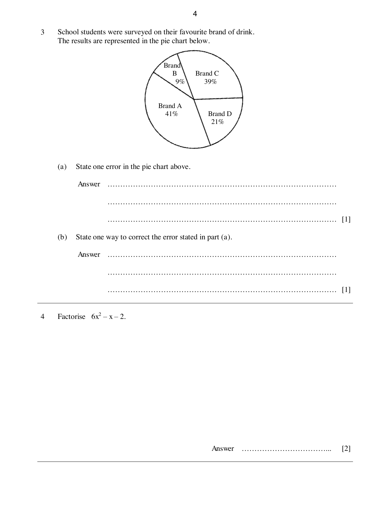
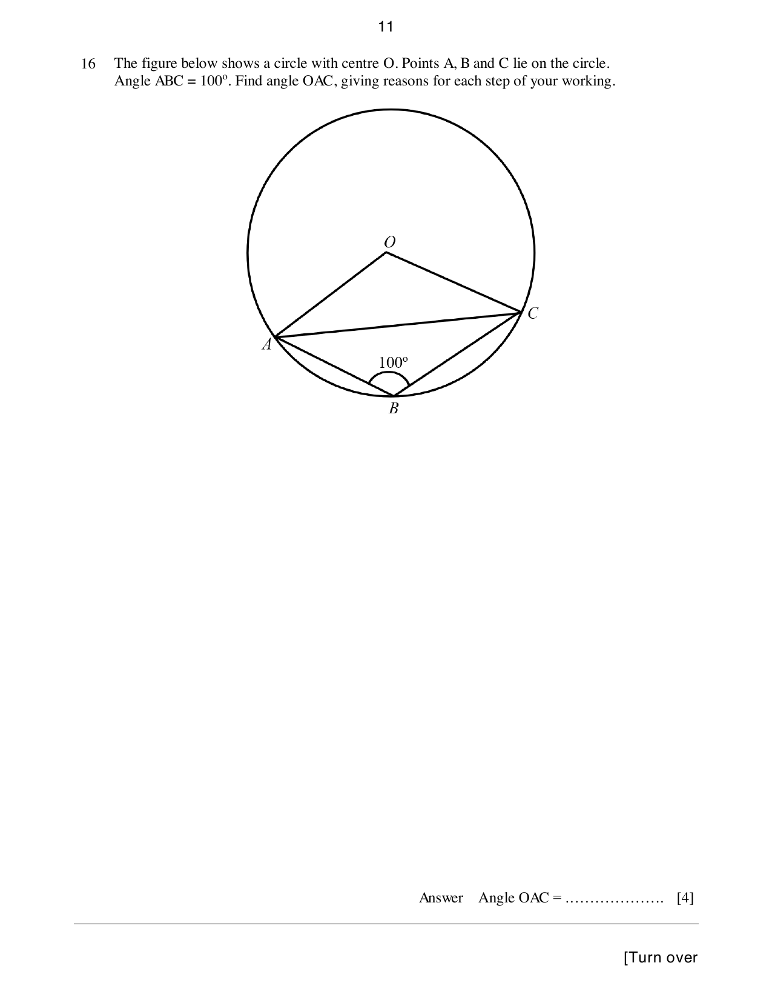
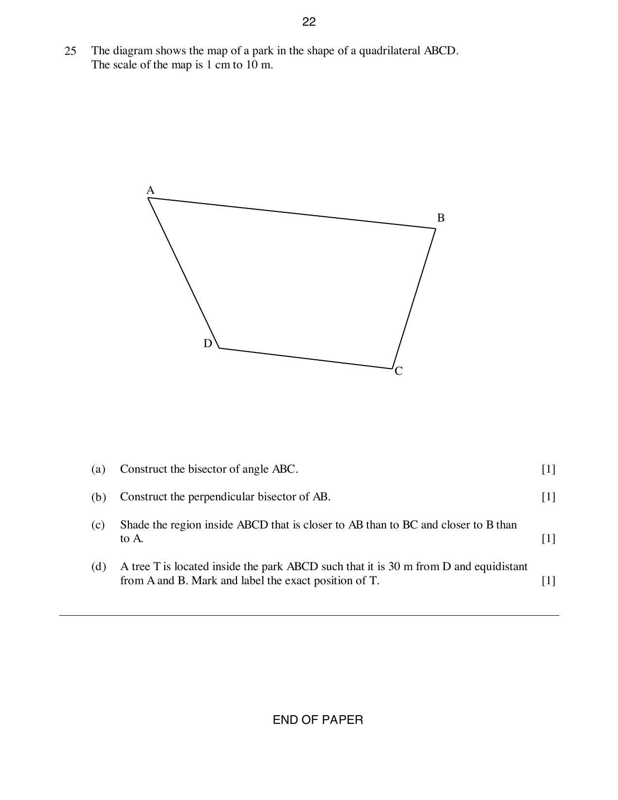

# Greenridge Secondary School — Mathematics 4052/01 Paper 1 (cleaned)

> **Institution:** Greenridge Secondary School
> **Exam:** Preliminary Examination 2024
> **Level:** Secondary 4 Express / 5 Normal (Academic)
> **Subjects:** Elementary Mathematics
> **Paper:** 4052/01 Paper 1
> **Date:** 22 August 2024
> **Duration:** 2 hours 15 minutes
> **Total Marks:** 90
> **Source:** `2024 GSS 4E Math Prelim Paper 1 FINAL.pdf`

---

## Instructions

Write your class, index number and name on all the work you hand in.
Write in dark blue or black pen.
You may use an HB pencil for any diagrams or graphs.
Do not use staples, paper clips, glue or correction fluid.

Answer all questions.
If working is needed for any question it must be shown with the answer.
Omission of essential working will result in loss of marks.
The use of an approved scientific calculator is expected, where appropriate.
If the degree of accuracy is not specified in the question, and if the answer is not exact, give the answer to three significant figures. Give answers in degrees to one decimal place.
For $\pi$, use either your calculator value or $3.142$, unless the question requires the answer in terms of $\pi$.

The number of marks is given in brackets [ ] at the end of each question or part question.
The total of the marks for this paper is 90.

---

## Mathematical Formulae

*Compound interest*

$$
\text{Total amount} = P\left(1+\frac{r}{100}\right)^{n}
$$

*Mensuration*

$$
\text{Curved surface area of a cone} = \pi rl
$$

$$
\text{Surface area of a sphere} = 4\pi r^{2}
$$

$$
\text{Volume of a cone} = \frac{1}{3}\pi r^{2}h
$$

$$
\text{Volume of a sphere} = \frac{4}{3}\pi r^{3}
$$

$$
\text{Area of triangle } ABC = \frac{1}{2}ab\sin C
$$

$$
\text{Arc length} = r\theta,\text{ where }\theta\text{ is in radians}
$$

$$
\text{Sector area} = \frac{1}{2}r^{2}\theta,\text{ where }\theta\text{ is in radians}
$$

*Trigonometry*

$$
\frac{a}{\sin A} = \frac{b}{\sin B} = \frac{c}{\sin C}
$$

$$
a^{2} = b^{2}+c^{2}-2bc\cos A
$$

*Statistics*

$$
\text{Mean} = \frac{\sum fx}{\sum f}
$$

$$
\text{Standard deviation} = \sqrt{\frac{\sum fx^{2}}{\sum f}-\left(\frac{\sum fx}{\sum f}\right)^{2}}
$$

---

### Q1

> **Marks:** 2
> **Page:** 3

(a) Calculate $\dfrac{\sqrt[3]{123^{2}}}{\dfrac{3}{5.01}+2}$. [1]
> **Topic:** N1 Numbers and their operations
> **Sub-topic:** Numbers and their operations
> **LO:** [[context/subjects/o-level-e-maths/learning-objectives/o-level-e-maths-N1g.md|N1g]]

(b) An item costs ＄24 when rounded off to the nearest dollar. What is the maximum possible price of the item? [1]
> **Topic:** N1 Numbers and their operations
> **Sub-topic:** Numbers and their operations
> **LO:** [[context/subjects/o-level-e-maths/learning-objectives/o-level-e-maths-N1g.md|N1g]]

### Q2

> **Marks:** 4
> **Page:** 3

(a) Given that $9^{12} = 27^{x}$, find $x$. [2]
> **Topic:** N5 Algebraic expressions and formulae
> **Sub-topic:** Algebraic expressions and formulae
> **LO:** [[context/subjects/o-level-e-maths/learning-objectives/o-level-e-maths-N5m.md|N5m]]

(b) The number of people owning cars in a country increased by $p\%$ every year, from 5000 in the year 2020, to 6500 in the year 2024. Find the value of $p$. [2]
> **Topic:** N5 Algebraic expressions and formulae
> **Sub-topic:** Algebraic expressions and formulae
> **LO:** [[context/subjects/o-level-e-maths/learning-objectives/o-level-e-maths-N5m.md|N5m]]

### Q3

> **Marks:** 2
> **Page:** 4

School students were surveyed on their favourite brand of drink. The results are represented in the pie chart below.

The printed percentages are Brand A $41\%$, Brand B $9\%$, Brand C $39\%$ and Brand D $21\%$.

(a) State one error in the pie chart above. [1]
> **Topic:** S1 Data handling and analysis
> **Sub-topic:** Data handling and analysis
> **LO:** [[context/subjects/o-level-e-maths/learning-objectives/o-level-e-maths-S1b.md|S1b]]

(b) State one way to correct the error stated in part (a). [1]
> **Topic:** S1 Data handling and analysis
> **Sub-topic:** Data handling and analysis
> **LO:** [[context/subjects/o-level-e-maths/learning-objectives/o-level-e-maths-S1b.md|S1b]]

### Q4

> **Marks:** 2
> **Topic:** N5 Algebraic expressions and formulae
> **Sub-topic:** Algebraic expressions and formulae
> **LO:** [[context/subjects/o-level-e-maths/learning-objectives/o-level-e-maths-N5h.md|N5h]]
> **Page:** 4

Factorise $6x^{2}-x-2$. [2]

### Q5

> **Marks:** 2
> **Topic:** N6 Functions and graphs
> **Sub-topic:** Functions and graphs
> **LO:** [[context/subjects/o-level-e-maths/learning-objectives/o-level-e-maths-N6g.md|N6g]]
> **Page:** 5

Write $\dfrac{2}{x-2}-\dfrac{3}{2x+1}$ as a single fraction in its simplest form. [2]

### Q6

> **Marks:** 2
> **Topic:** S1 Data handling and analysis
> **Sub-topic:** Data handling and analysis
> **LO:** [[context/subjects/o-level-e-maths/learning-objectives/o-level-e-maths-S1f.md|S1f]]
> **Page:** 5

Six positive integers have a mean of 15, a median of 15 and a mode of 16. The range of these numbers is 7. Find the six numbers. [2]

### Q7

> **Marks:** 2
> **Topic:** N7 Equations and inequalities
> **Sub-topic:** Equations and inequalities
> **LO:** [[context/subjects/o-level-e-maths/learning-objectives/o-level-e-maths-N7g.md|N7g]]
> **Page:** 5

Solve the inequality $\dfrac{2x-3}{4} \leq \dfrac{5-x}{5}$. [2]

### Q8

> **Marks:** 2
> **Page:** 6

(a) Convert $40^{\circ}$ into radians. Leave your answers in terms of $\pi$. [1]
> **Topic:** G4 Pythagoras' theorem and trigonometry
> **Sub-topic:** Pythagoras' theorem and trigonometry
> **LO:** [[context/subjects/o-level-e-maths/learning-objectives/o-level-e-maths-G4a.md|G4a]]

(b) Convert $23\text{ km/h}$ into m/s. [1]
> **Topic:** G4 Pythagoras' theorem and trigonometry
> **Sub-topic:** Pythagoras' theorem and trigonometry
> **LO:** [[context/subjects/o-level-e-maths/learning-objectives/o-level-e-maths-G4a.md|G4a]]

### Q9

> **Marks:** 2
> **Topic:** G5 Mensuration
> **Sub-topic:** Mensuration
> **LO:** [[context/subjects/o-level-e-maths/learning-objectives/o-level-e-maths-G5c.md|G5c]]
> **Page:** 6

Calculate the total surface area of a solid hemisphere with radius $6\text{ cm}$. [2]

### Q10

> **Marks:** 3
> **Topic:** N5 Algebraic expressions and formulae
> **Sub-topic:** Algebraic expressions and formulae
> **LO:** [[context/subjects/o-level-e-maths/learning-objectives/o-level-e-maths-N5k.md|N5k]]
> **Page:** 7

$2c+b = \dfrac{b-c}{a}$.

Rearrange the formula to make $b$ the subject. [3]

### Q11

> **Marks:** 3
> **Topic:** G3 Properties of circles
> **Sub-topic:** Properties of circles
> **LO:** [[context/subjects/o-level-e-maths/learning-objectives/o-level-e-maths-G3b.md|G3b]]
> **Page:** 7

Triangle $ABC$ is such that $AB = 16\text{ cm}$, $BC = 63\text{ cm}$, $AC = 65\text{ cm}$. Do points $A$, $B$ and $C$ lie on the circumference of a circle? Explain with working. [3]

### Q12

> **Marks:** 4
> **Page:** 8

(a) Factorise $a^{2}b^{4}-ab^{2}$. [1]
> **Topic:** N5 Algebraic expressions and formulae
> **Sub-topic:** Algebraic expressions and formulae
> **LO:** [[context/subjects/o-level-e-maths/learning-objectives/o-level-e-maths-N5h.md|N5h]]

(b) Expand and simplify $(3x+2)^{2}+4x(2-x)$. [3]
> **Topic:** N5 Algebraic expressions and formulae
> **Sub-topic:** Algebraic expressions and formulae
> **LO:** [[context/subjects/o-level-e-maths/learning-objectives/o-level-e-maths-N5j.md|N5j]]

### Q13

> **Marks:** 3
> **Page:** 8

(a) Find the area of a regular hexagon with each side $7\text{ cm}$. [2]
> **Topic:** G1 Angles, triangles and polygons
> **Sub-topic:** Angles, triangles and polygons
> **LO:** [[context/subjects/o-level-e-maths/learning-objectives/o-level-e-maths-G1f.md|G1f]]

(b) Find the interior angle of a regular 15-sided polygon. [1]
> **Topic:** G1 Angles, triangles and polygons
> **Sub-topic:** Angles, triangles and polygons
> **LO:** [[context/subjects/o-level-e-maths/learning-objectives/o-level-e-maths-G1f.md|G1f]]

### Q14

> **Marks:** 4
> **Page:** 9

(a) $y$ is directly proportional to $\sqrt[3]{x}$. Find the percentage increase of $y$ when $x$ increases by $700\%$. [2]
> **Topic:** N3 Percentage
> **Sub-topic:** Percentage
> **LO:** [[context/subjects/o-level-e-maths/learning-objectives/o-level-e-maths-N3d.md|N3d]]

(b) 6 men took 50 hours to paint a mural wall. How long does it take for 4 men to paint the same wall? [2]
> **Topic:** N3 Percentage
> **Sub-topic:** Percentage
> **LO:** [[context/subjects/o-level-e-maths/learning-objectives/o-level-e-maths-N3d.md|N3d]]

### Q15

> **Marks:** 4
> **Page:** 10

A bag contains some green counters, some orange counters and some yellow counters. The probability of picking a green counter at random is $0.2$. The probability of picking an orange counter at random is $0.1$ more than the probability of choosing a yellow counter at random.

(a) Show that the probability of picking a yellow counter at random is $0.35$. [1]
> **Topic:** S2 Probability
> **Sub-topic:** Probability
> **LO:** [[context/subjects/o-level-e-maths/learning-objectives/o-level-e-maths-S2c.md|S2c]]

(b) If there are 14 yellow counters, how many counters are there altogether? [2]
> **Topic:** S2 Probability
> **Sub-topic:** Probability
> **LO:** [[context/subjects/o-level-e-maths/learning-objectives/o-level-e-maths-S2c.md|S2c]]

(c) If 3 orange counters are removed, what is the new probability of picking a yellow counter at random? [1]
> **Topic:** S2 Probability
> **Sub-topic:** Probability
> **LO:** [[context/subjects/o-level-e-maths/learning-objectives/o-level-e-maths-S2c.md|S2c]]

### Q16

> **Marks:** 4
> **Topic:** G3 Properties of circles
> **Sub-topic:** Properties of circles
> **LO:** [[context/subjects/o-level-e-maths/learning-objectives/o-level-e-maths-G3b.md|G3b]]
> **Page:** 11

The figure below shows a circle with centre $O$. Points $A$, $B$ and $C$ lie on the circle. Angle $ABC = 100^{\circ}$. Find angle $OAC$, giving reasons for each step of your working.

[4]

### Q17

> **Marks:** 5
> **Page:** 12

(a) These are the first four terms of a sequence.

$$
2,\quad 6,\quad 10,\quad 14
$$

Find an expression, in terms of $n$, for the $n$th term of the sequence. [1]
> **Topic:** N5 Algebraic expressions and formulae
> **Sub-topic:** Algebraic expressions and formulae
> **LO:** [[context/subjects/o-level-e-maths/learning-objectives/o-level-e-maths-N5e.md|N5e]]

(b) One term in the sequence is 82. Find the value of $n$ for this term. [1]
> **Topic:** N5 Algebraic expressions and formulae
> **Sub-topic:** Algebraic expressions and formulae
> **LO:** [[context/subjects/o-level-e-maths/learning-objectives/o-level-e-maths-N5e.md|N5e]]

(c) Explain why 360 is not a term of this sequence. [1]
> **Topic:** N5 Algebraic expressions and formulae
> **Sub-topic:** Algebraic expressions and formulae
> **LO:** [[context/subjects/o-level-e-maths/learning-objectives/o-level-e-maths-N5e.md|N5e]]

(d) The sum of the first $n$ terms of another sequence is $-4n^{2}+54n$. Find the 8th term of this sequence. [2]
> **Topic:** N5 Algebraic expressions and formulae
> **Sub-topic:** Algebraic expressions and formulae
> **LO:** [[context/subjects/o-level-e-maths/learning-objectives/o-level-e-maths-N5e.md|N5e]]

### Q18

> **Marks:** 6
> **Page:** 13

(a) $x^{2}-4x+5 = (x-a)^{2}+b$. Find the value of $a$ and of $b$. [2]
> **Topic:** G6 Coordinate geometry
> **Sub-topic:** Coordinate geometry
> **LO:** [[context/subjects/o-level-e-maths/learning-objectives/o-level-e-maths-G6c.md|G6c]]

(b) The curve $y = x^{2}-4x+5$ is drawn. Write down the equation of the line of symmetry of the curve. [1]
> **Topic:** G6 Coordinate geometry
> **Sub-topic:** Coordinate geometry
> **LO:** [[context/subjects/o-level-e-maths/learning-objectives/o-level-e-maths-G6c.md|G6c]]

(c) Sketch the curve $y = x^{2}-4x+5$ on the axes below. Indicate clearly the coordinates of the points where the graph crosses the axes and the minimum point on the curve. [3]
> **Topic:** G6 Coordinate geometry
> **Sub-topic:** Coordinate geometry
> **LO:** [[context/subjects/o-level-e-maths/learning-objectives/o-level-e-maths-G6c.md|G6c]]

### Q19

> **Marks:** 4
> **Topic:** N7 Equations and inequalities
> **Sub-topic:** Equations and inequalities
> **LO:** [[context/subjects/o-level-e-maths/learning-objectives/o-level-e-maths-N7c.md|N7c]]
> **Page:** 14

Siti has $x$ number of ＄5 notes. Aisha has $y$ number of ＄2 notes. They have a total of 30 notes with total value ＄111. Form and solve two simultaneous equations to calculate the amount of money Siti has. [4]

### Q20

> **Marks:** 4
> **Page:** 15

The number of customers, $c$, served in a day at a counter for 40 days are given below.

| Number of customers $c$ | $0 < c \leq 5$ | $5 < c \leq 10$ | $10 < c \leq 15$ | $15 < c \leq 20$ |
| --- | --- | --- | --- | --- |
| Frequency | 11 | 18 | 9 | 2 |

(a) Calculate the mean number of customers served. [1]
> **Topic:** S1 Data handling and analysis
> **Sub-topic:** Data handling and analysis
> **LO:** [[context/subjects/o-level-e-maths/learning-objectives/o-level-e-maths-S1f.md|S1f]]

(b) Calculate the standard deviation. [1]
> **Topic:** S1 Data handling and analysis
> **Sub-topic:** Data handling and analysis
> **LO:** [[context/subjects/o-level-e-maths/learning-objectives/o-level-e-maths-S1k.md|S1k]]

(c) If 3 more customers were added to the counter each day, how would the mean and standard deviation be affected by this change? [2]
> **Topic:** S1 Data handling and analysis
> **Sub-topic:** Data handling and analysis
> **LO:** [[context/subjects/o-level-e-maths/learning-objectives/o-level-e-maths-S1f.md|S1f]]

### Q21

> **Marks:** 5
> **Page:** 16

(a) Express 5500 as a product of its prime factors. [1]
> **Topic:** N1 Numbers and their operations
> **Sub-topic:** Numbers and their operations
> **LO:** [[context/subjects/o-level-e-maths/learning-objectives/o-level-e-maths-N1b.md|N1b]]

(b) The number $\dfrac{5500p}{q}$ is a perfect cube. $p$ and $q$ are prime numbers. Find the value of $p$ and the value of $q$. [2]
> **Topic:** N1 Numbers and their operations
> **Sub-topic:** Numbers and their operations
> **LO:** [[context/subjects/o-level-e-maths/learning-objectives/o-level-e-maths-N1b.md|N1b]]

(c) Bus A takes 50 minutes to complete a route. Bus B takes 1 hour to complete the same route. Bus C takes 75 minutes to complete the same route. All 3 buses left the same bus stop at 6 am one morning. What time will all 3 buses meet again? [2]
> **Topic:** N1 Numbers and their operations
> **Sub-topic:** Numbers and their operations
> **LO:** [[context/subjects/o-level-e-maths/learning-objectives/o-level-e-maths-N1b.md|N1b]]

### Q22

> **Marks:** 4
> **Page:** 17

$A$, $B$ and $C$ are three points on horizontal ground. The bearing of $A$ from $B$ is $040^{\circ}$.

(a) Find the bearing of $B$ from $A$. [2]
> **Topic:** G4 Pythagoras' theorem and trigonometry
> **Sub-topic:** Pythagoras' theorem and trigonometry
> **LO:** [[context/subjects/o-level-e-maths/learning-objectives/o-level-e-maths-G4g.md|G4g]]

(b) Find the bearing of $C$ from $A$. [2]
> **Topic:** G4 Pythagoras' theorem and trigonometry
> **Sub-topic:** Pythagoras' theorem and trigonometry
> **LO:** [[context/subjects/o-level-e-maths/learning-objectives/o-level-e-maths-G4g.md|G4g]]

### Q23

> **Marks:** 7
> **Page:** 18–19

A concert offers three types of seating areas, $A$, $B$ and $C$, for Saturday and Sunday. The numbers of tickets sold for each type of seating area on each of these days in a particular week are shown in the following table.

| | $A$ | $B$ | $C$ |
| --- | --- | --- | --- |
| Saturday | 1100 | 1000 | 1200 |
| Sunday | 1400 | 1200 | 1300 |

(a) The information in the table can be represented by a $2 \times 3$ matrix $S$. Write down the matrix $S$. [1]
> **Topic:** N9 Matrices
> **Sub-topic:** Matrices
> **LO:** [[context/subjects/o-level-e-maths/learning-objectives/o-level-e-maths-N9b.md|N9b]]

(b) Each ticket for type $A$, $B$ and $C$ seating area costs ＄110, ＄80 and ＄$x$ respectively. Write down a $3 \times 1$ matrix $P$ to represent this information. [1]
> **Topic:** N9 Matrices
> **Sub-topic:** Matrices
> **LO:** [[context/subjects/o-level-e-maths/learning-objectives/o-level-e-maths-N9b.md|N9b]]

(c) Find, in terms of $x$, the matrix $T = SP$. [2]
> **Topic:** N9 Matrices
> **Sub-topic:** Matrices
> **LO:** [[context/subjects/o-level-e-maths/learning-objectives/o-level-e-maths-N9b.md|N9b]]

(d) Explain what is represented by the elements of matrix $T$. [1]
> **Topic:** N9 Matrices
> **Sub-topic:** Matrices
> **LO:** [[context/subjects/o-level-e-maths/learning-objectives/o-level-e-maths-N9b.md|N9b]]

(e) The company collected ＄688 500 from the sale of tickets for the weekend. Find the value of $x$. [2]
> **Topic:** N9 Matrices
> **Sub-topic:** Matrices
> **LO:** [[context/subjects/o-level-e-maths/learning-objectives/o-level-e-maths-N9b.md|N9b]]

### Q24

> **Marks:** 6
> **Page:** 20–21

The triangle with vertices $A(2, 5)$, $B(-2, -3)$ and $C(2, -2)$ is shown in the diagram below. $AC$ is vertical.

Find

(a) the area of triangle $ABC$, [1]
> **Topic:** G6 Coordinate geometry
> **Sub-topic:** Coordinate geometry
> **LO:** [[context/subjects/o-level-e-maths/learning-objectives/o-level-e-maths-G6c.md|G6c]]

(b) the coordinates of point $D$ such that $ABCD$ is a parallelogram, [1]
> **Topic:** G6 Coordinate geometry
> **Sub-topic:** Coordinate geometry
> **LO:** [[context/subjects/o-level-e-maths/learning-objectives/o-level-e-maths-G6c.md|G6c]]

(c) the area of parallelogram $ABCD$, [1]
> **Topic:** G6 Coordinate geometry
> **Sub-topic:** Coordinate geometry
> **LO:** [[context/subjects/o-level-e-maths/learning-objectives/o-level-e-maths-G6c.md|G6c]]

(d) angle $BAC$, [1]
> **Topic:** G6 Coordinate geometry
> **Sub-topic:** Coordinate geometry
> **LO:** [[context/subjects/o-level-e-maths/learning-objectives/o-level-e-maths-G6c.md|G6c]]

(e) the gradient of line $AC$, [1]
> **Topic:** G6 Coordinate geometry
> **Sub-topic:** Coordinate geometry
> **LO:** [[context/subjects/o-level-e-maths/learning-objectives/o-level-e-maths-G6c.md|G6c]]

(f) the cosine value of angle $BCA$ in terms of $p$, where $p = BC$. [1]
> **Topic:** G6 Coordinate geometry
> **Sub-topic:** Coordinate geometry
> **LO:** [[context/subjects/o-level-e-maths/learning-objectives/o-level-e-maths-G6c.md|G6c]]

### Q25

> **Marks:** 4
> **Page:** 22

The diagram shows the map of a park in the shape of a quadrilateral $ABCD$. The scale of the map is $1\text{ cm}$ to $10\text{ m}$.

(a) Construct the bisector of angle $ABC$. [1]
> **Topic:** G2 Congruence and similarity
> **Sub-topic:** Congruence and similarity
> **LO:** [[context/subjects/o-level-e-maths/learning-objectives/o-level-e-maths-G2e.md|G2e]]

(b) Construct the perpendicular bisector of $AB$. [1]
> **Topic:** G2 Congruence and similarity
> **Sub-topic:** Congruence and similarity
> **LO:** [[context/subjects/o-level-e-maths/learning-objectives/o-level-e-maths-G2e.md|G2e]]

(c) Shade the region inside $ABCD$ that is closer to $AB$ than to $BC$ and closer to $B$ than to $A$. [1]
> **Topic:** G2 Congruence and similarity
> **Sub-topic:** Congruence and similarity
> **LO:** [[context/subjects/o-level-e-maths/learning-objectives/o-level-e-maths-G2e.md|G2e]]

(d) A tree $T$ is located inside the park $ABCD$ such that it is $30\text{ m}$ from $D$ and equidistant from $A$ and $B$. Mark and label the exact position of $T$. [1]
> **Topic:** G2 Congruence and similarity
> **Sub-topic:** Congruence and similarity
> **LO:** [[context/subjects/o-level-e-maths/learning-objectives/o-level-e-maths-G2e.md|G2e]]
