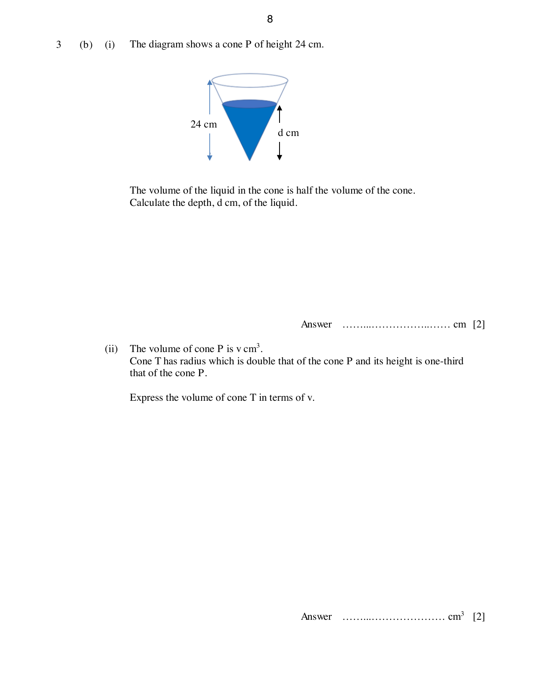
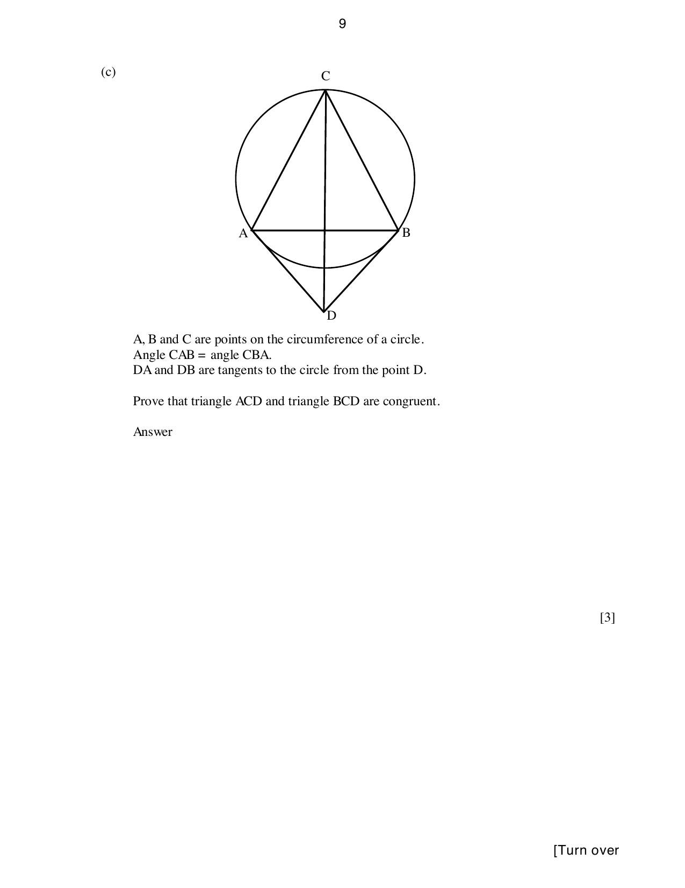
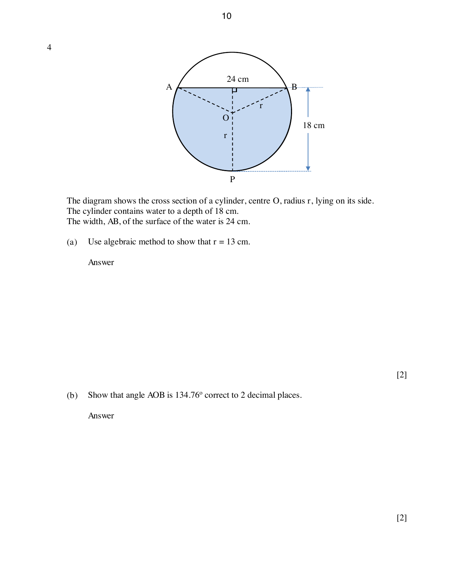

# Greenridge Secondary School — Mathematics 4052/02 Paper 2 (cleaned)

> **Institution:** Greenridge Secondary School
> **Exam:** Preliminary Examination 2024
> **Level:** Secondary 4 Express / 5 Normal (Academic)
> **Subjects:** Elementary Mathematics
> **Paper:** 4052/02 Paper 2
> **Date:** 23 August 2024
> **Duration:** 2 hours 15 minutes
> **Total Marks:** 90
> **Source:** `2024 GSS 4E5N Prelim Paper 2 (as on 5 Aug) -.pdf`

---

## Instructions

Write your class, index number and name on all the work you hand in.
Write in dark blue or black pen.
You may use an HB pencil for any diagrams or graphs.
Do not use staples, paper clips, glue or correction fluid.

Answer all questions.
If working is needed for any question it must be shown with the answer.
Omission of essential working will result in loss of marks.
The use of an approved scientific calculator is expected, where appropriate.
If the degree of accuracy is not specified in the question, and if the answer is not exact, give the answer to three significant figures. Give answers in degrees to one decimal place.
For $\pi$, use either your calculator value or $3.142$, unless the question requires the answer in terms of $\pi$.

The number of marks is given in brackets [ ] at the end of each question or part question.
The total of the marks for this paper is 90.

---

## Mathematical Formulae

*Compound interest*

$$
\text{Total amount} = P\left(1+\frac{r}{100}\right)^{n}
$$

*Mensuration*

$$
\text{Curved surface area of a cone} = \pi rl
$$

$$
\text{Surface area of a sphere} = 4\pi r^{2}
$$

$$
\text{Volume of a cone} = \frac{1}{3}\pi r^{2}h
$$

$$
\text{Volume of a sphere} = \frac{4}{3}\pi r^{3}
$$

$$
\text{Area of triangle } ABC = \frac{1}{2}ab\sin C
$$

$$
\text{Arc length} = r\theta,\text{ where }\theta\text{ is in radians}
$$

$$
\text{Sector area} = \frac{1}{2}r^{2}\theta,\text{ where }\theta\text{ is in radians}
$$

*Trigonometry*

$$
\frac{a}{\sin A} = \frac{b}{\sin B} = \frac{c}{\sin C}
$$

$$
a^{2} = b^{2}+c^{2}-2bc\cos A
$$

*Statistics*

$$
\text{Mean} = \frac{\sum fx}{\sum f}
$$

$$
\text{Standard deviation} = \sqrt{\frac{\sum fx^{2}}{\sum f}-\left(\frac{\sum fx}{\sum f}\right)^{2}}
$$

---

### Q1

> **Marks:** 10
> **Page:** 3–4

(a) Simplify $\dfrac{5a^{3}}{6b} \div \dfrac{2ab}{4a^{2}b}$. [1]
> **Topic:** N1 Numbers and their operations
> **Sub-topic:** Numbers and their operations
> **LO:** [[context/subjects/o-level-e-maths/learning-objectives/o-level-e-maths-N1g.md|N1g]]

(b) Solve $\dfrac{x}{8} = \dfrac{50}{x}$. [2]
> **Topic:** N1 Numbers and their operations
> **Sub-topic:** Numbers and their operations
> **LO:** [[context/subjects/o-level-e-maths/learning-objectives/o-level-e-maths-N1g.md|N1g]]

(c) Simplify $\dfrac{4v^{2}-1}{2pv+p-10v-5}$. [3]
> **Topic:** N1 Numbers and their operations
> **Sub-topic:** Numbers and their operations
> **LO:** [[context/subjects/o-level-e-maths/learning-objectives/o-level-e-maths-N1g.md|N1g]]

(d) Solve $2x^{2} = 3(3x-1)$. Give your solutions correct to two decimal places. [4]
> **Topic:** N1 Numbers and their operations
> **Sub-topic:** Numbers and their operations
> **LO:** [[context/subjects/o-level-e-maths/learning-objectives/o-level-e-maths-N1g.md|N1g]]

### Q2

> **Marks:** 8
> **Page:** 5–6

(a) Hamid borrowed a sum of money for 3 years at an interest rate of $3.5\%$ per annum simple interest to pay for his car. If the total interest Hamid paid on the loan was ＄10 374, find the sum of money that he borrowed. [2]
> **Topic:** N3 Percentage
> **Sub-topic:** Percentage
> **LO:** [[context/subjects/o-level-e-maths/learning-objectives/o-level-e-maths-N3d.md|N3d]]

(b) The table shows information collected by Hamid about his driving in 2023.

| | |
| --- | --- |
| Total distance driven in 2023 | 16 992 km |
| Average price paid for petrol | ＄2.72 per litre |
| Average petrol consumption of his car | 6.7 litres per 100 km |

Calculate the total amount Hamid paid for petrol in 2023. [2]
> **Topic:** N3 Percentage
> **Sub-topic:** Percentage
> **LO:** [[context/subjects/o-level-e-maths/learning-objectives/o-level-e-maths-N3d.md|N3d]]

(c) At the start of 2020, Hamid bought his car at a cash price of ＄120 500. Each year the value of the car decreases by $5\%$ of its value at the start of the year. At the end of 2023, Hamid decided to sell his car.

(i) Explain why the percentage reduction at the end of three years is not $15\%$ of ＄120 500. [1]
> **Topic:** N3 Percentage
> **Sub-topic:** Percentage
> **LO:** [[context/subjects/o-level-e-maths/learning-objectives/o-level-e-maths-N3d.md|N3d]]

(ii) Calculate the value of his car at the end of 2023. Give your answer correct to the nearest dollar. [3]
> **Topic:** N3 Percentage
> **Sub-topic:** Percentage
> **LO:** [[context/subjects/o-level-e-maths/learning-objectives/o-level-e-maths-N3d.md|N3d]]

### Q3

> **Marks:** 10
> **Page:** 7–9

(a) $\xi = \{x : x\text{ is an integer, } 2 \leq x \leq 14\}$, $A = \{x : x\text{ is a prime number}\}$, $B = \{x : x\text{ is a multiple of } 3\}$.

(i) List the elements in $(A \cup B)'$. [1]
> **Topic:** N8 Set language and notation
> **Sub-topic:** Set language and notation
> **LO:** [[context/subjects/o-level-e-maths/learning-objectives/o-level-e-maths-N8a.md|N8a]]

(ii) List the elements in $A \cap B$. [1]
> **Topic:** N8 Set language and notation
> **Sub-topic:** Set language and notation
> **LO:** [[context/subjects/o-level-e-maths/learning-objectives/o-level-e-maths-N8a.md|N8a]]

(iii) Given that $C \subset A$, $n(C) = 3$ and $B \cap C = \varnothing$, list the elements of a possible set $C$. [1]
> **Topic:** N8 Set language and notation
> **Sub-topic:** Set language and notation
> **LO:** [[context/subjects/o-level-e-maths/learning-objectives/o-level-e-maths-N8a.md|N8a]]

(b) (i) The diagram shows a cone $P$ of height $24\text{ cm}$, vertex downward, with liquid filled from the vertex to a depth of $d\text{ cm}$.

The volume of the liquid in the cone is half the volume of the cone. Calculate the depth, $d\text{ cm}$, of the liquid. [2]
> **Topic:** N8 Set language and notation
> **Sub-topic:** Set language and notation
> **LO:** [[context/subjects/o-level-e-maths/learning-objectives/o-level-e-maths-N8a.md|N8a]]

(ii) The volume of cone $P$ is $v\text{ cm}^{3}$. Cone $T$ has radius which is double that of the cone $P$ and its height is one-third that of the cone $P$. Express the volume of cone $T$ in terms of $v$. [2]
> **Topic:** N8 Set language and notation
> **Sub-topic:** Set language and notation
> **LO:** [[context/subjects/o-level-e-maths/learning-objectives/o-level-e-maths-N8a.md|N8a]]

(c) $A$, $B$ and $C$ are points on the circumference of a circle with centre $O$. Angle $CAB =$ angle $CBA$. $DA$ and $DB$ are tangents to the circle from the point $D$.

Prove that triangle $ACD$ and triangle $BCD$ are congruent. [3]
> **Topic:** N8 Set language and notation
> **Sub-topic:** Set language and notation
> **LO:** [[context/subjects/o-level-e-maths/learning-objectives/o-level-e-maths-N8a.md|N8a]]

### Q4

> **Marks:** 10
> **Page:** 10–11

The diagram shows the cross section of a cylinder, centre $O$, radius $r$, lying on its side. The cylinder contains water to a depth of $18\text{ cm}$. The width, $AB$, of the surface of the water is $24\text{ cm}$. The water surface is a chord $AB$ above the centre, and the shaded region is the water.

(a) Use an algebraic method to show that $r = 13\text{ cm}$. [2]
> **Topic:** G5 Mensuration
> **Sub-topic:** Mensuration
> **LO:** [[context/subjects/o-level-e-maths/learning-objectives/o-level-e-maths-G5b.md|G5b]]

(b) Show that angle $AOB$ is $134.76^{\circ}$ correct to 2 decimal places. [2]
> **Topic:** G5 Mensuration
> **Sub-topic:** Mensuration
> **LO:** [[context/subjects/o-level-e-maths/learning-objectives/o-level-e-maths-G5b.md|G5b]]

(c) Hence calculate the area of the shaded segment. [4]
> **Topic:** G5 Mensuration
> **Sub-topic:** Mensuration
> **LO:** [[context/subjects/o-level-e-maths/learning-objectives/o-level-e-maths-G5b.md|G5b]]

(d) The length of the cylinder is $40\text{ cm}$. The cylinder is turned so that it stands on one of its circular ends. In this position, the depth of the water is $h\text{ cm}$. Find the value of $h$. [2]
> **Topic:** G5 Mensuration
> **Sub-topic:** Mensuration
> **LO:** [[context/subjects/o-level-e-maths/learning-objectives/o-level-e-maths-G5b.md|G5b]]

### Q5

> **Marks:** 11
> **Page:** 12–13

(a) $A$ is the point $(2, 3)$ and $B$ is the point $(3, -5)$.

(i) Find the equation of the line $AB$. [2]
> **Topic:** G7 Vectors in two dimensions
> **Sub-topic:** Vectors in two dimensions
> **LO:** [[context/subjects/o-level-e-maths/learning-objectives/o-level-e-maths-G7h.md|G7h]]

(ii) Find the length of $AB$. [2]
> **Topic:** G7 Vectors in two dimensions
> **Sub-topic:** Vectors in two dimensions
> **LO:** [[context/subjects/o-level-e-maths/learning-objectives/o-level-e-maths-G7h.md|G7h]]

(iii) $\overrightarrow{BC} = \begin{pmatrix} -4 \\ 3 \end{pmatrix}$. Find the coordinates of point $C$. [2]
> **Topic:** G7 Vectors in two dimensions
> **Sub-topic:** Vectors in two dimensions
> **LO:** [[context/subjects/o-level-e-maths/learning-objectives/o-level-e-maths-G7h.md|G7h]]

(b) $OABC$ is a parallelogram. $\overrightarrow{OA} = 2\mathbf{a}$ and $\overrightarrow{OC} = 3\mathbf{c}$. $M$ is the midpoint of $BC$. $T$ is the point on $OB$ such that $OT:TB = 2:1$.

(i) Find $\overrightarrow{OB}$ in terms of $\mathbf{a}$ and $\mathbf{c}$. [1]
> **Topic:** G7 Vectors in two dimensions
> **Sub-topic:** Vectors in two dimensions
> **LO:** [[context/subjects/o-level-e-maths/learning-objectives/o-level-e-maths-G7h.md|G7h]]

(ii) Find $\overrightarrow{OT}$ in terms of $\mathbf{a}$ and $\mathbf{c}$. [1]
> **Topic:** G7 Vectors in two dimensions
> **Sub-topic:** Vectors in two dimensions
> **LO:** [[context/subjects/o-level-e-maths/learning-objectives/o-level-e-maths-G7h.md|G7h]]

(iii) Determine if the points $A$, $T$ and $M$ lie on a straight line. [3]
> **Topic:** G7 Vectors in two dimensions
> **Sub-topic:** Vectors in two dimensions
> **LO:** [[context/subjects/o-level-e-maths/learning-objectives/o-level-e-maths-G7h.md|G7h]]

### Q6

> **Marks:** 9
> **Page:** 14–15

The diagram shows three points, $A$, $B$ and $L$, on a horizontal field. $AL = 37.5\text{ m}$, $AB = 60\text{ m}$ and angle $LAB = 63^{\circ}$.

(a) Calculate $LB$. [3]
> **Topic:** G4 Pythagoras' theorem and trigonometry
> **Sub-topic:** Pythagoras' theorem and trigonometry
> **LO:** [[context/subjects/o-level-e-maths/learning-objectives/o-level-e-maths-G4g.md|G4g]]

(b) Calculate angle $LBA$. [2]
> **Topic:** G4 Pythagoras' theorem and trigonometry
> **Sub-topic:** Pythagoras' theorem and trigonometry
> **LO:** [[context/subjects/o-level-e-maths/learning-objectives/o-level-e-maths-G4g.md|G4g]]

(c) $T$ is the top of a vertical tree at $L$. The angle of elevation of the top of the tree seen from $A$ is $10^{\circ}$. Find the height of the tree. [2]
> **Topic:** G4 Pythagoras' theorem and trigonometry
> **Sub-topic:** Pythagoras' theorem and trigonometry
> **LO:** [[context/subjects/o-level-e-maths/learning-objectives/o-level-e-maths-G4g.md|G4g]]

(d) A bird is hovering at a height of $3\text{ m}$ above the field. It spots a prey on the ground at an angle of depression of $60^{\circ}$. Calculate the distance that the bird must fly to catch its prey. [2]
> **Topic:** G4 Pythagoras' theorem and trigonometry
> **Sub-topic:** Pythagoras' theorem and trigonometry
> **LO:** [[context/subjects/o-level-e-maths/learning-objectives/o-level-e-maths-G4g.md|G4g]]

### Q7

> **Marks:** 11
> **Page:** 16–17

(a) Complete the table of values for $y = 2x+\dfrac{9}{x}-11$. Values are given to 1 decimal place where appropriate. [1]
> **Topic:** G6 Coordinate geometry
> **Sub-topic:** Coordinate geometry
> **LO:** [[context/subjects/o-level-e-maths/learning-objectives/o-level-e-maths-G6c.md|G6c]]

| $x$ | 0.5 | 1 | 1.5 | 2 | 2.5 | 3 | 4 | 5 |
| --- | --- | --- | --- | --- | --- | --- | --- | --- |
| $y$ | 8 | 0 | $-2$ | $-2.5$ | $-2.4$ | $-2$ | $-0.8$ | |

(b) On the grid, draw the graph of $y = 2x+\dfrac{9}{x}-11$ for $0 \leq x \leq 5$. [3]
> **Topic:** G6 Coordinate geometry
> **Sub-topic:** Coordinate geometry
> **LO:** [[context/subjects/o-level-e-maths/learning-objectives/o-level-e-maths-G6c.md|G6c]]

(c) By drawing a tangent, find the gradient of the curve at $(1.5, -2)$. [2]
> **Topic:** G6 Coordinate geometry
> **Sub-topic:** Coordinate geometry
> **LO:** [[context/subjects/o-level-e-maths/learning-objectives/o-level-e-maths-G6c.md|G6c]]

(d) (i) On the same axes, draw the graph of the straight line $2y = 12-3x$. [1]
> **Topic:** G6 Coordinate geometry
> **Sub-topic:** Coordinate geometry
> **LO:** [[context/subjects/o-level-e-maths/learning-objectives/o-level-e-maths-G6c.md|G6c]]

(ii) Write down the $x$-coordinates of the points where the graphs meet. [2]
> **Topic:** G6 Coordinate geometry
> **Sub-topic:** Coordinate geometry
> **LO:** [[context/subjects/o-level-e-maths/learning-objectives/o-level-e-maths-G6c.md|G6c]]

(iii) These values of $x$ are the solutions of the equation $7x^{2}+Ax+B = 0$. Find the value of $A$ and the value of $B$. [2]
> **Topic:** G6 Coordinate geometry
> **Sub-topic:** Coordinate geometry
> **LO:** [[context/subjects/o-level-e-maths/learning-objectives/o-level-e-maths-G6c.md|G6c]]

### Q8

> **Marks:** 11
> **Page:** 18–20

(a) The cumulative frequency graph shows the distribution of times of the first 120 runners to finish a marathon in 2022.

The same page also shows the box-and-whisker plot of the times of the first 120 runners to finish the marathon in 2023. On that plot the left whisker starts near 136 minutes, the box runs from 145 to 155 minutes, the median is near 151 minutes, and the right whisker ends near 163 minutes.

(i) Use the two diagrams to complete this table for the two marathons. [3]
> **Topic:** S1 Data handling and analysis
> **Sub-topic:** Data handling and analysis
> **LO:** [[context/subjects/o-level-e-maths/learning-objectives/o-level-e-maths-S1i.md|S1i]]

| Year | Lower quartile | Median | Upper quartile | Interquartile range |
| --- | --- | --- | --- | --- |
| 2022 | | 154.5 | | |
| 2023 | 145 | | 155 | 10 |

(ii) Simon says that the runners in 2022 were quicker on average. Do you agree? Give a reason for your answer. [1]
> **Topic:** S1 Data handling and analysis
> **Sub-topic:** Data handling and analysis
> **LO:** [[context/subjects/o-level-e-maths/learning-objectives/o-level-e-maths-S1i.md|S1i]]

(iii) Complete the frequency table below for the runners in 2023. [2]
> **Topic:** S1 Data handling and analysis
> **Sub-topic:** Data handling and analysis
> **LO:** [[context/subjects/o-level-e-maths/learning-objectives/o-level-e-maths-S1i.md|S1i]]

| Time (minutes) | Frequency |
| --- | --- |
| $135 < t \leq 140$ | 4 |
| $140 < t \leq 145$ | |
| $145 < t \leq 150$ | 32 |
| $150 < t \leq 155$ | 28 |
| $155 < t \leq 160$ | |
| $160 < t \leq 165$ | 9 |

(b) In a game two dice are used. Die A has 2 blue faces and 4 yellow faces. Die B has 4 blue faces and 2 pink faces. The two dice are thrown together.

(i) Find the probability that

(a) both dice show a blue face on top, [1]
> **Topic:** S1 Data handling and analysis
> **Sub-topic:** Data handling and analysis
> **LO:** [[context/subjects/o-level-e-maths/learning-objectives/o-level-e-maths-S1i.md|S1i]]

(b) just one die shows a blue face on top. [2]
> **Topic:** S1 Data handling and analysis
> **Sub-topic:** Data handling and analysis
> **LO:** [[context/subjects/o-level-e-maths/learning-objectives/o-level-e-maths-S1i.md|S1i]]

(ii) If both dice show blue, the player wins a prize. If just one shows blue, the player throws both dice again. He also wins a prize if both show blue on the second throw. Calculate the probability that the player wins a prize on either the first throw or the second throw. [2]
> **Topic:** S2 Probability
> **Sub-topic:** Probability
> **LO:** [[context/subjects/o-level-e-maths/learning-objectives/o-level-e-maths-S2c.md|S2c]]

### Q9

> **Marks:** 10
> **Page:** 21–23

Electricity tariffs are regulated by the Energy Market Authority (EMA) of Singapore and revised quarterly to reflect the actual cost of electricity. The cost of electricity per kilowatt (kWh) is known as the electricity tariff rate, which is revised every quarter by SP power.

Quarterly household electricity tariff, in cents per kWh, price before GST:

| Quarter | Jul–Sep 22 | Oct–Dec 22 | Jan–Mar 23 | Apr–Jun 23 | Jul–Sep 23 | Oct–Dec 23 | Jan–Mar 24 |
| --- | --- | --- | --- | --- | --- | --- | --- |
| Cents/kWh | 30.17 | 29.74 | 28.95 | 27.43 | 27.74 | 28.70 | 29.89 |

Mr Faizal’s average electricity consumption in January to March 2024:

| Month | Jan 24 | Feb 24 | Mar 24 |
| --- | --- | --- | --- |
| Electricity consumption (kWh) | 727 | 682 | 769 |

(a) Show that Mr Faizal paid ＄217 on average per month for his family consumption from January to March 2024. [2]
> **Topic:** S1 Data handling and analysis
> **Sub-topic:** Data handling and analysis
> **LO:** [[context/subjects/o-level-e-maths/learning-objectives/o-level-e-maths-S1f.md|S1f]]

Mr Faizal stays in a terrace house in the east of Singapore. He is considering installing a solar panel at his home. He wants to know if the cost of installing the solar panel can offset the cost of his electricity bill. He did some research and gets a quotation from a company that installs solar panels. Based on his house type, he is recommended to use the 60-cells solar panel.

The figure shows two panel sizes: a 60-cell (120 HC) panel of about $1.65\text{ m}$ by $1.0\text{ m}$, and a 72-cell (144 HC) panel of about $2.0\text{ m}$ by $1.0\text{ m}$.

Source: https://www.novergysolar.com/solar-panels-brief-guide-selecting-right-one/

Information for installation of solar panels:

| | |
| --- | --- |
| Dimensions of roof area for installation | $9\text{ m} \times 4\text{ m}$ |
| Cost of installing every 10 solar panels | ＄5950 |
| Average amount of electricity produced by 1 solar panel | 19 kWh per month |
| Maintenance fee per year | ＄500 |
| Lifespan of solar panels | 20 years |

(b) Calculate the maximum number of solar panels that can be installed on the roof of Mr Faizal’s house. [2]
> **Topic:** S1 Data handling and analysis
> **Sub-topic:** Data handling and analysis
> **LO:** [[context/subjects/o-level-e-maths/learning-objectives/o-level-e-maths-S1f.md|S1f]]

(c) Using your answer in (a) and (b), determine if Mr Faizal should proceed with the installation of solar panels. Justify your answer and show your calculations clearly. State one assumption you have used. [6]
> **Topic:** S1 Data handling and analysis
> **Sub-topic:** Data handling and analysis
> **LO:** [[context/subjects/o-level-e-maths/learning-objectives/o-level-e-maths-S1f.md|S1f]]
