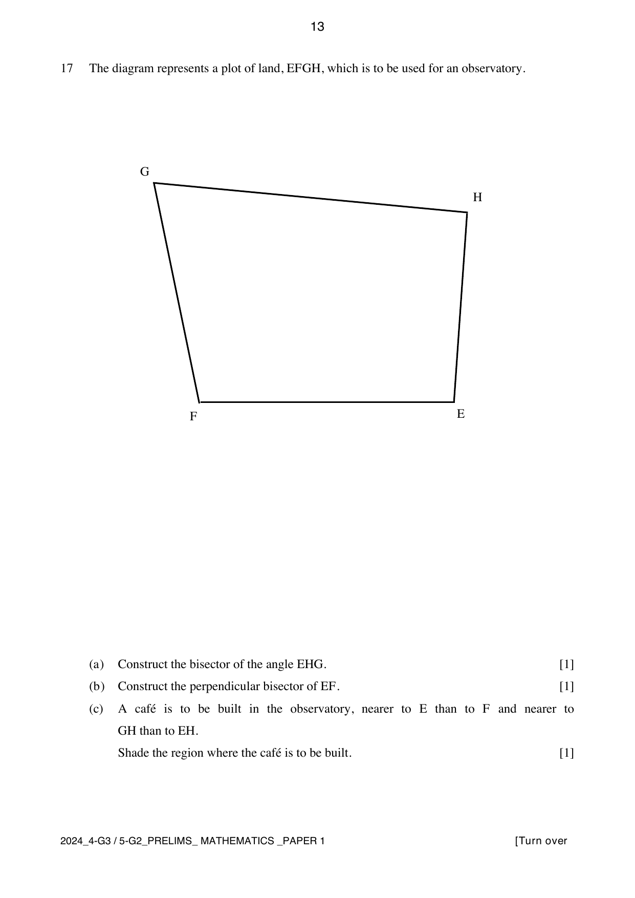
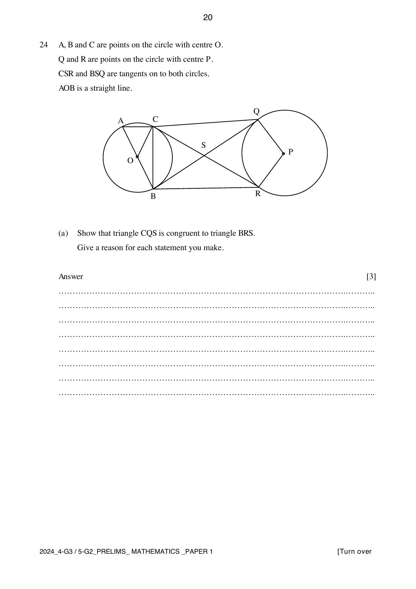

# Hua Yi Secondary School — Mathematics 4052/01 Paper 1 (cleaned)

> **Institution:** Hua Yi Secondary School
> **Exam:** Preliminary Examination 2024
> **Level:** Secondary 4 G3 / Secondary 5 G2
> **Subjects:** Elementary Mathematics
> **Paper:** 4052/01 Paper 1
> **Date:** 13 August 2024
> **Duration:** 2 hours 15 minutes
> **Total Marks:** 90
> **Source:** `2024 HYSS_S4-5 G3 MA Prelim_Paper 1_QP .pdf`

---

## Instructions

Write your name, class, and index number on all the work you hand in.
Write in dark blue or black pen.
You may use an HB pencil for any diagrams or graphs.
Do not use staples, paper clips, glue, or correction fluid.

Answer all the questions.
The number of marks is given in brackets [ ] at the end of each question or part question.
If working is needed for any question it must be shown with the answer.
Omission of essential working will result in loss of marks.
The total of the marks for this paper is 90.

The use of an approved scientific calculator is expected, where appropriate.
If the degree of accuracy is not specified in the question, and if the answer is not exact, give the answer to three significant figures. Give answers in degrees to one decimal place.
For $\pi$, use either your calculator value or $3.142$.

---

## Mathematical Formulae

*Compound interest*

$$
\text{Total amount} = P\left(1+\frac{r}{100}\right)^{n}
$$

*Mensuration*

$$
\text{Curved surface area of a cone} = \pi rl
$$

$$
\text{Surface area of a sphere} = 4\pi r^{2}
$$

$$
\text{Volume of a cone} = \frac{1}{3}\pi r^{2}h
$$

$$
\text{Volume of a sphere} = \frac{4}{3}\pi r^{3}
$$

$$
\text{Area of triangle } ABC = \frac{1}{2}ab\sin C
$$

$$
\text{Arc length} = r\theta,\text{ where }\theta\text{ is in radians}
$$

$$
\text{Sector area} = \frac{1}{2}r^{2}\theta,\text{ where }\theta\text{ is in radians}
$$

*Trigonometry*

$$
\frac{a}{\sin A} = \frac{b}{\sin B} = \frac{c}{\sin C}
$$

$$
a^{2} = b^{2}+c^{2}-2bc\cos A
$$

*Statistics*

$$
\text{Mean} = \frac{\sum fx}{\sum f}
$$

$$
\text{Standard deviation} = \sqrt{\frac{\sum fx^{2}}{\sum f}-\left(\frac{\sum fx}{\sum f}\right)^{2}}
$$

---

### Q1

> **Marks:** 2
> **Page:** 3

(a) Calculate

$$
\frac{-(-11.8)-\sqrt{(-11)^{2}-7\times 16\times(-40)}}{2\times 16}.
$$

[1]
> **Topic:** N1 Numbers and their operations
> **Sub-topic:** Numbers and their operations
> **LO:** [[context/subjects/o-level-e-maths/learning-objectives/o-level-e-maths-N1h.md|N1h]]

(b) There are 800 people in an auditorium, correct to the nearest hundred. State the minimum number of people that could be in the auditorium at this time. [1]
> **Topic:** N1 Numbers and their operations
> **Sub-topic:** Numbers and their operations
> **LO:** [[context/subjects/o-level-e-maths/learning-objectives/o-level-e-maths-N1h.md|N1h]]

### Q2

> **Marks:** 4
> **Page:** 3

(a) Express 1400 as the product of its prime factors. [1]
> **Topic:** N1 Numbers and their operations
> **Sub-topic:** Numbers and their operations
> **LO:** [[context/subjects/o-level-e-maths/learning-objectives/o-level-e-maths-N1b.md|N1b]]

(b) Write down the smallest positive integer $k$ such that $1400k$ is a perfect cube. [1]
> **Topic:** N1 Numbers and their operations
> **Sub-topic:** Numbers and their operations
> **LO:** [[context/subjects/o-level-e-maths/learning-objectives/o-level-e-maths-N1b.md|N1b]]

(c) $n$ is a number between 300 and 400. The highest common factor of $n$ and 1400 is 35. Find the largest possible value for $n$. [2]
> **Topic:** N1 Numbers and their operations
> **Sub-topic:** Numbers and their operations
> **LO:** [[context/subjects/o-level-e-maths/learning-objectives/o-level-e-maths-N1b.md|N1b]]

### Q3

> **Marks:** 3
> **Page:** 4

(a) Simplify $y^{0} \div 9x^{-2} \times x^{7}$. [2]
> **Topic:** N5 Algebraic expressions and formulae
> **Sub-topic:** Algebraic expressions and formulae
> **LO:** [[context/subjects/o-level-e-maths/learning-objectives/o-level-e-maths-N5b.md|N5b]]

(b) Simplify $(81a^{12})^{\frac{5}{4}}$. [1]
> **Topic:** N5 Algebraic expressions and formulae
> **Sub-topic:** Algebraic expressions and formulae
> **LO:** [[context/subjects/o-level-e-maths/learning-objectives/o-level-e-maths-N5b.md|N5b]]

### Q4

> **Marks:** 4
> **Page:** 4

(a) Express as a single fraction in its simplest form $\dfrac{18b^{7}}{5c^{2}} \div \dfrac{3b^{4}}{81}$. [2]
> **Topic:** N1 Numbers and their operations
> **Sub-topic:** Numbers and their operations
> **LO:** [[context/subjects/o-level-e-maths/learning-objectives/o-level-e-maths-N1j.md|N1j]]

(b) Use the laws of indices to show that $6^{4}\times 100+116\times 36^{2}$ can be expressed as a single power of six. [2]
> **Topic:** N1 Numbers and their operations
> **Sub-topic:** Numbers and their operations
> **LO:** [[context/subjects/o-level-e-maths/learning-objectives/o-level-e-maths-N1j.md|N1j]]

### Q5

> **Marks:** 3
> **Topic:** N1 Numbers and their operations
> **Sub-topic:** Numbers and their operations
> **LO:** [[context/subjects/o-level-e-maths/learning-objectives/o-level-e-maths-N1g.md|N1g]]
> **Page:** 5

In a greenhouse, the estimated number of flowering plants increased from 4100 in January 2024 to 4980 in June 2024. The number increased by $c\%$ every month. Find the value of $c$. [3]

### Q6

> **Marks:** 3
> **Topic:** N1 Numbers and their operations
> **Sub-topic:** Numbers and their operations
> **LO:** [[context/subjects/o-level-e-maths/learning-objectives/o-level-e-maths-N1e.md|N1e]]
> **Page:** 5

Kyle runs a tennis club. 54 of the members are adults and 31 are children. His aim is that at least $60\%$ the members should be children. Form an inequality to find the smallest number of children that Kyle would still need to recruit achieve his aim. [3]

### Q7

> **Marks:** 4
> **Page:** 6

A car travels at an average speed of $74.5\text{ km/h}$ for $2.25$ hours.

(a) Convert $75\text{ km/h}$ to m/s. [1]
> **Topic:** N4 Rate and speed
> **Sub-topic:** Rate and speed
> **LO:** [[context/subjects/o-level-e-maths/learning-objectives/o-level-e-maths-N4a.md|N4a]]

(b) By rounding the numbers correct to 1 significant figure, find an estimate of the distance travelled by the car. Show your working clearly. [2]
> **Topic:** N4 Rate and speed
> **Sub-topic:** Rate and speed
> **LO:** [[context/subjects/o-level-e-maths/learning-objectives/o-level-e-maths-N4a.md|N4a]]

(c) Without doing any calculation, explain why the actual distance travelled by the car is greater than the answer to (b). [1]
> **Topic:** N4 Rate and speed
> **Sub-topic:** Rate and speed
> **LO:** [[context/subjects/o-level-e-maths/learning-objectives/o-level-e-maths-N4a.md|N4a]]

### Q8

> **Marks:** 2
> **Topic:** S1 Data handling and analysis
> **Sub-topic:** Data handling and analysis
> **LO:** [[context/subjects/o-level-e-maths/learning-objectives/o-level-e-maths-S1f.md|S1f]]
> **Page:** 6

Isha has written down five numbers. The mean of these numbers is $13.2$, the median is $12$ and the mode is $7$. The largest number is three times the smallest number. Find the five numbers in ascending order. [2]

### Q9

> **Marks:** 5
> **Page:** 7

Factorise completely

(a) $2p^{4}-32s^{4}$, [3]
> **Topic:** N5 Algebraic expressions and formulae
> **Sub-topic:** Algebraic expressions and formulae
> **LO:** [[context/subjects/o-level-e-maths/learning-objectives/o-level-e-maths-N5h.md|N5h]]

(b) $12cd-9cx+6xy-8dy$. [2]
> **Topic:** N5 Algebraic expressions and formulae
> **Sub-topic:** Algebraic expressions and formulae
> **LO:** [[context/subjects/o-level-e-maths/learning-objectives/o-level-e-maths-N5h.md|N5h]]

### Q10

> **Marks:** 3
> **Page:** 7

(a) Express $9-8x+x^{2}$ in the form $a+(x+b)^{2}$. Find the value of $a$ and of $b$. [2]
> **Topic:** N6 Functions and graphs
> **Sub-topic:** Functions and graphs
> **LO:** [[context/subjects/o-level-e-maths/learning-objectives/o-level-e-maths-N6g.md|N6g]]

(b) Explain why when $x = 4$, the expression $9-8x+x^{2}$ has its minimum value. [1]
> **Topic:** N6 Functions and graphs
> **Sub-topic:** Functions and graphs
> **LO:** [[context/subjects/o-level-e-maths/learning-objectives/o-level-e-maths-N6g.md|N6g]]

### Q11

> **Marks:** 3
> **Topic:** N7 Equations and inequalities
> **Sub-topic:** Equations and inequalities
> **LO:** [[context/subjects/o-level-e-maths/learning-objectives/o-level-e-maths-N7e.md|N7e]]
> **Page:** 8

Solve the equation $5+2x = \dfrac{20}{1+x}$. [3]

### Q12

> **Marks:** 4
> **Topic:** N6 Functions and graphs
> **Sub-topic:** Functions and graphs
> **LO:** [[context/subjects/o-level-e-maths/learning-objectives/o-level-e-maths-N6c.md|N6c]]
> **Page:** 8

The points $(4, 20)$ and $(10, -4)$ satisfy the curve given by the equation $y = ax^{2}+bx-4$. Use an algebraic method to determine the values of $a$ and $b$. [4]

### Q13

> **Marks:** 6
> **Page:** 9

$\xi = \{\text{integers } x : 1 \leq x \leq 16\}$, $V = \{1, 2, 4, 8, 16\}$, $W = \{1, 4, 7, 9, 10, 14\}$.

Some of the information is shown on the Venn diagram. The numbers $3$, $5$, $6$, $11$, $12$, $13$ and $15$ are printed in the region outside both $V$ and $W$. The interiors of the circles are to be completed.

(a) Complete the Venn diagram by representing all the elements in the given sets. [1]
> **Topic:** N8 Set language and notation
> **Sub-topic:** Set language and notation
> **LO:** [[context/subjects/o-level-e-maths/learning-objectives/o-level-e-maths-N8c.md|N8c]]

(b) Describe the elements of set $V$. [1]
> **Topic:** N8 Set language and notation
> **Sub-topic:** Set language and notation
> **LO:** [[context/subjects/o-level-e-maths/learning-objectives/o-level-e-maths-N8c.md|N8c]]

(c) List the elements contained in the set $V' \cap W$. [1]
> **Topic:** N8 Set language and notation
> **Sub-topic:** Set language and notation
> **LO:** [[context/subjects/o-level-e-maths/learning-objectives/o-level-e-maths-N8c.md|N8c]]

(d) Find the number of elements in $(V \cap W') \cup (V \cup W)'$. [1]
> **Topic:** N8 Set language and notation
> **Sub-topic:** Set language and notation
> **LO:** [[context/subjects/o-level-e-maths/learning-objectives/o-level-e-maths-N8c.md|N8c]]

(e) Use one of the symbols below to complete each statement.

$$
= \quad \varnothing \quad \subset \quad \not\subset \quad \notin \quad \in \quad \xi
$$

(i) $\{2, 16\} \quad \ldots\ldots \quad V$ [1]
> **Topic:** N8 Set language and notation
> **Sub-topic:** Set language and notation
> **LO:** [[context/subjects/o-level-e-maths/learning-objectives/o-level-e-maths-N8c.md|N8c]]

(ii) $13 \quad \ldots\ldots \quad W$ [1]
> **Topic:** N8 Set language and notation
> **Sub-topic:** Set language and notation
> **LO:** [[context/subjects/o-level-e-maths/learning-objectives/o-level-e-maths-N8c.md|N8c]]

### Q14

> **Marks:** 6
> **Page:** 10

In grocery mart G, water costs ＄1.80 per litre, fresh milk costs ＄2.90 per litre and juice costs ＄2.30 per litre. In grocery mart H, water costs ＄0.20 more per litre, fresh milk costs ＄0.40 less per litre and juice costs ＄0.10 less per litre.

This information can be represented by the matrix

$$
Q = \begin{pmatrix} 1.8 & 0.2 \\ 2.9 & -0.4 \\ 2.3 & -0.1 \end{pmatrix}
\begin{matrix} W \\ M \\ J \end{matrix}
$$

with columns G and H.

(a) Rayyen and Zinnie went shopping together. Rayyen bought 4 litres of water, 2 litres of milk and 3 litres of juice. Zinnie bought 3 litres of water and 4 litres of juice. Represent their purchases in a $2 \times 3$ matrix $P$. [1]
> **Topic:** N9 Matrices
> **Sub-topic:** Matrices
> **LO:** [[context/subjects/o-level-e-maths/learning-objectives/o-level-e-maths-N9b.md|N9b]]

(b) Evaluate the matrix $R = PQ$. [2]
> **Topic:** N9 Matrices
> **Sub-topic:** Matrices
> **LO:** [[context/subjects/o-level-e-maths/learning-objectives/o-level-e-maths-N9b.md|N9b]]

(c) State what the elements in the second column of matrix $R$ represent. [1]
> **Topic:** N9 Matrices
> **Sub-topic:** Matrices
> **LO:** [[context/subjects/o-level-e-maths/learning-objectives/o-level-e-maths-N9b.md|N9b]]

(d) Rayyen shopped in grocery mart H. He got a discount coupon that entitled him to a discount of $15\%$. How much did he pay altogether for his items? [2]
> **Topic:** N3 Percentage
> **Sub-topic:** Percentage
> **LO:** [[context/subjects/o-level-e-maths/learning-objectives/o-level-e-maths-N3d.md|N3d]]

### Q15

> **Marks:** 4
> **Page:** 11

In a regular polygon, the ratio of an interior angle to an exterior angle is $14:1$.

(a) Find the number of sides of the polygon. [3]
> **Topic:** G1 Angles, triangles and polygons
> **Sub-topic:** Angles, triangles and polygons
> **LO:** [[context/subjects/o-level-e-maths/learning-objectives/o-level-e-maths-G1f.md|G1f]]

(b) Find the sum of the interior angles of the polygon. [1]
> **Topic:** G1 Angles, triangles and polygons
> **Sub-topic:** Angles, triangles and polygons
> **LO:** [[context/subjects/o-level-e-maths/learning-objectives/o-level-e-maths-G1f.md|G1f]]

### Q16

> **Marks:** 3
> **Topic:** G3 Properties of circles
> **Sub-topic:** Properties of circles
> **LO:** [[context/subjects/o-level-e-maths/learning-objectives/o-level-e-maths-G3a.md|G3a]]
> **Page:** 12

In the diagram, $BDK$ is a straight line and $AB = AD$. Angle $ABD = 36^{\circ}$, angle $CBD = 49^{\circ}$ and angle $CDK = 121^{\circ}$.

Explain why it is possible to draw a circle that passes through the points $A$, $B$, $C$ and $D$. Give reasons for each step of your working. [3]

### Q17

> **Marks:** 3
> **Page:** 13

The diagram represents a plot of land, $EFGH$, which is to be used for an observatory.

(a) Construct the bisector of the angle $EHG$. [1]
> **Topic:** G2 Congruence and similarity
> **Sub-topic:** Congruence and similarity
> **LO:** [[context/subjects/o-level-e-maths/learning-objectives/o-level-e-maths-G2e.md|G2e]]

(b) Construct the perpendicular bisector of $EF$. [1]
> **Topic:** G2 Congruence and similarity
> **Sub-topic:** Congruence and similarity
> **LO:** [[context/subjects/o-level-e-maths/learning-objectives/o-level-e-maths-G2e.md|G2e]]

(c) A café is to be built in the observatory, nearer to $E$ than to $F$ and nearer to $GH$ than to $EH$. Shade the region where the café is to be built. [1]
> **Topic:** G2 Congruence and similarity
> **Sub-topic:** Congruence and similarity
> **LO:** [[context/subjects/o-level-e-maths/learning-objectives/o-level-e-maths-G2e.md|G2e]]

### Q18

> **Marks:** 4
> **Page:** 14

(a) A cargo ship has an average fuel consumption of $0.000892$ kilometres per litre. Write this consumption in litres per kilometre. [1]
> **Topic:** N1 Numbers and their operations
> **Sub-topic:** Numbers and their operations
> **LO:** [[context/subjects/o-level-e-maths/learning-objectives/o-level-e-maths-N1h.md|N1h]]

(b) A model of another cargo ship is made to a scale of $1:60$. The length of this model cargo ship is $550\text{ cm}$.

(i) Find the actual length of this cargo ship in metres. [1]
> **Topic:** N1 Numbers and their operations
> **Sub-topic:** Numbers and their operations
> **LO:** [[context/subjects/o-level-e-maths/learning-objectives/o-level-e-maths-N1h.md|N1h]]

The capacity of the fuel tanks in the model cargo ship is $7.75$ litres.

(ii) Find the actual capacity of the fuel tanks of the cargo ship. Express your answer in standard form. [2]
> **Topic:** N1 Numbers and their operations
> **Sub-topic:** Numbers and their operations
> **LO:** [[context/subjects/o-level-e-maths/learning-objectives/o-level-e-maths-N1h.md|N1h]]

### Q19

> **Marks:** 3
> **Topic:** G5 Mensuration
> **Sub-topic:** Mensuration
> **LO:** [[context/subjects/o-level-e-maths/learning-objectives/o-level-e-maths-G5c.md|G5c]]
> **Page:** 15

A composite solid is made from a cylinder and two hemispheres. The cylinder has radius $p$ and length $2p$, while the hemispheres have radius $p$. A hemisphere is attached at each end of the cylinder.

The total surface area of the solid is six times the total surface area of a solid cone with radius $p$ and slant height $l$. Find $l$ in terms of $p$. [3]

### Q20

> **Marks:** 3
> **Topic:** N4 Rate and speed
> **Sub-topic:** Rate and speed
> **LO:** [[context/subjects/o-level-e-maths/learning-objectives/o-level-e-maths-N4a.md|N4a]]
> **Page:** 16

Gino can paint 6 fence panels in 4 hours, while Danish can paint 7 fence panels in 5 hours. Gino and Danish work together to paint a total of 21 panels. If they continue to paint at the same rate, how long will it take them to paint 21 panels? Give your answer in hours and minutes, correct to the nearest minute. [3]

### Q21

> **Marks:** 4
> **Topic:** S2 Probability
> **Sub-topic:** Probability
> **LO:** [[context/subjects/o-level-e-maths/learning-objectives/o-level-e-maths-S2c.md|S2c]]
> **Page:** 17

A fitness centre has 16 employees. One of the 16 employees is selected at random. The probability that it is a woman working part time is $\dfrac{1}{8}$. Two of the 16 employees are selected at random. The probability that they are both men working full time is $\dfrac{1}{8}$.

Complete the table of information below about the 16 employees of the fitness centre. Show all supporting calculations clearly. [4]

| | Part-time employees | Full-time employees |
| --- | --- | --- |
| Women | | 5 |
| Men | | |

### Q22

> **Marks:** 2
> **Topic:** S1 Data handling and analysis
> **Sub-topic:** Data handling and analysis
> **LO:** [[context/subjects/o-level-e-maths/learning-objectives/o-level-e-maths-S1l.md|S1l]]
> **Page:** 18

A librarian wants to find out how much time patrons spend at the library in a week. He uses the questionnaire.

How many hours do you spend at the library in a week (including weekends)? Please tick one box.

$1$–$2$ $\qquad$ $3$–$4$ $\qquad$ $5$–$7$ $\qquad$ over $7$

List two ways to improve the questionnaire. [2]

### Q23

> **Marks:** 2
> **Topic:** G6 Coordinate geometry
> **Sub-topic:** Coordinate geometry
> **LO:** [[context/subjects/o-level-e-maths/learning-objectives/o-level-e-maths-G6c.md|G6c]]
> **Page:** 19

$K$ is the point $(7, -8)$ and $L$ is the point $(x, y)$. The gradient of the line $KL$ is $\dfrac{2}{3}$.

Maverick claims that it is possible to express $x$ in terms of $y$, such that $x = a+by$, where $a$ and $b$ are constants. Explain why Maverick is correct. [2]

### Q24

> **Marks:** 6
> **Page:** 20–21

$A$, $B$ and $C$ are points on the circle with centre $O$. $Q$ and $R$ are points on the circle with centre $P$. $CSR$ and $BSQ$ are tangents to both circles. $AOB$ is a straight line.

(a) Show that triangle $CQS$ is congruent to triangle $BRS$. Give a reason for each statement you make. [3]
> **Topic:** G2 Congruence and similarity
> **Sub-topic:** Congruence and similarity
> **LO:** [[context/subjects/o-level-e-maths/learning-objectives/o-level-e-maths-G2i.md|G2i]]

(b) Angle $ABC = y^{\circ}$. Find, in terms of $y$,

(i) angle $BAC$, [1]
> **Topic:** G2 Congruence and similarity
> **Sub-topic:** Congruence and similarity
> **LO:** [[context/subjects/o-level-e-maths/learning-objectives/o-level-e-maths-G2i.md|G2i]]

(ii) angle $QPR$. [2]
> **Topic:** G2 Congruence and similarity
> **Sub-topic:** Congruence and similarity
> **LO:** [[context/subjects/o-level-e-maths/learning-objectives/o-level-e-maths-G2i.md|G2i]]

### Q25

> **Marks:** 4
> **Page:** 22

$ORS$ is a triangle. $J$ is a point on $RS$ such that $RJ:JS = 3:2$. $\overrightarrow{OR} = \mathbf{r}$ and $\overrightarrow{OS} = \mathbf{s}$.

(a) Show that $\overrightarrow{OJ} = \dfrac{1}{5}(2\mathbf{r}+3\mathbf{s})$. [2]
> **Topic:** G7 Vectors in two dimensions
> **Sub-topic:** Vectors in two dimensions
> **LO:** [[context/subjects/o-level-e-maths/learning-objectives/o-level-e-maths-G7h.md|G7h]]

(b) $X$ is a point such that $\overrightarrow{RX} = \dfrac{1}{5}(\mathbf{r}+9\mathbf{s})$. Explain why $O$, $J$ and $X$ lie on a straight line. [2]
> **Topic:** G7 Vectors in two dimensions
> **Sub-topic:** Vectors in two dimensions
> **LO:** [[context/subjects/o-level-e-maths/learning-objectives/o-level-e-maths-G7h.md|G7h]]
