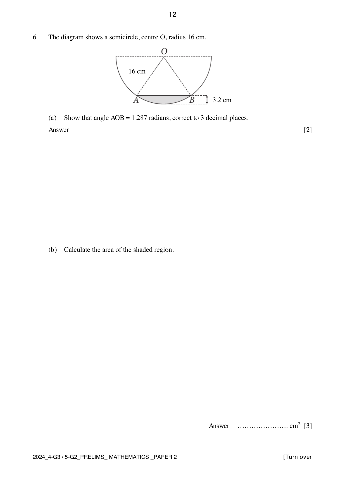
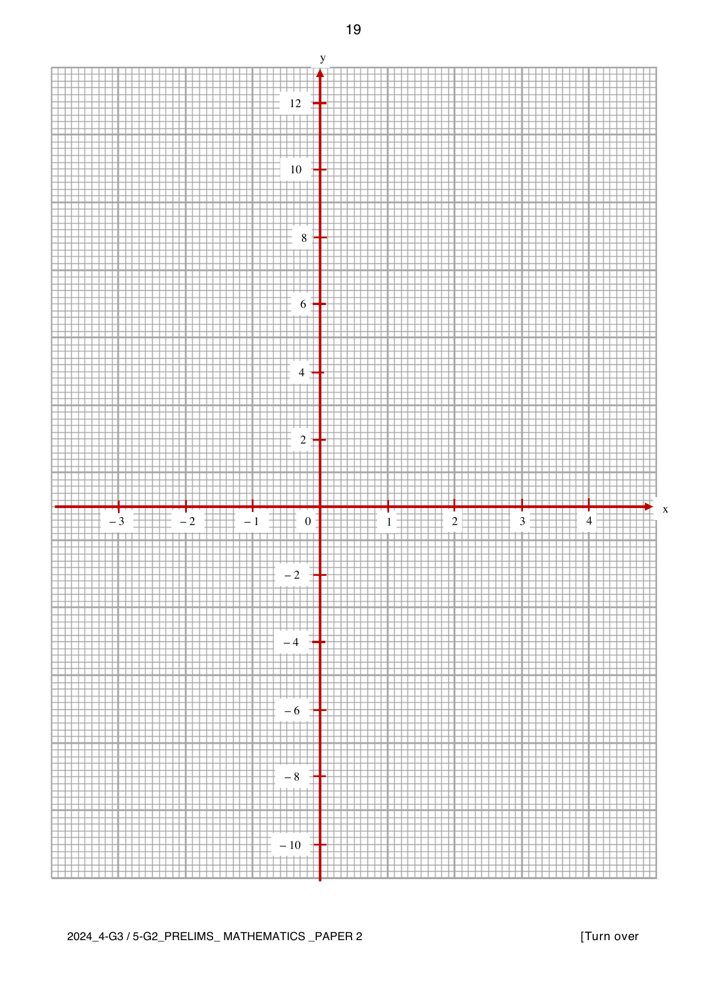

# Hua Yi Secondary School — Mathematics 4052/02 Paper 2 (cleaned)

> **Institution:** Hua Yi Secondary School
> **Exam:** Preliminary Examination 2024
> **Level:** Secondary 4 G3 / Secondary 5 G2
> **Subjects:** Elementary Mathematics
> **Paper:** 4052/02 Paper 2
> **Date:** 19 August 2024
> **Duration:** 2 hours 15 minutes
> **Total Marks:** 90
> **Source:** `2024 HYSS_S4-5 G3 MA Prelim_Paper 2_QP .pdf`

---

## Instructions

Write your name, class, and index number on all the work you hand in.
Write in dark blue or black pen.
You may use an HB pencil for any diagrams or graphs.
Do not use staples, paper clips, glue, or correction fluid.

Answer all the questions.
The number of marks is given in brackets [ ] at the end of each question or part question.
If working is needed for any question it must be shown with the answer.
Omission of essential working will result in loss of marks.
The total of the marks for this paper is 90.

The use of an approved scientific calculator is expected, where appropriate.
If the degree of accuracy is not specified in the question, and if the answer is not exact, give the answer to three significant figures. Give answers in degrees to one decimal place.
For $\pi$, use either your calculator value or $3.142$.

---

## Mathematical Formulae

*Compound interest*

$$
\text{Total amount} = P\left(1+\frac{r}{100}\right)^{n}
$$

*Mensuration*

$$
\text{Curved surface area of a cone} = \pi rl
$$

$$
\text{Surface area of a sphere} = 4\pi r^{2}
$$

$$
\text{Volume of a cone} = \frac{1}{3}\pi r^{2}h
$$

$$
\text{Volume of a sphere} = \frac{4}{3}\pi r^{3}
$$

$$
\text{Area of triangle } ABC = \frac{1}{2}ab\sin C
$$

$$
\text{Arc length} = r\theta,\text{ where }\theta\text{ is in radians}
$$

$$
\text{Sector area} = \frac{1}{2}r^{2}\theta,\text{ where }\theta\text{ is in radians}
$$

*Trigonometry*

$$
\frac{a}{\sin A} = \frac{b}{\sin B} = \frac{c}{\sin C}
$$

$$
a^{2} = b^{2}+c^{2}-2bc\cos A
$$

*Statistics*

$$
\text{Mean} = \frac{\sum fx}{\sum f}
$$

$$
\text{Standard deviation} = \sqrt{\frac{\sum fx^{2}}{\sum f}-\left(\frac{\sum fx}{\sum f}\right)^{2}}
$$

---

### Q1

> **Marks:** 11
> **Sub-topic:** Algebra
> **Page:** 3–4

(a) Express as a single fraction in its simplest form $\dfrac{2}{7-3x}-\dfrac{1}{6-x}$. [2]

(b) It is given that $v = \dfrac{3-5w}{w+2}+9$.

(i) Find $v$ when $w = -6$. [1]

(ii) Rearrange the formula to make $w$ the subject. [3]

(c) Solve the equation $\dfrac{5}{x-2}-\dfrac{3}{x^{2}-4} = \dfrac{1}{7}$. Give your solutions correct to two decimal places. [5]

### Q2

> **Marks:** 6
> **Sub-topic:** Coordinate geometry
> **Page:** 5

$C$ is the point $(-9, 1)$ and $D$ is the point $(7, 4)$. $\overrightarrow{CE} = \begin{pmatrix} -2 \\ 8 \end{pmatrix}$.

(a) Calculate the length of the line $CD$. [2]

(b) Determine the coordinates of point $E$. [1]

(c) Find the equation of the line $DE$. Leave your answer in the form $ax+by = c$, where $a$, $b$ and $c$ are constants. [3]

### Q3

> **Marks:** 9
> **Sub-topic:** Algebra
> **Page:** 6–7

(a) The first four terms of a sequence are $5$, $\dfrac{9}{4}$, $\dfrac{13}{9}$, $\dfrac{17}{16}$.

(i) State the fifth term of the sequence. [1]

(ii) Find an expression, in terms of $n$, for the $n$th term, $T_{n}$, of this sequence. [2]

(b) Elijah finds a number grid from his board game. The diagram shows part of a number grid with 7 columns.

| 1 | 2 | 3 | 4 | 5 | 6 | 7 |
| --- | --- | --- | --- | --- | --- | --- |
| 8 | 9 | 10 | 11 | 12 | 13 | 14 |
| 15 | 16 | 17 | 18 | 19 | 20 | 21 |
| 22 | 23 | 24 | 25 | 26 | 27 | 28 |
| 29 | 30 | 31 | 32 | 33 | 34 | 35 |
| 36 | 37 | 38 | 39 | 40 | 41 | 42 |

A rectangle outlining four numbers, two adjacent numbers in one row and the two numbers directly below them, can be placed anywhere on the grid.

(i) If $p$ represents the number in the top right corner of the rectangle, write down an expression, in terms of $p$, for the number in the bottom left corner of the rectangle. [1]

(ii) Show that the difference between the products of the numbers in the opposite corners of the rectangle is always $-7$. [2]

(iii) Elijah says it is impossible for the sum of the four numbers in the rectangle to be 199. Justify with relevant working why he is correct. [3]

### Q4

> **Marks:** 10
> **Sub-topic:** Number
> **Page:** 8–9

(a) Sophie earns a monthly salary of ＄6875. She gives $15\%$ of this amount to her parents. She puts $35\%$ of the remainder into a savings account. Calculate the amount she has left after giving to her parents and putting into her savings account. Leave your answer correct to the nearest dollar. [3]

(b) The cash price of a sofa is ＄830. Sophie buys this sofa on credit. She pays a deposit of one quarter of the cash price. She then pays 3 monthly payments of ＄260. Calculate the total amount Sophie pays for the sofa. [2]

(c) Sophie pays a monthly rent of ＄3174.20. This is $18\%$ more than her monthly rent last year. Calculate her monthly rent last year. [2]

(d) During her vacation, Sophie visits her friend in Wellington. Sophie spends NZD 940 in New Zealand using her credit card. She is charged a $2.6\%$ fee for the currency conversion. The exchange rate between Singapore dollars (SGD) and New Zealand dollars (NZD) is SGD $100 =$ NZD $120.7206$. Calculate the total amount on Sophie’s credit card bill, including the fee. Give your answer in Singapore dollars, correct to the nearest cent. [3]

### Q5

> **Marks:** 7
> **Sub-topic:** Trigonometry
> **Page:** 10–11

$ABCD$ is a field on horizontal ground. $AD = 163\text{ m}$, $BD = 329\text{ m}$, $CD = 152\text{ m}$ and angle $BDC = 48^{\circ}$. The bearing of $B$ from $A$ is $151^{\circ}$ and the bearing of $D$ from $A$ is $237^{\circ}$.

(a) Calculate the bearing of $D$ from $B$. [3]

(b) Calculate the distance from $B$ to $C$. [2]

(c) An aircraft is flying above $D$. Find the angle of elevation of the aircraft from $C$ when it is $245\text{ m}$ vertically above $D$. [2]

### Q6

> **Marks:** 11
> **Sub-topic:** Mensuration
> **Page:** 12–13

The diagram shows a semicircle, centre $O$, radius $16\text{ cm}$. A chord $AB$ cuts off a segment of height $3.2\text{ cm}$. The shaded region is that segment.

(a) Show that angle $AOB = 1.287$ radians, correct to 3 decimal places. [2]

(b) Calculate the area of the shaded region. [3]

(c) The semicircle is the cross section of a water trough of length $2.8\text{ m}$, standing on level ground. The shaded area represents the water in the trough.

(i) Calculate the volume of water, in $\text{cm}^{3}$, in the trough. Leave your answer in standard form. [3]

(ii) Calculate the number of litres of water that must be added to fill the trough. [3]

### Q7

> **Marks:** 9
> **Sub-topic:** Statistics
> **Page:** 14–15

A researcher wants to conduct a study to find out if there is a correlation between the analytical skills of adults and age. The researcher invited 80 adults to solve a number puzzle. The cumulative frequency curve shows the distribution of the time taken.

(a) Use the curve to estimate

(i) the median time taken, [1]

(ii) the interquartile range of the time taken. [2]

(b) $20\%$ of the adults took more than $n$ seconds to solve the puzzle. Find $n$. [2]

(c) The frequency distribution of the data for the 80 adults invited to solve the number puzzle is shown in the table.

| Time taken, $x$ (seconds) | Frequency |
| --- | --- |
| $0 < x \leq 20$ | 5 |
| $20 < x \leq 40$ | 40 |
| $40 < x \leq 60$ | 29 |
| $60 < x \leq 80$ | 6 |

Find an estimate of the standard deviation of the time taken by the 80 adults to solve the number puzzle. [2]

(d) The same group of adults were each given a word puzzle to solve. The box-and-whisker plot shows the distribution of the time taken.

Make two comparisons between the performances of the adults in solving the two puzzles. [2]

### Q8

> **Marks:** 5
> **Sub-topic:** Trigonometry
> **Page:** 16

In the diagram, $XYZ$ is a straight line. $AY = 20\text{ m}$, $AZ = 12\text{ m}$ and $YZ = 16\text{ m}$. The ratio of $XY:YZ$ is $1:4$. $A$ is off the line, with $Z$, then $Y$, then $X$ in that order.

(a) Prove that triangle $AYZ$ is right-angled. [2]

(b) Find the value of $\cos \angle AYX$, giving your answer as a fraction in its lowest terms. [1]

(c) The area of triangle $AXY$ is $24\text{ m}^{2}$. Lenard says: in another triangle $AYW$, where the length $YW = YX$ and its area is the same as that of triangle $AXY$, it is possible for angle $Y$ to be acute. Explain why Lenard is correct. Use calculations to support your answer. [2]

### Q9

> **Marks:** 12
> **Sub-topic:** Graphs
> **Page:** 17–19

The variables $x$ and $y$ are connected by the equation $y = \dfrac{x^{3}}{2}-5x-2$. Some corresponding values of $x$ and $y$ are given in the table.

| $x$ | $-3$ | $-2$ | $-1$ | $0$ | $1$ | $2$ | $3$ | $4$ |
| --- | --- | --- | --- | --- | --- | --- | --- | --- |
| $y$ | $-0.5$ | $4$ | $2.5$ | $-2$ | $-6.5$ | $k$ | $-3.5$ | $10$ |

(a) Find the value of $k$. [1]

(b) On the grid on page 19, draw the graph of $y = \dfrac{x^{3}}{2}-5x-2$ for $-3 \leq x \leq 4$. [2]

(c) The equation $\dfrac{x^{3}}{2}-5x = 7$ has only one solution. Explain how this can be deduced from your graph. [2]

(d) By drawing a tangent, estimate the gradient of the curve at $(1, -6.5)$. [2]

(e) (i) On the same grid, draw the line $y = 4-x$ for $-1 \leq x \leq 4$. [2]

(ii) Write down the $x$-coordinate of the point where this line intersects the curve. [1]

(iii) This value of $x$ is a solution of the equation $x^{3}+Ax+B = 0$. Find the value of $A$ and the value of $B$. [2]

### Q10

> **Marks:** 10
> **Sub-topic:** Real-world context
> **Page:** 20–24

Javier and Stella are planning their exercise routines. Javier and Stella have a body mass of $70\text{ kg}$ and $60\text{ kg}$ respectively. The speed for walking and jogging of the two individuals is represented in the chart.

On the chart, brisk walking is $6.5\text{ km/h}$ for both Javier and Stella. Jogging is $8\text{ km/h}$ for Javier and $9.5\text{ km/h}$ for Stella.

They research the following information about the benefits of exercise.

**Health advice**

For optimal health benefits, adults should do at least 150 minutes of moderate-intensity aerobic activity, or at least 75 minutes of vigorous-intensity aerobic activity per week.

For additional health benefits, adults should increase their moderate-intensity aerobic activity to 300 minutes per week, or an equivalent combination of moderate-intensity and vigorous-intensity aerobic activity.

1 minute of vigorous-intensity aerobic activity is equivalent to 2 minutes of moderate-intensity aerobic activity. For example, 10 minutes of jogging $= 20$ minutes of brisk walking.

Muscle-strengthening activities should be done on 2 or more days per week.

Approximate calories burned during 30 minutes of aerobic exercise:

| | 60 kg | 70 kg | 80 kg | 90 kg |
| --- | --- | --- | --- | --- |
| Walking $5\text{ km/h}$ | 105 | 120 | 135 | 150 |
| Walking $6.5\text{ km/h}$ | 130 | 150 | 170 | 190 |
| Jogging $8\text{ km/h}$ | 240 | 280 | 315 | 350 |
| Jogging $9.5\text{ km/h}$ | 300 | 345 | 390 | 435 |

Non-aerobic muscle-strengthening activities:

- 1 hour of yoga burns approximately 3 calories per kilogram of body mass.
- 1 hour of weight training burns approximately 4 calories per kilogram of body mass.

(a) In their first week of exercise, they each plan to go for four brisk walks. They will walk the same route each time. The four walks together meet the minimum target for the time for optimal health benefits in one week.

(i) Find the distance of one of these walks. [2]

(ii) Find out how many more calories Javier burns in these four walks than Stella. [1]

(b) After one month, they change their routines. Javier wants to gain additional health benefits. He decides to do a $4\text{ km}$ walk 3 times per week and do a $6\text{ km}$ jog 2 times per week. He will also attend a 45-minute yoga class 2 times per week.

Stella wants to maintain optimal health benefits. She decides to do an $8\text{ km}$ jog 2 times per week. She will also attend a 30-minute weight training session 2 times per week.

Javier says: we will both meet our targets for exercise. However, I will burn about $50\%$ more calories than Stella during our exercise per week.

Is Javier correct? Justify your decision with clear calculations. [7]
