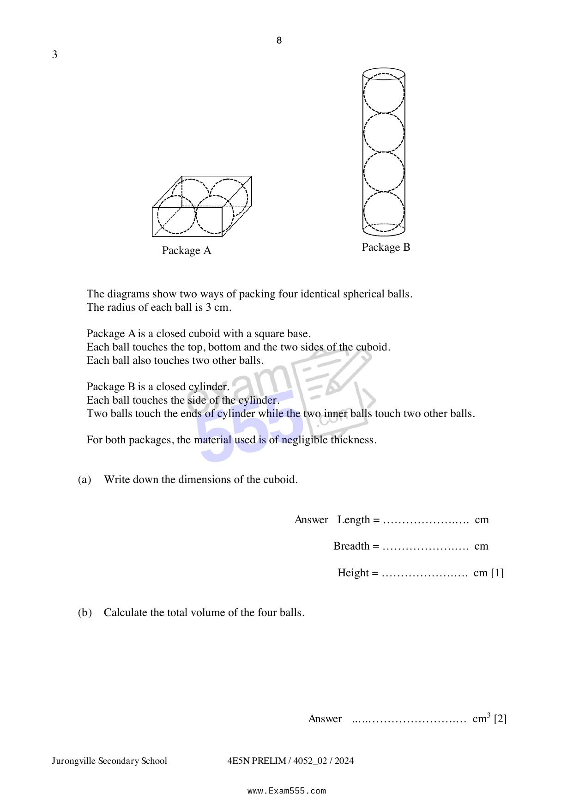
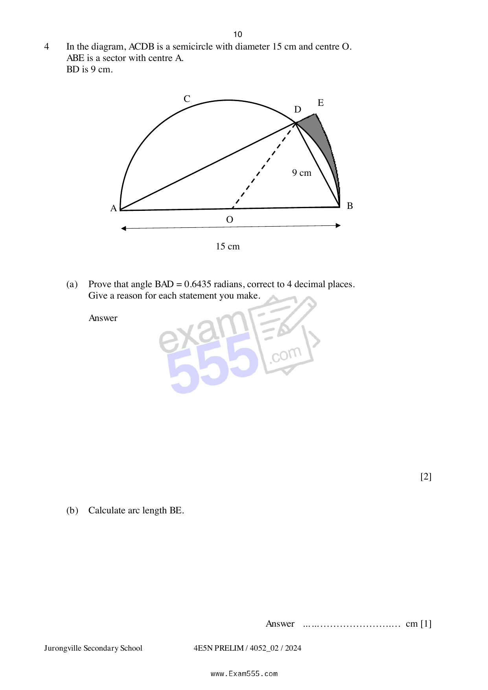

# Jurongville Secondary School — Mathematics 4052/02 Paper 2 (cleaned)

> **Institution:** Jurongville Secondary School
> **Exam:** Preliminary Examination 2024
> **Level:** Secondary 4 Express
> **Subjects:** Elementary Mathematics
> **Paper:** 4052/02 Paper 2
> **Date:** 2 August 2024
> **Duration:** 2 hours 15 minutes
> **Total Marks:** 90
> **Source:** `S4 E-Math JURONGVILLE P2 2024 EXAM555.pdf`

---

## Instructions

Candidates answer on the Question Paper.

Write your name, class and index number in the spaces on all the work you hand in.
Write in dark blue or black pen.
You may use a HB pencil for any diagrams or graphs.
Do not use staples, paper clips, highlighters, glue or correction fluid.

Answer ALL the questions.
The number of marks is given in brackets [ ] at the end of each question or part question.

If working is needed for any question it must be shown with the answer.
Omission of essential working will result in loss of marks.
The total marks for this paper is 90.

The use of an approved scientific calculator is expected, where appropriate.
If the degree of accuracy is not specified in the question and if the answer is not exact, give the answer to three significant figures. Give answers in degrees to one decimal place.
For $\pi$, use either your calculator value or $3.142$.

---

## Mathematical Formulae

*Compound interest*

$$
\text{Total amount} = P\left(1+\frac{r}{100}\right)^{n}
$$

*Mensuration*

$$
\text{Curved surface area of a cone} = \pi rl
$$

$$
\text{Surface area of a sphere} = 4\pi r^{2}
$$

$$
\text{Volume of a cone} = \frac{1}{3}\pi r^{2}h
$$

$$
\text{Volume of a sphere} = \frac{4}{3}\pi r^{3}
$$

$$
\text{Area of triangle } ABC = \frac{1}{2}ab\sin C
$$

$$
\text{Arc length} = r\theta,\text{ where }\theta\text{ is in radians}
$$

$$
\text{Sector area} = \frac{1}{2}r^{2}\theta,\text{ where }\theta\text{ is in radians}
$$

*Trigonometry*

$$
\frac{a}{\sin A} = \frac{b}{\sin B} = \frac{c}{\sin C}
$$

$$
a^{2} = b^{2}+c^{2}-2bc\cos A
$$

*Statistics*

$$
\text{Mean} = \frac{\sum fx}{\sum f}
$$

$$
\text{Standard deviation} = \sqrt{\frac{\sum fx^{2}}{\sum f}-\left(\frac{\sum fx}{\sum f}\right)^{2}}
$$

---

## Answer all the questions

---

### Q1

> **Marks:** (a) 2, (b) 3, (c)(i) 1, (c)(ii) 2, (d)(i) 2, (d)(ii) 1; total 11
> **Page:** 3–5

**(a)** Simplify $\dfrac{28xy^{3}}{5h}\div\dfrac{7x^{2}y}{30k}$. [2]
> **Topic:** N7 Equations and inequalities
> **Sub-topic:** Equations and inequalities
> **LO:** [[context/subjects/o-level-e-maths/learning-objectives/o-level-e-maths-N7a.md|N7a]]

**(b)** Given that $2^{y} = 4^{1011}+4^{1011}+4^{1011}+4^{1011}$, find the value of $y$. [3]
> **Topic:** N7 Equations and inequalities
> **Sub-topic:** Equations and inequalities
> **LO:** [[context/subjects/o-level-e-maths/learning-objectives/o-level-e-maths-N7a.md|N7a]]

**(c)** It is given that $c = \dfrac{x^{2}-a}{x^{2}+b}$.

(i) Find the value of $c$ when $a = -1$, $b = 5$ and $x = -3$. [1]
> **Topic:** N7 Equations and inequalities
> **Sub-topic:** Equations and inequalities
> **LO:** [[context/subjects/o-level-e-maths/learning-objectives/o-level-e-maths-N7a.md|N7a]]

(ii) Rearrange the formula to make $x$ the subject. [2]
> **Topic:** N5 Algebraic expressions and formulae
> **Sub-topic:** Algebraic expressions and formulae
> **LO:** [[context/subjects/o-level-e-maths/learning-objectives/o-level-e-maths-N5k.md|N5k]]

**(d)** (i) Solve the equation $\dfrac{3}{1-z}-\dfrac{1}{z-1} = 2$. [2]
> **Topic:** N7 Equations and inequalities
> **Sub-topic:** Equations and inequalities
> **LO:** [[context/subjects/o-level-e-maths/learning-objectives/o-level-e-maths-N7e.md|N7e]]

(ii) Hence, find the value of $a$ when $\dfrac{3}{1-2^{a}}-\dfrac{1}{2^{a}-1} = 2$. [1]
> **Topic:** N7 Equations and inequalities
> **Sub-topic:** Equations and inequalities
> **LO:** [[context/subjects/o-level-e-maths/learning-objectives/o-level-e-maths-N7e.md|N7e]]

---

### Q2

> **Marks:** (a) 2, (b) 3, (c)(i) 1, (c)(ii) 1, (d) 3; total 10
> **Page:** 6–7

**(a)** Elly played a computer game $500$ times and won $370$ of these games.
She then won the next $x$ games and lost none.
She has now won $75\%$ of the games that she has played.

Find the value $x$. [2]
> **Topic:** N3 Percentage
> **Sub-topic:** Percentage
> **LO:** [[context/subjects/o-level-e-maths/learning-objectives/o-level-e-maths-N3a.md|N3a]]

**(b)** Grade A coffee costs ＄$48$ per kilogram.
Grade B coffee costs ＄$32$ per kilogram.

Alen mixes Grade A coffee with Grade B coffee in the ratio $3 : 2$ to obtain a mixture.
He then sells the mixture at ＄$45$ per kilogram.

Calculate the percentage gain on the cost price. [3]
> **Topic:** N3 Percentage
> **Sub-topic:** Percentage
> **LO:** [[context/subjects/o-level-e-maths/learning-objectives/o-level-e-maths-N3d.md|N3d]]

**(c)** Raju has a hard disk with a memory space of $2.4$ terabytes.
($1$ terabyte $= 10^{12}$ bytes)

(i) $2.4\times 10^{12}$ can be written as $k$ billion.

Find the value of $k$. [1]
> **Topic:** N3 Percentage
> **Sub-topic:** Percentage
> **LO:** [[context/subjects/o-level-e-maths/learning-objectives/o-level-e-maths-N3a.md|N3a]]

(ii) If the size of a one-minute video is $50$ megabytes, how many $2$-hour full length movie videos can be stored in Raju’s hard disk?
($1$ megabyte $= 10^{6}$ bytes) [1]
> **Topic:** N3 Percentage
> **Sub-topic:** Percentage
> **LO:** [[context/subjects/o-level-e-maths/learning-objectives/o-level-e-maths-N3a.md|N3a]]

**(d)** A car is selling at ＄$13\,500$.
Ms Tan bought it at a hire purchase price, with a deposit of ＄$500$ and monthly instalment of ＄$243.75$ for $5$ years at a flat rate of $r\%$ per year.

Calculate the interest rate, $r$. [3]
> **Topic:** N3 Percentage
> **Sub-topic:** Percentage
> **LO:** [[context/subjects/o-level-e-maths/learning-objectives/o-level-e-maths-N3a.md|N3a]]

---

### Q3

> **Marks:** (a) 1, (b) 2, (c) 3, (d) 3; total 9
> **Page:** 8–9

The diagrams show two ways of packing four identical spherical balls.
The radius of each ball is $3\text{ cm}$.

Package A is a closed cuboid with a square base.
Each ball touches the top, bottom and the two sides of the cuboid.
Each ball also touches two other balls.

Package B is a closed cylinder.
Each ball touches the side of the cylinder.
Two balls touch the ends of cylinder while the two inner balls touch two other balls.

For both packages, the material used is of negligible thickness.

**(a)** Write down the dimensions of the cuboid. [1]
> **Topic:** G5 Mensuration
> **Sub-topic:** Mensuration
> **LO:** [[context/subjects/o-level-e-maths/learning-objectives/o-level-e-maths-G5c.md|G5c]]

**(b)** Calculate the total volume of the four balls. [2]
> **Topic:** G5 Mensuration
> **Sub-topic:** Mensuration
> **LO:** [[context/subjects/o-level-e-maths/learning-objectives/o-level-e-maths-G5c.md|G5c]]

**(c)** Jasmine claims that the volume of empty space in package A is more than that in package B.

Do you agree with her?
Show your working clearly. [3]
> **Topic:** G5 Mensuration
> **Sub-topic:** Mensuration
> **LO:** [[context/subjects/o-level-e-maths/learning-objectives/o-level-e-maths-G5c.md|G5c]]

**(d)** Jasmine intends to wrap Package B with wrapping paper.
She estimates that the amount of wrapping paper she needs will be at least $20\%$ more than the total external surface area of the package.

Calculate the minimum amount of wrapping paper required.
Give your answer to the nearest square centimetres. [3]
> **Topic:** G5 Mensuration
> **Sub-topic:** Mensuration
> **LO:** [[context/subjects/o-level-e-maths/learning-objectives/o-level-e-maths-G5c.md|G5c]]

---

### Q4

> **Marks:** (a) 2, (b) 1, (c) 2, (d) 5; total 10
> **Page:** 10–11

In the diagram, $ACDB$ is a semicircle with diameter $15\text{ cm}$ and centre $O$.
$ABE$ is a sector with centre $A$.
$BD$ is $9\text{ cm}$.

**(a)** Prove that angle $BAD = 0.6435$ radians, correct to $4$ decimal places.
Give a reason for each statement you make. [2]
> **Topic:** G5 Mensuration
> **Sub-topic:** Mensuration
> **LO:** [[context/subjects/o-level-e-maths/learning-objectives/o-level-e-maths-G5g.md|G5g]]

**(b)** Calculate arc length $BE$. [1]
> **Topic:** G5 Mensuration
> **Sub-topic:** Mensuration
> **LO:** [[context/subjects/o-level-e-maths/learning-objectives/o-level-e-maths-G5f.md|G5f]]

**(c)** Calculate angle $AOD$, giving your answer in radians. [2]
> **Topic:** G5 Mensuration
> **Sub-topic:** Mensuration
> **LO:** [[context/subjects/o-level-e-maths/learning-objectives/o-level-e-maths-G5g.md|G5g]]

**(d)** Calculate the area of the shaded region $BDE$.
Show your working clearly. [5]
> **Topic:** G5 Mensuration
> **Sub-topic:** Mensuration
> **LO:** [[context/subjects/o-level-e-maths/learning-objectives/o-level-e-maths-G5b.md|G5b]]

---

### Q5

> **Marks:** (a)(i) 1, (a)(ii) 1, (a)(iii) 1, (a)(iv) 2, (a)(v) 1, (b)(i) 1, (b)(ii) 2, (b)(iii) 2; total 11
> **Page:** 12–15

**(a)** A Residents’ Committee (RC) records the monthly phone bills of $100$ families in Jurong North District.

The distribution of the monthly phone bills is represented by a cumulative frequency curve below.

(i) Complete the following grouped frequency table for the monthly phone bills, ＄$t$, of Jurong North District. [1]
> **Topic:** S1 Data handling and analysis
> **Sub-topic:** Data handling and analysis
> **LO:** [[context/subjects/o-level-e-maths/learning-objectives/o-level-e-maths-S1i.md|S1i]]

| Monthly phone bills (＄$t$) | Frequency |
| --- | --- |
| $0 < t \leq 10$ | $38$ |
| $10 < t \leq 20$ |  |
| $20 < t \leq 30$ | $9$ |

(ii) Calculate an estimate of the mean. [1]
> **Topic:** S1 Data handling and analysis
> **Sub-topic:** Data handling and analysis
> **LO:** [[context/subjects/o-level-e-maths/learning-objectives/o-level-e-maths-S1i.md|S1i]]

(iii) Calculate an estimate of the standard deviation. [1]
> **Topic:** S1 Data handling and analysis
> **Sub-topic:** Data handling and analysis
> **LO:** [[context/subjects/o-level-e-maths/learning-objectives/o-level-e-maths-S1i.md|S1i]]

(iv) Find the interquartile range of the distribution.

Is there any difference between using standard deviation and interquartile range to estimate the spread of the monthly phone bills in Jurong North district?

Explain. [2]
> **Topic:** S1 Data handling and analysis
> **Sub-topic:** Data handling and analysis
> **LO:** [[context/subjects/o-level-e-maths/learning-objectives/o-level-e-maths-S1i.md|S1i]]

(v) It is recorded that another district, known as Clementine district, has a median monthly phone bill of ＄$17$.

The Chairman of the RC in Clementine district claims that his residents spend less on average monthly phone bills as compared to residents in Jurong North district.

Explain if his claim is justified. [1]
> **Topic:** S1 Data handling and analysis
> **Sub-topic:** Data handling and analysis
> **LO:** [[context/subjects/o-level-e-maths/learning-objectives/o-level-e-maths-S1i.md|S1i]]

**(b)** In a community event, cash vouchers are given as lucky draw prizes to the selected $100$ families in Jurong North district.

The table below shows the information about the number of families with senior citizens in Jurong North district.

Each family has at most one senior citizen who belongs to either the Pioneer or Merdeka generation.

|  | Pioneer Generation | Merdeka Generation |
| --- | --- | --- |
| Stay alone | 30 | 25 |
| Stay with dependents | 5 | 6 |

(i) One family is selected at random from Jurong North District.

Find the probability that this family has no senior citizen. [1]
> **Topic:** S2 Probability
> **Sub-topic:** Probability
> **LO:** [[context/subjects/o-level-e-maths/learning-objectives/o-level-e-maths-S2c.md|S2c]]

(ii) Two families are selected at random from Jurong North District.

Find the probability that both families have senior citizens who belong to the Merdeka Generation. [2]
> **Topic:** S2 Probability
> **Sub-topic:** Probability
> **LO:** [[context/subjects/o-level-e-maths/learning-objectives/o-level-e-maths-S2c.md|S2c]]

(iii) Both families have senior citizens who belong to the Pioneer Generation, but one of them stay alone. [2]
> **Topic:** S1 Data handling and analysis
> **Sub-topic:** Data handling and analysis
> **LO:** [[context/subjects/o-level-e-maths/learning-objectives/o-level-e-maths-S1i.md|S1i]]

---

### Q6

> **Marks:** (a) 1, (b) 3, (c) 1, (d) 2, (e)(i) 2, (e)(ii) 1, (e)(iii) 2; total 12
> **Page:** 16–17

**(a)** Complete the table of values for $y = \dfrac{24}{x}+x-9$.

Give your answer correct to one decimal place. [1]
> **Topic:** G6 Coordinate geometry
> **Sub-topic:** Coordinate geometry
> **LO:** [[context/subjects/o-level-e-maths/learning-objectives/o-level-e-maths-G6c.md|G6c]]

| $x$ | $2$ | $2.3$ | $2.6$ | $3$ | $4$ | $5$ | $6$ | $7$ | $8$ |
| --- | --- | --- | --- | --- | --- | --- | --- | --- | --- |
| $y$ | $5$ | $3.7$ | $2.8$ | $2$ | $1$ | $0.8$ | $1$ |  | $2$ |

**(b)** On the grid, draw the graph of $y = \dfrac{24}{x}+x-9$, for $2 \leq x \leq 8$. [3]
> **Topic:** G6 Coordinate geometry
> **Sub-topic:** Coordinate geometry
> **LO:** [[context/subjects/o-level-e-maths/learning-objectives/o-level-e-maths-G6c.md|G6c]]

**(c)** Use your graph to find the range of values of $x$ for which $\dfrac{24}{x}+x \leq 10\dfrac{1}{2}$. [1]
> **Topic:** G6 Coordinate geometry
> **Sub-topic:** Coordinate geometry
> **LO:** [[context/subjects/o-level-e-maths/learning-objectives/o-level-e-maths-G6c.md|G6c]]

**(d)** On the same grid, draw a tangent and find the gradient of the curve at $(4, 1)$. [2]
> **Topic:** G6 Coordinate geometry
> **Sub-topic:** Coordinate geometry
> **LO:** [[context/subjects/o-level-e-maths/learning-objectives/o-level-e-maths-G6c.md|G6c]]

**(e)** (i) On the same grid, draw the graph of $y = \dfrac{1}{2}x+1$ for $2 \leq x \leq 8$. [2]
> **Topic:** G6 Coordinate geometry
> **Sub-topic:** Coordinate geometry
> **LO:** [[context/subjects/o-level-e-maths/learning-objectives/o-level-e-maths-G6c.md|G6c]]

(ii) Write down the $x$-coordinate of the point where this line intersects the curve. [1]
> **Topic:** G6 Coordinate geometry
> **Sub-topic:** Coordinate geometry
> **LO:** [[context/subjects/o-level-e-maths/learning-objectives/o-level-e-maths-G6c.md|G6c]]

(iii) This value of $x$ has a solution of the equation $Ax^{2}+Bx+48 = 0$.

Find the value of $A$ and the value $B$. [2]
> **Topic:** G6 Coordinate geometry
> **Sub-topic:** Coordinate geometry
> **LO:** [[context/subjects/o-level-e-maths/learning-objectives/o-level-e-maths-G6c.md|G6c]]

---

### Q7

> **Marks:** (a) 2, (b)(i) 1, (b)(ii) 1, (b)(iii) 2, (b)(iv) 1, (b)(v) 1; total 8
> **Page:** 18–19

In the diagram, $O$ is the centre of the circle $ABCDE$. $DE$ is parallel to $CA$, $TA$ and $TD$ are tangents to the circle at $A$ and $D$ respectively.
$AC$ is perpendicular to $BD$ and $\angle ACD = 54^{\circ}$.

**(a)** Show that triangle $ABF$ and triangle $ADF$ are congruent.
Give a reason for each statement you make. [2]
> **Topic:** G2 Congruence and similarity
> **Sub-topic:** Congruence and similarity
> **LO:** [[context/subjects/o-level-e-maths/learning-objectives/o-level-e-maths-G2i.md|G2i]]

**(b)** By stating your reasons clearly, find

(i) angle $CAD$, [1]
> **Topic:** G2 Congruence and similarity
> **Sub-topic:** Congruence and similarity
> **LO:** [[context/subjects/o-level-e-maths/learning-objectives/o-level-e-maths-G2i.md|G2i]]

(ii) angle $AOD$, [1]
> **Topic:** G2 Congruence and similarity
> **Sub-topic:** Congruence and similarity
> **LO:** [[context/subjects/o-level-e-maths/learning-objectives/o-level-e-maths-G2i.md|G2i]]

(iii) angle $CAE$, [2]
> **Topic:** G2 Congruence and similarity
> **Sub-topic:** Congruence and similarity
> **LO:** [[context/subjects/o-level-e-maths/learning-objectives/o-level-e-maths-G2i.md|G2i]]

(iv) angle $BAT$, [1]
> **Topic:** G2 Congruence and similarity
> **Sub-topic:** Congruence and similarity
> **LO:** [[context/subjects/o-level-e-maths/learning-objectives/o-level-e-maths-G2i.md|G2i]]

(v) angle $ATD$. [1]
> **Topic:** G2 Congruence and similarity
> **Sub-topic:** Congruence and similarity
> **LO:** [[context/subjects/o-level-e-maths/learning-objectives/o-level-e-maths-G2i.md|G2i]]

---

### Q8

> **Marks:** (a)(i) 1, (a)(ii) 2, (a)(iii) 1, (b)(i) 1, (b)(ii) 1, (b)(iii) 1, (b)(iv) 2, (b)(v) 2; total 11
> **Page:** 20–22

**(a)** The numbers $1$ to $64$ are arranged in a grid as shown.
A rhombus is placed in various positions on the grids to enclose five of the numbers.
Two possible positions of the rhombus are shown above.

(i) A rhombus is placed such that the number at the centre is $19$.

Find the sum of the five numbers in the rhombus. [1]
> **Topic:** N1 Numbers and their operations
> **Sub-topic:** Numbers and their operations
> **LO:** [[context/subjects/o-level-e-maths/learning-objectives/o-level-e-maths-N1h.md|N1h]]

(ii) It is given that the number in the centre of one rhombus is $y$.

Find and simplify an expression, in terms of $y$, for the sum of five numbers. [2]
> **Topic:** N1 Numbers and their operations
> **Sub-topic:** Numbers and their operations
> **LO:** [[context/subjects/o-level-e-maths/learning-objectives/o-level-e-maths-N1h.md|N1h]]

(iii) It is given that the sum of the five numbers in another rhombus is $145$.

Find the number at the top of this rhombus. [1]
> **Topic:** N1 Numbers and their operations
> **Sub-topic:** Numbers and their operations
> **LO:** [[context/subjects/o-level-e-maths/learning-objectives/o-level-e-maths-N1h.md|N1h]]

**(b)** The table below shows a flooring consisting of square tiles measuring $1\text{ m}^{2}$ each.
Each day similar tiles are added to the previous pattern.

(i) Find an expression, in terms of $n$, for the area added on Day $n$. [1]
> **Topic:** N1 Numbers and their operations
> **Sub-topic:** Numbers and their operations
> **LO:** [[context/subjects/o-level-e-maths/learning-objectives/o-level-e-maths-N1h.md|N1h]]

(ii) Find the area added on Day $20$. [1]
> **Topic:** N1 Numbers and their operations
> **Sub-topic:** Numbers and their operations
> **LO:** [[context/subjects/o-level-e-maths/learning-objectives/o-level-e-maths-N1h.md|N1h]]

(iii) Explain why the area added is always odd. [1]
> **Topic:** N1 Numbers and their operations
> **Sub-topic:** Numbers and their operations
> **LO:** [[context/subjects/o-level-e-maths/learning-objectives/o-level-e-maths-N1h.md|N1h]]

(iv) Find an expression for the total area of the flooring in the form of $an^{2}+bn$, on Day $n$. [2]
> **Topic:** N1 Numbers and their operations
> **Sub-topic:** Numbers and their operations
> **LO:** [[context/subjects/o-level-e-maths/learning-objectives/o-level-e-maths-N1h.md|N1h]]

(v) Determine if a total area of $780\text{ m}^{2}$ of flooring can be completed in $3$ weeks. [2]
> **Topic:** N1 Numbers and their operations
> **Sub-topic:** Numbers and their operations
> **LO:** [[context/subjects/o-level-e-maths/learning-objectives/o-level-e-maths-N1h.md|N1h]]

---

### Q9

> **Marks:** (a) 1, (b) 7; total 8
> **Page:** 24–25

The Open Electricity Market is an initiative by the Energy Market Authority (EMA) of Singapore that allows households to enjoy more choices and flexibility when buying electricity.

Mr Simon and his family live in a bungalow.
Their average monthly electricity consumption is $2000\text{ kWh}$.
Mr Simon will be using his OABC credit card to pay for his monthly electricity bill.
He would also like to receive a paper bill each month instead of an electronic one.
As Mr Simon will be migrating to London, he intends to terminate his electricity supply at the end of $8$ months, on $30$ August $2024$.

Based on the above information, Mr Simon has identified three retailers that he can choose from for his electricity supply from $1$ January $2024$ to $30$ August $2024$.
The minimum contract period is $1$ year.

List of Electricity Retailer

|  | Alpha Switch | Best Electric | Chew Watt |
| --- | --- | --- | --- |
| (a) Base Price | $20\%$ off regulated tariff, with GST (see table below) | $23.80$ cents/kWh | $23.35$ cents/kWh |
| (b) Sign-up Incentives | One-time ＄$200$ Cash rebate and $3\%$ monthly rebates for OABC credit card holder | Nil | One-time ＄$150$ Cash rebate |
| (c) Early Termination Charge (E.T.C.) (if minimum contract period is not met) | Nil | E.T.C. $= A \times B \times C \times 15\%$, where $A$ is average monthly electricity consumption, $B$ is Base Price and $C$ is number of months remaining or part thereof | E.T.C. $= \text{Termination Rate} \times \text{remaining months}$. Termination Rate per month: Terrace ＄$30$; Semi-D ＄$45$; Bungalow ＄$60$ |
| (d) Cost of Paper Bill | ＄$0.60$ per bill | ＄$1.14$ per bill | ＄$0.75$ per bill |

Estimate of Quarterly Household Regulated Tariffs in $2024$

|  | Without GST (cents/kWh) per month | With GST (cents/kWh) per month |
| --- | --- | --- |
| January 2024 – March 2024 | $29.89$ |  |
| April 2024 – June 2024 | $29.79$ |  |
| July 2024 – September 2024 | $29.88$ |  |

**(a)** In $2024$, GST will be chargeable at $9\%$.
Complete the table above. [1]
> **Topic:** S1 Data handling and analysis
> **Sub-topic:** Data handling and analysis
> **LO:** [[context/subjects/o-level-e-maths/learning-objectives/o-level-e-maths-S1f.md|S1f]]

**(b)** Suggest the cheapest retailer for Mr Simon’s electricity bill for the period of $1$ January $2024$ to $30$ August $2024$.
Justify your decision and show your method clearly. [7]
> **Topic:** S1 Data handling and analysis
> **Sub-topic:** Data handling and analysis
> **LO:** [[context/subjects/o-level-e-maths/learning-objectives/o-level-e-maths-S1f.md|S1f]]
