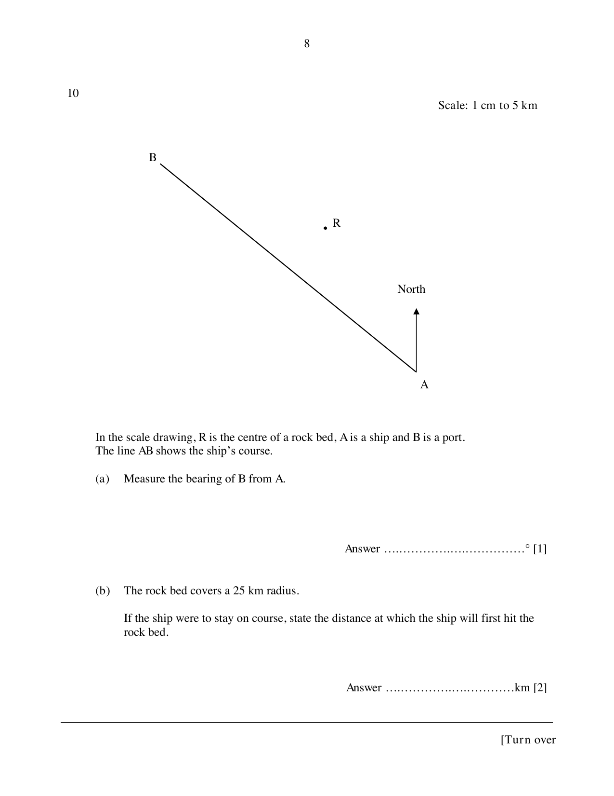
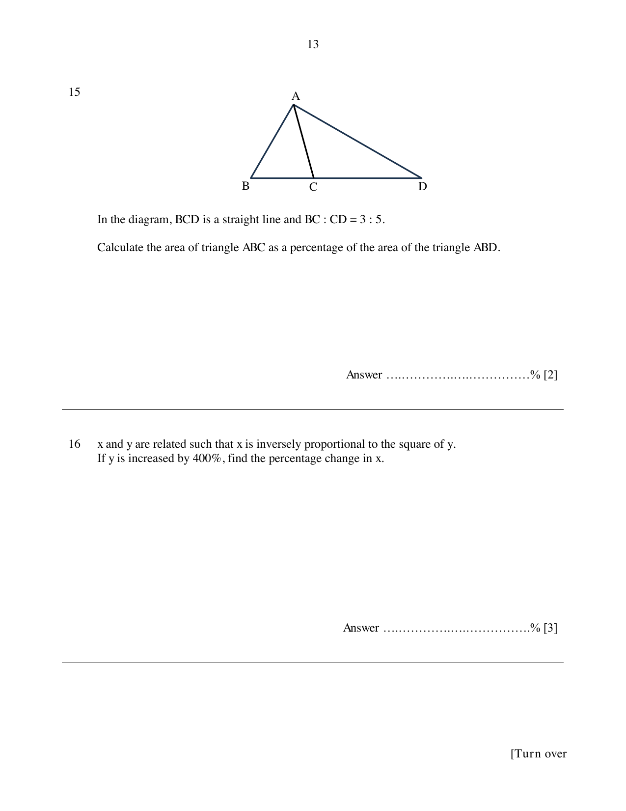
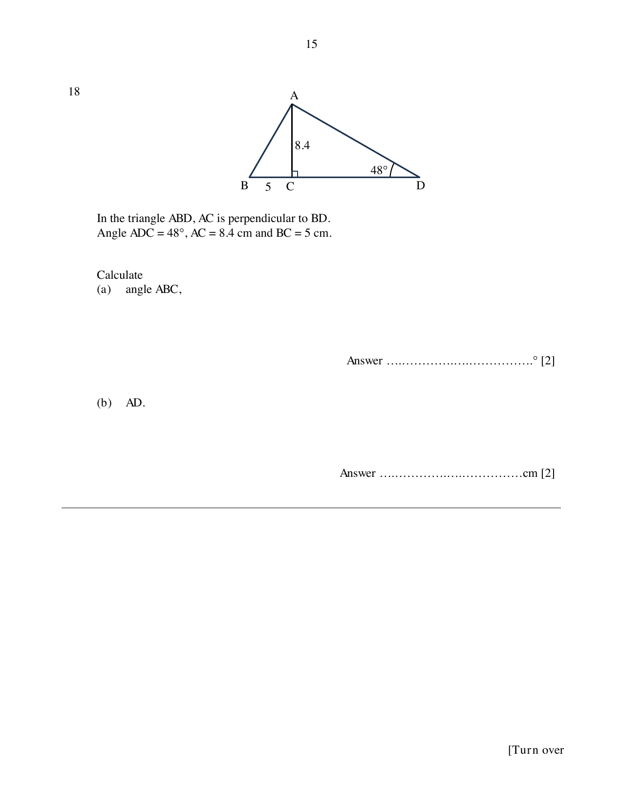
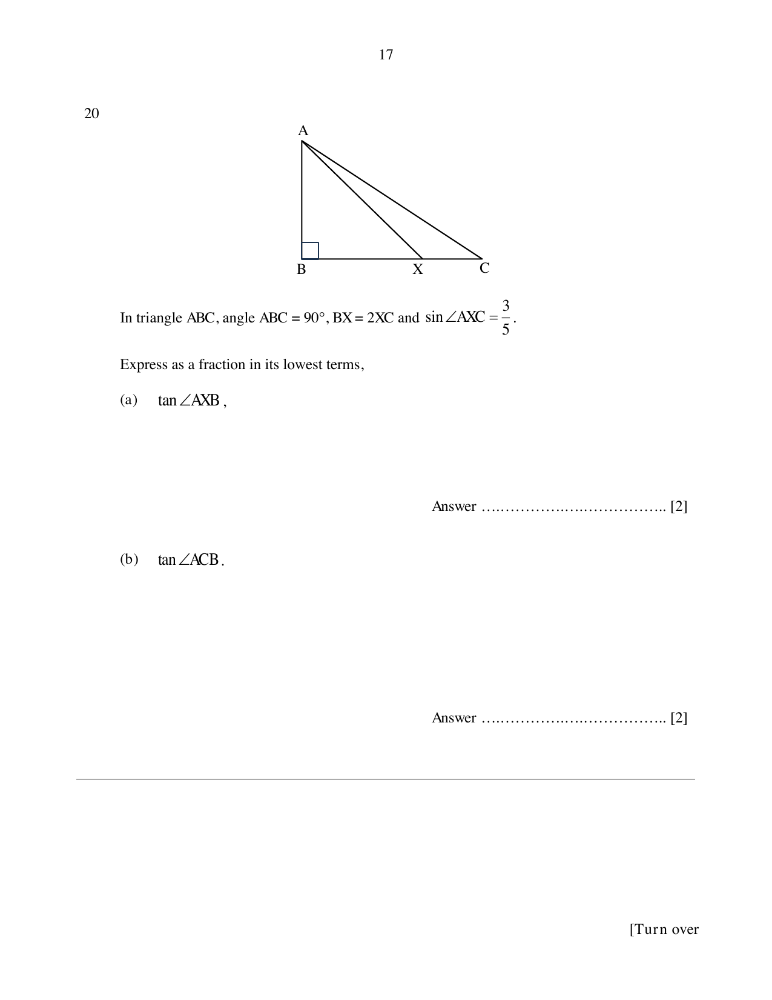
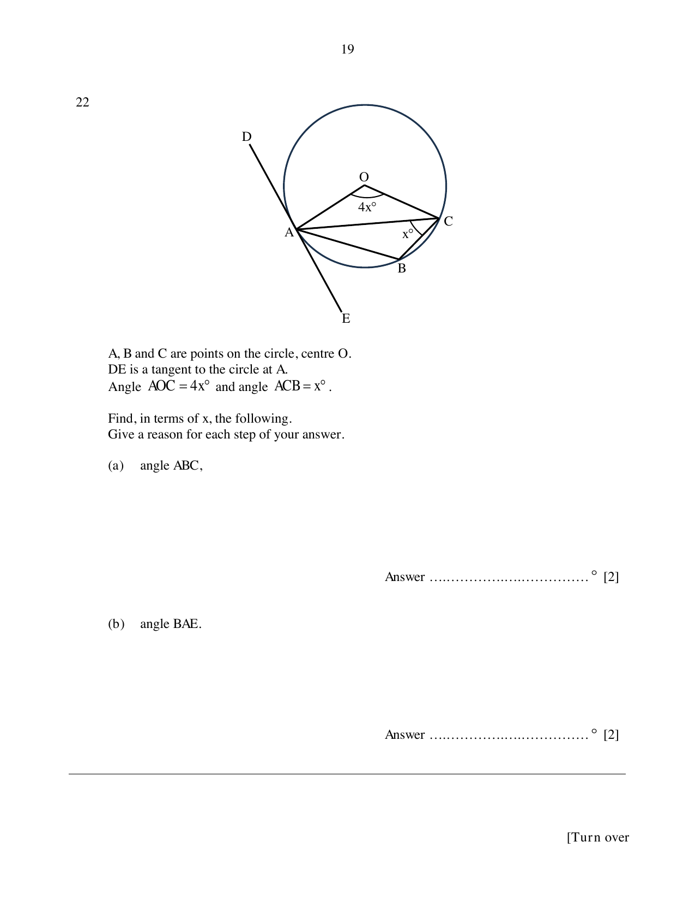
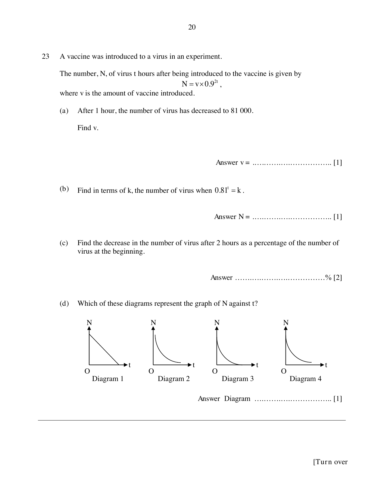

# Naval Base Secondary School — Mathematics 4052/01 Paper 1 (cleaned)

> **Institution:** Naval Base Secondary School
> **Exam:** Preliminary Examination 2024
> **Level:** Secondary 4 Express / 5 Normal (Academic)
> **Subjects:** Elementary Mathematics
> **Paper:** 4052/01 Paper 1
> **Date:** 21 August 2024
> **Duration:** 2 hours 15 minutes
> **Total Marks:** 90
> **Source:** `NBSS EM _Prelim_P1_2024 v2_QP.pdf`

---

## Instructions

Write your name, class and index number on all the work you hand in.
Write in dark blue or black pen.
You may use an HB pencil for any diagrams or graphs.
Do not use staples, paper clips, glue or correction fluid.

Answer all questions.
If working is needed for any question it must be shown with the answer.
Omission of essential working will result in loss of marks.
The use of an approved scientific calculator is expected, where appropriate.
If the degree of accuracy is not specified in the question and if the answer is not exact, give the answer to three significant figures. Give answers in degrees to one decimal place.
For $\pi$, use either your calculator value or $3.142$, unless the question requires the answer in terms of $\pi$.

The number of marks is given in brackets [ ] at the end of each question or part question.
The total of the marks for this paper is 90.

Candidates answer on the Question Paper.

---

## Mathematical Formulae

*Compound interest*

$$
\text{Total amount} = P\left(1+\frac{r}{100}\right)^{n}
$$

*Mensuration*

$$
\text{Curved surface area of a cone} = \pi rl
$$

$$
\text{Surface area of a sphere} = 4\pi r^{2}
$$

$$
\text{Volume of a cone} = \frac{1}{3}\pi r^{2}h
$$

$$
\text{Volume of a sphere} = \frac{4}{3}\pi r^{3}
$$

$$
\text{Area of a triangle } ABC = \frac{1}{2}ab\sin C
$$

$$
\text{Arc length} = r\theta,\text{ where }\theta\text{ is in radians}
$$

$$
\text{Sector area} = \frac{1}{2}r^{2}\theta,\text{ where }\theta\text{ is in radians}
$$

*Trigonometry*

$$
\frac{a}{\sin A} = \frac{b}{\sin B} = \frac{c}{\sin C}
$$

$$
a^{2} = b^{2}+c^{2}-2bc\cos A
$$

*Statistics*

$$
\text{Mean} = \frac{\sum fx}{\sum f}
$$

$$
\text{Standard deviation} = \sqrt{\frac{\sum fx^{2}}{\sum f}-\left(\frac{\sum fx}{\sum f}\right)^{2}}
$$

---

## Answer all the questions.

### Q1

> **Marks:** [1]
> **Topic:** N3 Percentage
> **Sub-topic:** Percentage
> **LO:** [[context/subjects/o-level-e-maths/learning-objectives/o-level-e-maths-N3e.md|N3e]]
> **Page:** 3

Calculate $\sqrt[4]{13.5^{2}-\dfrac{6.56}{0.37}}$.

### Q2

> **Marks:** (a) [1]; (b) [1]
> **Topic:** N1 Numbers and their operations
> **Sub-topic:** Numbers and their operations
> **LO:** [[context/subjects/o-level-e-maths/learning-objectives/o-level-e-maths-N1h.md|N1h]]
> **Page:** 3

Simplify

**(a)** $3x^{2}\times 4y^{5}$.

**(b)** $3(2x-1)-5$.

### Q3

> **Marks:** [2]
> **Topic:** N5 Algebraic expressions and formulae
> **Sub-topic:** Algebraic expressions and formulae
> **LO:** [[context/subjects/o-level-e-maths/learning-objectives/o-level-e-maths-N5h.md|N5h]]
> **Page:** 3

Factorise completely $2x^{3}-13x^{2}+6x$.

### Q4

> **Marks:** [2]
> **Topic:** G4 Pythagoras' theorem and trigonometry
> **Sub-topic:** Pythagoras' theorem and trigonometry
> **LO:** [[context/subjects/o-level-e-maths/learning-objectives/o-level-e-maths-G4d.md|G4d]]
> **Page:** 4

The sine of an angle is $0.6$, find the two possible values for the angle.

### Q5

> **Marks:** (a) [1]; (b) [2]
> **Topic:** S1 Data handling and analysis
> **Sub-topic:** Data handling and analysis
> **LO:** [[context/subjects/o-level-e-maths/learning-objectives/o-level-e-maths-S1f.md|S1f]]
> **Page:** 4

A class of 12 boys and 8 girls took a test.
The girls’ marks were 3, 6, 7, 8, 9, 9, 10 and 10.

**(a)** Find the mean mark for the girls.

**(b)** The mean mark for the boys was 8.0.

Find the mean mark for the whole class.

### Q6

> **Marks:** (a) [3]; (b) [1]
> **Topic:** N1 Numbers and their operations
> **Sub-topic:** Numbers and their operations
> **LO:** [[context/subjects/o-level-e-maths/learning-objectives/o-level-e-maths-N1e.md|N1e]]
> **Page:** 5

**(a)** The number $12250\times\dfrac{p}{q}$ is a perfect cube. $p$ and $q$ are prime numbers.
Find $p$ and $q$.

**(b)** $x$ is a number between 700 and 800.
The highest common factor of $x$ and $12\,250$ is 250.
Find the smallest possible value of $x$.

### Q7

> **Marks:** [2]
> **Topic:** N1 Numbers and their operations
> **Sub-topic:** Numbers and their operations
> **LO:** [[context/subjects/o-level-e-maths/learning-objectives/o-level-e-maths-N1h.md|N1h]]
> **Page:** 6

Given that $81^{2x}\times 9^{x} = 27$, find $x$.

### Q8

> **Marks:** [2]
> **Topic:** G5 Mensuration
> **Sub-topic:** Mensuration
> **LO:** [[context/subjects/o-level-e-maths/learning-objectives/o-level-e-maths-G5b.md|G5b]]
> **Page:** 6

Raj has 120 one-centimetre cubes.
He arranges all of the cubes into a cuboid.
The perimeter of the top of the cuboid is 20 cm.
Each side of the cuboid has a length greater than 3 cm.

Find the height of the cuboid.

### Q9

> **Marks:** [3]
> **Topic:** N5 Algebraic expressions and formulae
> **Sub-topic:** Algebraic expressions and formulae
> **LO:** [[context/subjects/o-level-e-maths/learning-objectives/o-level-e-maths-N5k.md|N5k]]
> **Page:** 7

$$
T = 2\pi\sqrt{\frac{L}{g}}
$$

Rearrange the formula to make $g$ the subject.

### Q10

> **Marks:** (a) [1]; (b) [2]
> **Topic:** G3 Properties of circles
> **Sub-topic:** Properties of circles
> **LO:** [[context/subjects/o-level-e-maths/learning-objectives/o-level-e-maths-G3b.md|G3b]]
> **Page:** 8

Scale: 1 cm to 5 km.

In the scale drawing, $R$ is the centre of a rock bed, $A$ is a ship and $B$ is a port.
The line $AB$ shows the ship’s course.

**(a)** Measure the bearing of $B$ from $A$.

**(b)** The rock bed covers a 25 km radius.

If the ship were to stay on course, state the distance at which the ship will first hit the rock bed.

### Q11

> **Marks:** (a)(i) [1]; (a)(ii) [1]; (b) [2]
> **Topic:** S1 Data handling and analysis
> **Sub-topic:** Data handling and analysis
> **LO:** [[context/subjects/o-level-e-maths/learning-objectives/o-level-e-maths-S1k.md|S1k]]
> **Page:** 9

The table below shows the amount of time spent playing online games by a group of children in one particular week.

| Time ($h$ hours) | Frequency |
| --- | --- |
| $0 < h \le 2$ | 4 |
| $2 < h \le 4$ | 9 |
| $4 < h \le 6$ | 15 |
| $6 < h \le 8$ | 13 |
| $8 < h \le 10$ | 7 |
| $10 < h \le 12$ | 2 |

**(a) (i)** Calculate an estimate of the mean time spent playing online games that week.

**(ii)** Explain why this is only an estimate of the mean time these children spent playing online games that week.

**(b)** Calculate an estimate of the standard deviation of the time spent playing online games that week.

### Q12

> **Marks:** [3]
> **Topic:** N7 Equations and inequalities
> **Sub-topic:** Equations and inequalities
> **LO:** [[context/subjects/o-level-e-maths/learning-objectives/o-level-e-maths-N7c.md|N7c]]
> **Page:** 10

Solve the simultaneous equations.

$$
\begin{aligned}
\frac{x}{4}-\frac{y}{2} &= 2 \\
3x &= 19+4y
\end{aligned}
$$

You must show your working.

### Q13

> **Marks:** (a) [1]; (b)(i) [1]; (b)(ii) [1]
> **Topic:** N8 Set language and notation
> **Sub-topic:** Set language and notation
> **LO:** [[context/subjects/o-level-e-maths/learning-objectives/o-level-e-maths-N8c.md|N8c]]
> **Page:** 11

**(a)** Factorise $5xy-20y$.

**(b) (i)** Use set notation to describe the shaded region.

**(ii)** On the Venn diagram, shade the region which represents $A\cup B'$.

### Q14

> **Marks:** (a) [1]; (b) [2]
> **Topic:** S2 Probability
> **Sub-topic:** Probability
> **LO:** [[context/subjects/o-level-e-maths/learning-objectives/o-level-e-maths-S2c.md|S2c]]
> **Page:** 12

**(a)** A bag contains black, blue and yellow balls.
A ball is picked at random from the bag.

The probability that the ball is blue is $\dfrac{5}{9}$.

The probability that the ball is yellow is $\dfrac{2}{15}$.

Find the probability that the ball is black.

**(b)** Another bag contains 10 red balls, 7 white balls and 8 blue balls.
A further $n$ white balls are added to the bag.
The probability of picking a white ball is now $\dfrac{2}{5}$.
Find the value of $n$.

### Q15

> **Marks:** [2]
> **Topic:** G1 Angles, triangles and polygons
> **Sub-topic:** Angles, triangles and polygons
> **LO:** [[context/subjects/o-level-e-maths/learning-objectives/o-level-e-maths-G1b.md|G1b]]
> **Page:** 13

In the diagram, $BCD$ is a straight line and $BC:CD = 3:5$.

Calculate the area of triangle $ABC$ as a percentage of the area of triangle $ABD$.

### Q16

> **Marks:** [3]
> **Topic:** N5 Algebraic expressions and formulae
> **Sub-topic:** Algebraic expressions and formulae
> **LO:** [[context/subjects/o-level-e-maths/learning-objectives/o-level-e-maths-N5g.md|N5g]]
> **Page:** 13

$x$ and $y$ are related such that $x$ is inversely proportional to the square of $y$.
If $y$ is increased by 400%, find the percentage change in $x$.

### Q17

> **Marks:** (a) [1]; (b) [2]; (c) [1]
> **Topic:** N1 Numbers and their operations
> **Sub-topic:** Numbers and their operations
> **LO:** [[context/subjects/o-level-e-maths/learning-objectives/o-level-e-maths-N1e.md|N1e]]
> **Page:** 14

The numbers 1 to 100 are arranged in a table as shown below.

An L-shaped shaded frame can be placed around various numbers throughout the table.

$L_{n}$ is used to refer to the shaded frame that is drawn around a particular number.
For example, $L_{2}$ refers to the shaded frame shown above drawn around the number 2.

**(a)** State the largest $L_{n}$.

**(b)** Write and simplify an expression, in terms of $n$, for the sum of the numbers in $L_{n}$.

**(c)** Explain why the sum of the numbers is always a multiple of 3.

### Q18

> **Marks:** (a) [2]; (b) [2]
> **Topic:** G4 Pythagoras' theorem and trigonometry
> **Sub-topic:** Pythagoras' theorem and trigonometry
> **LO:** [[context/subjects/o-level-e-maths/learning-objectives/o-level-e-maths-G4e.md|G4e]]
> **Page:** 15

In triangle $ABD$, $AC$ is perpendicular to $BD$.
Angle $ADC = 48^{\circ}$, $AC = 8.4$ cm and $BC = 5$ cm.

Calculate

**(a)** angle $ABC$,

**(b)** $AD$.

### Q19

> **Marks:** [4]
> **Topic:** N1 Numbers and their operations
> **Sub-topic:** Numbers and their operations
> **LO:** [[context/subjects/o-level-e-maths/learning-objectives/o-level-e-maths-N1g.md|N1g]]
> **Page:** 16

Solve the equation $x^{2}+5x-16 = 0$ by completing the square.
Give your solutions correct to two decimal places.

### Q20

> **Marks:** (a) [2]; (b) [2]
> **Topic:** G4 Pythagoras' theorem and trigonometry
> **Sub-topic:** Pythagoras' theorem and trigonometry
> **LO:** [[context/subjects/o-level-e-maths/learning-objectives/o-level-e-maths-G4c.md|G4c]]
> **Page:** 17

In triangle $ABC$, angle $ABC = 90^{\circ}$, $BX = 2XC$ and $\sin\angle AXC = \dfrac{3}{5}$.

Express as a fraction in its lowest terms,

**(a)** $\tan\angle AXB$,

**(b)** $\tan\angle ACB$.

### Q21

> **Marks:** [4]
> **Topic:** G1 Angles, triangles and polygons
> **Sub-topic:** Angles, triangles and polygons
> **LO:** [[context/subjects/o-level-e-maths/learning-objectives/o-level-e-maths-G1f.md|G1f]]
> **Page:** 18

The diagram shows a regular hexagon $P$ and a regular $n$-sided polygon $Q$.
Polygon $Q$ has an exterior angle of $18^{\circ}$.

Find the sum of angles $a$, $b$, $c$, $d$, $e$ and $f$.

### Q22

> **Marks:** (a) [2]; (b) [2]
> **Topic:** G3 Properties of circles
> **Sub-topic:** Properties of circles
> **LO:** [[context/subjects/o-level-e-maths/learning-objectives/o-level-e-maths-G3b.md|G3b]]
> **Page:** 19

$A$, $B$ and $C$ are points on the circle, centre $O$.
$DE$ is a tangent to the circle at $A$.
Angle $AOC = 4x^{\circ}$ and angle $ACB = x^{\circ}$.

Find, in terms of $x$, the following.
Give a reason for each step of your answer.

**(a)** angle $ABC$,

**(b)** angle $BAE$.

### Q23

> **Marks:** (a) [1]; (b) [1]; (c) [2]; (d) [1]
> **Topic:** N6 Functions and graphs
> **Sub-topic:** Functions and graphs
> **LO:** [[context/subjects/o-level-e-maths/learning-objectives/o-level-e-maths-N6c.md|N6c]]
> **Page:** 20

A vaccine was introduced to a virus in an experiment.

The number, $N$, of virus $t$ hours after being introduced to the vaccine is given by

$$
N = v\times 0.92^{t},
$$

where $v$ is the amount of vaccine introduced.

**(a)** After 1 hour, the number of virus has decreased to $81\,000$.

Find $v$.

**(b)** Find, in terms of $k$, the number of virus when $0.81^{t} = k$.

**(c)** Find the decrease in the number of virus after 2 hours as a percentage of the number of virus at the beginning.

**(d)** Which of these diagrams represent the graph of $N$ against $t$?

### Q24

> **Marks:** (a) [2]; (b) [4]
> **Topic:** N6 Functions and graphs
> **Sub-topic:** Functions and graphs
> **LO:** [[context/subjects/o-level-e-maths/learning-objectives/o-level-e-maths-N6e.md|N6e]]
> **Page:** 21

**(a)** Underline the following ratios that are equivalent to the ratio $a:b$.

$\dfrac{1}{b}:\dfrac{1}{a}$

$a^{3}:b^{3}$

$3a:3b$

$a+1:b+1$

**(b)** John and Sam each have an amount of money.
The ratio John’s amount : Sam’s amount $= 6:2$.

John gives Sam ＄13.
The new ratio John’s amount : Sam’s amount $= 2:5$.

Find how much money John has now.

### Q25

> **Marks:** (a) [2]; (b) [3]; (c) [1]
> **Topic:** G2 Congruence and similarity
> **Sub-topic:** Congruence and similarity
> **LO:** [[context/subjects/o-level-e-maths/learning-objectives/o-level-e-maths-G2i.md|G2i]]
> **Page:** 22

The diagram shows triangle $ABC$ and parallelogram $BDEF$.
$FE$ bisects angle $DEC$ and angle $FEC = x^{\circ}$.

**(a)** Find angle $ECF$ in terms of $x$.
Give a reason for each step of your answer.

**(b)** Show that triangle $AED$ is similar to triangle $ECF$.

**(c)** State another triangle that is similar to $AED$ and $ECF$.

### Q26

> **Marks:** (a) [1]; (b) [2]; (c) [1]; (d) [3]
> **Topic:** N9 Matrices
> **Sub-topic:** Matrices
> **LO:** [[context/subjects/o-level-e-maths/learning-objectives/o-level-e-maths-N9b.md|N9b]]
> **Page:** 23–24

A baking school offers beginner, intermediate and advanced baking classes on weekdays and weekends in August this year.
The matrix $B$ shows the number of participants attending the baking classes in August.

$$
B = \begin{pmatrix} 22 & 20 & 9 \\ 8 & 10 & 11 \end{pmatrix}
\begin{matrix} \text{weekdays} \\ \text{weekends} \end{matrix}
$$

Columns are beginner, intermediate and advanced.

**(a)** The fees for the beginner, intermediate and advanced baking classes are ＄30, ＄40 and ＄50 respectively.

Represent the class fees by a $3\times 1$ matrix $F$.

**(b)** Evaluate the matrix $C = BF$.

**(c)** State what the elements of $C$ represent.

**(d)** In September, there were a different number of participants attending baking classes.

The number of participants attending beginner classes decreased by 20%.
The number of participants attending intermediate classes increased by 10%.
The number of participants attending advanced classes tripled.

Calculate the percentage increase in the total amount of fees between the August and September classes.
