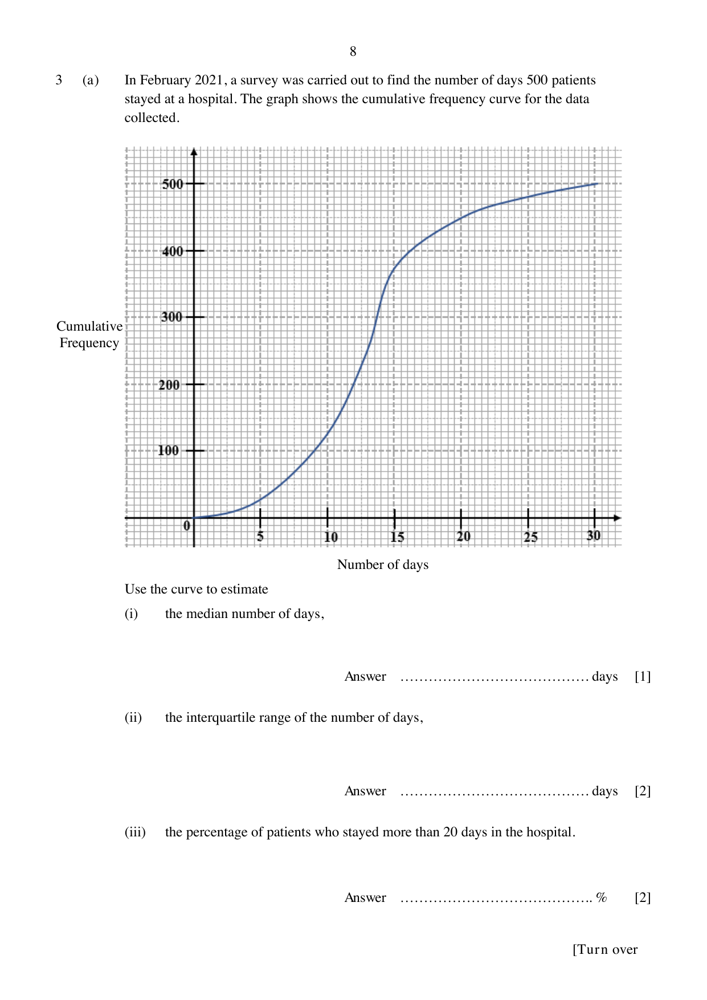
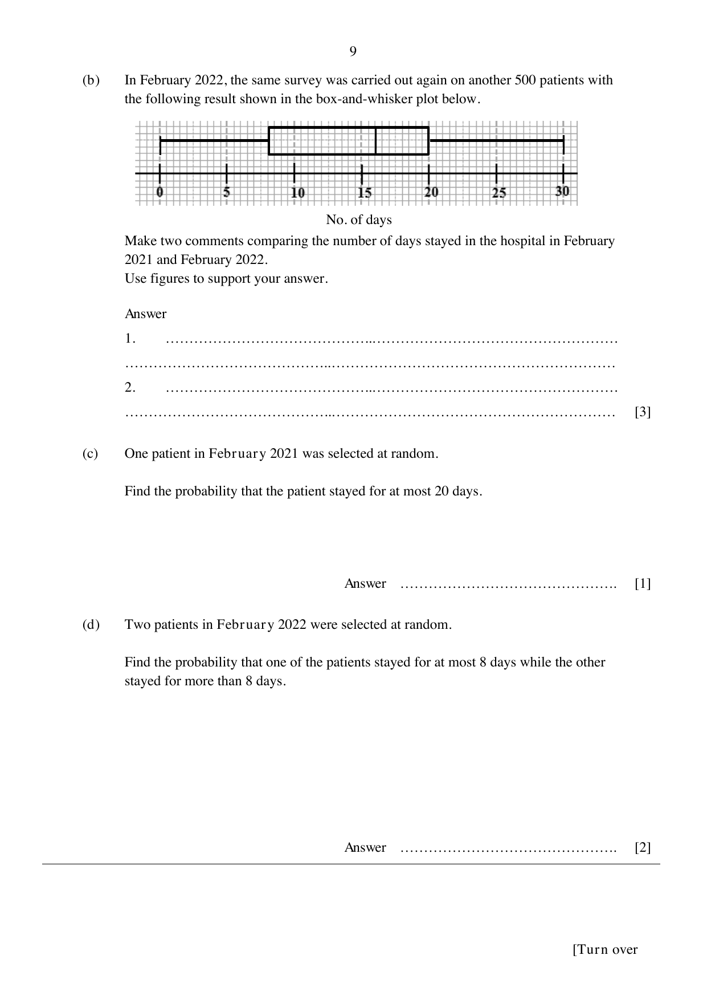
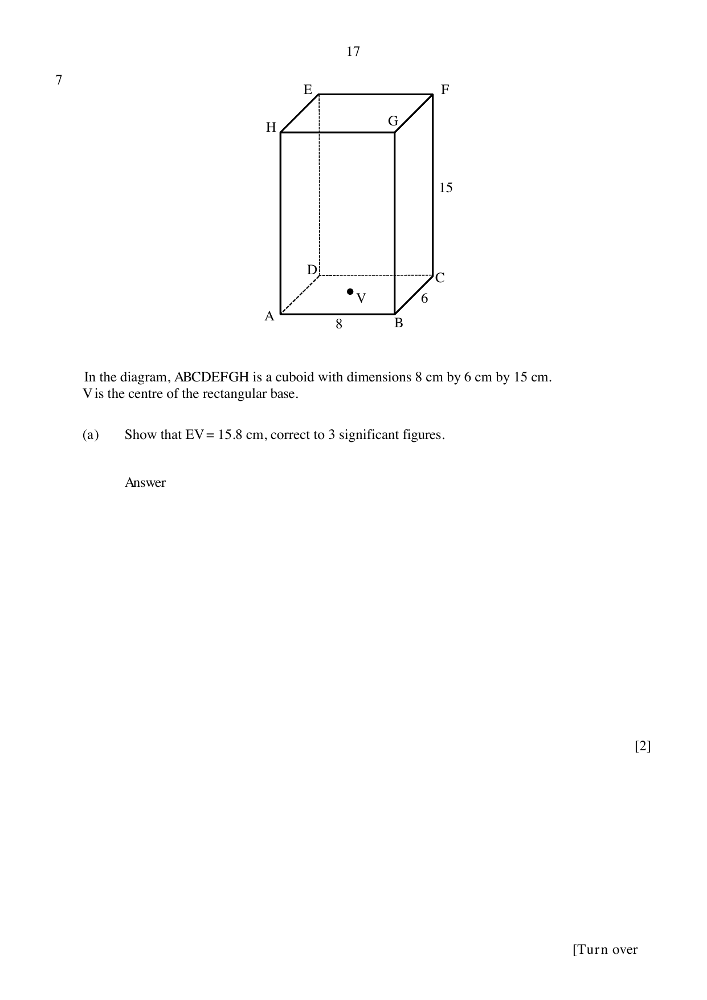

# Naval Base Secondary School — Mathematics 4052/02 Paper 2 (cleaned)

> **Institution:** Naval Base Secondary School
> **Exam:** Preliminary Examination 2024
> **Level:** Secondary 4 Express / 5 Normal (Academic)
> **Subjects:** Elementary Mathematics
> **Paper:** 4052/02 Paper 2
> **Date:** 22 August 2024
> **Duration:** 2 hours 15 minutes
> **Total Marks:** 90
> **Source:** `NBSS EM 2024 Prelim P2 QP.pdf`

---

## Instructions

Write your name, class and index number on all the work you hand in.
Write in dark blue or black pen.
You may use an HB pencil for any diagrams or graphs.
Do not use staples, paper clips, glue or correction fluid.

Answer all questions.
The number of marks is given in brackets [ ] at the end of each question or part question.

If working is needed for any question it must be shown with the answer.
Omission of essential working will result in loss of marks.
The total of the marks for this paper is 90.

The use of an approved scientific calculator is expected, where appropriate.
If the degree of accuracy is not specified in the question and if the answer is not exact, give the answer to three significant figures. Give answers in degrees to one decimal place.
For $\pi$, use either your calculator value or $3.142$.

Candidates answer on the Question Paper.

---

## Mathematical Formulae

*Compound interest*

$$
\text{Total amount} = P\left(1+\frac{r}{100}\right)^{n}
$$

*Mensuration*

$$
\text{Curved surface area of a cone} = \pi rl
$$

$$
\text{Surface area of a sphere} = 4\pi r^{2}
$$

$$
\text{Volume of a cone} = \frac{1}{3}\pi r^{2}h
$$

$$
\text{Volume of a sphere} = \frac{4}{3}\pi r^{3}
$$

$$
\text{Area of a triangle } ABC = \frac{1}{2}ab\sin C
$$

$$
\text{Arc length} = r\theta,\text{ where }\theta\text{ is in radians}
$$

$$
\text{Sector area} = \frac{1}{2}r^{2}\theta,\text{ where }\theta\text{ is in radians}
$$

*Trigonometry*

$$
\frac{a}{\sin A} = \frac{b}{\sin B} = \frac{c}{\sin C}
$$

$$
a^{2} = b^{2}+c^{2}-2bc\cos A
$$

*Statistics*

$$
\text{Mean} = \frac{\sum fx}{\sum f}
$$

$$
\text{Standard deviation} = \sqrt{\frac{\sum fx^{2}}{\sum f}-\left(\frac{\sum fx}{\sum f}\right)^{2}}
$$

---

## Answer all the questions.

### Q1

> **Marks:** (a) [2]; (b) [2]; (c) [3]; (d) [3]
> **Topic:** N7 Equations and inequalities
> **Sub-topic:** Equations and inequalities
> **LO:** [[context/subjects/o-level-e-maths/learning-objectives/o-level-e-maths-N7g.md|N7g]]
> **Page:** 3–4

**(a)** Solve $\dfrac{x}{5}+\dfrac{2x-3}{4} = -6$.

**(b)** Simplify $\dfrac{2(p-3q)}{10r}\div\dfrac{(3q-p)^{2}}{r}$.

**(c)** Solve the inequality $x+1 \le \dfrac{7x-2}{4} < \dfrac{5x+19}{5}$.

**(d)** Simplify $\dfrac{2y^{2}+7y-9}{4y^{2}-81}$.

### Q2

> **Marks:** (a)(i) [3]; (a)(ii) [3]; (b)(i) [2]; (b)(ii) [4]
> **Topic:** N4 Rate and speed
> **Sub-topic:** Rate and speed
> **LO:** [[context/subjects/o-level-e-maths/learning-objectives/o-level-e-maths-N4b.md|N4b]]
> **Page:** 5–7

**(a)** Cheryl wants to open a fixed deposit account with either Bank H or Bank L for a period of 4 years.

| Bank H Fixed Deposit Account | Bank L Fixed Deposit Account |
| --- | --- |
| Minimum deposit of ＄10 000. | No minimum amount required. |
| For the first ＄10 000, earn 0.05% simple interest per annum. | Compound interest at the rate of 0.8% per annum. |
| For the subsequent amount, earn 0.95% simple interest per annum. |  |

**(i)** Cheryl deposited ＄30 000 into Bank H.

Calculate the total amount in her account after 4 years.

**(ii)** Cheryl claimed that Bank H offers a better deal than Bank L.

Do you agree with Cheryl’s claim?
Justify your conclusion with clear calculations.

**(b) (i)** The exchange rate between Singapore dollars (S＄) and Chinese yuan (CNY) is S＄1 = CNY 5.33.

The exchange rate between Hong Kong dollars (HK＄) and Singapore dollars is HK＄1 = S＄0.17.

Tan is planning a trip to Hong Kong and Guangzhou.
He finds these hotel prices on a website.

| Guangzhou Hotel | CNY 825 |
| --- | --- |
| Hong Kong Hotel | HK＄825 |

By comparing the exchange rates, explain which hotel charges a cheaper rate per night.
Show your working clearly.

**(ii)** Tan books 4 nights in the Hong Kong hotel and 2 nights in the Guangzhou hotel.
He pays using his credit card. The credit card company converts the prices to Singapore dollars and charges a fee of $k\%$ for the currency conversion.

Given that the total amount Tan pays for the two hotels, including the credit card fee, is ＄890, find the value of $k$.

### Q3

> **Marks:** (a)(i) [1]; (a)(ii) [2]; (a)(iii) [2]; (b) [3]; (c) [1]; (d) [2]
> **Topic:** S1 Data handling and analysis
> **Sub-topic:** Data handling and analysis
> **LO:** [[context/subjects/o-level-e-maths/learning-objectives/o-level-e-maths-S1i.md|S1i]]
> **Page:** 8–9

**(a)** In February 2021, a survey was carried out to find the number of days 500 patients stayed at a hospital. The graph shows the cumulative frequency curve for the data collected.

Use the curve to estimate

**(i)** the median number of days,

**(ii)** the interquartile range of the number of days,

**(iii)** the percentage of patients who stayed more than 20 days in the hospital.

**(b)** In February 2022, the same survey was carried out again on another 500 patients with the following result shown in the box-and-whisker plot below.

Make two comments comparing the number of days stayed in the hospital in February 2021 and February 2022.
Use figures to support your answer.

**(c)** One patient in February 2021 was selected at random.

Find the probability that the patient stayed for at most 20 days.

**(d)** Two patients in February 2022 were selected at random.

Find the probability that one of the patients stayed for at most 8 days while the other stayed for more than 8 days.

### Q4

> **Marks:** (a) [2]; (b) [3]; (c) [2]; (d) [3]; (e) [1]
> **Topic:** N6 Functions and graphs
> **Sub-topic:** Functions and graphs
> **LO:** [[context/subjects/o-level-e-maths/learning-objectives/o-level-e-maths-N6j.md|N6j]]
> **Page:** 10–12

**(a)** Complete the table of values for $y = \dfrac{x^{3}}{5}-x^{2}+2$.

| $x$ | $-2$ | $-1$ | $0$ | $1$ | $2$ | $3$ | $4$ | $5$ |
| --- | --- | --- | --- | --- | --- | --- | --- | --- |
| $y$ | $-3.6$ |  | $2$ | $1.2$ | $-0.4$ | $-1.6$ | $-1.2$ |  |

**(b)** On the grid, draw the graph of $y = \dfrac{x^{3}}{5}-x^{2}+2$ for $-2 \le x \le 5$.

**(c)** By drawing a tangent, find the gradient of the curve at the point when $x = 4$.

**(d)** By drawing a suitable straight line on the grid, solve the equation $\dfrac{x^{3}}{5}-x^{2}+1 = 0$.

**(e)** “$y = k$ will always have exactly three intersections with $y = \dfrac{x^{3}}{5}-x^{2}+2$ when $k$ is negative.”

The above statement is false. Suggest a possible value of $k$.

### Q5

> **Marks:** (a)(i) [2]; (a)(ii) [2]; (b)(i) [2]; (b)(ii) [2]
> **Topic:** G5 Mensuration
> **Sub-topic:** Mensuration
> **LO:** [[context/subjects/o-level-e-maths/learning-objectives/o-level-e-maths-G5c.md|G5c]]
> **Page:** 13–14

**(a)** The diagram shows a container which consists of a cylinder of radius $r$ cm and height $h$ cm joined to a hemisphere of radius $r$ cm.

**(i)** Given that the ratio of the volume of the hemisphere to the volume of the cylinder is $1:3$, show that $h = 2r$.

**(ii)** The container is filled with water to a depth of 8 cm.

Find an expression, in terms of $\pi$ and $r$, for the surface area of the container that is in contact with the water.

**(b)** Three tin containers are geometrically similar.
The heights of tin container A and tin container C are 8 cm and 16 cm respectively.

**(i)** The base area of tin container B is $\dfrac{25}{64}$ of the base area of tin container C.

Calculate the height of tin container B.

**(ii)** The weight of tin container C is 450 g.

Calculate the weight of tin container A.

### Q6

> **Marks:** (a) [3]; (b)(i) [3]; (b)(ii) [3]
> **Topic:** G2 Congruence and similarity
> **Sub-topic:** Congruence and similarity
> **LO:** [[context/subjects/o-level-e-maths/learning-objectives/o-level-e-maths-G2i.md|G2i]]
> **Page:** 15–16

The diagram, not drawn to scale, shows two concentric circles, centre $O$.
$AB$ and $AD$ are tangents to the smaller circle at $B$ and $D$ respectively.
$AC$ is the diameter of the larger circle.

**(a)** Show that triangle $ABC$ is congruent to triangle $ADC$.
Give a reason for each statement you make.

**(b)** The radius of the larger circle is 8 cm and angle $BAO = 42.5^{\circ}$.

**(i)** Calculate the area of triangle $AOB$.

**(ii)** Calculate the area of the shaded region.

### Q7

> **Marks:** (a) [2]; (b) [4]; (c) [3]
> **Topic:** G4 Pythagoras' theorem and trigonometry
> **Sub-topic:** Pythagoras' theorem and trigonometry
> **LO:** [[context/subjects/o-level-e-maths/learning-objectives/o-level-e-maths-G4g.md|G4g]]
> **Page:** 17–19

$ABCDEFGH$ is a cuboid with dimensions 8 cm by 6 cm by 15 cm.
$V$ is the centre of the rectangular base.

**(a)** Show that $EV = 15.8$ cm, correct to 3 significant figures.

**(b)** Calculate angle $ACE$.

**(c)** A pyramid $EDAC$ is cut out from the cuboid.

Find the remaining volume of the cuboid.

### Q8

> **Marks:** (a)(i) [1]; (a)(ii) [1]; (a)(iii) [1]; (a)(iv) [3]; (b)(i) [1]; (b)(ii) [2]; (b)(iii) [2]; (b)(iv) [1]
> **Topic:** G7 Vectors in two dimensions
> **Sub-topic:** Vectors in two dimensions
> **LO:** [[context/subjects/o-level-e-maths/learning-objectives/o-level-e-maths-G7h.md|G7h]]
> **Page:** 20–22

**(a)** $A$ is the point $(1, -4)$ and $B$ is the point $(-7, -2)$.
The point $C$ is the result of the translation of point $B$ by $\begin{pmatrix} 5 \\ 4 \end{pmatrix}$.

**(i)** Find the length of $AB$.

**(ii)** Write down the column vector $\overrightarrow{AB}$.

**(iii)** Find the coordinates of point $C$.

**(iv)** Find the equation of the line $AC$.

**(b)** $OABC$ is a trapezium.
$\overrightarrow{OA} = \mathbf{a}$, $\overrightarrow{OC} = 2\mathbf{c}$ and $\overrightarrow{CB} = 2\mathbf{a}$.
$OP:PB = 1:3$.

**(i)** Express $\overrightarrow{OB}$ in terms of $\mathbf{a}$ and $\mathbf{c}$, as simply as possible.

**(ii)** Express $\overrightarrow{CP}$ in terms of $\mathbf{a}$ and $\mathbf{c}$, as simply as possible.

**(iii)** Explain why $C$, $P$ and $A$ do not lie on a straight line.

**(iv)** Write down the value of $\dfrac{\text{area of triangle } OBC}{\text{area of trapezium } OABC}$.

### Q9

> **Marks:** (a) [1]; (b) [7]
> **Topic:** G5 Mensuration
> **Sub-topic:** Mensuration
> **LO:** [[context/subjects/o-level-e-maths/learning-objectives/o-level-e-maths-G5c.md|G5c]]
> **Page:** 23–25

The table below shows the price board displayed at a petrol station on 12 April 2023.

| Grade | Pump price (per litre) | Nett price (per litre) |
| --- | --- | --- |
| Levo 98 | ＄3.41 | $x$ |
| Levo 95 | ＄2.92 | ＄2.77 |
| Levo Diesel | ＄2.69 | ＄2.55 |

Pump price refers to the price before a discount is given, whereas nett price refers to the price after a discount is given. The discount given for the 3 grades is the same.

**(a)** Find the value of $x$.

**(b)** Mrs Ong always drives her car from her house in Singapore to Malacca to visit her parents.

Fuel tank capacity: 11.0952 gallon.

Fuel consumption: 47 miles per gallon (mpg).

Fuel consumption is distance travelled per unit volume of fuel used.
1 mpg $= 0.42554$ km/litre.
1 gallon $= 3.7855$ litres.

Mrs Ong decided to visit her parents during Labour Day.
She pumped a full tank of Levo 95 for the car and drove a distance of 244 km.
The tank was left with 70% of fuel in the end.

Mrs Ong made two claims:

“The fuel consumption was 47 mpg.”

and

“The total discount she received would allow her to travel an extra distance of approximately 13.6 km.”

Were her claims correct?
Justify your decisions and show your calculations clearly.
