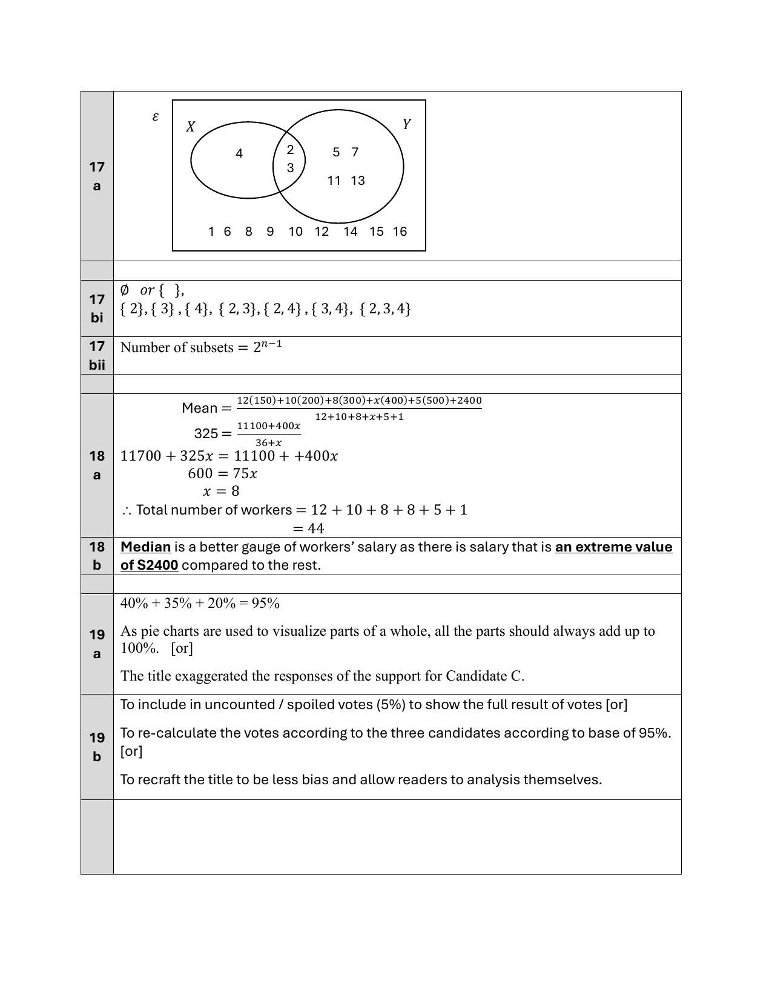
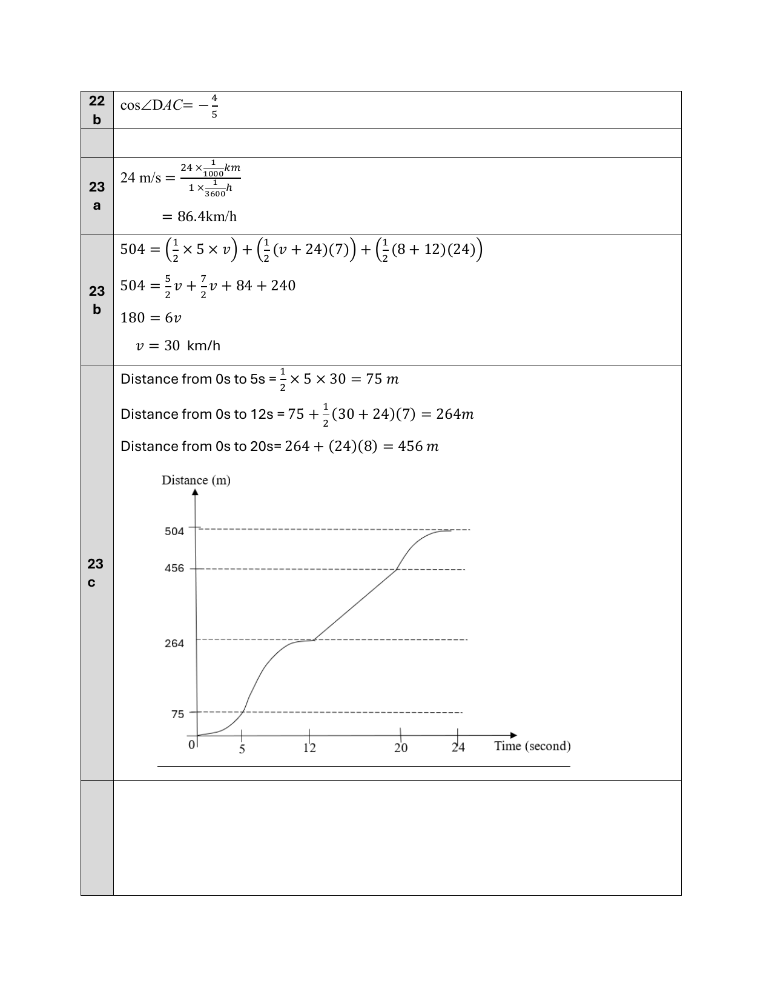
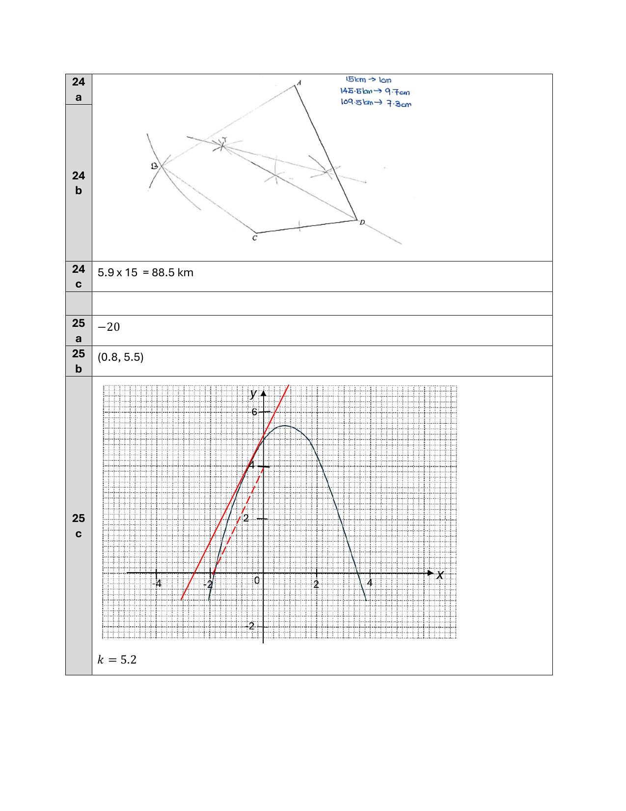

# Nan Chiau High School — Mathematics 4052/01 Paper 1 Suggested Solutions (cleaned)

> **Institution:** Nan Chiau High School
> **Exam:** Preliminary Examination 2024
> **Level:** Secondary 4
> **Subjects:** Elementary Mathematics
> **Paper:** 4052/01 Paper 1
> **Date:** 15 August 2024
> **Duration:** 2 hours 15 minutes
> **Total Marks:** 90
> **Source:** `2024 NCHS Prelim Math P1 Suggested Solutions.pdf`

Page numbers below are the question paper’s physical pages.

---

### Q1

> **Marks:** (a) [1]; (b) [1]
> **Sub-topic:** Number
> **Page:** 3

**(a)** False

**(b)** False

### Q2

> **Marks:** [2]
> **Sub-topic:** Number
> **Page:** 3

$$
\begin{aligned}
\frac{105b}{a} &= \frac{(3\times 5\times 7)(2^{2}\times 5\times 7)}{2\times 3^{2}\times 5} \\
&= \frac{2^{2}\times 3\times 5^{2}\times 7^{2}}{2\times 3^{2}\times 5} \\
&= \frac{2\times 5\times 7^{2}}{3}
\end{aligned}
$$

Numerator $2\times 5\times 7^{2}$ does not include the factor 3 to reduce $\dfrac{105b}{a}$ to a whole number.

### Q3

> **Marks:** [3]
> **Sub-topic:** Algebra
> **Page:** 4

Length of shorter portion of rope $= \dfrac{4}{11}\times 44 = 16$ cm.

Length of longer portion of rope $= 28$ cm.

Let $x$ be the length of rope cut.

$$
\begin{aligned}
\frac{16-x}{28-x} &= \frac{2}{5} \\
5(16-x) &= 2(28-x) \\
80-5x &= 56-2x \\
24 &= 3x \\
x &= 8
\end{aligned}
$$

### Q4

> **Marks:** [2]
> **Sub-topic:** Algebra
> **Page:** 4

$$
\begin{aligned}
7^{9-x^{2}}-1 &= 0 \\
7^{9-x^{2}} &= 1 \\
7^{(3-x)(3+x)} &= 7^{0} \\
x &= 3 \text{ or } x = -3
\end{aligned}
$$

### Q5

> **Marks:** [3]
> **Sub-topic:** Algebra
> **Page:** 5

$$
\begin{aligned}
y^{3} &= \frac{k}{x^{2}} \\
\frac{k}{3^{2}}-\frac{k}{6^{2}} &= 5 \\
\frac{k}{9}-\frac{k}{36} &= 5 \\
\frac{k}{12} &= 5 \\
k &= 60 \\
8 &= \frac{60}{x^{2}} \\
x^{2} &= 7.5 \\
x &= \pm 2.74
\end{aligned}
$$

### Q6

> **Marks:** [2]
> **Sub-topic:** Number
> **Page:** 5

$$
\begin{aligned}
24\text{ g} &\to 12.044\times 10^{23}\text{ atoms} \\
1\text{ g} &\to 0.501833\times 10^{23}\text{ atoms} \\
5000\text{ g} &\to 0.501833\times 10^{23}\times 5000 \\
&= 2509.167\times 10^{23} \\
&= 2.51\times 10^{26}
\end{aligned}
$$

### Q7

> **Marks:** (a) [1]; (b) [1]; (c) [1]
> **Sub-topic:** Graphs
> **Page:** 6

**(a)** Diagram A

**(b)** Diagram B

**(c)** Diagram D

### Q8

> **Marks:** [2]
> **Sub-topic:** Algebra
> **Page:** 7

$$
\begin{aligned}
9x+2.5y &= 3y-2x \\
11x &= 0.5y \\
22x &= y \\
\frac{x}{y} &= \frac{1}{22}
\end{aligned}
$$

Hence, $x = 22$ and $y = 1$ is not a solution, as $22(22)\neq 1$.

Or

LHS $= 9(22)+2.5(1) = 200.5$

RHS $= 3(1)-2(22) = -41$

Since LHS $\neq$ RHS, $x = 22$ and $y = 1$ is not a solution.

### Q9

> **Marks:** (a) [1]; (b) [2]
> **Sub-topic:** Graphs
> **Page:** 7

**(a)** The line $y = -x$ passes through the origin with gradient $-1$.

**(b)**

$$
\begin{aligned}
3y-kx-9 &= 0 \\
3y &= kx+9 \\
y &= \frac{k}{3}x+3,\text{ where }k < -3
\end{aligned}
$$

The line has $y$-intercept $3$ and a negative gradient steeper than $-1$.

### Q10

> **Marks:** [3]
> **Sub-topic:** Algebra
> **Page:** 8

Let the first digit be $x$ and the second digit be $y$.

| Step | Expression |
| --- | --- |
| A number between 20 to 100 | Let the number be $10x+y$ |
| Add the two digits together | $x+y$ |
| Subtract the sum of the two digits from your original number to get a new number | $(10x+y)-(x+y) = 9x$ |
| The new number is a multiple of 3 | Since the new number is a multiple of 9 and 3 is a factor of 9, hence the new number is a multiple of 3. |

### Q11

> **Marks:** [2]
> **Sub-topic:** Algebra
> **Page:** 9

$$
\begin{aligned}
2(mn)^{2}-2mn &= 3mn+3 \\
2m^{2}n^{2}-5mn-3 &= 0 \\
(mn-3)(2mn+1) &= 0 \\
mn &= 3 \text{ or } mn = -\frac{1}{2} \\
n &= \frac{3}{m} \text{ or } n = -\frac{1}{2m}
\end{aligned}
$$

### Q12

> **Marks:** [3]
> **Sub-topic:** Algebra
> **Page:** 9

$$
\begin{aligned}
\frac{4}{3}+\frac{2}{9m}\div\sqrt[4]{81m^{16}} &= \frac{4}{3}+\frac{2}{9m}\div 3m^{4} \\
&= \frac{4}{3}+\frac{2}{9m}\times\frac{1}{3m^{4}} \\
&= \frac{4}{3}+\frac{2}{27m^{5}} \\
&= \frac{36m^{5}+2}{27m^{5}}
\end{aligned}
$$

### Q13

> **Marks:** [3]
> **Sub-topic:** Algebra
> **Page:** 10

$$
\begin{aligned}
\frac{-9x^{2}+12x-4}{3-\dfrac{1}{x-\dfrac{x}{2}}} &= \frac{-(3x-2)^{2}}{3-\dfrac{1}{\dfrac{2x-x}{2}}} \\
&= \frac{-(3x-2)^{2}}{3-\dfrac{2}{x}} \\
&= \frac{-(3x-2)^{2}}{\dfrac{3x-2}{x}} \\
&= -x(3x-2)
\end{aligned}
$$

### Q14

> **Marks:** [3]
> **Sub-topic:** Algebra
> **Page:** 11

$$
\begin{aligned}
y &= \frac{1}{5}x^{2}-2x+7 &&\text{[1]} \\
y &= x &&\text{[2]}
\end{aligned}
$$

Substitute equation [1] into equation [2].

$$
\begin{aligned}
x &= \frac{1}{5}x^{2}-2x+7 \\
\frac{1}{5}x^{2}-3x+7 &= 0 \\
x &= \frac{3\pm\sqrt{(-3)^{2}-4\left(\dfrac{1}{5}\right)(7)}}{2\left(\dfrac{1}{5}\right)} \\
x &= 2.89 \text{ or } x = 12.1 \\
y &= 2.89 \text{ or } y = 12.1
\end{aligned}
$$

$(2.89, 2.89)$ and $(12.1, 12.1)$

### Q15

> **Marks:** (a) [2]; (b) [4]
> **Sub-topic:** Graphs
> **Page:** 12

**(a)** Let the $y$-intercept (vertical distance) be $d$.

By Pythagoras’ theorem,

$$
\begin{aligned}
d &= \sqrt{17^{2}-8^{2}} \\
d &= 15 \\
\therefore C(0, -15)
\end{aligned}
$$

**(b)** Let the $x$-coordinate of point $B$ be $b$.

$$
\begin{aligned}
b &= \frac{1}{8}(-15) \\
b &= -\frac{15}{8}
\end{aligned}
$$

Equation of the line of symmetry:

$$
x = \frac{-\dfrac{15}{8}+(-8)}{2} = -\frac{79}{16}
$$

Since $y = -15$ when $x = 0$, the coefficient of $x^{2}$ is $-1$.

$$
y = -\left(x+8\right)\left(x+\frac{15}{8}\right) \quad\text{or}\quad y = -\frac{1}{8}(x+8)(8x+15)
$$

$$
\begin{aligned}
y &= -\left(-\frac{79}{16}+8\right)\left(-\frac{79}{16}+\frac{15}{8}\right) \\
&= \frac{2401}{256}
\end{aligned}
$$

The coordinate of the maximum point is $\left(-\dfrac{79}{16}, \dfrac{2401}{256}\right)$ or $(-4.94, 9.38)$.

### Q16

> **Marks:** (a) [3]; (b) [2]
> **Sub-topic:** Probability
> **Page:** 13

**(a)**

$$
\begin{aligned}
\frac{8}{(8+5+x)}\times\frac{7}{(7+5+x)} &= \frac{4}{33} \\
\frac{8}{13+x}\times\frac{7}{12+x} &= \frac{4}{33} \\
33(8)(7) &= 4(13+x)(12+x) \\
462 &= x^{2}+25x+156 \\
x^{2}+25x-306 &= 0 \\
(x-9)(x+34) &= 0 \\
x &= 9 \text{ or } x = -34\text{ (rejected)}
\end{aligned}
$$

**(b)** Probability that only the second marble is green when three marbles are drawn:

$$
\frac{17}{22}\times\frac{5}{21}\times\frac{16}{20} = \frac{34}{231}
$$

### Q17

> **Marks:** (a) [3]; (b)(i) [2]; (b)(ii) [2]
> **Sub-topic:** Sets
> **Page:** 14

**(a)** $X\cap Y = \{2, 3\}$, $X$ only $= \{4\}$, $Y$ only $= \{5, 7, 11, 13\}$, and outside both $= \{1, 6, 8, 9, 10, 12, 14, 15, 16\}$.

**(b) (i)** $\varnothing$ or $\{\}$, $\{2\}$, $\{3\}$, $\{4\}$, $\{2, 3\}$, $\{2, 4\}$, $\{3, 4\}$, $\{2, 3, 4\}$

**(ii)** Number of subsets $= 2^{n-1}$

### Q18

> **Marks:** (a) [3]; (b) [2]
> **Sub-topic:** Statistics
> **Page:** 15

**(a)**

$$
\begin{aligned}
325 &= \frac{12(150)+10(200)+8(300)+x(400)+5(500)+2400}{12+10+8+x+5+1} \\
325 &= \frac{11100+400x}{36+x} \\
11700+325x &= 11100+400x \\
600 &= 75x \\
x &= 8
\end{aligned}
$$

Total number of workers $= 12+10+8+8+5+1 = 44$.

**(b)** Median is a better gauge of workers’ salary as there is a salary that is an extreme value of ＄2400 compared to the rest.

### Q19

> **Marks:** (a) [1]; (b) [1]
> **Sub-topic:** Statistics
> **Page:** 16

**(a)** $40\%+35\%+20\% = 95\%$.

As pie charts are used to visualize parts of a whole, all the parts should always add up to 100%.

Or the title exaggerated the responses of the support for Candidate C.

**(b)** To include uncounted / spoiled votes (5%) to show the full result of votes.

Or to re-calculate the votes according to the three candidates according to a base of 95%.

Or to recraft the title to be less bias and allow readers to analysis themselves.

### Q20

> **Marks:** (a) [3]; (b) [2]
> **Sub-topic:** Mensuration
> **Page:** 17

**(a)**

$$
\begin{aligned}
\text{Area of rhombus} &= 2\times\frac{1}{2}(7.4)(7.4)\sin 60^{\circ} \\
&= 47.424\text{ cm}^{2}
\end{aligned}
$$

Or height of rhombus $= (7.4)(\sin 60^{\circ}) = 6.4086$ cm, so area $= (6.4086)(7.4) = 47.424\text{ cm}^{2}$.

$$
\begin{aligned}
AD^{2} &= 7.4^{2}+7.4^{2}-2(7.4)(7.4)\cos 120^{\circ} \\
AD &= 12.817\text{ cm} \\
\text{Area of sector} &= \frac{60}{360}\times\pi(12.817)^{2} = 86.014\text{ cm}^{2} \\
\text{Shaded area} &= 86.014-47.424 = 38.6\text{ cm}^{2}
\end{aligned}
$$

**(b)**

$$
\begin{aligned}
\text{Arc length} &= \frac{60}{360}\times 2\pi(12.817) = 13.422 \\
\text{Perimeter} &= 13.422+2(12.817-7.4)+2(7.4) = 39.1\text{ cm}
\end{aligned}
$$

### Q21

> **Marks:** (a) [1]; (b) [1]; (c) [4]
> **Sub-topic:** Algebra
> **Page:** 18

**(a)** $10^{2}+4^{2} = (10-4)^{2}+2(10)(4)$

**(b)** $(2n)^{2}+(n-1)^{2} = (2n-n+1)^{2}+2(2n)(n-1)$, or $4n^{2}+n^{2}-2n+1$, or $5n^{2}-2n+1$.

**(c)**

$$
\begin{aligned}
p^{2}+q^{2} &= 1249 \\
5n^{2}-2n+1 &= 1249 \\
5n^{2}-2n-1248 &= 0 \\
(n-16)(5n+78) &= 0 \\
n &= 16 \text{ or } n = -\frac{78}{5}\text{ (rejected)}
\end{aligned}
$$

Hence $p = 32$ and $q = 15$.

### Q22

> **Marks:** (a) [3]; (b) [1]
> **Sub-topic:** Trigonometry
> **Page:** 19

**(a)**

$$
\begin{aligned}
AB^{2}+BC^{2} &= 6.4^{2}+4.8^{2} = 64 \\
AC^{2} &= 8^{2} = 64
\end{aligned}
$$

Since $AB^{2}+BC^{2} = AC^{2}$, by the converse of Pythagoras’ theorem, $\angle ABC = 90^{\circ}$.

$$
\sin\angle ACB = \frac{6.4}{8} = \frac{4}{5}
$$

**(b)** $\cos\angle DAC = -\dfrac{4}{5}$

### Q23

> **Marks:** (a) [1]; (b) [2]; (c) [2]
> **Sub-topic:** Graphs
> **Page:** 20–21

**(a)**

$$
24\text{ m/s} = \frac{24\times\dfrac{1}{1000}\text{ km}}{1\times\dfrac{1}{3600}\text{ h}} = 86.4\text{ km/h}
$$

**(b)** Printed working:

$$
\begin{aligned}
504 &= \left(\frac{1}{2}\times 5\times v\right)+\left(\frac{1}{2}(v+24)(7)\right)+\left(\frac{1}{2}(8+12)(24)\right) \\
504 &= \frac{5}{2}v+\frac{7}{2}v+84+240 \\
180 &= 6v \\
v &= 30\text{ km/h}
\end{aligned}
$$

**(c)**

Distance from 0 s to 5 s $= \dfrac{1}{2}\times 5\times 30 = 75$ m.

Distance from 0 s to 12 s $= 75+\dfrac{1}{2}(30+24)(7) = 264$ m.

Distance from 0 s to 20 s $= 264+(24)(8) = 456$ m.

### Q24

> **Marks:** (a) [1]; (b) [2]; (c) [2]
> **Sub-topic:** Geometry
> **Page:** 22

**(a)** and **(b)** Construction: $145.5\text{ km}\to 9.7\text{ cm}$ and $109.5\text{ km}\to 7.3\text{ cm}$. Point $B$ is the intersection of those arcs. $T$ is the intersection of the perpendicular bisector of $AC$ and the angle bisector of $\angle ADC$.

**(c)** $5.9\times 15 = 88.5$ km.

### Q25

> **Marks:** (a) [1]; (b) [1]; (c) [2]
> **Sub-topic:** Graphs
> **Page:** 23

**(a)** $-20$

**(b)** $(0.8, 5.5)$

**(c)** $k = 5.2$. The tangent of gradient 2 is drawn on the graph in the image above.
