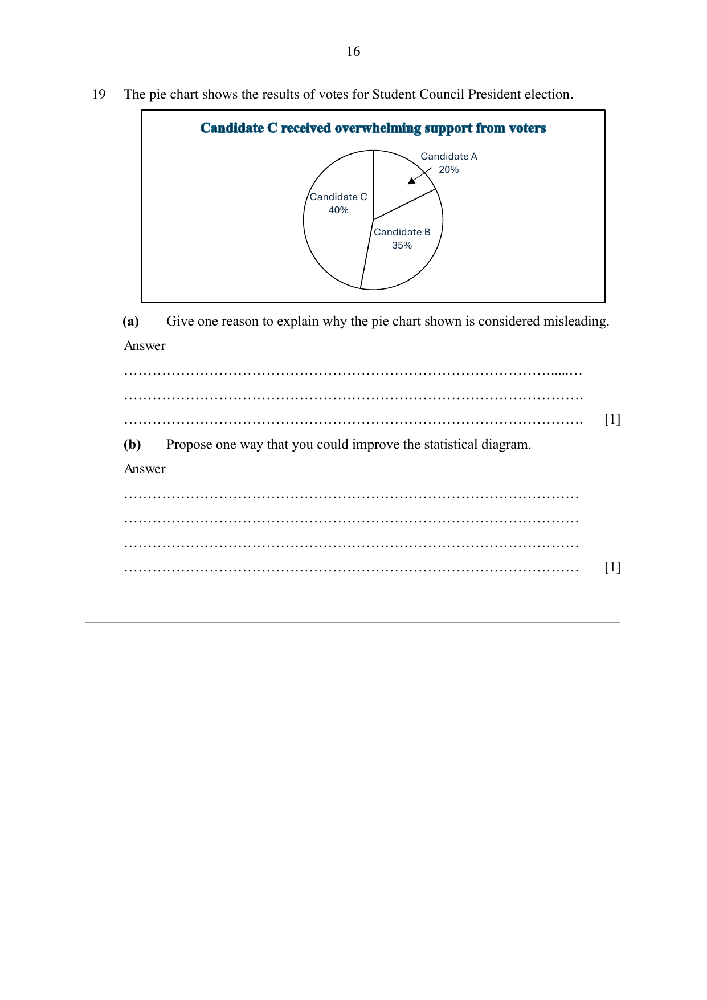
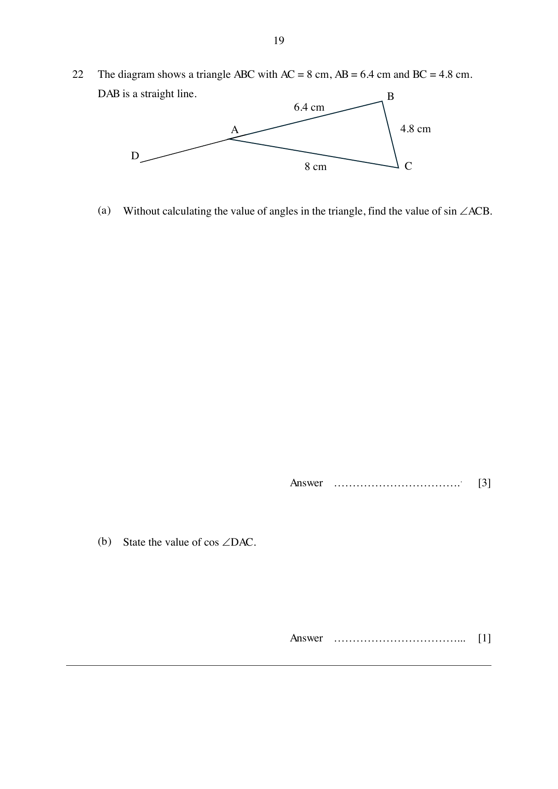

# Nan Chiau High School — Mathematics 4052/01 Paper 1 (cleaned)

> **Institution:** Nan Chiau High School
> **Exam:** Preliminary Examination 2024
> **Level:** Secondary Four Express
> **Subjects:** Elementary Mathematics
> **Paper:** 4052/01 Paper 1
> **Date:** 15 August 2024, Thursday
> **Duration:** 2 hours 15 minutes
> **Total Marks:** 90
> **Source:** `2024 NCHS Prelim Math P1 QP.pdf`

---

## Instructions

Write your name, class and register number in the spaces at the top of this page.
Write in dark blue or black pen.
You may use an HB pencil for any diagrams or graphs.
Do not use staples, paper clips, highlighters, glue or correction fluid.

Answer all questions.
If working is needed for any question it must be shown with the answer.
Omission of essential working will result in loss of marks.
The use of an approved calculator is expected, where appropriate.
If the degree of accuracy is not specified in the question, and if the answer is not exact, give the answer to three significant figures. Give answers in degrees to one decimal place.
For $\pi$, use either your calculator value or $3.142$, unless the question requires the answer in terms of $\pi$.

The number of marks is given in brackets [ ] at the end of each question or part question.
The total marks for this paper is 90.

Candidates answer on the Question Paper.

---

## Mathematical Formulae

*Compound interest*

$$
\text{Total amount} = P\left(1+\frac{r}{100}\right)^{n}
$$

*Mensuration*

$$
\text{Curved surface area of a cone} = \pi rl
$$

$$
\text{Surface area of a sphere} = 4\pi r^{2}
$$

$$
\text{Volume of a cone} = \frac{1}{3}\pi r^{2}h
$$

$$
\text{Volume of a sphere} = \frac{4}{3}\pi r^{3}
$$

$$
\text{Area of triangle } ABC = \frac{1}{2}ab\sin C
$$

$$
\text{Arc length} = r\theta,\text{ where }\theta\text{ is in radians}
$$

$$
\text{Sector area} = \frac{1}{2}r^{2}\theta,\text{ where }\theta\text{ is in radians}
$$

*Trigonometry*

$$
\frac{a}{\sin A} = \frac{b}{\sin B} = \frac{c}{\sin C}
$$

$$
a^{2} = b^{2}+c^{2}-2bc\cos A
$$

*Statistics*

$$
\text{Mean} = \frac{\Sigma fx}{\Sigma f}
$$

$$
\text{Standard deviation} = \sqrt{\frac{\Sigma fx^{2}}{\Sigma f}-\left(\frac{\Sigma fx}{\Sigma f}\right)^{2}}
$$

---

## Answer all the questions.

### Q1

> **Marks:** (a) [1]; (b) [1]
> **Sub-topic:** Number
> **Page:** 3

State whether each of the following statements is True or False.

**(a)** All natural numbers are either composite or prime number.

**(b)** For all real values of $x$, $x^{3}$ is always greater than $x^{2}$.

### Q2

> **Marks:** [2]
> **Sub-topic:** Number
> **Page:** 3

$a = 2 \times 3^{2} \times 5$

$b = 2^{2} \times 5 \times 7$

Using only prime factorisation, explain why $\dfrac{105b}{a}$ is not a whole number.

### Q3

> **Marks:** [3]
> **Sub-topic:** Algebra
> **Page:** 4

A rope is 44 m long.
Jay cuts the rope into two pieces so that the ratio of their lengths is $4:7$.
He subsequently cuts away the same length of rope from each piece. The new ratio of the remaining lengths of the ropes is $2:5$.
Calculate the length that Jay had cut away from each piece of rope.

### Q4

> **Marks:** [2]
> **Sub-topic:** Algebra
> **Page:** 4

Solve $7^{9-x^{2}}-1 = 0$. Find the values of $x$.

### Q5

> **Marks:** [3]
> **Sub-topic:** Algebra
> **Page:** 5

It is given that $y^{3}$ is inversely proportional to the square of $x$.
The difference between the value of $y^{3}$ when $x = 3$ and $x = 6$ is $5$.
Find the values of $x$ when $y = 2$.

### Q6

> **Marks:** [2]
> **Sub-topic:** Number
> **Page:** 5

There are $12.044 \times 10^{23}$ atoms in 24 g of carbon.
Find the number of atoms in 5 kg of carbon. Leave your answer in standard form.

### Q7

> **Marks:** (a) [1]; (b) [1]; (c) [1]
> **Sub-topic:** Graphs
> **Page:** 6

The diagrams show the graphs of six different functions.

In each case, select one of the graphs that best represent the equation.

**(a)** $y = (x^{2}-4)(x+4)$

**(b)** $y = -\dfrac{2}{x}$

**(c)** $y = x^{2}-x^{3}$

### Q8

> **Marks:** [2]
> **Sub-topic:** Algebra
> **Page:** 7

Explain whether $x = 22$ and $y = 1$ is a possible solution of the equation $9x+2.5y = 3y-2x$.

### Q9

> **Marks:** (a) [1]; (b) [2]
> **Sub-topic:** Graphs
> **Page:** 7

On the axes provided, indicating the $y$-intercept clearly, sketch the graph of

**(a)** $y = -x$,

**(b)** $3y-kx-9 = 0$, where $k < -3$.

### Q10

> **Marks:** [3]
> **Sub-topic:** Algebra
> **Page:** 8

Jake plays a mind-reading game with his friends.

Think of a number between 20 to 100.
Add the two digits together.
Subtract the sum of the two digits from your original number to get a new number.
…. And the new number is a multiple of 3!

Using algebraic expression, explain clearly why Jake is able to predict that the new number is a multiple of 3.

### Q11

> **Marks:** [2]
> **Sub-topic:** Algebra
> **Page:** 9

It is given that $2(mn)^{2}-2mn = 3mn+3$.
Find $n$ in terms of $m$.

### Q12

> **Marks:** [3]
> **Sub-topic:** Algebra
> **Page:** 9

Simplify $\dfrac{4}{3}+\dfrac{2}{9m}\div\sqrt[4]{81m^{16}}$, giving your answer as a single fraction.

### Q13

> **Marks:** [3]
> **Sub-topic:** Algebra
> **Page:** 10

Simplify $\dfrac{-9x^{2}+12x-4}{3-\dfrac{1}{x-\dfrac{x}{2}}}$.

### Q14

> **Marks:** [3]
> **Sub-topic:** Algebra
> **Page:** 11

The curve $y = \dfrac{1}{5}x^{2}-2x+7$ intersects a line which is equidistant from the positive $x$ and $y$-axes. Find the coordinates of the points of intersection.

### Q15

> **Marks:** (a) [2]; (b) [4]
> **Sub-topic:** Graphs
> **Page:** 12

In the diagram, the quadratic curve cuts the $x$-intercept at point $A(-8, 0)$ and point $B$.
The curve also cuts the $y$-intercept at point $C$.
The distance of point $B$ from the origin is one-eighth of the distance of point $C$ from the origin. The distance of $AC$ is 17 units.

**(a)** Find the coordinates of point $C$.

**(b)** Find the coordinates of the maximum point.

### Q16

> **Marks:** (a) [3]; (b) [2]
> **Sub-topic:** Probability
> **Page:** 13

A bag contains 8 blue marbles, 5 green marbles and $x$ yellow marbles.
The marbles are drawn one after the other from the bag, at random, without replacement.

**(a)** The probability that two blue marbles are drawn is $\dfrac{4}{33}$. Calculate the value of $x$.

**(b)** The two marbles drawn in part (a) are returned into the bag.
Hence, calculate the probability that only the second marble is green when three marbles are drawn from the bag.

### Q17

> **Marks:** (a) [3]; (b)(i) [2]; (b)(ii) [2]
> **Sub-topic:** Sets
> **Page:** 14

Given that

$\varepsilon = \{\text{positive integers less than } 17\}$,

$X = \{2, 3, 4\}$

$Y = \{\text{prime numbers}\}$

$Z = \{2, 3, 4, 5, \ldots, n-1, n\}$

**(a)** Draw a Venn Diagram to represent the set $\varepsilon$, $X$ and $Y$, indicating the elements clearly.

**(b)** **(i)** List all subsets of $X$.

**(ii)** Hence, deduce the number of subsets of $Z$ in term of $n$.

### Q18

> **Marks:** (a) [3]; (b) [2]
> **Sub-topic:** Statistics
> **Page:** 15

The table represents the weekly salary of workers in a company.

| Weekly salary | ＄150 | ＄200 | ＄300 | ＄400 | ＄500 | ＄2400 |
| --- | --- | --- | --- | --- | --- | --- |
| Number of workers | 12 | 10 | 8 | $x$ | 5 | 1 |

**(a)** Given that the weekly mean salary of the workers is ＄325, calculate the total number of workers in the company.

**(b)** Explain which measures of central tendency is a better gauge of workers’ salary.

### Q19

> **Marks:** (a) [1]; (b) [1]
> **Sub-topic:** Statistics
> **Page:** 16

The pie chart shows the results of votes for Student Council President election.

**(a)** Give one reason to explain why the pie chart shown is considered misleading.

**(b)** Propose one way that you could improve the statistical diagram.

### Q20

> **Marks:** (a) [3]; (b) [2]
> **Sub-topic:** Mensuration
> **Page:** 17

The diagram shows a figure consisting of a rhombus, $ABDF$ inscribed in a sector, $ACE$ with centre $A$. $AB = 7.4$ cm and $\angle CAE = 60^{\circ}$.

**(a)** Calculate the shaded area.

**(b)** Calculate the perimeter shaded area.

### Q21

> **Marks:** (a) [1]; (b) [1]; (c) [4]
> **Sub-topic:** Algebra
> **Page:** 18

Consider the following pattern.

Line 1: $2^{2}+0^{2} = (2-0)^{2}+2(2)(0)$

Line 2: $4^{2}+1^{2} = (4-1)^{2}+2(4)(1)$

Line 3: $6^{2}+2^{2} = (6-2)^{2}+2(6)(2)$

Line 4: $8^{2}+3^{2} = (8-3)^{2}+2(8)(3)$

**(a)** Write down Line 5 of the sequence of pattern.

**(b)** Write down Line $n$ of the sequence of pattern.

**(c)** Hence find the value of $p$ and of $q$, given that $p^{2}+q^{2} = 1249$ is part of the pattern where $q < p$.

### Q22

> **Marks:** (a) [3]; (b) [1]
> **Sub-topic:** Trigonometry
> **Page:** 19

The diagram shows a triangle $ABC$ with $AC = 8$ cm, $AB = 6.4$ cm and $BC = 4.8$ cm.
$DAB$ is a straight line.

**(a)** Without calculating the value of angles in the triangle, find the value of $\sin\angle ACB$.

**(b)** State the value of $\cos\angle DAC$.

### Q23

> **Marks:** (a) [1]; (b) [2]; (c) [2]
> **Sub-topic:** Graphs
> **Page:** 20–21

The diagram shows the speed-time graph for a car journey.
The total distance travelled by the car is 504 m.

**(a)** Convert the constant speed of the car during the journey into km/h.

**(b)** Calculate the greatest speed, $v$ m/s of the car.

**(c)** Sketch the distance-time graph for the entire journey.

### Q24

> **Marks:** (a) [1]; (b) [2]; (c) [2]
> **Sub-topic:** Geometry
> **Page:** 22

$ABCD$ represents a plot of flat land, drawn on a scale of 1 cm : 15 km.

**(a)** Construct and mark clearly point $B$ such that its actual distance is 145.5 km from point $A$ and 109.5 km from point $C$.

**(b)** A vertical Tower, $T$, is equidistant from $A$ and $C$ and equidistant from $AD$ and $CD$.
With clear constructions, mark the letter, $T$ on the diagram to indicate the position of the Tower.

**(c)** Hence, measure and calculate the actual distance from $T$ to $C$.

### Q25

> **Marks:** (a) [1]; (b) [1]; (c) [2]
> **Sub-topic:** Graphs
> **Page:** 23

A portion of the curve $y = -\dfrac{1}{4}(3x^{2}-5x+m)$ is drawn on the grid.

Using the graph,

**(a)** state the value of $m$.

**(b)** state the coordinates where the gradient of the curve is 0.

**(c)** state the value of $k$ for which the line $y = 2x+k$ is a tangent to the curve.

---

## Answers

Printed answer key (PDF page 24). Final answers only; questions 8, 9, 10, 18(b), 19 and 23(c) are not listed.

| Question | Answer | QP page |
| --- | --- | --- |
| 1a | False | 3 |
| 1b | False | 3 |
| 2 | $\dfrac{2\times 5\times 7^{2}}{3}$. As there extra prime factor of 3 at the denominator, $\dfrac{105b}{a}$ will not be a whole number. | 3 |
| 3 | 8 | 4 |
| 4 | $x = 3$ or $x = -3$ | 4 |
| 5 | $x = \pm 2.74$ | 5 |
| 6 | $2.51\times 10^{26}$ | 5 |
| 7 | A, B, D | 6 |
| 11 | $n = \dfrac{3}{m}$ or $n = -\dfrac{1}{2m}$ | 9 |
| 12 | $\dfrac{36m^{5}+2}{27m^{5}}$ | 9 |
| 13 | $-x(3x-2)$ | 10 |
| 14 | $(2.89, 2.89)$ and $(12.1, 12.1)$ | 11 |
| 15a | $C(0, -15)$ | 12 |
| 15b | $\left(-\dfrac{79}{16}, \dfrac{2401}{256}\right)$ | 12 |
| 16a | $x = 9$ | 13 |
| 16b | $\dfrac{34}{231}$ | 13 |
| 17bi | $\varnothing$ or $\{\}$, $\{2\}$, $\{3\}$, $\{4\}$, $\{2, 3\}$, $\{2, 4\}$, $\{3, 4\}$, $\{2, 3, 4\}$ | 14 |
| 17bii | $2^{n-1}$ | 14 |
| 18a | 44 | 15 |
| 20a | $38.6\text{ cm}^{2}$ | 17 |
| 20b | $39.1\text{ cm}$ | 17 |
| 21a | $10^{2}+4^{2} = (10-4)^{2}+2(10)(4)$ | 18 |
| 21b | $(2n)^{2}+(n-1)^{2} = (2n-n+1)^{2}+2(2n)(n-1)$ | 18 |
| 21c | $p = 32$ and $q = 15$ | 18 |
| 22a | $\dfrac{4}{5}$ | 19 |
| 22b | $-\dfrac{4}{5}$ | 19 |
| 23a | $86.4\text{ km/h}$ | 20 |
| 23b | $30\text{ km/h}$ | 20 |
| 24c | $88.5\text{ km}$ | 22 |
| 25a | $-20$ | 23 |
| 25b | $(0.8, 5.5)$ | 23 |
| 25c | $k = 5.2$ | 23 |
