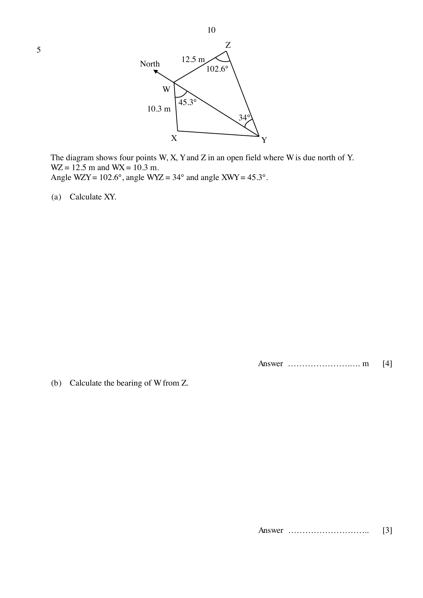
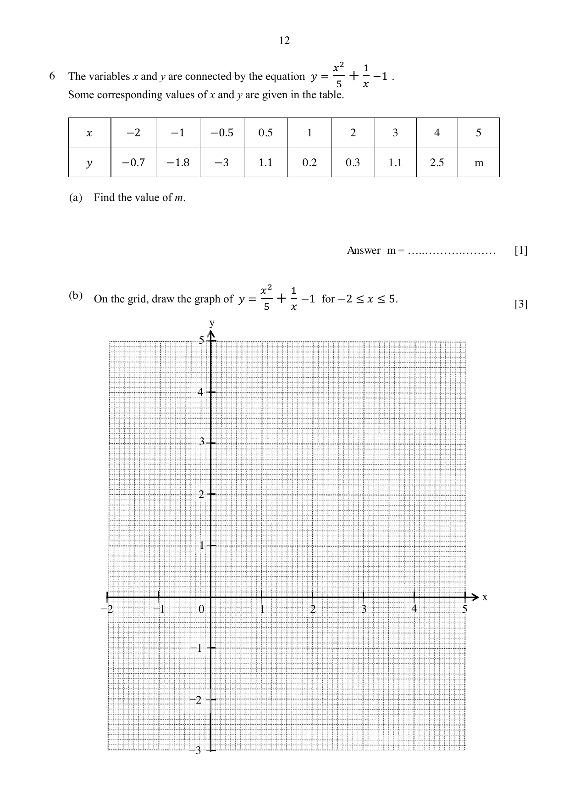
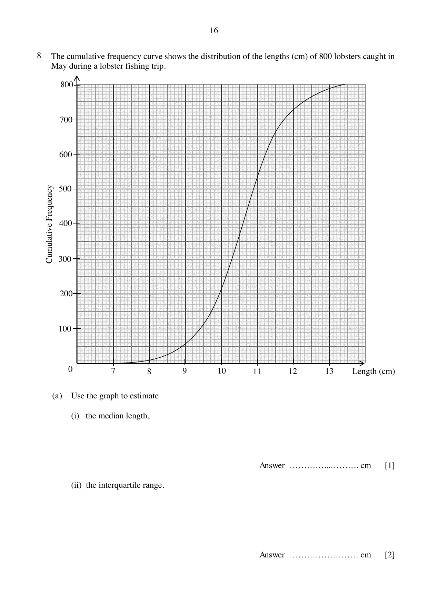
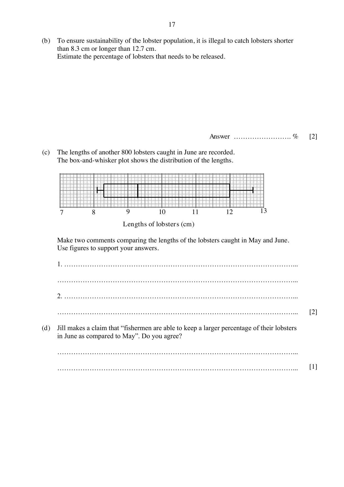
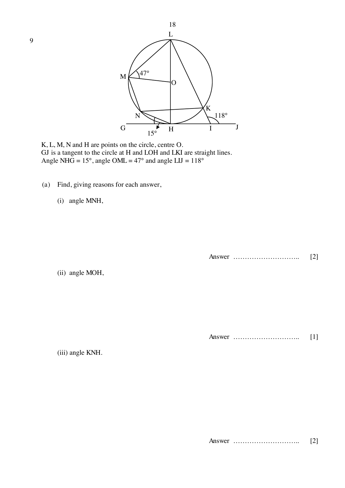

# Nan Chiau High School — Mathematics 4052/02 Paper 2 (cleaned)

> **Institution:** Nan Chiau High School
> **Exam:** Preliminary Examination 2024
> **Level:** Secondary Four Express
> **Subjects:** Elementary Mathematics
> **Paper:** 4052/02 Paper 2
> **Date:** 19 August 2024, Monday
> **Duration:** 2 hours 15 minutes
> **Total Marks:** 90
> **Source:** `2024 NCHS Prelim Math P2 QP.pdf`

---

## Instructions

Write your name, class and register number in the spaces at the top of this page.
Write in dark blue or black pen.
You may use a HB pencil for any diagrams or graphs.
Do not use staples, paper clips, glue or correction fluid.

Answer all questions.
If working is needed for any question it must be shown with the answer.
Omission of essential working will result in loss of marks.
The use of an approved scientific calculator is expected, where appropriate.
If the degree of accuracy is not specified in the question, and if the answer is not exact, give the answer to three significant figures. Give answers in degrees to one decimal place.
For $\pi$, use either your calculator value or $3.142$, unless the question requires the answer in terms of $\pi$.

The number of marks is given in brackets [ ] at the end of each question or part question.
The total marks for this paper is 90.

Candidates answer on the Question Paper.

---

## Mathematical Formulae

*Compound interest*

$$
\text{Total amount} = P\left(1+\frac{r}{100}\right)^{n}
$$

*Mensuration*

$$
\text{Curved surface area of a cone} = \pi rl
$$

$$
\text{Surface area of a sphere} = 4\pi r^{2}
$$

$$
\text{Volume of a cone} = \frac{1}{3}\pi r^{2}h
$$

$$
\text{Volume of a sphere} = \frac{4}{3}\pi r^{3}
$$

$$
\text{Area of triangle } ABC = \frac{1}{2}ab\sin C
$$

$$
\text{Arc length} = r\theta,\text{ where }\theta\text{ is in radians}
$$

$$
\text{Sector area} = \frac{1}{2}r^{2}\theta,\text{ where }\theta\text{ is in radians}
$$

*Trigonometry*

$$
\frac{a}{\sin A} = \frac{b}{\sin B} = \frac{c}{\sin C}
$$

$$
a^{2} = b^{2}+c^{2}-2bc\cos A
$$

*Statistics*

$$
\text{Mean} = \frac{\Sigma fx}{\Sigma f}
$$

$$
\text{Standard deviation} = \sqrt{\frac{\Sigma fx^{2}}{\Sigma f}-\left(\frac{\Sigma fx}{\Sigma f}\right)^{2}}
$$

---

## Answer all questions.

### Q1

> **Marks:** (a) [3]; (b) [3]; (c) [3]
> **Topic:** N7 Equations and inequalities
> **Sub-topic:** Equations and inequalities
> **LO:** [[context/subjects/o-level-e-maths/learning-objectives/o-level-e-maths-N7g.md|N7g]]
> **Page:** 3–4

**(a)** Simplify $\dfrac{9a^{2}-4b^{2}}{3ap+6aq-4bq-2bp}$.

**(b)** Write as a single fraction in its simplest form $\dfrac{x}{6-7x-5x^{2}}+\dfrac{2}{5x-3}$.

**(c)** Solve the inequality $-\dfrac{1}{2} < \dfrac{2y}{5}-\dfrac{1+y}{3} \le \dfrac{5}{6}$.

### Q2

> **Marks:** (a) [3]; (b) [4]
> **Topic:** G5 Mensuration
> **Sub-topic:** Mensuration
> **LO:** [[context/subjects/o-level-e-maths/learning-objectives/o-level-e-maths-G5c.md|G5c]]
> **Page:** 5

A closed container, in the shape of a cone, is partially filled with water to a height of 25 cm as shown in Diagram I.
The diameter of the container is 38 cm and the height of the container is 40 cm.

**(a)** Calculate the amount of water in the container, leaving your answer in litres.

The container is subsequently inverted so that the water flows to the base of the cone as shown in Diagram II.

**(b)** Calculate the height of the water, $h$ cm, in the cone as shown in Diagram II.

### Q3

> **Marks:** (a) [2]; (b) [4]; (c) [3]
> **Topic:** N3 Percentage
> **Sub-topic:** Percentage
> **LO:** [[context/subjects/o-level-e-maths/learning-objectives/o-level-e-maths-N3d.md|N3d]]
> **Page:** 6–7

Sam, Jane and Peter each decided to purchase a new car priced at ＄108 888.

**(a)** Sam paid for his new car in cash and was given a discount by the salesman. Given that Sam paid ＄100 176.96, find the percentage discount he received.

**(b)** Jane paid 15% of the cash price as deposit and take a loan for the remaining amount from the bank which charges simple interest at the rate of 2.98% per annum over a period of five years.

Calculate the monthly instalment Jane had to pay over the five years period.

**(c)** Peter paid ＄18 888 as deposit and take a loan for the remaining amount from the bank which charges compound interest at the rate of $R\%$ per annum over a period of ten years.
He paid a monthly instalment of ＄960.

Calculate the value of $R$.

### Q4

> **Marks:** (a) [1]; (b) [2]; (c) [1]; (d) [4]
> **Topic:** S1 Data handling and analysis
> **Sub-topic:** Data handling and analysis
> **LO:** [[context/subjects/o-level-e-maths/learning-objectives/o-level-e-maths-S1f.md|S1f]]
> **Page:** 8–9

Three bakery outlets A, B and C tracked the number of caramel, strawberry and mint cupcakes sold in a week in the table shown below.

|  | Caramel Cupcakes | Strawberry Cupcakes | Mint Cupcakes |
| --- | --- | --- | --- |
| Outlet A | 60 | 68 | 55 |
| Outlet B | 49 | 56 | 71 |
| Outlet C | 53 | 70 | 80 |

This information can be represented by the matrix

$$
P = \begin{pmatrix} 60 & 68 & 55 \\ 49 & 56 & 71 \\ 53 & 70 & 80 \end{pmatrix}.
$$

**(a)** Caramel cupcakes cost ＄1.20 each to bake.
Strawberry cupcakes cost ＄1.50 each to bake.
Mint cupcakes cost ＄0.95 each to bake.

Represent these costs in a $3\times 1$ column matrix $Q$.

**(b)** Evaluate the matrix $R = PQ$.

**(c)** State what each element of matrix $R$ means.

**(d)** The selling price of each caramel, strawberry and mint cupcake are marked up by 200%, 150% and 300% of the respective cost price.
Calculate the total amount of profit the three bakery outlets collected in a month.

### Q5

> **Marks:** (a) [4]; (b) [3]; (c) [3]
> **Topic:** G4 Pythagoras' theorem and trigonometry
> **Sub-topic:** Pythagoras' theorem and trigonometry
> **LO:** [[context/subjects/o-level-e-maths/learning-objectives/o-level-e-maths-G4g.md|G4g]]
> **Page:** 10–11

The diagram shows four points $W$, $X$, $Y$ and $Z$ in an open field where $W$ is due north of $Y$.
$WZ = 12.5$ m and $WX = 10.3$ m.
Angle $WZY = 102.6^{\circ}$, angle $WYZ = 34^{\circ}$ and angle $XWY = 45.3^{\circ}$.

**(a)** Calculate $XY$.

**(b)** Calculate the bearing of $W$ from $Z$.

A vertical tree of height 8 m is situated at point $Z$.
A man whose height is 1.9 m, walks from point $Y$ to point $W$.

**(c)** Find the greatest angle of elevation of the top of the tree from the top of the man’s head.

### Q6

> **Marks:** (a) [1]; (b) [3]; (c) [2]; (d) [3]
> **Topic:** G6 Coordinate geometry
> **Sub-topic:** Coordinate geometry
> **LO:** [[context/subjects/o-level-e-maths/learning-objectives/o-level-e-maths-G6c.md|G6c]]
> **Page:** 12–13

The variables $x$ and $y$ are connected by the equation $y = \dfrac{x^{2}}{5}+\dfrac{1}{x}-1$.
Some corresponding values of $x$ and $y$ are given in the table.

| $x$ | $-2$ | $-1$ | $-0.5$ | $0.5$ | $1$ | $2$ | $3$ | $4$ | $5$ |
| --- | --- | --- | --- | --- | --- | --- | --- | --- | --- |
| $y$ | $-0.7$ | $-1.8$ | $-3$ | $1.1$ | $0.2$ | $0.3$ | $1.1$ | $2.5$ | $m$ |

**(a)** Find the value of $m$.

**(b)** On the grid, draw the graph of $y = \dfrac{x^{2}}{5}+\dfrac{1}{x}-1$ for $-2 \le x \le 5$.

**(c)** By drawing a tangent, find the gradient of the curve at $(1, 0.2)$.

**(d)** Use your graph to find the solutions of the equation $x^{2}+\dfrac{5}{x}-4x-4 = 0$ in the range $-2 \le x \le 5$.

### Q7

> **Marks:** (a) [2]; (b) [3]; (c) [2]; (d) [1]; (e) [2]; (f)(i) [1]; (f)(ii) [2]
> **Topic:** G7 Vectors in two dimensions
> **Sub-topic:** Vectors in two dimensions
> **LO:** [[context/subjects/o-level-e-maths/learning-objectives/o-level-e-maths-G7h.md|G7h]]
> **Page:** 14–15

$PQRS$ is a parallelogram whose diagonals intersect at $B$. $C$ is the midpoint of $QR$.
$\overrightarrow{BP} = 5\mathbf{a}$ and $\overrightarrow{BS} = 3\mathbf{b}$.

**(a)** Show that triangles $RBC$ and $RPQ$ are similar.

**(b)** Show that $\overrightarrow{PC} = -\dfrac{3}{2}(5\mathbf{a}+\mathbf{b})$.

**(c)** Given that $A$ is a point on $QB$ such that $QA:AB = 2:1$.
Express $\overrightarrow{AC}$ in terms of $\mathbf{a}$ and $\mathbf{b}$.

**(d)** State one fact about $P$, $A$ and $C$.

**(e)** Explain why the areas of triangle $PAB$ and triangle $QAC$ are equal.

**(f)** Find

**(i)** $\dfrac{\text{area of }\triangle ABC}{\text{area of }\triangle QBC}$,

**(ii)** $\dfrac{\text{area of }\triangle ABC}{\text{area of }\triangle RPQ}$.

### Q8

> **Marks:** (a)(i) [1]; (a)(ii) [2]; (b) [2]; (c) [2]; (d) [1]
> **Topic:** S1 Data handling and analysis
> **Sub-topic:** Data handling and analysis
> **LO:** [[context/subjects/o-level-e-maths/learning-objectives/o-level-e-maths-S1i.md|S1i]]
> **Page:** 16–17

The cumulative frequency curve shows the distribution of the lengths (cm) of 800 lobsters caught in May during a lobster fishing trip.

**(a)** Use the graph to estimate

**(i)** the median length,

**(ii)** the interquartile range.

**(b)** To ensure sustainability of the lobster population, it is illegal to catch lobsters shorter than 8.3 cm or longer than 12.7 cm.
Estimate the percentage of lobsters that needs to be released.

**(c)** The lengths of another 800 lobsters caught in June are recorded.
The box-and-whisker plot shows the distribution of the lengths.

Make two comments comparing the lengths of the lobsters caught in May and June.
Use figures to support your answers.

**(d)** Jill makes a claim that “fishermen are able to keep a larger percentage of their lobsters in June as compared to May”. Do you agree?

### Q9

> **Marks:** (a)(i) [2]; (a)(ii) [1]; (a)(iii) [2]; (b) [2]
> **Topic:** G3 Properties of circles
> **Sub-topic:** Properties of circles
> **LO:** [[context/subjects/o-level-e-maths/learning-objectives/o-level-e-maths-G3b.md|G3b]]
> **Page:** 18–19

$K$, $L$, $M$, $N$ and $H$ are points on the circle, centre $O$.
$GJ$ is a tangent to the circle at $H$ and $LOH$ and $LKI$ are straight lines.
Angle $NHG = 15^{\circ}$, angle $OML = 47^{\circ}$ and angle $LIJ = 118^{\circ}$.

**(a)** Find, giving reasons for each answer,

**(i)** angle $MNH$,

**(ii)** angle $MOH$,

**(iii)** angle $KNH$.

**(b)** Explain whether $MN$ and $LI$ are parallel lines.

### Q10

> **Marks:** (a) [3]; (b) [7]
> **Topic:** G5 Mensuration
> **Sub-topic:** Mensuration
> **LO:** [[context/subjects/o-level-e-maths/learning-objectives/o-level-e-maths-G5c.md|G5c]]
> **Page:** 20–22

Jack visited the Super Nintendo World in Japan and bought a night light in the shape of a star as shown in Diagram I. The star-shaped night light can be modelled as a prism with a cross sectional area as shown in Diagram II.

The star-shaped cross sectional area is formed by a regular pentagon, $ABCDE$ and five identical equilateral triangles. $O$ is the centre of the star.
The thickness of the prism is 12 cm and $AP = 10$ cm.

**(a)** Calculate the star-shaped cross sectional area.

Jack wants to build a wooden frame for the night light and mount it onto the wall using an adhesive tape. The night light fits exactly inside the wooden frames as shown in Design I and Design II. The adhesive tape is applied to one face of the cross surface area of the wooden frame before mounting onto the wall.
In Design I, the wooden frame has a uniform width of 6 cm.
In Design II, the wooden frame is made up of five identical isosceles trapezium prisms with a height of 6 cm.
The thickness of the wooden frame is 12 cm.

Density of wood $= 900\text{ kg/m}^{3}$.
Mass of the night light $= 600$ grams.
Maximum mass that the adhesive tape can hold $= 8$ kg.

**(b)** Which design should Jack choose to satisfy the condition of the maximum mass that the adhesive tape can hold? Justify your decision with calculations.
