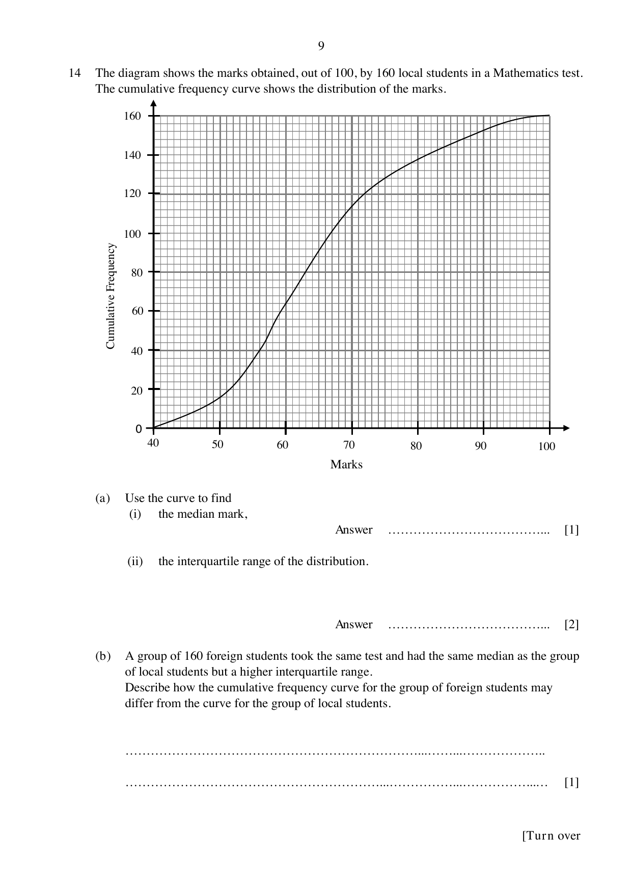
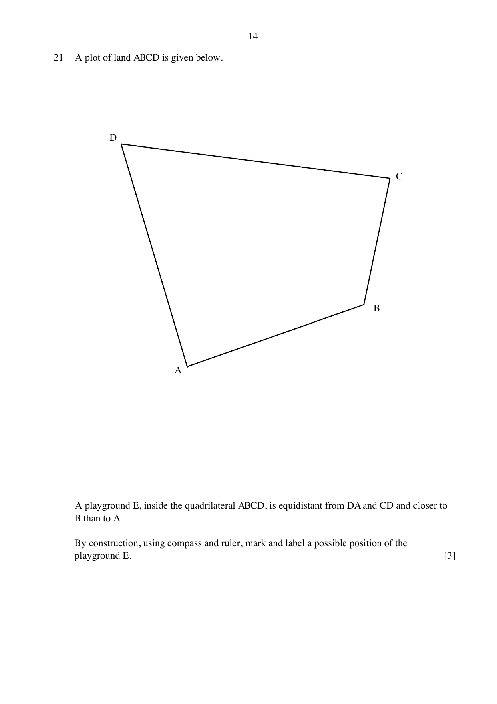

# North Vista Secondary School — Mathematics 4052/01 Paper 1 (cleaned)

> **Institution:** North Vista Secondary School
> **Exam:** Preliminary Examination 2024
> **Level:** Secondary 4 Express / 5 Normal Academic
> **Subjects:** Elementary Mathematics
> **Paper:** 4052/01 Paper 1
> **Date:** 19 August 2024
> **Duration:** 2 hours 15 minutes
> **Total Marks:** 90
> **Source:** `North Vista 4E EM Prelim P1 2024 QP.pdf`

---

## Instructions

Candidates answer on the Question Paper.

Write your name, class and index number on all the work you hand in.
Write in dark blue or black pen.
You may use an HB pencil for any diagrams or graphs.
Do not use staples, paper clips, glue or correction fluid.

Answer all questions.
The number of marks is given in brackets [ ] at the end of each question or part question.

If working is needed for any question it must be shown with the answer.
Omission of essential working will result in loss of marks.
The total of the marks for this paper is 90.

The use of an approved scientific calculator is expected, where appropriate.
If the degree of accuracy is not specified in the question, and if the answer is not exact, give the answer to three significant figures. Give answers in degrees to one decimal place.
For $\pi$, use either your calculator value or $3.142$.

---

## Mathematical Formulae

*Compound interest*

$$
\text{Total amount} = P\left(1+\frac{r}{100}\right)^{n}
$$

*Mensuration*

$$
\text{Curved surface area of a cone} = \pi rl
$$

$$
\text{Surface area of a sphere} = 4\pi r^{2}
$$

$$
\text{Volume of a cone} = \frac{1}{3}\pi r^{2}h
$$

$$
\text{Volume of a sphere} = \frac{4}{3}\pi r^{3}
$$

$$
\text{Area of triangle } ABC = \frac{1}{2}ab\sin C
$$

$$
\text{Arc length} = r\theta,\text{ where }\theta\text{ is in radians}
$$

$$
\text{Sector area} = \frac{1}{2}r^{2}\theta,\text{ where }\theta\text{ is in radians}
$$

*Trigonometry*

$$
\frac{a}{\sin A} = \frac{b}{\sin B} = \frac{c}{\sin C}
$$

$$
a^{2} = b^{2}+c^{2}-2bc\cos A
$$

*Statistics*

$$
\text{Mean} = \frac{\sum fx}{\sum f}
$$

$$
\text{Standard deviation} = \sqrt{\frac{\sum fx^{2}}{\sum f}-\left(\frac{\sum fx}{\sum f}\right)^{2}}
$$

---

### Q1

> **Marks:** 1
> **Topic:** N1 Numbers and their operations
> **Sub-topic:** Numbers and their operations
> **LO:** [[context/subjects/o-level-e-maths/learning-objectives/o-level-e-maths-N1g.md|N1g]]
> **Page:** 3

Calculate $\dfrac{13.5+14.04}{-0.31+\sqrt[3]{15.625}}$, giving your answer correct to one significant figure.

---

### Q2

> **Marks:** 2
> **Topic:** N3 Percentage
> **Sub-topic:** Percentage
> **LO:** [[context/subjects/o-level-e-maths/learning-objectives/o-level-e-maths-N3d.md|N3d]]
> **Page:** 3

Alex buys a shirt at a price of £14.75.
Paul buys a shirt at a price of ＄21.99.
The exchange rate is ＄1 = £0.73.
Calculate how much more Paul pays than Alex.

---

### Q3

> **Marks:** (a) 1, (b) 2; total 3
> **Topic:** N1 Numbers and their operations
> **Sub-topic:** Numbers and their operations
> **LO:** [[context/subjects/o-level-e-maths/learning-objectives/o-level-e-maths-N1j.md|N1j]]
> **Page:** 3

**(a)** Simplify $5(3^{3}\times 5^{4})^{2}$.
Give your answer in the form $3^{a}\times 5^{b}$.

**(b)** Use laws of indices to find the value of $k$.
Show your working.

$$
2^{100}-4\times 2^{97} = 2^{k}
$$

---

### Q4

> **Marks:** (a) 1, (b)(i) 1, (b)(ii) 2; total 4
> **Topic:** N1 Numbers and their operations
> **Sub-topic:** Numbers and their operations
> **LO:** [[context/subjects/o-level-e-maths/learning-objectives/o-level-e-maths-N1b.md|N1b]]
> **Page:** 4

**(a)** A number $p$ has exactly 12 factors. Two of the factors are 4 and 15.
Find the value of $p$.

**(b)** **(i)** Express 525 as the product of its prime factors.

**(ii)** The LCM of 15, $x$ and 35 is 525.
Find two possible values of $x$ between 15 and 100.

---

### Q5

> **Marks:** 3
> **Topic:** N3 Percentage
> **Sub-topic:** Percentage
> **LO:** [[context/subjects/o-level-e-maths/learning-objectives/o-level-e-maths-N3d.md|N3d]]
> **Page:** 4

Jessica invests ＄4540 at a rate of $r\%$ per year compound interest.
At the end of 10 years, she has earned ＄1328.54 in interest.
Calculate the value of $r$.

---

### Q6

> **Marks:** 2
> **Topic:** G1 Angles, triangles and polygons
> **Sub-topic:** Angles, triangles and polygons
> **LO:** [[context/subjects/o-level-e-maths/learning-objectives/o-level-e-maths-G1f.md|G1f]]
> **Page:** 5

Ayden claims that a regular polygon can be formed with the ratio

interior angle to exterior angle $= 5:4$.

Explain why Ayden is wrong.

---

### Q7

> **Marks:** (a) 2, (b) 1; total 3
> **Topic:** N6 Functions and graphs
> **Sub-topic:** Functions and graphs
> **LO:** [[context/subjects/o-level-e-maths/learning-objectives/o-level-e-maths-N6g.md|N6g]]
> **Page:** 5

The expression $x^{2}+ax+17$ can be written in the form $(x-6)^{2}+b$.

**(a)** Find the value of $a$ and of $b$.

**(b)** Explain why when $x=6$, the expression $x^{2}+ax+17$ has its minimum value.

---

### Q8

> **Marks:** 2
> **Topic:** N3 Percentage
> **Sub-topic:** Percentage
> **LO:** [[context/subjects/o-level-e-maths/learning-objectives/o-level-e-maths-N3d.md|N3d]]
> **Page:** 5

A shopkeeper makes a loss of 24% when he sells an article for ＄136.
Calculate the selling price of the article in order for the shopkeeper to make a profit of 40%.

---

### Q9

> **Marks:** 3
> **Topic:** N6 Functions and graphs
> **Sub-topic:** Functions and graphs
> **LO:** [[context/subjects/o-level-e-maths/learning-objectives/o-level-e-maths-N6e.md|N6e]]
> **Page:** 6

A bag contains some yellow and blue balls.
The ratio of the yellow balls to the blue balls is $1:4$.
5 yellow balls are removed from the bag and 10 blue balls are added to the bag.
The new ratio of yellow balls to blue balls is $1:6$.
Find the original number of yellow balls in the bag.

---

### Q10

> **Marks:** (a) 1, (b) 2; total 3
> **Topic:** G6 Coordinate geometry
> **Sub-topic:** Coordinate geometry
> **LO:** [[context/subjects/o-level-e-maths/learning-objectives/o-level-e-maths-G6c.md|G6c]]
> **Page:** 6

It is given $P(-4, 2)$, $Q(2, 10)$ and $R(-4, -5)$.

**(a)** Write down the equation of the line $PR$.

**(b)** The line $5y+10=mx$ has the same gradient as $QR$.
Find the value of $m$.

---

### Q11

> **Marks:** (a) 2, (b) 1, (c) 2; total 5
> **Topic:** N7 Equations and inequalities
> **Sub-topic:** Equations and inequalities
> **LO:** [[context/subjects/o-level-e-maths/learning-objectives/o-level-e-maths-N7g.md|N7g]]
> **Page:** 7

Each term in this sequence is found by subtracting the same number from the previous term.

$$
78,\quad a,\quad b,\quad c,\quad 42,\quad \ldots
$$

**(a)** Find the values of $a$, $b$ and $c$.

**(b)** Write down an expression, in terms of $n$, for the $n$th term.

**(c)** Write an inequality in $n$ and solve it to find the first negative term of this sequence.

---

### Q12

> **Marks:** (a) 1, (b)(i) 1, (b)(ii) 1, (b)(iii) 1; total 4
> **Topic:** N8 Set language and notation
> **Sub-topic:** Set language and notation
> **LO:** [[context/subjects/o-level-e-maths/learning-objectives/o-level-e-maths-N8a.md|N8a]]
> **Page:** 7–8

**(a)** Write down the set represented by the shaded region.

In the universal set $\varepsilon$, circle $P$ contains circle $Q$. The region inside $P$ but outside $Q$ is shaded. The interior of $Q$ is unshaded.

**(b)** $\varepsilon = \{\text{integer } x : 1 \le x < 15\}$

$A = \{\text{perfect squares}\}$

$B = \{\text{prime numbers}\}$

**(i)** Find $n(A\cup B)'$.

**(ii)** List the elements in $A\cap B'$.

**(iii)** Given that $C\subset (A\cap B')$ and $n(C)>0$, list the elements in one possible set of $C$.

---

### Q13

> **Marks:** 3
> **Topic:** N6 Functions and graphs
> **Sub-topic:** Functions and graphs
> **LO:** [[context/subjects/o-level-e-maths/learning-objectives/o-level-e-maths-N6c.md|N6c]]
> **Page:** 8

Sketch the graph of $y=(4-x)(2+x)$.
State clearly the coordinates of the points where the graph crosses the axes and the turning point on the curve.

A blank pair of axes is provided, with origin $O$.

---

### Q14

> **Marks:** (a)(i) 1, (a)(ii) 2, (b) 1; total 4
> **Topic:** S1 Data handling and analysis
> **Sub-topic:** Data handling and analysis
> **LO:** [[context/subjects/o-level-e-maths/learning-objectives/o-level-e-maths-S1i.md|S1i]]
> **Page:** 9

The diagram shows the marks obtained, out of 100, by 160 local students in a Mathematics test.
The cumulative frequency curve shows the distribution of the marks.

**(a)** Use the curve to find

**(i)** the median mark,

**(ii)** the interquartile range of the distribution.

**(b)** A group of 160 foreign students took the same test and had the same median as the group of local students but a higher interquartile range.
Describe how the cumulative frequency curve for the group of foreign students may differ from the curve for the group of local students.

---

### Q15

> **Marks:** 2
> **Topic:** N6 Functions and graphs
> **Sub-topic:** Functions and graphs
> **LO:** [[context/subjects/o-level-e-maths/learning-objectives/o-level-e-maths-N6g.md|N6g]]
> **Page:** 10

Write as a single fraction in its simplest form

$$
\frac{x}{x+9}-\frac{4x+3}{x^{2}-81}.
$$

---

### Q16

> **Marks:** (a) 2, (b)(i) 2, (b)(ii) 2; total 6
> **Topic:** N5 Algebraic expressions and formulae
> **Sub-topic:** Algebraic expressions and formulae
> **LO:** [[context/subjects/o-level-e-maths/learning-objectives/o-level-e-maths-N5h.md|N5h]]
> **Page:** 10

**(a)** Expand and simplify $(2x+3y)(7x-5y)$.

**(b)** Factorise completely.

**(i)** $x^{3}y^{3}-xy^{3}$

**(ii)** $5ax-3ay-10cx+6cy$

---

### Q17

> **Marks:** 2
> **Topic:** G2 Congruence and similarity
> **Sub-topic:** Congruence and similarity
> **LO:** [[context/subjects/o-level-e-maths/learning-objectives/o-level-e-maths-G2i.md|G2i]]
> **Page:** 11

Destin folded a square paper napkin, $ABCD$, along the lines $WX$, $XY$, $YZ$ and $WZ$ as shown.
He ensured that $AW=BX=CY=DZ$.

$ABCD$ is a square. $W$, $X$, $Y$ and $Z$ lie on $AB$, $BC$, $CD$ and $DA$ respectively, with $AW=BX=CY=DZ$. The fold lines form the inner quadrilateral $WXYZ$.

Prove that triangle $AWZ$ is congruent to triangle $BXW$.

---

### Q18

> **Marks:** (a) 2, (b) 2; total 4
> **Topic:** N2 Ratio and proportion
> **Sub-topic:** Ratio and proportion
> **LO:** [[context/subjects/o-level-e-maths/learning-objectives/o-level-e-maths-N2a.md|N2a]]
> **Page:** 11–12

**(a)** $y$ is directly proportional to the cube root of $(x+1)$.
It is given that $x=7$ when $y=1$. Find the value of $y$ when $x=124$.

**(b)** $F$ is inversely proportional to the square of $d$.

Explain what happens to $F$ when $d$ is halved.

---

### Q19

> **Marks:** (a) 1, (b) 2; total 3
> **Topic:** N6 Functions and graphs
> **Sub-topic:** Functions and graphs
> **LO:** [[context/subjects/o-level-e-maths/learning-objectives/o-level-e-maths-N6b.md|N6b]]
> **Page:** 12

The diagram below shows the speed–time graph of part of a car’s journey.

Speed falls in a straight line from $30\text{ m/s}$ at $t=0$ to $13\text{ m/s}$ at $t=16\text{ s}$, then stays constant at $13\text{ m/s}$ until $t=24\text{ s}$.

Calculate

**(a)** the deceleration of the car in the first 16 seconds,

**(b)** the average speed of the car during the 24 seconds.

---

### Q20

> **Marks:** (a)(i) 2, (a)(ii) 1, (b) 1, (c) 1; total 5
> **Topic:** N9 Matrices
> **Sub-topic:** Matrices
> **LO:** [[context/subjects/o-level-e-maths/learning-objectives/o-level-e-maths-N9b.md|N9b]]
> **Page:** 13

The following table shows the amount of flour, butter and sugar in grams needed in making a pandan cake and a marble cake.

| | Flour | Butter | Sugar |
| --- | --- | --- | --- |
| Pandan Cake | 250 g | 250 g | 100 g |
| Marble Cake | 400 g | 200 g | 90 g |

**(a)** The amount of ingredients used in making a pandan cake and a marble cake can be represented by the matrix

$$
A=\begin{pmatrix} 250 & 250 & 100 \\ 400 & 200 & 90 \end{pmatrix}.
$$

**(i)** Evaluate $AB$ where $B=\begin{pmatrix} 1 \\ 1 \\ 1 \end{pmatrix}$.

**(ii)** Explain what the elements in $AB$ represent.

**(b)** The cost of 100 g of flour is ＄0.20, 100 g of butter is $x$ dollars and 100 g of sugar is ＄0.30.

Represent this cost in a $3\times 1$ column matrix $D$.

**(c)** Given that the cost of baking a pandan cake is ＄4.25, calculate the value of $x$.

---

### Q21

> **Marks:** 3
> **Topic:** G2 Congruence and similarity
> **Sub-topic:** Congruence and similarity
> **LO:** [[context/subjects/o-level-e-maths/learning-objectives/o-level-e-maths-G2e.md|G2e]]
> **Page:** 14

A plot of land $ABCD$ is given below.

A playground $E$, inside the quadrilateral $ABCD$, is equidistant from $DA$ and $CD$ and closer to $B$ than to $A$.

By construction, using compass and ruler, mark and label a possible position of the playground $E$.

---

### Q22

> **Marks:** 4
> **Topic:** G5 Mensuration
> **Sub-topic:** Mensuration
> **LO:** [[context/subjects/o-level-e-maths/learning-objectives/o-level-e-maths-G5c.md|G5c]]
> **Page:** 15

The diagram below shows a solid circular cone and a solid sphere.
The cone has radius $12x\text{ cm}$ and height $17x\text{ cm}$.
The sphere has radius $rx\text{ cm}$.
The cone has the same total surface area as the sphere.

Calculate the value for $r$.

---

### Q23

> **Marks:** (a) 4, (b) 1; total 5
> **Topic:** G5 Mensuration
> **Sub-topic:** Mensuration
> **LO:** [[context/subjects/o-level-e-maths/learning-objectives/o-level-e-maths-G5c.md|G5c]]
> **Page:** 16

The diagram shows the symmetrical cross-section of a canal containing water.
The angle between the base and each side of the canal is $95^{\circ}$.
The width of the base is $90\text{ cm}$, and the depth of the water is $2.1\text{ m}$.
The canal is $100\text{ m}$ long.

The water surface is horizontal. Each base angle inside the cross-section is $95^{\circ}$, so each side slopes outward from the base.

**(a)** Calculate the volume of water in the canal.

**(b)** Water is pumped out of the canal at a rate of $0.3\text{ m}^{3}$ per minute.
Calculate the time taken to empty the canal completely.
Give your answer in hours and minutes, correct to the nearest minute.

---

### Q24

> **Marks:** (a)(i) 1, (a)(ii) 1, (b) 3, (c) 2; total 7
> **Topic:** G7 Vectors in two dimensions
> **Sub-topic:** Vectors in two dimensions
> **LO:** [[context/subjects/o-level-e-maths/learning-objectives/o-level-e-maths-G7h.md|G7h]]
> **Page:** 17–18

The diagram shows triangle $OPT$.

$\overrightarrow{OP}=\mathbf{p}$ and $\overrightarrow{OT}=\mathbf{m}$.
$OK:KT=2:1$ and $TL:LP=2:1$.

$K$ lies on $OT$ and $L$ lies on $TP$. The line $KL$ is drawn.

**(a)** Find, in terms of $\mathbf{m}$ and $\mathbf{p}$, in its simplest form

**(i)** $\overrightarrow{PL}$,

**(ii)** $\overrightarrow{KL}$.

**(b)** $KL$ is extended to the point $M$.

$$
\overrightarrow{KM}=-\frac{2}{3}\mathbf{m}+\frac{4}{3}\mathbf{p}.
$$

Show that $M$ lies on $OP$ extended.

**(c)** Find the ratio of area of triangle $KTL$ : area of triangle $OTP$.

---

### Q25

> **Marks:** (a) 2, (b) 3, (c) 2; total 7
> **Topic:** G4 Pythagoras' theorem and trigonometry
> **Sub-topic:** Pythagoras' theorem and trigonometry
> **LO:** [[context/subjects/o-level-e-maths/learning-objectives/o-level-e-maths-G4g.md|G4g]]
> **Page:** 19–20

The diagram shows the route of the Vistarian Roadrun.
The route is in the shape of a regular octagon, $ABCDEFGH$.
$B$ is due west of $A$ and $AB=0.65\text{ km}$.

North is vertically up from $A$. Side $AB$ is horizontal. The vertices continue in order $C$, $D$, $E$, $F$, $G$, $H$ around the octagon, with $H$ adjacent to $A$.

**(a)** Find the bearing of $H$ from $A$.

**(b)** Calculate the distance of $BH$.

**(c)** Calculate the area of triangle $BHG$.
