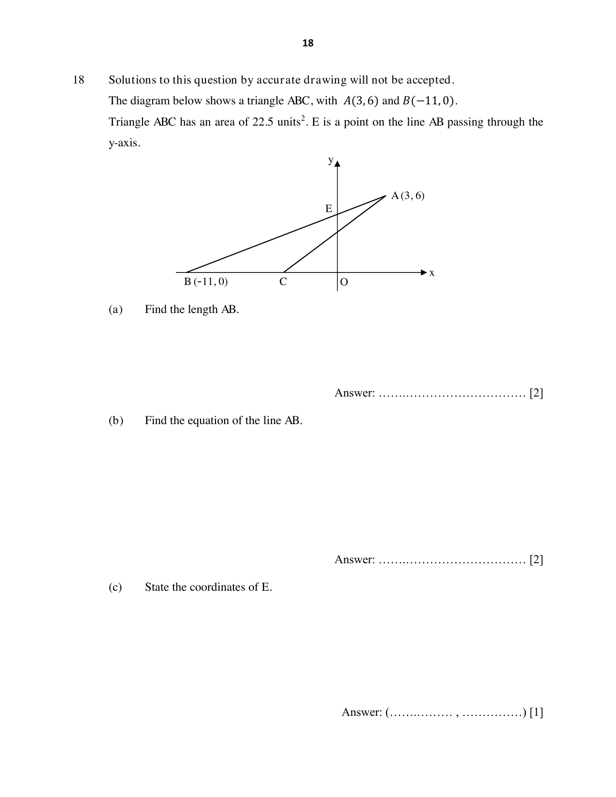

# Orchid Park Secondary School — Mathematics 4052/01 Paper 1 (cleaned)

> **Institution:** Orchid Park Secondary School
> **Exam:** Preliminary Examination 2024
> **Level:** Secondary 4 Express / 5 Normal (Academic)
> **Subjects:** Elementary Mathematics
> **Paper:** 4052/01 Paper 1
> **Date:** 15 August 2024
> **Duration:** 2 hours 15 minutes
> **Total Marks:** 90
> **Source:** `OPSS_Prelims_2024_4E_Math_P1_QP.pdf`

---

## Instructions

Additional materials: NIL. Setter: Mr Wong Yiu Hang.

Write your name, class and index number on all the work you hand in.
Write in dark blue or black pen.
Use a pencil for any diagrams or graphs.
Do not use staples, paper clips, glue or correction fluid.

Answer all questions.

If working is needed for any question it must be shown in the space below the question. Omission of essential working will result in loss of marks.
The use of an approved scientific calculator is expected, where appropriate.
If the degree of accuracy is not specified in the question, and if the answer is not exact, give the answer to three significant figures. Give answers in degrees to one decimal place.

For $\pi$, use either your calculator value or $3.142$, unless the question requires the answer in terms of $\pi$.

The number of marks is given in brackets [ ] at the end of each question or part question.
The total number of marks for this paper is 90.

---

## Mathematical Formulae

*Compound interest*

$$
\text{Total amount} = P\left(1+\frac{r}{100}\right)^{n}
$$

*Mensuration*

$$
\text{Curved surface area of a cone} = \pi rl
$$

$$
\text{Surface area of a sphere} = 4\pi r^{2}
$$

$$
\text{Volume of a cone} = \frac{1}{3}\pi r^{2}h
$$

$$
\text{Volume of a sphere} = \frac{4}{3}\pi r^{3}
$$

$$
\text{Area of triangle } ABC = \frac{1}{2}ab\sin C
$$

$$
\text{Arc length} = r\theta,\text{ where }\theta\text{ is in radians}
$$

$$
\text{Sector area} = \frac{1}{2}r^{2}\theta,\text{ where }\theta\text{ is in radians}
$$

*Trigonometry*

$$
\frac{a}{\sin A} = \frac{b}{\sin B} = \frac{c}{\sin C}
$$

$$
a^{2} = b^{2}+c^{2}-2bc\cos A
$$

*Statistics*

$$
\text{Mean} = \frac{\sum fx}{\sum f}
$$

$$
\text{Standard deviation} = \sqrt{\frac{\sum fx^{2}}{\sum f}-\left(\frac{\sum fx}{\sum f}\right)^{2}}
$$

---

### Q1

> **Marks:** (a) 1, (b) 1; total 2
> **Topic:** N1 Numbers and their operations
> **Sub-topic:** Numbers and their operations
> **LO:** [[context/subjects/o-level-e-maths/learning-objectives/o-level-e-maths-N1h.md|N1h]]
> **Page:** 3

**(a)** The approximate mass of the earth is $5.976\times 10^{24}$ kg. How many times is the earth heavier than an average male adult who weighs 75 kg?

Give your answer in standard form correct to 3 significant figures.

**(b)** The sum of 3 consecutive even numbers is estimated to be 300 when rounded off to 1 significant figure. Find the largest possible set of the 3 numbers.

---

### Q2

> **Marks:** (a) 2, (b) 1; total 3
> **Topic:** N1 Numbers and their operations
> **Sub-topic:** Numbers and their operations
> **LO:** [[context/subjects/o-level-e-maths/learning-objectives/o-level-e-maths-N1e.md|N1e]]
> **Page:** 3

**(a)** Solve the inequality $2y-1 < \dfrac{11y}{4} < \dfrac{1}{4}$.

**(b)** Given $-25 \le x \le 50$ and $-15 \le y \le -5$, what is the smallest possible value for $x+y^{2}$?

---

### Q3

> **Marks:** (a) 1, (b) 1, (c) 2; total 4
> **Topic:** N1 Numbers and their operations
> **Sub-topic:** Numbers and their operations
> **LO:** [[context/subjects/o-level-e-maths/learning-objectives/o-level-e-maths-N1e.md|N1e]]
> **Page:** 4

**(a)** Write 756 as a product of its prime factors.

**(b)** Given that $495=3^{2}\times 5\times 11$, find the smallest positive integer $p$ such that $756p$ is a multiple of 495.

**(c)** The number $756\times\dfrac{a}{b}$ is a perfect cube where $a$ and $b$ are both prime numbers.

Find the smallest possible value of $a$ and the smallest possible value of $b$.

---

### Q4

> **Marks:** 2
> **Topic:** N5 Algebraic expressions and formulae
> **Sub-topic:** Algebraic expressions and formulae
> **LO:** [[context/subjects/o-level-e-maths/learning-objectives/o-level-e-maths-N5b.md|N5b]]
> **Page:** 5

Simplify $\dfrac{a^{2}-3a+2}{9a^{2}-1}\div\dfrac{2a-2}{6a-2}$.

---

### Q5

> **Marks:** (a) 3, (b) 2; total 5
> **Page:** 5–6

**(a)** Simplify $\dfrac{(2x^{3}y^{2})^{-4}}{(10x^{-2}y^{3})^{2}}\div\sqrt[3]{27x^{-3}y^{6}}$.
> **Topic:** N5 Algebraic expressions and formulae
> **Sub-topic:** Algebraic expressions and formulae
> **LO:** [[context/subjects/o-level-e-maths/learning-objectives/o-level-e-maths-N5b.md|N5b]]

**(b)** Solve $3^{x+2}\times 3(3^{5})=1$.

---

### Q6

> **Marks:** (a) 2, (b) 3; total 5
> **Topic:** N5 Algebraic expressions and formulae
> **Sub-topic:** Algebraic expressions and formulae
> **LO:** [[context/subjects/o-level-e-maths/learning-objectives/o-level-e-maths-N5h.md|N5h]]
> **Page:** 6

**(a)** Factorise $a^{3}-2a^{2}b-4a+8b$.

**(b)** Solve $\dfrac{3x+2}{9x}=\dfrac{1}{7x-3}$.

---

### Q7

> **Marks:** 3
> **Topic:** N3 Percentage
> **Sub-topic:** Percentage
> **LO:** [[context/subjects/o-level-e-maths/learning-objectives/o-level-e-maths-N3d.md|N3d]]
> **Page:** 7

Peter has ＄20 000 to invest in either Bank A, Bank B or Bank C for 5 years.
The table below shows the investment plans.

| Bank | Interest rate per annum |
| --- | --- |
| A | 3.0% compound interest, compounded annually |
| B | 3.2% simple interest annually |
| C | Fixed interest of ＄3000 after 5 years |

Which plan should he invest in? Explain your answer.

---

### Q8

> **Marks:** (a) 2, (b) 2; total 4
> **Topic:** S2 Probability
> **Sub-topic:** Probability
> **LO:** [[context/subjects/o-level-e-maths/learning-objectives/o-level-e-maths-S2c.md|S2c]]
> **Page:** 8

A carton contains 17 good apples and 3 rotten apples. A fruit seller picks three apples at random from the carton and puts them into a smaller box for sale.

**(a)** Find the probability that there is at least 1 rotten apple in the box for sale.

**(b)** When Student A is asked to find the probability that the box contains two good apples and one rotten apple, he claims that the answer is $\dfrac{17}{20}\times\dfrac{16}{19}\times\dfrac{3}{18}$.

Do you agree with Student A’s claim? Explain your answer.

---

### Q9

> **Marks:** 3
> **Topic:** N1 Numbers and their operations
> **Sub-topic:** Numbers and their operations
> **LO:** [[context/subjects/o-level-e-maths/learning-objectives/o-level-e-maths-N1j.md|N1j]]
> **Page:** 9

A set of Pollutant Standards Index (PSI) taken from different parts of Singapore is as follows.

28, 30, 48, 19, 70, 50, 32, 72.

Represent the data using a box-and-whisker plot.

---

### Q10

> **Marks:** (a) 1, (b) 1, (c) 1; total 3
> **Topic:** N6 Functions and graphs
> **Sub-topic:** Functions and graphs
> **LO:** [[context/subjects/o-level-e-maths/learning-objectives/o-level-e-maths-N6c.md|N6c]]
> **Page:** 10

Sketch the graph in the spaces below. Blank axes, with origin marked 0, are provided for (a) and (b).

**(a)** $y=\dfrac{4}{x}$

**(b)** $y=-2x^{3}$

**(c)** Hence, state the number of solutions for the equation $\dfrac{4}{x}+2x^{3}=0$.

---

### Q11

> **Marks:** (a) 3, (b) 3, (c) 1; total 7
> **Topic:** N6 Functions and graphs
> **Sub-topic:** Functions and graphs
> **LO:** [[context/subjects/o-level-e-maths/learning-objectives/o-level-e-maths-N6c.md|N6c]]
> **Page:** 11

**(a)** Express $y=-(x+2)(x-5)$ in the form $y=-(x+p)^{2}+k$.
State the value of $p$ and the value of $k$.

**(b)** Sketch the graph of $y=-(x+2)(x-5)$ on the given axes. Indicate any intercepts on the axes.

**(c)** Find the coordinates of the turning point of the graph $y=-(x+2)(x-5)$.

---

### Q12

> **Marks:** (a) 3, (b) 1, (c) 2; total 6
> **Topic:** G3 Properties of circles
> **Sub-topic:** Properties of circles
> **LO:** [[context/subjects/o-level-e-maths/learning-objectives/o-level-e-maths-G3b.md|G3b]]
> **Page:** 12–13

**(a)** In the diagram, $A$, $B$, $C$ and $D$ are points on the circumference of a circle with centre $O$. $AB$ is parallel to $DO$ and angle $AOD=67^{\circ}$. $AOC$ is the diameter of the circle.

Find angle $BCD$.
Give a reason for each step of your working.

**(b)** Explain why angle $DAB$ is $123.5^{\circ}$.

**(c)** Find angle $DBC$.
Give a reason for each step of your working.

---

### Q13

> **Marks:** 3
> **Topic:** N5 Algebraic expressions and formulae
> **Sub-topic:** Algebraic expressions and formulae
> **LO:** [[context/subjects/o-level-e-maths/learning-objectives/o-level-e-maths-N5k.md|N5k]]
> **Page:** 13

It is given that $\sqrt{3p^{3}+6r^{2}}=\dfrac{5r}{2}$.

Make $r$ the subject of the equation.

---

### Q14

> **Marks:** (a) 2, (b) 2; total 4
> **Topic:** G5 Mensuration
> **Sub-topic:** Mensuration
> **LO:** [[context/subjects/o-level-e-maths/learning-objectives/o-level-e-maths-G5c.md|G5c]]
> **Page:** 14

The base areas of two geometrically similar cones are in the ratio of $9:49$.

**(a)** If the volume of the bigger cone is $1200\text{ cm}^{3}$, find the volume of the smaller cone.

**(b)** 80% of the smaller cone was filled with water. Find the height of water in the smaller cone given that the radius is 3 cm.

---

### Q15

> **Marks:** (a) 2, (b) 2; total 4
> **Topic:** N7 Equations and inequalities
> **Sub-topic:** Equations and inequalities
> **LO:** [[context/subjects/o-level-e-maths/learning-objectives/o-level-e-maths-N7d.md|N7d]]
> **Page:** 15

The illumination, $I$ units, of a bulb varies inversely as the square of the distance, $d$ metres.
It is given that the illumination is 8 units when the distance is 3 m.

**(a)** Find an equation connecting $I$ and $d$.

**(b)** Find the percentage change in the illumination of the bulb when the bulb is shifted to a new location which is one quarter of the original distance.

---

### Q16

> **Marks:** (a)(i) 2, (a)(ii) 2, (b) 2; total 6
> **Topic:** G1 Angles, triangles and polygons
> **Sub-topic:** Angles, triangles and polygons
> **LO:** [[context/subjects/o-level-e-maths/learning-objectives/o-level-e-maths-G1f.md|G1f]]
> **Page:** 16

**(a)** The figure is made up of a 7-sided regular polygon with centre $O$, a triangle $OAG$ and a parallelogram $OHFG$, where $GF$ is parallel to $OH$ and $GO$ is parallel to $FH$.

**(i)** Find angle $OGF$.

**(ii)** Find angle $EFH$.

**(b)** Three of the exterior angles of an $n$-sided polygon are $18^{\circ}$, $22^{\circ}$ and $32^{\circ}$, four of its interior angles are $163^{\circ}$ each, and each of the remaining interior angles is $160^{\circ}$.
Find the value of $n$.

---

### Q17

> **Marks:** (a) 3, (b) 1; total 4
> **Topic:** N8 Set language and notation
> **Sub-topic:** Set language and notation
> **LO:** [[context/subjects/o-level-e-maths/learning-objectives/o-level-e-maths-N8c.md|N8c]]
> **Page:** 17

It is given that

$\xi=\{x: x\text{ is a polygon}\}$,

$p=\{x: x\text{ is a parallelogram}\}$,

$q=\{x: x\text{ is a quadrilateral}\}$,

$r=\{x: x\text{ is a rectangle}\}$ and

$s=\{x: x\text{ is a square}\}$.

**(a)** Draw a clearly labelled Venn diagram in the space below to show the relationship between sets $\xi$, $p$, $q$, $r$ and $s$.

**(b)** Label in the Venn diagram above, the element “kite”.

---

### Q18

> **Marks:** (a) 2, (b) 2, (c) 1, (d) 2, (e) 1, (f) 2; total 10
> **Topic:** G6 Coordinate geometry
> **Sub-topic:** Coordinate geometry
> **LO:** [[context/subjects/o-level-e-maths/learning-objectives/o-level-e-maths-G6c.md|G6c]]
> **Page:** 18–19

Solutions to this question by accurate drawing will not be accepted.
The diagram below shows a triangle $ABC$, with $A(3, 6)$ and $B(-11, 0)$.
Triangle $ABC$ has an area of 22.5 units$^{2}$. $E$ is a point on the line $AB$ passing through the $y$-axis. $C$ lies on the $x$-axis between $B$ and the origin.

**(a)** Find the length $AB$.

**(b)** Find the equation of the line $AB$.

**(c)** State the coordinates of $E$.

**(d)** Find the coordinates of $C$.

**(e)** Given that $ABDC$ is a parallelogram, find the coordinates of $D$.

**(f)** The line $l$ has equation $7y-3x+15=0$.
Explain whether line $l$ will ever cut the line $AB$ when both lines are extended.
Show your workings clearly.

---

### Q19

> **Marks:** (a)(i) 2, (a)(ii) 1, (b)(i) 1, (b)(ii) 1, (c) 2; total 7
> **Topic:** G2 Congruence and similarity
> **Sub-topic:** Congruence and similarity
> **LO:** [[context/subjects/o-level-e-maths/learning-objectives/o-level-e-maths-G2e.md|G2e]]
> **Page:** 20

In a scale drawing, Town $W$, $X$ and $Y$ are shown below. Town $Z$ is 10 cm from Town $W$ and 8 cm from Town $Y$.

**(a)** **(i)** On the diagram, construct the quadrilateral $WXYZ$.

**(ii)** Measure angle $WZY$.

**(b)** On the diagram, using compass, construct

**(i)** the perpendicular bisector of $XY$,

**(ii)** the angle bisector of angle $WXY$.

**(c)** Mark claimed that it is possible to locate Town $G$ which is equidistant from points $W$, $X$ and $Y$, and angle $WXG$ equals angle $YXG$. Explain whether Mark’s claim is valid. Show your workings clearly.

---

### Q20

> **Marks:** (a) 2, (b)(i) 1, (b)(ii) 2; total 5
> **Topic:** N6 Functions and graphs
> **Sub-topic:** Functions and graphs
> **LO:** [[context/subjects/o-level-e-maths/learning-objectives/o-level-e-maths-N6b.md|N6b]]
> **Page:** 21

Mr Tan rides his motorcycle to a coffee shop for breakfast.
He starts from rest and accelerates at a constant rate to a speed of 20 m/s in 15 seconds.
He then travels at this constant speed of 20 m/s for the next 20 seconds before coming to rest in the next 10 seconds.

**(a)** On the given axes, sketch Mr Tan’s speed-time graph. The speed axis is marked in steps of 4 m/s up to 24, and the time axis is marked in steps of 10 s up to 50.

**(b)** **(i)** Find the acceleration in the first 15 seconds.

**(ii)** Calculate the average speed for the whole journey. The printed answer line is labelled m.
