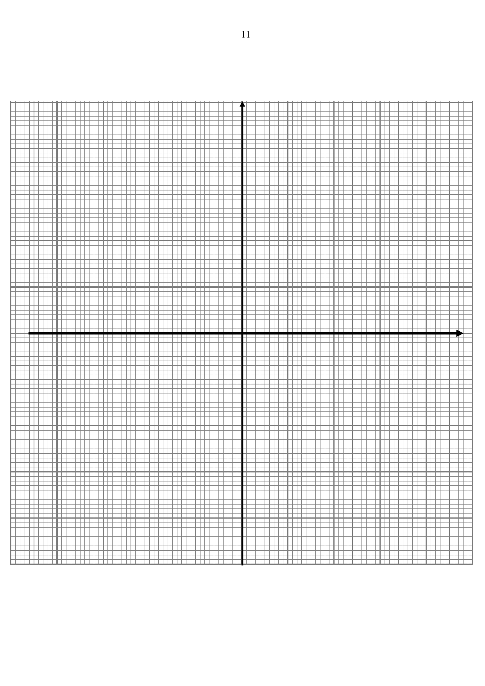
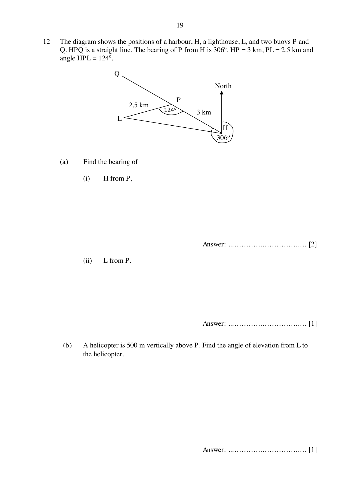

# Orchid Park Secondary School — Mathematics 4052/02 Paper 2 (cleaned)

> **Institution:** Orchid Park Secondary School
> **Exam:** Preliminary Examination 2024
> **Level:** Secondary 4 Express / 5 Normal (Academic)
> **Subjects:** Elementary Mathematics
> **Paper:** 4052/02 Paper 2
> **Date:** 19 August 2024
> **Duration:** 2 hours 15 minutes
> **Total Marks:** 90
> **Source:** `OPSS_Prelims_2024_4E_Math_P2_QP 11 Aug.pdf`

---

## Instructions

Additional materials: NIL. Setter: Mrs. Jay.

Write your name, class and index number on all the work you hand in.
Write in dark blue or black pen.
Use a pencil for any diagrams or graphs.
Do not use staples, paper clips, glue or correction fluid.

Answer all questions.

If working is needed for any question, it must be shown in the space below the question.
Omission of essential working will result in loss of marks.
The use of an approved scientific calculator is expected, where appropriate.
If the degree of accuracy is not specified in the question, and if the answer is not exact, give the answer to three significant figures. Give answers in degrees to one decimal place.
For $\pi$, use either your calculator value or $3.142$, unless the question requires the answer in terms of $\pi$.

The number of marks is given in brackets [ ] at the end of each question or part question.
The total number of marks for this paper is 90.

---

## Mathematical Formulae

The paper uses the standard 4052 formulae for compound interest, mensuration, trigonometry and statistics, as on Paper 1.

---

### Q1

> **Marks:** (a)(i) 1, (a)(ii) 2, (b) 3; total 6
> **Topic:** N1 Numbers and their operations
> **Sub-topic:** Numbers and their operations
> **LO:** [[context/subjects/o-level-e-maths/learning-objectives/o-level-e-maths-N1h.md|N1h]]
> **Page:** 3

**(a)** **(i)** Express $2x^{2}-6x-12$ in the form $k(x-a)^{2}-b$, where $k$ is an integer.

**(ii)** Hence, solve $2x^{2}-6x-12=0$.

**(b)** Simplify $\dfrac{3x+1}{2x^{2}+11x+12}-\dfrac{1}{x+4}$.

---

### Q2

> **Marks:** 3
> **Topic:** N5 Algebraic expressions and formulae
> **Sub-topic:** Algebraic expressions and formulae
> **LO:** [[context/subjects/o-level-e-maths/learning-objectives/o-level-e-maths-N5m.md|N5m]]
> **Page:** 4

In the diagram, $ABCD$ is a rectangle. Given that $AB=(2x+y)\text{ cm}$, $BC=(x+y)\text{ cm}$, $CD=(3x+5y+3)\text{ cm}$ and $AD=(4x+5y-7)\text{ cm}$.
Find the values of $x$ and $y$.

---

### Q3

> **Marks:** (a) 3, (b) 3; total 6
> **Topic:** N7 Equations and inequalities
> **Sub-topic:** Equations and inequalities
> **LO:** [[context/subjects/o-level-e-maths/learning-objectives/o-level-e-maths-N7e.md|N7e]]
> **Page:** 5

**(a)** By using factorisation, solve $(x-3)(2x+8)=-12$.

**(b)** Solve the equation $\dfrac{4}{2x-3}-\dfrac{3}{x+2}=1$.

Give your solutions correct to two decimal places.

---

### Q4

> **Marks:** (a) 2, (b) 3, (c) 4; total 9
> **Topic:** G5 Mensuration
> **Sub-topic:** Mensuration
> **LO:** [[context/subjects/o-level-e-maths/learning-objectives/o-level-e-maths-G5c.md|G5c]]
> **Page:** 6–7

The diagrams show a solid hemisphere and a solid cone. The hemisphere has a radius of $3y\text{ cm}$. The cone has a radius of $2y\text{ cm}$ and slant height $l\text{ cm}$.

**(a)** Show that the total surface area of the solid cone is $2\pi y(l+2y)\text{ cm}^{2}$.

**(b)** The total surface area of the solid hemisphere is equal to the total surface area of the solid cone. Find $l$ in terms of $y$.

**(c)** The volume of the hemisphere is $729\text{ cm}^{3}$. Calculate the volume of the cone.

---

### Q5

> **Marks:** (a) 1, (b) 2; total 3
> **Topic:** G5 Mensuration
> **Sub-topic:** Mensuration
> **LO:** [[context/subjects/o-level-e-maths/learning-objectives/o-level-e-maths-G5b.md|G5b]]
> **Page:** 7

The scale of a map is 2 cm : 1 km.

**(a)** Write this scale in the form $1:n$.

**(b)** The area of a park is represented by an area of $456\text{ cm}^{2}$ on the map. Calculate the actual area of the land in square kilometres.

---

### Q6

> **Marks:** (a)(i) 1, (a)(ii) 1, (b) 2, (c) 2; total 6
> **Topic:** G4 Pythagoras' theorem and trigonometry
> **Sub-topic:** Pythagoras' theorem and trigonometry
> **LO:** [[context/subjects/o-level-e-maths/learning-objectives/o-level-e-maths-G4c.md|G4c]]
> **Page:** 8

The points $A$, $B$, $C$, $D$ and $E$ are shown such that $ABC$ and $AED$ are straight lines and $BE=\sqrt{8}\text{ cm}$.

$A(-3, 1)$, $B(1, 1)$ and $C(4, 1)$ lie on the horizontal line $y=1$. $E$ is the point $(4, 3)$. $D$ lies on the straight line $AED$.

**(a)** Without using a calculator, find

**(i)** $\sin\angle ABE$,

**(ii)** $\cos\angle ABE$.

**(b)** Using your answer in (a)(i), calculate the area of triangle $ABE$.

**(c)** Given that triangle $ABE$ and triangle $ACD$ are similar, calculate the area of triangle $ACD$.

---

### Q7

> **Marks:** (a) 1, (b) 3, (c)(i) 2, (c)(ii) 1, (c)(iii) 1; total 8
> **Topic:** N6 Functions and graphs
> **Sub-topic:** Functions and graphs
> **LO:** [[context/subjects/o-level-e-maths/learning-objectives/o-level-e-maths-N6c.md|N6c]]
> **Page:** 10–11

**(a)** Complete the table of values for $y=x-\dfrac{4}{x^{2}}$.
Values are given to one decimal place where appropriate.

| $x$ | $-15$ | $-10$ | $-5$ | $-1$ | $1$ | $5$ | $10$ | $15$ |
| --- | --- | --- | --- | --- | --- | --- | --- | --- |
| $y$ | $-15.0$ | | $-5.2$ | $-5$ | $-3$ | $4.8$ | $10.0$ | $15.0$ |

**(b)** On the grid, draw the graph of $y=x-\dfrac{4}{x^{2}}$ for $-15 \le x \le 15$.
The graph has an asymptote at $x=0$ (the graph goes near but does not cut through the $y$-axis).

**(c)** **(i)** On the same grid, draw the graph of $2y-2x=-7$ for $-15 \le x \le 15$.

**(ii)** Write down the $x$-coordinates of the points where the line intersects the curve.

**(iii)** These values of $x$ in part (ii) are the solutions of the equation $Ax^{2}+B=0$.
Find the value of $A$ and the value of $B$.

---

### Q8

> **Marks:** (a) 2, (b) 1, (c) 1, (d) 3; total 7
> **Topic:** G3 Properties of circles
> **Sub-topic:** Properties of circles
> **LO:** [[context/subjects/o-level-e-maths/learning-objectives/o-level-e-maths-G3b.md|G3b]]
> **Page:** 12–13

$P$, $R$ and $Q$ are points on the circle with centre $O$.
$PT$ and $QT$ are tangents to the circle at $P$ and $Q$ respectively.
$\angle PTQ=60^{\circ}$ and $\angle OQR=20^{\circ}$.

Writing your reasons clearly, find

**(a)** $\angle TQP$,

**(b)** $\angle PRQ$,

**(c)** $\angle OPR$,

**(d)** If the radius of the circle is 5 cm, find the area of the major segment $QRP$ of the circle.

---

### Q9

> **Marks:** (a) 2, (b) 3, (c)(i) 2, (c)(ii) 2, (d) 1; total 10
> **Topic:** G7 Vectors in two dimensions
> **Sub-topic:** Vectors in two dimensions
> **LO:** [[context/subjects/o-level-e-maths/learning-objectives/o-level-e-maths-G7h.md|G7h]]
> **Page:** 14–15

$ABCD$ is a parallelogram. $A$ is the point $(-6, -2)$ and $B$ is the point $(-4, -7)$.
$\overrightarrow{BC}=\begin{pmatrix} 8 \\ -2 \end{pmatrix}$.

**(a)** Find the length of the line $AB$.

**(b)** Find the equation of the line $CD$.

**(c)** $X$ is the point where the diagonals of the parallelogram intersect.

**(i)** Find $\overrightarrow{XC}$.

**(ii)** Find the position vector of $X$.

**(d)** $P$ is the point on $BC$ such that $\dfrac{BP}{PC}=\dfrac{2}{1}$.
Find the ratio of the area of $\triangle ABP$ to the area of $\triangle ACP$.

---

### Q10

> **Marks:** (a) 2, (b) 1, (c) 2; total 5
> **Topic:** S1 Data handling and analysis
> **Sub-topic:** Data handling and analysis
> **LO:** [[context/subjects/o-level-e-maths/learning-objectives/o-level-e-maths-S1k.md|S1k]]
> **Page:** 16

The table below summarises the times taken by female participants to complete a 10 km race.

| Time ($t$ min) | $30 \le t < 40$ | $40 \le t < 50$ | $50 \le t < 60$ | $60 \le t < 70$ | $70 \le t < 80$ |
| --- | --- | --- | --- | --- | --- |
| Frequency | 20 | 39 | 16 | 20 | $x$ |

**(a)** Given that the estimated mean time is 50.1 min, show that the value of $x$ is 5.

**(b)** Calculate an estimate of the standard deviation.

**(c)** The mean time for male participants to complete the race was 45.3 min and the standard deviation was 12.6 min. Make 2 comparisons between the times for male and female participants.

---

### Q11

> **Marks:** (a) 1, (b) 1, (c) 2, (d) 2, (e) 2; total 8
> **Topic:** N5 Algebraic expressions and formulae
> **Sub-topic:** Algebraic expressions and formulae
> **LO:** [[context/subjects/o-level-e-maths/learning-objectives/o-level-e-maths-N5e.md|N5e]]
> **Page:** 17–18

The first four terms in a sequence of numbers are given below.

$T_{1}=3^{2}+5=14$

$T_{2}=4^{2}+8=24$

$T_{3}=5^{2}+11=36$

$T_{4}=6^{2}+14=50$

**(a)** Find $T_{5}$.

**(b)** Explain why the value of $T_{n}$ must be even for all values of $n$.

**(c)** Show that the $n$th term of the sequence, $T_{n}$, is given by $n^{2}+7n+6$.

**(d)** $T_{p}$ and $T_{p+1}$ are consecutive terms in the sequence. Find and simplify an expression, in terms of $p$, for $T_{p+1}-T_{p}$.

**(e)** Explain why two consecutive terms of the sequence cannot have a difference of 4.

---

### Q12

> **Marks:** (a)(i) 2, (a)(ii) 1, (b) 1, (c) 2, (d) 3; total 9
> **Topic:** G4 Pythagoras' theorem and trigonometry
> **Sub-topic:** Pythagoras' theorem and trigonometry
> **LO:** [[context/subjects/o-level-e-maths/learning-objectives/o-level-e-maths-G4g.md|G4g]]
> **Page:** 19–20

The diagram shows the positions of a harbour, $H$, a lighthouse, $L$, and two buoys $P$ and $Q$. $HPQ$ is a straight line. The bearing of $P$ from $H$ is $306^{\circ}$. $HP=3\text{ km}$, $PL=2.5\text{ km}$ and angle $HPL=124^{\circ}$.

**(a)** Find the bearing of

**(i)** $H$ from $P$,

**(ii)** $L$ from $P$.

**(b)** A helicopter is 500 m vertically above $P$. Find the angle of elevation from $L$ to the helicopter.

**(c)** Calculate $HL$.

**(d)** A ship sailed from the harbour along the line $HPQ$ at an average speed of 4.5 m/s. At 0809 hours, it reached a point $X$ which is nearest to the lighthouse.

Find the time it left the harbour. Correct your answer to the nearest minute.

---

### Q13

> **Marks:** (a) 2, (b) 2, (c) 6; total 10
> **Topic:** S2 Probability
> **Sub-topic:** Probability
> **LO:** [[context/subjects/o-level-e-maths/learning-objectives/o-level-e-maths-S2c.md|S2c]]
> **Page:** 21–22

In a shooting game, the player has to shoot with a gun to capture a monster. The bullet from the gun has to land on a circular target on the monster so that a net will open up.
The circular target has four different sizes.
Target 1 is a big circle;
Target 2 is three quarters of the area of Target 1;
Target 3 is half of the area of Target 1;
Target 4 is one quarter of the area of Target 1.

**(a)** Sam estimates that the probability that he hits Target 1 is about 0.88. Given that the probability of hitting the circular target is proportional to its area, show that the probability that Sam hits Target 2 and Target 4 is estimated to be 0.66 and 0.44 respectively.

Even if the bullet hits the circular target, the monster might not be captured as it can break free from the net. The probability of successfully capturing the monster depends on the area and colour of the circular target, and the type of bullet that the player uses.

| | Target 1 | Target 2 | Target 3 | Target 4 |
| --- | --- | --- | --- | --- |
| Probability of Sam hitting the target | 0.88 | 0.66 | 0.44 | 0.22 |

| Targets of different sizes | Target 1 | Target 2 | Target 3 | Target 4 |
| --- | --- | --- | --- | --- |
| Multiplier for capturing monster | 0.7 | 0.8 | 0.95 | 0.5 |

| Targets of different colours | Green | Yellow | Orange | Red |
| --- | --- | --- | --- | --- |
| Multiplier for capturing monster | 0.9 | 0.7 | 0.5 | 0.4 |

| Types of bullets | Hollow Point | Soft Point | Flat Nose |
| --- | --- | --- | --- |
| Multiplier for capturing monster | 0.6 | 0.7 | 0.9 |

To calculate this probability, in-built multipliers are assigned to each of these three factors. For example, if a player uses a hollow point bullet and captures a monster with a yellow Target 3, the probability of successfully capturing the monster is given by $0.6\times 0.7\times 0.95=0.399$.

**(b)** Show that the estimated probability that Sam will hit and capture a monster with an orange Target 4 using a Flat Nose bullet is 0.0495.

In the game, the target changes colour from green to yellow to orange to red and finally back to green. Each change occurs every second. In addition, the target also changes its size from Target 1 to 2 to 3 to 4 and then back to Target 1. Each change also occurs every second. For example, if a monster appears with a yellow Target 3, it will change to an orange Target 4 in the next second, and then a red Target 1 in the following second.

**(c)** At time $t=0$ seconds, Sam sees a monster with a red Target 2. He only has one Soft Point bullet. State the colour, Target size and find the maximum probability and the number of seconds Sam should take to shoot at the monster in order to maximise his chance of hitting and capturing it. Justify your decision and show your calculations clearly.
