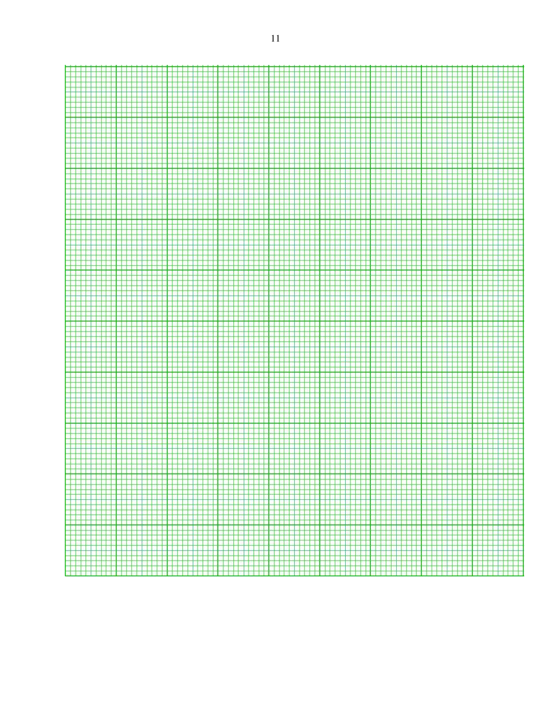
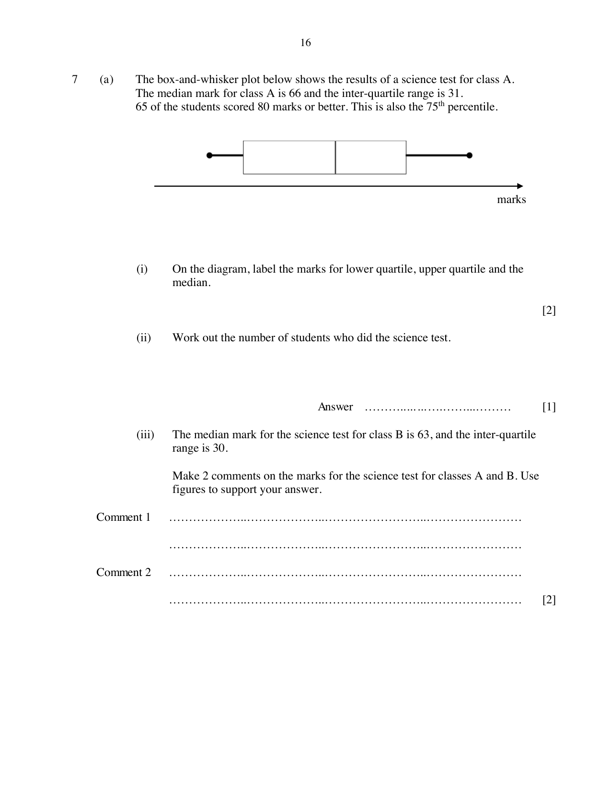
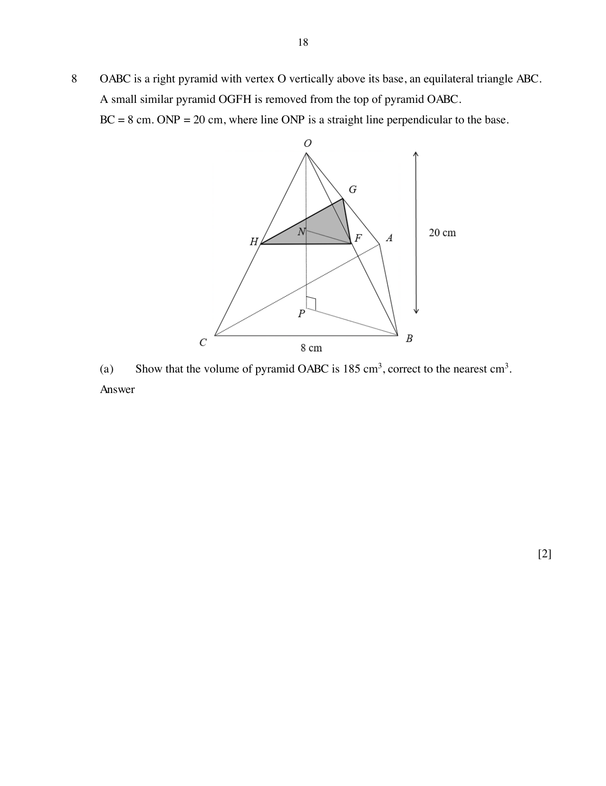

# Outram Secondary School — Mathematics 4052/02 Paper 2 (cleaned)

> **Institution:** Outram Secondary School
> **Exam:** Preliminary Examination 2024
> **Level:** Secondary Four Express and Five Normal Academic
> **Subjects:** Elementary Mathematics
> **Paper:** 4052/02 Paper 2
> **Date:** 23 August 2024
> **Duration:** 2 hours 15 minutes
> **Total Marks:** 90
> **Source:** `2024 Outram Prelim P2 QP.pdf`

---

## Instructions

Write your name, class and index number on all the work you hand in.
Write in dark blue or black pen.
You may use an HB pencil for any diagrams or graphs.
Do not use staples, paper clips, highlighters, glue or correction fluid.

Answer all questions on the Question Paper.
If working is needed for any question it must be shown with the answer.
Omission of essential working will result in loss of marks.
The use of an approved scientific calculator is expected, where appropriate.
If the degree of accuracy is not specified in the question, and if the answer is not exact, give the answer to three significant figures. Give answers in degrees to one decimal place.
For $\pi$, use either your calculator value or $3.142$, unless the question requires the answer in terms of $\pi$.

The number of marks is given in brackets [ ] at the end of each question or part question.
The total of the marks for this paper is 90.

---

### Q1

> **Marks:** (a)(i) 1, (a)(ii) 2, (b)(i) 1, (b)(ii) 2, (b)(iii) 2; total 8
> **Sub-topic:** Number
> **Page:** 3–4

**(a)** It is given that 1 microgram $=10^{-6}$ grams and 1 milligram $=10^{-3}$ grams.

**(i)** If 1 milligram $=p$ micrograms, find the integer value of $p$.

**(ii)** The recommended daily amount of vitamin A intake for an adult man is 900 micrograms. The amount of vitamin A in half a cup of boiled spinach is about 0.573 milligrams.

An adult man consumed one cup of boiled spinach in a day.

Explain whether he has met the daily recommended intake of vitamin A.

**(b)** A map has a scale of $1:30000$.

**(i)** The distance on the map between Town A and Town B is 8.5 cm.
Find the actual distance, in km, between Town A and Town B.

**(ii)** On the same map, the actual area of a pond is $0.36\text{ km}^{2}$.
Find the area of the pond represented on the map.

**(iii)** The same pond has an area of $0.5625\text{ cm}^{2}$ on another map with a scale of $1:n$. Find the value of $n$.

---

### Q2

> **Marks:** (a)(i) 2, (a)(ii) 3, (b) 2, (c) 4; total 11
> **Sub-topic:** Algebra
> **Page:** 4–5

**(a)** $2xz=\dfrac{4y-z^{2}}{3z}$

**(i)** Find $y$ when $x=3$ and $z=-1$.

**(ii)** Express $z$ in terms of $x$ and $y$.

**(b)** Solve the inequality $3-x<\dfrac{7-3x}{2}\le 6$.

**(c)** Solve the equation $\dfrac{2}{x+1}+\dfrac{5}{2x-5}=1$.

---

### Q3

> **Marks:** (a) 2, (b) 2, (c) 3, (d) 2; total 9
> **Sub-topic:** Mensuration
> **Page:** 6–8

The diagram shows an open funnel, consisting of a cylinder and a cone.
The heights of the cylinder and the cone are $1.5h$ cm each, and the radius of both the cylinder and the cone is $0.8h$ cm.

**(a)** Show that the curved surface area of the cone is $1.36\pi h^{2}$.

**(b)** Given that the total surface area of the funnel is $1504\pi\text{ cm}^{2}$, find the value of $h$.

**(c)** A glass rod is placed in the funnel so that one end of the glass rod rests on the edge of the funnel as shown.
When the glass rod is placed vertically from the bottom of the funnel, a part of the glass rod protrudes from the top of the funnel.
Calculate this length of the part of the glass rod that is outside the funnel when placed vertically.

**(d)** Water is being poured into the funnel at a constant rate and it takes 16 seconds to fill the funnel completely.

Sketch the change in height of the water level with respect to time, showing all critical values clearly.

---

### Q4

> **Marks:** (a) 1, (b) 1, (c) 3, (d)(i) 1, (d)(ii) 1, (e)(i) 2, (e)(ii) 2, (e)(iii) 3; total 14
> **Sub-topic:** Graphs
> **Page:** 9–11

The cost $y$, in dollars, of making a round plate of radius $x$ cm is given by the function $y=ax^{2}+\dfrac{210}{x}$, where $a$ is a constant.

**(a)** Given that $x=2$, $y=107$, show that $a=\dfrac{1}{2}$.

**(b)** The table below shows some of the corresponding values of $x$ and $y$.

| $x$ | | | | 8 | 10 | 12 |
| --- | --- | --- | --- | --- | --- | --- |
| $y$ | 107 | 60.5 | 53 | 58.3 | 71 | $p$ |

Find $p$.

**(c)** On the grid, draw the graph for $y=ax^{2}+\dfrac{210}{x}$ for $2\le x\le 12$.

**(d)** Using your graph,

**(i)** find the radius which gives the minimum cost,

**(ii)** find the range of values of $x$ such that the cost is below ＄70.

**(e)** **(i)** On the same grid as in part (c), draw the line $6y=25x+180$.

**(ii)** Write down the $x$-coordinates of the points where the line intersects the curve.

**(iii)** These values of $x$ are the solutions of the equation $x^{3}+Ax^{2}+Bx+C=0$.
Find the values of $A$, $B$ and $C$.

---

### Q5

> **Marks:** (a)(i) 3, (a)(ii) 1, (b)(i) 1, (b)(ii) 1, (b)(iii) 2; total 8
> **Sub-topic:** Geometry
> **Page:** 12–13

**(a)** The circle $BCDE$ has centre $O$. $AB$ and $AC$ are tangents to the circle. $COE$ is a straight line. Angle $CED=60^{\circ}$ and $DF=FB$.

**(i)** Prove, stating your reasons clearly, that triangle $BCD$ is equilateral.

**(ii)** Find angle $BAC$.

**(b)** The first three terms in a sequence of numbers, $T_{1}$, $T_{2}$, $T_{3}$, $\ldots$ are given below.

$T_{1}=\dfrac{1}{2}(2\times 3)=3$

$T_{2}=\dfrac{1}{2}(3\times 4)=6$

$T_{3}=\dfrac{1}{2}(4\times 5)=10$

**(i)** Find $T_{7}$.

**(ii)** Find an expression, in terms of $n$, for $T_{n}$.

**(iii)** 351 is a term in the sequence. Find the value of $n$.

---

### Q6

> **Marks:** (a)(i) 3, (a)(ii) 3, (b)(i) 2, (b)(ii) 2, (b)(iii) 2; total 12
> **Sub-topic:** Vectors
> **Page:** 14–15

**(a)** The position vector of point $P$ is $\begin{pmatrix} -3 \\ 4 \end{pmatrix}$ and the position vector of point $Q$ is $\begin{pmatrix} 2 \\ m \end{pmatrix}$, where $m<0$.

**(i)** $PQ=13$ units. Find $m$.

**(ii)** Given that $\overrightarrow{QP}=2\overrightarrow{PR}$, find the coordinates of point $R$.

**(b)** The coordinates of $B$ and $C$ are $(5, 7)$ and $(5, -2)$ respectively. Lines $AB$ and $AC$ intersect the $y$-axis at $P$ and $Q$ respectively.

**(i)** The gradient of $AB$ is $\dfrac{2}{3}$. Find the equation of the line $AB$.

**(ii)** The $y$-coordinate of $A$ is 1. Find the area of triangle $ABC$.

**(iii)** Explain why triangle $APQ$ and triangle $ABC$ are similar.

---

### Q7

> **Marks:** (a)(i) 2, (a)(ii) 1, (a)(iii) 2, (b)(i) 2, (b)(ii)(a) 2, (b)(ii)(b) 2; total 11
> **Sub-topic:** Statistics
> **Page:** 16–17

**(a)** The box-and-whisker plot below shows the results of a science test for class A.
The median mark for class A is 66 and the inter-quartile range is 31.
65 of the students scored 80 marks or better. This is also the 75th percentile.

**(i)** On the diagram, label the marks for the lower quartile, the upper quartile and the median.

**(ii)** Work out the number of students who did the science test.

**(iii)** The median mark for the science test for class B is 63, and the inter-quartile range is 30.

Make 2 comments on the marks for the science test for classes A and B. Use figures to support your answer.

**(b)** The table below shows the mass distribution of 80 eggs collected from a farm.

| Mass ($x$ g) | $25 < x \le 35$ | $35 < x \le 45$ | $45 < x \le 55$ | $55 < x \le 65$ |
| --- | --- | --- | --- | --- |
| Frequency | 6 | 12 | 30 | 32 |

**(i)** Calculate the mean and standard deviation.

**(ii)** Two eggs were chosen at random without replacement.
Find the probability that

**(a)** both eggs weigh at most 45 g,

**(b)** one of the eggs weighs less than 35 g and the other egg weighs more than 55 g.

---

### Q8

> **Marks:** (a) 2, (b) 3, (c) 2; total 7
> **Sub-topic:** Mensuration
> **Page:** 18–19

$OABC$ is a right pyramid with vertex $O$ vertically above its base, an equilateral triangle $ABC$.
A small similar pyramid $OGFH$ is removed from the top of pyramid $OABC$.
$BC=8\text{ cm}$. $ONP=20\text{ cm}$, where line $ONP$ is a straight line perpendicular to the base.

**(a)** Show that the volume of pyramid $OABC$ is $185\text{ cm}^{3}$, correct to the nearest $\text{cm}^{3}$.

**(b)** Given that the volume of pyramid $OGFH$ is $39.96\text{ cm}^{3}$, find the value of

$$
\frac{\text{area of triangle }FGH}{\text{area of triangle }BAC}.
$$

**(c)** The remaining vertical height of the solid, $NP$, is 8 cm.
Calculate the area of the top $FGH$ of the remaining solid.

---

### Q9

> **Marks:** (a) 5, (b) 5; total 10
> **Sub-topic:** Real-world context
> **Page:** 20–22

A group of students plans to sell all-day breakfast sets during the school carnival in order to raise funds for a charity. Each breakfast set consists of 2 scrambled eggs, 2 slices of bread, 1 sausage, 1 slice of chicken ham and a cup of coffee.

The students estimate that they will sell 300 all-day breakfast sets. The costs of the ingredients used are as follows.

| Item | Description | Unit cost |
| --- | --- | --- |
| Eggs | Pasar Fresh Eggs (10 per pack) | ＄2.70 |
| | Pasar Fresh Eggs (30 per pack) | ＄6.90 |
| | Dasun Fresh Eggs (15 per pack) | ＄4.55 |
| Bread | Garden Soft White Bread (14 slices) | ＄2.70 |
| | Sunny Soft White Bread (12 slices) | ＄2.50 |
| Sausages | Chicken Frank (10 per pack) | ＄5.25 |
| | Chef Sausages (6 per pack) (＄0.35 off per 2 packs) | ＄3.20 |
| Ham | FP Baked Ham (10 per pack) (20% off per 3 packs) | ＄4.35 |
| | SC Baked Ham (10 per pack) | ＄3.30 |
| Coffee | Nescafe Instant Coffee (35 per pack) (Buy 5 get 1 free) | ＄6.15 |
| | Indocafe Coffeemix (25 per pack) | ＄3.95 |

**(a)** Find the lowest possible total cost of the ingredients required for the 300 all-day breakfast sets.

**(b)** The school provides ＄200 in funding for the students and has set two criteria which every class must meet:

Criteria 1: Up to 40% of the sales will be used to cover their expenses, while the remaining goes to the charity.

Criteria 2: The students must raise at least ＄600 for charity.

Find the minimum price (to the nearest ten cents) they must charge for each breakfast set such that this group of students meets both criteria.

Justify your answer, showing all necessary workings clearly.
State an assumption you have made in your calculations.
