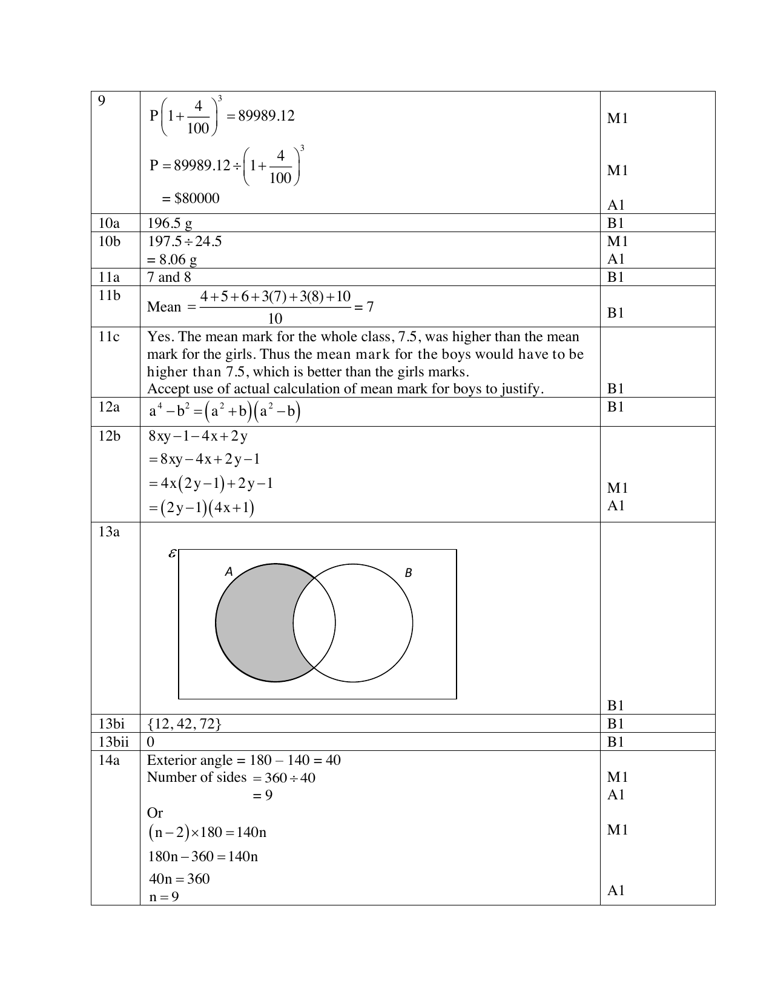
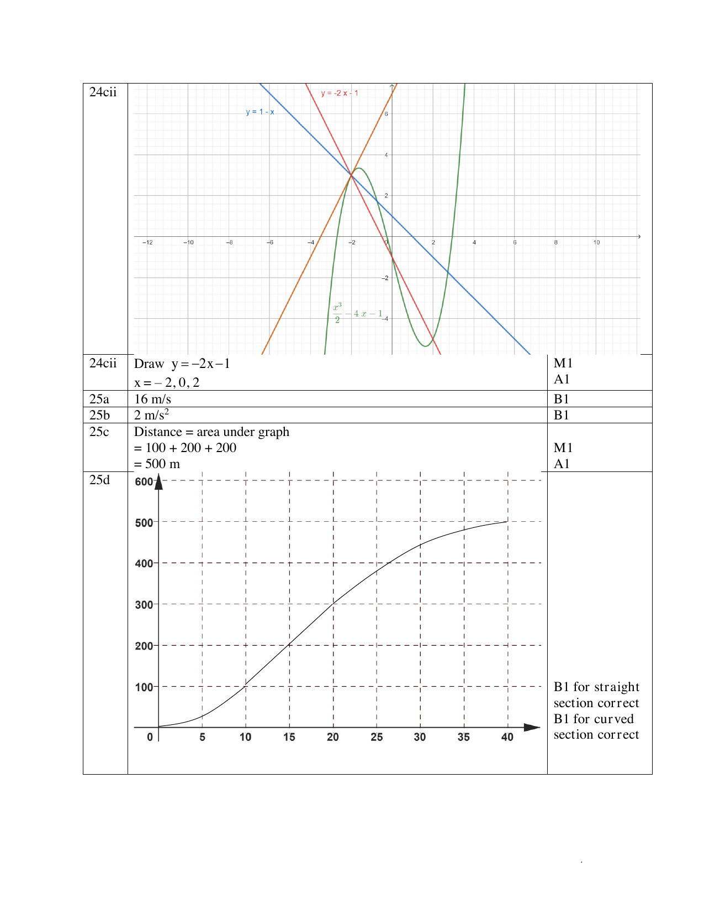

# Swiss Cottage Secondary School — Mathematics 4052/01 Paper 1 Mark Scheme (cleaned)

> **Institution:** Swiss Cottage Secondary School
> **Exam:** Preliminary Examination 2024
> **Level:** Secondary Four and Five
> **Subjects:** Elementary Mathematics
> **Paper:** 4052/01 Paper 1 — Mark Scheme
> **Date:** Monday 26 August 2024
> **Duration:** 2 hours 15 minutes
> **Total Marks:** 90
> **Source:** `SCSS 2024 EM Prelim P1 MS.pdf`. **Page** is the physical page of the paired question paper `SCSS 2024 EM Prelim P1 QP.pdf`.

---

## Answers

### Q1

> **Marks:** 2
> **Sub-topic:** Geometry
> **Page:** 3

$PQ^{2}+PQ^{2}=15^{2}$ (M1)

$2PQ^{2}=225$

$PQ=10.6\text{ cm}$ (A1)

### Q2

> **Marks:** (a) 1, (b) 1; total 2
> **Sub-topic:** Probability
> **Page:** 3

**(a)** $\dfrac{3}{5}$ (B1)

**(b)** New total $=3\times 5=15$. Yellow balls left $=15-8-5=2$. $x=7-2=5$ (B1)

### Q3

> **Marks:** 2
> **Sub-topic:** Number
> **Page:** 4

2020 population $=\dfrac{100}{104}\times 5\,920\,000$ (M1)

$=5\,690\,000$ (nearest ten thousand) (A1)

### Q4

> **Marks:** 2
> **Sub-topic:** Algebra
> **Page:** 4

$\dfrac{2x}{3}-\dfrac{3(x-2)}{4}=\dfrac{8x-9(x-2)}{12}$ (M1, common denominator)

$=\dfrac{8x-9x+18}{12}=\dfrac{18-x}{12}$ (A1)

### Q5

> **Marks:** 2
> **Sub-topic:** Algebra
> **Page:** 4

$\left(\dfrac{x^{3}}{27y^{6}}\right)^{\frac{4}{3}}=\dfrac{x^{4}}{81y^{8}}$

B1 numerator, B1 denominator.

### Q6

> **Marks:** 2
> **Sub-topic:** Number
> **Page:** 5

$24=2^{3}\times 3$, $20=2^{2}\times 5$, $15=3\times 5$

LCM $=2^{3}\times 3\times 5$ (M1)

Smallest length $=120\text{ cm}$ (A1)

### Q7

> **Marks:** (a) 1, (b) 1; total 2
> **Sub-topic:** Statistics
> **Page:** 5

**(a)** $9$ (B1)

**(b)** Angle $=\dfrac{3}{18}\times 360=60$ (B1)

### Q8

> **Marks:** (a) 1, (b) 2; total 3
> **Sub-topic:** Number
> **Page:** 6

**(a)** $1.90\times 10^{27}\div 5.97\times 10^{24}=3.18\times 10^{2}$ (B1)

**(b)** Jupiter density $=1.90\times 10^{27}\div 1.43\times 10^{24}=1328.6713\text{ kg/m}^{3}$

Earth density $=5.97\times 10^{24}\div 1.08\times 10^{21}=5527.7778\text{ kg/m}^{3}$ (M1)

Earth has a higher density. (A1)

### Q9

> **Marks:** 3
> **Sub-topic:** Number
> **Page:** 6

$P\left(1+\dfrac{4}{100}\right)^{3}=89989.12$ (M1)

$P=89989.12\div\left(1+\dfrac{4}{100}\right)^{3}$ (M1)

$=＄80000$ (A1)

### Q10

> **Marks:** (a) 1, (b) 2; total 3
> **Sub-topic:** Number
> **Page:** 7

**(a)** $196.5\text{ g}$ (B1)

**(b)** $197.5\div 24.5$ (M1)

$=8.06\text{ g}$ (A1)

### Q11

> **Marks:** (a) 1, (b) 1, (c) 1; total 3
> **Sub-topic:** Statistics
> **Page:** 7

**(a)** $7$ and $8$ (B1)

**(b)** Mean $=\dfrac{4+5+6+3(7)+3(8)+10}{10}=7$ (B1)

**(c)** Yes. The mean mark for the whole class, $7.5$, was higher than the mean mark for the girls. Thus the mean mark for the boys would have to be higher than $7.5$, which is better than the girls’ marks. Accept use of the actual calculation of the mean mark for the boys to justify. (B1)

### Q12

> **Marks:** (a) 1, (b) 2; total 3
> **Sub-topic:** Algebra
> **Page:** 8

**(a)** $a^{4}-b^{2}=(a^{2}+b)(a^{2}-b)$ (B1)

**(b)** $8xy-1-4x+2y=8xy-4x+2y-1=4x(2y-1)+2y-1$ (M1)

$=(2y-1)(4x+1)$ (A1)

### Q13

> **Marks:** (a) 1, (b)(i) 1, (b)(ii) 1; total 3
> **Sub-topic:** Sets
> **Page:** 8

**(a)** Shade the region that is inside $A$ and outside $B$. (B1)

**(b)(i)** $\{12, 42, 72\}$ (B1)

**(ii)** $0$ (B1)

### Q14

> **Marks:** (a) 2, (b) 2; total 4
> **Sub-topic:** Geometry
> **Page:** 9

**(a)** Exterior angle $=180-140=40$. Number of sides $=360\div 40=9$ (M1, A1)

Or $(n-2)\times 180=140n$ (M1), $180n-360=140n$, $40n=360$, $n=9$ (A1)

**(b)** Exterior angle of octagon $=360\div 8=45$ (M1)

Exterior angle of equilateral triangle $=180-60=120$

$x=120+45=165$ (A1)

### Q15

> **Marks:** (a) 1, (b) 1, (c) 2; total 4
> **Sub-topic:** Statistics
> **Page:** 10

**(a)** Accept $3\,700\,000$ to $3\,900\,000$ (B1)

**(b)** The total waste generated in the 2020s has decreased compared with the 2010s as the waste generated is lower on average. (B1)

**(c)** Yes. The amount of waste disposed of remains generally constant over the last decade but the waste recycled was generally less in the 2020s, so there is a decline in the percentage of waste recycled in the 2020s. (B1, B1)

### Q16

> **Marks:** (a) 2, (b) 2; total 4
> **Sub-topic:** Geometry
> **Page:** 11

**(a)** Angle $ACB=$ angle $ADC$ (given). Angle $BAC=$ angle $CAD$ (common angle). (M1)

Since all corresponding angles of the triangles are equal, triangles $ABC$ and $ACD$ are similar. (A1)

**(b)** $\dfrac{AB}{AC}=\dfrac{AC}{AD}$

$\dfrac{6.5}{AC}=\dfrac{AC}{6.5+5.5}$ (M1)

$AC^{2}=78$

$AC=8.83\text{ cm}$ (A1)

### Q17

> **Marks:** (a) 2, (b) 2; total 4
> **Sub-topic:** Algebra
> **Page:** 12

**(a)** $(a+2b)(a-2b)-a^{2}=a^{2}-4b^{2}-a^{2}$ (M1, correct expansion)

$=-4b^{2}$ (A1)

**(b)** $12\,349\times 12\,341-12\,345^{2}$

$=(12\,345+4)(12\,345-4)-12\,345^{2}$ (M1)

$=-4(4)=-16$ (A1)

### Q18

> **Marks:** (a) 1, (b) 2; total 3
> **Sub-topic:** Number
> **Page:** 12

**(a)** Number of days $=\dfrac{15}{5}\times 8=24$ (B1)

**(b)** $T=k\sqrt{l}$

Percentage increase $=\dfrac{k\sqrt{1.5l}-k\sqrt{l}}{k\sqrt{l}}\times 100$ (M1)

$=(\sqrt{1.5}-1)\times 100=22.5\%$ (A1)

### Q19

> **Marks:** (a) 1, (b) 1, (c) 2; total 4
> **Sub-topic:** Number
> **Page:** 13–14

**(a)** $4\text{ cm}:1\text{ km}=4\text{ cm}:100\,000\text{ cm}=1:25\,000$ (B1)

**(b)** $40\div 4=10\text{ km}$ (B1)

**(c)** $4\text{ cm}:1\text{ km}$ gives $16\text{ cm}^{2}:1\text{ km}^{2}$ (M1)

$4.5\times 16=72\text{ cm}^{2}$ (A1)

### Q20

> **Marks:** (a) 4, (b) 2; total 6
> **Sub-topic:** Trigonometry
> **Page:** 14

**(a)** $62^{2}=56^{2}+73^{2}-2(56)(73)\cos\angle BAC$ (M2)

$\angle BAC=55.5845^{\circ}$ (A1)

Bearing $=180-55.5845=124.4^{\circ}$ (A1)

**(b)** Area of triangle $ABC=\dfrac{1}{2}(56)(73)\sin 55.5845^{\circ}$ (M1)

$=1686.2195=1690\text{ km}^{2}$ (A1)

### Q21

> **Marks:** (a) 3, (b) 1, (c) 2; total 6
> **Sub-topic:** Number
> **Page:** 15

**(a)** $56=2^{3}\times 7$ (M1)

$126=2\times 3^{2}\times 7$

$56\times 126=2^{4}\times 3^{2}\times 7^{2}$ (M1)

Since the powers of all prime factors are even, $56\times 126$ is a perfect square. (A1)

**(b)** $2\times 7=14$ (B1)

**(c)** $k=2^{2}\times 3\times 7^{2}=588$ (M1, A1)

### Q22

> **Marks:** (a) 3, (b) 2; total 5
> **Sub-topic:** Algebra
> **Page:** 16

**(a)** $9x^{2}+6x-8=0$

$(3x-2)(3x+4)=0$ (M1)

$x=\dfrac{2}{3}$ or $x=-\dfrac{4}{3}$ (A2)

**(b)** $9(y-1)^{2}+6y-14=0$

$9(y-1)^{2}+6(y-1)+6-14=0$

$9(y-1)^{2}+6(y-1)-8=0$ (M1)

From (a), $y-1=\dfrac{2}{3}$ or $y-1=-\dfrac{4}{3}$

$y=1\dfrac{2}{3}$ or $y=-\dfrac{1}{3}$ (A1)

### Q23

> **Marks:** (a) 1, (b) 1, (c) 1, (d)(i) 1, (d)(ii) 1, (d)(iii) 1; total 6
> **Sub-topic:** Matrices
> **Page:** 17–19

**(a)** $B=\begin{pmatrix} 30 & 60 \\ 35 & 55 \end{pmatrix}$ (B1)

**(b)** $C=5\begin{pmatrix} 20 & 40 \\ 30 & 30 \end{pmatrix}+2\begin{pmatrix} 30 & 60 \\ 35 & 55 \end{pmatrix}=\begin{pmatrix} 160 & 320 \\ 220 & 260 \end{pmatrix}$ (B1)

**(c)** Elements of $C$ represent the total number of people from each of the categories of adults and children, admitted to the theatre in the morning and afternoon respectively over one week. (B1)

**(d)(i)** $D=\begin{pmatrix} 160 & 320 \\ 220 & 260 \end{pmatrix}\begin{pmatrix} 25 \\ 12 \end{pmatrix}=\begin{pmatrix} 7840 \\ 8620 \end{pmatrix}$ (B1)

**(ii)** $E=\dfrac{1}{7}\begin{pmatrix} 1 & 1 \end{pmatrix}\begin{pmatrix} 7840 \\ 8620 \end{pmatrix}=\begin{pmatrix} 2351\dfrac{3}{7} \end{pmatrix}$ (B1)

**(iii)** $E$ represents the average amount of money collected per day from admissions over one week. (B1)

### Q24

> **Marks:** (a) 1, (b) 2, (c)(i) 1, (c)(ii) 2; total 6
> **Sub-topic:** Graphs
> **Page:** 20–21

**(a)** $\dfrac{x^{3}}{2}-4x-1=1-x$

$\dfrac{x^{3}}{2}-3x-2=0$

$x^{3}-6x-4=0$ (B1)

**(b)** Draw a tangent. (M1) Gradient $=2$. (A1)

**(c)(i)** $x^{3}-4x=0$ gives $\dfrac{x^{3}}{2}-2x=0$, so $\dfrac{x^{3}}{2}-4x-1=-2x-1$. Equation of the line: $y=-2x-1$. (B1)

**(ii)** Draw $y=-2x-1$. (M1) $x=-2$, $0$, $2$. (A1)

### Q25

> **Marks:** (a) 1, (b) 1, (c) 2, (d) 2; total 6
> **Sub-topic:** Graphs
> **Page:** 22–23

**(a)** $16\text{ m/s}$ (B1)

**(b)** $2\text{ m/s}^{2}$ (B1)

**(c)** Distance $=$ area under the graph $=100+200+200$ (M1) $=500\text{ m}$ (A1)

**(d)** Straight section from the origin while the car accelerates and travels at constant speed, then a curve while the car decelerates. B1 for the straight section correct. B1 for the curved section correct.

The completed graph is on the same mark-scheme page as Q24(c)(ii).
