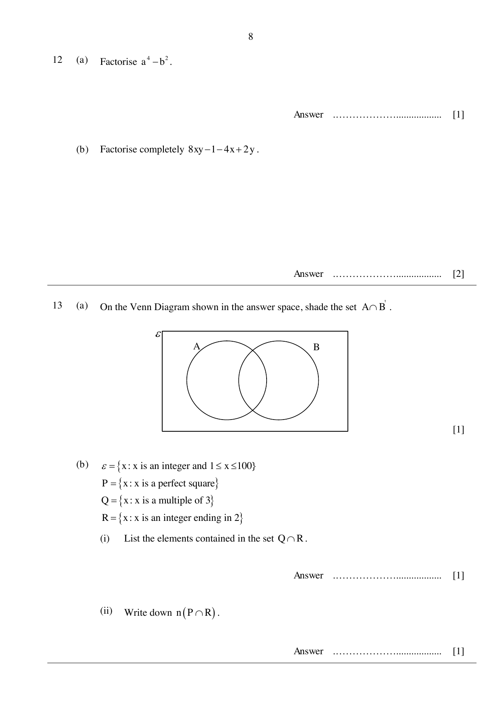
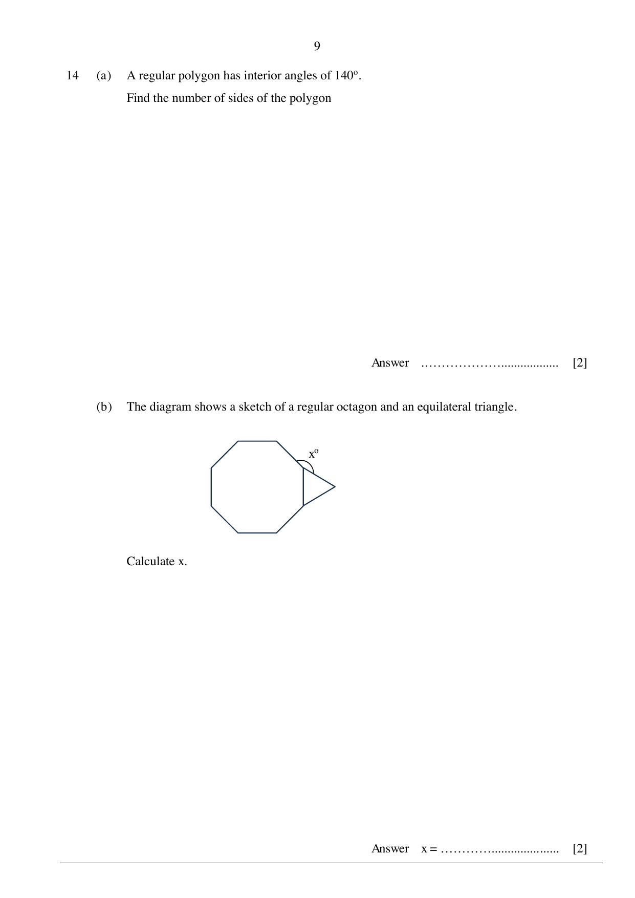
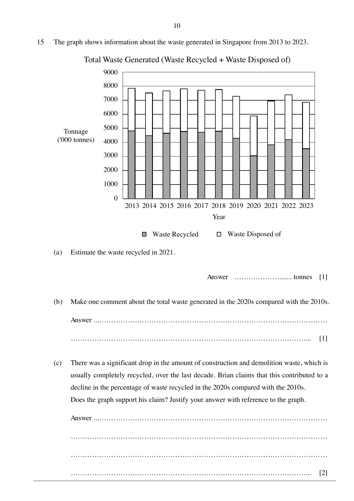
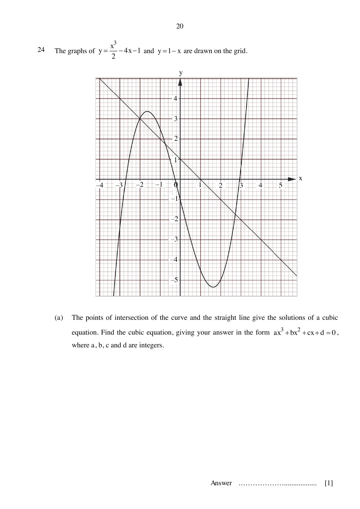
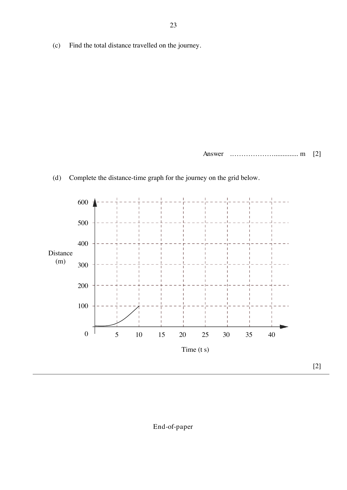

# Swiss Cottage Secondary School — Mathematics 4052/01 Paper 1 (cleaned)

> **Institution:** Swiss Cottage Secondary School
> **Exam:** Preliminary Examination 2024
> **Level:** Secondary Four and Five
> **Subjects:** Elementary Mathematics
> **Paper:** 4052/01 Paper 1
> **Date:** Monday 26 August 2024
> **Duration:** 2 hours 15 minutes
> **Total Marks:** 90
> **Source:** `SCSS 2024 EM Prelim P1 QP.pdf`

---

## Instructions

Write your class, index number and name on all the work you hand in.
Write in dark blue or black pen.
You may use an HB pencil for any diagrams or graphs.
Do not use staples, paper clips, glue or correction fluid.

Answer all the questions.
If working is needed for any question it must be shown with the answer.
Omission of essential working will result in loss of marks.
The use of an approved scientific calculator is expected, where appropriate.
If the degree of accuracy is not specified in the question and if the answer is not exact, give the answer to three significant figures. Give answers in degrees to one decimal place.
For $\pi$, use either your calculator value or $3.142$, unless the question requires the answer in terms of $\pi$.

The number of marks is given in brackets [ ] at the end of each question or part question.
The total number of marks for this paper is 90.

---

## Mathematical Formulae

*Compound interest*

$$
\text{Total amount} = P\left(1+\frac{r}{100}\right)^{n}
$$

*Measurement*

$$
\text{Curved surface area of a cone} = \pi rl
$$

$$
\text{Surface area of a sphere} = 4\pi r^{2}
$$

$$
\text{Volume of a cone} = \frac{1}{3}\pi r^{2}h
$$

$$
\text{Volume of a sphere} = \frac{4}{3}\pi r^{3}
$$

$$
\text{Area of triangle } ABC = \frac{1}{2}ab\sin C
$$

$$
\text{Arc length} = r\theta,\text{ where }\theta\text{ is in radians}
$$

$$
\text{Sector area} = \frac{1}{2}r^{2}\theta,\text{ where }\theta\text{ is in radians}
$$

*Trigonometry*

$$
\frac{a}{\sin A} = \frac{b}{\sin B} = \frac{c}{\sin C}
$$

$$
a^{2} = b^{2}+c^{2}-2bc\cos A
$$

*Statistics*

$$
\text{Mean} = \frac{\sum fx}{\sum f}
$$

$$
\text{Standard deviation} = \sqrt{\frac{\sum fx^{2}}{\sum f}-\left(\frac{\sum fx}{\sum f}\right)^{2}}
$$

---

## Section A (72 marks)

Answer all the questions.

### Q1

> **Marks:** 2
> **Topic:** G3 Properties of circles
> **Sub-topic:** Properties of circles
> **LO:** [[context/subjects/o-level-e-maths/learning-objectives/o-level-e-maths-G3b.md|G3b]]
> **Page:** 3

In the triangle, $PQ = QR$, $PR = 15\text{ cm}$ and angle $PQR = 90^{\circ}$. $Q$ is the right angle, with equal marks on $PQ$ and $QR$, and $PR$ the hypotenuse.

Calculate $PQ$.

### Q2

> **Marks:** (a) 1, (b) 1; total 2
> **Topic:** S2 Probability
> **Sub-topic:** Probability
> **LO:** [[context/subjects/o-level-e-maths/learning-objectives/o-level-e-maths-S2c.md|S2c]]
> **Page:** 3

A bag contains 8 red balls, 5 green balls and 7 yellow balls.

**(a)** A ball is chosen at random and then replaced. What is the probability that it is not a red ball?

**(b)** $x$ yellow balls are removed from the bag. The probability of choosing a green ball is now $\dfrac{1}{3}$. Find the value of $x$.

### Q3

> **Marks:** 2
> **Topic:** N3 Percentage
> **Sub-topic:** Percentage
> **LO:** [[context/subjects/o-level-e-maths/learning-objectives/o-level-e-maths-N3e.md|N3e]]
> **Page:** 4

In 2023, the population in Singapore was $5\,920\,000$, correct to the nearest ten thousand. The population increased by $4\%$ from 2020 to 2023. Calculate the population in Singapore in 2020, giving your answer correct to the nearest ten thousand.

### Q4

> **Marks:** 2
> **Topic:** N6 Functions and graphs
> **Sub-topic:** Functions and graphs
> **LO:** [[context/subjects/o-level-e-maths/learning-objectives/o-level-e-maths-N6g.md|N6g]]
> **Page:** 4

Write as a single fraction in its simplest form $\dfrac{2x}{3}-\dfrac{3(x-2)}{4}$.

### Q5

> **Marks:** 2
> **Topic:** N5 Algebraic expressions and formulae
> **Sub-topic:** Algebraic expressions and formulae
> **LO:** [[context/subjects/o-level-e-maths/learning-objectives/o-level-e-maths-N5o.md|N5o]]
> **Page:** 4

Simplify $\left(\dfrac{x^{3}}{27y^{6}}\right)^{\frac{4}{3}}$.

### Q6

> **Marks:** 2
> **Topic:** N1 Numbers and their operations
> **Sub-topic:** Numbers and their operations
> **LO:** [[context/subjects/o-level-e-maths/learning-objectives/o-level-e-maths-N1e.md|N1e]]
> **Page:** 5

Peter has many cuboid blocks with dimensions $24\text{ cm}$ by $20\text{ cm}$ by $15\text{ cm}$. He wishes to manufacture a box in the shape of a cube to pack the blocks such that there is no empty space in the box. Find the smallest possible length of the box.

### Q7

> **Marks:** (a) 1, (b) 1; total 2
> **Topic:** S1 Data handling and analysis
> **Sub-topic:** Data handling and analysis
> **LO:** [[context/subjects/o-level-e-maths/learning-objectives/o-level-e-maths-S1b.md|S1b]]
> **Page:** 5

The students in a school participate in exactly one CCA each. The table shows information on the type of CCA which students in a class participate in.

|  | Clubs and Society | Sports | Uniformed Groups | TOTAL |
| --- | --- | --- | --- | --- |
| Males | 6 |  |  |  |
| Females | 10 | 5 | 3 | 18 |
| TOTAL | 16 | 12 |  | 40 |

**(a)** How many males participate in uniformed groups?

**(b)** A pie chart is to be drawn showing the data for the females. Calculate the angle representing females participating in uniformed groups.

### Q8

> **Marks:** (a) 1, (b) 2; total 3
> **Topic:** N1 Numbers and their operations
> **Sub-topic:** Numbers and their operations
> **LO:** [[context/subjects/o-level-e-maths/learning-objectives/o-level-e-maths-N1h.md|N1h]]
> **Page:** 6

The mass of Jupiter is approximately $1.90\times 10^{27}\text{ kg}$. The mass of Earth is approximately $5.97\times 10^{24}\text{ kg}$.

**(a)** Giving your answer in standard form, calculate how many times Jupiter’s mass is, compared to that of Earth’s.

**(b)** Density refers to the mass per unit volume. Given that the volume of Jupiter is $1.43\times 10^{24}\text{ m}^{3}$ and that of Earth’s is $1.08\times 10^{21}\text{ m}^{3}$, calculate and determine which planet has a higher density.

### Q9

> **Marks:** 3
> **Topic:** N3 Percentage
> **Sub-topic:** Percentage
> **LO:** [[context/subjects/o-level-e-maths/learning-objectives/o-level-e-maths-N3d.md|N3d]]
> **Page:** 6

Elva invested a sum of money in an account paying compound interest at $4\%$ per year. After 3 years, there was ＄$89\,989.12$ in her account.

How much did Elva invest in the account?

### Q10

> **Marks:** (a) 1, (b) 2; total 3
> **Topic:** N3 Percentage
> **Sub-topic:** Percentage
> **LO:** [[context/subjects/o-level-e-maths/learning-objectives/o-level-e-maths-N3e.md|N3e]]
> **Page:** 7

A metal sphere has a mass of $197$ grams, correct to the nearest gram.

**(a)** Find the least possible mass of the metal sphere.

**(b)** The volume of the metal sphere is $25\text{ cm}^{3}$, correct to the nearest cubic centimetre. Find the greatest possible mass of $1$ cubic centimetre of the metal.

### Q11

> **Marks:** (a) 1, (b) 1, (c) 1; total 3
> **Topic:** S1 Data handling and analysis
> **Sub-topic:** Data handling and analysis
> **LO:** [[context/subjects/o-level-e-maths/learning-objectives/o-level-e-maths-S1f.md|S1f]]
> **Page:** 7

A class of 10 boys and 10 girls took a test. The girls’ marks were $4$, $5$, $6$, $7$, $7$, $7$, $8$, $8$, $8$ and $10$.

**(a)** State the modal mark for the girls.

**(b)** Find the mean mark for the girls.

**(c)** The mean mark for the whole class was $7.5$. Aaron claims that the boys did better in the test. Do you agree? Justify your answer.

### Q12

> **Marks:** (a) 1, (b) 2; total 3
> **Topic:** N5 Algebraic expressions and formulae
> **Sub-topic:** Algebraic expressions and formulae
> **LO:** [[context/subjects/o-level-e-maths/learning-objectives/o-level-e-maths-N5h.md|N5h]]
> **Page:** 8

**(a)** Factorise $a^{4}-b^{2}$.

**(b)** Factorise completely $8xy-1-4x+2y$.

### Q13

> **Marks:** (a) 1, (b)(i) 1, (b)(ii) 1; total 3
> **Topic:** N8 Set language and notation
> **Sub-topic:** Set language and notation
> **LO:** [[context/subjects/o-level-e-maths/learning-objectives/o-level-e-maths-N8c.md|N8c]]
> **Page:** 8

**(a)** On the Venn diagram in the answer space, shade the set $A\cap B'$. The diagram is two overlapping circles labelled $A$ and $B$.

**(b)** $\varepsilon=\{x:x\text{ is an integer and }1\le x\le 100\}$

$P=\{x:x\text{ is a perfect square}\}$

$Q=\{x:x\text{ is a multiple of }3\}$

$R=\{x:x\text{ is an integer ending in }2\}$

**(i)** List the elements contained in the set $Q\cap R$.

**(ii)** Write down $n(P\cap R)$.

### Q14

> **Marks:** (a) 2, (b) 2; total 4
> **Topic:** G1 Angles, triangles and polygons
> **Sub-topic:** Angles, triangles and polygons
> **LO:** [[context/subjects/o-level-e-maths/learning-objectives/o-level-e-maths-G1f.md|G1f]]
> **Page:** 9

**(a)** A regular polygon has interior angles of $140^{\circ}$. Find the number of sides of the polygon.

**(b)** The diagram shows a sketch of a regular octagon and an equilateral triangle. The triangle is attached outwardly to one side of the octagon. The angle $x^{\circ}$ is the angle between that shared side’s neighbouring octagon side and the adjacent side of the triangle.

Calculate $x$.

### Q15

> **Marks:** (a) 1, (b) 1, (c) 2; total 4
> **Topic:** S1 Data handling and analysis
> **Sub-topic:** Data handling and analysis
> **LO:** [[context/subjects/o-level-e-maths/learning-objectives/o-level-e-maths-S1b.md|S1b]]
> **Page:** 10

The graph shows information about the waste generated in Singapore from 2013 to 2023. Stacked columns show waste recycled and waste disposed of. The vertical axis is tonnage in thousands of tonnes, from $0$ to $9000$.

**(a)** Estimate the waste recycled in 2021.

**(b)** Make one comment about the total waste generated in the 2020s compared with the 2010s.

**(c)** There was a significant drop in the amount of construction and demolition waste, which is usually completely recycled, over the last decade. Brian claims that this contributed to a decline in the percentage of waste recycled in the 2020s compared with the 2010s. Does the graph support his claim? Justify your answer with reference to the graph.

### Q16

> **Marks:** (a) 2, (b) 2; total 4
> **Topic:** G2 Congruence and similarity
> **Sub-topic:** Congruence and similarity
> **LO:** [[context/subjects/o-level-e-maths/learning-objectives/o-level-e-maths-G2i.md|G2i]]
> **Page:** 11

In the diagram, $ABC$ and $ACD$ are triangles such that angle $ACB =$ angle $ADC$. $A$ is above base $CD$. Point $B$ lies on $AD$, and $CB$ is drawn. The equal angles at $C$ in triangle $ABC$ and at $D$ in triangle $ACD$ are marked.

**(a)** Show that the two triangles are similar.

**(b)** Given that $AB = 6.5\text{ cm}$ and $BD = 5.5\text{ cm}$, find $AC$.

### Q17

> **Marks:** (a) 2, (b) 2; total 4
> **Topic:** N1 Numbers and their operations
> **Sub-topic:** Numbers and their operations
> **LO:** [[context/subjects/o-level-e-maths/learning-objectives/o-level-e-maths-N1h.md|N1h]]
> **Page:** 12

**(a)** Simplify $(a+2b)(a-2b)-a^{2}$.

**(b)** Hence evaluate $12\,349\times 12\,341-12\,345^{2}$.

### Q18

> **Marks:** (a) 1, (b) 2; total 3
> **Topic:** N3 Percentage
> **Sub-topic:** Percentage
> **LO:** [[context/subjects/o-level-e-maths/learning-objectives/o-level-e-maths-N3d.md|N3d]]
> **Page:** 12

**(a)** 8 men can build a structure in 15 days. How long would it take 5 men to build the structure?

**(b)** The period, $T$ seconds, of a pendulum is proportional to the square root of the length, $l$ metres, of the pendulum. The length of a pendulum is increased by $50\%$ of its original value. Calculate the percentage increase in the period of the pendulum.

### Q19

> **Marks:** (a) 1, (b) 1, (c) 2; total 4
> **Topic:** N2 Ratio and proportion
> **Sub-topic:** Ratio and proportion
> **LO:** [[context/subjects/o-level-e-maths/learning-objectives/o-level-e-maths-N2c.md|N2c]]
> **Page:** 13

The scale of a map is $4\text{ cm}:1\text{ km}$.

**(a)** Write this scale in the form $1:n$.

**(b)** The distance between two cities on the map is $40\text{ cm}$. Find the actual distance, in kilometres, between the two cities.

**(c)** A park has an actual area of $4.5\text{ km}^{2}$. Find the area, in square centimetres, of the park on the map.

### Q20

> **Marks:** (a) 4, (b) 2; total 6
> **Topic:** G4 Pythagoras' theorem and trigonometry
> **Sub-topic:** Pythagoras' theorem and trigonometry
> **LO:** [[context/subjects/o-level-e-maths/learning-objectives/o-level-e-maths-G4g.md|G4g]]
> **Page:** 14

The diagram shows the positions of three towns, $A$, $B$ and $C$. $AB$ is $73\text{ km}$, $BC$ is $62\text{ km}$ and $AC$ is $56\text{ km}$. $A$ is due North of $C$. $B$ lies to the east of $AC$.

**(a)** Calculate the bearing of $B$ from $A$.

**(b)** Calculate the area of triangle $ABC$.

### Q21

> **Marks:** (a) 3, (b) 1, (c) 2; total 6
> **Topic:** N1 Numbers and their operations
> **Sub-topic:** Numbers and their operations
> **LO:** [[context/subjects/o-level-e-maths/learning-objectives/o-level-e-maths-N1e.md|N1e]]
> **Page:** 15

**(a)** Use prime factors to explain why $56\times 126$ is a perfect square.

**(b)** Write down the greatest integer that will divide both $56$ and $126$ exactly.

**(c)** The number $126k$ is a perfect cube. Find the smallest positive integer value of $k$.

### Q22

> **Marks:** (a) 3, (b) 2; total 5
> **Topic:** N5 Algebraic expressions and formulae
> **Sub-topic:** Algebraic expressions and formulae
> **LO:** [[context/subjects/o-level-e-maths/learning-objectives/o-level-e-maths-N5h.md|N5h]]
> **Page:** 16

**(a)** Using factorisation, solve $9x^{2}+6x-8=0$.

**(b)** Hence solve $9(y-1)^{2}+6y-14=0$.

---

## Section B (18 marks)

Answer all the questions.

### Q23

> **Marks:** (a) 1, (b) 1, (c) 1, (d)(i) 1, (d)(ii) 1, (d)(iii) 1; total 6
> **Topic:** N9 Matrices
> **Sub-topic:** Matrices
> **LO:** [[context/subjects/o-level-e-maths/learning-objectives/o-level-e-maths-N9b.md|N9b]]
> **Page:** 17–19

On every weekday morning, a theatre admits 20 adults and 40 children for a show. On every weekday afternoon, the theatre admits 30 adults and 30 children.

This information can be represented by the matrix

$$
A=\begin{pmatrix} 20 & 40 \\ 30 & 30 \end{pmatrix}
\begin{matrix} \text{Morning} \\ \text{Afternoon} \end{matrix}
$$

with columns Adults and Children.

On every weekend morning, the theatre admits 30 adults and 60 children for the show. On every weekend afternoon, the theatre admits 35 adults and 55 children.

**(a)** Represent the number of people admitted to the show on a day in the weekend by a matrix $B$.

**(b)** Evaluate the matrix $C=5A+2B$.

**(c)** State what the elements of $C$ represent.

**(d)** The admission fee for an adult is ＄$25$ and for a child is ＄$12$.

**(i)** Evaluate the matrix $D=C\begin{pmatrix} 25 \\ 12 \end{pmatrix}$.

**(ii)** Evaluate the matrix $E=\dfrac{1}{7}\begin{pmatrix} 1 & 1 \end{pmatrix}D$.

**(iii)** State what the elements of $E$ represent.

### Q24

> **Marks:** (a) 1, (b) 2, (c)(i) 1, (c)(ii) 2; total 6
> **Topic:** N6 Functions and graphs
> **Sub-topic:** Functions and graphs
> **LO:** [[context/subjects/o-level-e-maths/learning-objectives/o-level-e-maths-N6j.md|N6j]]
> **Page:** 20–21

The graphs of $y=\dfrac{x^{3}}{2}-4x-1$ and $y=1-x$ are drawn on the grid. The axes run from $x=-4$ to $x=5$ and from $y=-5$ to $y=4$.

**(a)** The points of intersection of the curve and the straight line give the solutions of a cubic equation. Find the cubic equation, giving your answer in the form $ax^{3}+bx^{2}+cx+d=0$, where $a$, $b$, $c$ and $d$ are integers.

**(b)** By drawing a tangent, find the gradient of the curve at $(-2, 3)$.

**(c)** The equation $x^{3}-4x=0$ can be solved by drawing a suitable straight line on the grid.

**(i)** Find the equation of the straight line.

**(ii)** By drawing this straight line, solve the equation $x^{3}-4x=0$.

### Q25

> **Marks:** (a) 1, (b) 1, (c) 2, (d) 2; total 6
> **Topic:** N6 Functions and graphs
> **Sub-topic:** Functions and graphs
> **LO:** [[context/subjects/o-level-e-maths/learning-objectives/o-level-e-maths-N6c.md|N6c]]
> **Page:** 22–23

The diagram shows the speed-time graph for a car journey. Speed rises linearly from $0\text{ m/s}$ at $t=0$ to $20\text{ m/s}$ at $t=10\text{ s}$, stays at $20\text{ m/s}$ until $t=20\text{ s}$, then falls linearly to $0\text{ m/s}$ at $t=40\text{ s}$.

**(a)** Find the speed of the car when $t=8$.

**(b)** Find the acceleration of the car when $t=8$.

**(c)** Find the total distance travelled on the journey.

**(d)** Complete the distance-time graph for the journey on the grid. The grid has time from $0$ to $40\text{ s}$ and distance from $0$ to $600\text{ m}$.

