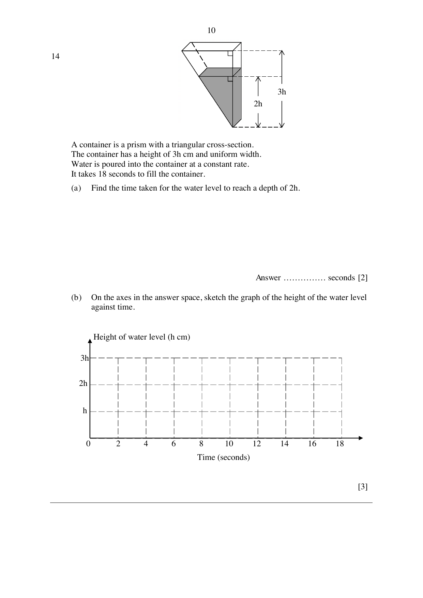

# St Joseph's Institution — Mathematics 4052/01 Paper 1 (cleaned)

> **Institution:** St Joseph's Institution
> **Exam:** Preliminary Examination 2024
> **Level:** Year 4
> **Subjects:** Elementary Mathematics
> **Paper:** 4052/01 Paper 1
> **Date:** 12 August 2024
> **Duration:** 2 hours 15 minutes (09:50–12:05)
> **Total Marks:** 90
> **Source:** `2024 SJI Prelim P1.pdf`
>
> Worked solutions printed after the question paper, from PDF page 25, are not transcribed. This note is the question paper only.

---

## Instructions

Write your class, index number and name on all the work you hand in.
Write in dark blue or black pen on both sides of the paper.
You may use an HB pencil for any diagrams or graphs.
Do not use paper clips, glue or correction fluid.

Answer all questions.
If working is needed for any question it must be shown with the answer.
Omission of essential working will result in loss of marks.
The use of an approved scientific calculator is expected, where appropriate.
If the degree of accuracy is not specified in the question, and if the answer is not exact, give the answer to three significant figures. Give answers in degrees to one decimal place.
For $\pi$, use either your calculator value or $3.142$, unless the question requires the answer in terms of $\pi$.

The number of marks is given in brackets [ ] at the end of each question or part question.

The total marks for this paper is 90.

---

## Mathematical Formulae

*Compound interest*

$$
\text{Total amount} = P\left(1+\frac{r}{100}\right)^{n}
$$

*Mensuration*

$$
\text{Curved surface area of a cone} = \pi rl
$$

$$
\text{Surface area of a sphere} = 4\pi r^{2}
$$

$$
\text{Volume of a cone} = \frac{1}{3}\pi r^{2}h
$$

$$
\text{Volume of a sphere} = \frac{4}{3}\pi r^{3}
$$

$$
\text{Area of triangle } ABC = \frac{1}{2}ab\sin C
$$

$$
\text{Arc length} = r\theta,\text{ where }\theta\text{ is in radians}
$$

$$
\text{Sector area} = \frac{1}{2}r^{2}\theta,\text{ where }\theta\text{ is in radians}
$$

*Trigonometry*

$$
\frac{a}{\sin A} = \frac{b}{\sin B} = \frac{c}{\sin C}
$$

$$
a^{2} = b^{2}+c^{2}-2bc\cos A
$$

*Statistics*

$$
\text{Mean} = \frac{\sum fx}{\sum f}
$$

$$
\text{Standard deviation} = \sqrt{\frac{\sum fx^{2}}{\sum f}-\left(\frac{\sum fx}{\sum f}\right)^{2}}
$$

---

### Q1

> **Marks:** 2
> **Topic:** N7 Equations and inequalities
> **Sub-topic:** Equations and inequalities
> **LO:** [[context/subjects/o-level-e-maths/learning-objectives/o-level-e-maths-N7g.md|N7g]]
> **Page:** 3

Solve the inequality $\dfrac{23-6x}{3} \le \dfrac{2+x}{6}$.

### Q2

> **Marks:** 2
> **Page:** 3

(a) Write 0.0001087 in standard form. [1]
> **Topic:** N1 Numbers and their operations
> **Sub-topic:** Numbers and their operations
> **LO:** [[context/subjects/o-level-e-maths/learning-objectives/o-level-e-maths-N1h.md|N1h]]

(b) The table shows the population in some cities in ASEAN and their land areas.

| City | Population | Land area, km$^{2}$ |
| --- | --- | --- |
| Bangkok | $1.07 \times 10^{7}$ | 7700.0 |
| Ho Chi Minh City | $2.12 \times 10^{7}$ | 30 595.0 |
| Manila | $1.35 \times 10^{7}$ | 24 317.7 |
| Kuala Lumpur | $8.46 \times 10^{6}$ | 8347.1 |

Write down the city in the table that has the smallest population per km$^{2}$. [1]
> **Topic:** N1 Numbers and their operations
> **Sub-topic:** Numbers and their operations
> **LO:** [[context/subjects/o-level-e-maths/learning-objectives/o-level-e-maths-N1h.md|N1h]]

### Q3

> **Marks:** 3
> **Topic:** N3 Percentage
> **Sub-topic:** Percentage
> **LO:** [[context/subjects/o-level-e-maths/learning-objectives/o-level-e-maths-N3d.md|N3d]]
> **Page:** 4

Vikas takes a study loan of ＄12 000 that charges an interest rate of $r\%$ per year compound interest for 4 years.
The total amount that he would have paid for the loan at the end of 4 years is ＄12 688.
Find the value of $r$.

### Q4

> **Marks:** 5
> **Page:** 4

(a) Simplify $\left(\dfrac{81u^{20}}{v^{8}}\right)^{-\frac{3}{4}}$. [2]
> **Topic:** N5 Algebraic expressions and formulae
> **Sub-topic:** Algebraic expressions and formulae
> **LO:** [[context/subjects/o-level-e-maths/learning-objectives/o-level-e-maths-N5h.md|N5h]]

(b) Factorise $4x^{2}+4-y^{2}-x^{2}y^{2}$ completely. [3]
> **Topic:** N5 Algebraic expressions and formulae
> **Sub-topic:** Algebraic expressions and formulae
> **LO:** [[context/subjects/o-level-e-maths/learning-objectives/o-level-e-maths-N5h.md|N5h]]

### Q5

> **Marks:** 2
> **Topic:** N1 Numbers and their operations
> **Sub-topic:** Numbers and their operations
> **LO:** [[context/subjects/o-level-e-maths/learning-objectives/o-level-e-maths-N1a.md|N1a]]
> **Page:** 5

$m$ and $n$ are positive integers, where $m \neq n$.

Explain why $(m+n)^{2}-(m-n)^{2}$ is not a prime number for all positive integer values of $m$ and $n$.

### Q6

> **Marks:** 2
> **Topic:** N3 Percentage
> **Sub-topic:** Percentage
> **LO:** [[context/subjects/o-level-e-maths/learning-objectives/o-level-e-maths-N3d.md|N3d]]
> **Page:** 5

The marked price of a smart watch at a shop is 25% above the cost price.
The shop gives a $p\%$ discount during a sale.
Calculate the value of $p$ such that the shop makes neither a loss nor a profit from the sale of the smart watch.

### Q7

> **Marks:** 2
> **Topic:** S1 Data handling and analysis
> **Sub-topic:** Data handling and analysis
> **LO:** [[context/subjects/o-level-e-maths/learning-objectives/o-level-e-maths-S1f.md|S1f]]
> **Page:** 6

The graph shows the average cost for a dozen of Grade A eggs in the year 2022.

Source: News Daily Mail UK.

State one misleading feature of the graph and explain how this feature affects the reader's interpretation of the cost for a dozen of Grade A eggs.

### Q8

> **Marks:** 3
> **Topic:** G4 Pythagoras' theorem and trigonometry
> **Sub-topic:** Pythagoras' theorem and trigonometry
> **LO:** [[context/subjects/o-level-e-maths/learning-objectives/o-level-e-maths-G4e.md|G4e]]
> **Page:** 7

In triangle $XYZ$, $YZ = 13$ cm, $XY = 20$ cm and angle $YXZ = 35^{\circ}$.
Find the two possible values of angle $XZY$.

### Q9

> **Marks:** 3
> **Page:** 7

The Mandai Wildlife Reserve conserves and promotes South-East Asian biodiversity.

(a) The Mandai Wildlife Bridge is 140 m long.
It is represented by a length of 3.5 cm on a map.
Express the scale of the map in the form $1 : r$. [1]
> **Topic:** N2 Ratio and proportion
> **Sub-topic:** Ratio and proportion
> **LO:** [[context/subjects/o-level-e-maths/learning-objectives/o-level-e-maths-N2c.md|N2c]]

(b) The Bird Paradise covers a land area of 17 hectares.
Find, in cm$^{2}$, the area representing the Bird Paradise on the same map.
(1 hectare $= 10000$ m$^{2}$) [2]
> **Topic:** N2 Ratio and proportion
> **Sub-topic:** Ratio and proportion
> **LO:** [[context/subjects/o-level-e-maths/learning-objectives/o-level-e-maths-N2c.md|N2c]]

### Q10

> **Marks:** 2
> **Topic:** N6 Functions and graphs
> **Sub-topic:** Functions and graphs
> **LO:** [[context/subjects/o-level-e-maths/learning-objectives/o-level-e-maths-N6c.md|N6c]]
> **Page:** 8

The sketch shows the graph of $y = ka^{-x}$.
The points $P(-2, 96)$ and $Q\left(0, \dfrac{3}{2}\right)$ lie on the graph.
The curve falls as $x$ increases and crosses the positive $y$-axis at $Q$.

Find the value of $k$ and of $a$.

### Q11

> **Marks:** 3
> **Topic:** N5 Algebraic expressions and formulae
> **Sub-topic:** Algebraic expressions and formulae
> **LO:** [[context/subjects/o-level-e-maths/learning-objectives/o-level-e-maths-N5k.md|N5k]]
> **Page:** 8

$$
\frac{v}{w} = \frac{1}{v}+\frac{3v}{u}
$$

Rearrange the formula to make $v$ the subject.

### Q12

> **Marks:** 4
> **Page:** 9

On a coordinate plane, $P$ is the point $(0, 12)$ and $\overrightarrow{PR} = \begin{pmatrix} 8 \\ -10 \end{pmatrix}$.

(a) Calculate $PR$. [2]
> **Topic:** G6 Coordinate geometry
> **Sub-topic:** Coordinate geometry
> **LO:** [[context/subjects/o-level-e-maths/learning-objectives/o-level-e-maths-G6c.md|G6c]]

(b) Find the equation of the line $PR$. [2]
> **Topic:** G6 Coordinate geometry
> **Sub-topic:** Coordinate geometry
> **LO:** [[context/subjects/o-level-e-maths/learning-objectives/o-level-e-maths-G6c.md|G6c]]

### Q13

> **Marks:** 3
> **Page:** 9

(a) Write down 252 as product of its prime factors in index notation. [1]
> **Topic:** N1 Numbers and their operations
> **Sub-topic:** Numbers and their operations
> **LO:** [[context/subjects/o-level-e-maths/learning-objectives/o-level-e-maths-N1b.md|N1b]]

(b) The highest common factor (HCF) of two numbers is 6.
The lowest common multiple (LCM) of the two numbers is 252.
One of the numbers is a perfect square.
Find the two numbers. [2]
> **Topic:** N1 Numbers and their operations
> **Sub-topic:** Numbers and their operations
> **LO:** [[context/subjects/o-level-e-maths/learning-objectives/o-level-e-maths-N1b.md|N1b]]

### Q14

> **Marks:** 5
> **Page:** 10

A container is a prism with a triangular cross-section.
The container has a height of $3h$ cm and uniform width.
Water is poured into the container at a constant rate.
It takes 18 seconds to fill the container.
The diagram marks depths $2h$ and $3h$ on the triangular cross-section.

(a) Find the time taken for the water level to reach a depth of $2h$. [2]
> **Topic:** G5 Mensuration
> **Sub-topic:** Mensuration
> **LO:** [[context/subjects/o-level-e-maths/learning-objectives/o-level-e-maths-G5c.md|G5c]]

(b) On the axes in the answer space, sketch the graph of the height of the water level against time.
The axes run from 0 to 18 seconds, with horizontal marks at $h$, $2h$ and $3h$. The time axis also shows a label $3h$ beside the 10-second mark as printed. [3]
> **Topic:** G5 Mensuration
> **Sub-topic:** Mensuration
> **LO:** [[context/subjects/o-level-e-maths/learning-objectives/o-level-e-maths-G5c.md|G5c]]

### Q15

> **Marks:** 4
> **Page:** 11

(a) The expression $x^{2}+3x-7$ can be written in the form $\left(x+\dfrac{3}{2}\right)^{2}+k$.
Find the value of $k$. [2]
> **Topic:** N6 Functions and graphs
> **Sub-topic:** Functions and graphs
> **LO:** [[context/subjects/o-level-e-maths/learning-objectives/o-level-e-maths-N6h.md|N6h]]

(b) Hence, explain why the equation $x^{2}+3x-7 = p$ does not have solutions for some values of $p$. [2]
> **Topic:** N6 Functions and graphs
> **Sub-topic:** Functions and graphs
> **LO:** [[context/subjects/o-level-e-maths/learning-objectives/o-level-e-maths-N6h.md|N6h]]

### Q16

> **Marks:** 2
> **Topic:** G1 Angles, triangles and polygons
> **Sub-topic:** Angles, triangles and polygons
> **LO:** [[context/subjects/o-level-e-maths/learning-objectives/o-level-e-maths-G1f.md|G1f]]
> **Page:** 11

The sum of all reflex angles of a regular $n$ sided polygon is $3060^{\circ}$.
Find the number of sides of the regular polygon.

### Q17

> **Marks:** 3
> **Page:** 12

(a) Which of the following diagrams represents a directly proportional relationship between two variables. [1]
> **Topic:** N3 Percentage
> **Sub-topic:** Percentage
> **LO:** [[context/subjects/o-level-e-maths/learning-objectives/o-level-e-maths-N3b.md|N3b]]

Diagram 1 is a straight line through the origin. Diagram 2 is a straight line that does not pass through the origin. Diagram 3 is a curve.

(b) The frequency, $F$ hertz (Hz), of a sound wave is directly proportional to the square root of the tension, $T$ newton (N), in a guitar string.
Calculate percentage $F$ increases by when the tension of the guitar string is increased 9 times. [2]
> **Topic:** N3 Percentage
> **Sub-topic:** Percentage
> **LO:** [[context/subjects/o-level-e-maths/learning-objectives/o-level-e-maths-N3d.md|N3d]]

### Q18

> **Marks:** 3
> **Topic:** N2 Ratio and proportion
> **Sub-topic:** Ratio and proportion
> **LO:** [[context/subjects/o-level-e-maths/learning-objectives/o-level-e-maths-N2a.md|N2a]]
> **Page:** 12

Zara has only 2-dollar notes and 5-dollar notes in her wallet.
The number of 2-dollar notes to 5-dollar notes is in the ratio $4:5$.
After Zara spends ＄9, the number of 2-dollar notes to 5-dollar notes in her wallet becomes $2:3$.
Calculate number of 2-dollar notes in Zara's wallet initially.

### Q19

> **Marks:** 3
> **Topic:** S1 Data handling and analysis
> **Sub-topic:** Data handling and analysis
> **LO:** [[context/subjects/o-level-e-maths/learning-objectives/o-level-e-maths-S1f.md|S1f]]
> **Page:** 13

11.8 is the mean of five positive integers.
The sum of their squares is 875.
Each of the positive integer is now multiplied by 2.
Find the new standard deviation.

### Q20

> **Marks:** 4
> **Page:** 14

(a) $\xi$ is the universal set and $P$, $Q$ and $R$ are three sets.

$\xi = \{j, k, l, m, n\}$

$P = \{j, k, l, n\}$

(i) It is given that $P \cap Q = \{l\}$ and $P' \cap Q \neq \varnothing$.
List the elements of $Q$. [1]
> **Topic:** N8 Set language and notation
> **Sub-topic:** Set language and notation
> **LO:** [[context/subjects/o-level-e-maths/learning-objectives/o-level-e-maths-N8c.md|N8c]]

(ii) $R \subset P$. Xena claim's that one possible set is $R = \{j, k, l, n\}$.
Explain why Xena's claim is not true. [1]
> **Topic:** N8 Set language and notation
> **Sub-topic:** Set language and notation
> **LO:** [[context/subjects/o-level-e-maths/learning-objectives/o-level-e-maths-N8c.md|N8c]]

(b) In a class of 23 students, 11 students speak French, and 7 students speak Spanish.

(i) Draw a Venn diagram to illustrate the case that there are some students who speak both languages. [1]
> **Topic:** N8 Set language and notation
> **Sub-topic:** Set language and notation
> **LO:** [[context/subjects/o-level-e-maths/learning-objectives/o-level-e-maths-N8c.md|N8c]]

(ii) Calculate the maximum possible number of students who do not speak both languages. [1]
> **Topic:** N8 Set language and notation
> **Sub-topic:** Set language and notation
> **LO:** [[context/subjects/o-level-e-maths/learning-objectives/o-level-e-maths-N8c.md|N8c]]

### Q21

> **Marks:** 4
> **Page:** 15

Scale: 1 cm to 1 km.

In the scale drawing, $A$, $B$ and $C$ define a boundary between coastline and the sea.
$B$ is a port and $S$ is a ship. North is marked.

(a) $L$ is a lighthouse that is located

(i) equidistant from $A$ and $B$,

(ii) equidistant from $AB$ and $BC$.

Locate the lighthouse, $L$, on the scale drawing. [2]
> **Topic:** G3 Properties of circles
> **Sub-topic:** Properties of circles
> **LO:** [[context/subjects/o-level-e-maths/learning-objectives/o-level-e-maths-G3a.md|G3a]]

(b) Ships must not sail within 2 km of the lighthouse nor the port.
Ship, $S$, sailed on a bearing of $\theta^{\circ}$.
It passed between $B$ and $L$.

Estimate the range of $\theta^{\circ}$. [2]
> **Topic:** G3 Properties of circles
> **Sub-topic:** Properties of circles
> **LO:** [[context/subjects/o-level-e-maths/learning-objectives/o-level-e-maths-G3a.md|G3a]]

### Q22

> **Marks:** 5
> **Page:** 16

In a science examination, a class of 25 students took two papers, paper A and paper B.
Both papers were out of 50 marks.
The dot diagram shows the distribution of the marks for paper A. The axis is marked from 33 to 49.

(a) Explain why mean is not an appropriate measure of central tendency to represent the distribution of marks for paper A. [1]
> **Topic:** S1 Data handling and analysis
> **Sub-topic:** Data handling and analysis
> **LO:** [[context/subjects/o-level-e-maths/learning-objectives/o-level-e-maths-S1f.md|S1f]]

(b) Calculate the interquartile range for paper A. [2]
> **Topic:** S1 Data handling and analysis
> **Sub-topic:** Data handling and analysis
> **LO:** [[context/subjects/o-level-e-maths/learning-objectives/o-level-e-maths-S1i.md|S1i]]

(c) The table below summaries the distribution of the class for paper B.

| Median | 41 |
| --- | --- |
| Interquartile Range | 7 |

Make two comments comparing the distribution of marks for both papers.
Use figures to support your answer. [2]
> **Topic:** S1 Data handling and analysis
> **Sub-topic:** Data handling and analysis
> **LO:** [[context/subjects/o-level-e-maths/learning-objectives/o-level-e-maths-S1i.md|S1i]]

### Q23

> **Marks:** 7
> **Page:** 17–18

Han and Peng are training to take part in a triathlon.
Each training session involves training different segments, continuously in order.
For each session Han plans to swim 15 minutes, cycle 20 minutes and run 22 minutes.
For each session Peng plans to swim 20 minutes, cycle 25 minutes and run $x$ minutes.

$$
\mathbf{E} = \begin{pmatrix} 15 & 20 \\ 20 & 25 \\ 22 & x \end{pmatrix}
\begin{matrix} \text{swimming} \\ \text{cycling} \\ \text{running} \end{matrix}
$$

Columns are Han and Peng.

Han plans to train 3 sessions on the weekdays and 1 session on weekends.
Peng plans to train 1 session on weekdays and 2 sessions on weekends.

$$
\mathbf{N} = \begin{pmatrix} 3 & 1 \\ 1 & 2 \end{pmatrix}
$$

(a) Find, in terms of $x$, the matrix $\mathbf{T} = \mathbf{EN}$. [2]
> **Topic:** N9 Matrices
> **Sub-topic:** Matrices
> **LO:** [[context/subjects/o-level-e-maths/learning-objectives/o-level-e-maths-N9b.md|N9b]]

(b) State what each element in the second column of matrix $\mathbf{T}$ represents. [1]
> **Topic:** N9 Matrices
> **Sub-topic:** Matrices
> **LO:** [[context/subjects/o-level-e-maths/learning-objectives/o-level-e-maths-N9b.md|N9b]]

(c) The total time ran by Han and Peng on the weekdays is equal to total time ran on the weekends.
Find the value of $x$. [2]
> **Topic:** N9 Matrices
> **Sub-topic:** Matrices
> **LO:** [[context/subjects/o-level-e-maths/learning-objectives/o-level-e-maths-N9b.md|N9b]]

(d) It is given that swimming burns 8 calories per minute, cycling burns 10 calories per minute and running burns 12 calories per minute.
This information can be represented by the matrix $\mathbf{C}$.
Another matrix $\mathbf{A}$ is such that all the elements are 1.
The elements of the matrix $\mathbf{B}$, where $\mathbf{B} = \mathbf{CTA}$, represents the total number of calories burnt by Han and Peng for a week.
Write down the matrix $\mathbf{C}$ and state the order of matrix $\mathbf{A}$. [1]

The printed brackets on this part are split as [1] for $\mathbf{C}$ and [1] for the order of $\mathbf{A}$.
> **Topic:** N9 Matrices
> **Sub-topic:** Matrices
> **LO:** [[context/subjects/o-level-e-maths/learning-objectives/o-level-e-maths-N9b.md|N9b]]

### Q24

> **Marks:** 3
> **Topic:** N5 Algebraic expressions and formulae
> **Sub-topic:** Algebraic expressions and formulae
> **LO:** [[context/subjects/o-level-e-maths/learning-objectives/o-level-e-maths-N5k.md|N5k]]
> **Page:** 18

A ball is thrown vertically upwards. Its height, $h$ m, above ground at time $t$ seconds after being thrown is given by the formula $h = -1.44t^{2}+1.6t+1.5$.
Find the time taken for the ball to return to the ground.

### Q25

> **Marks:** 6
> **Page:** 19

The diagram shows a circle which passes through $D$, $E$ and $F$.
$AEB$, $BFC$ and $ADC$ are tangents to the circle, with centre $O$.

(a) Show that triangle $ABF$ is congruent to triangle $ACF$.
Give a reason for each statement you make. [3]
> **Topic:** G2 Congruence and similarity
> **Sub-topic:** Congruence and similarity
> **LO:** [[context/subjects/o-level-e-maths/learning-objectives/o-level-e-maths-G2i.md|G2i]]

(b) $AB = 25$ cm and $BC = 14$ cm.
Find the radius of the circle. [3]
> **Topic:** G2 Congruence and similarity
> **Sub-topic:** Congruence and similarity
> **LO:** [[context/subjects/o-level-e-maths/learning-objectives/o-level-e-maths-G2i.md|G2i]]

### Q26

> **Marks:** 5
> **Page:** 20–21

The diagram shows two circles that intersect at $A$ and $B$.
$A$, $B$ and $D$ are three points on a circle I.
$A$, $E$, $B$ and $C$ are four points on a circle II.
$AD$ is the diameter of the circle I.
$BC$ is the diameter of the circle II.
$CA$ is parallel to $BD$.
Angle $CAD = 109^{\circ}$ and angle $ACB = 38^{\circ}$.

(a) Find angle $DEB$.
Give a reason for each step of your working. [2]
> **Topic:** G3 Properties of circles
> **Sub-topic:** Properties of circles
> **LO:** [[context/subjects/o-level-e-maths/learning-objectives/o-level-e-maths-G3b.md|G3b]]

(b) Show that $E$ is the centre of circle I.
Give a reason for each step of your working. [3]
> **Topic:** G3 Properties of circles
> **Sub-topic:** Properties of circles
> **LO:** [[context/subjects/o-level-e-maths/learning-objectives/o-level-e-maths-G3b.md|G3b]]
