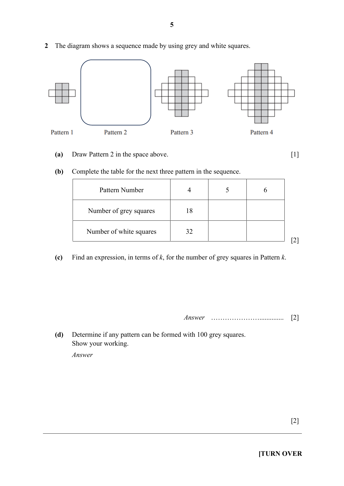
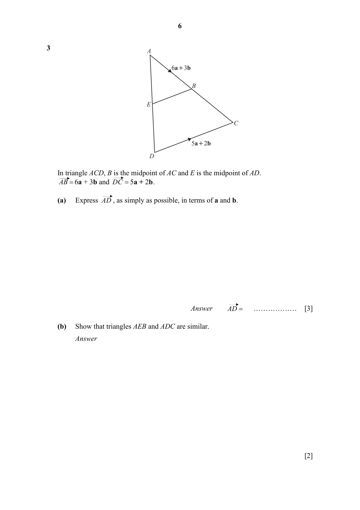
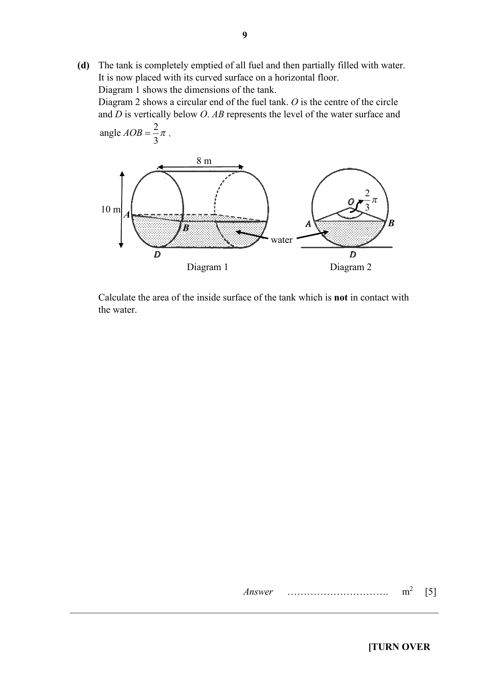
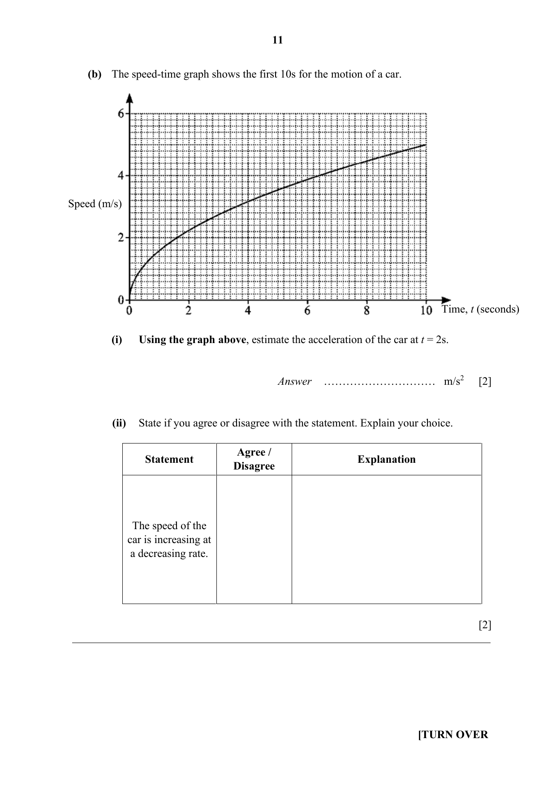
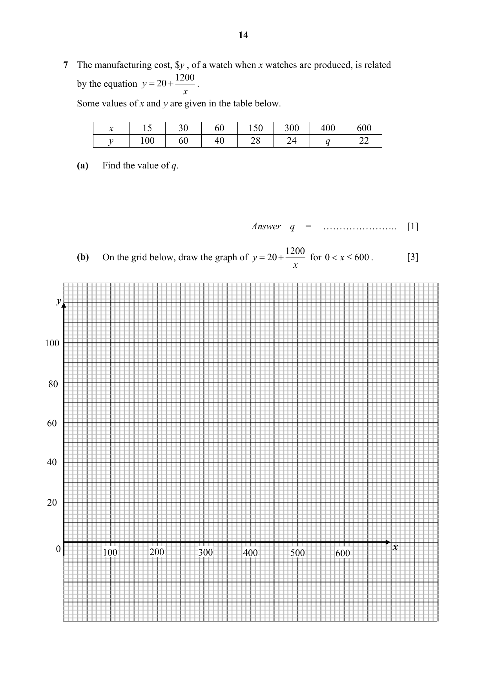
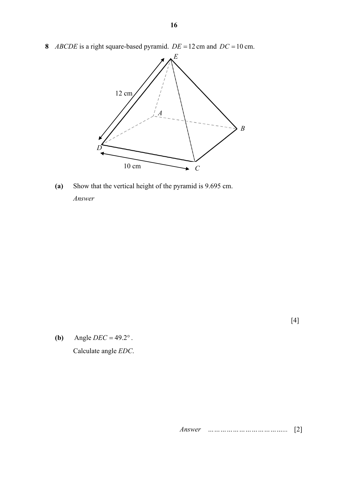
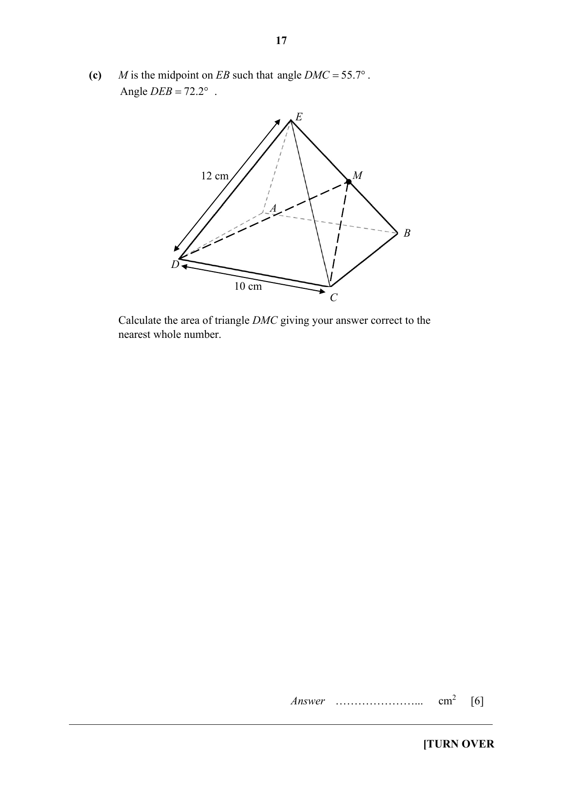
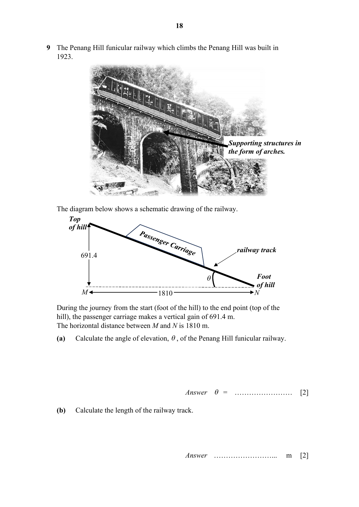
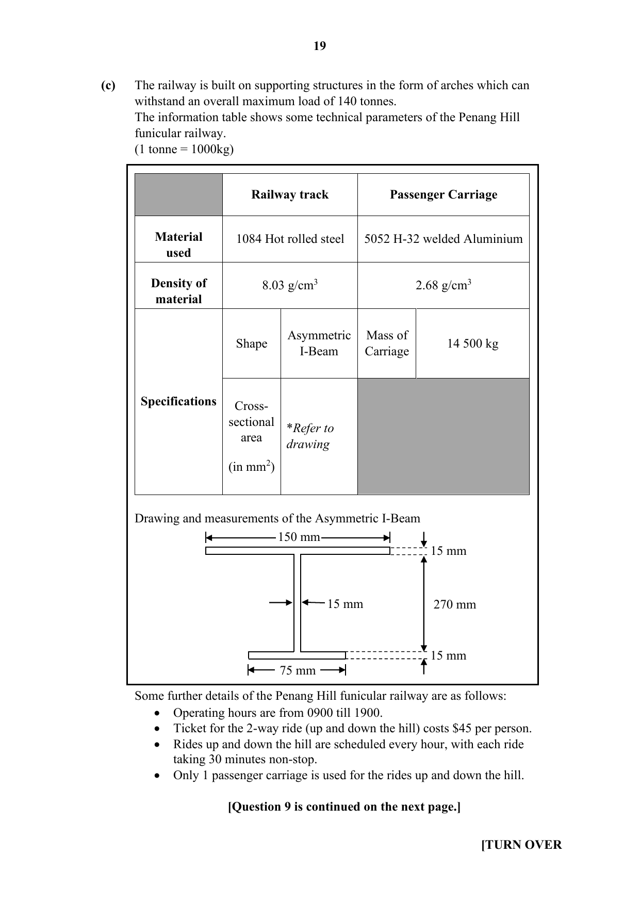

# St Joseph's Institution — Mathematics 4052/02 Paper 2 (cleaned)

> **Institution:** St Joseph's Institution
> **Exam:** Preliminary Examination 2024
> **Level:** Year 4
> **Subjects:** Elementary Mathematics
> **Paper:** 4052/02 Paper 2
> **Date:** 15 August 2024
> **Duration:** 2 hours 15 minutes (08:30–10:45)
> **Total Marks:** 90
> **Source:** `2024 SJI Prelim P2.pdf`
>
> Worked solutions printed after the question paper, from PDF page 21, are not transcribed. This note is the question paper only.

---

## Instructions

Write your class, index number and name on all the work you hand in.
Write in dark blue or black pen on both sides of the paper.
You may use an HB pencil for any diagrams or graphs.
Do not use paper clips, glue or correction fluid.

Answer all questions.
If working is needed for any question it must be shown with the answer.
Omission of essential working will result in loss of marks.
The use of an approved scientific calculator is expected, where appropriate.
If the degree of accuracy is not specified in the question, and if the answer is not exact, give the answer to three significant figures. Give answers in degrees to one decimal place.
For $\pi$, use either your calculator value or $3.142$, unless the question requires the answer in terms of $\pi$.

The number of marks is given in brackets [ ] at the end of each question or part question.

The total mark for this paper is 90.

---

## Mathematical Formulae

*Compound interest*

$$
\text{Total amount} = P\left(1+\frac{r}{100}\right)^{n}
$$

*Mensuration*

$$
\text{Curved surface area of a cone} = \pi rl
$$

$$
\text{Surface area of a sphere} = 4\pi r^{2}
$$

$$
\text{Volume of a cone} = \frac{1}{3}\pi r^{2}h
$$

$$
\text{Volume of a sphere} = \frac{4}{3}\pi r^{3}
$$

$$
\text{Area of triangle } ABC = \frac{1}{2}ab\sin C
$$

$$
\text{Arc length} = r\theta,\text{ where }\theta\text{ is in radians}
$$

$$
\text{Sector area} = \frac{1}{2}r^{2}\theta,\text{ where }\theta\text{ is in radians}
$$

*Trigonometry*

$$
\frac{a}{\sin A} = \frac{b}{\sin B} = \frac{c}{\sin C}
$$

$$
a^{2} = b^{2}+c^{2}-2bc\cos A
$$

*Statistics*

$$
\text{Mean} = \frac{\sum fx}{\sum f}
$$

$$
\text{Standard deviation} = \sqrt{\frac{\sum fx^{2}}{\sum f}-\left(\frac{\sum fx}{\sum f}\right)^{2}}
$$

---

### Q1

> **Marks:** 9
> **Page:** 3–4

(a) In 2024, apples cost ＄$x$ per kilogram and oranges cost ＄$y$ per kilogram.
The total cost of 5 kg of apples and 10 kg of oranges is ＄40.

(i) Show that $8-2y = x$. [2]
> **Topic:** N6 Functions and graphs
> **Sub-topic:** Functions and graphs
> **LO:** [[context/subjects/o-level-e-maths/learning-objectives/o-level-e-maths-N6h.md|N6h]]

(ii) In 2023, the cost, per kilogram, of apples were 9% lower than in 2024 while the cost of oranges, per kilogram were 9% higher than in 2024.
Find an expression, in terms of $x$ and $y$, for the total cost of 3 kg of apples and 2 kg of oranges in 2023. Give your answer in its simplest form. [3]
> **Topic:** N6 Functions and graphs
> **Sub-topic:** Functions and graphs
> **LO:** [[context/subjects/o-level-e-maths/learning-objectives/o-level-e-maths-N6h.md|N6h]]

(b) Write as a single fraction in its simplest form

$$
\frac{x}{x^{2}-x-12}+\frac{3x}{4-x}.
$$

[4]
> **Topic:** N6 Functions and graphs
> **Sub-topic:** Functions and graphs
> **LO:** [[context/subjects/o-level-e-maths/learning-objectives/o-level-e-maths-N6h.md|N6h]]

### Q2

> **Marks:** 7
> **Page:** 5

The diagram shows a sequence made by using grey and white squares.
Pattern 1, Pattern 3 and Pattern 4 are drawn. The space for Pattern 2 is blank.

(a) Draw Pattern 2 in the space above. [1]
> **Topic:** N5 Algebraic expressions and formulae
> **Sub-topic:** Algebraic expressions and formulae
> **LO:** [[context/subjects/o-level-e-maths/learning-objectives/o-level-e-maths-N5e.md|N5e]]

(b) Complete the table for the next three pattern in the sequence. [2]
> **Topic:** N5 Algebraic expressions and formulae
> **Sub-topic:** Algebraic expressions and formulae
> **LO:** [[context/subjects/o-level-e-maths/learning-objectives/o-level-e-maths-N5e.md|N5e]]

| Pattern Number | 4 | 5 | 6 |
| --- | --- | --- | --- |
| Number of grey squares | 18 |  |  |
| Number of white squares | 32 |  |  |

(c) Find an expression, in terms of $k$, for the number of grey squares in Pattern $k$. [2]
> **Topic:** N5 Algebraic expressions and formulae
> **Sub-topic:** Algebraic expressions and formulae
> **LO:** [[context/subjects/o-level-e-maths/learning-objectives/o-level-e-maths-N5e.md|N5e]]

(d) Determine if any pattern can be formed with 100 grey squares.
Show your working. [2]
> **Topic:** N5 Algebraic expressions and formulae
> **Sub-topic:** Algebraic expressions and formulae
> **LO:** [[context/subjects/o-level-e-maths/learning-objectives/o-level-e-maths-N5e.md|N5e]]

### Q3

> **Marks:** 11
> **Page:** 6–7

In triangle $ACD$, $B$ is the midpoint of $AC$ and $E$ is the midpoint of $AD$.
$\overrightarrow{AB} = 6\mathbf{a}+3\mathbf{b}$ and $\overrightarrow{DC} = 5\mathbf{a}+2\mathbf{b}$.
$E$ lies on $AD$, and $EB$ is drawn.

(a) Express $\overrightarrow{AD}$, as simply as possible, in terms of $\mathbf{a}$ and $\mathbf{b}$. [3]
> **Topic:** G7 Vectors in two dimensions
> **Sub-topic:** Vectors in two dimensions
> **LO:** [[context/subjects/o-level-e-maths/learning-objectives/o-level-e-maths-G7h.md|G7h]]

(b) Show that triangles $AEB$ and $ADC$ are similar. [2]
> **Topic:** G7 Vectors in two dimensions
> **Sub-topic:** Vectors in two dimensions
> **LO:** [[context/subjects/o-level-e-maths/learning-objectives/o-level-e-maths-G7h.md|G7h]]

(c) $S$ is a point on $AE$ such $AS : SE = 2 : 3$.
It is given that $\overrightarrow{SC} = \dfrac{1}{k}(53\mathbf{a}+26\mathbf{b})$.
Find the value of $k$. [2]
> **Topic:** G7 Vectors in two dimensions
> **Sub-topic:** Vectors in two dimensions
> **LO:** [[context/subjects/o-level-e-maths/learning-objectives/o-level-e-maths-G7h.md|G7h]]

(d) Find the numerical value of $\dfrac{\text{area of triangle } AEB}{\text{area of } EBCD}$. [2]
> **Topic:** G7 Vectors in two dimensions
> **Sub-topic:** Vectors in two dimensions
> **LO:** [[context/subjects/o-level-e-maths/learning-objectives/o-level-e-maths-G7h.md|G7h]]

(e) Use vectors to show that $EB$ is parallel to $DC$. [2]
> **Topic:** G7 Vectors in two dimensions
> **Sub-topic:** Vectors in two dimensions
> **LO:** [[context/subjects/o-level-e-maths/learning-objectives/o-level-e-maths-G7h.md|G7h]]

### Q4

> **Marks:** 12
> **Page:** 8–9

A tank is a closed cylinder of radius 5 m and height 8 m.
It is made of negligible thickness and stands with its base horizontal.

(a) The tank contains fuel to a depth of 3 m.
Find correct to the nearest cubic metre, the volume of the fuel in the tank. [1]
> **Topic:** G5 Mensuration
> **Sub-topic:** Mensuration
> **LO:** [[context/subjects/o-level-e-maths/learning-objectives/o-level-e-maths-G5c.md|G5c]]

(b) 20 000 litres of fuel are added.
Find the increase in depth of the fuel in the tank. Give your answer in cm.
(1 litre $= 1000$ cm$^{3}$) [3]
> **Topic:** G5 Mensuration
> **Sub-topic:** Mensuration
> **LO:** [[context/subjects/o-level-e-maths/learning-objectives/o-level-e-maths-G5c.md|G5c]]

(c) The outer curved surface and the top of the tank are to be painted.
The paint is sold in tins, each of which contains 5 litres.
One litre of paint can cover 7 m$^{2}$.
Calculate the number of tins required. [3]
> **Topic:** G5 Mensuration
> **Sub-topic:** Mensuration
> **LO:** [[context/subjects/o-level-e-maths/learning-objectives/o-level-e-maths-G5c.md|G5c]]

(d) The tank is completely emptied of all fuel and then partially filled with water.
It is now placed with its curved surface on a horizontal floor.
Diagram 1 shows the dimensions of the tank: length 8 m and diameter 10 m.
Diagram 2 shows a circular end of the fuel tank. $O$ is the centre of the circle and $D$ is vertically below $O$. $AB$ represents the level of the water surface and angle $AOB = \dfrac{2}{3}\pi$.

Calculate the area of the inside surface of the tank which is not in contact with the water. [5]
> **Topic:** G5 Mensuration
> **Sub-topic:** Mensuration
> **LO:** [[context/subjects/o-level-e-maths/learning-objectives/o-level-e-maths-G5c.md|G5c]]

### Q5

> **Marks:** 9
> **Page:** 10–11

(a) (i) Convert 14 km/h to m/s. [1]
> **Topic:** N4 Rate and speed
> **Sub-topic:** Rate and speed
> **LO:** [[context/subjects/o-level-e-maths/learning-objectives/o-level-e-maths-N4a.md|N4a]]

(ii) Haley rode a bike at a speed of 14 km/h for 1 hour 20 minutes from Kensington Town to Brood City.
After a 30 minutes rest at Brood City, she continued her 25 km journey to Bristol Plains at a speed of 10 km/h.
Calculate Haley's average speed, in km/h, for the entire journey. [4]
> **Topic:** N4 Rate and speed
> **Sub-topic:** Rate and speed
> **LO:** [[context/subjects/o-level-e-maths/learning-objectives/o-level-e-maths-N4a.md|N4a]]

(b) The speed-time graph shows the first 10 s for the motion of a car.

(i) Using the graph above, estimate the acceleration of the car at $t = 2$ s. [2]
> **Topic:** N6 Functions and graphs
> **Sub-topic:** Functions and graphs
> **LO:** [[context/subjects/o-level-e-maths/learning-objectives/o-level-e-maths-N6c.md|N6c]]

(ii) State if you agree or disagree with the statement. Explain your choice. [2]
> **Topic:** N6 Functions and graphs
> **Sub-topic:** Functions and graphs
> **LO:** [[context/subjects/o-level-e-maths/learning-objectives/o-level-e-maths-N6c.md|N6c]]

| Statement | Agree / Disagree | Explanation |
| --- | --- | --- |
| The speed of the car is increasing at a decreasing rate. |  |  |

### Q6

> **Marks:** 10
> **Page:** 12–13

(a) A scientist researched on the effectiveness of a new drug to combat a disease.
The probabilities of a patient's condition upon receiving the drug are as follows:

| Patient's condition | Probability |
| --- | --- |
| No effect | $q$ |
| Improving but still ill | $2p$ |
| Getting worst | $5p-\dfrac{4q}{5}$ |

There are three times as many patients whose condition was not affected by the drug as compared to those whose condition was getting worst.
Calculate the value of $p$ and of $q$. [4]
> **Topic:** S2 Probability
> **Sub-topic:** Probability
> **LO:** [[context/subjects/o-level-e-maths/learning-objectives/o-level-e-maths-S2c.md|S2c]]

(b) Baloxavir marboxil (trade name Xofluza) is the latest influenza (flu) antiviral drug.
The drug is immediately stopped once the patient is cured.
At most, each patient can only receive two doses of the drug.
The probabilities of a patient's condition after receiving each dose is as follows:

| Patient's condition | Probability |
| --- | --- |
| Fully cured | $\dfrac{4}{7}$ |
| Improving but still ill | $\dfrac{5}{14}$ |
| Getting worst | $\dfrac{1}{14}$ |

(i) Draw a tree diagram showing the possible outcomes. [3]
> **Topic:** S2 Probability
> **Sub-topic:** Probability
> **LO:** [[context/subjects/o-level-e-maths/learning-objectives/o-level-e-maths-S2c.md|S2c]]

(ii) Calculate the probability that a patient remains ill despite 2 doses of Xofluza. [3]
> **Topic:** S2 Probability
> **Sub-topic:** Probability
> **LO:** [[context/subjects/o-level-e-maths/learning-objectives/o-level-e-maths-S2c.md|S2c]]

### Q7

> **Marks:** 9
> **Page:** 14–15

The manufacturing cost, ＄$y$, of a watch when $x$ watches are produced, is related by the equation $y = 20+\dfrac{1200}{x}$.
Some values of $x$ and $y$ are given in the table below.

| $x$ | 15 | 30 | 60 | 150 | 300 | 400 | 600 |
| --- | --- | --- | --- | --- | --- | --- | --- |
| $y$ | 100 | 60 | 40 | 28 | 24 | $q$ | 22 |

(a) Find the value of $q$. [1]
> **Topic:** N6 Functions and graphs
> **Sub-topic:** Functions and graphs
> **LO:** [[context/subjects/o-level-e-maths/learning-objectives/o-level-e-maths-N6c.md|N6c]]

(b) On the grid below, draw the graph of $y = 20+\dfrac{1200}{x}$ for $0 < x \le 600$.

The grid has $x$ from 0 to 600, marked every 100, and $y$ from 0 to 100. [3]
> **Topic:** N6 Functions and graphs
> **Sub-topic:** Functions and graphs
> **LO:** [[context/subjects/o-level-e-maths/learning-objectives/o-level-e-maths-N6c.md|N6c]]

Use your graph to find

(i) the manufacturing cost when 80 watches are produced, [1]
> **Topic:** N6 Functions and graphs
> **Sub-topic:** Functions and graphs
> **LO:** [[context/subjects/o-level-e-maths/learning-objectives/o-level-e-maths-N6c.md|N6c]]

(ii) the minimum number of watches to be produced for the manufacturing cost to be at most ＄25. [1]
> **Topic:** N6 Functions and graphs
> **Sub-topic:** Functions and graphs
> **LO:** [[context/subjects/o-level-e-maths/learning-objectives/o-level-e-maths-N6c.md|N6c]]

(c) In order to sell $x$ watches, the selling price of a watch needs to be ＄$\left(90-\dfrac{21x}{100}\right)$.
By inserting a suitable line, determine the range of number of watches that needs to be sold to ensure a profit. [3]
> **Topic:** N6 Functions and graphs
> **Sub-topic:** Functions and graphs
> **LO:** [[context/subjects/o-level-e-maths/learning-objectives/o-level-e-maths-N6c.md|N6c]]

### Q8

> **Marks:** 12
> **Page:** 16–17

$ABCDE$ is a right square-based pyramid. $DE = 12$ cm and $DC = 10$ cm.

(a) Show that the vertical height of the pyramid is 9.695 cm. [4]
> **Topic:** G4 Pythagoras' theorem and trigonometry
> **Sub-topic:** Pythagoras' theorem and trigonometry
> **LO:** [[context/subjects/o-level-e-maths/learning-objectives/o-level-e-maths-G4e.md|G4e]]

(b) Angle $DEC = 49.2^{\circ}$.
Calculate angle $EDC$. [2]
> **Topic:** G4 Pythagoras' theorem and trigonometry
> **Sub-topic:** Pythagoras' theorem and trigonometry
> **LO:** [[context/subjects/o-level-e-maths/learning-objectives/o-level-e-maths-G4e.md|G4e]]

(c) $M$ is the midpoint on $EB$ such that angle $DMC = 55.7^{\circ}$.
Angle $DEB = 72.2^{\circ}$.

Calculate the area of triangle $DMC$ giving your answer correct to the nearest whole number. [6]
> **Topic:** G4 Pythagoras' theorem and trigonometry
> **Sub-topic:** Pythagoras' theorem and trigonometry
> **LO:** [[context/subjects/o-level-e-maths/learning-objectives/o-level-e-maths-G4e.md|G4e]]

### Q9

> **Marks:** 11
> **Page:** 18–20

The Penang Hill funicular railway which climbs the Penang Hill was built in 1923.

The diagram shows a schematic drawing of the railway. From the foot of the hill, $N$, to the top, the passenger carriage makes a vertical gain of 691.4 m. The horizontal distance between $M$ and $N$ is 1810 m. The angle of elevation of the track is $\theta$.

(a) Calculate the angle of elevation, $\theta$, of the Penang Hill funicular railway. [2]
> **Topic:** G4 Pythagoras' theorem and trigonometry
> **Sub-topic:** Pythagoras' theorem and trigonometry
> **LO:** [[context/subjects/o-level-e-maths/learning-objectives/o-level-e-maths-G4g.md|G4g]]

(b) Calculate the length of the railway track. [2]
> **Topic:** G4 Pythagoras' theorem and trigonometry
> **Sub-topic:** Pythagoras' theorem and trigonometry
> **LO:** [[context/subjects/o-level-e-maths/learning-objectives/o-level-e-maths-G4g.md|G4g]]

(c) The railway is built on supporting structures in the form of arches which can withstand an overall maximum load of 140 tonnes.
The information table shows some technical parameters of the Penang Hill funicular railway.
(1 tonne $= 1000$ kg)

|  | Railway track | Passenger carriage |
| --- | --- | --- |
| Material used | 1084 Hot rolled steel | 5052 H-32 welded Aluminium |
| Density of material | 8.03 g/cm$^{3}$ | 2.68 g/cm$^{3}$ |
| Specifications | Shape: Asymmetric I-Beam. Cross-sectional area in mm$^{2}$: refer to the drawing. | Mass of carriage: 14 500 kg |

The drawing of the asymmetric I-beam is on the question page. The printed lengths include 150 mm, 75 mm, 270 mm and several 15 mm thicknesses. The numerical cross-sectional area is not printed as a single value.

Some further details of the Penang Hill funicular railway are as follows:

- Operating hours are from 0900 till 1900.
- Ticket for the 2-way ride (up and down the hill) costs ＄45 per person.
- Rides up and down the hill are scheduled every hour, with each ride taking 30 minutes non-stop.
- Only 1 passenger carriage is used for the rides up and down the hill.

The government of Penang claims that the Penang Hill funicular railway receives a daily estimated total of at least ＄80 000 from the sale of tickets for the rides.
Assuming the average weight of a passenger is 75 kg, justify with calculations, if the claim made by the government of Penang is true. [7]
> **Topic:** G4 Pythagoras' theorem and trigonometry
> **Sub-topic:** Pythagoras' theorem and trigonometry
> **LO:** [[context/subjects/o-level-e-maths/learning-objectives/o-level-e-maths-G4g.md|G4g]]
