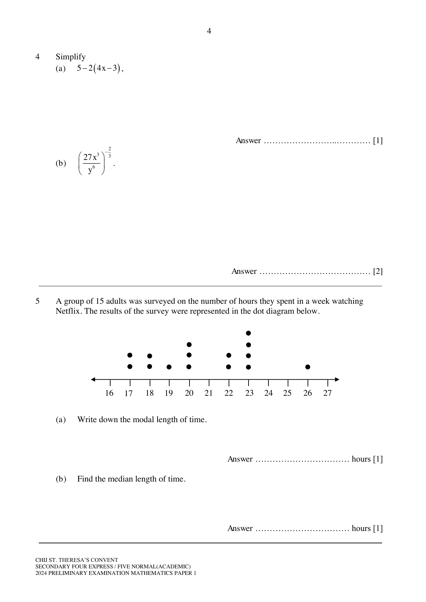
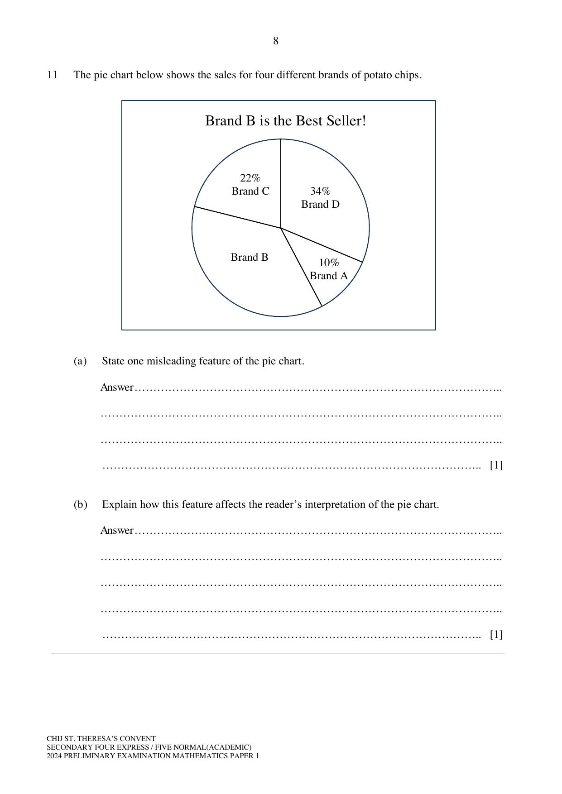
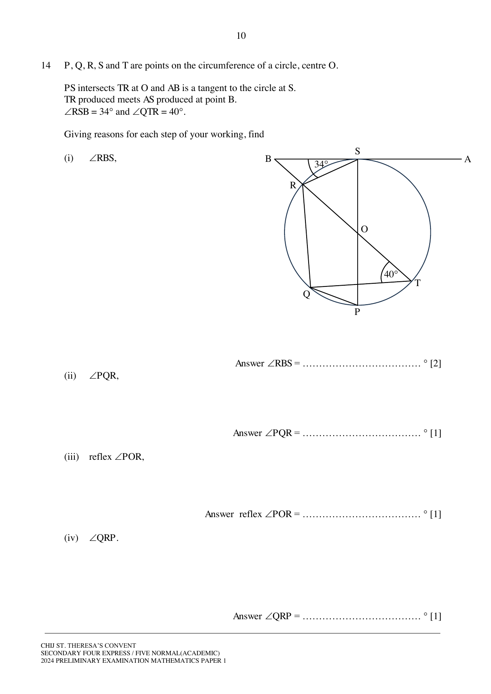
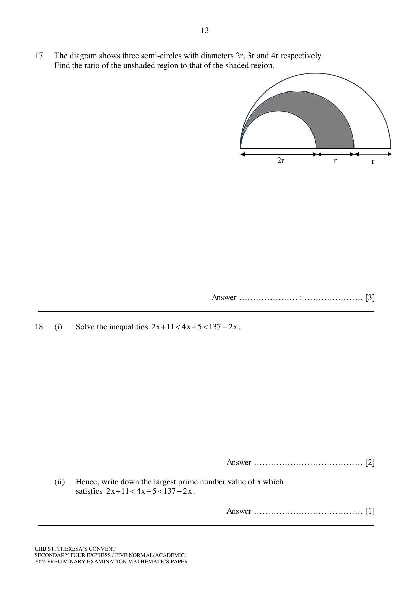
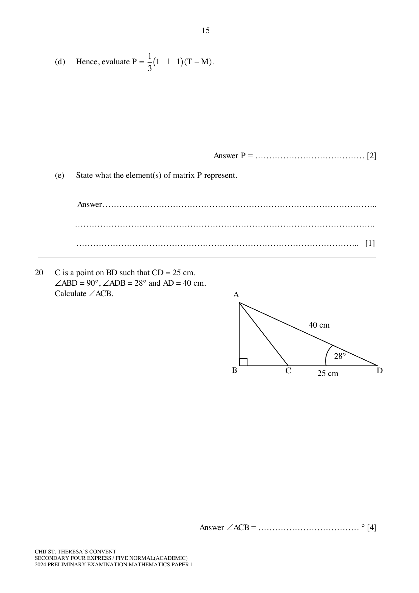
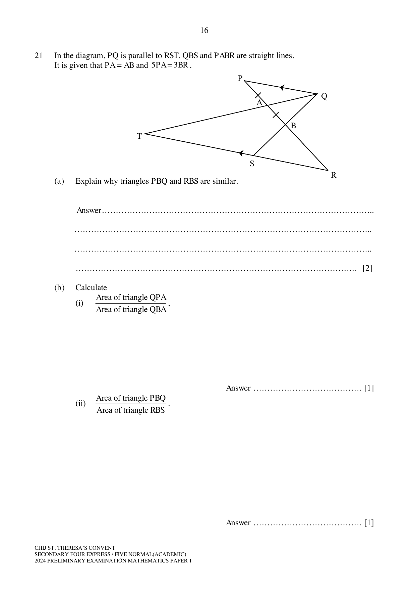

# CHIJ St. Theresa's Convent — Mathematics 4052/1 Paper 1 (cleaned)

> **Institution:** CHIJ St. Theresa's Convent
> **Exam:** Preliminary Examination 2024
> **Level:** Secondary 4 Express / 5 Normal (Academic)
> **Subjects:** Elementary Mathematics
> **Paper:** 4052/1 Paper 1
> **Date:** 26 August 2024
> **Duration:** 2 hours 15 minutes
> **Total Marks:** 90
> **Source:** `CHIJ STC 2024 Math Prelim P1.pdf`

---

## Instructions

Candidates answer on the Question Paper.

Write your name, class and index number in the spaces at the top of this page.
Write in dark blue or black pen.
You may use an HB pencil for any diagrams or graphs.
Do not use paper clips, highlighters, glue or correction fluid.

Answer all the questions.
The number of marks is given in brackets [ ] at the end of each question or part question.

If working is needed for any question it must be shown with the answer.
Omission of essential working will result in loss of marks.
The total number of marks for this paper is 90.

The use of an approved scientific calculator is expected, where appropriate.
If the degree of accuracy is not specified in the question, and if the answer is not exact, give the answer to three significant figures. Give answers in degrees to one decimal place.
For $\pi$, use either your calculator value or $3.142$.

---

## Mathematical Formulae

*Compound interest*

$$
\text{Total amount} = P\left(1+\frac{r}{100}\right)^{n}
$$

*Mensuration*

$$
\text{Curved surface area of a cone} = \pi rl
$$

$$
\text{Surface area of a sphere} = 4\pi r^{2}
$$

$$
\text{Volume of a cone} = \frac{1}{3}\pi r^{2}h
$$

$$
\text{Volume of a sphere} = \frac{4}{3}\pi r^{3}
$$

$$
\text{Area of triangle } ABC = \frac{1}{2}ab\sin C
$$

$$
\text{Arc length} = r\theta,\text{ where }\theta\text{ is in radians}
$$

$$
\text{Sector area} = \frac{1}{2}r^{2}\theta,\text{ where }\theta\text{ is in radians}
$$

*Trigonometry*

$$
\frac{a}{\sin A} = \frac{b}{\sin B} = \frac{c}{\sin C}
$$

$$
a^{2} = b^{2}+c^{2}-2bc\cos A
$$

*Statistics*

$$
\text{Mean} = \frac{\sum fx}{\sum f}
$$

$$
\text{Standard deviation} = \sqrt{\frac{\sum fx^{2}}{\sum f}-\left(\frac{\sum fx}{\sum f}\right)^{2}}
$$

---

### Q1

> **Marks:** 1
> **Topic:** N1 Numbers and their operations
> **Sub-topic:** Numbers and their operations
> **LO:** [[context/subjects/o-level-e-maths/learning-objectives/o-level-e-maths-N1h.md|N1h]]
> **Page:** 3

Calculate $\dfrac{6.4+\sqrt[5]{14.8^{3}-4.6^{2}}}{3\times 24}$.

### Q2

> **Marks:** 3
> **Page:** 3

(a) Given that $6\sin x = 5$, find the two possible values for angle $x$, where $0^{\circ}\leq x\leq 180^{\circ}$. [2]
> **Topic:** G4 Pythagoras' theorem and trigonometry
> **Sub-topic:** Pythagoras' theorem and trigonometry
> **LO:** [[context/subjects/o-level-e-maths/learning-objectives/o-level-e-maths-G4c.md|G4c]]

(b) Convert $138^{\circ}$ into radians. [1]
> **Topic:** G4 Pythagoras' theorem and trigonometry
> **Sub-topic:** Pythagoras' theorem and trigonometry
> **LO:** [[context/subjects/o-level-e-maths/learning-objectives/o-level-e-maths-G4c.md|G4c]]

### Q3

> **Marks:** 2
> **Topic:** N3 Percentage
> **Sub-topic:** Percentage
> **LO:** [[context/subjects/o-level-e-maths/learning-objectives/o-level-e-maths-N3e.md|N3e]]
> **Page:** 3

Solve $4^{x}=\sqrt{32}$.

### Q4

> **Marks:** 3
> **Page:** 4

Simplify

(a) $5-2(4x-3)$, [1]
> **Topic:** N5 Algebraic expressions and formulae
> **Sub-topic:** Algebraic expressions and formulae
> **LO:** [[context/subjects/o-level-e-maths/learning-objectives/o-level-e-maths-N5o.md|N5o]]

(b) $\left(\dfrac{27x^{3}}{y^{6}}\right)^{-\frac{2}{3}}$. [2]
> **Topic:** N5 Algebraic expressions and formulae
> **Sub-topic:** Algebraic expressions and formulae
> **LO:** [[context/subjects/o-level-e-maths/learning-objectives/o-level-e-maths-N5o.md|N5o]]

### Q5

> **Marks:** 2
> **Page:** 4

A group of 15 adults was surveyed on the number of hours they spent in a week watching Netflix. The results of the survey were represented in the dot diagram below.

(a) Write down the modal length of time. [1]
> **Topic:** S1 Data handling and analysis
> **Sub-topic:** Data handling and analysis
> **LO:** [[context/subjects/o-level-e-maths/learning-objectives/o-level-e-maths-S1f.md|S1f]]

(b) Find the median length of time. [1]
> **Topic:** S1 Data handling and analysis
> **Sub-topic:** Data handling and analysis
> **LO:** [[context/subjects/o-level-e-maths/learning-objectives/o-level-e-maths-S1f.md|S1f]]

### Q6

> **Marks:** 2
> **Page:** 5

(a) Factorise completely $24k-16$. [1]
> **Topic:** N5 Algebraic expressions and formulae
> **Sub-topic:** Algebraic expressions and formulae
> **LO:** [[context/subjects/o-level-e-maths/learning-objectives/o-level-e-maths-N5h.md|N5h]]

(b) Expand and simplify $(3a-7b)^{2}$. [1]
> **Topic:** N5 Algebraic expressions and formulae
> **Sub-topic:** Algebraic expressions and formulae
> **LO:** [[context/subjects/o-level-e-maths/learning-objectives/o-level-e-maths-N5j.md|N5j]]

### Q7

> **Marks:** 3
> **Page:** 5

A pencil case contains 9 black pens, 5 red pens and 6 green pens.

(a) A pen is chosen at random and then replaced. What is the probability that it is not a red pen? [1]
> **Topic:** S2 Probability
> **Sub-topic:** Probability
> **LO:** [[context/subjects/o-level-e-maths/learning-objectives/o-level-e-maths-S2c.md|S2c]]

(b) $x$ black pens are removed from the box. The probability of choosing a green pen is now $\dfrac{3}{8}$. Find the value of $x$. [2]
> **Topic:** S2 Probability
> **Sub-topic:** Probability
> **LO:** [[context/subjects/o-level-e-maths/learning-objectives/o-level-e-maths-S2c.md|S2c]]

### Q8

> **Marks:** 3
> **Topic:** N5 Algebraic expressions and formulae
> **Sub-topic:** Algebraic expressions and formulae
> **LO:** [[context/subjects/o-level-e-maths/learning-objectives/o-level-e-maths-N5k.md|N5k]]
> **Page:** 6

Rearrange the formula $y=\dfrac{2x+3}{5x-1}$ to make $x$ the subject.

### Q9

> **Marks:** 3
> **Topic:** N6 Functions and graphs
> **Sub-topic:** Functions and graphs
> **LO:** [[context/subjects/o-level-e-maths/learning-objectives/o-level-e-maths-N6g.md|N6g]]
> **Page:** 6

Express $\dfrac{8}{3x-2}-\dfrac{3}{2x+1}$ as a single fraction in its simplest form.

### Q10

> **Marks:** 3
> **Topic:** S1 Data handling and analysis
> **Sub-topic:** Data handling and analysis
> **LO:** [[context/subjects/o-level-e-maths/learning-objectives/o-level-e-maths-S1f.md|S1f]]
> **Page:** 7

The mean weight of a group of athletes is 72 kg. There are 6 more male athletes than female athletes in the group.

The mean weight of the female athletes is 60.8 kg. The mean weight of the male athletes is 80.4 kg.

Calculate the total number of athletes in the group.

### Q11

> **Marks:** 2
> **Page:** 8

The pie chart below shows the sales for four different brands of potato chips.

(a) State one misleading feature of the pie chart. [1]
> **Topic:** S1 Data handling and analysis
> **Sub-topic:** Data handling and analysis
> **LO:** [[context/subjects/o-level-e-maths/learning-objectives/o-level-e-maths-S1b.md|S1b]]

(b) Explain how this feature affects the reader's interpretation of the pie chart. [1]
> **Topic:** S1 Data handling and analysis
> **Sub-topic:** Data handling and analysis
> **LO:** [[context/subjects/o-level-e-maths/learning-objectives/o-level-e-maths-S1b.md|S1b]]

### Q12

> **Marks:** 2
> **Topic:** N5 Algebraic expressions and formulae
> **Sub-topic:** Algebraic expressions and formulae
> **LO:** [[context/subjects/o-level-e-maths/learning-objectives/o-level-e-maths-N5h.md|N5h]]
> **Page:** 9

Factorise $9x^{2}-6x-8$.

### Q13

> **Marks:** 3
> **Topic:** N1 Numbers and their operations
> **Sub-topic:** Numbers and their operations
> **LO:** [[context/subjects/o-level-e-maths/learning-objectives/o-level-e-maths-N1h.md|N1h]]
> **Page:** 9

Cerra is thinking of two numbers. If she triples the first number and subtracts from it twice the second number, the answer is 6. If she multiplies the first number by 5 and adds to it 6 times the second number, the answer is 38. Find these two numbers.

### Q14

> **Marks:** 5
> **Page:** 10

$P$, $Q$, $R$, $S$ and $T$ are points on the circumference of a circle, centre $O$.

$PS$ intersects $TR$ at $O$ and $AB$ is a tangent to the circle at $S$. $TR$ produced meets $AS$ produced at point $B$. $\angle RSB = 34^{\circ}$ and $\angle QTR = 40^{\circ}$.

Giving reasons for each step of your working, find

(i) $\angle RBS$, [2]
> **Topic:** G3 Properties of circles
> **Sub-topic:** Properties of circles
> **LO:** [[context/subjects/o-level-e-maths/learning-objectives/o-level-e-maths-G3a.md|G3a]]

(ii) $\angle PQR$, [1]
> **Topic:** G3 Properties of circles
> **Sub-topic:** Properties of circles
> **LO:** [[context/subjects/o-level-e-maths/learning-objectives/o-level-e-maths-G3a.md|G3a]]

(iii) reflex $\angle POR$, [1]
> **Topic:** G3 Properties of circles
> **Sub-topic:** Properties of circles
> **LO:** [[context/subjects/o-level-e-maths/learning-objectives/o-level-e-maths-G3a.md|G3a]]

(iv) $\angle QRP$. [1]
> **Topic:** G3 Properties of circles
> **Sub-topic:** Properties of circles
> **LO:** [[context/subjects/o-level-e-maths/learning-objectives/o-level-e-maths-G3a.md|G3a]]

### Q15

> **Marks:** 4
> **Page:** 11

(a) Given that $\dfrac{2a-b}{a-3b}=\dfrac{2}{9}$, find the value of $\dfrac{a}{b}$. [2]
> **Topic:** N5 Algebraic expressions and formulae
> **Sub-topic:** Algebraic expressions and formulae
> **LO:** [[context/subjects/o-level-e-maths/learning-objectives/o-level-e-maths-N5m.md|N5m]]

(b) Consider the equation $(m+5)^{80}+(n-8)^{100}=0$. Determine the value of $m+n$. [2]
> **Topic:** N5 Algebraic expressions and formulae
> **Sub-topic:** Algebraic expressions and formulae
> **LO:** [[context/subjects/o-level-e-maths/learning-objectives/o-level-e-maths-N5m.md|N5m]]

### Q16

> **Marks:** 4
> **Page:** 12–13

The table below shows the timings taken of 40 girls for a 2.4 km run.

| Timing, $t$ (minutes) | Frequency |
| --- | --- |
| $12.5\leq t<13.5$ | 5 |
| $13.5\leq t<14.5$ | 8 |
| $14.5\leq t<15.5$ | 15 |
| $15.5\leq t<16.5$ | 12 |

(a) Calculate an estimate for

(i) the mean timing of the girls, [1]
> **Topic:** S1 Data handling and analysis
> **Sub-topic:** Data handling and analysis
> **LO:** [[context/subjects/o-level-e-maths/learning-objectives/o-level-e-maths-S1f.md|S1f]]

(ii) the standard deviation of the timings of the girls. [1]
> **Topic:** S1 Data handling and analysis
> **Sub-topic:** Data handling and analysis
> **LO:** [[context/subjects/o-level-e-maths/learning-objectives/o-level-e-maths-S1f.md|S1f]]

(b) It was later discovered that the stopwatch used for the timing of the 2.4 km run was faulty and the timing recorded of every girl should be 1 minute shorter.

Explain how the mean and the standard deviation will be affected after the timings have been rectified. [2]
> **Topic:** S1 Data handling and analysis
> **Sub-topic:** Data handling and analysis
> **LO:** [[context/subjects/o-level-e-maths/learning-objectives/o-level-e-maths-S1f.md|S1f]]

### Q17

> **Marks:** 3
> **Topic:** G5 Mensuration
> **Sub-topic:** Mensuration
> **LO:** [[context/subjects/o-level-e-maths/learning-objectives/o-level-e-maths-G5d.md|G5d]]
> **Page:** 13

The diagram shows three semi-circles with diameters $2r$, $3r$ and $4r$ respectively. Find the ratio of the unshaded region to that of the shaded region.

### Q18

> **Marks:** 3
> **Page:** 13

(i) Solve the inequalities $2x+11<4x+5<137-2x$. [2]
> **Topic:** N7 Equations and inequalities
> **Sub-topic:** Equations and inequalities
> **LO:** [[context/subjects/o-level-e-maths/learning-objectives/o-level-e-maths-N7g.md|N7g]]

(ii) Hence, write down the largest prime number value of $x$ which satisfies $2x+11<4x+5<137-2x$. [1]
> **Topic:** N1 Numbers and their operations
> **Sub-topic:** Numbers and their operations
> **LO:** [[context/subjects/o-level-e-maths/learning-objectives/o-level-e-maths-N1e.md|N1e]]

### Q19

> **Marks:** 7
> **Page:** 14–15

The number of students enrolled for Mathematics and Geography enrichment classes at 3 outlets are shown in the table below.

|  | Mathematics | Geography |
| --- | --- | --- |
| Ang Mo Kio | 125 | 130 |
| Bishan | 145 | 128 |
| Clementi | 80 | 115 |

The cost of Mathematics and Geography enrichment classes per month are ＄120 and ＄150 respectively.

The above information can be represented by the matrices

$$
S=\begin{pmatrix}125&130\\145&128\\80&115\end{pmatrix}\quad\text{and}\quad C=\begin{pmatrix}120\\150\end{pmatrix}.
$$

(a) Evaluate the matrix $T=SC$. [2]
> **Topic:** N9 Matrices
> **Sub-topic:** Matrices
> **LO:** [[context/subjects/o-level-e-maths/learning-objectives/o-level-e-maths-N9b.md|N9b]]

(b) State what the elements of matrix $T$ represent. [1]
> **Topic:** N9 Matrices
> **Sub-topic:** Matrices
> **LO:** [[context/subjects/o-level-e-maths/learning-objectives/o-level-e-maths-N9b.md|N9b]]

(c) The monthly operational costs of the Ang Mo Kio, Bishan and Clementi outlets are ＄6000, ＄8500 and ＄5500 respectively.

Represent the monthly operational costs using a $3\times 1$ matrix $M$. [1]
> **Topic:** N9 Matrices
> **Sub-topic:** Matrices
> **LO:** [[context/subjects/o-level-e-maths/learning-objectives/o-level-e-maths-N9b.md|N9b]]

(d) Hence, evaluate $P=\dfrac{1}{3}\begin{pmatrix}1&1&1\end{pmatrix}(T-M)$. [2]
> **Topic:** N9 Matrices
> **Sub-topic:** Matrices
> **LO:** [[context/subjects/o-level-e-maths/learning-objectives/o-level-e-maths-N9b.md|N9b]]

(e) State what the element(s) of matrix $P$ represent. [1]
> **Topic:** N9 Matrices
> **Sub-topic:** Matrices
> **LO:** [[context/subjects/o-level-e-maths/learning-objectives/o-level-e-maths-N9b.md|N9b]]

### Q20

> **Marks:** 4
> **Topic:** G4 Pythagoras' theorem and trigonometry
> **Sub-topic:** Pythagoras' theorem and trigonometry
> **LO:** [[context/subjects/o-level-e-maths/learning-objectives/o-level-e-maths-G4c.md|G4c]]
> **Page:** 15

$C$ is a point on $BD$ such that $CD=25$ cm. $\angle ABD=90^{\circ}$, $\angle ADB=28^{\circ}$ and $AD=40$ cm. Calculate $\angle ACB$.

### Q21

> **Marks:** 4
> **Page:** 16

In the diagram, $PQ$ is parallel to $RST$. $QBS$ and $PABR$ are straight lines. It is given that $PA=AB$ and $5\,PA=3\,BR$.

(a) Explain why triangles $PBQ$ and $RBS$ are similar. [2]
> **Topic:** G2 Congruence and similarity
> **Sub-topic:** Congruence and similarity
> **LO:** [[context/subjects/o-level-e-maths/learning-objectives/o-level-e-maths-G2i.md|G2i]]

(b) Calculate

(i) $\dfrac{\text{Area of triangle }QPA}{\text{Area of triangle }QBA}$, [1]
> **Topic:** G2 Congruence and similarity
> **Sub-topic:** Congruence and similarity
> **LO:** [[context/subjects/o-level-e-maths/learning-objectives/o-level-e-maths-G2i.md|G2i]]

(ii) $\dfrac{\text{Area of triangle }PBQ}{\text{Area of triangle }RBS}$. [1]
> **Topic:** G2 Congruence and similarity
> **Sub-topic:** Congruence and similarity
> **LO:** [[context/subjects/o-level-e-maths/learning-objectives/o-level-e-maths-G2i.md|G2i]]

### Q22

> **Marks:** 4
> **Page:** 17

The terms $T_{1}$, $T_{2}$, $T_{3}$, $T_{4}$ of a sequence are given as follows:

$$
T_{1}=4^{2}-(-2)^{2}=12\times 1
$$

$$
T_{2}=5^{2}-(-1)^{2}=12\times 2
$$

$$
T_{3}=6^{2}-(0)^{2}=12\times 3
$$

$$
T_{4}=7^{2}-(1)^{2}=12\times 4
$$

(a) Write down an expression, in the same form and in terms of $n$, to represent $T_{n}$. [2]
> **Topic:** N1 Numbers and their operations
> **Sub-topic:** Numbers and their operations
> **LO:** [[context/subjects/o-level-e-maths/learning-objectives/o-level-e-maths-N1h.md|N1h]]

(b) Using your answer in part (a) or otherwise, find the positive value of $a$ and of $b$ such that $a^{2}-b^{2}=1104$. [2]
> **Topic:** N1 Numbers and their operations
> **Sub-topic:** Numbers and their operations
> **LO:** [[context/subjects/o-level-e-maths/learning-objectives/o-level-e-maths-N1h.md|N1h]]

### Q23

> **Marks:** 8
> **Page:** 18–19

Figure 1 shows a container formed by joining together a hemisphere of radius 5 cm and a cone with a base radius of 5 cm.

(a) Given that the volume of the cone is equal to $\dfrac{2}{3}$ of the volume of the hemisphere, find the vertical height of the cone. [3]
> **Topic:** G5 Mensuration
> **Sub-topic:** Mensuration
> **LO:** [[context/subjects/o-level-e-maths/learning-objectives/o-level-e-maths-G5c.md|G5c]]

(b) Figure 2 shows the vertical cross-section of the container. The container is partially filled with coloured liquid. The surface of the liquid is represented by $AB$ which is 4 cm below the vertex, $V$, of the container. Calculate the length of $AB$. [2]
> **Topic:** G5 Mensuration
> **Sub-topic:** Mensuration
> **LO:** [[context/subjects/o-level-e-maths/learning-objectives/o-level-e-maths-G5c.md|G5c]]

(c) This container is geometrically similar to a larger container. Given that the volume of the larger container is $\dfrac{7}{2}$ of the volume of the container in Figure 1, find the total surface area of the container (in Figure 1) as a percentage of the total surface area of the larger container. [3]
> **Topic:** G5 Mensuration
> **Sub-topic:** Mensuration
> **LO:** [[context/subjects/o-level-e-maths/learning-objectives/o-level-e-maths-G5c.md|G5c]]

### Q24

> **Marks:** 3
> **Page:** 20

(a) Express 630 as a product of its prime factors. [1]
> **Topic:** N1 Numbers and their operations
> **Sub-topic:** Numbers and their operations
> **LO:** [[context/subjects/o-level-e-maths/learning-objectives/o-level-e-maths-N1b.md|N1b]]

(b) 270 adults, 504 boys and 630 girls are to be grouped such that the adults, boys and girls are equally distributed among the groups. Find the greatest number of groups that can be formed. [2]
> **Topic:** N1 Numbers and their operations
> **Sub-topic:** Numbers and their operations
> **LO:** [[context/subjects/o-level-e-maths/learning-objectives/o-level-e-maths-N1b.md|N1b]]

### Q25

> **Marks:** 3
> **Topic:** N5 Algebraic expressions and formulae
> **Sub-topic:** Algebraic expressions and formulae
> **LO:** [[context/subjects/o-level-e-maths/learning-objectives/o-level-e-maths-N5m.md|N5m]]
> **Page:** 20

It is given that $y$ is inversely proportional to $\sqrt{x-1}$ and that the difference in the values of $y$ is $\dfrac{1}{18}$ when the values of $x$ are 10 and 17. Express $y$ in terms of $x$.

### Q26

> **Marks:** 6
> **Page:** 21

In triangle $PQR$, $PQ=10$ cm, $QR=8$ cm and $\angle PQR=70^{\circ}$.

(a) Construct triangle $PQR$ in the answer space below. [2]
> **Topic:** G2 Congruence and similarity
> **Sub-topic:** Congruence and similarity
> **LO:** [[context/subjects/o-level-e-maths/learning-objectives/o-level-e-maths-G2e.md|G2e]]

(b) In triangle $PQR$, construct

(i) the perpendicular bisector of the line $PR$, [1]
> **Topic:** G2 Congruence and similarity
> **Sub-topic:** Congruence and similarity
> **LO:** [[context/subjects/o-level-e-maths/learning-objectives/o-level-e-maths-G2e.md|G2e]]

(ii) the bisector of $\angle QPR$. [1]
> **Topic:** G2 Congruence and similarity
> **Sub-topic:** Congruence and similarity
> **LO:** [[context/subjects/o-level-e-maths/learning-objectives/o-level-e-maths-G2e.md|G2e]]

The printed answer space for (a) and (b) is blank.

(c) The line in (b)(i) and the line in (b)(ii) intersect at the point $A$. Complete the sentence in the answer space.

The point $A$ is equidistant from the points .................... and .................... and equidistant from the lines .................... and ........................ . [2]
> **Topic:** G2 Congruence and similarity
> **Sub-topic:** Congruence and similarity
> **LO:** [[context/subjects/o-level-e-maths/learning-objectives/o-level-e-maths-G2e.md|G2e]]
