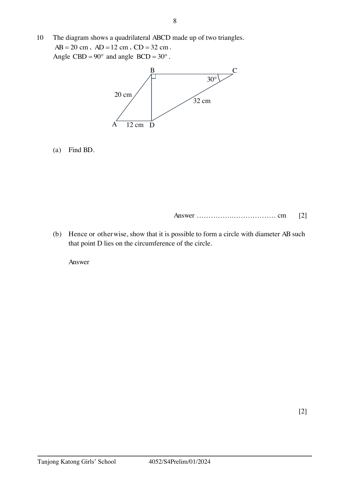
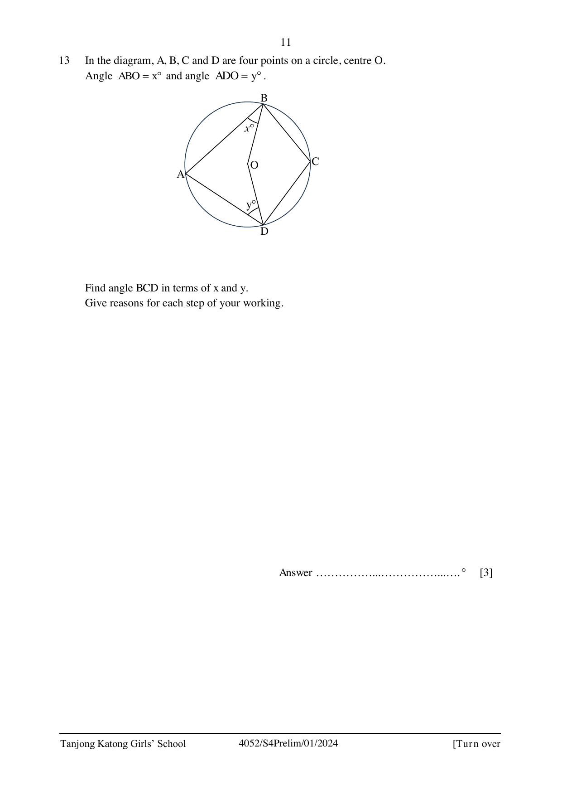
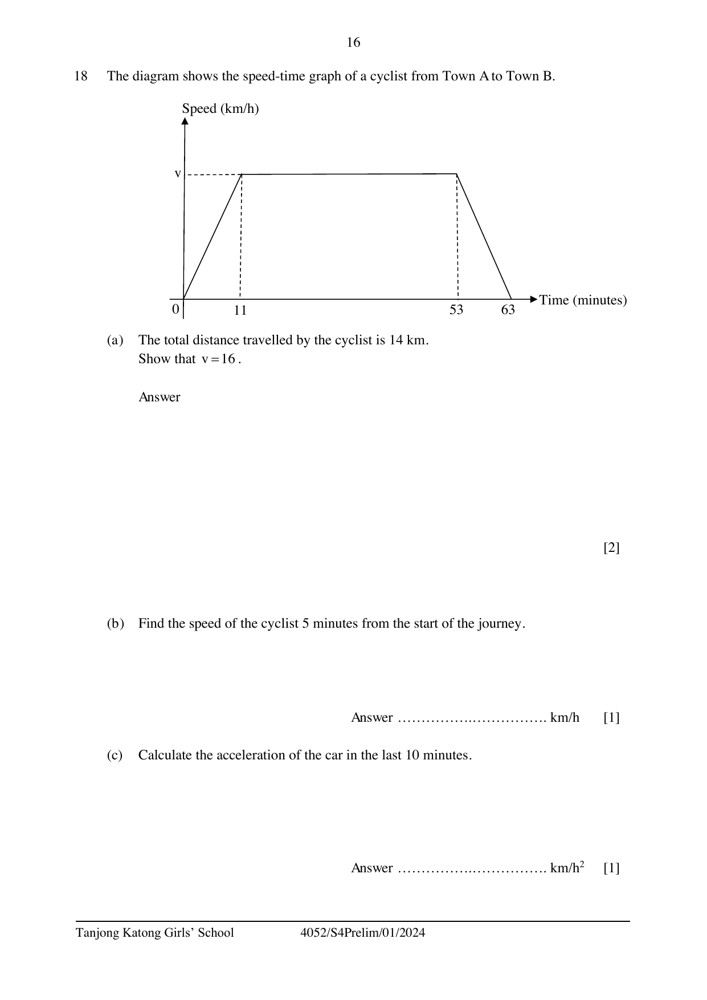

# Tanjong Katong Girls' School — Mathematics 4052/01 Paper 1 (cleaned)

> **Institution:** Tanjong Katong Girls' School
> **Exam:** Preliminary Examination 2024
> **Level:** Secondary Four Express
> **Subjects:** Elementary Mathematics
> **Paper:** 4052/01 Paper 1
> **Date:** 16 August 2024
> **Duration:** 2 hours 15 minutes
> **Total Marks:** 90
> **Source:** `TKGS 2024 S4 Math Prelim P1_Question Paper (with Answer Key).pdf`

---

## Instructions

Write your index number and name on all the work you hand in.
Write in dark blue or black pen.
You may use an HB pencil for any diagrams or graphs.
Do not use staples, paper clips, glue or correction fluid.
DO NOT WRITE ON ANY BARCODES.

Answer all the questions.
The number of marks is given in brackets [ ] at the end of each question or part question.

If working is needed for any question it must be shown with the answer.
Omission of essential working will result in loss of marks.
The total of the marks for this paper is 90.

The use of an approved scientific calculator is expected, where appropriate.
If the degree of accuracy is not specified in the question, and if the answer is not exact, give the answer to three significant figures. Give answers in degrees to one decimal place.
For $\pi$, use either your calculator value or $3.142$.

---

## Mathematical Formulae

*Compound interest*

$$
\text{Total amount} = P\left(1+\frac{r}{100}\right)^{n}
$$

*Mensuration*

$$
\text{Curved surface area of a cone} = \pi rl
$$

$$
\text{Surface area of a sphere} = 4\pi r^{2}
$$

$$
\text{Volume of a cone} = \frac{1}{3}\pi r^{2}h
$$

$$
\text{Volume of a sphere} = \frac{4}{3}\pi r^{3}
$$

$$
\text{Area of triangle } ABC = \frac{1}{2}ab\sin C
$$

$$
\text{Arc length} = r\theta,\text{ where }\theta\text{ is in radians}
$$

$$
\text{Sector area} = \frac{1}{2}r^{2}\theta,\text{ where }\theta\text{ is in radians}
$$

*Trigonometry*

$$
\frac{a}{\sin A} = \frac{b}{\sin B} = \frac{c}{\sin C}
$$

$$
a^{2} = b^{2}+c^{2}-2bc\cos A
$$

*Statistics*

$$
\text{Mean} = \frac{\sum fx}{\sum f}
$$

$$
\text{Standard deviation} = \sqrt{\frac{\sum fx^{2}}{\sum f}-\left(\frac{\sum fx}{\sum f}\right)^{2}}
$$

---

Answer all the questions.

### Q1

> **Marks:** 2
> **Page:** 3

(a) Calculate $\dfrac{165^{2}+\sqrt[4]{75.125-11.2\times(-3)}}{3.142}$.

Write your answer correct to 2 significant figures. [1]
> **Topic:** N1 Numbers and their operations
> **Sub-topic:** Numbers and their operations
> **LO:** [[context/subjects/o-level-e-maths/learning-objectives/o-level-e-maths-N1g.md|N1g]]

(b) The number of people in a shopping mall is 1100, correct to the nearest hundred.
Write down the minimum number of people there are in the mall. [1]
> **Topic:** N1 Numbers and their operations
> **Sub-topic:** Numbers and their operations
> **LO:** [[context/subjects/o-level-e-maths/learning-objectives/o-level-e-maths-N1g.md|N1g]]

### Q2

> **Marks:** 3
> **Page:** 3

Simplify

(a) $5-2(6x-1)$, [1]
> **Topic:** N5 Algebraic expressions and formulae
> **Sub-topic:** Algebraic expressions and formulae
> **LO:** [[context/subjects/o-level-e-maths/learning-objectives/o-level-e-maths-N5o.md|N5o]]

(b) $\left(\dfrac{27b^{9}}{a^{6}}\right)^{-\frac{1}{3}}$. [2]
> **Topic:** N5 Algebraic expressions and formulae
> **Sub-topic:** Algebraic expressions and formulae
> **LO:** [[context/subjects/o-level-e-maths/learning-objectives/o-level-e-maths-N5o.md|N5o]]

### Q3

> **Marks:** 2
> **Topic:** N2 Ratio and proportion
> **Sub-topic:** Ratio and proportion
> **LO:** [[context/subjects/o-level-e-maths/learning-objectives/o-level-e-maths-N2a.md|N2a]]
> **Page:** 4

Albert and Chris have some savings in the ratio $5 : 3$.
They spent ＄30 each from their savings and the new ratio of their savings is $2 : 1$.
Find the amount of savings Chris has at the start.

### Q4

> **Marks:** 3
> **Page:** 4

(a) Express 1400 as a product of its prime factors. [1]
> **Topic:** N1 Numbers and their operations
> **Sub-topic:** Numbers and their operations
> **LO:** [[context/subjects/o-level-e-maths/learning-objectives/o-level-e-maths-N1b.md|N1b]]

(b) $q$ is a number between 70 and 90.
The highest common factor of $q$ and 1400 is 28.
Find the smallest possible value of $q$. [2]
> **Topic:** N1 Numbers and their operations
> **Sub-topic:** Numbers and their operations
> **LO:** [[context/subjects/o-level-e-maths/learning-objectives/o-level-e-maths-N1e.md|N1e]]

### Q5

> **Marks:** 2
> **Topic:** N3 Percentage
> **Sub-topic:** Percentage
> **LO:** [[context/subjects/o-level-e-maths/learning-objectives/o-level-e-maths-N3e.md|N3e]]
> **Page:** 5

Given that $\dfrac{1}{2^{a-1}} = 2^{3}+2^{3}+2^{3}+2^{3}$, find the value of $a$.

### Q6

> **Marks:** 3
> **Page:** 5

(a) Expand and simplify $2(5m+3n)^{2}$. [2]
> **Topic:** N5 Algebraic expressions and formulae
> **Sub-topic:** Algebraic expressions and formulae
> **LO:** [[context/subjects/o-level-e-maths/learning-objectives/o-level-e-maths-N5j.md|N5j]]

(b) Factorise completely $24(mn)^{2}-21mn^{3}$. [1]
> **Topic:** N5 Algebraic expressions and formulae
> **Sub-topic:** Algebraic expressions and formulae
> **LO:** [[context/subjects/o-level-e-maths/learning-objectives/o-level-e-maths-N5h.md|N5h]]

### Q7

> **Marks:** 3
> **Topic:** G4 Pythagoras' theorem and trigonometry
> **Sub-topic:** Pythagoras' theorem and trigonometry
> **LO:** [[context/subjects/o-level-e-maths/learning-objectives/o-level-e-maths-G4e.md|G4e]]
> **Page:** 6

The area of triangle $XYZ$ is 12.6 cm$^{2}$.
$XY = 4.5$ cm and $YZ = 7.1$ cm.

Find two possible values for angle $XYZ$. Give your answers in radians.

### Q8

> **Marks:** 2
> **Topic:** N3 Percentage
> **Sub-topic:** Percentage
> **LO:** [[context/subjects/o-level-e-maths/learning-objectives/o-level-e-maths-N3d.md|N3d]]
> **Page:** 6

$P$ is inversely proportional to $Q^{3}$.
Find the percentage change in $P$ when $Q$ is reduced by 20%.

### Q9

> **Marks:** 3
> **Page:** 7

It is given that $p = \dfrac{q+r^{2}}{q-5}$.

(a) Find $p$ when $q = \dfrac{1}{5}$ and $r = -6$. [1]
> **Topic:** N5 Algebraic expressions and formulae
> **Sub-topic:** Algebraic expressions and formulae
> **LO:** [[context/subjects/o-level-e-maths/learning-objectives/o-level-e-maths-N5l.md|N5l]]

(b) Express $q$ in terms of $p$ and $r$. [2]
> **Topic:** N5 Algebraic expressions and formulae
> **Sub-topic:** Algebraic expressions and formulae
> **LO:** [[context/subjects/o-level-e-maths/learning-objectives/o-level-e-maths-N5m.md|N5m]]

### Q10

> **Marks:** 4
> **Page:** 8

The diagram shows a quadrilateral $ABCD$ made up of two triangles.
$AB = 20$ cm, $AD = 12$ cm, $CD = 32$ cm.
Angle $CBD = 90^{\circ}$ and angle $BCD = 30^{\circ}$.
$BD$ is a common side. $D$ lies on the straight line through $A$ and the foot of the perpendicular from $B$.

(a) Find $BD$. [2]
> **Topic:** G4 Pythagoras' theorem and trigonometry
> **Sub-topic:** Pythagoras' theorem and trigonometry
> **LO:** [[context/subjects/o-level-e-maths/learning-objectives/o-level-e-maths-G4b.md|G4b]]

(b) Hence or otherwise, show that it is possible to form a circle with diameter $AB$ such that point $D$ lies on the circumference of the circle. [2]
> **Topic:** G4 Pythagoras' theorem and trigonometry
> **Sub-topic:** Pythagoras' theorem and trigonometry
> **LO:** [[context/subjects/o-level-e-maths/learning-objectives/o-level-e-maths-G4b.md|G4b]]

### Q11

> **Marks:** 3
> **Topic:** N6 Functions and graphs
> **Sub-topic:** Functions and graphs
> **LO:** [[context/subjects/o-level-e-maths/learning-objectives/o-level-e-maths-N6g.md|N6g]]
> **Page:** 9

Write as a single fraction in its simplest form $\dfrac{3}{(1-2h)^{2}}+\dfrac{8}{2h-1}$.

### Q12

> **Marks:** 4
> **Page:** 10

$k$ is a positive integer.
An odd number is formed when 5 is subtracted from twice of $k$.

(a) Write down an expression for the odd number in terms of $k$. [1]
> **Topic:** N1 Numbers and their operations
> **Sub-topic:** Numbers and their operations
> **LO:** [[context/subjects/o-level-e-maths/learning-objectives/o-level-e-maths-N1e.md|N1e]]

(b) The sum between the odd number and the next consecutive odd number is greater than 16.

Form an inequality in terms of $k$ and solve it to find the smallest possible value of the larger odd number. [3]
> **Topic:** N1 Numbers and their operations
> **Sub-topic:** Numbers and their operations
> **LO:** [[context/subjects/o-level-e-maths/learning-objectives/o-level-e-maths-N1e.md|N1e]]

### Q13

> **Marks:** 3
> **Topic:** G3 Properties of circles
> **Sub-topic:** Properties of circles
> **LO:** [[context/subjects/o-level-e-maths/learning-objectives/o-level-e-maths-G3b.md|G3b]]
> **Page:** 11

In the diagram, $A$, $B$, $C$ and $D$ are four points on a circle, centre $O$.
Angle $ABO = x^{\circ}$ and angle $ADO = y^{\circ}$.

Find angle $BCD$ in terms of $x$ and $y$.
Give reasons for each step of your working.

### Q14

> **Marks:** 4
> **Page:** 12

(a) Factorise $3x^{2}-14x-5$. [2]
> **Topic:** N5 Algebraic expressions and formulae
> **Sub-topic:** Algebraic expressions and formulae
> **LO:** [[context/subjects/o-level-e-maths/learning-objectives/o-level-e-maths-N5h.md|N5h]]

(b) Hence, factorise completely $3(y+1)^{2}-14y-19$. [2]
> **Topic:** N5 Algebraic expressions and formulae
> **Sub-topic:** Algebraic expressions and formulae
> **LO:** [[context/subjects/o-level-e-maths/learning-objectives/o-level-e-maths-N5h.md|N5h]]

### Q15

> **Marks:** 4
> **Topic:** N6 Functions and graphs
> **Sub-topic:** Functions and graphs
> **LO:** [[context/subjects/o-level-e-maths/learning-objectives/o-level-e-maths-N6c.md|N6c]]
> **Page:** 13

The points $P(2, 3)$ and $Q(-1, -3)$ lie on the curve $y = ax^{2}+bx+2$.
Form and solve two simultaneous equations to find the values of $a$ and $b$.

### Q16

> **Marks:** 4
> **Page:** 14

A bag contains 15 red marbles, some blue marbles and some yellow marbles.
A marble is chosen at random from the bag.

The probability of choosing a blue marble is $\dfrac{1}{6}$ and the probability of choosing a yellow marble is $\dfrac{7}{12}$.

(a) Show that there are 60 marbles in total in the bag. [2]
> **Topic:** S2 Probability
> **Sub-topic:** Probability
> **LO:** [[context/subjects/o-level-e-maths/learning-objectives/o-level-e-maths-S2c.md|S2c]]

(b) Two marbles are chosen at random from the bag.
Find the probability that both marbles are blue. [2]
> **Topic:** S2 Probability
> **Sub-topic:** Probability
> **LO:** [[context/subjects/o-level-e-maths/learning-objectives/o-level-e-maths-S2c.md|S2c]]

### Q17

> **Marks:** 4
> **Page:** 15

The figure is made up of a regular pentagon $ABCDE$ and a regular hexagon $CDFGHI$.

(a) Find angle $BCI$. [2]
> **Topic:** G1 Angles, triangles and polygons
> **Sub-topic:** Angles, triangles and polygons
> **LO:** [[context/subjects/o-level-e-maths/learning-objectives/o-level-e-maths-G1f.md|G1f]]

(b) Determine whether $BC$ and $CI$ are two sides of another regular polygon.
Justify your answers with mathematical working. [2]
> **Topic:** G1 Angles, triangles and polygons
> **Sub-topic:** Angles, triangles and polygons
> **LO:** [[context/subjects/o-level-e-maths/learning-objectives/o-level-e-maths-G1f.md|G1f]]

### Q18

> **Marks:** 4
> **Page:** 16

The diagram shows the speed-time graph of a cyclist from Town A to Town B.
Speed rises linearly from 0 to $v$ km/h in 11 minutes, stays at $v$ until 53 minutes, then falls linearly to 0 at 63 minutes.

(a) The total distance travelled by the cyclist is 14 km.
Show that $v = 16$. [2]
> **Topic:** N6 Functions and graphs
> **Sub-topic:** Functions and graphs
> **LO:** [[context/subjects/o-level-e-maths/learning-objectives/o-level-e-maths-N6c.md|N6c]]

(b) Find the speed of the cyclist 5 minutes from the start of the journey. [1]
> **Topic:** N6 Functions and graphs
> **Sub-topic:** Functions and graphs
> **LO:** [[context/subjects/o-level-e-maths/learning-objectives/o-level-e-maths-N6c.md|N6c]]

(c) Calculate the acceleration of the car in the last 10 minutes. [1]
> **Topic:** N6 Functions and graphs
> **Sub-topic:** Functions and graphs
> **LO:** [[context/subjects/o-level-e-maths/learning-objectives/o-level-e-maths-N6c.md|N6c]]

### Q19

> **Marks:** 4
> **Page:** 17

The times taken, in minutes, by 14 students to complete a Mathematics assignment are recorded.

| Stem | Leaf |
| --- | --- |
| 1 | 1 5 9 |
| 2 | 0 3 3 3 6 9 |
| 3 | 4 8 8 9 |
| 4 | 0 |

Key: $4 \mid 0$ represents 40 minutes.

(a) Find the modal time. [1]
> **Topic:** S1 Data handling and analysis
> **Sub-topic:** Data handling and analysis
> **LO:** [[context/subjects/o-level-e-maths/learning-objectives/o-level-e-maths-S1b.md|S1b]]

(b) Find the percentage of students who took at most 20 minutes to complete the assignment. [1]
> **Topic:** S1 Data handling and analysis
> **Sub-topic:** Data handling and analysis
> **LO:** [[context/subjects/o-level-e-maths/learning-objectives/o-level-e-maths-S1b.md|S1b]]

(c) The time taken for the 15th student to complete the assignment is recorded.
The range increases to 31 minutes.
Find two possible times this student spent completing the assignment. [2]
> **Topic:** S1 Data handling and analysis
> **Sub-topic:** Data handling and analysis
> **LO:** [[context/subjects/o-level-e-maths/learning-objectives/o-level-e-maths-S1b.md|S1b]]

### Q20

> **Marks:** 5
> **Page:** 18

The first four terms in a sequence of numbers are given below.

$$
T_{1} = \frac{2}{1}-\frac{3}{5} = \frac{7}{5}
$$

$$
T_{2} = \frac{3}{5}-\frac{4}{5^{2}} = \frac{11}{25}
$$

$$
T_{3} = \frac{4}{5^{2}}-\frac{5}{5^{3}} = \frac{3}{25}
$$

$$
T_{4} = \frac{5}{5^{3}}-\frac{6}{5^{4}} = \frac{19}{625}
$$

(a) Find $T_{5}$. [1]
> **Topic:** N5 Algebraic expressions and formulae
> **Sub-topic:** Algebraic expressions and formulae
> **LO:** [[context/subjects/o-level-e-maths/learning-objectives/o-level-e-maths-N5e.md|N5e]]

(b) Find an expression, in terms of $n$, for $T_{n}$. [2]
> **Topic:** N5 Algebraic expressions and formulae
> **Sub-topic:** Algebraic expressions and formulae
> **LO:** [[context/subjects/o-level-e-maths/learning-objectives/o-level-e-maths-N5e.md|N5e]]

(c) Evaluate the sum of the first ten terms, $T_{1}+T_{2}+T_{3}+\ldots+T_{10}$. [2]
> **Topic:** N5 Algebraic expressions and formulae
> **Sub-topic:** Algebraic expressions and formulae
> **LO:** [[context/subjects/o-level-e-maths/learning-objectives/o-level-e-maths-N5e.md|N5e]]

### Q21

> **Marks:** 4
> **Page:** 19

Benedict left his house to go to the library.
He took the first bus, which travelled 5 km in $t$ minutes.

He then alighted at a bus stop and waited for 12 minutes to switch to the next bus.

The second bus took 2 minutes less than the first bus to reach his destination after travelling a further 3.75 km.

(a) Find the time taken for the whole journey, in minutes, in terms of $t$. [1]
> **Topic:** S1 Data handling and analysis
> **Sub-topic:** Data handling and analysis
> **LO:** [[context/subjects/o-level-e-maths/learning-objectives/o-level-e-maths-S1f.md|S1f]]

(b) Given that the average speed for the whole journey is 10.5 km/h, form an equation in terms of $t$ to calculate the total time taken for the journey. [3]
> **Topic:** S1 Data handling and analysis
> **Sub-topic:** Data handling and analysis
> **LO:** [[context/subjects/o-level-e-maths/learning-objectives/o-level-e-maths-S1f.md|S1f]]

### Q22

> **Marks:** 4
> **Page:** 20

In this scale drawing, $A$, $B$ and $C$ are three corners of a park $ABCD$ with $C$ due north of $B$.

(a) Construct the perpendicular bisector of $BC$. [1]
> **Topic:** G2 Congruence and similarity
> **Sub-topic:** Congruence and similarity
> **LO:** [[context/subjects/o-level-e-maths/learning-objectives/o-level-e-maths-G2e.md|G2e]]

(b) $D$ is on a bearing of $065^{\circ}$ from $A$ and equidistant from $B$ and $C$.
Mark and label point $D$ on the drawing. [1]
> **Topic:** G3 Properties of circles
> **Sub-topic:** Properties of circles
> **LO:** [[context/subjects/o-level-e-maths/learning-objectives/o-level-e-maths-G3a.md|G3a]]

(c) Construct the bisector of angle $ABC$. [1]
> **Topic:** G3 Properties of circles
> **Sub-topic:** Properties of circles
> **LO:** [[context/subjects/o-level-e-maths/learning-objectives/o-level-e-maths-G3a.md|G3a]]

(d) Eleanor is standing inside the park $ABCD$ such that she is closer to $BC$ than $AB$ and closer to $B$ than $C$.
Shade the region where Eleanor could be standing. [1]
> **Topic:** G3 Properties of circles
> **Sub-topic:** Properties of circles
> **LO:** [[context/subjects/o-level-e-maths/learning-objectives/o-level-e-maths-G3a.md|G3a]]

### Q23

> **Marks:** 5
> **Page:** 21

The table below shows the number of books read by 50 students in Class A in semester 1.

| Number of books read, $n$ | Frequency |
| --- | --- |
| $0 < n \le 2$ | 8 |
| $2 < n \le 4$ | 21 |
| $4 < n \le 6$ | 11 |
| $6 < n \le 8$ | 3 |
| $8 < n \le 10$ | 7 |

(a) Calculate an estimate for

(i) the mean number of books read by the students, [1]
> **Topic:** S1 Data handling and analysis
> **Sub-topic:** Data handling and analysis
> **LO:** [[context/subjects/o-level-e-maths/learning-objectives/o-level-e-maths-S1f.md|S1f]]

(ii) the standard deviation of the number of books read by the students. [1]
> **Topic:** S1 Data handling and analysis
> **Sub-topic:** Data handling and analysis
> **LO:** [[context/subjects/o-level-e-maths/learning-objectives/o-level-e-maths-S1f.md|S1f]]

(b) After introducing a reading programme in semester 2, the number of books read by each student in Class A increased by 2.
State how the mean and standard deviation will change after the increase. [2]
> **Topic:** S1 Data handling and analysis
> **Sub-topic:** Data handling and analysis
> **LO:** [[context/subjects/o-level-e-maths/learning-objectives/o-level-e-maths-S1f.md|S1f]]

(c) The standard deviation of the number of books read by the students from Class B was 3.15.

Use this information to comment on one difference between the two distributions. [1]
> **Topic:** S1 Data handling and analysis
> **Sub-topic:** Data handling and analysis
> **LO:** [[context/subjects/o-level-e-maths/learning-objectives/o-level-e-maths-S1f.md|S1f]]

### Q24

> **Marks:** 5
> **Page:** 22

An enrichment centre offers drama, writing and speech enrichment classes on weekdays during the school holiday.

The matrix $\mathbf{S}$ shows the number of students who attend the different classes for beginners and advanced levels in a day.

$$
\mathbf{S} = \begin{pmatrix} 25 & 32 & 40 \\ 21 & 19 & 32 \end{pmatrix}
\begin{matrix} \text{beginners} \\ \text{advanced} \end{matrix}
$$

Columns are drama, writing, speech.

(a) Evaluate the matrix $\mathbf{W} = 5\mathbf{S}$. [1]
> **Topic:** N9 Matrices
> **Sub-topic:** Matrices
> **LO:** [[context/subjects/o-level-e-maths/learning-objectives/o-level-e-maths-N9b.md|N9b]]

The school fee for drama cost ＄40 per session, ＄25 per session for writing and ＄30 per session for speech. The fees for beginner and advanced learners are the same for each type of class.

(b) Represent these amounts in a column matrix $\mathbf{C}$. [1]
> **Topic:** N9 Matrices
> **Sub-topic:** Matrices
> **LO:** [[context/subjects/o-level-e-maths/learning-objectives/o-level-e-maths-N9b.md|N9b]]

(c) Evaluate the matrix $\mathbf{T} = \mathbf{WC}$. [2]
> **Topic:** N9 Matrices
> **Sub-topic:** Matrices
> **LO:** [[context/subjects/o-level-e-maths/learning-objectives/o-level-e-maths-N9b.md|N9b]]

(d) Explain what the elements in $\mathbf{T}$ represent. [1]
> **Topic:** N9 Matrices
> **Sub-topic:** Matrices
> **LO:** [[context/subjects/o-level-e-maths/learning-objectives/o-level-e-maths-N9b.md|N9b]]

### Q25

> **Marks:** 6
> **Page:** 23

$PR$ is a diameter of the large circle, centre $O$.
$QS$ is a diameter of the small circle, centre $O$.

$PQ$ and $RS$ are tangents to the small circle.
Two regions, triangle $OPQ$ and triangle $ORS$, are shaded.

(a) Show that triangle $OPQ$ is congruent to triangle $ORS$.
Give a reason for each statement you make. [3]
> **Topic:** G2 Congruence and similarity
> **Sub-topic:** Congruence and similarity
> **LO:** [[context/subjects/o-level-e-maths/learning-objectives/o-level-e-maths-G2i.md|G2i]]

(b) The ratio of $OQ$ to $PQ$ to $OP$ is $5 : 12 : 13$.
Express the area of the shaded region as a percentage of the large circle. [3]
> **Topic:** G3 Properties of circles
> **Sub-topic:** Properties of circles
> **LO:** [[context/subjects/o-level-e-maths/learning-objectives/o-level-e-maths-G3b.md|G3b]]

---

## Answers

Printed answer key, page 24 of the same PDF. Parts that are "show that" or constructions, and $T_{n}$, are not in the key.

| Question | Answer | QP page |
| --- | --- | --- |
| 1(a) | 8700 | 3 |
| 1(b) | 1050 | 3 |
| 2(a) | $7-12x$ | 3 |
| 2(b) | $\dfrac{a^{2}}{3b^{3}}$ | 3 |
| 3 | ＄90 | 4 |
| 4(a) | $1400 = 2^{3} \times 5^{2} \times 7$ | 4 |
| 4(b) | $q = 84$ | 4 |
| 5 | $a = -4$ | 5 |
| 6(a) | $50m^{2}+60mn+18n^{2}$ | 5 |
| 6(b) | $3mn^{2}(8m-7n)$ | 5 |
| 7 | $\angle XYZ = 0.909$ radian or $2.23$ radian | 6 |
| 8 | $95\dfrac{5}{16}\%$ | 6 |
| 9(a) | $-7\dfrac{13}{24}$ | 7 |
| 9(b) | $q = \dfrac{r^{2}+5p}{p-1}$ | 7 |
| 10(a) | 16 cm | 8 |
| 11 | $\dfrac{16h-5}{(1-2h)^{2}}$ | 9 |
| 12(a) | $2k-5$ | 10 |
| 12(b) | 11 | 10 |
| 13 | $180^{\circ}-x^{\circ}-y^{\circ}$ | 11 |
| 14(a) | $(3x+1)(x-5)$ | 12 |
| 14(b) | $(3y+4)(y-4)$ | 12 |
| 15 | $a = -1.5$ and $b = 3.5$ | 13 |
| 16(a) | 60 | 14 |
| 16(b) | $\dfrac{3}{118}$ | 14 |
| 17(a) | $132^{\circ}$ | 15 |
| 17(b) | Since the number of sides is not a positive integer greater than 3, $BC$ and $CI$ cannot be sides of a regular polygon. | 15 |
| 18(b) | $7\dfrac{3}{11}$ km/h | 16 |
| 18(c) | $-96$ km/h$^{2}$ | 16 |
| 19(a) | 23 | 17 |
| 19(b) | $28\dfrac{4}{7}\%$ | 17 |
| 19(c) | 42 and 9 | 17 |
| 20(a) | $T_{5} = \dfrac{6}{5^{4}}-\dfrac{7}{5^{5}} = \dfrac{23}{3125}$ | 18 |
| 20(c) | 2.00 | 18 |
| 21(a) | $(2t+10)$ minutes | 19 |
| 21(b) | 50 minutes | 19 |
| 23(a)(i) | 4.2 | 21 |
| 23(a)(ii) | 2.47 | 21 |
| 23(b) | The mean number of books will increase by 2 while the standard deviation value will remain the same. | 21 |
| 23(c) | SD of class A $= 2.47$. SD of class B $= 3.15$. Since the standard deviation value of class A is lesser than class B by 0.68, class A has a smaller spread in distribution and the books read by class A is more homogeneous in general. | 21 |
| 24(a) | $\begin{pmatrix} 125 & 160 & 200 \\ 105 & 95 & 160 \end{pmatrix}$ | 22 |
| 24(b) | $\begin{pmatrix} 40 \\ 25 \\ 30 \end{pmatrix}$ | 22 |
| 24(c) | $\begin{pmatrix} 15000 \\ 11375 \end{pmatrix}$ | 22 |
| 24(d) | The elements in $\mathbf{T}$ represent the total amount of school fees paid for weekdays in a week for beginner and advanced students respectively. | 22 |
| 25(a) | ASA / RHS / AAS test | 23 |
| 25(b) | 11.3% | 23 |
