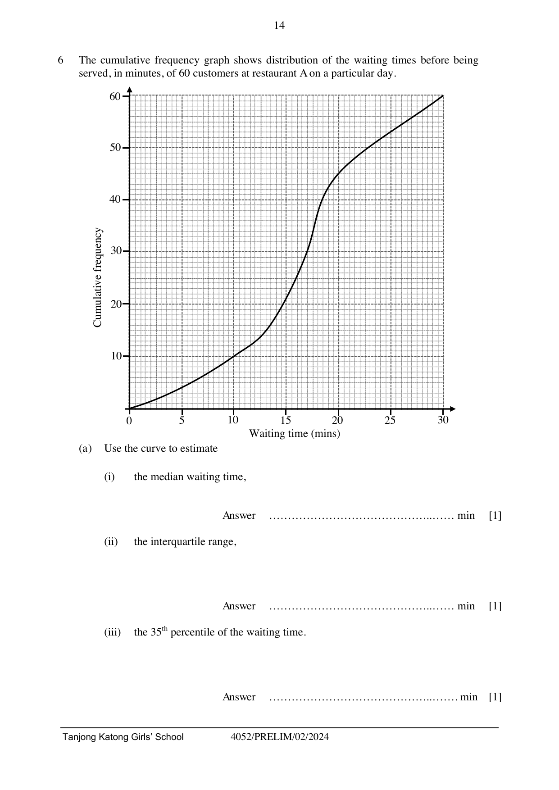
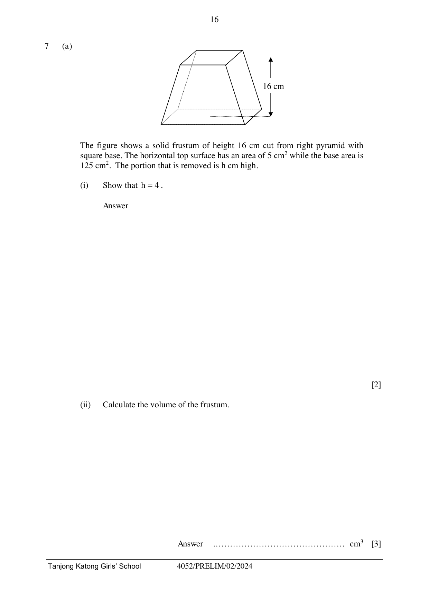

# Tanjong Katong Girls' School — Mathematics 4052/02 Paper 2 (cleaned)

> **Institution:** Tanjong Katong Girls' School
> **Exam:** Preliminary Examination 2024
> **Level:** Secondary Four Express
> **Subjects:** Elementary Mathematics
> **Paper:** 4052/02 Paper 2
> **Date:** 7 August 2024
> **Duration:** 2 hours 15 minutes
> **Total Marks:** 90
> **Source:** `TKGS 2024 S4 Prelim Math P2 Question Paper (with answer key).pdf`

---

## Instructions

Write your class, index number and name on all the work you hand in.
Write in dark blue or black pen.
You may use a HB pencil for any diagrams or graphs.
Do not use staples, paper clips, glue or correction fluid.
DO NOT WRITE ON ANY BARCODES.

Answer all questions.
The number of marks is given in brackets [ ] at the end of each question or part question.

If working is needed for any question it must be shown with the answer.
Omission of essential working will result in loss of marks.
The total of the marks for this paper is 90.

The use of an approved scientific calculator is expected, where appropriate.
If the degree of accuracy is not specified in the question and if the answer is not exact, give the answer to three significant figures. Gives answers in degrees to one decimal place.
For $\pi$, use either your calculator value or $3.142$.

---

## Mathematical Formulae

*Compound interest*

$$
\text{Total amount} = P\left(1+\frac{r}{100}\right)^{n}
$$

*Mensuration*

$$
\text{Curved surface area of a cone} = \pi rl
$$

$$
\text{Surface area of a sphere} = 4\pi r^{2}
$$

$$
\text{Volume of a cone} = \frac{1}{3}\pi r^{2}h
$$

$$
\text{Volume of a sphere} = \frac{4}{3}\pi r^{3}
$$

$$
\text{Area of triangle } ABC = \frac{1}{2}ab\sin C
$$

$$
\text{Arc length} = r\theta,\text{ where }\theta\text{ is in radians}
$$

$$
\text{Sector area} = \frac{1}{2}r^{2}\theta,\text{ where }\theta\text{ is in radians}
$$

*Trigonometry*

$$
\frac{a}{\sin A} = \frac{b}{\sin B} = \frac{c}{\sin C}
$$

$$
a^{2} = b^{2}+c^{2}-2bc\cos A
$$

*Statistics*

$$
\text{Mean} = \frac{\sum fx}{\sum f}
$$

$$
\text{Standard deviation} = \sqrt{\frac{\sum fx^{2}}{\sum f}-\left(\frac{\sum fx}{\sum f}\right)^{2}}
$$

---

### Q1

> **Marks:** 12
> **Page:** 4–5

(a) Solve the equation $\dfrac{3-2x}{7} = \dfrac{1}{3}(2x-1)$. [2]
> **Topic:** N7 Equations and inequalities
> **Sub-topic:** Equations and inequalities
> **LO:** [[context/subjects/o-level-e-maths/learning-objectives/o-level-e-maths-N7e.md|N7e]]

(b) Simplify

(i) $\dfrac{25a^{2}-9b^{2}}{15a-10ab+6b^{2}-9b}$ [3]
> **Topic:** N1 Numbers and their operations
> **Sub-topic:** Numbers and their operations
> **LO:** [[context/subjects/o-level-e-maths/learning-objectives/o-level-e-maths-N1g.md|N1g]]

(ii) $\dfrac{3c}{4ab} \div \dfrac{c^{3}}{12a^{2}b}$ [2]
> **Topic:** N1 Numbers and their operations
> **Sub-topic:** Numbers and their operations
> **LO:** [[context/subjects/o-level-e-maths/learning-objectives/o-level-e-maths-N1g.md|N1g]]

(c) (i) Solve the equation $-x^{2}+9x-\dfrac{7}{2} = 0$ by completing the square. Give your solutions correct to two decimal places. [3]
> **Topic:** N7 Equations and inequalities
> **Sub-topic:** Equations and inequalities
> **LO:** [[context/subjects/o-level-e-maths/learning-objectives/o-level-e-maths-N7e.md|N7e]]

(ii) Explain why $-x^{2}+9x-\dfrac{7}{2} = 18$ has no real solution. [2]
> **Topic:** N7 Equations and inequalities
> **Sub-topic:** Equations and inequalities
> **LO:** [[context/subjects/o-level-e-maths/learning-objectives/o-level-e-maths-N7e.md|N7e]]

### Q2

> **Marks:** 8
> **Page:** 6–7

(a) In a particular month, 21 people took a driving test.

One of the 21 people is selected at random.
The probability that it is a man who passed the test is $\dfrac{1}{7}$.

Two of the 21 people are selected at random.
The probability that they are both women who failed the test is $\dfrac{1}{10}$.

Complete the table of information about the 21 people who took the test on that particular month.

|  | Passed the test | Failed the test |
| --- | --- | --- |
| Men |  | 9 |
| Women |  |  |

[4]
> **Topic:** S2 Probability
> **Sub-topic:** Probability
> **LO:** [[context/subjects/o-level-e-maths/learning-objectives/o-level-e-maths-S2c.md|S2c]]

(b) $\varepsilon = \{x : x \text{ is a student in a class}\}$

$A = \{x : x \text{ is a student who listens to pop music}\}$

$B = \{x : x \text{ is a student who listens to classical music}\}$

It is given that $n(\varepsilon) = 35$, $n(A) = 22$, $n(B) = 14$ and $n(A \cap B') = 12$.

(i) Describe in words the set $A \cap B'$. [1]
> **Topic:** S2 Probability
> **Sub-topic:** Probability
> **LO:** [[context/subjects/o-level-e-maths/learning-objectives/o-level-e-maths-S2c.md|S2c]]

(ii) Find the number of students who listen to both pop and classical music. [1]
> **Topic:** S2 Probability
> **Sub-topic:** Probability
> **LO:** [[context/subjects/o-level-e-maths/learning-objectives/o-level-e-maths-S2c.md|S2c]]

(iii) Find the number of students who listen to classical music only. [1]
> **Topic:** S2 Probability
> **Sub-topic:** Probability
> **LO:** [[context/subjects/o-level-e-maths/learning-objectives/o-level-e-maths-S2c.md|S2c]]

(iv) Find the number of students who listen to neither pop nor classical music. [1]
> **Topic:** S2 Probability
> **Sub-topic:** Probability
> **LO:** [[context/subjects/o-level-e-maths/learning-objectives/o-level-e-maths-S2c.md|S2c]]

### Q3

> **Marks:** 10
> **Page:** 8–9

(a) Complete the table of values for $y = 2x+\dfrac{20}{x}-15$. [1]
> **Topic:** G6 Coordinate geometry
> **Sub-topic:** Coordinate geometry
> **LO:** [[context/subjects/o-level-e-maths/learning-objectives/o-level-e-maths-G6c.md|G6c]]

| $x$ | 1 | 2.5 | 5 | 10 | 12.5 | 15 | 20 |
| --- | --- | --- | --- | --- | --- | --- | --- |
| $y$ | 7 |  | $-1$ | 7 | 11.6 | 16.3 | 26 |

(b) On the grid, draw the graph of $y = 2x+\dfrac{20}{x}-15$ for $0 < x \le 20$.

The grid has $x$ from 0 to 20, in steps of 2.5, and $y$ from $-5$ to 30. [3]
> **Topic:** N6 Functions and graphs
> **Sub-topic:** Functions and graphs
> **LO:** [[context/subjects/o-level-e-maths/learning-objectives/o-level-e-maths-N6c.md|N6c]]

(c) Using the graph, state the range of values of $x$ for which $2x+\dfrac{20}{x} < 22$. [2]
> **Topic:** N6 Functions and graphs
> **Sub-topic:** Functions and graphs
> **LO:** [[context/subjects/o-level-e-maths/learning-objectives/o-level-e-maths-N6c.md|N6c]]

(d) By drawing a tangent, find the gradient of the curve at the point where $x = 4$. [2]
> **Topic:** G6 Coordinate geometry
> **Sub-topic:** Coordinate geometry
> **LO:** [[context/subjects/o-level-e-maths/learning-objectives/o-level-e-maths-G6c.md|G6c]]

(e) By drawing a suitable straight line on the grid, find the solutions of the equation $x^{2}-13x+20 = 0$. [2]
> **Topic:** G6 Coordinate geometry
> **Sub-topic:** Coordinate geometry
> **LO:** [[context/subjects/o-level-e-maths/learning-objectives/o-level-e-maths-G6c.md|G6c]]

### Q4

> **Marks:** 11
> **Page:** 10–11

In the diagram, $PQRS$ is a vertical rectangular wall of height 2.5 m and length 7.5 m.
$T$ is a point on level ground from the base of the wall $RS$.
$\angle STR = 95^{\circ}$ and $\angle SRT = 40^{\circ}$.
$X$ is a point on $ST$ such that $SX : XT$ is $1 : 3$.

(a) Calculate the length of $SX$. [3]
> **Topic:** G4 Pythagoras' theorem and trigonometry
> **Sub-topic:** Pythagoras' theorem and trigonometry
> **LO:** [[context/subjects/o-level-e-maths/learning-objectives/o-level-e-maths-G4g.md|G4g]]

(b) Calculate the length of $XR$. [3]
> **Topic:** G4 Pythagoras' theorem and trigonometry
> **Sub-topic:** Pythagoras' theorem and trigonometry
> **LO:** [[context/subjects/o-level-e-maths/learning-objectives/o-level-e-maths-G4g.md|G4g]]

(c) Calculate the length of $PT$. [1]
> **Topic:** G4 Pythagoras' theorem and trigonometry
> **Sub-topic:** Pythagoras' theorem and trigonometry
> **LO:** [[context/subjects/o-level-e-maths/learning-objectives/o-level-e-maths-G4g.md|G4g]]

(d) A bird sat on the ledge of the wall along $PQ$ such that its angle of elevation $\theta$ from $X$ is the largest. Find $\theta$. [4]
> **Topic:** G4 Pythagoras' theorem and trigonometry
> **Sub-topic:** Pythagoras' theorem and trigonometry
> **LO:** [[context/subjects/o-level-e-maths/learning-objectives/o-level-e-maths-G4g.md|G4g]]

### Q5

> **Marks:** 11
> **Page:** 12–13

In the diagram, $O$ is the centre of the circle through $A$, $B$, $C$, $D$ and $TB$ is the tangent at $B$. $AC$ is the diameter of the circle, and the length of the minor arc $BAD$ is 11 cm.
Given that $\angle OBC = 40^{\circ}$, $\angle ACD = 30^{\circ}$ and $\angle BTC = 70^{\circ}$.

(a) Find, giving a reason for each step of your working,

(i) $\angle ABD$, [1]
> **Topic:** G2 Congruence and similarity
> **Sub-topic:** Congruence and similarity
> **LO:** [[context/subjects/o-level-e-maths/learning-objectives/o-level-e-maths-G2i.md|G2i]]

(ii) $\angle BAD$, [2]
> **Topic:** G2 Congruence and similarity
> **Sub-topic:** Congruence and similarity
> **LO:** [[context/subjects/o-level-e-maths/learning-objectives/o-level-e-maths-G2i.md|G2i]]

(iii) Taking $\pi = \dfrac{22}{7}$, calculate the radius of the circle. [2]
> **Topic:** G2 Congruence and similarity
> **Sub-topic:** Congruence and similarity
> **LO:** [[context/subjects/o-level-e-maths/learning-objectives/o-level-e-maths-G2i.md|G2i]]

(b) (i) Show that triangle $BCD$ is similar to triangle $CTB$. Give a reason for each statement you make. [4]
> **Topic:** G2 Congruence and similarity
> **Sub-topic:** Congruence and similarity
> **LO:** [[context/subjects/o-level-e-maths/learning-objectives/o-level-e-maths-G2i.md|G2i]]

(ii) Hence, express $CT$ in terms of $x$ and $y$ given that $BC = x$ cm and $BD = y$ cm. [2]
> **Topic:** G2 Congruence and similarity
> **Sub-topic:** Congruence and similarity
> **LO:** [[context/subjects/o-level-e-maths/learning-objectives/o-level-e-maths-G2i.md|G2i]]

### Q6

> **Marks:** 7
> **Page:** 14–15

The cumulative frequency graph shows the distribution of the waiting times before being served, in minutes, of 60 customers at restaurant A on a particular day.

(a) Use the curve to estimate

(i) the median waiting time, [1]
> **Topic:** S1 Data handling and analysis
> **Sub-topic:** Data handling and analysis
> **LO:** [[context/subjects/o-level-e-maths/learning-objectives/o-level-e-maths-S1f.md|S1f]]

(ii) the interquartile range, [1]
> **Topic:** S1 Data handling and analysis
> **Sub-topic:** Data handling and analysis
> **LO:** [[context/subjects/o-level-e-maths/learning-objectives/o-level-e-maths-S1i.md|S1i]]

(iii) the 35th percentile of the waiting time. [1]
> **Topic:** S1 Data handling and analysis
> **Sub-topic:** Data handling and analysis
> **LO:** [[context/subjects/o-level-e-maths/learning-objectives/o-level-e-maths-S1i.md|S1i]]

(b) Given that 20% of the customers waited more than $x$ minutes to be served, find the value of $x$. [1]
> **Topic:** S1 Data handling and analysis
> **Sub-topic:** Data handling and analysis
> **LO:** [[context/subjects/o-level-e-maths/learning-objectives/o-level-e-maths-S1i.md|S1i]]

(c) The data below represents the waiting times of 10 customers from restaurant B on the same day.

10, 12, 14, 14, 15, 17, 17, 18, 22, 28

Calculate

(i) the median waiting time, [1]
> **Topic:** S1 Data handling and analysis
> **Sub-topic:** Data handling and analysis
> **LO:** [[context/subjects/o-level-e-maths/learning-objectives/o-level-e-maths-S1f.md|S1f]]

(ii) the interquartile range. [1]
> **Topic:** S1 Data handling and analysis
> **Sub-topic:** Data handling and analysis
> **LO:** [[context/subjects/o-level-e-maths/learning-objectives/o-level-e-maths-S1i.md|S1i]]

(d) The owner of restaurant B claims that his restaurant is more efficient and consistent in their service compared to restaurant A based on the data given. Give a reason why this is not a fair comparison. [1]
> **Topic:** S1 Data handling and analysis
> **Sub-topic:** Data handling and analysis
> **LO:** [[context/subjects/o-level-e-maths/learning-objectives/o-level-e-maths-S1i.md|S1i]]

The printed answer key labels this last statement as 6(c)(iii).

### Q7

> **Marks:** 10
> **Page:** 16–17

(a) The figure shows a solid frustum of height 16 cm cut from a right pyramid with square base. The horizontal top surface has an area of 5 cm$^{2}$ while the base area is 125 cm$^{2}$. The portion that is removed is $h$ cm high.

(i) Show that $h = 4$. [2]
> **Topic:** G5 Mensuration
> **Sub-topic:** Mensuration
> **LO:** [[context/subjects/o-level-e-maths/learning-objectives/o-level-e-maths-G5b.md|G5b]]

(ii) Calculate the volume of the frustum. [3]
> **Topic:** G5 Mensuration
> **Sub-topic:** Mensuration
> **LO:** [[context/subjects/o-level-e-maths/learning-objectives/o-level-e-maths-G5c.md|G5c]]

(iii) Find the percentage of the right pyramid that has been removed. [2]
> **Topic:** G5 Mensuration
> **Sub-topic:** Mensuration
> **LO:** [[context/subjects/o-level-e-maths/learning-objectives/o-level-e-maths-G5b.md|G5b]]

(b) Two solid cones have the same height but the radius of cone A is 1.5 times of cone B. Given that the volume of cone B is 240 cm$^{3}$.

Find the volume of cone A. [3]
> **Topic:** G5 Mensuration
> **Sub-topic:** Mensuration
> **LO:** [[context/subjects/o-level-e-maths/learning-objectives/o-level-e-maths-G5c.md|G5c]]

### Q8

> **Marks:** 11
> **Page:** 18–21

(a) $\overrightarrow{AB} = \begin{pmatrix} -3 \\ 9 \end{pmatrix}$, $\overrightarrow{BC} = \begin{pmatrix} 2 \\ 5 \end{pmatrix}$, $\overrightarrow{CD} = \begin{pmatrix} d \\ 4 \end{pmatrix}$.

(i) Given that $\overrightarrow{CD}$ is parallel to $\overrightarrow{AB}$, find the value of $d$. [2]
> **Topic:** G7 Vectors in two dimensions
> **Sub-topic:** Vectors in two dimensions
> **LO:** [[context/subjects/o-level-e-maths/learning-objectives/o-level-e-maths-G7h.md|G7h]]

(ii) Find $AC$. [2]
> **Topic:** G7 Vectors in two dimensions
> **Sub-topic:** Vectors in two dimensions
> **LO:** [[context/subjects/o-level-e-maths/learning-objectives/o-level-e-maths-G7h.md|G7h]]

(b) $PQR$ is a triangle and $M$ is the mid-point of $PQ$. It is given that $\overrightarrow{PQ} = \mathbf{a}$, $\overrightarrow{PR} = \mathbf{b}$, $\overrightarrow{QT} = h\overrightarrow{QR}$ and $\overrightarrow{RS} = k\overrightarrow{RM}$, where $k$ and $h$ are constants.

(i) Express $\overrightarrow{PS}$ in terms of $k$, $\mathbf{a}$ and $\mathbf{b}$. [2]
> **Topic:** G7 Vectors in two dimensions
> **Sub-topic:** Vectors in two dimensions
> **LO:** [[context/subjects/o-level-e-maths/learning-objectives/o-level-e-maths-G7h.md|G7h]]

(ii) Express $\overrightarrow{PT}$ in terms of $h$, $\mathbf{a}$ and $\mathbf{b}$. [2]
> **Topic:** G7 Vectors in two dimensions
> **Sub-topic:** Vectors in two dimensions
> **LO:** [[context/subjects/o-level-e-maths/learning-objectives/o-level-e-maths-G7h.md|G7h]]

(iii) Hence show that $hk+2 = 2(h+k)$ if $P$, $S$ and $T$ are collinear. [1]
> **Topic:** G7 Vectors in two dimensions
> **Sub-topic:** Vectors in two dimensions
> **LO:** [[context/subjects/o-level-e-maths/learning-objectives/o-level-e-maths-G7h.md|G7h]]

(iv) Given that $h = \dfrac{1}{3}$ and $k = \dfrac{4}{5}$, find the ratio of $PS : ST$. [2]
> **Topic:** G7 Vectors in two dimensions
> **Sub-topic:** Vectors in two dimensions
> **LO:** [[context/subjects/o-level-e-maths/learning-objectives/o-level-e-maths-G7h.md|G7h]]

### Q9

> **Marks:** 10
> **Page:** 22–23

A factory prints posters for corporate events. The prices of printing posters of different sizes are listed below.

| Type of banners | Size in inches | Prices (per copy) | Additional cost |
| --- | --- | --- | --- |
| Bulletin poster | $11 \times 17$ | ＄2.00 | 5% of the total cost if printing a total area of more than 120 m$^{2}$ |
| Mini poster | $12 \times 18$ | ＄2.50 |  |
| Medium poster | $18 \times 24$ | ＄3.50 |  |
| Large poster | $24 \times 36$ | ＄5.00 |  |

The additional-cost note applies to a total printed area of more than 120 m$^{2}$.

The factory has the following guidelines for operating the printers.

- A printer operates from 9.00 am to 4.00 pm every day.
- A printer needs to be cooled for a period of 30 minutes after every 2 hours of printing.
- A printer needs to be serviced if its rate of printing has slowed down to less than 60 m$^{2}$ a day.

(a) Given that 1 inch $= 2.54$ cm, find the area of a bulletin poster in m$^{2}$. [1]
> **Topic:** G5 Mensuration
> **Sub-topic:** Mensuration
> **LO:** [[context/subjects/o-level-e-maths/learning-objectives/o-level-e-maths-G5b.md|G5b]]

(b) Mr Tan wants to print 1200 bulletin posters for an event. Calculate how much does it cost. [2]
> **Topic:** G4 Pythagoras' theorem and trigonometry
> **Sub-topic:** Pythagoras' theorem and trigonometry
> **LO:** [[context/subjects/o-level-e-maths/learning-objectives/o-level-e-maths-G4c.md|G4c]]

(c) The factory uses 2 printers to print Mr Tan's order for an entire day. The older printer takes 15 seconds more to print one bulletin poster compared to the newer printer and the rates of printing of the 2 printers are constant throughout the day.

An operator of the printers claims that the older printer needs servicing. Do you agree? Justify your answers with clear working. [7]
> **Topic:** G4 Pythagoras' theorem and trigonometry
> **Sub-topic:** Pythagoras' theorem and trigonometry
> **LO:** [[context/subjects/o-level-e-maths/learning-objectives/o-level-e-maths-G4c.md|G4c]]

---

## Answers

Printed answer key, page 25 of the same PDF.

| Question | Answer | QP page |
| --- | --- | --- |
| 1(a) | $x = 0.8$ or $\dfrac{4}{5}$ | 4 |
| 1(b)(i) | $\dfrac{5a+3b}{3-2b}$ | 4 |
| 1(b)(ii) | $\dfrac{9a}{c^{2}}$ | 4 |
| 1(c)(i) | $x = 8.59$ or $0.41$ | 5 |
| 1(c)(ii) | Since the maximum value of $y = -x^{2}+9x-\dfrac{7}{2}$ is $16.75$ or $\dfrac{67}{4}$, which is less than 18, there is no solution when $y = 18$. | 5 |
| 2(a) | Men: passed 3, failed 9. Women: passed 2, failed 7. | 6 |
| 2(b)(i) | A set of students who only listen to pop music but not classical music. | 7 |
| 2(b)(ii) | 10 | 7 |
| 2(b)(iii) | 4 | 7 |
| 2(b)(iv) | 9 | 7 |
| 3(a) | $-2$ | 8 |
| 3(b) | See graph | 8 |
| 3(c) | $1 < x < 10$ | 9 |
| 3(d) | 0.753 | 9 |
| 3(e) | $x = 1.783$ or $11.217$ | 9 |
| 4(a) | 1.21 m | 10 |
| 4(b) | 6.70 m | 11 |
| 4(c) | 5.45 m | 11 |
| 4(d) | 71.1 (1 d.p.) | 11 |
| 5(a)(i) | $30^{\circ}$ | 12 |
| 5(a)(ii) | $110^{\circ}$ | 12 |
| 5(a)(iii) | 4.5 cm | 13 |
| 5(b)(i) | AA similarity test | 13 |
| 5(b)(ii) | $\dfrac{x^{2}}{y}$ | 13 |
| 6(a)(i) | 17 min | 14 |
| 6(a)(ii) | 7 min | 14 |
| 6(a)(iii) | 15 min | 14 |
| 6(b) | 21.5 min | 15 |
| 6(c)(i) | 16 min | 15 |
| 6(c)(ii) | 4 min | 15 |
| 6(d) | The sample sizes are not the same. | 15 |
| 7(a)(i) | Use similar areas to show $h = 4$ | 16 |
| 7(a)(ii) | 827 cm$^{3}$ | 16 |
| 7(a)(iii) | $\dfrac{4}{5}\%$ or 0.8% | 17 |
| 7(b) | 540 cm$^{3}$ | 17 |
| 8(a)(i) | $d = -\dfrac{4}{3}$ | 18 |
| 8(a)(ii) | 14.0 units | 18 |
| 8(b)(i) | $\dfrac{1}{2}k\mathbf{a}+(1-k)\mathbf{b}$ | 20 |
| 8(b)(ii) | $(1-h)\mathbf{a}+h\mathbf{b}$ | 20 |
| 8(b)(iii) | Use parallel vectors and an equal scalar multiple to show. | 21 |
| 8(b)(iv) | $PS : ST = 3 : 2$ | 21 |
| 9(a) | 0.121 m$^{2}$ | 22 |
| 9(b) | ＄2520 | 22 |
| 9(c) | Since the older printer only printed 57.9 m$^{2}$, which is less than 60 m$^{2}$, it will need to be serviced. | 23 |
