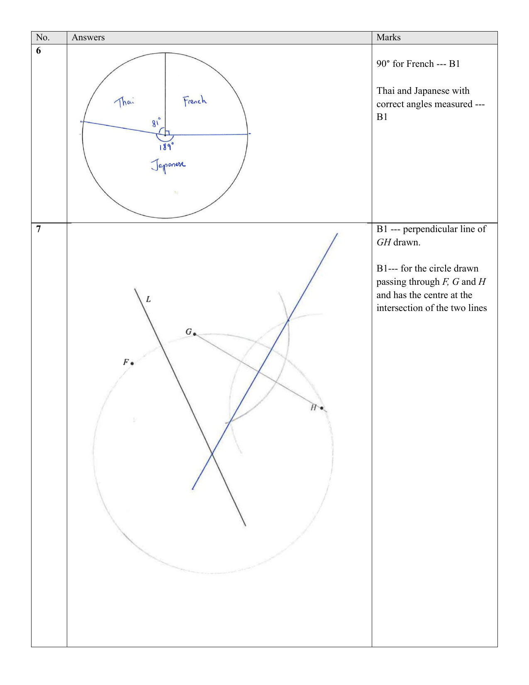

# Tampines Secondary School — Mathematics 4052/01 Paper 1 Marking Scheme (cleaned)

> **Institution:** Tampines Secondary School
> **Exam:** Preliminary Examination 2024
> **Level:** Secondary Four Express / Five Normal Academic / Four Normal Academic OOS
> **Subjects:** Elementary Mathematics
> **Paper:** 4052/01 Paper 1
> **Date:** 22 August 2024
> **Duration:** 2 hours 15 minutes
> **Total Marks:** 90
> **Source:** `2024 TPSS EMATH P1 PRELIM MS.pdf`
>
> Page numbers below are the physical pages of the paired question paper `2024 TPSS EMATH P1 PRELIM QP.pdf`, not the marking-scheme PDF.
> $\sqrt{}$ in the scheme means follow through.
> The scheme header reads: Sec 4E/5NA/4NA OOS Math Prelim Exam Paper 1 2024 Marking Scheme.

---

### Q1

> **Marks:** 2
> **Sub-topic:** Number
> **Page:** 3

$$
3x-8 < 56 \quad \text{M1}
$$

$$
3x < 64
$$

$$
x < 21.3
$$

The largest prime number is 19. A1

### Q2

> **Marks:** 1
> **Sub-topic:** Algebra
> **Page:** 3

$-2a+15b$. B1

### Q3

> **Marks:** 2
> **Sub-topic:** Algebra
> **Page:** 3

$4(x^{3}-5y)(x^{3}+5y)$.

B1 for $4(x^{3}-5y)(x^{3}+5y)$ or $(2x^{3}-10y)(2x^{3}+10y)$ seen.

### Q4

> **Marks:** 2
> **Sub-topic:** Graphs
> **Page:** 3

(a) Increasing curve of $y = 2(3)^{x}$, crossing the $y$-axis at 2, with a horizontal asymptote along the negative $x$-axis. B1

(b) $p = -3$. B1

### Q5

> **Marks:** 2
> **Sub-topic:** Number
> **Page:** 4

$$
\text{Total number of rhinos} = 27000\left(1+\frac{3}{100}\right)^{4} \quad \text{M1}
$$

$$
= 30388.73 \approx 30000 \quad \text{A1}
$$

### Q6

> **Marks:** 2
> **Sub-topic:** Statistics
> **Page:** 4

$90^{\circ}$ for French. B1

Thai and Japanese with correct angles measured. B1

The scheme drawing labels French $90^{\circ}$, Thai $81^{\circ}$ and Japanese $189^{\circ}$.

### Q7

> **Marks:** 2
> **Sub-topic:** Geometry
> **Page:** 5

B1 for the perpendicular line of $GH$ drawn.

B1 for the circle drawn passing through $F$, $G$ and $H$ and with the centre at the intersection of the two lines.

The construction is on the same scheme page as Q6.

### Q8

> **Marks:** 4
> **Sub-topic:** Number
> **Page:** 6

(a) $2420 = 2^{2} \times 5 \times 11^{2}$. B1

Not all the powers of the prime factors are multiples of 3, hence 2420 is not a perfect cube. B1

(b) LCM $= 2420 = 2^{2} \times 5 \times 11^{2}$.

HCF $= 110 = 2 \times 5 \times 11$.

The two numbers are $2^{2} \times 5 \times 11 = 220$ and $2 \times 5 \times 11^{2} = 1210$. B1, B1

### Q9

> **Marks:** 5
> **Sub-topic:** Algebra
> **Page:** 6

(a)

$$
\left(\frac{27x^{15}}{8y^{12}}\right)^{-\frac{1}{3}} = \left(\frac{8y^{12}}{27x^{15}}\right)^{\frac{1}{3}} = \frac{2y^{4}}{3x^{5}}
$$

B1 for $2y^{4}$. B1 for $3x^{5}$.

(b) (i) $(y-2)(4x+1)$. B1, B1

(ii) $(y-2)(4x+1) = 0$. Follow through.

$y = 2$ or $x = -\dfrac{1}{4}$. Follow-through B1 for both correct values.

### Q10

> **Marks:** 3
> **Sub-topic:** Statistics
> **Page:** 7

(a) For the vertical bars, the area of each bar is not directly proportional to the height, hence readers might be misled that the amount spent on hotel stays in 2021 is about 4 times that in 2020 instead of only 2 times as shown by the height.

B1 for the misleading fact. B1 for the explanation of why this misleading fact causes misinterpretation.

Accept other reasonable responses.

(b) The chart does not support her claim because between 2021 and 2022, the amount spent on flight increases but the amount spent on hotel stays decreases. B1

Accept other reasonable responses.

### Q11

> **Marks:** 6
> **Sub-topic:** Sets
> **Page:** 8–9

(a) (i) $\subset$. B1

(ii) $\notin$. B1

(b) The region outside both circles, inside the rectangle, is shaded (everything except $P \cup Q$). B1

(c) (i) $x = 21$. B1

The scheme does not state what $x$ represents.

(ii)

$$
\left(\frac{21}{120} \times \frac{20}{119} \times \frac{74}{118}\right) + \left(\frac{74}{120} \times \frac{21}{119} \times \frac{20}{118}\right) + \left(\frac{21}{120} \times \frac{74}{119} \times \frac{20}{118}\right)
$$

$$
= \frac{111}{2006} \text{ or } 0.0553
$$

M1 for $\dfrac{21}{120} \times \dfrac{20}{119} \times \dfrac{74}{118}$ seen. M1 for addition. A1

Alternative method:

$$
\left(\frac{21}{120} \times \frac{20}{119} \times \frac{74}{118}\right) \times 3 = \frac{111}{2006} \text{ or } 0.0553
$$

M2 + A1

### Q12

> **Marks:** 1
> **Sub-topic:** Statistics
> **Page:** 10

$3, 5, 5, 7, 10$ or $4, 5, 5, 5, 11$. B1

### Q13

> **Marks:** 3
> **Sub-topic:** Number
> **Page:** 10

(a) $10 : 4 : 7$. B1

(b) Flour : Sugar : Butter $= 1500 : 500 : 1000$.

$1500 \div 250 = 6$

$500 \div 100 = 5$

$1000 \div 175 = 5$

Maximum number of biscuits made $= 5 \times 25 = 125$. M1, A1

### Q14

> **Marks:** 2
> **Sub-topic:** Algebra
> **Page:** 11

(a)

$$
x^{2}-5x+9 = (x-2.5)^{2}-\frac{25}{4}+9 = \frac{11}{4}+(x-2.5)^{2}
$$

$p = \dfrac{11}{4}$ or $p = 2.75$. B1

(b) $x = \dfrac{5}{2}$ or $x = 2.5$. B1

### Q15

> **Marks:** 5
> **Sub-topic:** Coordinate geometry
> **Page:** 11

(a) $y = -\dfrac{2}{5}x+4$.

B1 for the correct gradient. B1 for the correct $y$-intercept.

(b) Let the shortest distance from $P$ to line $L$ be $h$.

Let $\theta$ be the angle made between the line and the $x$-axis.

$$
\tan \theta = \frac{4}{10} \Rightarrow \theta = 21.8014^{\circ} \quad \text{M1}
$$

$$
\frac{h}{7} = \sin 21.8014^{\circ} \quad \text{M1}
$$

$$
h = 7 \times 0.713 \approx 2.60 \quad \text{A1}
$$

Alternative method:

$$
\frac{h}{4} = \frac{7}{\sqrt{116}} \quad \text{M1, B1 for } \sqrt{116} \text{ seen}
$$

$$
h = \frac{28}{\sqrt{116}} \approx 2.60 \quad \text{A1}
$$

### Q16

> **Marks:** 3
> **Sub-topic:** Geometry
> **Page:** 12

Interior angle of polygon A $= 360^{\circ}-135^{\circ}-60^{\circ} = 165^{\circ}$. B1

Let $n$ be the number of sides of polygon A.

$$
\frac{(n-2) \times 180}{n} = 165 \quad \text{M1}
$$

$$
180n-360 = 165n
$$

$$
n = \frac{360}{15} = 24 \quad \text{A1}
$$

### Q17

> **Marks:** 3
> **Sub-topic:** Number
> **Page:** 12

$$
P = \frac{k}{\sqrt{Q}}
$$

$$
\frac{k}{\sqrt{9}}+\frac{k}{\sqrt{16}} = 21 \quad \text{M1}
$$

$$
\frac{k}{3}+\frac{k}{4} = 21
$$

$$
\frac{7k}{12} = 21
$$

$$
7k = 252
$$

$$
k = 36
$$

$$
\frac{36}{\sqrt{Q}} = 100 \quad \text{M1}
$$

$$
Q = \left(\frac{36}{100}\right)^{2} = 0.1296
$$

Accept $\dfrac{81}{625}$. A1

### Q18

> **Marks:** 6
> **Sub-topic:** Mensuration
> **Page:** 13

(a)

$$
\text{Perimeter} = \frac{216}{360} \times 2 \times \pi \times 10 + 20 = 12\pi+20
$$

M1 for $\dfrac{216}{360} \times 2 \times \pi \times 10$.

(b) $2\pi r = 12\pi$, so $r = 6$. M1

Height of the cone $= \sqrt{10^{2}-6^{2}} = 8$. M1

$$
\text{Volume of the cone} = \frac{1}{3} \times \pi \times 6^{2} \times 8 = 301.59 \approx 302 \quad \text{M1, A1}
$$

### Q19

> **Marks:** 4
> **Sub-topic:** Geometry
> **Page:** 14

The scheme uses a point $P$ that is not labelled on the question diagram (the question uses $F$). The ratio in part (b) is not given.

$AD = BC$ (opposite length of parallelogram). B1

$\angle EAD = \angle ADB = \angle DBC$ (alternate angle). B1

$$
\angle EDA = \angle EDP - \angle ADP
$$

$$
= \angle DPC - \angle DBC \text{ (alternate angle)}
$$

$$
= \angle PCB \text{ (exterior angle)}
$$

B1 for using alternate angle. B1 for using exterior angle, or another equivalent reason, to conclude that $\angle EDA = \angle PCB$.

Therefore $\triangle BCP \equiv \triangle ADE$ (ASA). A1 for ASA shown.

### Q20

> **Marks:** 3
> **Sub-topic:** Algebra
> **Page:** 15

(a) (i) $6, 12, 22, 36$. B1

The scheme lists these four terms and does not list a fifth term.

(ii) $2n^{2}+4 = 2(n^{2}+2)$ is a multiple of 2 for all values of $n$, hence it is an even number and not an odd number. B1

(b) $2k^{2}-3$. B1

### Q21

> **Marks:** 3
> **Sub-topic:** Algebra
> **Page:** 15

$$
\frac{4x+5}{x} = \frac{4x+11}{x+2} \quad \text{M1}
$$

$$
(4x+5)(x+2) = x(4x+11) \quad \text{M1}
$$

$$
4x^{2}+13x+10 = 4x^{2}+11x
$$

$$
2x = -10
$$

$$
x = -5 \quad \text{A1}
$$

### Q22

> **Marks:** 5
> **Sub-topic:** Statistics
> **Page:** 16

(a) $47$. B1

(b) $20.5$. B1

(c) 1. On average Team B scored more points than Team A as their median score was 53 which was higher than the median score of 47 achieved by Team A. B1

2. The interquartile range of Team B was higher than that of Team A which was 17.5. Hence the scores for Team B was more widely spread out. B1

(d) There is an outlier in the distribution scores of Team A which is significantly greater than the rest of the scores. B1

### Q23

> **Marks:** 5
> **Sub-topic:** Matrices
> **Page:** 17

(a)

$$
\begin{pmatrix} 560 & 420 & 140 \\ 490 & 280 & 280 \end{pmatrix} \quad \text{B1}
$$

(b)

$$
\mathbf{T} = \begin{pmatrix} 1.25 & 2.50 \end{pmatrix} \begin{pmatrix} 560 & 420 & 140 \\ 490 & 280 & 280 \end{pmatrix} = \begin{pmatrix} 1925 & 1225 & 875 \end{pmatrix} \quad \text{B1}
$$

(c) The total cost of the small and large vegetarian pies. B1

(d) Not given in the scheme.

### Q24

> **Marks:** 6
> **Sub-topic:** Geometry
> **Page:** 18

(a) $\angle DOB = 68 \times 2 = 136^{\circ}$ (angle at centre = twice angle on circumference). B1 for correct reasoning.

$\angle BCD = 180-68 = 112^{\circ}$ (angles in opposite segment). B1 for correct reasoning.

$\angle ODC = 360-52-136-112 = 60^{\circ}$ (sum of angles in a quadrilateral is $360^{\circ}$). B1

(b) Area of the shaded segment $=$ area of sector $OCB$ $-$ area of triangle $OCB$

$$
= \frac{76}{360} \times \pi \times 5^{2} - \frac{1}{2} \times 5^{2} \times \sin 76^{\circ} \quad \text{M1, M1}
$$

$$
= 4.451932 = 4.45 \text{ cm}^{2} \quad \text{A1}
$$

### Q25

> **Marks:** 5
> **Sub-topic:** Mensuration
> **Page:** 19

Curved surface of the small hemisphere

$$
= 2\pi(3.6)^{2} = 25.92\pi \text{ cm}^{2} \quad \text{M1}
$$

Curved surface area of the cylinder

$$
= 2\pi(3.6)(6.5) = 46.8\pi \text{ cm}^{2} \quad \text{M1}
$$

Total surface area of the large hemisphere

$$
= 2\pi(5.4)^{2}+\pi(5.4^{2}-3.6^{2}) = 74.52\pi \text{ cm}^{2} \quad \text{M1, M1}
$$

Total surface area of the solid

$$
25.92\pi+46.8\pi+74.52\pi = 462.56 \approx 463 \text{ cm}^{2} \quad \text{A1}
$$

### Q26

> **Marks:** 4
> **Sub-topic:** Graphs
> **Page:** 20

(a)

$$
\frac{40-v}{0.5-2} = -6 \quad \text{M1}
$$

$$
v = 31 \quad \text{A1}
$$

(b) A curve from the origin to about 10 km at $t = 0.5$ h, then a shallower curve to 63.25 km at $t = 2$ h. The scheme labels 10 and 63.25 on the vertical axis.

B1 for the correct curve from $t = 0$ to $t = 0.5$ h.

B1 for the correct curve from $t = 0.5$ h to $t = 2$ h.

B1 for the values 10 and 63.25 labelled correctly on the vertical axis.

The question paper prints [2] for this part; the scheme shows three B marks.

