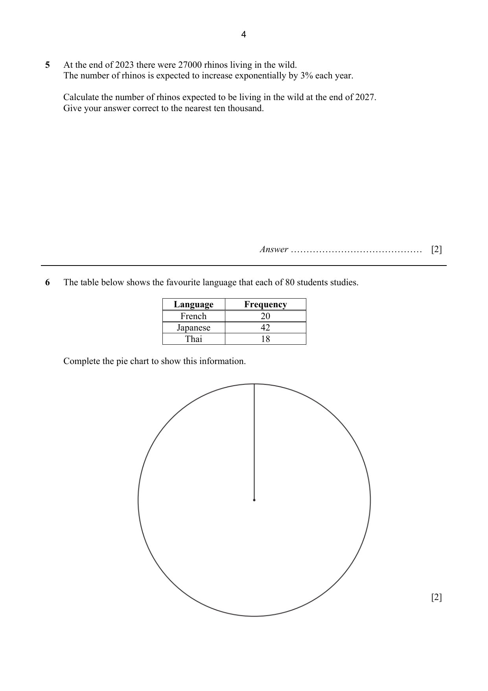
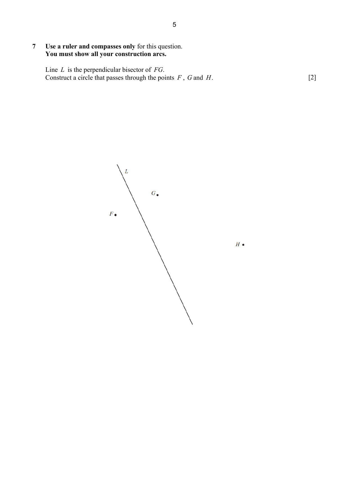
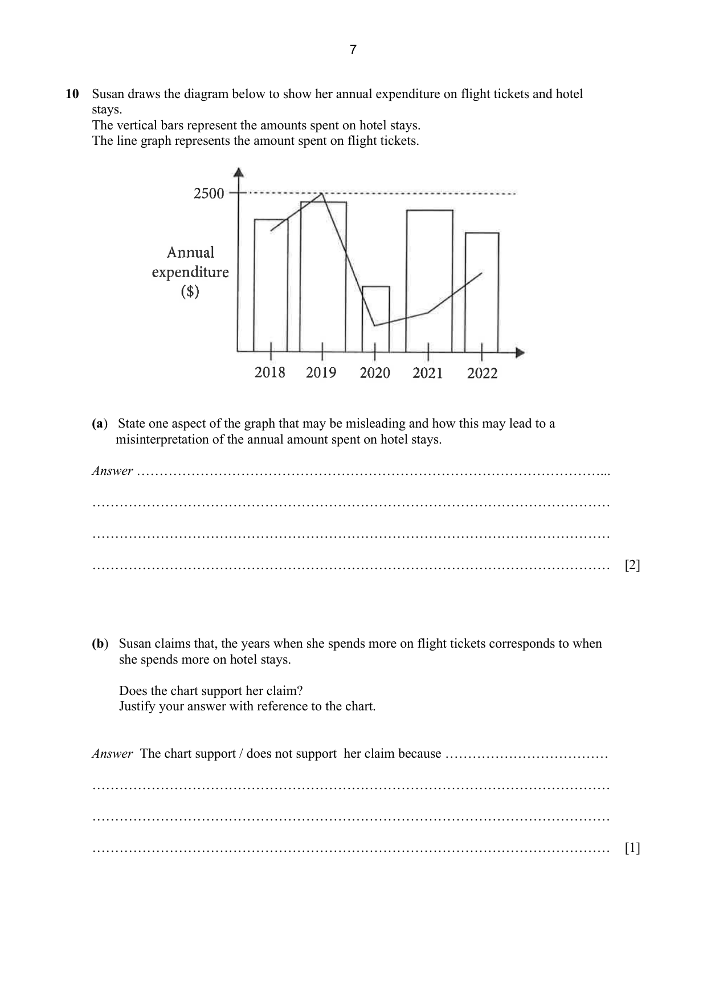
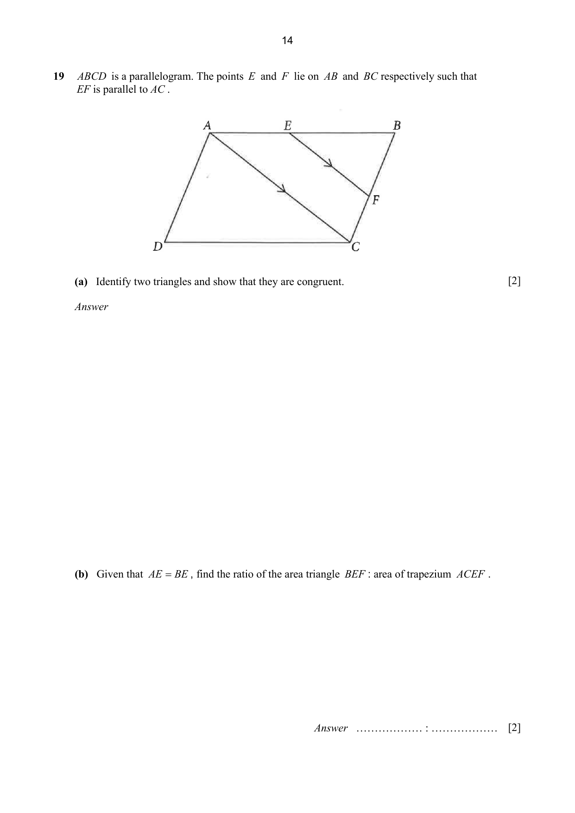
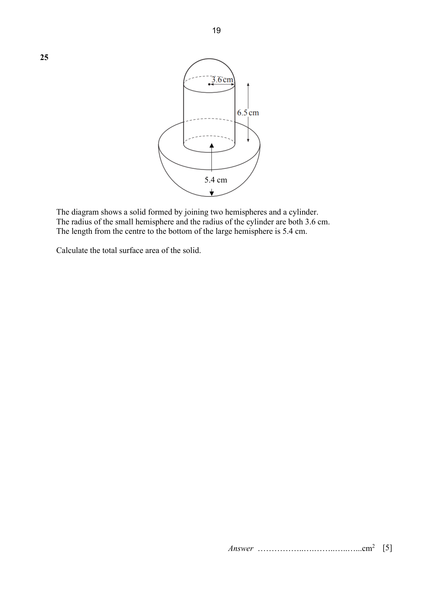

# Tampines Secondary School — Mathematics 4052/01 Paper 1 (cleaned)

> **Institution:** Tampines Secondary School
> **Exam:** Preliminary Examination 2024
> **Level:** Secondary Four Express / Five Normal Academic
> **Subjects:** Elementary Mathematics
> **Paper:** 4052/01 Paper 1
> **Date:** 22 August 2024
> **Duration:** 2 hours 15 minutes
> **Total Marks:** 90
> **Source:** `2024 TPSS EMATH P1 PRELIM QP.pdf`

---

## Instructions

Write your name, class and register number on all the work you hand in.
Write in dark blue or black pen.
You may use an HB pencil for any diagrams or graphs.
Do not use staples, paper clips, glue or correction fluid.

Answer all the questions.

If working is needed for any question it must be shown with the answer.
Omission of essential working will result in loss of marks.

The use of an approved scientific calculator is expected, where appropriate.
If the degree of accuracy is not specified in the question, and if the answer is not exact, give the answer to three significant figures. Give answers in degrees to one decimal place.
For $\pi$, use either your calculator value or $3.142$, unless the question requires the answer in terms of $\pi$.

The number of marks is given in brackets [ ] at the end of each question or part question.
The total number of marks for this paper is 90.

---

## Mathematical Formulae

*Compound interest*

$$
\text{Total amount} = P\left(1+\frac{r}{100}\right)^{n}
$$

*Mensuration*

$$
\text{Curved surface area of a cone} = \pi rl
$$

$$
\text{Surface area of a sphere} = 4\pi r^{2}
$$

$$
\text{Volume of a cone} = \frac{1}{3}\pi r^{2}h
$$

$$
\text{Volume of a sphere} = \frac{4}{3}\pi r^{3}
$$

$$
\text{Area of triangle } ABC = \frac{1}{2}ab\sin C
$$

$$
\text{Arc length} = r\theta,\text{ where }\theta\text{ is in radians}
$$

$$
\text{Sector area} = \frac{1}{2}r^{2}\theta,\text{ where }\theta\text{ is in radians}
$$

*Trigonometry*

$$
\frac{a}{\sin A} = \frac{b}{\sin B} = \frac{c}{\sin C}
$$

$$
a^{2} = b^{2}+c^{2}-2bc\cos A
$$

*Statistics*

$$
\text{Mean} = \frac{\sum fx}{\sum f}
$$

$$
\text{Standard deviation} = \sqrt{\frac{\sum fx^{2}}{\sum f}-\left(\frac{\sum fx}{\sum f}\right)^{2}}
$$

---

Answer all the questions.

### Q1

> **Marks:** 2
> **Topic:** N1 Numbers and their operations
> **Sub-topic:** Numbers and their operations
> **LO:** [[context/subjects/o-level-e-maths/learning-objectives/o-level-e-maths-N1e.md|N1e]]
> **Page:** 3

Find the largest prime number that satisfies the inequality $\dfrac{3x-8}{2} < 28$.

### Q2

> **Marks:** 1
> **Topic:** N5 Algebraic expressions and formulae
> **Sub-topic:** Algebraic expressions and formulae
> **LO:** [[context/subjects/o-level-e-maths/learning-objectives/o-level-e-maths-N5j.md|N5j]]
> **Page:** 3

Expand and simplify $a-3(a-5b)$.

### Q3

> **Marks:** 2
> **Topic:** N5 Algebraic expressions and formulae
> **Sub-topic:** Algebraic expressions and formulae
> **LO:** [[context/subjects/o-level-e-maths/learning-objectives/o-level-e-maths-N5h.md|N5h]]
> **Page:** 3

Factorise $4x^{6}-100y^{2}$ completely.

### Q4

> **Marks:** 2
> **Page:** 3

(a) Sketch the graph of $y = 2(3)^{x}$, indicating the points of intersection between the axes, if any. Axes are provided. [1]
> **Topic:** N6 Functions and graphs
> **Sub-topic:** Functions and graphs
> **LO:** [[context/subjects/o-level-e-maths/learning-objectives/o-level-e-maths-N6b.md|N6b]]

(b) State a possible equation for the graph shown below. [1]
> **Topic:** N6 Functions and graphs
> **Sub-topic:** Functions and graphs
> **LO:** [[context/subjects/o-level-e-maths/learning-objectives/o-level-e-maths-N6c.md|N6c]]

### Q5

> **Marks:** 2
> **Topic:** N3 Percentage
> **Sub-topic:** Percentage
> **LO:** [[context/subjects/o-level-e-maths/learning-objectives/o-level-e-maths-N3e.md|N3e]]
> **Page:** 4

At the end of 2023 there were 27000 rhinos living in the wild.
The number of rhinos is expected to increase exponentially by 3% each year.

Calculate the number of rhinos expected to be living in the wild at the end of 2027.
Give your answer correct to the nearest ten thousand.

### Q6

> **Marks:** 2
> **Topic:** S1 Data handling and analysis
> **Sub-topic:** Data handling and analysis
> **LO:** [[context/subjects/o-level-e-maths/learning-objectives/o-level-e-maths-S1b.md|S1b]]
> **Page:** 4

The table below shows the favourite language that each of 80 students studies.

| Language | Frequency |
| --- | --- |
| French | 20 |
| Japanese | 42 |
| Thai | 18 |

Complete the pie chart to show this information. A circle is drawn with one vertical radius from the centre to the top of the circle.

### Q7

> **Marks:** 2
> **Topic:** G2 Congruence and similarity
> **Sub-topic:** Congruence and similarity
> **LO:** [[context/subjects/o-level-e-maths/learning-objectives/o-level-e-maths-G2e.md|G2e]]
> **Page:** 5

Use a ruler and compasses only for this question.
You must show all your construction arcs.

Line $L$ is the perpendicular bisector of $FG$.
Construct a circle that passes through the points $F$, $G$ and $H$.

### Q8

> **Marks:** 4
> **Page:** 6

(a) By using prime factorization, explain why 2420 is not a perfect cube. [2]
> **Topic:** N1 Numbers and their operations
> **Sub-topic:** Numbers and their operations
> **LO:** [[context/subjects/o-level-e-maths/learning-objectives/o-level-e-maths-N1b.md|N1b]]

(b) When written as a product of its prime factors, the lowest common multiple of two numbers is 2420 and the highest common factor of these two numbers is 110.
Given that neither of these two numbers is 2420, find the value of these two numbers. [2]
> **Topic:** N1 Numbers and their operations
> **Sub-topic:** Numbers and their operations
> **LO:** [[context/subjects/o-level-e-maths/learning-objectives/o-level-e-maths-N1b.md|N1b]]

### Q9

> **Marks:** 5
> **Page:** 6

(a) Simplify $\left(\dfrac{27x^{15}}{8y^{12}}\right)^{-\frac{1}{3}}$. [2]
> **Topic:** N7 Equations and inequalities
> **Sub-topic:** Equations and inequalities
> **LO:** [[context/subjects/o-level-e-maths/learning-objectives/o-level-e-maths-N7a.md|N7a]]

(b) (i) Factorize $4xy-2+y-8x$ completely. [2]
> **Topic:** N5 Algebraic expressions and formulae
> **Sub-topic:** Algebraic expressions and formulae
> **LO:** [[context/subjects/o-level-e-maths/learning-objectives/o-level-e-maths-N5h.md|N5h]]

(ii) Hence solve the equation $7^{4xy-2+y-8x} = 1$. [1]
> **Topic:** N7 Equations and inequalities
> **Sub-topic:** Equations and inequalities
> **LO:** [[context/subjects/o-level-e-maths/learning-objectives/o-level-e-maths-N7a.md|N7a]]

### Q10

> **Marks:** 3
> **Page:** 7

Susan draws the diagram below to show her annual expenditure on flight tickets and hotel stays.
The vertical bars represent the amounts spent on hotel stays.
The line graph represents the amount spent on flight tickets.

(a) State one aspect of the graph that may be misleading and how this may lead to a misinterpretation of the annual amount spent on hotel stays. [2]
> **Topic:** N6 Functions and graphs
> **Sub-topic:** Functions and graphs
> **LO:** [[context/subjects/o-level-e-maths/learning-objectives/o-level-e-maths-N6c.md|N6c]]

(b) Susan claims that, the years when she spends more on flight tickets corresponds to when she spends more on hotel stays.

Does the chart support her claim?
Justify your answer with reference to the chart. [1]
> **Topic:** N6 Functions and graphs
> **Sub-topic:** Functions and graphs
> **LO:** [[context/subjects/o-level-e-maths/learning-objectives/o-level-e-maths-N6c.md|N6c]]

### Q11

> **Marks:** 6
> **Page:** 8–9

(a) The following shows two sets.

$A = \{4, 8, 12, 16, 20, 24\}$ $\qquad$ $B = \{8, 16, 24\}$

Use the following set notations to complete this statement.

$\subset \qquad \not\subset \qquad \in \qquad \notin \qquad \varnothing \qquad \cup \qquad \cap$

(i) $B \ldots\ldots A$ [1]
> **Topic:** N8 Set language and notation
> **Sub-topic:** Set language and notation
> **LO:** [[context/subjects/o-level-e-maths/learning-objectives/o-level-e-maths-N8a.md|N8a]]

(ii) $22 \ldots\ldots A$ [1]
> **Topic:** N8 Set language and notation
> **Sub-topic:** Set language and notation
> **LO:** [[context/subjects/o-level-e-maths/learning-objectives/o-level-e-maths-N8a.md|N8a]]

(b) Shade the given set on the Venn diagram below. The set printed under the diagram is $P' \cup Q'$. [1]
> **Topic:** N8 Set language and notation
> **Sub-topic:** Set language and notation
> **LO:** [[context/subjects/o-level-e-maths/learning-objectives/o-level-e-maths-N8c.md|N8c]]

(c) There are 120 students in a group.
The Venn diagram below shows the number of students who study History ($H$), Geography ($G$) and Economics ($E$).

Regions: $H$ only $25$; $H \cap G$ only $9$; $G$ only $32$; $H \cap E$ only $7$; $H \cap G \cap E$ is $4$; $G \cap E$ only $5$; $E$ only $17$; outside the three circles, $x$.

(i) Find the value of $x$ and state what this value represents. [1]
> **Topic:** N8 Set language and notation
> **Sub-topic:** Set language and notation
> **LO:** [[context/subjects/o-level-e-maths/learning-objectives/o-level-e-maths-N8c.md|N8c]]

(ii) Two of the students who study Economics are chosen at random.

Find, as a fraction in its simplest form, the probability that one of these students also studies Geography but not History and the other student also studies History but not Geography. [2]
> **Topic:** N8 Set language and notation
> **Sub-topic:** Set language and notation
> **LO:** [[context/subjects/o-level-e-maths/learning-objectives/o-level-e-maths-N8a.md|N8a]]

### Q12

> **Marks:** 1
> **Topic:** S1 Data handling and analysis
> **Sub-topic:** Data handling and analysis
> **LO:** [[context/subjects/o-level-e-maths/learning-objectives/o-level-e-maths-S1f.md|S1f]]
> **Page:** 10

Find five positive integers that satisfy all four of the following conditions.

(1) Mode $= 5$

(2) Median $= 5$

(3) Mean $= 6$

(4) Range $= 7$

### Q13

> **Marks:** 3
> **Page:** 10

The following shows a list of ingredients for a recipe for making shortbread biscuits.

Ingredients to make 25 biscuits

- 250 grams of flour
- 100 grams of sugar
- 175 grams of butter

(a) Write down the ratio of flour, sugar and butter in its simplest form. [1]
> **Topic:** N2 Ratio and proportion
> **Sub-topic:** Ratio and proportion
> **LO:** [[context/subjects/o-level-e-maths/learning-objectives/o-level-e-maths-N2a.md|N2a]]

(b) Raju is making shortbread biscuits for a party using this recipe.
She wants to make as many biscuits as possible.
She has 1.5 kg of flour, 0.5 kg of sugar and 1 kg of butter.

Calculate the maximum number of biscuits Raju can make. [2]
> **Topic:** N2 Ratio and proportion
> **Sub-topic:** Ratio and proportion
> **LO:** [[context/subjects/o-level-e-maths/learning-objectives/o-level-e-maths-N2a.md|N2a]]

### Q14

> **Marks:** 2
> **Page:** 11

The expression $9-5x+x^{2}$ can be written in the form $p+(x-2.5)^{2}$.

(a) Find the value of $p$. [1]
> **Topic:** N6 Functions and graphs
> **Sub-topic:** Functions and graphs
> **LO:** [[context/subjects/o-level-e-maths/learning-objectives/o-level-e-maths-N6g.md|N6g]]

(b) Write down the equation of the line of symmetry of the graph $y = 9-5x+x^{2}$. [1]
> **Topic:** G6 Coordinate geometry
> **Sub-topic:** Coordinate geometry
> **LO:** [[context/subjects/o-level-e-maths/learning-objectives/o-level-e-maths-G6c.md|G6c]]

### Q15

> **Marks:** 5
> **Page:** 11

The diagram shows a straight line $L$. The line cuts the axes at $(10, 0)$ and $(0, 4)$. The point $P$ is marked on the positive $x$-axis.

(a) Find the equation of line $L$. [2]
> **Topic:** G6 Coordinate geometry
> **Sub-topic:** Coordinate geometry
> **LO:** [[context/subjects/o-level-e-maths/learning-objectives/o-level-e-maths-G6c.md|G6c]]

(b) The point $P$ has coordinates $(3, 0)$. Calculate the shortest distance from $P$ to line $L$. [3]
> **Topic:** G6 Coordinate geometry
> **Sub-topic:** Coordinate geometry
> **LO:** [[context/subjects/o-level-e-maths/learning-objectives/o-level-e-maths-G6c.md|G6c]]

### Q16

> **Marks:** 3
> **Topic:** G1 Angles, triangles and polygons
> **Sub-topic:** Angles, triangles and polygons
> **LO:** [[context/subjects/o-level-e-maths/learning-objectives/o-level-e-maths-G1f.md|G1f]]
> **Page:** 12

The diagram shows part of the regular polygon $A$ joining the equilateral triangle $B$.
Calculate the number of sides of polygon $A$.

An angle of $135^{\circ}$ is marked at the join, between a side of the polygon and a side of the triangle.

### Q17

> **Marks:** 3
> **Topic:** N2 Ratio and proportion
> **Sub-topic:** Ratio and proportion
> **LO:** [[context/subjects/o-level-e-maths/learning-objectives/o-level-e-maths-N2a.md|N2a]]
> **Page:** 12

$P$ is inversely proportional to the square root of $Q$.
The sum of the values of $P$ when $Q = 9$ and when $Q = 16$ is 21.
Find the value of $Q$ when $P = 100$.

### Q18

> **Marks:** 6
> **Page:** 13

$AOB$ is a sector of a circle, centre $O$. $OA = 10$ cm and the sector angle is $216^{\circ}$. The diagram shows the major sector.

(a) Calculate the perimeter of this sector. Give your answer in terms of $\pi$. [2]
> **Topic:** G5 Mensuration
> **Sub-topic:** Mensuration
> **LO:** [[context/subjects/o-level-e-maths/learning-objectives/o-level-e-maths-G5b.md|G5b]]

(b) A cone is made from this sector by joining $OA$ to $OB$.
Calculate the volume of the cone. [4]
> **Topic:** G5 Mensuration
> **Sub-topic:** Mensuration
> **LO:** [[context/subjects/o-level-e-maths/learning-objectives/o-level-e-maths-G5c.md|G5c]]

### Q19

> **Marks:** 4
> **Page:** 14

$ABCD$ is a parallelogram. The points $E$ and $F$ lie on $AB$ and $BC$ respectively such that $EF$ is parallel to $AC$.

(a) Identify two triangles and show that they are congruent. [2]
> **Topic:** G2 Congruence and similarity
> **Sub-topic:** Congruence and similarity
> **LO:** [[context/subjects/o-level-e-maths/learning-objectives/o-level-e-maths-G2i.md|G2i]]

(b) Given that $AE = BE$, find the ratio of the area triangle $BEF$ : area of trapezium $ACEF$. [2]
> **Topic:** G2 Congruence and similarity
> **Sub-topic:** Congruence and similarity
> **LO:** [[context/subjects/o-level-e-maths/learning-objectives/o-level-e-maths-G2i.md|G2i]]

### Q20

> **Marks:** 3
> **Page:** 15

(a) The $n$th term of a sequence is given by $2n^{2}+4$.

(i) Write down the first 5 terms. [1]
> **Topic:** N5 Algebraic expressions and formulae
> **Sub-topic:** Algebraic expressions and formulae
> **LO:** [[context/subjects/o-level-e-maths/learning-objectives/o-level-e-maths-N5e.md|N5e]]

(ii) Explain why it is not possible for a term in this sequence to be an odd number. [1]
> **Topic:** N5 Algebraic expressions and formulae
> **Sub-topic:** Algebraic expressions and formulae
> **LO:** [[context/subjects/o-level-e-maths/learning-objectives/o-level-e-maths-N5e.md|N5e]]

(b) The first 5 terms of another sequence are $-1$, $5$, $15$, $29$, $47$, $\ldots$

By comparing this sequence with your answer to (a), write down the $k$th term. [1]
> **Topic:** N5 Algebraic expressions and formulae
> **Sub-topic:** Algebraic expressions and formulae
> **LO:** [[context/subjects/o-level-e-maths/learning-objectives/o-level-e-maths-N5e.md|N5e]]

### Q21

> **Marks:** 3
> **Topic:** N7 Equations and inequalities
> **Sub-topic:** Equations and inequalities
> **LO:** [[context/subjects/o-level-e-maths/learning-objectives/o-level-e-maths-N7f.md|N7f]]
> **Page:** 15

Solve $\dfrac{4x+5}{x} = 4+\dfrac{3}{x+2}$.

### Q22

> **Marks:** 5
> **Page:** 16

Two teams played 16 basketball matches.
Their scores are shown in the stem-and-leaf diagram.

| Team A | Stem | Team B |
| --- | --- | --- |
| 0 0 1 1 | 3 | 6 6 |
| 0 1 2 6 8 8 | 4 | 2 3 3 7 |
| 2 3 3 4 5 | 5 | 0 2 4 6 7 |
|  | 6 | 1 6 8 9 |
| 9 | 7 | 3 |

Key: $0 \mid 3 \mid 6$ means a score of 30 by Team A and a score of 36 by Team B.

(a) Find the median score of Team A. [1]
> **Topic:** S1 Data handling and analysis
> **Sub-topic:** Data handling and analysis
> **LO:** [[context/subjects/o-level-e-maths/learning-objectives/o-level-e-maths-S1f.md|S1f]]

(b) Find the interquartile range of the scores of Team B. [1]
> **Topic:** S1 Data handling and analysis
> **Sub-topic:** Data handling and analysis
> **LO:** [[context/subjects/o-level-e-maths/learning-objectives/o-level-e-maths-S1i.md|S1i]]

(c) Use your answers to part (a) and (b) to make two comments comparing the scores of the two teams. [2]
> **Topic:** S1 Data handling and analysis
> **Sub-topic:** Data handling and analysis
> **LO:** [[context/subjects/o-level-e-maths/learning-objectives/o-level-e-maths-S1f.md|S1f]]

(d) Explain why the mean may not be an appropriate average to use to summarise the scores of Team A. [1]
> **Topic:** S1 Data handling and analysis
> **Sub-topic:** Data handling and analysis
> **LO:** [[context/subjects/o-level-e-maths/learning-objectives/o-level-e-maths-S1f.md|S1f]]

### Q23

> **Marks:** 5
> **Page:** 17

A bakery makes chicken pies (C), seafood pies (S) and vegetarian pies (V) every day.
The matrix $\mathbf{M}$ shows the number of pies of each type that are made each day.

$$
\mathbf{M} = \begin{pmatrix} 80 & 60 & 20 \\ 70 & 40 & 40 \end{pmatrix}
\begin{matrix} \text{small} \\ \text{large} \end{matrix}
$$

Columns are C, S, V.

(a) Evaluate the matrix $\mathbf{P} = 7\mathbf{M}$. [1]
> **Topic:** N9 Matrices
> **Sub-topic:** Matrices
> **LO:** [[context/subjects/o-level-e-maths/learning-objectives/o-level-e-maths-N9b.md|N9b]]

(b) Each small pie costs ＄1.25 to make.
Each large pie costs ＄2.50 to make.
By representing these amounts in a $1 \times 2$ row matrix $\mathbf{N}$, evaluate the matrix $\mathbf{T} = \mathbf{NP}$. [1]
> **Topic:** N9 Matrices
> **Sub-topic:** Matrices
> **LO:** [[context/subjects/o-level-e-maths/learning-objectives/o-level-e-maths-N9b.md|N9b]]

(c) Explain what the third element in matrix $\mathbf{T}$ represents. [1]
> **Topic:** N9 Matrices
> **Sub-topic:** Matrices
> **LO:** [[context/subjects/o-level-e-maths/learning-objectives/o-level-e-maths-N9b.md|N9b]]

(d) One week, the bakery sold all the chicken pies and vegetarian pies, and $\dfrac{3}{5}$ of each size of the seafood pies that were made that week. The unsold pies were given to the staff of the bakery. Given that the bakery made a profit of 150% for each pie that it sells, calculate the total amount of profit that the bakery made that week. [2]
> **Topic:** N3 Percentage
> **Sub-topic:** Percentage
> **LO:** [[context/subjects/o-level-e-maths/learning-objectives/o-level-e-maths-N3d.md|N3d]]

### Q24

> **Marks:** 6
> **Page:** 18

$A$, $B$, $C$ and $D$ are points on the circle, centre $O$.
Angle $BAD = 68^{\circ}$ and angle $OBC = 52^{\circ}$.
The segment $BC$ is shaded.

(a) Work out the angle $ODC$.
Give a reason for each step of your answer. [3]
> **Topic:** G3 Properties of circles
> **Sub-topic:** Properties of circles
> **LO:** [[context/subjects/o-level-e-maths/learning-objectives/o-level-e-maths-G3b.md|G3b]]

(b) Given that the length of $OB = 5$ cm. Calculate the area of the shaded segment $BC$. [3]
> **Topic:** G3 Properties of circles
> **Sub-topic:** Properties of circles
> **LO:** [[context/subjects/o-level-e-maths/learning-objectives/o-level-e-maths-G3b.md|G3b]]

### Q25

> **Marks:** 5
> **Topic:** G5 Mensuration
> **Sub-topic:** Mensuration
> **LO:** [[context/subjects/o-level-e-maths/learning-objectives/o-level-e-maths-G5c.md|G5c]]
> **Page:** 19

The diagram shows a solid formed by joining two hemispheres and a cylinder.
The radius of the small hemisphere and the radius of the cylinder are both 3.6 cm.
The length from the centre to the bottom of the large hemisphere is 5.4 cm.
The diagram also labels the cylinder height as 6.5 cm.

Calculate the total surface area of the solid.

### Q26

> **Marks:** 4
> **Page:** 20

The diagram shows the speed-time graph for Anne in the first 2 hours of a cycling race.
Speed rises from 0 to 40 km/h in the first 0.5 h, then falls in a straight line to $v$ km/h at 2 h. A horizontal dashed line marks speed $v$.

(a) The deceleration of Anne's journey after 0.5 hours is 6 km/h.
Find the value of $v$. [2]
> **Topic:** N6 Functions and graphs
> **Sub-topic:** Functions and graphs
> **LO:** [[context/subjects/o-level-e-maths/learning-objectives/o-level-e-maths-N6c.md|N6c]]

(b) The area under the speed-time graph represents the distance travelled.
Draw the distance-time graph for the first 2 hours of Anne's journey.
Blank axes are provided, with time marks at 0, 0.5 and 2 hours. [2]
> **Topic:** N6 Functions and graphs
> **Sub-topic:** Functions and graphs
> **LO:** [[context/subjects/o-level-e-maths/learning-objectives/o-level-e-maths-N6c.md|N6c]]
