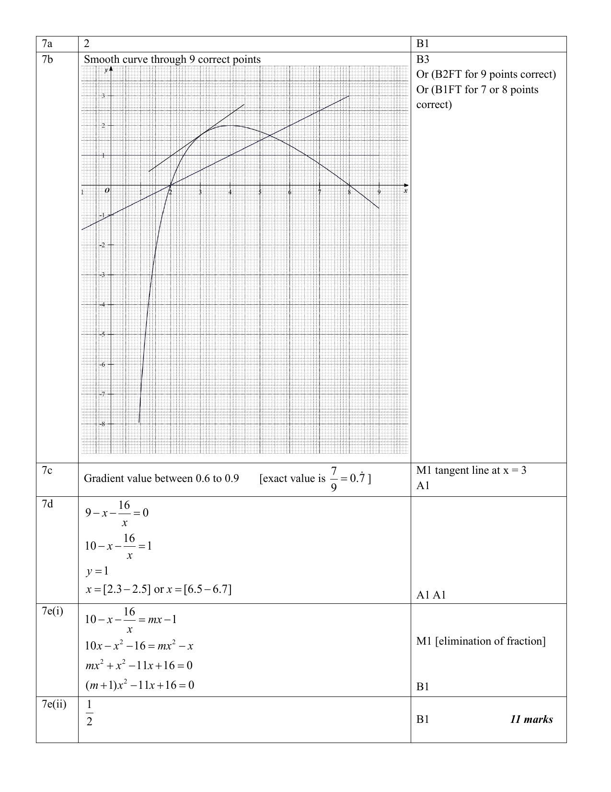

# Tampines Secondary School — Mathematics 4052/02 Paper 2 Marking Scheme (cleaned)

> **Institution:** Tampines Secondary School
> **Exam:** Preliminary Examination 2024
> **Level:** Secondary Four
> **Subjects:** Elementary Mathematics
> **Paper:** 4052/02 Paper 2
> **Date:** 23 August 2024
> **Duration:** 2 hours 15 minutes
> **Total Marks:** 90
> **Source:** `2024 TPSS EMATH P2 PRELIM MS.pdf`
>
> Page numbers below are the physical pages of the paired question paper `2024 TPSS EMATH P2 PRELIM QP.pdf`, not the marking-scheme PDF.
> $\sqrt{}$ in the scheme means follow through.
> The scheme header reads: Sec 4 Prelim Math Paper 2 2024 Marking Scheme.

---

### Q1

> **Marks:** 11
> **Sub-topic:** Algebra
> **Page:** 3–4

(a)

$$
\frac{6(a+1)^{3}}{7b} \times \frac{28b}{9(a+1)} = \frac{8(a+1)^{2}}{3}
$$

B1 for $(a+1)^{2}$ seen. B1 for $\dfrac{8}{3}$ seen.

(b) (i) $x = 2+\dfrac{3(-4)^{2}}{5} = 11.6$. B1

(ii)

$$
x = a+\frac{bv^{2}}{k}
$$

$$
x-a = \frac{bv^{2}}{k}
$$

$$
k(x-a) = bv^{2} \quad \text{M1 (elimination of the fraction)}
$$

$$
\frac{k(x-a)}{b} = v^{2} \quad \text{M1 (square root)}
$$

$$
v = \pm \sqrt{\frac{k(x-a)}{b}} \quad \text{A1 ($\pm$ seen)}
$$

(c)

$$
4x+7y = -23 \quad (1)
$$

$$
6x-2y = 3 \quad (2)
$$

$(1) \times 3$: $12x+21y = -69$ (3)

$(2) \times 2$: $12x-4y = 6$ (4)

M1 for a correct method to eliminate one variable.

$(3)-(4)$: $25y = -75$, so $y = -3$. A1

$x = -0.5$. A1

(d)

$$
\frac{x^{2}-(x-y)(x+y)}{(x+y)(x-3y)} = \frac{x^{2}-(x^{2}-y^{2})}{(x+y)(x-3y)} = \frac{y^{2}}{(x+y)(x-3y)}
$$

M1. A1. An expanded denominator is accepted.

### Q2

> **Marks:** 10
> **Sub-topic:** Number
> **Page:** 5–6

(a)

$$
1500 = \frac{25000 \times R \times 9}{12 \times 100} \quad \text{M1}
$$

$R = 8$. The rate is 8%. A1

(b) ＄1 $= 26.77$ THB.

＄500 $= 500 \times 26.77 = 13385$ THB.

Money left $= 13385-10600 = 2785$ THB. M1 for the remaining amount in THB.

$26.88$ THB $= ＄1$.

$$
2785 \text{ THB} = \frac{2785}{26.88} = ＄103.61
$$

A1, to the nearest cent.

(c) Deposit $= \dfrac{15}{100} \times 2700 = ＄405$.

Total instalments $= 68 \times 36 = ＄2448$.

Total paid $= 405+2448 = ＄2853$.

Interest $= 2853-2700 = ＄153$.

M1 for both the deposit and the instalments.

$$
\text{Percentage required} = \frac{153}{2700} \times 100 = 5.\overline{6}\% \left(5\frac{2}{3}\%\right)
$$

M1 for their interest, follow through, divided by the cash price, times 100. A1

(d) $100\% \to ＄180$.

$$
110\% \to \frac{110}{100} \times 180 = ＄198 \quad \text{M1 (discounted price)}
$$

$75\% \to ＄198$.

$$
100\% \to \frac{100}{75} \times 198 = ＄264
$$

M1, follow through from the discounted price. A1

### Q3

> **Marks:** 10
> **Sub-topic:** Algebra
> **Page:** 7–8

(a) Length of box $= 3x+1-3-3 = (3x-5)$ cm. Width of box $= x+13-3-3 = (x+7)$ cm. Height $= 3$ cm. B1 for length and width.

Volume $= 3(3x-5)(x+7)$. M1, follow through.

$$
930 = 3(3x^{2}+21x-5x-35) \quad \text{M1 (expansion, follow through)}
$$

$$
310 = 3x^{2}+16x-35
$$

$$
3x^{2}+16x-345 = 0 \quad \text{A1 (equation established)}
$$

(b)

$$
x = \frac{-16 \pm \sqrt{16^{2}-4(3)(-345)}}{2(3)} \quad \text{B1}
$$

$x = 8.38$ or $x = -13.72$. B1, B1

(c) Length of box $= 3(8.38)-5 = 20.14$ cm. Width $= 8.38+7 = 15.38$ cm.

M1, follow through, for either length or width from the Q3(b) value.

$$
SQ = \sqrt{20.14^{2}+15.38^{2}} = 25.3 \text{ cm}
$$

M1 and A1, follow through.

### Q4

> **Marks:** 11
> **Sub-topic:** Vectors
> **Page:** 9–11

(a) (i)

$$
\overrightarrow{AB} = \overrightarrow{AO}+\overrightarrow{OB} = \begin{pmatrix} -3 \\ -7 \end{pmatrix}+\begin{pmatrix} 13 \\ -8 \end{pmatrix} = \begin{pmatrix} 10 \\ -15 \end{pmatrix}
$$

$$
\left|\begin{pmatrix} 10 \\ -15 \end{pmatrix}\right| = \sqrt{10^{2}+(-15)^{2}} = 18.0
$$

M1, or use the length formula. A1

(ii) $\overrightarrow{BA} = 2\overrightarrow{AP}$.

$$
\begin{pmatrix} -10 \\ 15 \end{pmatrix} = 2(\overrightarrow{AO}+\overrightarrow{OP})
$$

$$
\begin{pmatrix} -5 \\ 7.5 \end{pmatrix} = \begin{pmatrix} -3 \\ -7 \end{pmatrix}+\overrightarrow{OP} \quad \text{M1}
$$

$$
\overrightarrow{OP} = \begin{pmatrix} -2 \\ 14.5 \end{pmatrix}
$$

$P(-2, 14.5)$. A1

(b) (i)

$$
\overrightarrow{CP} = \frac{3}{4}\overrightarrow{CB} = \frac{3}{4}(-4\mathbf{a}+2\mathbf{b}) = -3\mathbf{a}+\frac{3}{2}\mathbf{b}
$$

B1 for $\overrightarrow{CB}$. B1

(ii)

$$
\overrightarrow{AP} = \overrightarrow{AC}+\overrightarrow{CP} = 2\mathbf{a}-3\mathbf{a}+\frac{3}{2}\mathbf{b} = -\mathbf{a}+\frac{3}{2}\mathbf{b} \quad \text{B1}
$$

(iii) $\overrightarrow{AD} = -2\mathbf{a}+3\mathbf{b}$. B1, or find $\overrightarrow{PD}$.

$$
\overrightarrow{AD} = 2\left(-\mathbf{a}+\frac{3}{2}\mathbf{b}\right) = 2\overrightarrow{AP}
$$

M1 for expressing one vector as a scalar multiple of the other.

$\overrightarrow{AD}$ is a scalar multiple of $\overrightarrow{AP}$, so $\overrightarrow{AD}$ and $\overrightarrow{AP}$ are parallel, with $A$ as the common point. Therefore $A$, $D$ and $P$ lie on the same straight line. A1

(iv) Area of $\triangle OCB$ : area of $\triangle CBD$ : area of $\triangle CPD$, leading to the answer $\dfrac{8}{3}$. B1

### Q5

> **Marks:** 9
> **Sub-topic:** Trigonometry
> **Page:** 12–13

(a) Bearing of $B$ from $C = 180-(90-33) = 123^{\circ}$. M1, A1

The scheme redraws the figure with a north arrow at $C$ and at $B$.

(b)

$$
\frac{AB}{\sin(180-52-33)^{\circ}} = \frac{43}{\sin 33^{\circ}} \quad \text{M1}
$$

$AB = 78.65 = 78.7$ m (3 s.f.). A1

(c)

$$
\cos \angle CDA = \frac{67^{2}+32^{2}-43^{2}}{2(67)(32)} \quad \text{M2}
$$

$\angle CDA = 31.297^{\circ} = 31.3^{\circ}$ (1 d.p.). A1

(d)

$$
\tan \theta = \frac{60}{67} \quad \text{M1}
$$

$\theta = 41.84^{\circ} = 41.8^{\circ}$ (1 d.p.). A1

### Q6

> **Marks:** 10
> **Sub-topic:** Geometry
> **Page:** 14–15

(a) $\angle OAT = \angle OBT = 90^{\circ}$ (radius perpendicular to tangent).

Therefore $\angle OAX = \angle TBX = 90^{\circ}$.

$\angle AXO = \angle BXT$ (common angle).

$\angle AOX = \angle BTX$ (third angle in the triangle).

Therefore $\triangle OAX$ and $\triangle TBX$ are similar.

B2 for the first three, or all, statements seen. B1 for one correct pair of angles with a reason.

(b) (i) The scheme diagram marks $TX = 13$, $TB = 5$, $XB = 12$, a length 18 and $OA = 7.5$.

$TB = \sqrt{13^{2}-12^{2}} = 5$. M1 for $TB = 5$ seen.

$TA = TB = 5$ cm (tangents from an external point).

$$
\frac{OA}{5} = \frac{18}{12} \quad \text{M1 (form a ratio to find } OA \text{ or equivalent)}
$$

$OA = 7.5$. A1

(ii)

$$
\frac{\text{area of } \triangle TBX}{\text{area of } \triangle OAX} = \left(\frac{12}{18}\right)^{2} = \frac{4}{9} \quad \text{B1}
$$

$$
\frac{\text{area of } \triangle TBX}{\text{area of quadrilateral } OATB} = \frac{4}{5} \quad \text{A1}
$$

(iii)

$$
\tan \angle AOX = \frac{18}{7.5}
$$

$\angle AOX = 67.38^{\circ}$. M1 or equivalent for $\angle AOX$.

Reflex $\angle AOB = 360-67.38 = 292.62^{\circ}$.

$$
\frac{292.62}{180} \times \pi = 5.11 \text{ rad (3 s.f.)}
$$

M1 for the conversion. A1

### Q7

> **Marks:** 11
> **Sub-topic:** Graphs
> **Page:** 16–17

(a) $2$. B1

(b) Smooth curve through 9 correct points. B3.

Or B2 follow through for 9 points correct. Or B1 follow through for 7 or 8 points correct.

The scheme draws the curve from below $y = -8$ near $x = 1$, through $(2, 0)$, a maximum near $x = 4$, and down through $(8, 0)$ to about $(9, -0.8)$. A tangent is drawn at $x = 3$. A straight line through the curve is also shown.

(c) Gradient value between 0.6 and 0.9. The exact value is $\dfrac{7}{9} = 0.\dot{7}$.

M1 for a tangent line at $x = 3$. A1

(d)

$$
9-x-\frac{16}{x} = 0
$$

$$
10-x-\frac{16}{x} = 1
$$

$y = 1$.

$x = [2.3$ to $2.5]$ or $x = [6.5$ to $6.7]$. A1, A1

(e) (i)

$$
10-x-\frac{16}{x} = mx-1
$$

$$
10x-x^{2}-16 = mx^{2}-x \quad \text{M1 (elimination of the fraction)}
$$

$$
mx^{2}+x^{2}-11x+16 = 0
$$

$$
(m+1)x^{2}-11x+16 = 0 \quad \text{B1}
$$

(ii) $\dfrac{1}{2}$. B1

### Q8

> **Marks:** 8
> **Sub-topic:** Statistics
> **Page:** 18–19

(a) (i) 48 g. B1

(ii) $51-45$ or $51.5-45$.

$= 6$ g or $= 6.5$ g.

B1 for the lower quartile or the upper quartile. A1

(iii) 40 g. B1

(b) $260-200 = 60$.

$$
\frac{60}{300} \times \frac{59}{299} = \frac{59}{1495}
$$

M1, A1. Accept 0.0395.

(c) (i) 1st batch of eggs: interquartile range $= 6$ g (6.5 g).

2nd batch of eggs: interquartile range $= 10$ g. B1

Since $6$ g $< 10$ g, the mass of the 1st batch varies less widely, hence the mass is more consistent.

(ii) The mass of the top 25% varies more widely than the bottom 25%. B1

### Q9

> **Marks:** 10
> **Sub-topic:** Real-world context
> **Page:** 21–23

(a) $p = 0.2979$ (4 d.p.).

$r = 11.03$ (2 d.p.).

$s = 133.62$ (2 d.p.).

B3, one mark for each answer.

(b) July national average electricity usage $= 505$ kWh.

Current July usage $= 289$ kWh.

Additional usage $= 505-289 = 216$ kWh. M1

Additional amount $= 216 \times 0.2979 = ＄64.3464 = ＄64.35$. M1

Monthly cost from the air-con must be less than ＄64.35. M1

The 4-tick and 5-tick models are selected.

| Model | Monthly cost (＄) | LCC (＄) |
| --- | --- | --- |
| B | $616 \div 12 = 51.33$ | $2749+616 \times 7 = 7061$ |
| C | $789 \div 12 = 65.75$ | $1989+789 \times 7 = 7512$ |
| D | $552 \div 12 = 46$ | $3499+552 \times 7 = 7363$ |
| E | $594 \div 12 = 49.50$ | $3305+594 \times 7 = 7463$ |

M1 for the monthly cost. M1 for the LCC. Calculated for B, C, D and E, or for D and E.

Chen should opt for Model D, which has the lowest monthly cost (below ＄64.35) and the LCC is the second lowest among the four models. A1

Estimated August bill $= 1.09 \times (122.59+46) = ＄183.76$. A1
